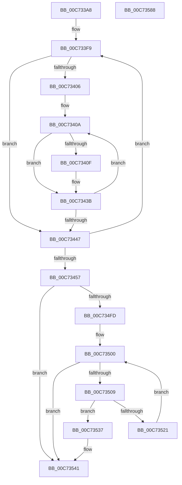

# KiRcuSystemInitialize

- RVA: `0x00C733A8`–`0x00C73589` (길이 `481` bytes)
- VA: `0x0000000140C733A8`
- 실행 섹션: `INIT`
- PDB 이름 있음: `예`; PDB Function 태그: `아니요`
- unwind 정보 RVA: `0x00075C18`
- 디코드: `123`개 명령, `481/481` bytes 표시
- 미해석 바이트: `0` (있으면 어셈블리에 `.byte`로 보존)

> 이 문서는 커널 이미지의 기계어와 PDB 기호를 분석해 생성했습니다. 4번과 5번은 함수 원형과 자료형을 바이너리 사용 방식에서 추정한 C 해석이며 원본 소스 복구 결과는 아닙니다.

## 1. Dependencies

- 직접 호출 지점: **6**; 고유 호출 대상: **3**
- 직접 호출자로 확인된 함수: **1**
- RIP 상대 이미지 참조: **21**

### Outgoing calls
- `0x00C73510` → [KeAcquireSpinLockRaiseToDpc](../../text/20/KeAcquireSpinLockRaiseToDpc_function_00208470.md) (function, `0x00208470`)
- `0x00C7352D` → [KeReleaseSpinLock](../../text/39/KeReleaseSpinLock_function_00392BA0.md) (function, `0x00392BA0`)
- `0x00C7353C` → [KeReleaseSpinLock](../../text/39/KeReleaseSpinLock_function_00392BA0.md) (function, `0x00392BA0`)
- `0x00C73545` → [KeAcquireSpinLockRaiseToDpc](../../text/20/KeAcquireSpinLockRaiseToDpc_function_00208470.md) (function, `0x00208470`)
- `0x00C73557` → [KeReleaseSpinLock](../../text/39/KeReleaseSpinLock_function_00392BA0.md) (function, `0x00392BA0`)
- `0x00C73566` → [KiSrcuProcessorInitialize](../../text/4F/KiSrcuProcessorInitialize_function_004FA6C4.md) (function, `0x004FA6C4`)

### Direct callers
- [KeInitSystem](KeInitSystem_function_00C71660.md) at `0x00C716F1`

### Static image references
- `0x00C733C7` → RVA `0x00F210C0` (`.data`; write)
- `0x00C733D4` → RVA `0x00F21180` (`.data`; read)
- `0x00C733DE` → RVA `0x00F210C2` (`.data`; read)
- `0x00C733EB` → RVA `0x00F210C8` (`.data`; read)
- `0x00C733F2` → RVA `0x00F210C0` (`.data`; read)
- `0x00C73457` → RVA `0x00F210F0` (`.data`; read)
- `0x00C7345E` → RVA `0x00F21158` (`.data`; write)
- `0x00C73465` → RVA `0x00F210F8` (`.data`; write)
- `0x00C7346C` → RVA `0x00F110C0` (`.data`; read)
- `0x00C73473` → RVA `0x00F210F0` (`.data`; write)
- `0x00C7347C` → RVA `0x005BD2C0` (`KiRcuFlushCompletedWorkerRoutine`; read)
- `0x00C73483` → RVA `0x00F21140` (`.data`; write)
- `0x00C7348A` → RVA `0x00F21150` (`.data`; write)
- `0x00C73491` → RVA `0x005BD2A0` (`KiRcuFlushCompletedDpcRoutine`; read)
- `0x00C73498` → RVA `0x00F21118` (`.data`; write)
- `0x00C7349F` → RVA `0x00F21100` (`.data`; write)
- `0x00C734A9` → RVA `0x00F21120` (`.data`; write)
- `0x00C734B0` → RVA `0x00F21138` (`.data`; write)
- `0x00C734B7` → RVA `0x00F21110` (`.data`; write)
- `0x00C734CC` → RVA `0x00F210C1` (`.data`; read)
- `0x00C734DF` → RVA `0x00F210D0` (`.data`; read)

## 2. Other-region calls and transfers

- 다른 실행 섹션으로 향하는 call: **6**
  - `0x00C73510` → [KeAcquireSpinLockRaiseToDpc](../../text/20/KeAcquireSpinLockRaiseToDpc_function_00208470.md) (`INIT` → `.text`)
  - `0x00C7352D` → [KeReleaseSpinLock](../../text/39/KeReleaseSpinLock_function_00392BA0.md) (`INIT` → `.text`)
  - `0x00C7353C` → [KeReleaseSpinLock](../../text/39/KeReleaseSpinLock_function_00392BA0.md) (`INIT` → `.text`)
  - `0x00C73545` → [KeAcquireSpinLockRaiseToDpc](../../text/20/KeAcquireSpinLockRaiseToDpc_function_00208470.md) (`INIT` → `.text`)
  - `0x00C73557` → [KeReleaseSpinLock](../../text/39/KeReleaseSpinLock_function_00392BA0.md) (`INIT` → `.text`)
  - `0x00C73566` → [KiSrcuProcessorInitialize](../../text/4F/KiSrcuProcessorInitialize_function_004FA6C4.md) (`INIT` → `.text`)
- 별도 외부 분기/꼬리 이동을 확인하지 못했습니다.

## 3. Assembly (complete function range)

```asm
00C733A8  48 89 5C 24 08                  mov qword ptr [rsp + 8], rbx
00C733AD  48 89 6C 24 10                  mov qword ptr [rsp + 0x10], rbp
00C733B2  48 89 74 24 18                  mov qword ptr [rsp + 0x18], rsi
00C733B7  57                              push rdi
00C733B8  41 54                           push r12
00C733BA  41 55                           push r13
00C733BC  41 56                           push r14
00C733BE  41 57                           push r15
00C733C0  48 83 EC 20                     sub rsp, 0x20
00C733C4  45 33 ED                        xor r13d, r13d
00C733C7  C7 05 EF DC 2A 00 20 40 01 20   mov dword ptr [rip + 0x2adcef], 0x20014020
00C733D1  45 8B CD                        mov r9d, r13d
00C733D4  4C 8D 15 A5 DD 2A 00            lea r10, [rip + 0x2adda5]
00C733DB  4C 8B F9                        mov r15, rcx
00C733DE  48 8D 1D DD DC 2A 00            lea rbx, [rip + 0x2adcdd]
00C733E5  41 BC 01 00 00 00               mov r12d, 1
00C733EB  48 8D 3D D6 DC 2A 00            lea rdi, [rip + 0x2adcd6]
00C733F2  4C 8D 35 C7 DC 2A 00            lea r14, [rip + 0x2adcc7]
00C733F9  4C 89 17                        mov qword ptr [rdi], r10
00C733FC  45 8B DD                        mov r11d, r13d
00C733FF  0F B6 33                        movzx esi, byte ptr [rbx]
00C73402  85 F6                           test esi, esi
00C73404  74 41                           je 0x140c73447
00C73406  41 8D 69 FF                     lea ebp, [r9 - 1]
00C7340A  45 85 C9                        test r9d, r9d
00C7340D  74 2C                           je 0x140c7343b
00C7340F  41 0F B6 0C 2E                  movzx ecx, byte ptr [r14 + rbp]
00C73414  33 D2                           xor edx, edx
00C73416  41 8B C3                        mov eax, r11d
00C73419  F7 F1                           div ecx
00C7341B  44 8B C2                        mov r8d, edx
00C7341E  48 8D 14 C0                     lea rdx, [rax + rax*8]
00C73422  49 8B 44 EE 08                  mov rax, qword ptr [r14 + rbp*8 + 8]
00C73427  48 8D 0C D0                     lea rcx, [rax + rdx*8]
00C7342B  49 8B C4                        mov rax, r12
00C7342E  49 89 4A 08                     mov qword ptr [r10 + 8], rcx
00C73432  41 8B C8                        mov ecx, r8d
00C73435  48 D3 E0                        shl rax, cl
00C73438  49 89 02                        mov qword ptr [r10], rax
00C7343B  49 83 C2 48                     add r10, 0x48
00C7343F  45 03 DC                        add r11d, r12d
00C73442  44 3B DE                        cmp r11d, esi
00C73445  72 C3                           jb 0x140c7340a
00C73447  45 03 CC                        add r9d, r12d
00C7344A  48 83 C7 08                     add rdi, 8
00C7344E  49 03 DC                        add rbx, r12
00C73451  41 83 F9 02                     cmp r9d, 2
00C73455  72 A2                           jb 0x140c733f9
00C73457  48 8D 05 92 DC 2A 00            lea rax, [rip + 0x2adc92]
00C7345E  4C 89 2D F3 DC 2A 00            mov qword ptr [rip + 0x2adcf3], r13
00C73465  48 89 05 8C DC 2A 00            mov qword ptr [rip + 0x2adc8c], rax
00C7346C  48 8D 0D 4D DC 29 00            lea rcx, [rip + 0x29dc4d]
00C73473  48 89 05 76 DC 2A 00            mov qword ptr [rip + 0x2adc76], rax
00C7347A  33 D2                           xor edx, edx
00C7347C  48 8D 05 3D 9E 94 FF            lea rax, [rip - 0x6b61c3]
00C73483  4C 89 2D B6 DC 2A 00            mov qword ptr [rip + 0x2adcb6], r13
00C7348A  48 89 05 BF DC 2A 00            mov qword ptr [rip + 0x2adcbf], rax
00C73491  48 8D 05 08 9E 94 FF            lea rax, [rip - 0x6b61f8]
00C73498  48 89 05 79 DC 2A 00            mov qword ptr [rip + 0x2adc79], rax
00C7349F  C7 05 57 DC 2A 00 1A 01 00 00   mov dword ptr [rip + 0x2adc57], 0x11a
00C734A9  4C 89 2D 70 DC 2A 00            mov qword ptr [rip + 0x2adc70], r13
00C734B0  4C 89 2D 81 DC 2A 00            mov qword ptr [rip + 0x2adc81], r13
00C734B7  4C 89 2D 52 DC 2A 00            mov qword ptr [rip + 0x2adc52], r13
00C734BE  41 8B 47 24                     mov eax, dword ptr [r15 + 0x24]
00C734C2  44 8B F0                        mov r14d, eax
00C734C5  49 C1 E6 05                     shl r14, 5
00C734C9  4C 03 F1                        add r14, rcx
00C734CC  0F B6 0D EE DB 2A 00            movzx ecx, byte ptr [rip + 0x2adbee]
00C734D3  F7 F1                           div ecx
00C734D5  4D 89 7E 10                     mov qword ptr [r14 + 0x10], r15
00C734D9  8B CA                           mov ecx, edx
00C734DB  48 8D 14 C0                     lea rdx, [rax + rax*8]
00C734DF  48 8B 05 EA DB 2A 00            mov rax, qword ptr [rip + 0x2adbea]
00C734E6  48 8D 3C D0                     lea rdi, [rax + rdx*8]
00C734EA  49 8B C4                        mov rax, r12
00C734ED  48 D3 E0                        shl rax, cl
00C734F0  49 89 06                        mov qword ptr [r14], rax
00C734F3  49 89 7E 08                     mov qword ptr [r14 + 8], rdi
00C734F7  4C 39 6F 10                     cmp qword ptr [rdi + 0x10], r13
00C734FB  75 44                           jne 0x140c73541
00C734FD  48 8B F7                        mov rsi, rdi
00C73500  48 8B 5E 08                     mov rbx, qword ptr [rsi + 8]
00C73504  48 85 DB                        test rbx, rbx
00C73507  74 38                           je 0x140c73541
00C73509  48 8D 6B 20                     lea rbp, [rbx + 0x20]
00C7350D  48 8B CD                        mov rcx, rbp
00C73510  E8 5B 4F 59 FF                  call 0x140208470
00C73515  48 8B 53 10                     mov rdx, qword ptr [rbx + 0x10]
00C73519  48 8B 0E                        mov rcx, qword ptr [rsi]
00C7351C  48 85 D1                        test rcx, rdx
00C7351F  75 16                           jne 0x140c73537
00C73521  48 0B D1                        or rdx, rcx
00C73524  48 8B CD                        mov rcx, rbp
00C73527  48 89 53 10                     mov qword ptr [rbx + 0x10], rdx
00C7352B  8A D0                           mov dl, al
00C7352D  E8 6E F6 71 FF                  call 0x140392ba0
00C73532  48 8B F3                        mov rsi, rbx
00C73535  EB C9                           jmp 0x140c73500
00C73537  8A D0                           mov dl, al
00C73539  48 8B CD                        mov rcx, rbp
00C7353C  E8 5F F6 71 FF                  call 0x140392ba0
00C73541  48 8D 4F 20                     lea rcx, [rdi + 0x20]
00C73545  E8 26 4F 59 FF                  call 0x140208470
00C7354A  4D 8B 06                        mov r8, qword ptr [r14]
00C7354D  48 8D 4F 20                     lea rcx, [rdi + 0x20]
00C73551  4C 09 47 10                     or qword ptr [rdi + 0x10], r8
00C73555  8A D0                           mov dl, al
00C73557  E8 44 F6 71 FF                  call 0x140392ba0
00C7355C  45 09 66 18                     or dword ptr [r14 + 0x18], r12d
00C73560  41 8B D4                        mov edx, r12d
00C73563  49 8B CF                        mov rcx, r15
00C73566  E8 59 71 88 FF                  call 0x1404fa6c4
00C7356B  48 8B 5C 24 50                  mov rbx, qword ptr [rsp + 0x50]
00C73570  48 8B 6C 24 58                  mov rbp, qword ptr [rsp + 0x58]
00C73575  48 8B 74 24 60                  mov rsi, qword ptr [rsp + 0x60]
00C7357A  48 83 C4 20                     add rsp, 0x20
00C7357E  41 5F                           pop r15
00C73580  41 5E                           pop r14
00C73582  41 5D                           pop r13
00C73584  41 5C                           pop r12
00C73586  5F                              pop rdi
00C73587  C3                              ret
00C73588  CC                              int3
```

## 4. C-style interpretation (structured pseudocode)

```c
__int64 __fastcall KiRcuSystemInitialize(__int64 a1, int a2)
{
    __int64 result;
    __int64 v_r10;
    __int64 v_r11;
    __int64 v_r13;
    __int64 v_r14;
    __int64 v_rbx;
    __int64 v_rdi;
    __int64 v_rsp;
    unsigned __int64 v_stack_p10;
    unsigned __int64 v_stack_p18;
    unsigned __int64 v_stack_p8;

    v_stack_p8 = v_rbx;
    v_stack_p10 = v_rbp;
    v_stack_p18 = v_rsi;
    v_rsp = (v_rsp) - (32);
    v_r13 = 0;
    *(unsigned int *)(v_rip + 2809071) = 0x20014020ULL;
loc_00C733F9:
    *(unsigned __int64 *)(v_rip + 2809046) = v_rip + 2809253;
    if ((unsigned int)(*(unsigned __int8 *)(v_rip + 2809053)) == 0) goto loc_00C73447;
loc_00C7340A:
    if (0 != 0) {
        a1 = *(unsigned __int8 *)(v_rip + 2809031 + 0 - 1 * 1);
        a2 = 0;
        result = 0;
        a3 = 0;
        a2 = result + result * 8;
        result = *(unsigned __int64 *)(v_rip + 2809031 + 0 - 1 * 8 + 8);
        a1 = result + a2 * 8;
        result = 1;
        *(unsigned __int64 *)(v_rip + 2809253 + 8) = a1;
        a1 = (unsigned int)(a3);
        result = (result) << ((unsigned __int8)(a1));
        *(unsigned __int64 *)(v_rip + 2809253) = result;
    }
    v_r10 = (v_rip + 2809253) + (72);
    v_r11 = (unsigned int)((0) + (1));
    if (((unsigned int)(v_r11)) < ((unsigned int)(*(unsigned __int8 *)(v_rip + 2809053)))) goto loc_00C7340A;
loc_00C73447:
    a4 = (unsigned int)((0) + (1));
    v_rdi = (v_rip + 2809046) + (8);
    v_rbx = (v_rip + 2809053) + (1);
    if (((unsigned int)(a4)) < 2) goto loc_00C733F9;
    *(unsigned __int64 *)(v_rip + 2809075) = 0;
    *(unsigned __int64 *)(v_rip + 2808972) = v_rip + 2808978;
    *(unsigned __int64 *)(v_rip + 2808950) = v_rip + 2808978;
    a2 = 0;
    *(unsigned __int64 *)(v_rip + 2809014) = 0;
    *(unsigned __int64 *)(v_rip + 2809023) = v_rip - 7037379;
    *(unsigned __int64 *)(v_rip + 2808953) = v_rip - 7037432;
    *(unsigned int *)(v_rip + 2808919) = 282;
    *(unsigned __int64 *)(v_rip + 2808944) = 0;
    *(unsigned __int64 *)(v_rip + 2808961) = 0;
    *(unsigned __int64 *)(v_rip + 2808914) = 0;
    v_r14 = ((unsigned int)((unsigned int)((unsigned int)(*(unsigned int *)(a1 + 36))))) << (5);
    v_r14 = (v_r14) + (v_rip + 2743373);
    *(unsigned __int64 *)(v_r14 + 16) = a1;
    result = (1) << (0);
    *(unsigned __int64 *)(v_r14) = result;
    *(unsigned __int64 *)(v_r14 + 8) = *(unsigned __int64 *)(v_rip + 2808810) + (unsigned int)(*(unsigned int *)(a1 + 36)) + (unsigned int)(*(unsigned int *)(a1 + 36)) * 8 * 8;
    if ((*(unsigned __int64 *)(*(unsigned __int64 *)(v_rip + 2808810) + (unsigned int)(*(unsigned int *)(a1 + 36)) + (unsigned int)(*(unsigned int *)(a1 + 36)) * 8 * 8 + 16)) != 0) goto loc_00C73541;
loc_00C73500:
    if (*(unsigned __int64 *)(*(unsigned __int64 *)(v_rip + 2808810) + (unsigned int)(*(unsigned int *)(a1 + 36)) + (unsigned int)(*(unsigned int *)(a1 + 36)) * 8 * 8 + 8) == 0) goto loc_00C73541;
    result = KeAcquireSpinLockRaiseToDpc(*(unsigned __int64 *)(*(unsigned __int64 *)(v_rip + 2808810) + (unsigned int)(*(unsigned int *)(a1 + 36)) + (unsigned int)(*(unsigned int *)(a1 + 36)) * 8 * 8 + 8) + 32, (unsigned int)(*(unsigned int *)(a1 + 36)) + (unsigned int)(*(unsigned int *)(a1 + 36)) * 8, a3, a4);
    if (((*(unsigned __int64 *)(*(unsigned __int64 *)(v_rip + 2808810) + (unsigned int)(*(unsigned int *)(a1 + 36)) + (unsigned int)(*(unsigned int *)(a1 + 36)) * 8 * 8)) & (*(unsigned __int64 *)(*(unsigned __int64 *)(*(unsigned __int64 *)(v_rip + 2808810) + (unsigned int)(*(unsigned int *)(a1 + 36)) + (unsigned int)(*(unsigned int *)(a1 + 36)) * 8 * 8 + 8) + 16))) != 0) goto loc_00C73537;
    a2 = (*(unsigned __int64 *)(*(unsigned __int64 *)(*(unsigned __int64 *)(v_rip + 2808810) + (unsigned int)(*(unsigned int *)(a1 + 36)) + (unsigned int)(*(unsigned int *)(a1 + 36)) * 8 * 8 + 8) + 16)) | (*(unsigned __int64 *)(*(unsigned __int64 *)(v_rip + 2808810) + (unsigned int)(*(unsigned int *)(a1 + 36)) + (unsigned int)(*(unsigned int *)(a1 + 36)) * 8 * 8));
    *(unsigned __int64 *)(*(unsigned __int64 *)(*(unsigned __int64 *)(v_rip + 2808810) + (unsigned int)(*(unsigned int *)(a1 + 36)) + (unsigned int)(*(unsigned int *)(a1 + 36)) * 8 * 8 + 8) + 16) = a2;
    result = KeReleaseSpinLock(*(unsigned __int64 *)(*(unsigned __int64 *)(v_rip + 2808810) + (unsigned int)(*(unsigned int *)(a1 + 36)) + (unsigned int)(*(unsigned int *)(a1 + 36)) * 8 * 8 + 8) + 32, (unsigned __int8)(result), a3, a4);
    goto loc_00C73500;
loc_00C73537:
    result = KeReleaseSpinLock(*(unsigned __int64 *)(*(unsigned __int64 *)(v_rip + 2808810) + (unsigned int)(*(unsigned int *)(a1 + 36)) + (unsigned int)(*(unsigned int *)(a1 + 36)) * 8 * 8 + 8) + 32, (unsigned __int8)(result), a3, a4);
loc_00C73541:
    result = KeAcquireSpinLockRaiseToDpc(*(unsigned __int64 *)(v_rip + 2808810) + (unsigned int)(*(unsigned int *)(a1 + 36)) + (unsigned int)(*(unsigned int *)(a1 + 36)) * 8 * 8 + 32, (unsigned __int8)(result), a3, a4);
    result = KeReleaseSpinLock(*(unsigned __int64 *)(v_rip + 2808810) + (unsigned int)(*(unsigned int *)(a1 + 36)) + (unsigned int)(*(unsigned int *)(a1 + 36)) * 8 * 8 + 32, (unsigned __int8)(result), *(unsigned __int64 *)(v_r14), a4);
    result = KiSrcuProcessorInitialize(a1, 1, *(unsigned __int64 *)(v_r14), a4);
    v_rsp = (v_rsp) + (32);
    return result;
}
```

## 5. (Beta) C Style

```c
int64_t KiRcuSystemInitialize(void *Arg1, int32_t Arg2)
{
    uint8_t *arg1 = (uint8_t *)Arg1;

    int64_t result;
    int64_t local_r10;
    int64_t local_r11;
    int64_t local_r13;
    int64_t local_r14;
    int64_t local_rbx;
    int64_t local_rdi;
    int64_t local_rsp;
    uint64_t v_stack_p10;
    uint64_t v_stack_p18;
    uint64_t v_stack_p8;

    v_stack_p8 = local_rbx;
    v_stack_p10 = local_rbp;
    v_stack_p18 = local_rsi;
    local_rsp = (local_rsp) - (32);
    local_r13 = 0;
    *(uint32_t *)(v_rip + 0x2ADCEF) = 0x20014020ULL;
loc_00C733F9:
    *(uint64_t *)(v_rip + 0x2ADCD6) = v_rip + 2809253;
    if ((uint32_t)(*(uint8_t *)(v_rip + 0x2ADCDD)) == 0) goto loc_00C73447;
loc_00C7340A:
    if (0 != 0) {
        Arg1 = *(uint8_t *)(v_rip + 0x2ADCC7 + 0x0 - 0x1 * 1);
        Arg2 = 0;
        result = 0;
        a3 = 0;
        Arg2 = result + result * 8;
        result = *(uint64_t *)(v_rip + 0x2ADCC7 + 0x0 - 0x1 * 8 + 0x8);
        Arg1 = result + Arg2 * 8;
        result = 1;
        *(void **)(v_rip + 0x2ADDA5 + 0x8) = Arg1;
        Arg1 = (uint32_t)(a3);
        result = (result) << ((uint8_t)(Arg1));
        *(uint64_t *)(v_rip + 0x2ADDA5) = result;
    }
    local_r10 = (v_rip + 2809253) + (72);
    local_r11 = (uint32_t)((0) + (1));
    if (((uint32_t)(local_r11)) < ((uint32_t)(*(uint8_t *)(v_rip + 0x2ADCDD)))) goto loc_00C7340A;
loc_00C73447:
    a4 = (uint32_t)((0) + (1));
    local_rdi = (v_rip + 2809046) + (8);
    local_rbx = (v_rip + 2809053) + (1);
    if (((uint32_t)(a4)) < 2) goto loc_00C733F9;
    *(uint64_t *)(v_rip + 0x2ADCF3) = 0;
    *(uint64_t *)(v_rip + 0x2ADC8C) = v_rip + 2808978;
    *(uint64_t *)(v_rip + 0x2ADC76) = v_rip + 2808978;
    Arg2 = 0;
    *(uint64_t *)(v_rip + 0x2ADCB6) = 0;
    *(uint64_t *)(v_rip + 0x2ADCBF) = v_rip - 7037379;
    *(uint64_t *)(v_rip + 0x2ADC79) = v_rip - 7037432;
    *(uint32_t *)(v_rip + 0x2ADC57) = 282;
    *(uint64_t *)(v_rip + 0x2ADC70) = 0;
    *(uint64_t *)(v_rip + 0x2ADC81) = 0;
    *(uint64_t *)(v_rip + 0x2ADC52) = 0;
    local_r14 = ((uint32_t)((uint32_t)((uint32_t)(*(uint32_t *)(arg1 + 0x24))))) << (5);
    local_r14 = (local_r14) + (v_rip + 2743373);
    *(void **)(local_r14 + 0x10) = Arg1;
    result = (1) << (0);
    *(uint64_t *)(local_r14) = result;
    *(uint64_t *)(local_r14 + 0x8) = *(uint64_t *)(v_rip + 0x2ADBEA) + (uint32_t)(*(uint32_t *)(arg1 + 0x24)) + (uint32_t)(*(uint32_t *)(arg1 + 0x24)) * 8 * 8;
    if ((*(uint64_t *)(*(uint64_t *)(v_rip + 0x2ADBEA) + (uint32_t)(*(uint32_t *)(arg1 + 0x24)) + (uint32_t)(*(uint32_t *)(arg1 + 0x24)) * 8 * 8 + 0x10)) != 0) goto loc_00C73541;
loc_00C73500:
    if (*(uint64_t *)(*(uint64_t *)(v_rip + 0x2ADBEA) + (uint32_t)(*(uint32_t *)(arg1 + 0x24)) + (uint32_t)(*(uint32_t *)(arg1 + 0x24)) * 8 * 8 + 0x8) == 0) goto loc_00C73541;
    result = KeAcquireSpinLockRaiseToDpc(*(uint64_t *)(*(uint64_t *)(v_rip + 0x2ADBEA) + (uint32_t)(*(uint32_t *)(arg1 + 0x24)) + (uint32_t)(*(uint32_t *)(arg1 + 0x24)) * 8 * 8 + 0x8) + 32, (uint32_t)(*(uint32_t *)(arg1 + 0x24)) + (uint32_t)(*(uint32_t *)(arg1 + 0x24)) * 8, a3, a4);
    if (((*(uint64_t *)(*(uint64_t *)(v_rip + 0x2ADBEA) + (uint32_t)(*(uint32_t *)(arg1 + 0x24)) + (uint32_t)(*(uint32_t *)(arg1 + 0x24)) * 8 * 8)) & (*(uint64_t *)(*(uint64_t *)(*(uint64_t *)(v_rip + 0x2ADBEA) + (uint32_t)(*(uint32_t *)(arg1 + 0x24)) + (uint32_t)(*(uint32_t *)(arg1 + 0x24)) * 8 * 8 + 0x8) + 0x10))) != 0) goto loc_00C73537;
    Arg2 = (*(uint64_t *)(*(uint64_t *)(*(uint64_t *)(v_rip + 0x2ADBEA) + (uint32_t)(*(uint32_t *)(arg1 + 0x24)) + (uint32_t)(*(uint32_t *)(arg1 + 0x24)) * 8 * 8 + 0x8) + 0x10)) | (*(uint64_t *)(*(uint64_t *)(v_rip + 0x2ADBEA) + (uint32_t)(*(uint32_t *)(arg1 + 0x24)) + (uint32_t)(*(uint32_t *)(arg1 + 0x24)) * 8 * 8));
    *(uint64_t *)(*(uint64_t *)(*(uint64_t *)(v_rip + 0x2ADBEA) + (uint32_t)(*(uint32_t *)(arg1 + 0x24)) + (uint32_t)(*(uint32_t *)(arg1 + 0x24)) * 8 * 8 + 0x8) + 0x10) = Arg2;
    result = KeReleaseSpinLock(*(uint64_t *)(*(uint64_t *)(v_rip + 0x2ADBEA) + (uint32_t)(*(uint32_t *)(arg1 + 0x24)) + (uint32_t)(*(uint32_t *)(arg1 + 0x24)) * 8 * 8 + 0x8) + 32, (uint8_t)(result), a3, a4);
    goto loc_00C73500;
loc_00C73537:
    result = KeReleaseSpinLock(*(uint64_t *)(*(uint64_t *)(v_rip + 0x2ADBEA) + (uint32_t)(*(uint32_t *)(arg1 + 0x24)) + (uint32_t)(*(uint32_t *)(arg1 + 0x24)) * 8 * 8 + 0x8) + 32, (uint8_t)(result), a3, a4);
loc_00C73541:
    result = KeAcquireSpinLockRaiseToDpc(*(uint64_t *)(v_rip + 0x2ADBEA) + (uint32_t)(*(uint32_t *)(arg1 + 0x24)) + (uint32_t)(*(uint32_t *)(arg1 + 0x24)) * 8 * 8 + 32, (uint8_t)(result), a3, a4);
    result = KeReleaseSpinLock(*(uint64_t *)(v_rip + 0x2ADBEA) + (uint32_t)(*(uint32_t *)(arg1 + 0x24)) + (uint32_t)(*(uint32_t *)(arg1 + 0x24)) * 8 * 8 + 32, (uint8_t)(result), *(uint64_t *)(local_r14), a4);
    result = KiSrcuProcessorInitialize(Arg1, 1, *(uint64_t *)(local_r14), a4);
    local_rsp = (local_rsp) + (32);
    return result;
}
```

### 관측된 메모리 오프셋

구조체 형식이 확인되지 않은 접근은 인자 기준의 오프셋으로만 기록했습니다.

| 기준 인자 | 오프셋 표현 | 폭 (bit) | 접근 |
|---|---:|---:|---|
| `Arg1` | `+ 0x24` | `32` | `R` |

## 6. Execution-region graph

[열기: 2D/3D 그래프와 함수 탐색 컨트롤 패널](../../../control-panel.html?section=init&rva=0x00C733A8&view=graph)

- 2D 그래프는 위에서 아래로 흐르고, 3D 그래프는 빈 공간을 드래그해 회전합니다. Shift+드래그는 이동, 휠은 확대·축소, 함수 노드 선택은 대상 보고서 이동입니다.

### Static fallback


