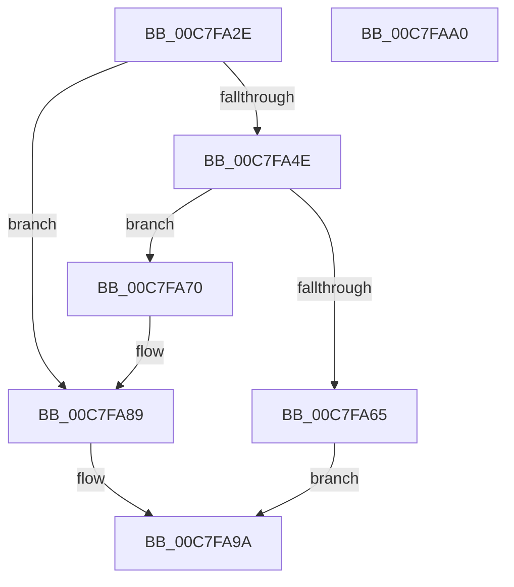

# KiVerifyXcpt10$fin$9

- RVA: `0x00C7FA2E`–`0x00C7FAA1` (길이 `115` bytes)
- VA: `0x0000000140C7FA2E`
- 실행 섹션: `INIT`
- PDB 이름 있음: `예`; PDB Function 태그: `예`
- unwind 정보 RVA: `0x000CAEEC`
- 디코드: `38`개 명령, `115/115` bytes 표시
- 미해석 바이트: `0` (있으면 어셈블리에 `.byte`로 보존)

> 이 문서는 커널 이미지의 기계어와 PDB 기호를 분석해 생성했습니다. 4번과 5번은 함수 원형과 자료형을 바이너리 사용 방식에서 추정한 C 해석이며 원본 소스 복구 결과는 아닙니다.

## 1. Dependencies

- 직접 호출 지점: **3**; 고유 호출 대상: **2**
- 직접 호출자로 확인된 함수: **0**
- RIP 상대 이미지 참조: **2**

### Outgoing calls
- `0x00C7FA73` → [KiVerifyXcptFilter](../C3/KiVerifyXcptFilter_function_00C3ADD0.md) (function, `0x00C3ADD0`)
- `0x00C7FA83` → [local_unwind](../../text/4F/local_unwind_function_004FFB40.md) (function, `0x004FFB40`)
- `0x00C7FA94` → [local_unwind](../../text/4F/local_unwind_function_004FFB40.md) (function, `0x004FFB40`)

### Direct callers
- 이 함수 시작 RVA로 연결되는 직접 call은 확인되지 않았습니다. 간접 호출은 완전히 역산할 수 없습니다.

### Static image references
- `0x00C7FA78` → RVA `0x00C3A940` (`INIT`; read)
- `0x00C7FA89` → RVA `0x00C3A951` (`INIT`; read)

## 2. Other-region calls and transfers

- 다른 실행 섹션으로 향하는 call: **2**
  - `0x00C7FA83` → [local_unwind](../../text/4F/local_unwind_function_004FFB40.md) (`INIT` → `.text`)
  - `0x00C7FA94` → [local_unwind](../../text/4F/local_unwind_function_004FFB40.md) (`INIT` → `.text`)
- 별도 외부 분기/꼬리 이동을 확인하지 못했습니다.

## 3. Assembly (complete function range)

```asm
00C7FA2E  40 55                           push rbp
00C7FA30  48 83 EC 20                     sub rsp, 0x20
00C7FA34  48 8B EA                        mov rbp, rdx
00C7FA37  48 89 6C 24 38                  mov qword ptr [rsp + 0x38], rbp
00C7FA3C  48 8B 55 40                     mov rdx, qword ptr [rbp + 0x40]
00C7FA40  8B 42 0C                        mov eax, dword ptr [rdx + 0xc]
00C7FA43  83 C0 0B                        add eax, 0xb
00C7FA46  89 42 0C                        mov dword ptr [rdx + 0xc], eax
00C7FA49  83 F8 63                        cmp eax, 0x63
00C7FA4C  75 3B                           jne 0x140c7fa89
00C7FA4E  48 8B 02                        mov rax, qword ptr [rdx]
00C7FA51  8B 08                           mov ecx, dword ptr [rax]
00C7FA53  FF C1                           inc ecx
00C7FA55  89 08                           mov dword ptr [rax], ecx
00C7FA57  8B 42 0C                        mov eax, dword ptr [rdx + 0xc]
00C7FA5A  83 C0 0B                        add eax, 0xb
00C7FA5D  89 42 0C                        mov dword ptr [rdx + 0xc], eax
00C7FA60  83 F8 63                        cmp eax, 0x63
00C7FA63  75 0B                           jne 0x140c7fa70
00C7FA65  48 8B 02                        mov rax, qword ptr [rdx]
00C7FA68  8B 08                           mov ecx, dword ptr [rax]
00C7FA6A  FF C1                           inc ecx
00C7FA6C  89 08                           mov dword ptr [rax], ecx
00C7FA6E  EB 2A                           jmp 0x140c7fa9a
00C7FA70  48 8B CA                        mov rcx, rdx
00C7FA73  E8 58 B3 FB FF                  call 0x140c3add0
00C7FA78  48 8D 15 C1 AE FB FF            lea rdx, [rip - 0x4513f]
00C7FA7F  48 8B 4D 20                     mov rcx, qword ptr [rbp + 0x20]
00C7FA83  E8 B8 00 88 FF                  call 0x1404ffb40
00C7FA88  90                              nop
00C7FA89  48 8D 15 C1 AE FB FF            lea rdx, [rip - 0x4513f]
00C7FA90  48 8B 4D 20                     mov rcx, qword ptr [rbp + 0x20]
00C7FA94  E8 A7 00 88 FF                  call 0x1404ffb40
00C7FA99  90                              nop
00C7FA9A  48 83 C4 20                     add rsp, 0x20
00C7FA9E  5D                              pop rbp
00C7FA9F  C3                              ret
00C7FAA0  CC                              int3
```

## 4. C-style interpretation (structured pseudocode)

```c
__int64 __fastcall KiVerifyXcpt10_fin_9(__int64 a1, __int64 a2)
{
    __int64 result;
    __int64 v_rsp;
    unsigned __int64 v_stack_p10;

    v_rsp = (v_rsp) - (32);
    v_stack_p10 = a2;
    result = (unsigned int)(((unsigned int)(*(unsigned int *)(*(unsigned __int64 *)(a2 + 64) + 12))) + (11));
    *(unsigned int *)(*(unsigned __int64 *)(a2 + 64) + 12) = (unsigned int)(result);
    if (((unsigned int)(result)) != 99) goto loc_00C7FA89;
    a1 = (unsigned int)(((unsigned int)(*(unsigned int *)(*(unsigned __int64 *)(*(unsigned __int64 *)(a2 + 64))))) + 1);
    *(unsigned int *)(*(unsigned __int64 *)(*(unsigned __int64 *)(a2 + 64))) = (unsigned int)(a1);
    result = (unsigned int)(((unsigned int)(*(unsigned int *)(*(unsigned __int64 *)(a2 + 64) + 12))) + (11));
    *(unsigned int *)(*(unsigned __int64 *)(a2 + 64) + 12) = (unsigned int)(result);
    if (((unsigned int)(result)) != 99) goto loc_00C7FA70;
    a1 = (unsigned int)(((unsigned int)(*(unsigned int *)(*(unsigned __int64 *)(*(unsigned __int64 *)(a2 + 64))))) + 1);
    *(unsigned int *)(*(unsigned __int64 *)(*(unsigned __int64 *)(a2 + 64))) = (unsigned int)(a1);
    goto loc_00C7FA9A;
loc_00C7FA70:
    result = KiVerifyXcptFilter(*(unsigned __int64 *)(a2 + 64), *(unsigned __int64 *)(a2 + 64), a3, a4);
    result = local_unwind(*(unsigned __int64 *)(a2 + 32), v_rip - 282943, a3, a4);
loc_00C7FA89:
    result = local_unwind(*(unsigned __int64 *)(a2 + 32), v_rip - 282943, a3, a4);
loc_00C7FA9A:
    v_rsp = (v_rsp) + (32);
    return result;
}
```

## 5. (Beta) C Style

```c
int64_t KiVerifyXcpt10_fin_9(int64_t Arg1, void *Arg2)
{
    uint8_t *arg2 = (uint8_t *)Arg2;

    int64_t result;
    int64_t local_rsp;
    uint64_t v_stack_p10;

    local_rsp = (local_rsp) - (32);
    v_stack_p10 = Arg2;
    result = (uint32_t)(((uint32_t)(*(uint32_t *)(*(uint64_t *)(arg2 + 0x40) + 0xC))) + (11));
    *(uint32_t *)(*(uint64_t *)(arg2 + 0x40) + 0xC) = (uint32_t)(result);
    if (((uint32_t)(result)) != 99) goto loc_00C7FA89;
    Arg1 = (uint32_t)(((uint32_t)(*(uint32_t *)(*(uint64_t *)(*(uint64_t *)(arg2 + 0x40))))) + 1);
    *(uint32_t *)(*(uint64_t *)(*(uint64_t *)(arg2 + 0x40))) = (uint32_t)(Arg1);
    result = (uint32_t)(((uint32_t)(*(uint32_t *)(*(uint64_t *)(arg2 + 0x40) + 0xC))) + (11));
    *(uint32_t *)(*(uint64_t *)(arg2 + 0x40) + 0xC) = (uint32_t)(result);
    if (((uint32_t)(result)) != 99) goto loc_00C7FA70;
    Arg1 = (uint32_t)(((uint32_t)(*(uint32_t *)(*(uint64_t *)(*(uint64_t *)(arg2 + 0x40))))) + 1);
    *(uint32_t *)(*(uint64_t *)(*(uint64_t *)(arg2 + 0x40))) = (uint32_t)(Arg1);
    goto loc_00C7FA9A;
loc_00C7FA70:
    result = KiVerifyXcptFilter(*(uint64_t *)(arg2 + 0x40), *(uint64_t *)(arg2 + 0x40), a3, a4);
    result = local_unwind(*(uint64_t *)(arg2 + 0x20), v_rip - 282943, a3, a4);
loc_00C7FA89:
    result = local_unwind(*(uint64_t *)(arg2 + 0x20), v_rip - 282943, a3, a4);
loc_00C7FA9A:
    local_rsp = (local_rsp) + (32);
    return result;
}
```

### 관측된 메모리 오프셋

구조체 형식이 확인되지 않은 접근은 인자 기준의 오프셋으로만 기록했습니다.

| 기준 인자 | 오프셋 표현 | 폭 (bit) | 접근 |
|---|---:|---:|---|
| `Arg2` | `+ 0x20` | `64` | `R` |
| `Arg2` | `+ 0x40` | `64` | `R` |

## 6. Execution-region graph

[열기: 2D/3D 그래프와 함수 탐색 컨트롤 패널](../../../control-panel.html?section=init&rva=0x00C7FA2E&view=graph)

- 2D 그래프는 위에서 아래로 흐르고, 3D 그래프는 빈 공간을 드래그해 회전합니다. Shift+드래그는 이동, 휠은 확대·축소, 함수 노드 선택은 대상 보고서 이동입니다.

### Static fallback


