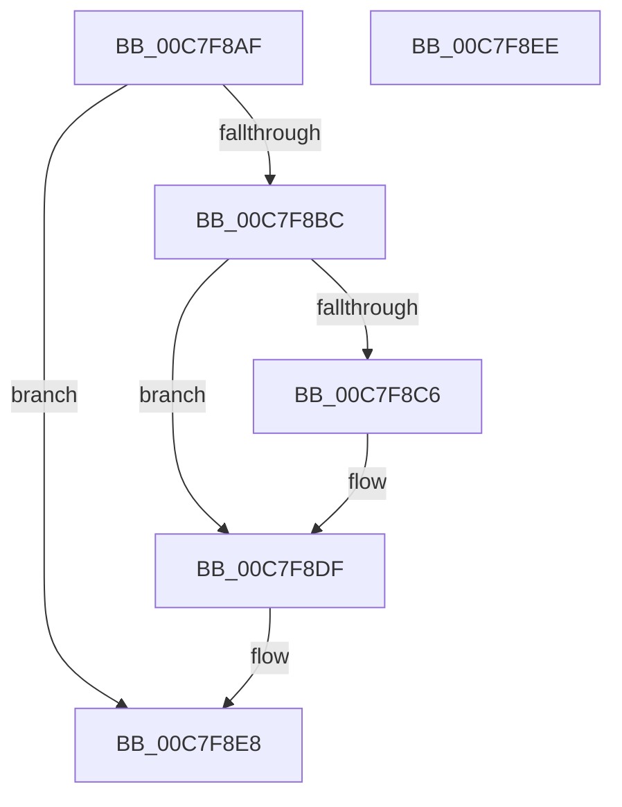

# KiVerifyXcpt1$fin$0

- RVA: `0x00C7F8AF`–`0x00C7F8EF` (길이 `64` bytes)
- VA: `0x0000000140C7F8AF`
- 실행 섹션: `INIT`
- PDB 이름 있음: `예`; PDB Function 태그: `예`
- unwind 정보 RVA: `0x000BF6EC`
- 디코드: `22`개 명령, `64/64` bytes 표시
- 미해석 바이트: `0` (있으면 어셈블리에 `.byte`로 보존)

> 이 문서는 커널 이미지의 기계어와 PDB 기호를 분석해 생성했습니다. 4번과 5번은 함수 원형과 자료형을 바이너리 사용 방식에서 추정한 C 해석이며 원본 소스 복구 결과는 아닙니다.

## 1. Dependencies

- 직접 호출 지점: **2**; 고유 호출 대상: **2**
- 직접 호출자로 확인된 함수: **0**
- RIP 상대 이미지 참조: **1**

### Outgoing calls
- `0x00C7F8C9` → [KiVerifyXcptFilter](../C3/KiVerifyXcptFilter_function_00C3ADD0.md) (function, `0x00C3ADD0`)
- `0x00C7F8D9` → [local_unwind](../../text/4F/local_unwind_function_004FFB40.md) (function, `0x004FFB40`)

### Direct callers
- 이 함수 시작 RVA로 연결되는 직접 call은 확인되지 않았습니다. 간접 호출은 완전히 역산할 수 없습니다.

### Static image references
- `0x00C7F8CE` → RVA `0x00C3A7F1` (`INIT`; read)

## 2. Other-region calls and transfers

- 다른 실행 섹션으로 향하는 call: **1**
  - `0x00C7F8D9` → [local_unwind](../../text/4F/local_unwind_function_004FFB40.md) (`INIT` → `.text`)
- 별도 외부 분기/꼬리 이동을 확인하지 못했습니다.

## 3. Assembly (complete function range)

```asm
00C7F8AF  40 55                           push rbp
00C7F8B1  48 83 EC 20                     sub rsp, 0x20
00C7F8B5  48 8B EA                        mov rbp, rdx
00C7F8B8  84 C9                           test cl, cl
00C7F8BA  74 2C                           je 0x140c7f8e8
00C7F8BC  48 8B 55 40                     mov rdx, qword ptr [rbp + 0x40]
00C7F8C0  83 7A 0C 02                     cmp dword ptr [rdx + 0xc], 2
00C7F8C4  75 19                           jne 0x140c7f8df
00C7F8C6  48 8B CA                        mov rcx, rdx
00C7F8C9  E8 02 B5 FB FF                  call 0x140c3add0
00C7F8CE  48 8D 15 1C AF FB FF            lea rdx, [rip - 0x450e4]
00C7F8D5  48 8B 4D 20                     mov rcx, qword ptr [rbp + 0x20]
00C7F8D9  E8 62 02 88 FF                  call 0x1404ffb40
00C7F8DE  90                              nop
00C7F8DF  48 8B 02                        mov rax, qword ptr [rdx]
00C7F8E2  8B 08                           mov ecx, dword ptr [rax]
00C7F8E4  FF C1                           inc ecx
00C7F8E6  89 08                           mov dword ptr [rax], ecx
00C7F8E8  48 83 C4 20                     add rsp, 0x20
00C7F8EC  5D                              pop rbp
00C7F8ED  C3                              ret
00C7F8EE  CC                              int3
```

## 4. C-style interpretation (structured pseudocode)

```c
__int64 __fastcall KiVerifyXcpt1_fin_0(unsigned __int8 a1, __int64 a2)
{
    __int64 result;
    __int64 v_rsp;

    v_rsp = (v_rsp) - (32);
    if (a1 == 0) goto loc_00C7F8E8;
    if ((*(unsigned int *)(*(unsigned __int64 *)(a2 + 64) + 12)) == 2) {
        a1 = *(unsigned __int64 *)(a2 + 64);
        result = KiVerifyXcptFilter(a1, *(unsigned __int64 *)(a2 + 64), a3, a4);
        a2 = v_rip - 282852;
        a1 = *(unsigned __int64 *)(a2 + 32);
        result = local_unwind(a1, a2, a3, a4);
    }
    a1 = (unsigned int)(((unsigned int)(*(unsigned int *)(*(unsigned __int64 *)(a2)))) + 1);
    *(unsigned int *)(*(unsigned __int64 *)(a2)) = a1;
loc_00C7F8E8:
    v_rsp = (v_rsp) + (32);
    return *(unsigned __int64 *)(a2);
}
```

## 5. (Beta) C Style

```c
int64_t KiVerifyXcpt1_fin_0(uint8_t Arg1, void *Arg2)
{
    uint8_t *arg2 = (uint8_t *)Arg2;

    int64_t result;
    int64_t local_rsp;

    local_rsp = (local_rsp) - (32);
    if (Arg1 == 0) goto loc_00C7F8E8;
    if ((*(uint32_t *)(*(uint64_t *)(arg2 + 0x40) + 0xC)) == 2) {
        Arg1 = *(uint64_t *)(arg2 + 0x40);
        result = KiVerifyXcptFilter(Arg1, *(uint64_t *)(arg2 + 0x40), a3, a4);
        Arg2 = v_rip - 282852;
        Arg1 = *(uint64_t *)(arg2 + 0x20);
        result = local_unwind(Arg1, Arg2, a3, a4);
    }
    Arg1 = (uint32_t)(((uint32_t)(*(uint32_t *)(*(uint64_t *)(arg2)))) + 1);
    *(uint32_t *)(*(uint64_t *)(arg2)) = Arg1;
loc_00C7F8E8:
    local_rsp = (local_rsp) + (32);
    return *(uint64_t *)(arg2);
}
```

### 관측된 메모리 오프셋

구조체 형식이 확인되지 않은 접근은 인자 기준의 오프셋으로만 기록했습니다.

| 기준 인자 | 오프셋 표현 | 폭 (bit) | 접근 |
|---|---:|---:|---|
| `Arg2` | `+ 0x20` | `64` | `R` |
| `Arg2` | `+ 0x40` | `64` | `R` |

## 6. Execution-region graph

[열기: 2D/3D 그래프와 함수 탐색 컨트롤 패널](../../../control-panel.html?section=init&rva=0x00C7F8AF&view=graph)

- 2D 그래프는 위에서 아래로 흐르고, 3D 그래프는 빈 공간을 드래그해 회전합니다. Shift+드래그는 이동, 휠은 확대·축소, 함수 노드 선택은 대상 보고서 이동입니다.

### Static fallback


