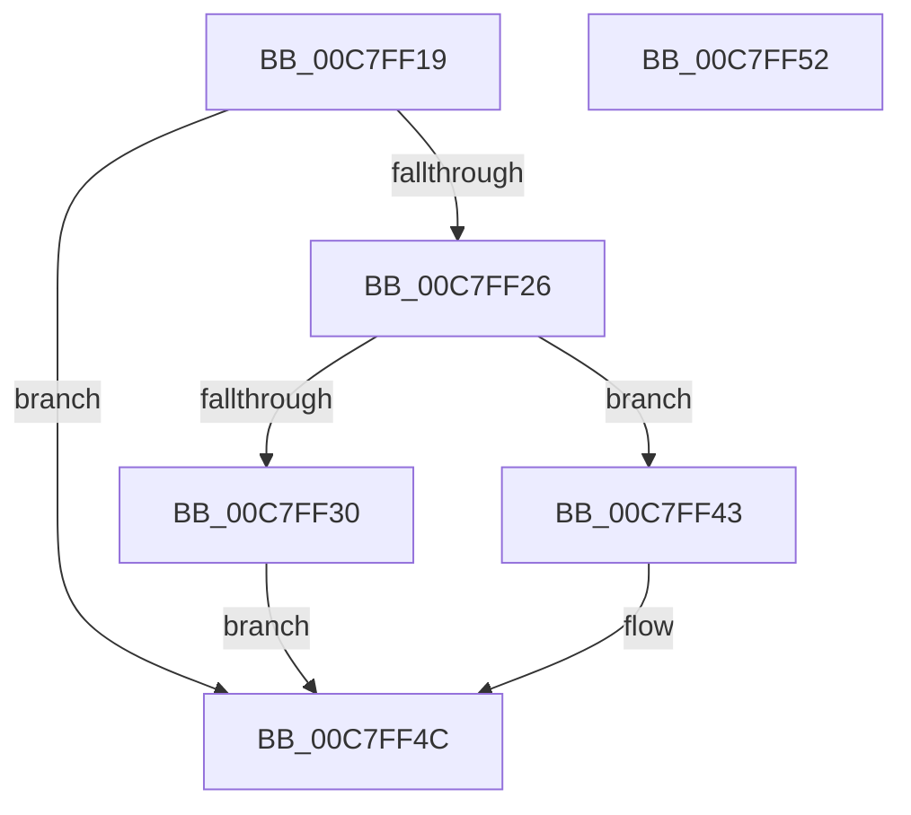

# KiVerifyXcpt3$fin$1

- RVA: `0x00C7FF19`–`0x00C7FF53` (길이 `58` bytes)
- VA: `0x0000000140C7FF19`
- 실행 섹션: `INIT`
- PDB 이름 있음: `예`; PDB Function 태그: `예`
- unwind 정보 RVA: `0x000BF6EC`
- 디코드: `22`개 명령, `58/58` bytes 표시
- 미해석 바이트: `0` (있으면 어셈블리에 `.byte`로 보존)

> 이 문서는 커널 이미지의 기계어와 PDB 기호를 분석해 생성했습니다. 4번과 5번은 함수 원형과 자료형을 바이너리 사용 방식에서 추정한 C 해석이며 원본 소스 복구 결과는 아닙니다.

## 1. Dependencies

- 직접 호출 지점: **1**; 고유 호출 대상: **1**
- 직접 호출자로 확인된 함수: **0**
- RIP 상대 이미지 참조: **0**

### Outgoing calls
- `0x00C7FF3C` → [KiVerifyXcptFilter](../C3/KiVerifyXcptFilter_function_00C3ADD0.md) (function, `0x00C3ADD0`)

### Direct callers
- 이 함수 시작 RVA로 연결되는 직접 call은 확인되지 않았습니다. 간접 호출은 완전히 역산할 수 없습니다.

### Static image references
- 디코드된 RIP-relative 메모리 참조가 없습니다.

## 2. Other-region calls and transfers

- 다른 실행 섹션으로 향하는 call: **0**
- 별도 외부 분기/꼬리 이동을 확인하지 못했습니다.

## 3. Assembly (complete function range)

```asm
00C7FF19  40 55                           push rbp
00C7FF1B  48 83 EC 20                     sub rsp, 0x20
00C7FF1F  48 8B EA                        mov rbp, rdx
00C7FF22  84 C9                           test cl, cl
00C7FF24  74 26                           je 0x140c7ff4c
00C7FF26  48 8B 55 40                     mov rdx, qword ptr [rbp + 0x40]
00C7FF2A  83 7A 0C 08                     cmp dword ptr [rdx + 0xc], 8
00C7FF2E  75 13                           jne 0x140c7ff43
00C7FF30  8B 42 0C                        mov eax, dword ptr [rdx + 0xc]
00C7FF33  83 C0 04                        add eax, 4
00C7FF36  89 42 0C                        mov dword ptr [rdx + 0xc], eax
00C7FF39  48 8B CA                        mov rcx, rdx
00C7FF3C  E8 8F AE FB FF                  call 0x140c3add0
00C7FF41  EB 09                           jmp 0x140c7ff4c
00C7FF43  48 8B 02                        mov rax, qword ptr [rdx]
00C7FF46  8B 08                           mov ecx, dword ptr [rax]
00C7FF48  FF C1                           inc ecx
00C7FF4A  89 08                           mov dword ptr [rax], ecx
00C7FF4C  48 83 C4 20                     add rsp, 0x20
00C7FF50  5D                              pop rbp
00C7FF51  C3                              ret
00C7FF52  CC                              int3
```

## 4. C-style interpretation (structured pseudocode)

```c
__int64 __fastcall KiVerifyXcpt3_fin_1(unsigned __int8 a1, __int64 a2)
{
    __int64 result;
    __int64 v_rsp;

    v_rsp = (v_rsp) - (32);
    if (a1 == 0) goto loc_00C7FF4C;
    if ((*(unsigned int *)(*(unsigned __int64 *)(a2 + 64) + 12)) != 8) goto loc_00C7FF43;
    result = (unsigned int)(((unsigned int)(*(unsigned int *)(*(unsigned __int64 *)(a2 + 64) + 12))) + (4));
    *(unsigned int *)(*(unsigned __int64 *)(a2 + 64) + 12) = (unsigned int)(result);
    result = KiVerifyXcptFilter(*(unsigned __int64 *)(a2 + 64), *(unsigned __int64 *)(a2 + 64), a3, a4);
    goto loc_00C7FF4C;
loc_00C7FF43:
    a1 = (unsigned int)(((unsigned int)(*(unsigned int *)(*(unsigned __int64 *)(*(unsigned __int64 *)(a2 + 64))))) + 1);
    *(unsigned int *)(*(unsigned __int64 *)(*(unsigned __int64 *)(a2 + 64))) = a1;
loc_00C7FF4C:
    v_rsp = (v_rsp) + (32);
    return *(unsigned __int64 *)(*(unsigned __int64 *)(a2 + 64));
}
```

## 5. (Beta) C Style

```c
int64_t KiVerifyXcpt3_fin_1(uint8_t Arg1, void *Arg2)
{
    uint8_t *arg2 = (uint8_t *)Arg2;

    int64_t result;
    int64_t local_rsp;

    local_rsp = (local_rsp) - (32);
    if (Arg1 == 0) goto loc_00C7FF4C;
    if ((*(uint32_t *)(*(uint64_t *)(arg2 + 0x40) + 0xC)) != 8) goto loc_00C7FF43;
    result = (uint32_t)(((uint32_t)(*(uint32_t *)(*(uint64_t *)(arg2 + 0x40) + 0xC))) + (4));
    *(uint32_t *)(*(uint64_t *)(arg2 + 0x40) + 0xC) = (uint32_t)(result);
    result = KiVerifyXcptFilter(*(uint64_t *)(arg2 + 0x40), *(uint64_t *)(arg2 + 0x40), a3, a4);
    goto loc_00C7FF4C;
loc_00C7FF43:
    Arg1 = (uint32_t)(((uint32_t)(*(uint32_t *)(*(uint64_t *)(*(uint64_t *)(arg2 + 0x40))))) + 1);
    *(uint32_t *)(*(uint64_t *)(*(uint64_t *)(arg2 + 0x40))) = Arg1;
loc_00C7FF4C:
    local_rsp = (local_rsp) + (32);
    return *(uint64_t *)(*(uint64_t *)(arg2 + 0x40));
}
```

### 관측된 메모리 오프셋

구조체 형식이 확인되지 않은 접근은 인자 기준의 오프셋으로만 기록했습니다.

| 기준 인자 | 오프셋 표현 | 폭 (bit) | 접근 |
|---|---:|---:|---|
| `Arg2` | `+ 0x40` | `64` | `R` |

## 6. Execution-region graph

[열기: 2D/3D 그래프와 함수 탐색 컨트롤 패널](../../../control-panel.html?section=init&rva=0x00C7FF19&view=graph)

- 2D 그래프는 위에서 아래로 흐르고, 3D 그래프는 빈 공간을 드래그해 회전합니다. Shift+드래그는 이동, 휠은 확대·축소, 함수 노드 선택은 대상 보고서 이동입니다.

### Static fallback


