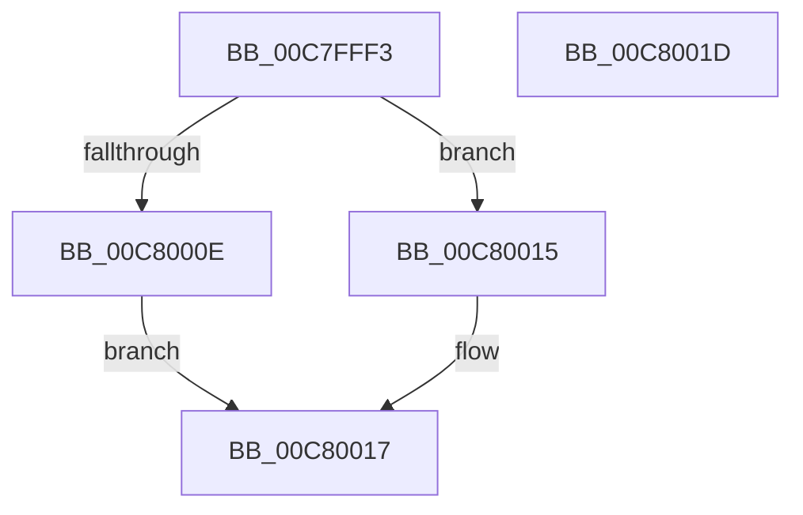

# KiVerifyXcpt4$filt$2

- RVA: `0x00C7FFF3`–`0x00C8001E` (길이 `43` bytes)
- VA: `0x0000000140C7FFF3`
- 실행 섹션: `INIT`
- PDB 이름 있음: `예`; PDB Function 태그: `예`
- unwind 정보 RVA: `0x000BF6EC`
- 디코드: `16`개 명령, `43/43` bytes 표시
- 미해석 바이트: `0` (있으면 어셈블리에 `.byte`로 보존)

> 이 문서는 커널 이미지의 기계어와 PDB 기호를 분석해 생성했습니다. 4번과 5번은 함수 원형과 자료형을 바이너리 사용 방식에서 추정한 C 해석이며 원본 소스 복구 결과는 아닙니다.

## 1. Dependencies

- 직접 호출 지점: **1**; 고유 호출 대상: **1**
- 직접 호출자로 확인된 함수: **0**
- RIP 상대 이미지 참조: **0**

### Outgoing calls
- `0x00C8000E` → [KiVerifyXcptFilter](../C3/KiVerifyXcptFilter_function_00C3ADD0.md) (function, `0x00C3ADD0`)

### Direct callers
- 이 함수 시작 RVA로 연결되는 직접 call은 확인되지 않았습니다. 간접 호출은 완전히 역산할 수 없습니다.

### Static image references
- 디코드된 RIP-relative 메모리 참조가 없습니다.

## 2. Other-region calls and transfers

- 다른 실행 섹션으로 향하는 call: **0**
- 별도 외부 분기/꼬리 이동을 확인하지 못했습니다.

## 3. Assembly (complete function range)

```asm
00C7FFF3  40 55                           push rbp
00C7FFF5  48 83 EC 20                     sub rsp, 0x20
00C7FFF9  48 8B EA                        mov rbp, rdx
00C7FFFC  48 8B 4D 40                     mov rcx, qword ptr [rbp + 0x40]
00C80000  8B 41 0C                        mov eax, dword ptr [rcx + 0xc]
00C80003  83 C0 05                        add eax, 5
00C80006  89 41 0C                        mov dword ptr [rcx + 0xc], eax
00C80009  83 F8 05                        cmp eax, 5
00C8000C  75 07                           jne 0x140c80015
00C8000E  E8 BD AD FB FF                  call 0x140c3add0
00C80013  EB 02                           jmp 0x140c80017
00C80015  33 C0                           xor eax, eax
00C80017  48 83 C4 20                     add rsp, 0x20
00C8001B  5D                              pop rbp
00C8001C  C3                              ret
00C8001D  CC                              int3
```

## 4. C-style interpretation (structured pseudocode)

```c
__int64 __fastcall KiVerifyXcpt4_filt_2(__int64 a1, __int64 a2)
{
    __int64 result;
    __int64 v_rsp;

    v_rsp = (v_rsp) - (32);
    result = (unsigned int)(((unsigned int)(*(unsigned int *)(*(unsigned __int64 *)(a2 + 64) + 12))) + (5));
    *(unsigned int *)(*(unsigned __int64 *)(a2 + 64) + 12) = (unsigned int)(result);
    if (((unsigned int)(result)) != 5) goto loc_00C80015;
    result = KiVerifyXcptFilter(*(unsigned __int64 *)(a2 + 64), a2, a3, a4);
    goto loc_00C80017;
loc_00C80015:
    result = 0;
loc_00C80017:
    v_rsp = (v_rsp) + (32);
    return result;
}
```

## 5. (Beta) C Style

```c
int64_t KiVerifyXcpt4_filt_2(int64_t Arg1, void *Arg2)
{
    uint8_t *arg2 = (uint8_t *)Arg2;

    int64_t result;
    int64_t local_rsp;

    local_rsp = (local_rsp) - (32);
    result = (uint32_t)(((uint32_t)(*(uint32_t *)(*(uint64_t *)(arg2 + 0x40) + 0xC))) + (5));
    *(uint32_t *)(*(uint64_t *)(arg2 + 0x40) + 0xC) = (uint32_t)(result);
    if (((uint32_t)(result)) != 5) goto loc_00C80015;
    result = KiVerifyXcptFilter(*(uint64_t *)(arg2 + 0x40), Arg2, a3, a4);
    goto loc_00C80017;
loc_00C80015:
    result = 0;
loc_00C80017:
    local_rsp = (local_rsp) + (32);
    return result;
}
```

### 관측된 메모리 오프셋

구조체 형식이 확인되지 않은 접근은 인자 기준의 오프셋으로만 기록했습니다.

| 기준 인자 | 오프셋 표현 | 폭 (bit) | 접근 |
|---|---:|---:|---|
| `Arg2` | `+ 0x40` | `64` | `R` |

## 6. Execution-region graph

[열기: 2D/3D 그래프와 함수 탐색 컨트롤 패널](../../../control-panel.html?section=init&rva=0x00C7FFF3&view=graph)

- 2D 그래프는 위에서 아래로 흐르고, 3D 그래프는 빈 공간을 드래그해 회전합니다. Shift+드래그는 이동, 휠은 확대·축소, 함수 노드 선택은 대상 보고서 이동입니다.

### Static fallback


