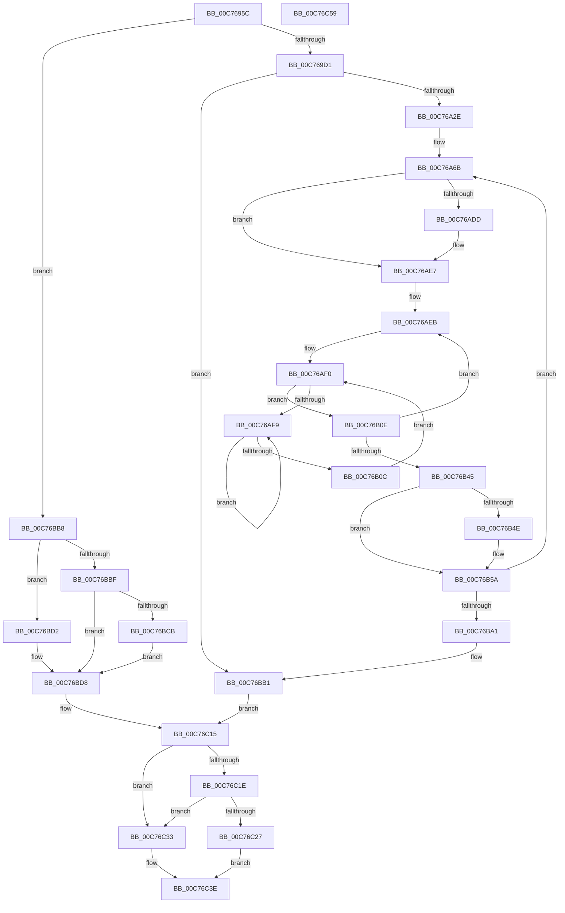

# MiFreeBootDriverPages

- RVA: `0x00C7695C`–`0x00C76C5A` (길이 `766` bytes)
- VA: `0x0000000140C7695C`
- 실행 섹션: `INIT`
- PDB 이름 있음: `예`; PDB Function 태그: `아니요`
- unwind 정보 RVA: `0x000BDFB8`
- 디코드: `183`개 명령, `766/766` bytes 표시
- 미해석 바이트: `0` (있으면 어셈블리에 `.byte`로 보존)

> 이 문서는 커널 이미지의 기계어와 PDB 기호를 분석해 생성했습니다. 4번과 5번은 함수 원형과 자료형을 바이너리 사용 방식에서 추정한 C 해석이며 원본 소스 복구 결과는 아닙니다.

## 1. Dependencies

- 직접 호출 지점: **14**; 고유 호출 대상: **14**
- 직접 호출자로 확인된 함수: **2**
- RIP 상대 이미지 참조: **8**

### Outgoing calls
- `0x00C769C4` → [MI_IS_PHYSICAL_ADDRESS](../../text/23/MI_IS_PHYSICAL_ADDRESS_function_0023B3A0.md) (function, `0x0023B3A0`)
- `0x00C769D1` → [MiGetProcessorFlushList](../../text/24/MiGetProcessorFlushList_function_00242C90.md) (function, `0x00242C90`)
- `0x00C769FA` → [MiInitializeTbFlushList](../../text/29/MiInitializeTbFlushList_function_00294F00.md) (function, `0x00294F00`)
- `0x00C76AB4` → [MiInsertLargeTbFlushEntry](../../text/37/MiInsertLargeTbFlushEntry_function_0037827C.md) (function, `0x0037827C`)
- `0x00C76ABC` → [MiFlushTbList](../../text/31/MiFlushTbList_function_00311FC0.md) (function, `0x00311FC0`)
- `0x00C76AE2` → [KiRaiseIrqlProcessIrqlFlags](../../text/4F/KiRaiseIrqlProcessIrqlFlags_function_004F56FC.md) (function, `0x004F56FC`)
- `0x00C76AFE` → [KeYieldProcessorEx](../../text/3F/KeYieldProcessorEx_function_003FBD00.md) (function, `0x003FBD00`)
- `0x00C76B55` → [KiLowerIrqlProcessIrqlFlags](../../text/4F/KiLowerIrqlProcessIrqlFlags_function_004F5698.md) (function, `0x004F5698`)
- `0x00C76B6C` → [MiFreeLargePageMemory](../../text/37/MiFreeLargePageMemory_function_00377938.md) (function, `0x00377938`)
- `0x00C76B7B` → [MiLockAndDecrementShareCount](../../text/2A/MiLockAndDecrementShareCount_function_002A2854.md) (function, `0x002A2854`)
- `0x00C76BB1` → [MiReleaseProcessorFlushList](../../text/31/MiReleaseProcessorFlushList_function_00313C70.md) (function, `0x00313C70`)
- `0x00C76BCB` → [MiSectionControlArea](../../text/29/MiSectionControlArea_function_00294CB0.md) (function, `0x00294CB0`)
- `0x00C76BFF` → [MiDecommitPages](../../text/24/MiDecommitPages_function_00241BD0.md) (function, `0x00241BD0`)
- `0x00C76C10` → [MiUnmapReturnCharges](../../page/AA/MiUnmapReturnCharges_function_00AA6C40.md) (function, `0x00AA6C40`)

### Direct callers
- [MiFreeInitializationCode](../../page/7F/MiFreeInitializationCode_function_007F88A0.md) at `0x007F8B52`
- [MiHandleBootImage](../C6/MiHandleBootImage_function_00C6B854.md) at `0x00C6B963`

### Static image references
- `0x00C769E4` → RVA `0x00E37E40` (`.data`; read)
- `0x00C76A6E` → RVA `0x00010880` (`.rdata`; read)
- `0x00C76AD4` → RVA `0x00FC6D20` (`ALMOSTRO`; read)
- `0x00C76C09` → RVA `0x00E38D00` (`.data`; read)
- `0x00C76C15` → RVA `0x00FC6B28` (`ALMOSTRO`; read)
- `0x00C76C1E` → RVA `0x00FC6B98` (`ALMOSTRO`; read)
- `0x00C76C29` → RVA `0x00E376F0` (`.data`; read/write)
- `0x00C76C36` → RVA `0x00E376D8` (`.data`; read/write)

## 2. Other-region calls and transfers

- 다른 실행 섹션으로 향하는 call: **14**
  - `0x00C769C4` → [MI_IS_PHYSICAL_ADDRESS](../../text/23/MI_IS_PHYSICAL_ADDRESS_function_0023B3A0.md) (`INIT` → `.text`)
  - `0x00C769D1` → [MiGetProcessorFlushList](../../text/24/MiGetProcessorFlushList_function_00242C90.md) (`INIT` → `.text`)
  - `0x00C769FA` → [MiInitializeTbFlushList](../../text/29/MiInitializeTbFlushList_function_00294F00.md) (`INIT` → `.text`)
  - `0x00C76AB4` → [MiInsertLargeTbFlushEntry](../../text/37/MiInsertLargeTbFlushEntry_function_0037827C.md) (`INIT` → `.text`)
  - `0x00C76ABC` → [MiFlushTbList](../../text/31/MiFlushTbList_function_00311FC0.md) (`INIT` → `.text`)
  - `0x00C76AE2` → [KiRaiseIrqlProcessIrqlFlags](../../text/4F/KiRaiseIrqlProcessIrqlFlags_function_004F56FC.md) (`INIT` → `.text`)
  - `0x00C76AFE` → [KeYieldProcessorEx](../../text/3F/KeYieldProcessorEx_function_003FBD00.md) (`INIT` → `.text`)
  - `0x00C76B55` → [KiLowerIrqlProcessIrqlFlags](../../text/4F/KiLowerIrqlProcessIrqlFlags_function_004F5698.md) (`INIT` → `.text`)
  - `0x00C76B6C` → [MiFreeLargePageMemory](../../text/37/MiFreeLargePageMemory_function_00377938.md) (`INIT` → `.text`)
  - `0x00C76B7B` → [MiLockAndDecrementShareCount](../../text/2A/MiLockAndDecrementShareCount_function_002A2854.md) (`INIT` → `.text`)
  - `0x00C76BB1` → [MiReleaseProcessorFlushList](../../text/31/MiReleaseProcessorFlushList_function_00313C70.md) (`INIT` → `.text`)
  - `0x00C76BCB` → [MiSectionControlArea](../../text/29/MiSectionControlArea_function_00294CB0.md) (`INIT` → `.text`)
  - `0x00C76BFF` → [MiDecommitPages](../../text/24/MiDecommitPages_function_00241BD0.md) (`INIT` → `.text`)
  - `0x00C76C10` → [MiUnmapReturnCharges](../../page/AA/MiUnmapReturnCharges_function_00AA6C40.md) (`INIT` → `PAGE`)
- 별도 외부 분기/꼬리 이동을 확인하지 못했습니다.

## 3. Assembly (complete function range)

```asm
00C7695C  4C 8B DC                        mov r11, rsp
00C7695F  49 89 5B 08                     mov qword ptr [r11 + 8], rbx
00C76963  49 89 53 10                     mov qword ptr [r11 + 0x10], rdx
00C76967  55                              push rbp
00C76968  56                              push rsi
00C76969  57                              push rdi
00C7696A  41 54                           push r12
00C7696C  41 55                           push r13
00C7696E  41 56                           push r14
00C76970  41 57                           push r15
00C76972  48 81 EC A0 00 00 00            sub rsp, 0xa0
00C76979  0F 57 C0                        xorps xmm0, xmm0
00C7697C  49 BE 00 00 00 00 80 F6 FF FF   movabs r14, 0xfffff68000000000
00C76986  48 8B F1                        mov rsi, rcx
00C76989  49 8D 69 FF                     lea rbp, [r9 - 1]
00C7698D  0F 11 44 24 60                  movups xmmword ptr [rsp + 0x60], xmm0
00C76992  49 8B C8                        mov rcx, r8
00C76995  33 C0                           xor eax, eax
00C76997  0F 11 44 24 70                  movups xmmword ptr [rsp + 0x70], xmm0
00C7699C  49 89 43 B8                     mov qword ptr [r11 - 0x48], rax
00C769A0  49 8B D9                        mov rbx, r9
00C769A3  41 0F 11 43 A8                  movups xmmword ptr [r11 - 0x58], xmm0
00C769A8  48 C1 E1 19                     shl rcx, 0x19
00C769AC  49 8D 2C E8                     lea rbp, [r8 + rbp*8]
00C769B0  49 8B F8                        mov rdi, r8
00C769B3  4C 8B FA                        mov r15, rdx
00C769B6  49 8B C6                        mov rax, r14
00C769B9  48 C1 E0 19                     shl rax, 0x19
00C769BD  48 2B C8                        sub rcx, rax
00C769C0  48 C1 F9 10                     sar rcx, 0x10
00C769C4  E8 D7 49 5C FF                  call 0x14023b3a0
00C769C9  85 C0                           test eax, eax
00C769CB  0F 84 E7 01 00 00               je 0x140c76bb8
00C769D1  E8 BA C2 5C FF                  call 0x140242c90
00C769D6  41 B9 08 00 00 00               mov r9d, 8
00C769DC  48 89 84 24 F0 00 00 00         mov qword ptr [rsp + 0xf0], rax
00C769E4  48 8D 15 55 14 1C 00            lea rdx, [rip + 0x1c1455]
00C769EB  C7 44 24 20 01 00 00 00         mov dword ptr [rsp + 0x20], 1
00C769F3  48 8B C8                        mov rcx, rax
00C769F6  44 8B 40 0C                     mov r8d, dword ptr [rax + 0xc]
00C769FA  E8 01 E5 61 FF                  call 0x140294f00
00C769FF  48 C1 EF 09                     shr rdi, 9
00C76A03  48 B9 F8 FF FF FF 7F 00 00 00   movabs rcx, 0x7ffffffff8
00C76A0D  48 23 F9                        and rdi, rcx
00C76A10  49 8B C6                        mov rax, r14
00C76A13  48 C1 ED 09                     shr rbp, 9
00C76A17  48 03 F8                        add rdi, rax
00C76A1A  48 23 E9                        and rbp, rcx
00C76A1D  49 8B C6                        mov rax, r14
00C76A20  48 03 E8                        add rbp, rax
00C76A23  33 DB                           xor ebx, ebx
00C76A25  48 3B FD                        cmp rdi, rbp
00C76A28  0F 87 83 01 00 00               ja 0x140c76bb1
00C76A2E  4C 8B BC 24 F0 00 00 00         mov r15, qword ptr [rsp + 0xf0]
00C76A36  45 8D 71 FE                     lea r14d, [r9 - 2]
00C76A3A  48 8B DD                        mov rbx, rbp
00C76A3D  48 BA 00 00 00 00 00 DE FF FF   movabs rdx, 0xffffde0000000000
00C76A47  48 2B DF                        sub rbx, rdi
00C76A4A  49 B8 FF FF FF FF FF 00 00 00   movabs r8, 0xffffffffff
00C76A54  48 C1 EB 03                     shr rbx, 3
00C76A58  48 FF C3                        inc rbx
00C76A5B  48 C1 E3 09                     shl rbx, 9
00C76A5F  48 89 9C 24 F8 00 00 00         mov qword ptr [rsp + 0xf8], rbx
00C76A67  41 8D 59 F9                     lea ebx, [r9 - 7]
00C76A6B  48 8B 0F                        mov rcx, qword ptr [rdi]
00C76A6E  48 8B 05 0B 9E 39 FF            mov rax, qword ptr [rip - 0xc661f5]
00C76A75  48 C1 E9 0C                     shr rcx, 0xc
00C76A79  49 23 C8                        and rcx, r8
00C76A7C  48 89 07                        mov qword ptr [rdi], rax
00C76A7F  48 89 4C 24 48                  mov qword ptr [rsp + 0x48], rcx
00C76A84  48 8D 34 49                     lea rsi, [rcx + rcx*2]
00C76A88  48 C1 E6 04                     shl rsi, 4
00C76A8C  48 8B C2                        mov rax, rdx
00C76A8F  48 03 F0                        add rsi, rax
00C76A92  48 8B 46 28                     mov rax, qword ptr [rsi + 0x28]
00C76A96  49 23 C0                        and rax, r8
00C76A99  48 8D 0C 40                     lea rcx, [rax + rax*2]
00C76A9D  48 C1 E1 04                     shl rcx, 4
00C76AA1  48 8B C2                        mov rax, rdx
00C76AA4  48 03 C8                        add rcx, rax
00C76AA7  4C 8B C7                        mov r8, rdi
00C76AAA  48 89 4C 24 50                  mov qword ptr [rsp + 0x50], rcx
00C76AAF  8B D3                           mov edx, ebx
00C76AB1  49 8B CF                        mov rcx, r15
00C76AB4  E8 C3 17 70 FF                  call 0x14037827c
00C76AB9  49 8B CF                        mov rcx, r15
00C76ABC  E8 FF B4 69 FF                  call 0x140311fc0
00C76AC1  41 BD 00 02 00 00               mov r13d, 0x200
00C76AC7  45 0F 20 C4                     mov r12, cr8
00C76ACB  B8 02 00 00 00                  mov eax, 2
00C76AD0  44 0F 22 C0                     mov cr8, rax
00C76AD4  83 3D 45 02 35 00 00            cmp dword ptr [rip + 0x350245], 0
00C76ADB  74 0A                           je 0x140c76ae7
00C76ADD  8A D0                           mov dl, al
00C76ADF  41 8A CC                        mov cl, r12b
00C76AE2  E8 15 EC 87 FF                  call 0x1404f56fc
00C76AE7  48 83 C6 23                     add rsi, 0x23
00C76AEB  83 64 24 40 00                  and dword ptr [rsp + 0x40], 0
00C76AF0  F0 48 0F BA 6E F5 3F            lock bts qword ptr [rsi - 0xb], 0x3f
00C76AF7  73 15                           jae 0x140c76b0e
00C76AF9  48 8D 4C 24 40                  lea rcx, [rsp + 0x40]
00C76AFE  E8 FD 51 78 FF                  call 0x1403fbd00
00C76B03  48 8B 46 F5                     mov rax, qword ptr [rsi - 0xb]
00C76B07  48 85 C0                        test rax, rax
00C76B0A  78 ED                           js 0x140c76af9
00C76B0C  EB E2                           jmp 0x140c76af0
00C76B0E  8B 46 FD                        mov eax, dword ptr [rsi - 3]
00C76B11  89 84 24 F0 00 00 00            mov dword ptr [rsp + 0xf0], eax
00C76B18  66 01 9C 24 F0 00 00 00         add word ptr [rsp + 0xf0], bx
00C76B20  8B 84 24 F0 00 00 00            mov eax, dword ptr [rsp + 0xf0]
00C76B27  89 46 FD                        mov dword ptr [rsi - 3], eax
00C76B2A  48 B8 FF FF FF FF FF FF FF 7F   movabs rax, 0x7fffffffffffffff
00C76B34  80 26 F7                        and byte ptr [rsi], 0xf7
00C76B37  F0 48 21 46 F5                  lock and qword ptr [rsi - 0xb], rax
00C76B3C  48 83 C6 30                     add rsi, 0x30
00C76B40  4C 2B EB                        sub r13, rbx
00C76B43  75 A6                           jne 0x140c76aeb
00C76B45  44 39 2D D4 01 35 00            cmp dword ptr [rip + 0x3501d4], r13d
00C76B4C  74 0C                           je 0x140c76b5a
00C76B4E  44 0F 20 C1                     mov rcx, cr8
00C76B52  41 8A D4                        mov dl, r12b
00C76B55  E8 3E EB 87 FF                  call 0x1404f5698
00C76B5A  41 0F B6 C4                     movzx eax, r12b
00C76B5E  44 0F 22 C0                     mov cr8, rax
00C76B62  48 8B 4C 24 48                  mov rcx, qword ptr [rsp + 0x48]
00C76B67  45 8B C6                        mov r8d, r14d
00C76B6A  8B D3                           mov edx, ebx
00C76B6C  E8 C7 0D 70 FF                  call 0x140377938
00C76B71  48 8B 4C 24 50                  mov rcx, qword ptr [rsp + 0x50]
00C76B76  BA 04 00 00 00                  mov edx, 4
00C76B7B  E8 D4 BC 62 FF                  call 0x1402a2854
00C76B80  48 83 C7 08                     add rdi, 8
00C76B84  48 BA 00 00 00 00 00 DE FF FF   movabs rdx, 0xffffde0000000000
00C76B8E  49 B8 FF FF FF FF FF 00 00 00   movabs r8, 0xffffffffff
00C76B98  48 3B FD                        cmp rdi, rbp
00C76B9B  0F 86 CA FE FF FF               jbe 0x140c76a6b
00C76BA1  48 8B 9C 24 F8 00 00 00         mov rbx, qword ptr [rsp + 0xf8]
00C76BA9  4C 8B BC 24 E8 00 00 00         mov r15, qword ptr [rsp + 0xe8]
00C76BB1  E8 BA D0 69 FF                  call 0x140313c70
00C76BB6  EB 5D                           jmp 0x140c76c15
00C76BB8  33 C0                           xor eax, eax
00C76BBA  48 85 F6                        test rsi, rsi
00C76BBD  74 13                           je 0x140c76bd2
00C76BBF  48 8B 4E 70                     mov rcx, qword ptr [rsi + 0x70]
00C76BC3  45 33 F6                        xor r14d, r14d
00C76BC6  48 85 C9                        test rcx, rcx
00C76BC9  74 0D                           je 0x140c76bd8
00C76BCB  E8 E0 E0 61 FF                  call 0x140294cb0
00C76BD0  EB 06                           jmp 0x140c76bd8
00C76BD2  41 BE 06 00 00 00               mov r14d, 6
00C76BD8  48 8D 4C 24 60                  lea rcx, [rsp + 0x60]
00C76BDD  45 33 C9                        xor r9d, r9d
00C76BE0  48 89 4C 24 38                  mov qword ptr [rsp + 0x38], rcx
00C76BE5  4C 8B C0                        mov r8, rax
00C76BE8  48 83 64 24 30 00               and qword ptr [rsp + 0x30], 0
00C76BEE  48 8B D3                        mov rdx, rbx
00C76BF1  44 89 74 24 28                  mov dword ptr [rsp + 0x28], r14d
00C76BF6  48 8B CF                        mov rcx, rdi
00C76BF9  48 83 64 24 20 00               and qword ptr [rsp + 0x20], 0
00C76BFF  E8 CC AF 5C FF                  call 0x140241bd0
00C76C04  48 8D 54 24 60                  lea rdx, [rsp + 0x60]
00C76C09  48 8D 0D F0 20 1C 00            lea rcx, [rip + 0x1c20f0]
00C76C10  E8 2B 00 E3 FF                  call 0x140aa6c40
00C76C15  4C 3B 3D 0C FF 34 00            cmp r15, qword ptr [rip + 0x34ff0c]
00C76C1C  74 15                           je 0x140c76c33
00C76C1E  4C 3B 3D 73 FF 34 00            cmp r15, qword ptr [rip + 0x34ff73]
00C76C25  74 0C                           je 0x140c76c33
00C76C27  F7 DB                           neg ebx
00C76C29  F0 0F C1 1D BF 0A 1C 00         lock xadd dword ptr [rip + 0x1c0abf], ebx
00C76C31  EB 0B                           jmp 0x140c76c3e
00C76C33  48 F7 DB                        neg rbx
00C76C36  F0 48 01 1D 9A 0A 1C 00         lock add qword ptr [rip + 0x1c0a9a], rbx
00C76C3E  48 8B 9C 24 E0 00 00 00         mov rbx, qword ptr [rsp + 0xe0]
00C76C46  48 81 C4 A0 00 00 00            add rsp, 0xa0
00C76C4D  41 5F                           pop r15
00C76C4F  41 5E                           pop r14
00C76C51  41 5D                           pop r13
00C76C53  41 5C                           pop r12
00C76C55  5F                              pop rdi
00C76C56  5E                              pop rsi
00C76C57  5D                              pop rbp
00C76C58  C3                              ret
00C76C59  CC                              int3
```

## 4. C-style interpretation (structured pseudocode)

```c
__int64 __fastcall MiFreeBootDriverPages(__int64 a1, __int64 a2, __int64 a3, __int64 a4)
{
    __int64 result;
    __int64 v_r13;
    __int64 v_r14;
    __int64 v_rbp;
    __int64 v_rbx;
    __int64 v_rdi;
    __int64 v_rsi;
    __int64 v_rsp;
    unsigned __int64 v_stack_m68;
    unsigned __int64 v_stack_m78;
    unsigned __int64 v_stack_m88;
    unsigned __int64 v_stack_m90;
    unsigned int v_stack_m98;
    unsigned __int64 v_stack_mA0;
    unsigned __int64 v_stack_mA8;
    unsigned int v_stack_mB0;
    unsigned int v_stack_mB8;
    unsigned __int64 v_stack_p10;
    unsigned __int64 v_stack_p18;
    unsigned __int64 v_stack_p20;
    unsigned __int64 v_stack_p8;

    *(unsigned __int64 *)(v_rsp + 8) = v_rbx;
    *(unsigned __int64 *)(v_rsp + 16) = a2;
    v_rsp = (v_rsp) - (160);
    v_stack_m78 = v_xmm0;
    result = 0;
    v_stack_m68 = v_xmm0;
    *(unsigned __int64 *)(v_rsp - 72) = 0;
    *(unsigned __int64 *)(v_rsp - 88) = v_xmm0;
    a1 = (a3) << (25);
    result = (v_r14) << (25);
    a1 = (a1) - (result);
    a1 = (a1) >> (16);
    result = MI_IS_PHYSICAL_ADDRESS(a1, a2, a3, a4);
    if ((unsigned int)(result) == 0) goto loc_00C76BB8;
    result = MiGetProcessorFlushList(a1, a2, a3, a4);
    v_stack_p18 = result;
    v_stack_mB8 = 1;
    result = MiInitializeTbFlushList(result, v_rip + 1840213, (unsigned int)(*(unsigned int *)(result + 12)), 8);
    v_rdi = (a3) >> (9);
    v_rdi = (v_rdi) & (result);
    v_rbp = (a3 + a4 - 1 * 8) >> (9);
    v_rdi = (v_rdi) + (v_r14);
    v_rbp = (v_rbp) & (result);
    v_rbp = (v_rbp) + (v_r14);
    v_rbx = 0;
    if (v_rdi > v_rbp) goto loc_00C76BB1;
    v_rbx = (v_rbp) - (v_rdi);
    v_rbx = (v_rbx) >> (3);
    v_rbx = (v_rbx) + 1;
    v_rbx = (v_rbx) << (9);
    v_stack_p20 = v_rbx;
loc_00C76A6B:
    a1 = (*(unsigned __int64 *)(v_rdi)) >> (12);
    a1 = (a1) & ((unsigned int)(*(unsigned int *)(result + 12)));
    *(unsigned __int64 *)(v_rdi) = *(unsigned __int64 *)(v_rip - 13001205);
    v_stack_m90 = a1;
    v_rsi = (a1 + a1 * 2) << (4);
    v_rsi = (v_rsi) + (v_rip + 1840213);
    result = (*(unsigned __int64 *)(v_rsi + 40)) & ((unsigned int)(*(unsigned int *)(result + 12)));
    a1 = (result + result * 2) << (4);
    a1 = (a1) + (v_rip + 1840213);
    v_stack_m88 = a1;
    result = MiInsertLargeTbFlushEntry(v_stack_p18, (unsigned int)((unsigned int)(8 - 7)), v_rdi, 8);
    result = MiFlushTbList(v_stack_p18, (unsigned int)((unsigned int)(8 - 7)), v_rdi, 8);
    result = 2;
    if ((*(unsigned int *)(v_rip + 3473989)) != 0) {
        a2 = 2;
        a1 = (unsigned __int8)(v_cr8);
        result = KiRaiseIrqlProcessIrqlFlags(a1, a2, v_rdi, 8);
    }
    v_rsi = (v_rsi) + (35);
loc_00C76AEB:
loc_00C76AF0:
    if (condition_is_above_or_equal) goto loc_00C76B0E;
loc_00C76AF9:
    result = KeYieldProcessorEx(v_stack_m98, a2, v_rdi, 8);
    if (sign_flag) goto loc_00C76AF9;
    goto loc_00C76AF0;
loc_00C76B0E:
    v_stack_p18 = (unsigned int)((unsigned int)(*(unsigned int *)(v_rsi - 3)));
    *(unsigned int *)(v_rsi - 3) = (unsigned int)((unsigned int)(v_stack_p18));
    v_rsi = (v_rsi) + (48);
    v_r13 = (512) - (8 - 7);
    if (condition_is_not_equal) goto loc_00C76AEB;
    result = (unsigned int)(v_stack_p18);
    if ((*(unsigned int *)(v_rip + 3473876)) != ((unsigned int)(v_r13))) {
        a1 = 2;
        a2 = (unsigned __int8)(v_cr8);
        result = KiLowerIrqlProcessIrqlFlags(a1, a2, v_rdi, 8);
    }
    result = MiFreeLargePageMemory(v_stack_m90, (unsigned int)((unsigned int)(8 - 7)), (unsigned int)((unsigned int)(8 - 2)), 8);
    result = MiLockAndDecrementShareCount(v_stack_m88, 4, (unsigned int)((unsigned int)(8 - 2)), 8);
    v_rdi = (v_rdi) + (8);
    if (v_rdi <= v_rbp) goto loc_00C76A6B;
loc_00C76BB1:
    result = MiReleaseProcessorFlushList(v_stack_m88, 4, (unsigned int)((unsigned int)(8 - 2)), 8);
    goto loc_00C76C15;
loc_00C76BB8:
    result = 0;
    if (v_rsi == 0) goto loc_00C76BD2;
    v_r14 = 0;
    if (*(unsigned __int64 *)(v_rsi + 112) == 0) goto loc_00C76BD8;
    result = MiSectionControlArea(*(unsigned __int64 *)(v_rsi + 112), 4, (unsigned int)((unsigned int)(8 - 2)), 8);
    goto loc_00C76BD8;
loc_00C76BD2:
loc_00C76BD8:
    a4 = 0;
    v_stack_mA0 = v_stack_m78;
    v_stack_mB0 = 6;
    result = MiDecommitPages(v_rdi, v_stack_p20, result, a4);
    result = MiUnmapReturnCharges(v_rip + 1843440, v_stack_m78, result, a4);
loc_00C76C15:
    if (v_stack_p10 == (*(unsigned __int64 *)(v_rip + 3473164))) goto loc_00C76C33;
    if (v_stack_p10 == (*(unsigned __int64 *)(v_rip + 3473267))) goto loc_00C76C33;
    v_rbx = (unsigned int)(-(v_stack_p20));
    goto loc_00C76C3E;
loc_00C76C33:
    v_rbx = -(v_rbx);
loc_00C76C3E:
    v_rsp = (v_rsp) + (160);
    return result;
}
```

## 5. (Beta) C Style

```c
int64_t MiFreeBootDriverPages(int64_t Arg1, int64_t Arg2, void *Arg3, void *Arg4)
{
    uint8_t *arg3 = (uint8_t *)Arg3;
    uint8_t *arg4 = (uint8_t *)Arg4;

    int64_t result;
    int64_t local_r13;
    int64_t local_r14;
    int64_t local_rbp;
    int64_t local_rbx;
    int64_t local_rdi;
    int64_t local_rsi;
    int64_t local_rsp;
    uint64_t v_stack_m68;
    uint64_t v_stack_m78;
    uint64_t v_stack_m88;
    uint64_t v_stack_m90;
    uint32_t v_stack_m98;
    uint64_t v_stack_mA0;
    uint64_t v_stack_mA8;
    uint32_t v_stack_mB0;
    uint32_t v_stack_mB8;
    uint64_t v_stack_p10;
    uint64_t v_stack_p18;
    uint64_t v_stack_p20;
    uint64_t v_stack_p8;

    *(uint64_t *)(local_rsp + 0x8) = local_rbx;
    *(uint64_t *)(local_rsp + 0x10) = Arg2;
    local_rsp = (local_rsp) - (160);
    v_stack_m78 = v_xmm0;
    result = 0;
    v_stack_m68 = v_xmm0;
    *(uint64_t *)(local_rsp - 0x48) = 0;
    *(uint64_t *)(local_rsp - 0x58) = v_xmm0;
    Arg1 = (Arg3) << (25);
    result = (local_r14) << (25);
    Arg1 = (Arg1) - (result);
    Arg1 = (Arg1) >> (16);
    result = MI_IS_PHYSICAL_ADDRESS(Arg1, Arg2, Arg3, Arg4);
    if ((uint32_t)(result) == 0) goto loc_00C76BB8;
    result = MiGetProcessorFlushList(Arg1, Arg2, Arg3, Arg4);
    v_stack_p18 = result;
    v_stack_mB8 = 1;
    result = MiInitializeTbFlushList(result, v_rip + 1840213, (uint32_t)(*(uint32_t *)(result + 0xC)), 8);
    local_rdi = (Arg3) >> (9);
    local_rdi = (local_rdi) & (result);
    local_rbp = (Arg3 + Arg4 - 1 * 8) >> (9);
    local_rdi = (local_rdi) + (local_r14);
    local_rbp = (local_rbp) & (result);
    local_rbp = (local_rbp) + (local_r14);
    local_rbx = 0;
    if (local_rdi > local_rbp) goto loc_00C76BB1;
    local_rbx = (local_rbp) - (local_rdi);
    local_rbx = (local_rbx) >> (3);
    local_rbx = (local_rbx) + 1;
    local_rbx = (local_rbx) << (9);
    v_stack_p20 = local_rbx;
loc_00C76A6B:
    Arg1 = (*(uint64_t *)(local_rdi)) >> (12);
    Arg1 = (Arg1) & ((uint32_t)(*(uint32_t *)(result + 0xC)));
    *(uint64_t *)(local_rdi) = *(uint64_t *)(v_rip - 0xC661F5);
    v_stack_m90 = Arg1;
    local_rsi = (Arg1 + Arg1 * 2) << (4);
    local_rsi = (local_rsi) + (v_rip + 1840213);
    result = (*(uint64_t *)(local_rsi + 0x28)) & ((uint32_t)(*(uint32_t *)(result + 0xC)));
    Arg1 = (result + result * 2) << (4);
    Arg1 = (Arg1) + (v_rip + 1840213);
    v_stack_m88 = Arg1;
    result = MiInsertLargeTbFlushEntry(v_stack_p18, (uint32_t)((uint32_t)(8 - 7)), local_rdi, 8);
    result = MiFlushTbList(v_stack_p18, (uint32_t)((uint32_t)(8 - 7)), local_rdi, 8);
    result = 2;
    if ((*(uint32_t *)(v_rip + 0x350245)) != 0) {
        Arg2 = 2;
        Arg1 = (uint8_t)(v_cr8);
        result = KiRaiseIrqlProcessIrqlFlags(Arg1, Arg2, local_rdi, 8);
    }
    local_rsi = (local_rsi) + (35);
loc_00C76AEB:
loc_00C76AF0:
    if (condition_is_above_or_equal) goto loc_00C76B0E;
loc_00C76AF9:
    result = KeYieldProcessorEx(v_stack_m98, Arg2, local_rdi, 8);
    if (sign_flag) goto loc_00C76AF9;
    goto loc_00C76AF0;
loc_00C76B0E:
    v_stack_p18 = (uint32_t)((uint32_t)(*(uint32_t *)(local_rsi - 0x3)));
    *(uint32_t *)(local_rsi - 0x3) = (uint32_t)((uint32_t)(v_stack_p18));
    local_rsi = (local_rsi) + (48);
    local_r13 = (512) - (8 - 7);
    if (condition_is_not_equal) goto loc_00C76AEB;
    result = (uint32_t)(v_stack_p18);
    if ((*(uint32_t *)(v_rip + 0x3501D4)) != ((uint32_t)(local_r13))) {
        Arg1 = 2;
        Arg2 = (uint8_t)(v_cr8);
        result = KiLowerIrqlProcessIrqlFlags(Arg1, Arg2, local_rdi, 8);
    }
    result = MiFreeLargePageMemory(v_stack_m90, (uint32_t)((uint32_t)(8 - 7)), (uint32_t)((uint32_t)(8 - 2)), 8);
    result = MiLockAndDecrementShareCount(v_stack_m88, 4, (uint32_t)((uint32_t)(8 - 2)), 8);
    local_rdi = (local_rdi) + (8);
    if (local_rdi <= local_rbp) goto loc_00C76A6B;
loc_00C76BB1:
    result = MiReleaseProcessorFlushList(v_stack_m88, 4, (uint32_t)((uint32_t)(8 - 2)), 8);
    goto loc_00C76C15;
loc_00C76BB8:
    result = 0;
    if (local_rsi == 0) goto loc_00C76BD2;
    local_r14 = 0;
    if (*(uint64_t *)(local_rsi + 0x70) == 0) goto loc_00C76BD8;
    result = MiSectionControlArea(*(uint64_t *)(local_rsi + 0x70), 4, (uint32_t)((uint32_t)(8 - 2)), 8);
    goto loc_00C76BD8;
loc_00C76BD2:
loc_00C76BD8:
    Arg4 = 0;
    v_stack_mA0 = v_stack_m78;
    v_stack_mB0 = 6;
    result = MiDecommitPages(local_rdi, v_stack_p20, result, Arg4);
    result = MiUnmapReturnCharges(v_rip + 1843440, v_stack_m78, result, Arg4);
loc_00C76C15:
    if (v_stack_p10 == (*(uint64_t *)(v_rip + 0x34FF0C))) goto loc_00C76C33;
    if (v_stack_p10 == (*(uint64_t *)(v_rip + 0x34FF73))) goto loc_00C76C33;
    local_rbx = (uint32_t)(-(v_stack_p20));
    goto loc_00C76C3E;
loc_00C76C33:
    local_rbx = -(local_rbx);
loc_00C76C3E:
    local_rsp = (local_rsp) + (160);
    return result;
}
```

### 관측된 메모리 오프셋

구조체 형식이 확인되지 않은 접근은 인자 기준의 오프셋으로만 기록했습니다.

| 기준 인자 | 오프셋 표현 | 폭 (bit) | 접근 |
|---|---:|---:|---|
| `Arg3` | `+ 0x0 + rbp*8` | `64` | `R` |
| `Arg4` | `- 0x1` | `64` | `R` |

## 6. Execution-region graph

[열기: 2D/3D 그래프와 함수 탐색 컨트롤 패널](../../../control-panel.html?section=init&rva=0x00C7695C&view=graph)

- 2D 그래프는 위에서 아래로 흐르고, 3D 그래프는 빈 공간을 드래그해 회전합니다. Shift+드래그는 이동, 휠은 확대·축소, 함수 노드 선택은 대상 보고서 이동입니다.

### Static fallback


