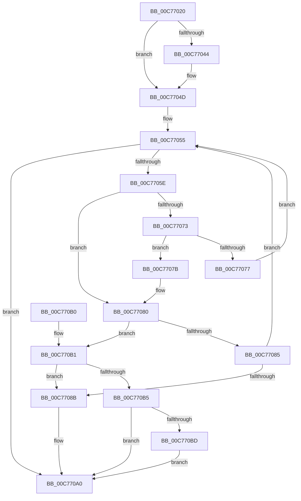

# MiInitializeSystemVa

- RVA: `0x00C77020`–`0x00C770C9` (길이 `169` bytes)
- VA: `0x0000000140C77020`
- 실행 섹션: `INIT`
- PDB 이름 있음: `예`; PDB Function 태그: `아니요`
- unwind 정보 RVA: `0x000684A0`
- 디코드: `47`개 명령, `169/169` bytes 표시
- 미해석 바이트: `0` (있으면 어셈블리에 `.byte`로 보존)

> 이 문서는 커널 이미지의 기계어와 PDB 기호를 분석해 생성했습니다. 4번과 5번은 함수 원형과 자료형을 바이너리 사용 방식에서 추정한 C 해석이며 원본 소스 복구 결과는 아닙니다.

## 1. Dependencies

- 직접 호출 지점: **5**; 고유 호출 대상: **5**
- 직접 호출자로 확인된 함수: **1**
- RIP 상대 이미지 참조: **3**

### Outgoing calls
- `0x00C77055` → [MiInitializeTopLevelBitmap](MiInitializeTopLevelBitmap_function_00C770D0.md) (function, `0x00C770D0`)
- `0x00C7706A` → [MiAssignTopLevelRanges](../C6/MiAssignTopLevelRanges_function_00C65560.md) (function, `0x00C65560`)
- `0x00C7708E` → [MiAssignHalEntropy](../C6/MiAssignHalEntropy_function_00C65344.md) (function, `0x00C65344`)
- `0x00C77093` → [MiSetSystemRegionTypes](../C6/MiSetSystemRegionTypes_function_00C65E34.md) (function, `0x00C65E34`)
- `0x00C7709B` → [MiRebaseDynamicRelocationRegions](../C6/MiRebaseDynamicRelocationRegions_function_00C65C4C.md) (function, `0x00C65C4C`)

### Direct callers
- [MmInitSystem](../BE/MmInitSystem_function_00BEE990.md) at `0x00BEEA2F`

### Static image references
- `0x00C77044` → RVA `0x00FC6A88` (`ALMOSTRO`; read/write)
- `0x00C770B5` → RVA `0x00E30248` (`.data`; read)
- `0x00C770BD` → RVA `0x00E30248` (`.data`; write)

## 2. Other-region calls and transfers

- 다른 실행 섹션으로 향하는 call: **0**
- 별도 외부 분기/꼬리 이동을 확인하지 못했습니다.

## 3. Assembly (complete function range)

```asm
00C77020  48 89 5C 24 08                  mov qword ptr [rsp + 8], rbx
00C77025  48 89 74 24 10                  mov qword ptr [rsp + 0x10], rsi
00C7702A  57                              push rdi
00C7702B  48 83 EC 20                     sub rsp, 0x20
00C7702F  48 8B 81 F0 00 00 00            mov rax, qword ptr [rcx + 0xf0]
00C77036  48 8B F1                        mov rsi, rcx
00C77039  8B 90 84 00 00 00               mov edx, dword ptr [rax + 0x84]
00C7703F  F6 C2 08                        test dl, 8
00C77042  74 09                           je 0x140c7704d
00C77044  48 0F BA 2D 3B FA 34 00 14      bts qword ptr [rip + 0x34fa3b], 0x14
00C7704D  BF 10 00 00 00                  mov edi, 0x10
00C77052  8D 5F F8                        lea ebx, [rdi - 8]
00C77055  E8 76 00 00 00                  call 0x140c770d0
00C7705A  85 C0                           test eax, eax
00C7705C  74 42                           je 0x140c770a0
00C7705E  48 BA 00 00 00 00 80 0C 00 00   movabs rdx, 0xc8000000000
00C77068  8B CF                           mov ecx, edi
00C7706A  E8 F1 E4 FE FF                  call 0x140c65560
00C7706F  85 C0                           test eax, eax
00C77071  75 0D                           jne 0x140c77080
00C77073  85 DB                           test ebx, ebx
00C77075  74 04                           je 0x140c7707b
00C77077  FF CB                           dec ebx
00C77079  EB DA                           jmp 0x140c77055
00C7707B  BB 08 00 00 00                  mov ebx, 8
00C77080  83 FF 01                        cmp edi, 1
00C77083  74 2C                           je 0x140c770b1
00C77085  D1 EF                           shr edi, 1
00C77087  85 C0                           test eax, eax
00C77089  74 CA                           je 0x140c77055
00C7708B  48 8B CE                        mov rcx, rsi
00C7708E  E8 B1 E2 FE FF                  call 0x140c65344
00C77093  E8 9C ED FE FF                  call 0x140c65e34
00C77098  48 8B CE                        mov rcx, rsi
00C7709B  E8 AC EB FE FF                  call 0x140c65c4c
00C770A0  48 8B 5C 24 30                  mov rbx, qword ptr [rsp + 0x30]
00C770A5  48 8B 74 24 38                  mov rsi, qword ptr [rsp + 0x38]
00C770AA  48 83 C4 20                     add rsp, 0x20
00C770AE  5F                              pop rdi
00C770AF  C3                              ret
00C770B0  CC                              int3
00C770B1  85 C0                           test eax, eax
00C770B3  75 D6                           jne 0x140c7708b
00C770B5  39 05 8D 91 1B 00               cmp dword ptr [rip + 0x1b918d], eax
00C770BB  75 E3                           jne 0x140c770a0
00C770BD  C7 05 81 91 1B 00 05 00 00 00   mov dword ptr [rip + 0x1b9181], 5
00C770C7  EB D7                           jmp 0x140c770a0
```

## 4. C-style interpretation (structured pseudocode)

```c
__int64 __fastcall MiInitializeSystemVa(__int64 a1)
{
    __int64 result;
    __int64 v_rbx;
    __int64 v_rdi;
    __int64 v_rsp;
    unsigned __int64 v_stack_p10;
    unsigned __int64 v_stack_p8;

    v_stack_p8 = v_rbx;
    v_stack_p10 = v_rsi;
    v_rsp = (v_rsp) - (32);
    if ((((unsigned __int8)((unsigned int)(*(unsigned int *)(*(unsigned __int64 *)(a1 + 240) + 132)))) & (8)) != 0) {
    }
loc_00C77055:
    result = MiInitializeTopLevelBitmap(a1, (unsigned int)(*(unsigned int *)(*(unsigned __int64 *)(a1 + 240) + 132)), a3, a4);
    if ((unsigned int)(result) == 0) goto loc_00C770A0;
    result = MiAssignTopLevelRanges(16, (unsigned int)(*(unsigned int *)(*(unsigned __int64 *)(a1 + 240) + 132)), a3, a4);
    if ((unsigned int)(result) != 0) goto loc_00C77080;
    if ((unsigned int)(16 - 8) == 0) goto loc_00C7707B;
    v_rbx = (unsigned int)((16 - 8) - 1);
    goto loc_00C77055;
loc_00C7707B:
loc_00C77080:
    if (16 == 1) goto loc_00C770B1;
    v_rdi = (unsigned int)((16) >> (1));
    if ((unsigned int)(result) == 0) goto loc_00C77055;
loc_00C7708B:
    result = MiAssignHalEntropy(a1, (unsigned int)(*(unsigned int *)(*(unsigned __int64 *)(a1 + 240) + 132)), a3, a4);
    result = MiSetSystemRegionTypes(a1, (unsigned int)(*(unsigned int *)(*(unsigned __int64 *)(a1 + 240) + 132)), a3, a4);
    result = MiRebaseDynamicRelocationRegions(a1, (unsigned int)(*(unsigned int *)(*(unsigned __int64 *)(a1 + 240) + 132)), a3, a4);
loc_00C770A0:
    v_rsp = (v_rsp) + (32);
    return result;
loc_00C770B1:
    if ((unsigned int)(result) != 0) goto loc_00C7708B;
    if ((*(unsigned int *)(v_rip + 1806733)) != ((unsigned int)(result))) goto loc_00C770A0;
    *(unsigned int *)(v_rip + 1806721) = 5;
    goto loc_00C770A0;
}
```

## 5. (Beta) C Style

```c
int64_t MiInitializeSystemVa(void *Arg1)
{
    uint8_t *arg1 = (uint8_t *)Arg1;

    int64_t result;
    int64_t local_rbx;
    int64_t local_rdi;
    int64_t local_rsp;
    uint64_t v_stack_p10;
    uint64_t v_stack_p8;

    v_stack_p8 = local_rbx;
    v_stack_p10 = local_rsi;
    local_rsp = (local_rsp) - (32);
    if ((((uint8_t)((uint32_t)(*(uint32_t *)(*(uint64_t *)(arg1 + 0xF0) + 0x84)))) & (8)) != 0) {
    }
loc_00C77055:
    result = MiInitializeTopLevelBitmap(Arg1, (uint32_t)(*(uint32_t *)(*(uint64_t *)(arg1 + 0xF0) + 0x84)), a3, a4);
    if ((uint32_t)(result) == 0) goto loc_00C770A0;
    result = MiAssignTopLevelRanges(16, (uint32_t)(*(uint32_t *)(*(uint64_t *)(arg1 + 0xF0) + 0x84)), a3, a4);
    if ((uint32_t)(result) != 0) goto loc_00C77080;
    if ((uint32_t)(16 - 8) == 0) goto loc_00C7707B;
    local_rbx = (uint32_t)((16 - 8) - 1);
    goto loc_00C77055;
loc_00C7707B:
loc_00C77080:
    if (16 == 1) goto loc_00C770B1;
    local_rdi = (uint32_t)((16) >> (1));
    if ((uint32_t)(result) == 0) goto loc_00C77055;
loc_00C7708B:
    result = MiAssignHalEntropy(Arg1, (uint32_t)(*(uint32_t *)(*(uint64_t *)(arg1 + 0xF0) + 0x84)), a3, a4);
    result = MiSetSystemRegionTypes(Arg1, (uint32_t)(*(uint32_t *)(*(uint64_t *)(arg1 + 0xF0) + 0x84)), a3, a4);
    result = MiRebaseDynamicRelocationRegions(Arg1, (uint32_t)(*(uint32_t *)(*(uint64_t *)(arg1 + 0xF0) + 0x84)), a3, a4);
loc_00C770A0:
    local_rsp = (local_rsp) + (32);
    return result;
loc_00C770B1:
    if ((uint32_t)(result) != 0) goto loc_00C7708B;
    if ((*(uint32_t *)(v_rip + 0x1B918D)) != ((uint32_t)(result))) goto loc_00C770A0;
    *(uint32_t *)(v_rip + 0x1B9181) = 5;
    goto loc_00C770A0;
}
```

### 관측된 메모리 오프셋

구조체 형식이 확인되지 않은 접근은 인자 기준의 오프셋으로만 기록했습니다.

| 기준 인자 | 오프셋 표현 | 폭 (bit) | 접근 |
|---|---:|---:|---|
| `Arg1` | `+ 0xF0` | `64` | `R` |

## 6. Execution-region graph

[열기: 2D/3D 그래프와 함수 탐색 컨트롤 패널](../../../control-panel.html?section=init&rva=0x00C77020&view=graph)

- 2D 그래프는 위에서 아래로 흐르고, 3D 그래프는 빈 공간을 드래그해 회전합니다. Shift+드래그는 이동, 휠은 확대·축소, 함수 노드 선택은 대상 보고서 이동입니다.

### Static fallback


