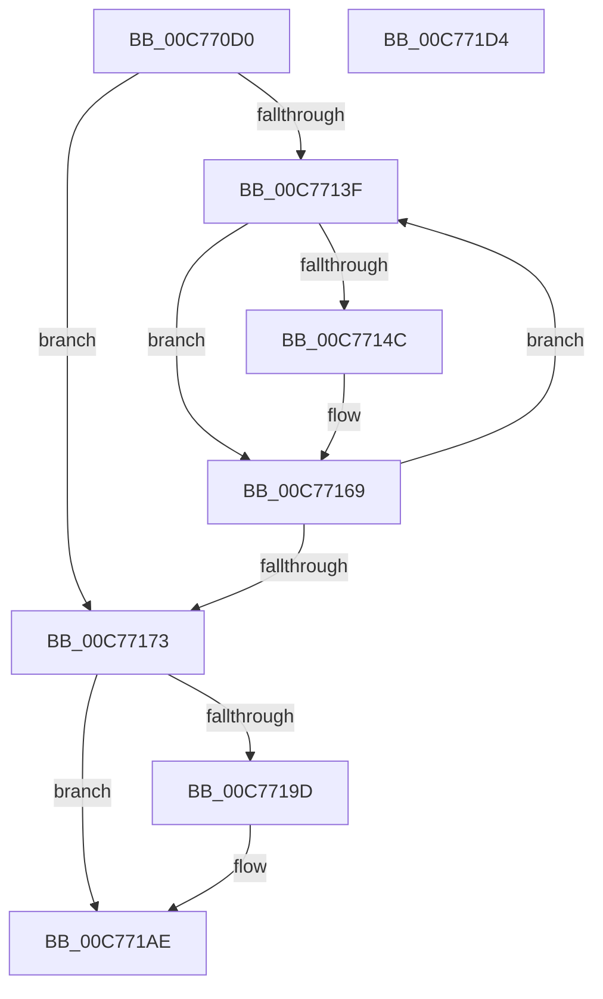

# MiInitializeTopLevelBitmap

- RVA: `0x00C770D0`–`0x00C771D5` (길이 `261` bytes)
- VA: `0x0000000140C770D0`
- 실행 섹션: `INIT`
- PDB 이름 있음: `예`; PDB Function 태그: `아니요`
- unwind 정보 RVA: `0x000BE370`
- 디코드: `60`개 명령, `261/261` bytes 표시
- 미해석 바이트: `0` (있으면 어셈블리에 `.byte`로 보존)

> 이 문서는 커널 이미지의 기계어와 PDB 기호를 분석해 생성했습니다. 4번과 5번은 함수 원형과 자료형을 바이너리 사용 방식에서 추정한 C 해석이며 원본 소스 복구 결과는 아닙니다.

## 1. Dependencies

- 직접 호출 지점: **4**; 고유 호출 대상: **3**
- 직접 호출자로 확인된 함수: **1**
- RIP 상대 이미지 참조: **7**

### Outgoing calls
- `0x00C770F1` → [ExGenRandom](../../text/41/ExGenRandom_function_0041B010.md) (function, `0x0041B010`)
- `0x00C77142` → [MI_READ_PTE_LOCK_FREE](../../text/28/MI_READ_PTE_LOCK_FREE_function_002828A0.md) (function, `0x002828A0`)
- `0x00C77164` → [RtlSetBits](../../text/3E/RtlSetBits_function_003E1610.md) (function, `0x003E1610`)
- `0x00C7718B` → [RtlSetBits](../../text/3E/RtlSetBits_function_003E1610.md) (function, `0x003E1610`)

### Direct callers
- [MiInitializeSystemVa](MiInitializeSystemVa_function_00C77020.md) at `0x00C77055`

### Static image references
- `0x00C770FC` → RVA `0x00E2F168` (`.data`; read)
- `0x00C77103` → RVA `0x00E2F188` (`.data`; write)
- `0x00C7711F` → RVA `0x00E2F178` (`.data`; read)
- `0x00C77190` → RVA `0x00FC6A88` (`ALMOSTRO`; read)
- `0x00C7719D` → RVA `0x00E2F185` (`.data`; read)
- `0x00C771A8` → RVA `0x00E2F185` (`.data`; write)
- `0x00C771C8` → RVA `0x00E2F168` (`.data`; write)

## 2. Other-region calls and transfers

- 다른 실행 섹션으로 향하는 call: **4**
  - `0x00C770F1` → [ExGenRandom](../../text/41/ExGenRandom_function_0041B010.md) (`INIT` → `.text`)
  - `0x00C77142` → [MI_READ_PTE_LOCK_FREE](../../text/28/MI_READ_PTE_LOCK_FREE_function_002828A0.md) (`INIT` → `.text`)
  - `0x00C77164` → [RtlSetBits](../../text/3E/RtlSetBits_function_003E1610.md) (`INIT` → `.text`)
  - `0x00C7718B` → [RtlSetBits](../../text/3E/RtlSetBits_function_003E1610.md) (`INIT` → `.text`)
- 별도 외부 분기/꼬리 이동을 확인하지 못했습니다.

## 3. Assembly (complete function range)

```asm
00C770D0  48 8B C4                        mov rax, rsp
00C770D3  48 89 58 08                     mov qword ptr [rax + 8], rbx
00C770D7  48 89 68 10                     mov qword ptr [rax + 0x10], rbp
00C770DB  57                              push rdi
00C770DC  48 83 EC 30                     sub rsp, 0x30
00C770E0  48 C7 40 E8 00 01 00 00         mov qword ptr [rax - 0x18], 0x100
00C770E8  B9 01 00 00 00                  mov ecx, 1
00C770ED  83 60 EC 00                     and dword ptr [rax - 0x14], 0
00C770F1  E8 1A 3F 7A FF                  call 0x14041b010
00C770F6  0F B6 C8                        movzx ecx, al
00C770F9  0F 57 C0                        xorps xmm0, xmm0
00C770FC  48 8D 05 65 80 1B 00            lea rax, [rip + 0x1b8065]
00C77103  89 0D 7F 80 1B 00               mov dword ptr [rip + 0x1b807f], ecx
00C77109  48 89 44 24 28                  mov qword ptr [rsp + 0x28], rax
00C7710E  0F 11 05 53 80 1B 00            movups xmmword ptr [rip + 0x1b8053], xmm0
00C77115  48 BD 00 D8 BE 7D FB F6 FF FF   movabs rbp, 0xfffff6fb7dbed800
00C7711F  0F 11 05 52 80 1B 00            movups xmmword ptr [rip + 0x1b8052], xmm0
00C77126  48 8B DD                        mov rbx, rbp
00C77129  48 8B C5                        mov rax, rbp
00C7712C  48 C1 E8 03                     shr rax, 3
00C77130  BF 00 02 00 00                  mov edi, 0x200
00C77135  25 FF 01 00 00                  and eax, 0x1ff
00C7713A  48 2B F8                        sub rdi, rax
00C7713D  74 34                           je 0x140c77173
00C7713F  48 8B CB                        mov rcx, rbx
00C77142  E8 59 B7 60 FF                  call 0x1402828a0
00C77147  48 85 C0                        test rax, rax
00C7714A  74 1D                           je 0x140c77169
00C7714C  48 8B C5                        mov rax, rbp
00C7714F  48 8B D3                        mov rdx, rbx
00C77152  48 8D 4C 24 20                  lea rcx, [rsp + 0x20]
00C77157  48 2B D0                        sub rdx, rax
00C7715A  41 B8 01 00 00 00               mov r8d, 1
00C77160  48 C1 FA 03                     sar rdx, 3
00C77164  E8 A7 A4 76 FF                  call 0x1403e1610
00C77169  48 83 C3 08                     add rbx, 8
00C7716D  48 83 EF 01                     sub rdi, 1
00C77171  75 CC                           jne 0x140c7713f
00C77173  48 8B C5                        mov rax, rbp
00C77176  48 2B D8                        sub rbx, rax
00C77179  48 8D 4C 24 20                  lea rcx, [rsp + 0x20]
00C7717E  48 C1 FB 03                     sar rbx, 3
00C77182  41 B8 01 00 00 00               mov r8d, 1
00C77188  8D 53 FF                        lea edx, [rbx - 1]
00C7718B  E8 80 A4 76 FF                  call 0x1403e1610
00C77190  48 F7 05 ED F8 34 00 00 00 10 00  test qword ptr [rip + 0x34f8ed], 0x100000
00C7719B  75 11                           jne 0x140c771ae
00C7719D  0F BE 0D E1 7F 1B 00            movsx ecx, byte ptr [rip + 0x1b7fe1]
00C771A4  0F BA F1 05                     btr ecx, 5
00C771A8  88 0D D7 7F 1B 00               mov byte ptr [rip + 0x1b7fd7], cl
00C771AE  0F BE 0D B3 7F 1B 00            movsx ecx, byte ptr [rip + 0x1b7fb3]
00C771B5  B8 01 00 00 00                  mov eax, 1
00C771BA  48 8B 5C 24 40                  mov rbx, qword ptr [rsp + 0x40]
00C771BF  0F BA E9 00                     bts ecx, 0
00C771C3  48 8B 6C 24 48                  mov rbp, qword ptr [rsp + 0x48]
00C771C8  88 0D 9A 7F 1B 00               mov byte ptr [rip + 0x1b7f9a], cl
00C771CE  48 83 C4 30                     add rsp, 0x30
00C771D2  5F                              pop rdi
00C771D3  C3                              ret
00C771D4  CC                              int3
```

## 4. C-style interpretation (structured pseudocode)

```c
__int64 __fastcall MiInitializeTopLevelBitmap(void)
{
    __int64 result;
    __int64 v_rbx;
    __int64 v_rdi;
    __int64 v_rsp;
    unsigned __int64 v_stack_m10;
    unsigned __int64 v_stack_m18;
    unsigned __int64 v_stack_p10;
    unsigned __int64 v_stack_p8;

    *(unsigned __int64 *)(v_rsp + 8) = v_rbx;
    *(unsigned __int64 *)(v_rsp + 16) = v_rbp;
    v_rsp = (v_rsp) - (48);
    *(unsigned __int64 *)(v_rsp - 24) = 256;
    result = ExGenRandom(1, a2, a3, a4);
    *(unsigned int *)(v_rip + 1802367) = (unsigned int)((unsigned __int8)(result));
    v_stack_m10 = v_rip + 1802341;
    *(unsigned __int64 *)(v_rip + 1802323) = v_xmm0;
    *(unsigned __int64 *)(v_rip + 1802322) = v_xmm0;
    result = (v_rbp) >> (3);
    result = (unsigned int)((result) & (511));
    v_rdi = (512) - (result);
    if (condition_is_equal) goto loc_00C77173;
loc_00C7713F:
    result = MI_READ_PTE_LOCK_FREE(v_rbp, a2, a3, a4);
    if (result != 0) {
        result = v_rbp;
        a2 = v_rbp;
        a1 = v_stack_m18;
        a2 = (a2) - (result);
        a3 = 1;
        a2 = (a2) >> (3);
        result = RtlSetBits(a1, a2, a3, a4);
    }
    v_rbx = (v_rbp) + (8);
    v_rdi = (v_rdi) - (1);
    if (condition_is_not_equal) goto loc_00C7713F;
loc_00C77173:
    v_rbx = (v_rbx) - (v_rbp);
    v_rbx = (v_rbx) >> (3);
    result = RtlSetBits(v_stack_m18, v_rbx - 1, 1, a4);
    if (((*(unsigned __int64 *)(v_rip + 3471597)) & (0x100000ULL)) == 0) {
        a1 = (__int8)(*(unsigned __int8 *)(v_rip + 1802209));
        *(unsigned __int8 *)(v_rip + 1802199) = (unsigned __int8)(a1);
    }
    *(unsigned __int8 *)(v_rip + 1802138) = (unsigned __int8)((__int8)(*(unsigned __int8 *)(v_rip + 1802163)));
    v_rsp = (v_rsp) + (48);
    return 1;
}
```

## 5. (Beta) C Style

```c
void MiInitializeTopLevelBitmap(void)
{
    int64_t result;
    int64_t local_rbx;
    int64_t local_rdi;
    int64_t local_rsp;
    uint64_t v_stack_m10;
    uint64_t v_stack_m18;
    uint64_t v_stack_p10;
    uint64_t v_stack_p8;

    *(uint64_t *)(local_rsp + 0x8) = local_rbx;
    *(uint64_t *)(local_rsp + 0x10) = local_rbp;
    local_rsp = (local_rsp) - (48);
    *(uint64_t *)(local_rsp - 0x18) = 256;
    result = ExGenRandom(1, a2, a3, a4);
    *(uint32_t *)(v_rip + 0x1B807F) = (uint32_t)((uint8_t)(result));
    v_stack_m10 = v_rip + 1802341;
    *(uint64_t *)(v_rip + 0x1B8053) = v_xmm0;
    *(uint64_t *)(v_rip + 0x1B8052) = v_xmm0;
    result = (local_rbp) >> (3);
    result = (uint32_t)((result) & (511));
    local_rdi = (512) - (result);
    if (condition_is_equal) goto loc_00C77173;
loc_00C7713F:
    result = MI_READ_PTE_LOCK_FREE(local_rbp, a2, a3, a4);
    if (result != 0) {
        result = local_rbp;
        a2 = local_rbp;
        a1 = v_stack_m18;
        a2 = (a2) - (result);
        a3 = 1;
        a2 = (a2) >> (3);
        result = RtlSetBits(a1, a2, a3, a4);
    }
    local_rbx = (local_rbp) + (8);
    local_rdi = (local_rdi) - (1);
    if (condition_is_not_equal) goto loc_00C7713F;
loc_00C77173:
    local_rbx = (local_rbx) - (local_rbp);
    local_rbx = (local_rbx) >> (3);
    result = RtlSetBits(v_stack_m18, local_rbx - 1, 1, a4);
    if (((*(uint64_t *)(v_rip + 0x34F8ED)) & (0x100000ULL)) == 0) {
        a1 = (int8_t)(*(uint8_t *)(v_rip + 0x1B7FE1));
        *(uint8_t *)(v_rip + 0x1B7FD7) = (uint8_t)(a1);
    }
    *(uint8_t *)(v_rip + 0x1B7F9A) = (uint8_t)((int8_t)(*(uint8_t *)(v_rip + 0x1B7FB3)));
    local_rsp = (local_rsp) + (48);
    return 1;
}
```

## 6. Execution-region graph

[열기: 2D/3D 그래프와 함수 탐색 컨트롤 패널](../../../control-panel.html?section=init&rva=0x00C770D0&view=graph)

- 2D 그래프는 위에서 아래로 흐르고, 3D 그래프는 빈 공간을 드래그해 회전합니다. Shift+드래그는 이동, 휠은 확대·축소, 함수 노드 선택은 대상 보고서 이동입니다.

### Static fallback


