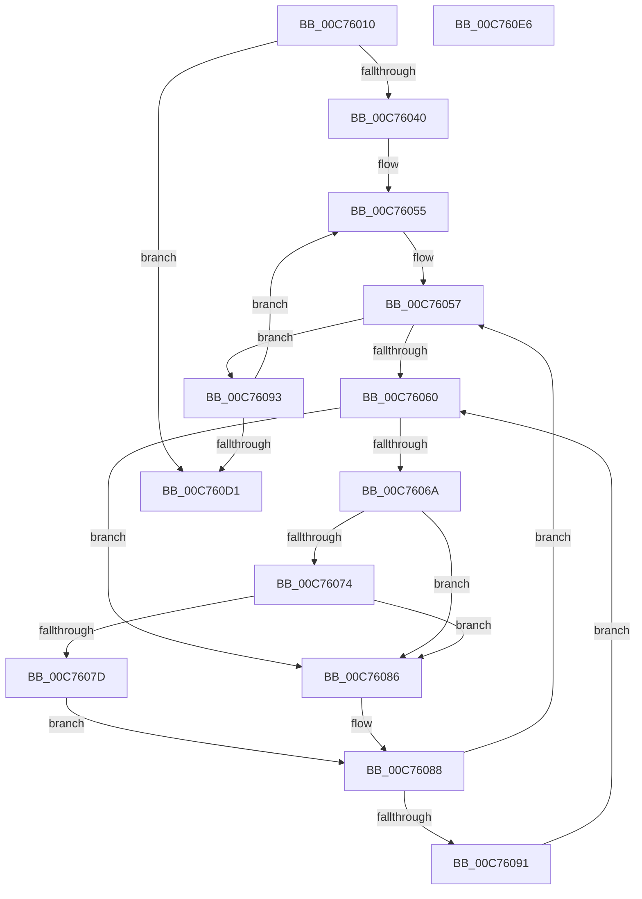

# MiInsertRegistryPageInModifiedList

- RVA: `0x00C76010`–`0x00C760E7` (길이 `215` bytes)
- VA: `0x0000000140C76010`
- 실행 섹션: `INIT`
- PDB 이름 있음: `예`; PDB Function 태그: `아니요`
- unwind 정보 RVA: `0x0005C954`
- 디코드: `58`개 명령, `215/215` bytes 표시
- 미해석 바이트: `0` (있으면 어셈블리에 `.byte`로 보존)

> 이 문서는 커널 이미지의 기계어와 PDB 기호를 분석해 생성했습니다. 4번과 5번은 함수 원형과 자료형을 바이너리 사용 방식에서 추정한 C 해석이며 원본 소스 복구 결과는 아닙니다.

## 1. Dependencies

- 직접 호출 지점: **5**; 고유 호출 대상: **5**
- 직접 호출자로 확인된 함수: **1**
- RIP 상대 이미지 참조: **2**

### Outgoing calls
- `0x00C7602F` → [MiMakeDemandZeroPte](../../text/33/MiMakeDemandZeroPte_function_00337A00.md) (function, `0x00337A00`)
- `0x00C76074` → [KiCheckVpBackingLongSpinWaitHypercall](../../text/30/KiCheckVpBackingLongSpinWaitHypercall_function_0030F490.md) (function, `0x0030F490`)
- `0x00C7607F` → [HvlNotifyLongSpinWait](../../text/30/HvlNotifyLongSpinWait_function_0030F460.md) (function, `0x0030F460`)
- `0x00C760A9` → [MiSetPfnModified](../../text/36/MiSetPfnModified_function_00362960.md) (function, `0x00362960`)
- `0x00C760B3` → [MiDecrementShareCountEx](../../text/33/MiDecrementShareCountEx_function_00333F70.md) (function, `0x00333F70`)

### Direct callers
- [MiPageBootRegistry](../../text/66/MiPageBootRegistry_function_0066E82C.md) at `0x0066E9AE`
- [MiPageBootRegistry](../../text/66/MiPageBootRegistry_function_0066E82C.md) at `0x0066EAC9`

### Static image references
- `0x00C76062` → RVA `0x00FC52AC` (`ALMOSTRO`; reference)
- `0x00C7606A` → RVA `0x00FC6AB8` (`ALMOSTRO`; read)

## 2. Other-region calls and transfers

- 다른 실행 섹션으로 향하는 call: **5**
  - `0x00C7602F` → [MiMakeDemandZeroPte](../../text/33/MiMakeDemandZeroPte_function_00337A00.md) (`INIT` → `.text`)
  - `0x00C76074` → [KiCheckVpBackingLongSpinWaitHypercall](../../text/30/KiCheckVpBackingLongSpinWaitHypercall_function_0030F490.md) (`INIT` → `.text`)
  - `0x00C7607F` → [HvlNotifyLongSpinWait](../../text/30/HvlNotifyLongSpinWait_function_0030F460.md) (`INIT` → `.text`)
  - `0x00C760A9` → [MiSetPfnModified](../../text/36/MiSetPfnModified_function_00362960.md) (`INIT` → `.text`)
  - `0x00C760B3` → [MiDecrementShareCountEx](../../text/33/MiDecrementShareCountEx_function_00333F70.md) (`INIT` → `.text`)
- 별도 외부 분기/꼬리 이동을 확인하지 못했습니다.

## 3. Assembly (complete function range)

```asm
00C76010  48 89 5C 24 08                  mov qword ptr [rsp + 8], rbx
00C76015  48 89 6C 24 10                  mov qword ptr [rsp + 0x10], rbp
00C7601A  48 89 74 24 18                  mov qword ptr [rsp + 0x18], rsi
00C7601F  57                              push rdi
00C76020  48 83 EC 20                     sub rsp, 0x20
00C76024  4C 8B C1                        mov r8, rcx
00C76027  48 8B EA                        mov rbp, rdx
00C7602A  B9 04 00 00 00                  mov ecx, 4
00C7602F  E8 CC 19 6C FF                  call 0x140337a00
00C76034  48 8B D8                        mov rbx, rax
00C76037  48 85 D2                        test rdx, rdx
00C7603A  0F 84 91 00 00 00               je 0x140c760d1
00C76040  4B 8D 3C 40                     lea rdi, [r8 + r8*2]
00C76044  48 C1 E7 04                     shl rdi, 4
00C76048  48 B8 00 00 00 00 00 DE FF FF   movabs rax, 0xffffde0000000000
00C76052  48 03 F8                        add rdi, rax
00C76055  33 F6                           xor esi, esi
00C76057  F0 48 0F BA 6F 18 3F            lock bts qword ptr [rdi + 0x18], 0x3f
00C7605E  73 33                           jae 0x140c76093
00C76060  FF C6                           inc esi
00C76062  85 35 44 F2 34 00               test dword ptr [rip + 0x34f244], esi
00C76068  75 1C                           jne 0x140c76086
00C7606A  8B 05 48 0A 35 00               mov eax, dword ptr [rip + 0x350a48]
00C76070  A8 40                           test al, 0x40
00C76072  74 12                           je 0x140c76086
00C76074  E8 17 94 69 FF                  call 0x14030f490
00C76079  84 C0                           test al, al
00C7607B  74 09                           je 0x140c76086
00C7607D  8B CE                           mov ecx, esi
00C7607F  E8 DC 93 69 FF                  call 0x14030f460
00C76084  EB 02                           jmp 0x140c76088
00C76086  F3 90                           pause
00C76088  48 8B 47 18                     mov rax, qword ptr [rdi + 0x18]
00C7608C  48 85 C0                        test rax, rax
00C7608F  79 C6                           jns 0x140c76057
00C76091  EB CD                           jmp 0x140c76060
00C76093  48 8B 07                        mov rax, qword ptr [rdi]
00C76096  BA 01 00 00 00                  mov edx, 1
00C7609B  48 83 C8 01                     or rax, 1
00C7609F  48 8B CF                        mov rcx, rdi
00C760A2  48 89 07                        mov qword ptr [rdi], rax
00C760A5  48 89 5F 10                     mov qword ptr [rdi + 0x10], rbx
00C760A9  E8 B2 C8 6E FF                  call 0x140362960
00C760AE  33 D2                           xor edx, edx
00C760B0  48 8B CF                        mov rcx, rdi
00C760B3  E8 B8 DE 6B FF                  call 0x140333f70
00C760B8  48 B8 FF FF FF FF FF FF FF 7F   movabs rax, 0x7fffffffffffffff
00C760C2  F0 48 21 47 18                  lock and qword ptr [rdi + 0x18], rax
00C760C7  48 83 C7 30                     add rdi, 0x30
00C760CB  48 83 ED 01                     sub rbp, 1
00C760CF  75 84                           jne 0x140c76055
00C760D1  48 8B 5C 24 30                  mov rbx, qword ptr [rsp + 0x30]
00C760D6  48 8B 6C 24 38                  mov rbp, qword ptr [rsp + 0x38]
00C760DB  48 8B 74 24 40                  mov rsi, qword ptr [rsp + 0x40]
00C760E0  48 83 C4 20                     add rsp, 0x20
00C760E4  5F                              pop rdi
00C760E5  C3                              ret
00C760E6  CC                              int3
```

## 4. C-style interpretation (structured pseudocode)

```c
__int64 __fastcall MiInsertRegistryPageInModifiedList(__int64 a1, __int64 a2)
{
    __int64 result;
    __int64 v_rbp;
    __int64 v_rdi;
    __int64 v_rsi;
    __int64 v_rsp;
    unsigned __int64 v_stack_p10;
    unsigned __int64 v_stack_p18;
    unsigned __int64 v_stack_p8;

    v_stack_p8 = v_rbx;
    v_stack_p10 = v_rbp;
    v_stack_p18 = v_rsi;
    v_rsp = (v_rsp) - (32);
    result = MiMakeDemandZeroPte(4, a2, a1, a4);
    if (a2 == 0) goto loc_00C760D1;
    v_rdi = (a1 + a1 * 2) << (4);
    v_rdi = (v_rdi) + (result);
loc_00C76055:
    v_rsi = 0;
loc_00C76057:
    if (condition_is_above_or_equal) goto loc_00C76093;
loc_00C76060:
    v_rsi = (unsigned int)((v_rsi) + 1);
    if (((*(unsigned int *)(v_rip + 3469892)) & ((unsigned int)(v_rsi))) != 0) goto loc_00C76086;
    if ((((unsigned __int8)((unsigned int)(*(unsigned int *)(v_rip + 3476040)))) & (64)) == 0) goto loc_00C76086;
    result = KiCheckVpBackingLongSpinWaitHypercall(4, a2, a1, a4);
    if ((unsigned __int8)(result) == 0) goto loc_00C76086;
    result = HvlNotifyLongSpinWait((unsigned int)((unsigned int)(v_rsi)), a2, a1, a4);
    goto loc_00C76088;
loc_00C76086:
loc_00C76088:
    if (!sign_flag) goto loc_00C76057;
    goto loc_00C76060;
loc_00C76093:
    result = (*(unsigned __int64 *)(v_rdi)) | (1);
    *(unsigned __int64 *)(v_rdi) = result;
    *(unsigned __int64 *)(v_rdi + 16) = result;
    result = MiSetPfnModified(v_rdi, 1, a1, a4);
    a2 = 0;
    result = MiDecrementShareCountEx(v_rdi, a2, a1, a4);
    v_rdi = (v_rdi) + (48);
    v_rbp = (a2) - (1);
    if (condition_is_not_equal) goto loc_00C76055;
loc_00C760D1:
    v_rsp = (v_rsp) + (32);
    return result;
}
```

## 5. (Beta) C Style

```c
int64_t MiInsertRegistryPageInModifiedList(int64_t Arg1, int64_t Arg2)
{
    int64_t result;
    int64_t local_rbp;
    int64_t local_rdi;
    int64_t local_rsi;
    int64_t local_rsp;
    uint64_t v_stack_p10;
    uint64_t v_stack_p18;
    uint64_t v_stack_p8;

    v_stack_p8 = local_rbx;
    v_stack_p10 = local_rbp;
    v_stack_p18 = local_rsi;
    local_rsp = (local_rsp) - (32);
    result = MiMakeDemandZeroPte(4, Arg2, Arg1, a4);
    if (Arg2 == 0) goto loc_00C760D1;
    local_rdi = (Arg1 + Arg1 * 2) << (4);
    local_rdi = (local_rdi) + (result);
loc_00C76055:
    local_rsi = 0;
loc_00C76057:
    if (condition_is_above_or_equal) goto loc_00C76093;
loc_00C76060:
    local_rsi = (uint32_t)((local_rsi) + 1);
    if (((*(uint32_t *)(v_rip + 0x34F244)) & ((uint32_t)(local_rsi))) != 0) goto loc_00C76086;
    if ((((uint8_t)((uint32_t)(*(uint32_t *)(v_rip + 0x350A48)))) & (64)) == 0) goto loc_00C76086;
    result = KiCheckVpBackingLongSpinWaitHypercall(4, Arg2, Arg1, a4);
    if ((uint8_t)(result) == 0) goto loc_00C76086;
    result = HvlNotifyLongSpinWait((uint32_t)((uint32_t)(local_rsi)), Arg2, Arg1, a4);
    goto loc_00C76088;
loc_00C76086:
loc_00C76088:
    if (!sign_flag) goto loc_00C76057;
    goto loc_00C76060;
loc_00C76093:
    result = (*(uint64_t *)(local_rdi)) | (1);
    *(uint64_t *)(local_rdi) = result;
    *(uint64_t *)(local_rdi + 0x10) = result;
    result = MiSetPfnModified(local_rdi, 1, Arg1, a4);
    Arg2 = 0;
    result = MiDecrementShareCountEx(local_rdi, Arg2, Arg1, a4);
    local_rdi = (local_rdi) + (48);
    local_rbp = (Arg2) - (1);
    if (condition_is_not_equal) goto loc_00C76055;
loc_00C760D1:
    local_rsp = (local_rsp) + (32);
    return result;
}
```

## 6. Execution-region graph

[열기: 2D/3D 그래프와 함수 탐색 컨트롤 패널](../../../control-panel.html?section=init&rva=0x00C76010&view=graph)

- 2D 그래프는 위에서 아래로 흐르고, 3D 그래프는 빈 공간을 드래그해 회전합니다. Shift+드래그는 이동, 휠은 확대·축소, 함수 노드 선택은 대상 보고서 이동입니다.

### Static fallback


