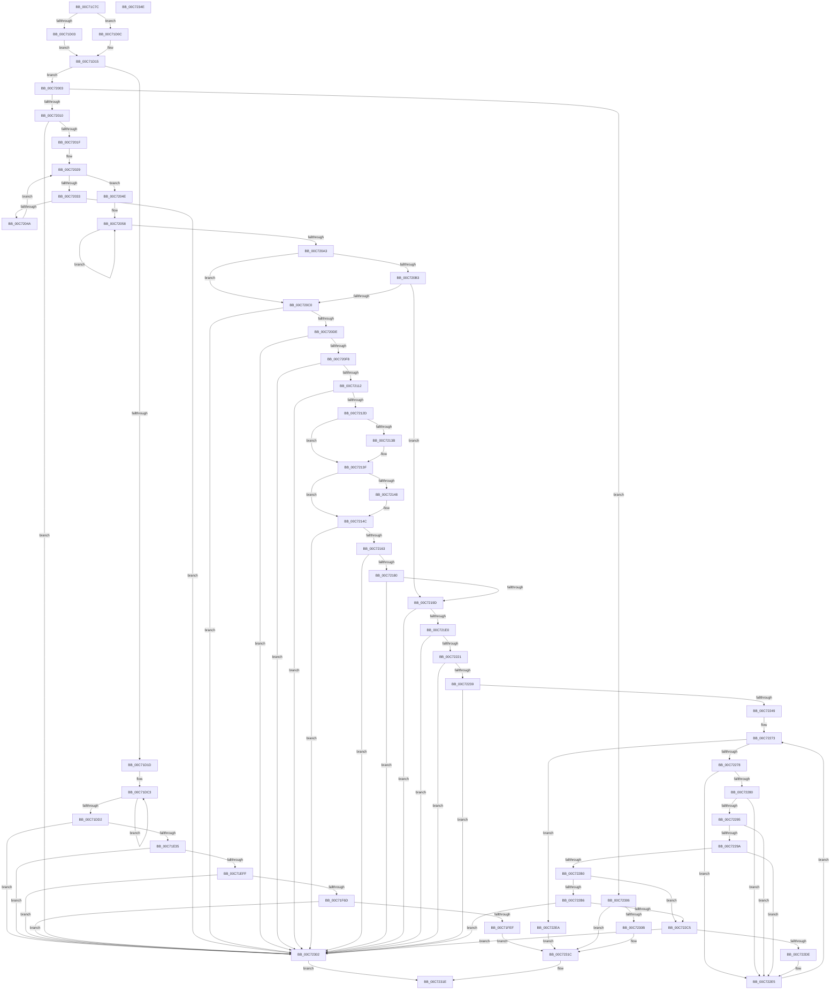

# ObInitSystem

- RVA: `0x00C71C7C`–`0x00C7234F` (길이 `1,747` bytes)
- VA: `0x0000000140C71C7C`
- 실행 섹션: `INIT`
- PDB 이름 있음: `예`; PDB Function 태그: `아니요`
- unwind 정보 RVA: `0x000BAF74`
- 디코드: `386`개 명령, `1,747/1,747` bytes 표시
- 미해석 바이트: `0` (있으면 어셈블리에 `.byte`로 보존)

> 이 문서는 커널 이미지의 기계어와 PDB 기호를 분석해 생성했습니다. 4번과 5번은 함수 원형과 자료형을 바이너리 사용 방식에서 추정한 C 해석이며 원본 소스 복구 결과는 아닙니다.

## 1. Dependencies

- 직접 호출 지점: **33**; 고유 호출 대상: **28**
- 직접 호출자로 확인된 함수: **3**
- RIP 상대 이미지 참조: **55**

### Outgoing calls
- `0x00C71D1D` → [ExGenRandom](../../text/41/ExGenRandom_function_0041B010.md) (function, `0x0041B010`)
- `0x00C71D51` → [ExInitializeSystemLookasideList](../../pagelk/B7/ExInitializeSystemLookasideList_function_00B7E57C.md) (function, `0x00B7E57C`)
- `0x00C71D7D` → [ExInitializeSystemLookasideList](../../pagelk/B7/ExInitializeSystemLookasideList_function_00B7E57C.md) (function, `0x00B7E57C`)
- `0x00C71DFE` → [ExCreateHandleTable](../../page/94/ExCreateHandleTable_function_0094C7E8.md) (function, `0x0094C7E8`)
- `0x00C71E7E` → [ObpInitInfoBlockOffsets](../C3/ObpInitInfoBlockOffsets_function_00C3C77C.md) (function, `0x00C3C77C`)
- `0x00C71E9F` → [memset](../../text/6C/memset_function_006C6C40.md) (function, `0x006C6C40`)
- `0x00C71EBD` → [RtlInitUnicodeString](../../text/42/RtlInitUnicodeString_function_0042A780.md) (function, `0x0042A780`)
- `0x00C71EF2` → [ObCreateObjectType](../../page/70/ObCreateObjectType_function_00705230.md) (function, `0x00705230`)
- `0x00C71F0D` → [RtlInitUnicodeString](../../text/42/RtlInitUnicodeString_function_0042A780.md) (function, `0x0042A780`)
- `0x00C71F60` → [ObCreateObjectType](../../page/70/ObCreateObjectType_function_00705230.md) (function, `0x00705230`)
- `0x00C71F8B` → [RtlInitUnicodeString](../../text/42/RtlInitUnicodeString_function_0042A780.md) (function, `0x0042A780`)
- `0x00C71FE2` → [ObCreateObjectType](../../page/70/ObCreateObjectType_function_00705230.md) (function, `0x00705230`)
- `0x00C71FF9` → [ObpInitStackTrace](../C3/ObpInitStackTrace_function_00C3C86C.md) (function, `0x00C3C86C`)
- `0x00C72012` → [ObInitServerSilo](../../page/74/ObInitServerSilo_function_0074D8FC.md) (function, `0x0074D8FC`)
- `0x00C7203D` → [ObInitializeProcessor](../../page/74/ObInitializeProcessor_function_0074DA98.md) (function, `0x0074DA98`)
- `0x00C72093` → [ExInitializeNPagedLookasideListInternal](../../text/46/ExInitializeNPagedLookasideListInternal_function_00468720.md) (function, `0x00468720`)
- `0x00C720EB` → [RtlCreateAcl](../../page/91/RtlCreateAcl_function_00916F00.md) (function, `0x00916F00`)
- `0x00C72105` → [RtlAddAuditAccessAce](../../page/78/RtlAddAuditAccessAce_function_0078D410.md) (function, `0x0078D410`)
- `0x00C72120` → [RtlGetAce](../../text/40/RtlGetAce_function_0040FAF0.md) (function, `0x0040FAF0`)
- `0x00C72156` → [RtlCreateSecurityDescriptor](../../page/9F/RtlCreateSecurityDescriptor_function_009F1DF0.md) (function, `0x009F1DF0`)
- `0x00C72173` → [RtlSetDaclSecurityDescriptor](../../page/9E/RtlSetDaclSecurityDescriptor_function_009EC210.md) (function, `0x009EC210`)
- `0x00C72190` → [RtlSetSaclSecurityDescriptor](../../page/A1/RtlSetSaclSecurityDescriptor_function_00A18B80.md) (function, `0x00A18B80`)
- `0x00C721D3` → [NtCreateDirectoryObject](../../page/A5/NtCreateDirectoryObject_function_00A561F0.md) (function, `0x00A561F0`)
- `0x00C72208` → [ObReferenceObjectByHandle](../../page/86/ObReferenceObjectByHandle_function_00868DB0.md) (function, `0x00868DB0`)
- `0x00C7222C` → [ObpInitializeRootNamespace](../../page/74/ObpInitializeRootNamespace_function_0074E588.md) (function, `0x0074E588`)
- `0x00C7223C` → [NtClose](../../page/86/NtClose_function_00868870.md) (function, `0x00868870`)
- `0x00C72264` → [ObpLockDirectoryExclusive](../../page/99/ObpLockDirectoryExclusive_function_0099F24C.md) (function, `0x0099F24C`)
- `0x00C722A6` → [ObpLookupDirectoryEntry](../../page/85/ObpLookupDirectoryEntry_function_0085D5B0.md) (function, `0x0085D5B0`)
- `0x00C722BC` → [ObpInitObjectTypeSD](../../page/74/ObpInitObjectTypeSD_function_0074F1B8.md) (function, `0x0074F1B8`)
- `0x00C722D5` → [ObpInsertDirectoryEntry](../../page/A1/ObpInsertDirectoryEntry_function_00A18AC0.md) (function, `0x00A18AC0`)
- `0x00C722EF` → [ObpReleaseLookupContext](../../text/26/ObpReleaseLookupContext_function_00263D30.md) (function, `0x00263D30`)
- `0x00C72317` → [TraceLoggingRegisterEx_EtwRegister_EtwSetInformation](../../page/92/TraceLoggingRegisterEx_EtwRegister_EtwSetInformation_function_009208A0.md) (function, `0x009208A0`)
- `0x00C72328` → [_security_check_cookie](../../text/6A/_security_check_cookie_function_006AC640.md) (function, `0x006AC640`)

### Direct callers
- [InitBootProcessor](../C1/InitBootProcessor_function_00C1B1C8.md) at `0x00C1BD34`
- [Phase1InitializationDiscard](../C1/Phase1InitializationDiscard_function_00C1C728.md) at `0x00C1D1BE`
- [Phase1InitializationIoReady](Phase1InitializationIoReady_function_00C70458.md) at `0x00C705C3`

### Static image references
- `0x00C71CA2` → RVA `0x00E0A740` (`.data`; read)
- `0x00C71CC0` → RVA `0x00FC521C` (`ALMOSTRO`; read)
- `0x00C71D22` → RVA `0x00EFAC00` (`.data`; read)
- `0x00C71D29` → RVA `0x00FC6E4C` (`ALMOSTRO`; write)
- `0x00C71D2F` → RVA `0x00E27380` (`.data`; read)
- `0x00C71D5B` → RVA `0x00E27300` (`.data`; read)
- `0x00C71DAE` → RVA `0x00FD0EC8` (`CACHEALI`; read)
- `0x00C71DB5` → RVA `0x00F0F640` (`.data`; write)
- `0x00C71DBC` → RVA `0x00F0F5C0` (`.data`; write)
- `0x00C71DD2` → RVA `0x00F0F5A8` (`.data`; read)
- `0x00C71DD9` → RVA `0x00F0F5A0` (`.data`; write)
- `0x00C71DE3` → RVA `0x00F0F5B0` (`.data`; write)
- `0x00C71DEA` → RVA `0x00F0F5A8` (`.data`; write)
- `0x00C71DF1` → RVA `0x00F0F5A2` (`.data`; write)
- `0x00C71DF8` → RVA `0x00F0F5A4` (`.data`; write)
- `0x00C71E03` → RVA `0x00F0F5B8` (`.data`; write)
- `0x00C71E1A` → RVA `0x00F0F5B8` (`.data`; read)
- `0x00C71E35` → RVA `0x009D7B40` (`ObpProcessRemoveObjectQueue`; read)
- `0x00C71E3C` → RVA `0x00F0F638` (`.data`; write)
- `0x00C71E43` → RVA `0x00F0F630` (`.data`; write)
- `0x00C71E4A` → RVA `0x005CD9C0` (`ObpProcessRemoveObjectDpcWorker`; read)
- `0x00C71E51` → RVA `0x00F0F5F8` (`.data`; write)
- `0x00C71E58` → RVA `0x00F0F620` (`.data`; write)
- `0x00C71E5F` → RVA `0x00F0F5E0` (`.data`; write)
- `0x00C71E69` → RVA `0x00F0F600` (`.data`; write)
- `0x00C71E70` → RVA `0x00F0F618` (`.data`; write)
- `0x00C71E77` → RVA `0x00F0F5F0` (`.data`; write)
- `0x00C71E83` → RVA `0x00FC6C08` (`ALMOSTRO`; read)
- `0x00C71E8E` → RVA `0x00FC7808` (`ALMOSTRO`; write)
- `0x00C71EA4` → RVA `0x00C7A3E0` (` ?? ::PBOPGDP::`string'`; read)
- `0x00C71EC2` → RVA `0x00C826A0` (`ObpTypeMapping`; read)
- `0x00C71ECD` → RVA `0x00F0F660` (`.data`; read)
- `0x00C71EFF` → RVA `0x00C7BD30` (` ?? ::PBOPGDP::`string'`; read)
- `0x00C71F15` → RVA `0x00F0F650` (`.data`; read)
- `0x00C71F1C` → RVA `0x00C826B0` (`ObpDirectoryMapping`; read)
- `0x00C71F42` → RVA `0x00A212F0` (`ObpCloseDirectoryObject`; read)
- `0x00C71F50` → RVA `0x00A757A0` (`ObpDeleteDirectoryObject`; read)
- `0x00C71F74` → RVA `0x00C7BD50` (` ?? ::PBOPGDP::`string'`; read)
- `0x00C71F93` → RVA `0x00A78E20` (`ObpDeleteSymbolicLink`; read)
- `0x00C71F9A` → RVA `0x00C82690` (`ObpSymbolicLinkMapping`; read)
- `0x00C71FA4` → RVA `0x00F0F658` (`.data`; read)
- `0x00C71FB3` → RVA `0x008B35C0` (`ObpParseSymbolicLinkEx`; read)
- `0x00C72022` → RVA `0x00000000` (`image boundary/outside`; read)
- `0x00C72029` → RVA `0x00FC6A80` (`ALMOSTRO`; read)
- `0x00C72051` → RVA `0x00E27400` (`.data`; read)
- `0x00C720A3` → RVA `0x00F0FF6C` (`.data`; read)
- `0x00C720AA` → RVA `0x00FD9AA8` (`PAGEDATA`; read)
- `0x00C720B3` → RVA `0x00F0FF68` (`.data`; read)
- `0x00C720C0` → RVA `0x00E67D48` (`.data`; read)
- `0x00C72163` → RVA `0x00FD9B40` (`PAGEDATA`; read)
- `0x00C7219D` → RVA `0x00B4B5D0` (`ObpRootDirectoryName`; read)
- `0x00C72212` → RVA `0x00F0F668` (`.data`; write)
- `0x00C72249` → RVA `0x00F0F648` (`.data`; read)
- `0x00C722F4` → RVA `0x00E0B388` (`.data`; read)
- `0x00C7230E` → RVA `0x00E074A0` (`.data`; read)

## 2. Other-region calls and transfers

- 다른 실행 섹션으로 향하는 call: **31**
  - `0x00C71D1D` → [ExGenRandom](../../text/41/ExGenRandom_function_0041B010.md) (`INIT` → `.text`)
  - `0x00C71D51` → [ExInitializeSystemLookasideList](../../pagelk/B7/ExInitializeSystemLookasideList_function_00B7E57C.md) (`INIT` → `PAGELK`)
  - `0x00C71D7D` → [ExInitializeSystemLookasideList](../../pagelk/B7/ExInitializeSystemLookasideList_function_00B7E57C.md) (`INIT` → `PAGELK`)
  - `0x00C71DFE` → [ExCreateHandleTable](../../page/94/ExCreateHandleTable_function_0094C7E8.md) (`INIT` → `PAGE`)
  - `0x00C71E9F` → [memset](../../text/6C/memset_function_006C6C40.md) (`INIT` → `.text`)
  - `0x00C71EBD` → [RtlInitUnicodeString](../../text/42/RtlInitUnicodeString_function_0042A780.md) (`INIT` → `.text`)
  - `0x00C71EF2` → [ObCreateObjectType](../../page/70/ObCreateObjectType_function_00705230.md) (`INIT` → `PAGE`)
  - `0x00C71F0D` → [RtlInitUnicodeString](../../text/42/RtlInitUnicodeString_function_0042A780.md) (`INIT` → `.text`)
  - `0x00C71F60` → [ObCreateObjectType](../../page/70/ObCreateObjectType_function_00705230.md) (`INIT` → `PAGE`)
  - `0x00C71F8B` → [RtlInitUnicodeString](../../text/42/RtlInitUnicodeString_function_0042A780.md) (`INIT` → `.text`)
  - `0x00C71FE2` → [ObCreateObjectType](../../page/70/ObCreateObjectType_function_00705230.md) (`INIT` → `PAGE`)
  - `0x00C72012` → [ObInitServerSilo](../../page/74/ObInitServerSilo_function_0074D8FC.md) (`INIT` → `PAGE`)
  - `0x00C7203D` → [ObInitializeProcessor](../../page/74/ObInitializeProcessor_function_0074DA98.md) (`INIT` → `PAGE`)
  - `0x00C72093` → [ExInitializeNPagedLookasideListInternal](../../text/46/ExInitializeNPagedLookasideListInternal_function_00468720.md) (`INIT` → `.text`)
  - `0x00C720EB` → [RtlCreateAcl](../../page/91/RtlCreateAcl_function_00916F00.md) (`INIT` → `PAGE`)
  - `0x00C72105` → [RtlAddAuditAccessAce](../../page/78/RtlAddAuditAccessAce_function_0078D410.md) (`INIT` → `PAGE`)
  - `0x00C72120` → [RtlGetAce](../../text/40/RtlGetAce_function_0040FAF0.md) (`INIT` → `.text`)
  - `0x00C72156` → [RtlCreateSecurityDescriptor](../../page/9F/RtlCreateSecurityDescriptor_function_009F1DF0.md) (`INIT` → `PAGE`)
  - `0x00C72173` → [RtlSetDaclSecurityDescriptor](../../page/9E/RtlSetDaclSecurityDescriptor_function_009EC210.md) (`INIT` → `PAGE`)
  - `0x00C72190` → [RtlSetSaclSecurityDescriptor](../../page/A1/RtlSetSaclSecurityDescriptor_function_00A18B80.md) (`INIT` → `PAGE`)
  - `0x00C721D3` → [NtCreateDirectoryObject](../../page/A5/NtCreateDirectoryObject_function_00A561F0.md) (`INIT` → `PAGE`)
  - `0x00C72208` → [ObReferenceObjectByHandle](../../page/86/ObReferenceObjectByHandle_function_00868DB0.md) (`INIT` → `PAGE`)
  - `0x00C7222C` → [ObpInitializeRootNamespace](../../page/74/ObpInitializeRootNamespace_function_0074E588.md) (`INIT` → `PAGE`)
  - `0x00C7223C` → [NtClose](../../page/86/NtClose_function_00868870.md) (`INIT` → `PAGE`)
  - `0x00C72264` → [ObpLockDirectoryExclusive](../../page/99/ObpLockDirectoryExclusive_function_0099F24C.md) (`INIT` → `PAGE`)
  - `0x00C722A6` → [ObpLookupDirectoryEntry](../../page/85/ObpLookupDirectoryEntry_function_0085D5B0.md) (`INIT` → `PAGE`)
  - `0x00C722BC` → [ObpInitObjectTypeSD](../../page/74/ObpInitObjectTypeSD_function_0074F1B8.md) (`INIT` → `PAGE`)
  - `0x00C722D5` → [ObpInsertDirectoryEntry](../../page/A1/ObpInsertDirectoryEntry_function_00A18AC0.md) (`INIT` → `PAGE`)
  - `0x00C722EF` → [ObpReleaseLookupContext](../../text/26/ObpReleaseLookupContext_function_00263D30.md) (`INIT` → `.text`)
  - `0x00C72317` → [TraceLoggingRegisterEx_EtwRegister_EtwSetInformation](../../page/92/TraceLoggingRegisterEx_EtwRegister_EtwSetInformation_function_009208A0.md) (`INIT` → `PAGE`)
  - `0x00C72328` → [_security_check_cookie](../../text/6A/_security_check_cookie_function_006AC640.md) (`INIT` → `.text`)
- 별도 외부 분기/꼬리 이동을 확인하지 못했습니다.

## 3. Assembly (complete function range)

```asm
00C71C7C  48 8B C4                        mov rax, rsp
00C71C7F  48 89 58 08                     mov qword ptr [rax + 8], rbx
00C71C83  48 89 70 10                     mov qword ptr [rax + 0x10], rsi
00C71C87  48 89 78 18                     mov qword ptr [rax + 0x18], rdi
00C71C8B  55                              push rbp
00C71C8C  41 54                           push r12
00C71C8E  41 55                           push r13
00C71C90  41 56                           push r14
00C71C92  41 57                           push r15
00C71C94  48 8D A8 48 FE FF FF            lea rbp, [rax - 0x1b8]
00C71C9B  48 81 EC 90 02 00 00            sub rsp, 0x290
00C71CA2  48 8B 05 97 8A 19 00            mov rax, qword ptr [rip + 0x198a97]
00C71CA9  48 33 C4                        xor rax, rsp
00C71CAC  48 89 85 80 01 00 00            mov qword ptr [rbp + 0x180], rax
00C71CB3  0F 57 C0                        xorps xmm0, xmm0
00C71CB6  45 33 E4                        xor r12d, r12d
00C71CB9  33 C0                           xor eax, eax
00C71CBB  4C 89 64 24 48                  mov qword ptr [rsp + 0x48], r12
00C71CC0  44 38 25 55 35 35 00            cmp byte ptr [rip + 0x353555], r12b
00C71CC7  0F 57 C9                        xorps xmm1, xmm1
00C71CCA  0F 11 45 D0                     movups xmmword ptr [rbp - 0x30], xmm0
00C71CCE  45 8D 7C 24 10                  lea r15d, [r12 + 0x10]
00C71CD3  48 89 45 F0                     mov qword ptr [rbp - 0x10], rax
00C71CD7  45 8D 6C 24 40                  lea r13d, [r12 + 0x40]
00C71CDC  48 89 45 90                     mov qword ptr [rbp - 0x70], rax
00C71CE0  0F 11 45 E0                     movups xmmword ptr [rbp - 0x20], xmm0
00C71CE4  89 45 98                        mov dword ptr [rbp - 0x68], eax
00C71CE7  0F 11 45 B0                     movups xmmword ptr [rbp - 0x50], xmm0
00C71CEB  4C 89 64 24 50                  mov qword ptr [rsp + 0x50], r12
00C71CF0  0F 11 44 24 70                  movups xmmword ptr [rsp + 0x70], xmm0
00C71CF5  0F 11 45 80                     movups xmmword ptr [rbp - 0x80], xmm0
00C71CF9  0F 11 45 C0                     movups xmmword ptr [rbp - 0x40], xmm0
00C71CFD  0F 11 4D A0                     movups xmmword ptr [rbp - 0x60], xmm1
00C71D01  74 09                           je 0x140c71d0c
00C71D03  41 0F B7 FD                     movzx edi, r13w
00C71D07  8D 58 20                        lea ebx, [rax + 0x20]
00C71D0A  EB 09                           jmp 0x140c71d15
00C71D0C  BF 20 00 00 00                  mov edi, 0x20
00C71D11  41 0F B7 DF                     movzx ebx, r15w
00C71D15  85 C9                           test ecx, ecx
00C71D17  0F 85 E6 02 00 00               jne 0x140c72003
00C71D1D  E8 EE 92 7A FF                  call 0x14041b010
00C71D22  48 8D 35 D7 8E 28 00            lea rsi, [rip + 0x288ed7]
00C71D29  89 05 1D 51 35 00               mov dword ptr [rip + 0x35511d], eax
00C71D2F  4C 8D 35 4A 56 1B 00            lea r14, [rip + 0x1b564a]
00C71D36  48 89 74 24 28                  mov qword ptr [rsp + 0x28], rsi
00C71D3B  49 8B CE                        mov rcx, r14
00C71D3E  66 89 7C 24 20                  mov word ptr [rsp + 0x20], di
00C71D43  41 B9 4F 62 43 69               mov r9d, 0x6943624f
00C71D49  45 8B C5                        mov r8d, r13d
00C71D4C  BA 00 02 00 00                  mov edx, 0x200
00C71D51  E8 26 C8 F0 FF                  call 0x140b7e57c
00C71D56  48 89 74 24 28                  mov qword ptr [rsp + 0x28], rsi
00C71D5B  48 8D 3D 9E 55 1B 00            lea rdi, [rip + 0x1b559e]
00C71D62  66 89 5C 24 20                  mov word ptr [rsp + 0x20], bx
00C71D67  41 B9 4F 62 4E 6D               mov r9d, 0x6d4e624f
00C71D6D  BB 01 00 00 00                  mov ebx, 1
00C71D72  41 B8 F8 00 00 00               mov r8d, 0xf8
00C71D78  8B D3                           mov edx, ebx
00C71D7A  48 8B CF                        mov rcx, rdi
00C71D7D  E8 FA C7 F0 FF                  call 0x140b7e57c
00C71D82  65 48 8B 04 25 20 00 00 00      mov rax, qword ptr gs:[0x20]
00C71D8B  BE 00 01 00 00                  mov esi, 0x100
00C71D90  8B CE                           mov ecx, esi
00C71D92  4C 89 B0 48 08 00 00            mov qword ptr [rax + 0x848], r14
00C71D99  4C 89 B0 40 08 00 00            mov qword ptr [rax + 0x840], r14
00C71DA0  48 89 B8 58 08 00 00            mov qword ptr [rax + 0x858], rdi
00C71DA7  48 89 B8 50 08 00 00            mov qword ptr [rax + 0x850], rdi
00C71DAE  48 8D 05 13 F1 35 00            lea rax, [rip + 0x35f113]
00C71DB5  4C 89 25 84 D8 29 00            mov qword ptr [rip + 0x29d884], r12
00C71DBC  4C 89 25 FD D7 29 00            mov qword ptr [rip + 0x29d7fd], r12
00C71DC3  4C 89 60 F8                     mov qword ptr [rax - 8], r12
00C71DC7  4C 89 20                        mov qword ptr [rax], r12
00C71DCA  49 03 C7                        add rax, r15
00C71DCD  48 2B CB                        sub rcx, rbx
00C71DD0  75 F1                           jne 0x140c71dc3
00C71DD2  48 8D 05 CF D7 29 00            lea rax, [rip + 0x29d7cf]
00C71DD9  66 44 89 25 BF D7 29 00         mov word ptr [rip + 0x29d7bf], r12w
00C71DE1  8B D3                           mov edx, ebx
00C71DE3  48 89 05 C6 D7 29 00            mov qword ptr [rip + 0x29d7c6], rax
00C71DEA  48 89 05 B7 D7 29 00            mov qword ptr [rip + 0x29d7b7], rax
00C71DF1  C6 05 AA D7 29 00 06            mov byte ptr [rip + 0x29d7aa], 6
00C71DF8  89 1D A6 D7 29 00               mov dword ptr [rip + 0x29d7a6], ebx
00C71DFE  E8 E5 A9 CD FF                  call 0x14094c7e8
00C71E03  48 89 05 AE D7 29 00            mov qword ptr [rip + 0x29d7ae], rax
00C71E0A  65 48 8B 04 25 88 01 00 00      mov rax, qword ptr gs:[0x188]
00C71E13  48 8B 88 B8 00 00 00            mov rcx, qword ptr [rax + 0xb8]
00C71E1A  48 8B 05 97 D7 29 00            mov rax, qword ptr [rip + 0x29d797]
00C71E21  48 89 81 00 03 00 00            mov qword ptr [rcx + 0x300], rax
00C71E28  4C 39 25 89 D7 29 00            cmp qword ptr [rip + 0x29d789], r12
00C71E2F  0F 84 CD 04 00 00               je 0x140c72302
00C71E35  48 8D 05 04 5D D6 FF            lea rax, [rip - 0x29a2fc]
00C71E3C  4C 89 25 F5 D7 29 00            mov qword ptr [rip + 0x29d7f5], r12
00C71E43  48 89 05 E6 D7 29 00            mov qword ptr [rip + 0x29d7e6], rax
00C71E4A  48 8D 05 6F BB 95 FF            lea rax, [rip - 0x6a4491]
00C71E51  48 89 05 A0 D7 29 00            mov qword ptr [rip + 0x29d7a0], rax
00C71E58  4C 89 25 C1 D7 29 00            mov qword ptr [rip + 0x29d7c1], r12
00C71E5F  C7 05 77 D7 29 00 13 01 00 00   mov dword ptr [rip + 0x29d777], 0x113
00C71E69  4C 89 25 90 D7 29 00            mov qword ptr [rip + 0x29d790], r12
00C71E70  4C 89 25 A1 D7 29 00            mov qword ptr [rip + 0x29d7a1], r12
00C71E77  4C 89 25 72 D7 29 00            mov qword ptr [rip + 0x29d772], r12
00C71E7E  E8 F9 A8 FC FF                  call 0x140c3c77c
00C71E83  48 8B 15 7E 4D 35 00            mov rdx, qword ptr [rip + 0x354d7e]
00C71E8A  48 8D 4D 00                     lea rcx, [rbp]
00C71E8E  48 89 15 73 59 35 00            mov qword ptr [rip + 0x355973], rdx
00C71E95  BF 78 00 00 00                  mov edi, 0x78
00C71E9A  33 D2                           xor edx, edx
00C71E9C  44 8B C7                        mov r8d, edi
00C71E9F  E8 9C 4D A5 FF                  call 0x1406c6c40
00C71EA4  48 8D 15 35 85 00 00            lea rdx, [rip + 0x8535]
00C71EAB  66 89 7D 00                     mov word ptr [rbp], di
00C71EAF  48 8D 4D A0                     lea rcx, [rbp - 0x60]
00C71EB3  89 75 08                        mov dword ptr [rbp + 8], esi
00C71EB6  C7 45 24 00 02 00 00            mov dword ptr [rbp + 0x24], 0x200
00C71EBD  E8 BE 88 7B FF                  call 0x14042a780
00C71EC2  0F 10 05 D7 07 01 00            movups xmm0, xmmword ptr [rip + 0x107d7]
00C71EC9  80 4D 02 24                     or byte ptr [rbp + 2], 0x24
00C71ECD  4C 8D 0D 8C D7 29 00            lea r9, [rip + 0x29d78c]
00C71ED4  45 33 C0                        xor r8d, r8d
00C71ED7  C7 45 1C 01 00 0F 00            mov dword ptr [rbp + 0x1c], 0xf0001
00C71EDE  48 8D 55 00                     lea rdx, [rbp]
00C71EE2  C7 45 2C E0 00 00 00            mov dword ptr [rbp + 0x2c], 0xe0
00C71EE9  48 8D 4D A0                     lea rcx, [rbp - 0x60]
00C71EED  F3 0F 7F 45 0C                  movdqu xmmword ptr [rbp + 0xc], xmm0
00C71EF2  E8 39 33 A9 FF                  call 0x140705230
00C71EF7  85 C0                           test eax, eax
00C71EF9  0F 88 03 04 00 00               js 0x140c72302
00C71EFF  48 8D 15 2A 9E 00 00            lea rdx, [rip + 0x9e2a]
00C71F06  89 5D 24                        mov dword ptr [rbp + 0x24], ebx
00C71F09  48 8D 4D B0                     lea rcx, [rbp - 0x50]
00C71F0D  E8 6E 88 7B FF                  call 0x14042a780
00C71F12  8A 45 02                        mov al, byte ptr [rbp + 2]
00C71F15  4C 8D 0D 34 D7 29 00            lea r9, [rip + 0x29d734]
00C71F1C  0F 10 05 8D 07 01 00            movups xmm0, xmmword ptr [rip + 0x1078d]
00C71F23  0A C3                           or al, bl
00C71F25  C7 45 2C 58 01 00 00            mov dword ptr [rbp + 0x2c], 0x158
00C71F2C  24 DF                           and al, 0xdf
00C71F2E  C7 45 1C 0F 00 0F 00            mov dword ptr [rbp + 0x1c], 0xf000f
00C71F35  0C 0C                           or al, 0xc
00C71F37  48 8D 55 00                     lea rdx, [rbp]
00C71F3B  88 45 02                        mov byte ptr [rbp + 2], al
00C71F3E  48 8D 4D B0                     lea rcx, [rbp - 0x50]
00C71F42  48 8D 05 A7 F3 DA FF            lea rax, [rip - 0x250c59]
00C71F49  45 33 C0                        xor r8d, r8d
00C71F4C  48 89 45 40                     mov qword ptr [rbp + 0x40], rax
00C71F50  48 8D 05 49 38 E0 FF            lea rax, [rip - 0x1fc7b7]
00C71F57  48 89 45 48                     mov qword ptr [rbp + 0x48], rax
00C71F5B  F3 0F 7F 45 0C                  movdqu xmmword ptr [rbp + 0xc], xmm0
00C71F60  E8 CB 32 A9 FF                  call 0x140705230
00C71F65  85 C0                           test eax, eax
00C71F67  0F 88 95 03 00 00               js 0x140c72302
00C71F6D  48 8B 05 DC D6 29 00            mov rax, qword ptr [rip + 0x29d6dc]
00C71F74  48 8D 15 D5 9D 00 00            lea rdx, [rip + 0x9dd5]
00C71F7B  BF FF FF EF FF                  mov edi, 0xffefffff
00C71F80  4C 89 65 40                     mov qword ptr [rbp + 0x40], r12
00C71F84  48 8D 4D C0                     lea rcx, [rbp - 0x40]
00C71F88  21 78 5C                        and dword ptr [rax + 0x5c], edi
00C71F8B  E8 F0 87 7B FF                  call 0x14042a780
00C71F90  8A 45 02                        mov al, byte ptr [rbp + 2]
00C71F93  48 8D 0D 86 6E E0 FF            lea rcx, [rip - 0x1f917a]
00C71F9A  0F 10 05 EF 06 01 00            movups xmm0, xmmword ptr [rip + 0x106ef]
00C71FA1  08 5D 03                        or byte ptr [rbp + 3], bl
00C71FA4  4C 8D 0D AD D6 29 00            lea r9, [rip + 0x29d6ad]
00C71FAB  48 89 4D 48                     mov qword ptr [rbp + 0x48], rcx
00C71FAF  48 8D 55 00                     lea rdx, [rbp]
00C71FB3  48 8D 0D 06 16 C4 FF            lea rcx, [rip - 0x3be9fa]
00C71FBA  C7 45 2C 28 00 00 00            mov dword ptr [rbp + 0x2c], 0x28
00C71FC1  0A C3                           or al, bl
00C71FC3  48 89 4D 50                     mov qword ptr [rbp + 0x50], rcx
00C71FC7  24 F7                           and al, 0xf7
00C71FC9  89 5D 24                        mov dword ptr [rbp + 0x24], ebx
00C71FCC  48 8D 4D C0                     lea rcx, [rbp - 0x40]
00C71FD0  C7 45 1C FF FF 0F 00            mov dword ptr [rbp + 0x1c], 0xfffff
00C71FD7  45 33 C0                        xor r8d, r8d
00C71FDA  88 45 02                        mov byte ptr [rbp + 2], al
00C71FDD  F3 0F 7F 45 0C                  movdqu xmmword ptr [rbp + 0xc], xmm0
00C71FE2  E8 49 32 A9 FF                  call 0x140705230
00C71FE7  85 C0                           test eax, eax
00C71FE9  0F 88 13 03 00 00               js 0x140c72302
00C71FEF  48 8B 05 62 D6 29 00            mov rax, qword ptr [rip + 0x29d662]
00C71FF6  21 78 5C                        and dword ptr [rax + 0x5c], edi
00C71FF9  E8 6E A8 FC FF                  call 0x140c3c86c
00C71FFE  E9 19 03 00 00                  jmp 0x140c7231c
00C72003  BB 01 00 00 00                  mov ebx, 1
00C72008  3B CB                           cmp ecx, ebx
00C7200A  0F 85 F6 02 00 00               jne 0x140c72306
00C72010  33 C9                           xor ecx, ecx
00C72012  E8 E5 B8 AD FF                  call 0x14074d8fc
00C72017  85 C0                           test eax, eax
00C72019  0F 88 E3 02 00 00               js 0x140c72302
00C7201F  41 8B FC                        mov edi, r12d
00C72022  4C 8D 35 D7 DF 38 FF            lea r14, [rip - 0xc72029]
00C72029  8B 05 51 4A 35 00               mov eax, dword ptr [rip + 0x354a51]
00C7202F  3B F8                           cmp edi, eax
00C72031  73 1B                           jae 0x140c7204e
00C72033  8B CF                           mov ecx, edi
00C72035  49 8B 8C CE 40 8C FC 00         mov rcx, qword ptr [r14 + rcx*8 + 0xfc8c40]
00C7203D  E8 56 BA AD FF                  call 0x14074da98
00C72042  85 C0                           test eax, eax
00C72044  0F 88 B8 02 00 00               js 0x140c72302
00C7204A  03 FB                           add edi, ebx
00C7204C  EB DB                           jmp 0x140c72029
00C7204E  41 8B FC                        mov edi, r12d
00C72051  48 8D 35 A8 53 1B 00            lea rsi, [rip + 0x1b53a8]
00C72058  6B C7 0E                        imul eax, edi, 0xe
00C7205B  41 B9 00 02 00 00               mov r9d, 0x200
00C72061  44 89 64 24 38                  mov dword ptr [rsp + 0x38], r12d
00C72066  66 44 89 64 24 30               mov word ptr [rsp + 0x30], r12w
00C7206C  C7 44 24 28 4F 62 57 6D         mov dword ptr [rsp + 0x28], 0x6d57624f
00C72074  83 C0 18                        add eax, 0x18
00C72077  41 3B C5                        cmp eax, r13d
00C7207A  41 0F 43 C5                     cmovae eax, r13d
00C7207E  45 33 C0                        xor r8d, r8d
00C72081  33 D2                           xor edx, edx
00C72083  48 8D 0C 40                     lea rcx, [rax + rax*2]
00C72087  48 C1 E1 04                     shl rcx, 4
00C7208B  48 89 4C 24 20                  mov qword ptr [rsp + 0x20], rcx
00C72090  48 8B CE                        mov rcx, rsi
00C72093  E8 88 66 7F FF                  call 0x140468720
00C72098  03 FB                           add edi, ebx
00C7209A  48 83 EE 80                     sub rsi, -0x80
00C7209E  83 FF 04                        cmp edi, 4
00C720A1  72 B5                           jb 0x140c72058
00C720A3  44 39 25 C2 DE 29 00            cmp dword ptr [rip + 0x29dec2], r12d
00C720AA  48 8B 3D F7 79 36 00            mov rdi, qword ptr [rip + 0x3679f7]
00C720B1  75 0D                           jne 0x140c720c0
00C720B3  44 39 25 AE DE 29 00            cmp dword ptr [rip + 0x29deae], r12d
00C720BA  0F 84 DD 00 00 00               je 0x140c7219d
00C720C0  48 8B 05 81 5C 1F 00            mov rax, qword ptr [rip + 0x1f5c81]
00C720C7  0F B6 48 01                     movzx ecx, byte ptr [rax + 1]
00C720CB  8D 14 8D 1C 00 00 00            lea edx, [rcx*4 + 0x1c]
00C720D2  81 FA FA 00 00 00               cmp edx, 0xfa
00C720D8  0F 83 24 02 00 00               jae 0x140c72302
00C720DE  41 B8 02 00 00 00               mov r8d, 2
00C720E4  48 8D 8D 80 00 00 00            lea rcx, [rbp + 0x80]
00C720EB  E8 10 4E CA FF                  call 0x140916f00
00C720F0  85 C0                           test eax, eax
00C720F2  0F 88 0A 02 00 00               js 0x140c72302
00C720F8  41 B8 00 00 00 60               mov r8d, 0x60000000
00C720FE  48 8D 8D 80 00 00 00            lea rcx, [rbp + 0x80]
00C72105  E8 06 B3 B1 FF                  call 0x14078d410
00C7210A  85 C0                           test eax, eax
00C7210C  0F 88 F0 01 00 00               js 0x140c72302
00C72112  4C 8D 44 24 48                  lea r8, [rsp + 0x48]
00C72117  33 D2                           xor edx, edx
00C72119  48 8D 8D 80 00 00 00            lea rcx, [rbp + 0x80]
00C72120  E8 CB D9 79 FF                  call 0x14040faf0
00C72125  85 C0                           test eax, eax
00C72127  0F 88 D5 01 00 00               js 0x140c72302
00C7212D  44 39 25 38 DE 29 00            cmp dword ptr [rip + 0x29de38], r12d
00C72134  48 8B 44 24 48                  mov rax, qword ptr [rsp + 0x48]
00C72139  74 04                           je 0x140c7213f
00C7213B  80 48 01 0A                     or byte ptr [rax + 1], 0xa
00C7213F  44 39 25 22 DE 29 00            cmp dword ptr [rip + 0x29de22], r12d
00C72146  74 04                           je 0x140c7214c
00C72148  80 48 01 09                     or byte ptr [rax + 1], 9
00C7214C  8B D3                           mov edx, ebx
00C7214E  48 8D 4D D0                     lea rcx, [rbp - 0x30]
00C72152  48 8D 7D D0                     lea rdi, [rbp - 0x30]
00C72156  E8 95 FC D7 FF                  call 0x1409f1df0
00C7215B  85 C0                           test eax, eax
00C7215D  0F 88 9F 01 00 00               js 0x140c72302
00C72163  4C 8B 05 D6 79 36 00            mov r8, qword ptr [rip + 0x3679d6]
00C7216A  48 8D 4D D0                     lea rcx, [rbp - 0x30]
00C7216E  45 33 C9                        xor r9d, r9d
00C72171  8A D3                           mov dl, bl
00C72173  E8 98 A0 D7 FF                  call 0x1409ec210
00C72178  85 C0                           test eax, eax
00C7217A  0F 88 82 01 00 00               js 0x140c72302
00C72180  45 33 C9                        xor r9d, r9d
00C72183  4C 8D 85 80 00 00 00            lea r8, [rbp + 0x80]
00C7218A  8A D3                           mov dl, bl
00C7218C  48 8D 4D D0                     lea rcx, [rbp - 0x30]
00C72190  E8 EB 69 DA FF                  call 0x140a18b80
00C72195  85 C0                           test eax, eax
00C72197  0F 88 65 01 00 00               js 0x140c72302
00C7219D  48 8D 05 2C 94 ED FF            lea rax, [rip - 0x126bd4]
00C721A4  C7 44 24 70 30 00 00 00         mov dword ptr [rsp + 0x70], 0x30
00C721AC  4C 8D 44 24 70                  lea r8, [rsp + 0x70]
00C721B1  48 89 45 80                     mov qword ptr [rbp - 0x80], rax
00C721B5  BA 0F 00 0F 00                  mov edx, 0xf000f
00C721BA  4C 89 64 24 78                  mov qword ptr [rsp + 0x78], r12
00C721BF  48 8D 4C 24 50                  lea rcx, [rsp + 0x50]
00C721C4  C7 45 88 50 00 00 00            mov dword ptr [rbp - 0x78], 0x50
00C721CB  48 89 7D 90                     mov qword ptr [rbp - 0x70], rdi
00C721CF  4C 89 65 98                     mov qword ptr [rbp - 0x68], r12
00C721D3  E8 18 40 DE FF                  call 0x140a561f0
00C721D8  85 C0                           test eax, eax
00C721DA  0F 88 22 01 00 00               js 0x140c72302
00C721E0  48 8B 7C 24 50                  mov rdi, qword ptr [rsp + 0x50]
00C721E5  48 8D 44 24 40                  lea rax, [rsp + 0x40]
00C721EA  4C 8B 05 5F D4 29 00            mov r8, qword ptr [rip + 0x29d45f]
00C721F1  48 8B CF                        mov rcx, rdi
00C721F4  4C 89 64 24 28                  mov qword ptr [rsp + 0x28], r12
00C721F9  45 33 C9                        xor r9d, r9d
00C721FC  33 D2                           xor edx, edx
00C721FE  4C 89 64 24 40                  mov qword ptr [rsp + 0x40], r12
00C72203  48 89 44 24 20                  mov qword ptr [rsp + 0x20], rax
00C72208  E8 A3 6B BF FF                  call 0x140868db0
00C7220D  48 8B 54 24 40                  mov rdx, qword ptr [rsp + 0x40]
00C72212  48 89 15 4F D4 29 00            mov qword ptr [rip + 0x29d44f], rdx
00C72219  85 C0                           test eax, eax
00C7221B  0F 88 E1 00 00 00               js 0x140c72302
00C72221  45 33 C9                        xor r9d, r9d
00C72224  45 33 C0                        xor r8d, r8d
00C72227  48 8B D7                        mov rdx, rdi
00C7222A  33 C9                           xor ecx, ecx
00C7222C  E8 57 C3 AD FF                  call 0x14074e588
00C72231  85 C0                           test eax, eax
00C72233  0F 88 C9 00 00 00               js 0x140c72302
00C72239  48 8B CF                        mov rcx, rdi
00C7223C  E8 2F 66 BF FF                  call 0x140868870
00C72241  85 C0                           test eax, eax
00C72243  0F 88 B9 00 00 00               js 0x140c72302
00C72249  48 8B 15 F8 D3 29 00            mov rdx, qword ptr [rip + 0x29d3f8]
00C72250  48 8D 4C 24 58                  lea rcx, [rsp + 0x58]
00C72255  0F 57 C0                        xorps xmm0, xmm0
00C72258  33 C0                           xor eax, eax
00C7225A  0F 11 44 24 58                  movups xmmword ptr [rsp + 0x58], xmm0
00C7225F  48 89 44 24 68                  mov qword ptr [rsp + 0x68], rax
00C72264  E8 E3 CF D2 FF                  call 0x14099f24c
00C72269  4C 8B 3D F0 D3 29 00            mov r15, qword ptr [rip + 0x29d3f0]
00C72270  49 8B 3F                        mov rdi, qword ptr [r15]
00C72273  49 3B FF                        cmp rdi, r15
00C72276  74 72                           je 0x140c722ea
00C72278  0F B6 47 3A                     movzx eax, byte ptr [rdi + 0x3a]
00C7227C  A8 02                           test al, 2
00C7227E  74 65                           je 0x140c722e5
00C72280  83 E0 03                        and eax, 3
00C72283  48 8D 4F 20                     lea rcx, [rdi + 0x20]
00C72287  42 0F B6 84 30 80 FF F0 00      movzx eax, byte ptr [rax + r14 + 0xf0ff80]
00C72290  48 2B C8                        sub rcx, rax
00C72293  74 50                           je 0x140c722e5
00C72295  4C 39 21                        cmp qword ptr [rcx], r12
00C72298  75 4B                           jne 0x140c722e5
00C7229A  48 83 C1 08                     add rcx, 8
00C7229E  4C 8D 44 24 58                  lea r8, [rsp + 0x58]
00C722A3  41 8B D5                        mov edx, r13d
00C722A6  E8 05 B3 BE FF                  call 0x14085d5b0
00C722AB  48 85 C0                        test rax, rax
00C722AE  75 35                           jne 0x140c722e5
00C722B0  4C 39 67 48                     cmp qword ptr [rdi + 0x48], r12
00C722B4  75 0F                           jne 0x140c722c5
00C722B6  33 D2                           xor edx, edx
00C722B8  48 8D 4F 50                     lea rcx, [rdi + 0x50]
00C722BC  E8 F7 CE AD FF                  call 0x14074f1b8
00C722C1  85 C0                           test eax, eax
00C722C3  78 3D                           js 0x140c72302
00C722C5  48 8B 0D 7C D3 29 00            mov rcx, qword ptr [rip + 0x29d37c]
00C722CC  4C 8D 44 24 58                  lea r8, [rsp + 0x58]
00C722D1  48 8D 57 50                     lea rdx, [rdi + 0x50]
00C722D5  E8 E6 67 DA FF                  call 0x140a18ac0
00C722DA  84 C0                           test al, al
00C722DC  74 24                           je 0x140c72302
00C722DE  4C 8D 35 1B DD 38 FF            lea r14, [rip - 0xc722e5]
00C722E5  48 8B 3F                        mov rdi, qword ptr [rdi]
00C722E8  EB 89                           jmp 0x140c72273
00C722EA  48 8D 4C 24 58                  lea rcx, [rsp + 0x58]
00C722EF  E8 3C 1A 5F FF                  call 0x140263d30
00C722F4  48 8D 05 8D 90 19 00            lea rax, [rip + 0x19908d]
00C722FB  48 89 44 24 40                  mov qword ptr [rsp + 0x40], rax
00C72300  EB 1A                           jmp 0x140c7231c
00C72302  32 C0                           xor al, al
00C72304  EB 18                           jmp 0x140c7231e
00C72306  83 F9 02                        cmp ecx, 2
00C72309  75 11                           jne 0x140c7231c
00C7230B  45 33 C0                        xor r8d, r8d
00C7230E  48 8D 0D 8B 51 19 00            lea rcx, [rip + 0x19518b]
00C72315  33 D2                           xor edx, edx
00C72317  E8 84 E5 CA FF                  call 0x1409208a0
00C7231C  8A C3                           mov al, bl
00C7231E  48 8B 8D 80 01 00 00            mov rcx, qword ptr [rbp + 0x180]
00C72325  48 33 CC                        xor rcx, rsp
00C72328  E8 13 A3 A3 FF                  call 0x1406ac640
00C7232D  4C 8D 9C 24 90 02 00 00         lea r11, [rsp + 0x290]
00C72335  49 8B 5B 30                     mov rbx, qword ptr [r11 + 0x30]
00C72339  49 8B 73 38                     mov rsi, qword ptr [r11 + 0x38]
00C7233D  49 8B 7B 40                     mov rdi, qword ptr [r11 + 0x40]
00C72341  49 8B E3                        mov rsp, r11
00C72344  41 5F                           pop r15
00C72346  41 5E                           pop r14
00C72348  41 5D                           pop r13
00C7234A  41 5C                           pop r12
00C7234C  5D                              pop rbp
00C7234D  C3                              ret
00C7234E  CC                              int3
```

## 4. C-style interpretation (structured pseudocode)

```c
__int64 __fastcall ObInitSystem(int a1)
{
    __int64 result;
    __int64 v_r12;
    __int64 v_rdi;
    __int64 v_rsi;
    __int64 v_rsp;
    unsigned __int64 v_stack_m240;
    unsigned __int64 v_stack_m248;
    unsigned __int64 v_stack_m250;
    unsigned __int64 v_stack_m260;
    unsigned __int64 v_stack_m268;
    unsigned __int64 v_stack_m270;
    unsigned __int64 v_stack_m278;
    unsigned __int64 v_stack_m28;
    unsigned int v_stack_m280;
    unsigned __int16 v_stack_m288;
    unsigned __int64 v_stack_m290;
    unsigned __int16 v_stack_m298;

    *(unsigned __int64 *)(v_rsp + 8) = v_rbx;
    *(unsigned __int64 *)(v_rsp + 16) = v_rsi;
    *(unsigned __int64 *)(v_rsp + 24) = v_rdi;
    v_rsp = (v_rsp) - (656);
    result = (*(unsigned __int64 *)(v_rip + 1673879)) ^ (v_rsp);
    *(unsigned __int64 *)(v_rsp - 440 + 384) = result;
    v_r12 = 0;
    result = 0;
    v_stack_m270 = 0;
    *(unsigned __int64 *)(v_rsp - 440 - 48) = v_xmm0;
    *(unsigned __int64 *)(v_rsp - 440 - 16) = 0;
    *(unsigned __int64 *)(v_rsp - 440 - 112) = 0;
    *(unsigned __int64 *)(v_rsp - 440 - 32) = v_xmm0;
    *(unsigned int *)(v_rsp - 440 - 104) = 0;
    *(unsigned __int64 *)(v_rsp - 440 - 80) = v_xmm0;
    v_stack_m268 = 0;
    v_stack_m248 = v_xmm0;
    *(unsigned __int64 *)(v_rsp - 440 - 128) = v_xmm0;
    *(unsigned __int64 *)(v_rsp - 440 - 64) = v_xmm0;
    *(unsigned __int64 *)(v_rsp - 440 - 96) = v_xmm1;
    if ((*(unsigned __int8 *)(v_rip + 3487061)) == 0) goto loc_00C71D0C;
    goto loc_00C71D15;
loc_00C71D0C:
loc_00C71D15:
    if (a1 != 0) goto loc_00C72003;
    result = ExGenRandom(a1, a2, a3, a4);
    *(unsigned int *)(v_rip + 3494173) = (unsigned int)(result);
    v_stack_m290 = v_rip + 2658007;
    v_stack_m298 = 32;
    result = ExInitializeSystemLookasideList(v_rip + 1791562, 512, (unsigned int)((unsigned int)(v_r12 + 64)), (unsigned int)(0x6943624FULL));
    v_stack_m290 = v_rip + 2658007;
    v_stack_m298 = (unsigned __int16)((unsigned __int16)(v_r12 + 16));
    result = ExInitializeSystemLookasideList(v_rip + 1791390, 1, 248, (unsigned int)(0x6D4E624FULL));
    *(unsigned __int64 *)(*(unsigned __int64 *)(gs_base + (0 + 32)) + 2120) = v_rip + 1791562;
    *(unsigned __int64 *)(*(unsigned __int64 *)(gs_base + (0 + 32)) + 2112) = v_rip + 1791562;
    *(unsigned __int64 *)(*(unsigned __int64 *)(gs_base + (0 + 32)) + 2136) = v_rip + 1791390;
    *(unsigned __int64 *)(*(unsigned __int64 *)(gs_base + (0 + 32)) + 2128) = v_rip + 1791390;
    *(unsigned __int64 *)(v_rip + 2742404) = 0;
    *(unsigned __int64 *)(v_rip + 2742269) = 0;
loc_00C71DC3:
    *(unsigned __int64 *)(v_rip + 3535123 - 8) = 0;
    *(unsigned __int64 *)(v_rip + 3535123) = 0;
    result = (v_rip + 3535123) + (v_r12 + 16);
    a1 = (256) - (1);
    if (condition_is_not_equal) goto loc_00C71DC3;
    *(unsigned __int16 *)(v_rip + 2742207) = 0;
    *(unsigned __int64 *)(v_rip + 2742214) = v_rip + 2742223;
    *(unsigned __int64 *)(v_rip + 2742199) = v_rip + 2742223;
    *(unsigned __int8 *)(v_rip + 2742186) = 6;
    *(unsigned int *)(v_rip + 2742182) = 1;
    result = ExCreateHandleTable(a1, 1, 248, (unsigned int)(0x6D4E624FULL));
    *(unsigned __int64 *)(v_rip + 2742190) = result;
    *(unsigned __int64 *)(*(unsigned __int64 *)(*(unsigned __int64 *)(gs_base + (0 + 392)) + 184) + 768) = *(unsigned __int64 *)(v_rip + 2742167);
    if ((*(unsigned __int64 *)(v_rip + 2742153)) == 0) goto loc_00C72302;
    *(unsigned __int64 *)(v_rip + 2742261) = 0;
    *(unsigned __int64 *)(v_rip + 2742246) = v_rip - 2728700;
    *(unsigned __int64 *)(v_rip + 2742176) = v_rip - 6964369;
    *(unsigned __int64 *)(v_rip + 2742209) = 0;
    *(unsigned int *)(v_rip + 2742135) = 275;
    *(unsigned __int64 *)(v_rip + 2742160) = 0;
    *(unsigned __int64 *)(v_rip + 2742177) = 0;
    *(unsigned __int64 *)(v_rip + 2742130) = 0;
    result = ObpInitInfoBlockOffsets(*(unsigned __int64 *)(*(unsigned __int64 *)(gs_base + (0 + 392)) + 184), 1, 248, (unsigned int)(0x6D4E624FULL));
    *(unsigned __int64 *)(v_rip + 3496307) = *(unsigned __int64 *)(v_rip + 3493246);
    a2 = 0;
    result = memset(v_rsp - 440, a2, 120, (unsigned int)(0x6D4E624FULL));
    *(unsigned __int16 *)(v_rsp - 440) = 120;
    *(unsigned int *)(v_rsp - 440 + 8) = 256;
    *(unsigned int *)(v_rsp - 440 + 36) = 512;
    result = RtlInitUnicodeString(v_rsp - 440 - 96, v_rip + 34101, 120, (unsigned int)(0x6D4E624FULL));
    a3 = 0;
    *(unsigned int *)(v_rsp - 440 + 28) = 0xF0001ULL;
    *(unsigned int *)(v_rsp - 440 + 44) = 224;
    *(unsigned __int64 *)(v_rsp - 440 + 12) = v_xmm0;
    result = ObCreateObjectType(v_rsp - 440 - 96, v_rsp - 440, a3, v_rip + 2742156);
    if (sign_flag) goto loc_00C72302;
    *(unsigned int *)(v_rsp - 440 + 36) = 1;
    result = RtlInitUnicodeString(v_rsp - 440 - 80, v_rip + 40490, a3, v_rip + 2742156);
    result = (unsigned __int8)((*(unsigned __int8 *)(v_rsp - 440 + 2)) | (1));
    *(unsigned int *)(v_rsp - 440 + 44) = 344;
    result = (unsigned __int8)((result) & (223));
    *(unsigned int *)(v_rsp - 440 + 28) = 0xF000FULL;
    result = (unsigned __int8)((result) | (12));
    *(unsigned __int8 *)(v_rsp - 440 + 2) = (unsigned __int8)(result);
    a3 = 0;
    *(unsigned __int64 *)(v_rsp - 440 + 64) = v_rip - 2427993;
    *(unsigned __int64 *)(v_rsp - 440 + 72) = v_rip - 2082743;
    *(unsigned __int64 *)(v_rsp - 440 + 12) = v_xmm0;
    result = ObCreateObjectType(v_rsp - 440 - 80, v_rsp - 440, a3, v_rip + 2742068);
    if (sign_flag) goto loc_00C72302;
    *(unsigned __int64 *)(v_rsp - 440 + 64) = 0;
    result = RtlInitUnicodeString(v_rsp - 440 - 64, v_rip + 40405, a3, v_rip + 2742068);
    *(unsigned __int64 *)(v_rsp - 440 + 72) = v_rip - 2068858;
    *(unsigned int *)(v_rsp - 440 + 44) = 40;
    result = (unsigned __int8)((*(unsigned __int8 *)(v_rsp - 440 + 2)) | (1));
    *(unsigned __int64 *)(v_rsp - 440 + 80) = v_rip - 3926522;
    result = (unsigned __int8)((result) & (247));
    *(unsigned int *)(v_rsp - 440 + 36) = 1;
    *(unsigned int *)(v_rsp - 440 + 28) = 0xFFFFFULL;
    a3 = 0;
    *(unsigned __int8 *)(v_rsp - 440 + 2) = (unsigned __int8)(result);
    *(unsigned __int64 *)(v_rsp - 440 + 12) = v_xmm0;
    result = ObCreateObjectType(v_rsp - 440 - 64, v_rsp - 440, a3, v_rip + 2741933);
    if (sign_flag) goto loc_00C72302;
    result = ObpInitStackTrace(v_rsp - 440 - 64, v_rsp - 440, a3, v_rip + 2741933);
    goto loc_00C7231C;
loc_00C72003:
    if (((unsigned int)(v_rsp - 440 - 64)) != 1) goto loc_00C72306;
    a1 = 0;
    result = ObInitServerSilo(a1, v_rsp - 440, a3, v_rip + 2741933);
    if (sign_flag) goto loc_00C72302;
loc_00C72029:
    if (0 >= ((unsigned int)((unsigned int)(*(unsigned int *)(v_rip + 3492433))))) goto loc_00C7204E;
    result = ObInitializeProcessor(*(unsigned __int64 *)(v_rip - 13049897 + 0 * 8 + 16550976), v_rsp - 440, a3, v_rip + 2741933);
    if (sign_flag) goto loc_00C72302;
    v_rdi = (unsigned int)((0) + (1));
    goto loc_00C72029;
loc_00C7204E:
loc_00C72058:
    result = (unsigned int)((result) * (0));
    v_stack_m280 = 0;
    v_stack_m288 = 0;
    v_stack_m290 = 0x6D57624FULL;
    result = (unsigned int)((result) + (24));
    if (((unsigned int)(result)) >= ((unsigned int)(v_r12 + 64))) { result = (unsigned int)(v_r12 + 64); }
    a3 = 0;
    a2 = 0;
    a1 = (result + result * 2) << (4);
    v_stack_m298 = a1;
    result = ExInitializeNPagedLookasideListInternal(v_rip + 1790888, a2, a3, 512);
    v_rdi = (unsigned int)((0) + (1));
    v_rsi = (v_rip + 1790888) - (-128);
    if (((unsigned int)(v_rdi)) < 4) goto loc_00C72058;
    if ((*(unsigned int *)(v_rip + 2744002)) != 0) goto loc_00C720C0;
    if ((*(unsigned int *)(v_rip + 2743982)) == 0) goto loc_00C7219D;
loc_00C720C0:
    if (((unsigned int)(*(unsigned __int8 *)(*(unsigned __int64 *)(v_rip + 2055297) + 1) * 4 + 28)) >= 250) goto loc_00C72302;
    result = RtlCreateAcl(v_rsp - 440 + 128, *(unsigned __int8 *)(*(unsigned __int64 *)(v_rip + 2055297) + 1) * 4 + 28, 2, 512);
    if (sign_flag) goto loc_00C72302;
    result = RtlAddAuditAccessAce(v_rsp - 440 + 128, *(unsigned __int8 *)(*(unsigned __int64 *)(v_rip + 2055297) + 1) * 4 + 28, (unsigned int)(0x60000000ULL), 512);
    if (sign_flag) goto loc_00C72302;
    a2 = 0;
    result = RtlGetAce(v_rsp - 440 + 128, a2, v_stack_m270, 512);
    if (sign_flag) goto loc_00C72302;
    if ((*(unsigned int *)(v_rip + 2743864)) != 0) {
    }
    if ((*(unsigned int *)(v_rip + 2743842)) != 0) {
    }
    result = RtlCreateSecurityDescriptor(v_rsp - 440 - 48, 1, v_stack_m270, 512);
    if (sign_flag) goto loc_00C72302;
    a4 = 0;
    result = RtlSetDaclSecurityDescriptor(v_rsp - 440 - 48, 1, *(unsigned __int64 *)(v_rip + 3570134), a4);
    if (sign_flag) goto loc_00C72302;
    a4 = 0;
    result = RtlSetSaclSecurityDescriptor(v_rsp - 440 - 48, 1, v_rsp - 440 + 128, a4);
    if (sign_flag) goto loc_00C72302;
loc_00C7219D:
    v_stack_m248 = 48;
    *(unsigned __int64 *)(v_rsp - 440 - 128) = v_rip - 1207252;
    v_stack_m240 = 0;
    *(unsigned int *)(v_rsp - 440 - 120) = 80;
    *(unsigned __int64 *)(v_rsp - 440 - 112) = v_rsp - 440 - 48;
    *(unsigned __int64 *)(v_rsp - 440 - 104) = 0;
    result = NtCreateDirectoryObject(v_stack_m268, (unsigned int)(0xF000FULL), v_stack_m248, a4);
    if (sign_flag) goto loc_00C72302;
    v_stack_m290 = 0;
    a4 = 0;
    a2 = 0;
    v_stack_m278 = 0;
    v_stack_m298 = v_stack_m278;
    result = ObReferenceObjectByHandle(v_stack_m268, a2, *(unsigned __int64 *)(v_rip + 2741343), a4);
    *(unsigned __int64 *)(v_rip + 2741327) = v_stack_m278;
    if (sign_flag) goto loc_00C72302;
    a4 = 0;
    a3 = 0;
    a1 = 0;
    result = ObpInitializeRootNamespace(a1, v_stack_m268, a3, a4);
    if (sign_flag) goto loc_00C72302;
    result = NtClose(v_stack_m268, v_stack_m268, a3, a4);
    if (sign_flag) goto loc_00C72302;
    result = 0;
    v_stack_m260 = v_xmm0;
    v_stack_m250 = 0;
    result = ObpLockDirectoryExclusive(v_stack_m260, *(unsigned __int64 *)(v_rip + 2741240), a3, a4);
loc_00C72273:
    if ((*(unsigned __int64 *)(*(unsigned __int64 *)(v_rip + 2741232))) == (*(unsigned __int64 *)(v_rip + 2741232))) goto loc_00C722EA;
    if ((((unsigned __int8)(*(unsigned __int8 *)(*(unsigned __int64 *)(*(unsigned __int64 *)(v_rip + 2741232)) + 58))) & (2)) == 0) goto loc_00C722E5;
    result = (unsigned int)((*(unsigned __int8 *)(*(unsigned __int64 *)(*(unsigned __int64 *)(v_rip + 2741232)) + 58)) & (3));
    a1 = (*(unsigned __int64 *)(*(unsigned __int64 *)(v_rip + 2741232)) + 32) - (*(unsigned __int8 *)(result + v_rip - 13049897 * 1 + 15794048));
    if (condition_is_equal) goto loc_00C722E5;
    if ((*(unsigned __int64 *)(a1)) != 0) goto loc_00C722E5;
    a1 = (a1) + (8);
    result = ObpLookupDirectoryEntry(a1, (unsigned int)((unsigned int)(v_r12 + 64)), v_stack_m260, a4);
    if (result != 0) goto loc_00C722E5;
    if ((*(unsigned __int64 *)(*(unsigned __int64 *)(*(unsigned __int64 *)(v_rip + 2741232)) + 72)) != 0) goto loc_00C722C5;
    a2 = 0;
    result = ObpInitObjectTypeSD(*(unsigned __int64 *)(*(unsigned __int64 *)(v_rip + 2741232)) + 80, a2, v_stack_m260, a4);
    if (sign_flag) goto loc_00C72302;
loc_00C722C5:
    result = ObpInsertDirectoryEntry(*(unsigned __int64 *)(v_rip + 2741116), *(unsigned __int64 *)(*(unsigned __int64 *)(v_rip + 2741232)) + 80, v_stack_m260, a4);
    if ((unsigned __int8)(result) == 0) goto loc_00C72302;
loc_00C722E5:
    goto loc_00C72273;
loc_00C722EA:
    result = ObpReleaseLookupContext(v_stack_m260, *(unsigned __int64 *)(*(unsigned __int64 *)(v_rip + 2741232)) + 80, v_stack_m260, a4);
    v_stack_m278 = v_rip + 1675405;
    goto loc_00C7231C;
loc_00C72302:
    result = 0;
    goto loc_00C7231E;
loc_00C72306:
    if (((unsigned int)(v_stack_m260)) == 2) {
        a3 = 0;
        a1 = v_rip + 1659275;
        a2 = 0;
        result = TraceLoggingRegisterEx_EtwRegister_EtwSetInformation(a1, a2, a3, a4);
    }
loc_00C7231E:
    a1 = (*(unsigned __int64 *)(v_rsp - 440 + 384)) ^ (v_rsp);
    result = _security_check_cookie(a1, a2, a3, a4);
    return result;
}
```

## 5. (Beta) C Style

```c
int64_t ObInitSystem(int32_t Arg1)
{
    int64_t result;
    int64_t local_r12;
    int64_t local_rdi;
    int64_t local_rsi;
    int64_t local_rsp;
    uint64_t v_stack_m240;
    uint64_t v_stack_m248;
    uint64_t v_stack_m250;
    uint64_t v_stack_m260;
    uint64_t v_stack_m268;
    uint64_t v_stack_m270;
    uint64_t v_stack_m278;
    uint64_t v_stack_m28;
    uint32_t v_stack_m280;
    uint16_t v_stack_m288;
    uint64_t v_stack_m290;
    uint16_t v_stack_m298;

    *(uint64_t *)(local_rsp + 0x8) = local_rbx;
    *(uint64_t *)(local_rsp + 0x10) = local_rsi;
    *(uint64_t *)(local_rsp + 0x18) = local_rdi;
    local_rsp = (local_rsp) - (656);
    result = (*(uint64_t *)(v_rip + 0x198A97)) ^ (local_rsp);
    *(uint64_t *)(local_rsp - 0x1B8 + 0x180) = result;
    local_r12 = 0;
    result = 0;
    v_stack_m270 = 0;
    *(uint64_t *)(local_rsp - 0x1B8 - 0x30) = v_xmm0;
    *(uint64_t *)(local_rsp - 0x1B8 - 0x10) = 0;
    *(uint64_t *)(local_rsp - 0x1B8 - 0x70) = 0;
    *(uint64_t *)(local_rsp - 0x1B8 - 0x20) = v_xmm0;
    *(uint32_t *)(local_rsp - 0x1B8 - 0x68) = 0;
    *(uint64_t *)(local_rsp - 0x1B8 - 0x50) = v_xmm0;
    v_stack_m268 = 0;
    v_stack_m248 = v_xmm0;
    *(uint64_t *)(local_rsp - 0x1B8 - 0x80) = v_xmm0;
    *(uint64_t *)(local_rsp - 0x1B8 - 0x40) = v_xmm0;
    *(uint64_t *)(local_rsp - 0x1B8 - 0x60) = v_xmm1;
    if ((*(uint8_t *)(v_rip + 0x353555)) == 0) goto loc_00C71D0C;
    goto loc_00C71D15;
loc_00C71D0C:
loc_00C71D15:
    if (Arg1 != 0) goto loc_00C72003;
    result = ExGenRandom(Arg1, a2, a3, a4);
    *(uint32_t *)(v_rip + 0x35511D) = (uint32_t)(result);
    v_stack_m290 = v_rip + 2658007;
    v_stack_m298 = 32;
    result = ExInitializeSystemLookasideList(v_rip + 1791562, 512, (uint32_t)((uint32_t)(local_r12 + 64)), (uint32_t)(0x6943624FULL));
    v_stack_m290 = v_rip + 2658007;
    v_stack_m298 = (uint16_t)((uint16_t)(local_r12 + 16));
    result = ExInitializeSystemLookasideList(v_rip + 1791390, 1, 248, (uint32_t)(0x6D4E624FULL));
    *(uint64_t *)(*(uint64_t *)(gs_base + (0 + 0x20)) + 0x848) = v_rip + 1791562;
    *(uint64_t *)(*(uint64_t *)(gs_base + (0 + 0x20)) + 0x840) = v_rip + 1791562;
    *(uint64_t *)(*(uint64_t *)(gs_base + (0 + 0x20)) + 0x858) = v_rip + 1791390;
    *(uint64_t *)(*(uint64_t *)(gs_base + (0 + 0x20)) + 0x850) = v_rip + 1791390;
    *(uint64_t *)(v_rip + 0x29D884) = 0;
    *(uint64_t *)(v_rip + 0x29D7FD) = 0;
loc_00C71DC3:
    *(uint64_t *)(v_rip + 0x35F113 - 0x8) = 0;
    *(uint64_t *)(v_rip + 0x35F113) = 0;
    result = (v_rip + 3535123) + (local_r12 + 16);
    Arg1 = (256) - (1);
    if (condition_is_not_equal) goto loc_00C71DC3;
    *(uint16_t *)(v_rip + 0x29D7BF) = 0;
    *(uint64_t *)(v_rip + 0x29D7C6) = v_rip + 2742223;
    *(uint64_t *)(v_rip + 0x29D7B7) = v_rip + 2742223;
    *(uint8_t *)(v_rip + 0x29D7AA) = 6;
    *(uint32_t *)(v_rip + 0x29D7A6) = 1;
    result = ExCreateHandleTable(Arg1, 1, 248, (uint32_t)(0x6D4E624FULL));
    *(uint64_t *)(v_rip + 0x29D7AE) = result;
    *(uint64_t *)(*(uint64_t *)(*(uint64_t *)(gs_base + (0 + 0x188)) + 0xB8) + 0x300) = *(uint64_t *)(v_rip + 0x29D797);
    if ((*(uint64_t *)(v_rip + 0x29D789)) == 0) goto loc_00C72302;
    *(uint64_t *)(v_rip + 0x29D7F5) = 0;
    *(uint64_t *)(v_rip + 0x29D7E6) = v_rip - 2728700;
    *(uint64_t *)(v_rip + 0x29D7A0) = v_rip - 6964369;
    *(uint64_t *)(v_rip + 0x29D7C1) = 0;
    *(uint32_t *)(v_rip + 0x29D777) = 275;
    *(uint64_t *)(v_rip + 0x29D790) = 0;
    *(uint64_t *)(v_rip + 0x29D7A1) = 0;
    *(uint64_t *)(v_rip + 0x29D772) = 0;
    result = ObpInitInfoBlockOffsets(*(uint64_t *)(*(uint64_t *)(gs_base + (0 + 0x188)) + 0xB8), 1, 248, (uint32_t)(0x6D4E624FULL));
    *(uint64_t *)(v_rip + 0x355973) = *(uint64_t *)(v_rip + 0x354D7E);
    a2 = 0;
    result = memset(local_rsp - 440, a2, 120, (uint32_t)(0x6D4E624FULL));
    *(uint16_t *)(local_rsp - 0x1B8) = 120;
    *(uint32_t *)(local_rsp - 0x1B8 + 0x8) = 256;
    *(uint32_t *)(local_rsp - 0x1B8 + 0x24) = 512;
    result = RtlInitUnicodeString(local_rsp - 440 - 96, v_rip + 34101, 120, (uint32_t)(0x6D4E624FULL));
    a3 = 0;
    *(uint32_t *)(local_rsp - 0x1B8 + 0x1C) = 0xF0001ULL;
    *(uint32_t *)(local_rsp - 0x1B8 + 0x2C) = 224;
    *(uint64_t *)(local_rsp - 0x1B8 + 0xC) = v_xmm0;
    result = ObCreateObjectType(local_rsp - 440 - 96, local_rsp - 440, a3, v_rip + 2742156);
    if (sign_flag) goto loc_00C72302;
    *(uint32_t *)(local_rsp - 0x1B8 + 0x24) = 1;
    result = RtlInitUnicodeString(local_rsp - 440 - 80, v_rip + 40490, a3, v_rip + 2742156);
    result = (uint8_t)((*(uint8_t *)(local_rsp - 0x1B8 + 0x2)) | (1));
    *(uint32_t *)(local_rsp - 0x1B8 + 0x2C) = 344;
    result = (uint8_t)((result) & (223));
    *(uint32_t *)(local_rsp - 0x1B8 + 0x1C) = 0xF000FULL;
    result = (uint8_t)((result) | (12));
    *(uint8_t *)(local_rsp - 0x1B8 + 0x2) = (uint8_t)(result);
    a3 = 0;
    *(uint64_t *)(local_rsp - 0x1B8 + 0x40) = v_rip - 2427993;
    *(uint64_t *)(local_rsp - 0x1B8 + 0x48) = v_rip - 2082743;
    *(uint64_t *)(local_rsp - 0x1B8 + 0xC) = v_xmm0;
    result = ObCreateObjectType(local_rsp - 440 - 80, local_rsp - 440, a3, v_rip + 2742068);
    if (sign_flag) goto loc_00C72302;
    *(uint64_t *)(local_rsp - 0x1B8 + 0x40) = 0;
    result = RtlInitUnicodeString(local_rsp - 440 - 64, v_rip + 40405, a3, v_rip + 2742068);
    *(uint64_t *)(local_rsp - 0x1B8 + 0x48) = v_rip - 2068858;
    *(uint32_t *)(local_rsp - 0x1B8 + 0x2C) = 40;
    result = (uint8_t)((*(uint8_t *)(local_rsp - 0x1B8 + 0x2)) | (1));
    *(uint64_t *)(local_rsp - 0x1B8 + 0x50) = v_rip - 3926522;
    result = (uint8_t)((result) & (247));
    *(uint32_t *)(local_rsp - 0x1B8 + 0x24) = 1;
    *(uint32_t *)(local_rsp - 0x1B8 + 0x1C) = 0xFFFFFULL;
    a3 = 0;
    *(uint8_t *)(local_rsp - 0x1B8 + 0x2) = (uint8_t)(result);
    *(uint64_t *)(local_rsp - 0x1B8 + 0xC) = v_xmm0;
    result = ObCreateObjectType(local_rsp - 440 - 64, local_rsp - 440, a3, v_rip + 2741933);
    if (sign_flag) goto loc_00C72302;
    result = ObpInitStackTrace(local_rsp - 440 - 64, local_rsp - 440, a3, v_rip + 2741933);
    goto loc_00C7231C;
loc_00C72003:
    if (((uint32_t)(local_rsp - 440 - 64)) != 1) goto loc_00C72306;
    Arg1 = 0;
    result = ObInitServerSilo(Arg1, local_rsp - 440, a3, v_rip + 2741933);
    if (sign_flag) goto loc_00C72302;
loc_00C72029:
    if (0 >= ((uint32_t)((uint32_t)(*(uint32_t *)(v_rip + 0x354A51))))) goto loc_00C7204E;
    result = ObInitializeProcessor(*(uint64_t *)(v_rip - 0xC72029 + 0x0 * 8 + 0xFC8C40), local_rsp - 440, a3, v_rip + 2741933);
    if (sign_flag) goto loc_00C72302;
    local_rdi = (uint32_t)((0) + (1));
    goto loc_00C72029;
loc_00C7204E:
loc_00C72058:
    result = (uint32_t)((result) * (0));
    v_stack_m280 = 0;
    v_stack_m288 = 0;
    v_stack_m290 = 0x6D57624FULL;
    result = (uint32_t)((result) + (24));
    if (((uint32_t)(result)) >= ((uint32_t)(local_r12 + 64))) { result = (uint32_t)(local_r12 + 64); }
    a3 = 0;
    a2 = 0;
    Arg1 = (result + result * 2) << (4);
    v_stack_m298 = Arg1;
    result = ExInitializeNPagedLookasideListInternal(v_rip + 1790888, a2, a3, 512);
    local_rdi = (uint32_t)((0) + (1));
    local_rsi = (v_rip + 1790888) - (-128);
    if (((uint32_t)(local_rdi)) < 4) goto loc_00C72058;
    if ((*(uint32_t *)(v_rip + 0x29DEC2)) != 0) goto loc_00C720C0;
    if ((*(uint32_t *)(v_rip + 0x29DEAE)) == 0) goto loc_00C7219D;
loc_00C720C0:
    if (((uint32_t)(*(uint8_t *)(*(uint64_t *)(v_rip + 0x1F5C81) + 0x1) * 4 + 28)) >= 250) goto loc_00C72302;
    result = RtlCreateAcl(local_rsp - 440 + 128, *(uint8_t *)(*(uint64_t *)(v_rip + 0x1F5C81) + 0x1) * 4 + 28, 2, 512);
    if (sign_flag) goto loc_00C72302;
    result = RtlAddAuditAccessAce(local_rsp - 440 + 128, *(uint8_t *)(*(uint64_t *)(v_rip + 0x1F5C81) + 0x1) * 4 + 28, (uint32_t)(0x60000000ULL), 512);
    if (sign_flag) goto loc_00C72302;
    a2 = 0;
    result = RtlGetAce(local_rsp - 440 + 128, a2, v_stack_m270, 512);
    if (sign_flag) goto loc_00C72302;
    if ((*(uint32_t *)(v_rip + 0x29DE38)) != 0) {
    }
    if ((*(uint32_t *)(v_rip + 0x29DE22)) != 0) {
    }
    result = RtlCreateSecurityDescriptor(local_rsp - 440 - 48, 1, v_stack_m270, 512);
    if (sign_flag) goto loc_00C72302;
    a4 = 0;
    result = RtlSetDaclSecurityDescriptor(local_rsp - 440 - 48, 1, *(uint64_t *)(v_rip + 0x3679D6), a4);
    if (sign_flag) goto loc_00C72302;
    a4 = 0;
    result = RtlSetSaclSecurityDescriptor(local_rsp - 440 - 48, 1, local_rsp - 440 + 128, a4);
    if (sign_flag) goto loc_00C72302;
loc_00C7219D:
    v_stack_m248 = 48;
    *(uint64_t *)(local_rsp - 0x1B8 - 0x80) = v_rip - 1207252;
    v_stack_m240 = 0;
    *(uint32_t *)(local_rsp - 0x1B8 - 0x78) = 80;
    *(uint64_t *)(local_rsp - 0x1B8 - 0x70) = local_rsp - 440 - 48;
    *(uint64_t *)(local_rsp - 0x1B8 - 0x68) = 0;
    result = NtCreateDirectoryObject(v_stack_m268, (uint32_t)(0xF000FULL), v_stack_m248, a4);
    if (sign_flag) goto loc_00C72302;
    v_stack_m290 = 0;
    a4 = 0;
    a2 = 0;
    v_stack_m278 = 0;
    v_stack_m298 = v_stack_m278;
    result = ObReferenceObjectByHandle(v_stack_m268, a2, *(uint64_t *)(v_rip + 0x29D45F), a4);
    *(uint64_t *)(v_rip + 0x29D44F) = v_stack_m278;
    if (sign_flag) goto loc_00C72302;
    a4 = 0;
    a3 = 0;
    Arg1 = 0;
    result = ObpInitializeRootNamespace(Arg1, v_stack_m268, a3, a4);
    if (sign_flag) goto loc_00C72302;
    result = NtClose(v_stack_m268, v_stack_m268, a3, a4);
    if (sign_flag) goto loc_00C72302;
    result = 0;
    v_stack_m260 = v_xmm0;
    v_stack_m250 = 0;
    result = ObpLockDirectoryExclusive(v_stack_m260, *(uint64_t *)(v_rip + 0x29D3F8), a3, a4);
loc_00C72273:
    if ((*(uint64_t *)(*(uint64_t *)(v_rip + 0x29D3F0))) == (*(uint64_t *)(v_rip + 0x29D3F0))) goto loc_00C722EA;
    if ((((uint8_t)(*(uint8_t *)(*(uint64_t *)(*(uint64_t *)(v_rip + 0x29D3F0)) + 0x3A))) & (2)) == 0) goto loc_00C722E5;
    result = (uint32_t)((*(uint8_t *)(*(uint64_t *)(*(uint64_t *)(v_rip + 0x29D3F0)) + 0x3A)) & (3));
    Arg1 = (*(uint64_t *)(*(uint64_t *)(v_rip + 0x29D3F0)) + 32) - (*(uint8_t *)(result + v_rip - 0xC72029 * 1 + 0xF0FF80));
    if (condition_is_equal) goto loc_00C722E5;
    if ((*(uint64_t *)(Arg1)) != 0) goto loc_00C722E5;
    Arg1 = (Arg1) + (8);
    result = ObpLookupDirectoryEntry(Arg1, (uint32_t)((uint32_t)(local_r12 + 64)), v_stack_m260, a4);
    if (result != 0) goto loc_00C722E5;
    if ((*(uint64_t *)(*(uint64_t *)(*(uint64_t *)(v_rip + 0x29D3F0)) + 0x48)) != 0) goto loc_00C722C5;
    a2 = 0;
    result = ObpInitObjectTypeSD(*(uint64_t *)(*(uint64_t *)(v_rip + 0x29D3F0)) + 80, a2, v_stack_m260, a4);
    if (sign_flag) goto loc_00C72302;
loc_00C722C5:
    result = ObpInsertDirectoryEntry(*(uint64_t *)(v_rip + 0x29D37C), *(uint64_t *)(*(uint64_t *)(v_rip + 0x29D3F0)) + 80, v_stack_m260, a4);
    if ((uint8_t)(result) == 0) goto loc_00C72302;
loc_00C722E5:
    goto loc_00C72273;
loc_00C722EA:
    result = ObpReleaseLookupContext(v_stack_m260, *(uint64_t *)(*(uint64_t *)(v_rip + 0x29D3F0)) + 80, v_stack_m260, a4);
    v_stack_m278 = v_rip + 1675405;
    goto loc_00C7231C;
loc_00C72302:
    result = 0;
    goto loc_00C7231E;
loc_00C72306:
    if (((uint32_t)(v_stack_m260)) == 2) {
        a3 = 0;
        Arg1 = v_rip + 1659275;
        a2 = 0;
        result = TraceLoggingRegisterEx_EtwRegister_EtwSetInformation(Arg1, a2, a3, a4);
    }
loc_00C7231E:
    Arg1 = (*(uint64_t *)(local_rsp - 0x1B8 + 0x180)) ^ (local_rsp);
    result = _security_check_cookie(Arg1, a2, a3, a4);
    return result;
}
```

## 6. Execution-region graph

[열기: 2D/3D 그래프와 함수 탐색 컨트롤 패널](../../../control-panel.html?section=init&rva=0x00C71C7C&view=graph)

- 2D 그래프는 위에서 아래로 흐르고, 3D 그래프는 빈 공간을 드래그해 회전합니다. Shift+드래그는 이동, 휠은 확대·축소, 함수 노드 선택은 대상 보고서 이동입니다.

### Static fallback


