# Phase1InitializationIoReady

- RVA: `0x00C70458`–`0x00C70840` (길이 `1,000` bytes)
- VA: `0x0000000140C70458`
- 실행 섹션: `INIT`
- PDB 이름 있음: `예`; PDB Function 태그: `아니요`
- unwind 정보 RVA: `0x000BAEA8`
- 디코드: `255`개 명령, `1,000/1,000` bytes 표시
- 미해석 바이트: `0` (있으면 어셈블리에 `.byte`로 보존)

> 이 문서는 커널 이미지의 기계어와 PDB 기호를 분석해 생성했습니다. 4번과 5번은 함수 원형과 자료형을 바이너리 사용 방식에서 추정한 C 해석이며 원본 소스 복구 결과는 아닙니다.

## 1. Dependencies

- 직접 호출 지점: **51**; 고유 호출 대상: **39**
- 직접 호출자로 확인된 함수: **1**
- RIP 상대 이미지 참조: **24**

### Outgoing calls
- `0x00C7047A` → [RtlpInitializeNonVolatileFlush](../../text/4E/RtlpInitializeNonVolatileFlush_function_004E2A38.md) (function, `0x004E2A38`)
- `0x00C7047F` → [ExInitializeNls](../../page/AD/ExInitializeNls_function_00ADB178.md) (function, `0x00ADB178`)
- `0x00C7049E` → [KeBugCheckEx](../../text/4F/KeBugCheckEx_function_004FD660.md) (function, `0x004FD660`)
- `0x00C704AE` → `ext-ms-win-ntos-stateseparation-l1-1-0.dll!ExpInitializeStateSeparationPhase1` (import, 간접 대상; import `ext-ms-win-ntos-stateseparation-l1-1-0.dll!ExpInitializeStateSeparationPhase1`)
- `0x00C704DD` → [KeBugCheckEx](../../text/4F/KeBugCheckEx_function_004FD660.md) (function, `0x004FD660`)
- `0x00C704E3` → [CmInitSystem2](../C6/CmInitSystem2_function_00C6FDD8.md) (function, `0x00C6FDD8`)
- `0x00C704F0` → [EmInitSystem](EmInitSystem_function_00C71150.md) (function, `0x00C71150`)
- `0x00C7050E` → [KeBugCheckEx](../../text/4F/KeBugCheckEx_function_004FD660.md) (function, `0x004FD660`)
- `0x00C70514` → `ext-ms-win-ntos-tm-l1-1-0.dll!TmInitSystemPhase2` (import, 간접 대상; import `ext-ms-win-ntos-tm-l1-1-0.dll!TmInitSystemPhase2`)
- `0x00C70527` → [InbvSetProgressBarSubset](../../text/4F/InbvSetProgressBarSubset_function_004FC340.md) (function, `0x004FC340`)
- `0x00C70537` → [InitSafeBoot](../C1/InitSafeBoot_function_00C1BFE0.md) (function, `0x00C1BFE0`)
- `0x00C70548` → [TraceLoggingRegisterEx_EtwRegister_EtwSetInformation](../../page/92/TraceLoggingRegisterEx_EtwRegister_EtwSetInformation_function_009208A0.md) (function, `0x009208A0`)
- `0x00C70568` → [SmpSystemStoreCreate](../../page/7A/SmpSystemStoreCreate_function_007A8024.md) (function, `0x007A8024`)
- `0x00C7059B` → [TraceLoggingRegisterEx_EtwRegister_EtwSetInformation](../../page/92/TraceLoggingRegisterEx_EtwRegister_EtwSetInformation_function_009208A0.md) (function, `0x009208A0`)
- `0x00C705B3` → [MmInitSystem](../BE/MmInitSystem_function_00BEE990.md) (function, `0x00BEE990`)
- `0x00C705BB` → [CcInitializeCacheManager](../BE/CcInitializeCacheManager_function_00BEE2E8.md) (function, `0x00BEE2E8`)
- `0x00C705C3` → [ObInitSystem](ObInitSystem_function_00C71C7C.md) (function, `0x00C71C7C`)
- `0x00C705C8` → [SaveNodeDistanceInformation](../C6/SaveNodeDistanceInformation_function_00C6FE60.md) (function, `0x00C6FE60`)
- `0x00C705D2` → [PoInitSystem](PoInitSystem_function_00C72358.md) (function, `0x00C72358`)
- `0x00C705E0` → [KeBugCheck](../../text/4F/KeBugCheck_function_004FD640.md) (function, `0x004FD640`)
- `0x00C705EC` → [KeInitializeClock](KeInitializeClock_function_00C70C30.md) (function, `0x00C70C30`)
- `0x00C705F3` → [KeInitSystem](KeInitSystem_function_00C71660.md) (function, `0x00C71660`)
- `0x00C70604` → [TraceLoggingRegisterEx_EtwRegister_EtwSetInformation](../../page/92/TraceLoggingRegisterEx_EtwRegister_EtwSetInformation_function_009208A0.md) (function, `0x009208A0`)
- `0x00C70618` → [KasanInitSystem](../C3/KasanInitSystem_function_00C368B0.md) (function, `0x00C368B0`)
- `0x00C7061D` → [ExLogTimeZoneInformation](../../text/4E/ExLogTimeZoneInformation_function_004E3B50.md) (function, `0x004E3B50`)
- `0x00C70622` → [sub_009669C4](../../page/96/Unknown_function_009669C4.md) (function, `0x009669C4`)
- `0x00C7062D` → [PsInitSystem](../BE/PsInitSystem_function_00BEED58.md) (function, `0x00BEED58`)
- `0x00C7063A` → [MmInitSystemDll](../BE/MmInitSystemDll_function_00BEEFB0.md) (function, `0x00BEEFB0`)
- `0x00C7063F` → [SeRmInitPhase1](SeRmInitPhase1_function_00C70B2C.md) (function, `0x00C70B2C`)
- `0x00C7064D` → [KeBugCheck](../../text/4F/KeBugCheck_function_004FD640.md) (function, `0x004FD640`)
- `0x00C70658` → [BapdpProcessVsmKeyBlobs](../C4/BapdpProcessVsmKeyBlobs_function_00C4FD60.md) (function, `0x00C4FD60`)
- `0x00C70662` → [PsInitSystem](../BE/PsInitSystem_function_00BEED58.md) (function, `0x00BEED58`)
- `0x00C70676` → [TlgRegisterAggregateProvider](../../page/70/TlgRegisterAggregateProvider_function_0070526C.md) (function, `0x0070526C`)
- `0x00C7067B` → [StartFirstUserProcess](StartFirstUserProcess_function_00C70848.md) (function, `0x00C70848`)
- `0x00C706AA` → [KeAcquireSpinLockRaiseToDpc](../../text/20/KeAcquireSpinLockRaiseToDpc_function_00208470.md) (function, `0x00208470`)
- `0x00C706CC` → [guard_dispatch_icall](../../text/6B/guard_dispatch_icall_function_006BAAD0.md) (function, `0x006BAAD0`)
- `0x00C706EA` → [KeReleaseSpinLock](../../text/39/KeReleaseSpinLock_function_00392BA0.md) (function, `0x00392BA0`)
- `0x00C70708` → [PopUmpoMessageCallback](../../text/45/PopUmpoMessageCallback_function_00452600.md) (function, `0x00452600`)
- `0x00C70711` → [guard_dispatch_icall](../../text/6B/guard_dispatch_icall_function_006BAAD0.md) (function, `0x006BAAD0`)
- `0x00C70719` → [KeAcquireSpinLockRaiseToDpc](../../text/20/KeAcquireSpinLockRaiseToDpc_function_00208470.md) (function, `0x00208470`)
- `0x00C7073D` → [KeSetEvent](../../text/33/KeSetEvent_function_0033F310.md) (function, `0x0033F310`)
- `0x00C70750` → [KeReleaseSpinLock](../../text/39/KeReleaseSpinLock_function_00392BA0.md) (function, `0x00392BA0`)
- `0x00C7075E` → [CarInitLogging](../../text/61/CarInitLogging_function_006180B0.md) (function, `0x006180B0`)
- `0x00C70768` → [VfNotifyVerifierOfEvent](../../pagevrfy/B9/VfNotifyVerifierOfEvent_function_00B92E90.md) (function, `0x00B92E90`)
- `0x00C70776` → [VfClearVerifierSettings](../../text/61/VfClearVerifierSettings_function_00611DB0.md) (function, `0x00611DB0`)
- `0x00C707A0` → [CarReportUnusualShutdown](../../text/61/CarReportUnusualShutdown_function_0061951C.md) (function, `0x0061951C`)
- `0x00C707A7` → [ExQueryBootEntropyInformation](../../page/70/ExQueryBootEntropyInformation_function_00702E20.md) (function, `0x00702E20`)
- `0x00C707B1` → [KeInitSystem](KeInitSystem_function_00C71660.md) (function, `0x00C71660`)
- `0x00C707D0` → [KeBugCheckEx](../../text/4F/KeBugCheckEx_function_004FD660.md) (function, `0x004FD660`)
- `0x00C70810` → [IoRegisterPlugPlayNotification](../../page/95/IoRegisterPlugPlayNotification_function_009535A0.md) (function, `0x009535A0`)
- `0x00C7083A` → [KeBugCheck](../../text/4F/KeBugCheck_function_004FD640.md) (function, `0x004FD640`)

### Direct callers
- [Phase1Initialization](../../page/70/Phase1Initialization_function_007062C0.md) at `0x00706321`

### Static image references
- `0x00C704A4` → RVA `0x00EEFB6C` (`.data`; read)
- `0x00C704AE` → RVA `0x00151368` (`ext-ms-win-ntos-stateseparation-l1-1-0.dll!ExpInitializeStateSeparationPhase1 (IAT)`; read)
- `0x00C70514` → RVA `0x00151468` (`ext-ms-win-ntos-tm-l1-1-0.dll!TmInitSystemPhase2 (IAT)`; read)
- `0x00C7052C` → RVA `0x00FC41C4` (`.data`; read)
- `0x00C7053F` → RVA `0x00E074D8` (`.data`; read)
- `0x00C7054D` → RVA `0x00FC6EA0` (`ALMOSTRO`; read)
- `0x00C7056D` → RVA `0x00E288F0` (`.data`; write)
- `0x00C70576` → RVA `0x00E09100` (`.data`; read)
- `0x00C7057F` → RVA `0x00A9BB90` (`VmpTracingEnabledCallback`; read)
- `0x00C705A6` → RVA `0x00F02458` (`.data`; write)
- `0x00C705FB` → RVA `0x00E09388` (`.data`; read)
- `0x00C70609` → RVA `0x00FCEC68` (`ALMOSTRO`; read)
- `0x00C7066F` → RVA `0x00E06C50` (`.data`; read)
- `0x00C70680` → RVA `0x00EFED68` (`.data`; read)
- `0x00C70687` → RVA `0x00FC41A0` (`.data`; read/write)
- `0x00C706F3` → RVA `0x00452600` (`PopUmpoMessageCallback`; read)
- `0x00C70734` → RVA `0x00EFACE0` (`.data`; read)
- `0x00C70755` → RVA `0x00F04984` (`.data`; read)
- `0x00C7076D` → RVA `0x00F04350` (`.data`; read)
- `0x00C707D6` → RVA `0x00F8C440` (`.data`; read)
- `0x00C707DD` → RVA `0x00EFAAD0` (`.data`; read)
- `0x00C707E9` → RVA `0x0001C7C0` (`.rdata`; read)
- `0x00C707F0` → RVA `0x007CEDE0` (`ExpPrmNotifyInterfaceChange`; read)
- `0x00C70809` → RVA `0x00EFAB28` (`.data`; write)

## 2. Other-region calls and transfers

- 다른 실행 섹션으로 향하는 call: **31**
  - `0x00C7047A` → [RtlpInitializeNonVolatileFlush](../../text/4E/RtlpInitializeNonVolatileFlush_function_004E2A38.md) (`INIT` → `.text`)
  - `0x00C7047F` → [ExInitializeNls](../../page/AD/ExInitializeNls_function_00ADB178.md) (`INIT` → `PAGE`)
  - `0x00C7049E` → [KeBugCheckEx](../../text/4F/KeBugCheckEx_function_004FD660.md) (`INIT` → `.text`)
  - `0x00C704DD` → [KeBugCheckEx](../../text/4F/KeBugCheckEx_function_004FD660.md) (`INIT` → `.text`)
  - `0x00C7050E` → [KeBugCheckEx](../../text/4F/KeBugCheckEx_function_004FD660.md) (`INIT` → `.text`)
  - `0x00C70527` → [InbvSetProgressBarSubset](../../text/4F/InbvSetProgressBarSubset_function_004FC340.md) (`INIT` → `.text`)
  - `0x00C70548` → [TraceLoggingRegisterEx_EtwRegister_EtwSetInformation](../../page/92/TraceLoggingRegisterEx_EtwRegister_EtwSetInformation_function_009208A0.md) (`INIT` → `PAGE`)
  - `0x00C70568` → [SmpSystemStoreCreate](../../page/7A/SmpSystemStoreCreate_function_007A8024.md) (`INIT` → `PAGE`)
  - `0x00C7059B` → [TraceLoggingRegisterEx_EtwRegister_EtwSetInformation](../../page/92/TraceLoggingRegisterEx_EtwRegister_EtwSetInformation_function_009208A0.md) (`INIT` → `PAGE`)
  - `0x00C705E0` → [KeBugCheck](../../text/4F/KeBugCheck_function_004FD640.md) (`INIT` → `.text`)
  - `0x00C70604` → [TraceLoggingRegisterEx_EtwRegister_EtwSetInformation](../../page/92/TraceLoggingRegisterEx_EtwRegister_EtwSetInformation_function_009208A0.md) (`INIT` → `PAGE`)
  - `0x00C7061D` → [ExLogTimeZoneInformation](../../text/4E/ExLogTimeZoneInformation_function_004E3B50.md) (`INIT` → `.text`)
  - `0x00C70622` → [sub_009669C4](../../page/96/Unknown_function_009669C4.md) (`INIT` → `PAGE`)
  - `0x00C7064D` → [KeBugCheck](../../text/4F/KeBugCheck_function_004FD640.md) (`INIT` → `.text`)
  - `0x00C70676` → [TlgRegisterAggregateProvider](../../page/70/TlgRegisterAggregateProvider_function_0070526C.md) (`INIT` → `PAGE`)
  - `0x00C706AA` → [KeAcquireSpinLockRaiseToDpc](../../text/20/KeAcquireSpinLockRaiseToDpc_function_00208470.md) (`INIT` → `.text`)
  - `0x00C706CC` → [guard_dispatch_icall](../../text/6B/guard_dispatch_icall_function_006BAAD0.md) (`INIT` → `.text`)
  - `0x00C706EA` → [KeReleaseSpinLock](../../text/39/KeReleaseSpinLock_function_00392BA0.md) (`INIT` → `.text`)
  - `0x00C70708` → [PopUmpoMessageCallback](../../text/45/PopUmpoMessageCallback_function_00452600.md) (`INIT` → `.text`)
  - `0x00C70711` → [guard_dispatch_icall](../../text/6B/guard_dispatch_icall_function_006BAAD0.md) (`INIT` → `.text`)
  - `0x00C70719` → [KeAcquireSpinLockRaiseToDpc](../../text/20/KeAcquireSpinLockRaiseToDpc_function_00208470.md) (`INIT` → `.text`)
  - `0x00C7073D` → [KeSetEvent](../../text/33/KeSetEvent_function_0033F310.md) (`INIT` → `.text`)
  - `0x00C70750` → [KeReleaseSpinLock](../../text/39/KeReleaseSpinLock_function_00392BA0.md) (`INIT` → `.text`)
  - `0x00C7075E` → [CarInitLogging](../../text/61/CarInitLogging_function_006180B0.md) (`INIT` → `.text`)
  - `0x00C70768` → [VfNotifyVerifierOfEvent](../../pagevrfy/B9/VfNotifyVerifierOfEvent_function_00B92E90.md) (`INIT` → `PAGEVRFY`)
  - `0x00C70776` → [VfClearVerifierSettings](../../text/61/VfClearVerifierSettings_function_00611DB0.md) (`INIT` → `.text`)
  - `0x00C707A0` → [CarReportUnusualShutdown](../../text/61/CarReportUnusualShutdown_function_0061951C.md) (`INIT` → `.text`)
  - `0x00C707A7` → [ExQueryBootEntropyInformation](../../page/70/ExQueryBootEntropyInformation_function_00702E20.md) (`INIT` → `PAGE`)
  - `0x00C707D0` → [KeBugCheckEx](../../text/4F/KeBugCheckEx_function_004FD660.md) (`INIT` → `.text`)
  - `0x00C70810` → [IoRegisterPlugPlayNotification](../../page/95/IoRegisterPlugPlayNotification_function_009535A0.md) (`INIT` → `PAGE`)
  - `0x00C7083A` → [KeBugCheck](../../text/4F/KeBugCheck_function_004FD640.md) (`INIT` → `.text`)
- 별도 외부 분기/꼬리 이동을 확인하지 못했습니다.

## 3. Assembly (complete function range)

```asm
00C70458  48 8B C4                        mov rax, rsp
00C7045B  48 89 58 08                     mov qword ptr [rax + 8], rbx
00C7045F  48 89 68 10                     mov qword ptr [rax + 0x10], rbp
00C70463  48 89 70 18                     mov qword ptr [rax + 0x18], rsi
00C70467  48 89 78 20                     mov qword ptr [rax + 0x20], rdi
00C7046B  41 54                           push r12
00C7046D  41 56                           push r14
00C7046F  41 57                           push r15
00C70471  48 83 EC 70                     sub rsp, 0x70
00C70475  8A DA                           mov bl, dl
00C70477  48 8B F1                        mov rsi, rcx
00C7047A  E8 B9 25 87 FF                  call 0x1404e2a38
00C7047F  E8 F4 AC E6 FF                  call 0x140adb178
00C70484  45 33 FF                        xor r15d, r15d
00C70487  85 C0                           test eax, eax
00C70489  79 19                           jns 0x140c704a4
00C7048B  48 63 D0                        movsxd rdx, eax
00C7048E  41 8D 4F 32                     lea ecx, [r15 + 0x32]
00C70492  45 33 C9                        xor r9d, r9d
00C70495  4C 89 7C 24 20                  mov qword ptr [rsp + 0x20], r15
00C7049A  45 8D 47 07                     lea r8d, [r15 + 7]
00C7049E  E8 BD D1 88 FF                  call 0x1404fd660
00C704A3  CC                              int3
00C704A4  44 39 3D C1 F6 27 00            cmp dword ptr [rip + 0x27f6c1], r15d
00C704AB  0F 95 C1                        setne cl
00C704AE  48 FF 15 B3 0E 4E FF            call qword ptr [rip - 0xb1f14d]
00C704B5  0F 1F 44 00 00                  nop dword ptr [rax + rax]
00C704BA  BA 00 00 00 80                  mov edx, 0x80000000
00C704BF  8D 0C 10                        lea ecx, [rax + rdx]
00C704C2  85 CA                           test edx, ecx
00C704C4  75 1D                           jne 0x140c704e3
00C704C6  3D BB 00 00 C0                  cmp eax, 0xc00000bb
00C704CB  74 16                           je 0x140c704e3
00C704CD  33 D2                           xor edx, edx
00C704CF  4C 89 7C 24 20                  mov qword ptr [rsp + 0x20], r15
00C704D4  45 33 C9                        xor r9d, r9d
00C704D7  45 33 C0                        xor r8d, r8d
00C704DA  8D 4A 32                        lea ecx, [rdx + 0x32]
00C704DD  E8 7E D1 88 FF                  call 0x1404fd660
00C704E2  CC                              int3
00C704E3  E8 F0 F8 FF FF                  call 0x140c6fdd8
00C704E8  48 8B D6                        mov rdx, rsi
00C704EB  B9 01 00 00 00                  mov ecx, 1
00C704F0  E8 5B 0C 00 00                  call 0x140c71150
00C704F5  85 C0                           test eax, eax
00C704F7  79 1B                           jns 0x140c70514
00C704F9  B9 32 00 00 00                  mov ecx, 0x32
00C704FE  48 63 D0                        movsxd rdx, eax
00C70501  4C 89 7C 24 20                  mov qword ptr [rsp + 0x20], r15
00C70506  44 8D 49 CF                     lea r9d, [rcx - 0x31]
00C7050A  44 8D 41 D6                     lea r8d, [rcx - 0x2a]
00C7050E  E8 4D D1 88 FF                  call 0x1404fd660
00C70513  CC                              int3
00C70514  48 FF 15 4D 0F 4E FF            call qword ptr [rip - 0xb1f0b3]
00C7051B  0F 1F 44 00 00                  nop dword ptr [rax + rax]
00C70520  BA 64 00 00 00                  mov edx, 0x64
00C70525  33 C9                           xor ecx, ecx
00C70527  E8 14 BE 88 FF                  call 0x1404fc340
00C7052C  44 39 3D 91 3C 35 00            cmp dword ptr [rip + 0x353c91], r15d
00C70533  74 07                           je 0x140c7053c
00C70535  8A CB                           mov cl, bl
00C70537  E8 A4 BA FA FF                  call 0x140c1bfe0
00C7053C  45 33 C0                        xor r8d, r8d
00C7053F  48 8D 0D 92 6F 19 00            lea rcx, [rip + 0x196f92]
00C70546  33 D2                           xor edx, edx
00C70548  E8 53 03 CB FF                  call 0x1409208a0
00C7054D  48 8B 05 4C 69 35 00            mov rax, qword ptr [rip + 0x35694c]
00C70554  BF 03 00 00 00                  mov edi, 3
00C70559  48 8B 48 18                     mov rcx, qword ptr [rax + 0x18]
00C7055D  8B 81 B0 08 00 00               mov eax, dword ptr [rcx + 0x8b0]
00C70563  40 84 C7                        test dil, al
00C70566  74 05                           je 0x140c7056d
00C70568  E8 B7 7A B3 FF                  call 0x1407a8024
00C7056D  89 3D 7D 83 1B 00               mov dword ptr [rip + 0x1b837d], edi
00C70573  0F 57 C0                        xorps xmm0, xmm0
00C70576  48 8D 1D 83 8B 19 00            lea rbx, [rip + 0x198b83]
00C7057D  33 C0                           xor eax, eax
00C7057F  48 8D 15 0A B6 E2 FF            lea rdx, [rip - 0x1d49f6]
00C70586  48 8B CB                        mov rcx, rbx
00C70589  48 89 44 24 60                  mov qword ptr [rsp + 0x60], rax
00C7058E  45 33 C0                        xor r8d, r8d
00C70591  0F 11 44 24 40                  movups xmmword ptr [rsp + 0x40], xmm0
00C70596  0F 11 44 24 50                  movups xmmword ptr [rsp + 0x50], xmm0
00C7059B  E8 00 03 CB FF                  call 0x1409208a0
00C705A0  41 BC 02 00 00 00               mov r12d, 2
00C705A6  48 89 1D AB 1E 29 00            mov qword ptr [rip + 0x291eab], rbx
00C705AD  41 8B CC                        mov ecx, r12d
00C705B0  48 8B D6                        mov rdx, rsi
00C705B3  E8 D8 E3 F7 FF                  call 0x140bee990
00C705B8  41 8B CC                        mov ecx, r12d
00C705BB  E8 28 DD F7 FF                  call 0x140bee2e8
00C705C0  41 8B CC                        mov ecx, r12d
00C705C3  E8 B4 16 00 00                  call 0x140c71c7c
00C705C8  E8 93 F8 FF FF                  call 0x140c6fe60
00C705CD  48 8B D6                        mov rdx, rsi
00C705D0  8B CF                           mov ecx, edi
00C705D2  E8 81 1D 00 00                  call 0x140c72358
00C705D7  84 C0                           test al, al
00C705D9  75 0B                           jne 0x140c705e6
00C705DB  B9 A0 00 00 00                  mov ecx, 0xa0
00C705E0  E8 5B D0 88 FF                  call 0x1404fd640
00C705E5  CC                              int3
00C705E6  48 8B D6                        mov rdx, rsi
00C705E9  41 8B CC                        mov ecx, r12d
00C705EC  E8 3F 06 00 00                  call 0x140c70c30
00C705F1  8B CF                           mov ecx, edi
00C705F3  E8 68 10 00 00                  call 0x140c71660
00C705F8  45 33 C0                        xor r8d, r8d
00C705FB  48 8D 0D 86 8D 19 00            lea rcx, [rip + 0x198d86]
00C70602  33 D2                           xor edx, edx
00C70604  E8 97 02 CB FF                  call 0x1409208a0
00C70609  44 38 3D 58 E6 35 00            cmp byte ptr [rip + 0x35e658], r15b
00C70610  74 0B                           je 0x140c7061d
00C70612  41 8B D4                        mov edx, r12d
00C70615  48 8B CE                        mov rcx, rsi
00C70618  E8 93 62 FC FF                  call 0x140c368b0
00C7061D  E8 2E 35 87 FF                  call 0x1404e3b50
00C70622  E8 9D 63 CF FF                  call 0x1409669c4
00C70627  48 8B D6                        mov rdx, rsi
00C7062A  41 8B CC                        mov ecx, r12d
00C7062D  E8 26 E7 F7 FF                  call 0x140beed58
00C70632  84 C0                           test al, al
00C70634  0F 84 FB 01 00 00               je 0x140c70835
00C7063A  E8 71 E9 F7 FF                  call 0x140beefb0
00C7063F  E8 E8 04 00 00                  call 0x140c70b2c
00C70644  84 C0                           test al, al
00C70646  75 0B                           jne 0x140c70653
00C70648  B9 6C 00 00 00                  mov ecx, 0x6c
00C7064D  E8 EE CF 88 FF                  call 0x1404fd640
00C70652  CC                              int3
00C70653  B9 01 00 00 00                  mov ecx, 1
00C70658  E8 03 F7 FD FF                  call 0x140c4fd60
00C7065D  48 8B D6                        mov rdx, rsi
00C70660  8B CF                           mov ecx, edi
00C70662  E8 F1 E6 F7 FF                  call 0x140beed58
00C70667  84 C0                           test al, al
00C70669  0F 84 C6 01 00 00               je 0x140c70835
00C7066F  48 8D 0D DA 65 19 00            lea rcx, [rip + 0x1965da]
00C70676  E8 F1 4B A9 FF                  call 0x14070526c
00C7067B  E8 C8 01 00 00                  call 0x140c70848
00C70680  48 8B 05 E1 E6 28 00            mov rax, qword ptr [rip + 0x28e6e1]
00C70687  FF 05 13 3B 35 00               inc dword ptr [rip + 0x353b13]
00C7068D  48 85 C0                        test rax, rax
00C70690  0F 84 BF 00 00 00               je 0x140c70755
00C70696  48 8D 78 10                     lea rdi, [rax + 0x10]
00C7069A  48 39 3F                        cmp qword ptr [rdi], rdi
00C7069D  0F 84 B2 00 00 00               je 0x140c70755
00C706A3  4C 8D 70 08                     lea r14, [rax + 8]
00C706A7  49 8B CE                        mov rcx, r14
00C706AA  E8 C1 7D 59 FF                  call 0x140208470
00C706AF  48 8B 1F                        mov rbx, qword ptr [rdi]
00C706B2  40 8A E8                        mov bpl, al
00C706B5  41 3A C4                        cmp al, r12b
00C706B8  74 1A                           je 0x140c706d4
00C706BA  E9 86 00 00 00                  jmp 0x140c70745
00C706BF  48 8B 43 18                     mov rax, qword ptr [rbx + 0x18]
00C706C3  45 33 C0                        xor r8d, r8d
00C706C6  48 8B 4B 20                     mov rcx, qword ptr [rbx + 0x20]
00C706CA  33 D2                           xor edx, edx
00C706CC  E8 FF A3 A4 FF                  call 0x1406baad0
00C706D1  48 8B 1B                        mov rbx, qword ptr [rbx]
00C706D4  48 3B DF                        cmp rbx, rdi
00C706D7  75 E6                           jne 0x140c706bf
00C706D9  EB 6F                           jmp 0x140c7074a
00C706DB  44 38 7B 2C                     cmp byte ptr [rbx + 0x2c], r15b
00C706DF  75 61                           jne 0x140c70742
00C706E1  FF 43 28                        inc dword ptr [rbx + 0x28]
00C706E4  40 8A D5                        mov dl, bpl
00C706E7  49 8B CE                        mov rcx, r14
00C706EA  E8 B1 24 72 FF                  call 0x140392ba0
00C706EF  48 8B 43 18                     mov rax, qword ptr [rbx + 0x18]
00C706F3  48 8D 15 06 1F 7E FF            lea rdx, [rip - 0x81e0fa]
00C706FA  48 8B 4B 20                     mov rcx, qword ptr [rbx + 0x20]
00C706FE  45 33 C0                        xor r8d, r8d
00C70701  48 3B C2                        cmp rax, rdx
00C70704  75 09                           jne 0x140c7070f
00C70706  33 D2                           xor edx, edx
00C70708  E8 F3 1E 7E FF                  call 0x140452600
00C7070D  EB 07                           jmp 0x140c70716
00C7070F  33 D2                           xor edx, edx
00C70711  E8 BA A3 A4 FF                  call 0x1406baad0
00C70716  49 8B CE                        mov rcx, r14
00C70719  E8 52 7D 59 FF                  call 0x140208470
00C7071E  FF 4B 28                        dec dword ptr [rbx + 0x28]
00C70721  40 8A E8                        mov bpl, al
00C70724  8B 43 28                        mov eax, dword ptr [rbx + 0x28]
00C70727  44 38 7B 2C                     cmp byte ptr [rbx + 0x2c], r15b
00C7072B  74 15                           je 0x140c70742
00C7072D  85 C0                           test eax, eax
00C7072F  75 11                           jne 0x140c70742
00C70731  45 33 C0                        xor r8d, r8d
00C70734  48 8D 0D A5 A5 28 00            lea rcx, [rip + 0x28a5a5]
00C7073B  33 D2                           xor edx, edx
00C7073D  E8 CE EB 6C FF                  call 0x14033f310
00C70742  48 8B 1B                        mov rbx, qword ptr [rbx]
00C70745  48 3B DF                        cmp rbx, rdi
00C70748  75 91                           jne 0x140c706db
00C7074A  40 8A D5                        mov dl, bpl
00C7074D  49 8B CE                        mov rcx, r14
00C70750  E8 4B 24 72 FF                  call 0x140392ba0
00C70755  44 39 3D 28 42 29 00            cmp dword ptr [rip + 0x294228], r15d
00C7075C  74 0F                           je 0x140c7076d
00C7075E  E8 4D 79 9A FF                  call 0x1406180b0
00C70763  B9 05 00 00 00                  mov ecx, 5
00C70768  E8 23 27 F2 FF                  call 0x140b92e90
00C7076D  44 39 3D DC 3B 29 00            cmp dword ptr [rip + 0x293bdc], r15d
00C70774  74 05                           je 0x140c7077b
00C70776  E8 35 16 9A FF                  call 0x140611db0
00C7077B  48 8B 86 F0 00 00 00            mov rax, qword ptr [rsi + 0xf0]
00C70782  8B 88 84 00 00 00               mov ecx, dword ptr [rax + 0x84]
00C70788  41 84 CC                        test r12b, cl
00C7078B  75 18                           jne 0x140c707a5
00C7078D  44 39 3D 30 3A 35 00            cmp dword ptr [rip + 0x353a30], r15d
00C70794  75 0F                           jne 0x140c707a5
00C70796  44 39 3D E7 41 29 00            cmp dword ptr [rip + 0x2941e7], r15d
00C7079D  0F 94 C1                        sete cl
00C707A0  E8 77 8D 9A FF                  call 0x14061951c
00C707A5  33 C9                           xor ecx, ecx
00C707A7  E8 74 26 A9 FF                  call 0x140702e20
00C707AC  B9 04 00 00 00                  mov ecx, 4
00C707B1  E8 AA 0E 00 00                  call 0x140c71660
00C707B6  84 C0                           test al, al
00C707B8  75 1C                           jne 0x140c707d6
00C707BA  45 33 C0                        xor r8d, r8d
00C707BD  4C 89 7C 24 20                  mov qword ptr [rsp + 0x20], r15
00C707C2  4D 8B CC                        mov r9, r12
00C707C5  48 C7 C2 01 00 00 C0            mov rdx, 0xffffffffc0000001
00C707CC  41 8D 48 32                     lea ecx, [r8 + 0x32]
00C707D0  E8 8B CE 88 FF                  call 0x1404fd660
00C707D5  CC                              int3
00C707D6  4C 8B 0D 63 BC 31 00            mov r9, qword ptr [rip + 0x31bc63]
00C707DD  48 8D 05 EC A2 28 00            lea rax, [rip + 0x28a2ec]
00C707E4  48 89 44 24 30                  mov qword ptr [rsp + 0x30], rax
00C707E9  4C 8D 05 D0 BF 3A FF            lea r8, [rip - 0xc54030]
00C707F0  48 8D 05 E9 E5 B5 FF            lea rax, [rip - 0x4a1a17]
00C707F7  4C 89 7C 24 28                  mov qword ptr [rsp + 0x28], r15
00C707FC  BA 01 00 00 00                  mov edx, 1
00C70801  48 89 44 24 20                  mov qword ptr [rsp + 0x20], rax
00C70806  41 8B CC                        mov ecx, r12d
00C70809  4C 89 0D 18 A3 28 00            mov qword ptr [rip + 0x28a318], r9
00C70810  E8 8B 2D CE FF                  call 0x1409535a0
00C70815  4C 8D 5C 24 70                  lea r11, [rsp + 0x70]
00C7081A  49 8B 5B 20                     mov rbx, qword ptr [r11 + 0x20]
00C7081E  49 8B 6B 28                     mov rbp, qword ptr [r11 + 0x28]
00C70822  49 8B 73 30                     mov rsi, qword ptr [r11 + 0x30]
00C70826  49 8B 7B 38                     mov rdi, qword ptr [r11 + 0x38]
00C7082A  49 8B E3                        mov rsp, r11
00C7082D  41 5F                           pop r15
00C7082F  41 5E                           pop r14
00C70831  41 5C                           pop r12
00C70833  C3                              ret
00C70834  CC                              int3
00C70835  B9 6B 00 00 00                  mov ecx, 0x6b
00C7083A  E8 01 CE 88 FF                  call 0x1404fd640
00C7083F  CC                              int3
```

## 4. C-style interpretation (structured pseudocode)

```c
__int64 __fastcall Phase1InitializationIoReady(__int64 a1, unsigned __int8 a2, __int64 a3, int a4)
{
    __int64 result;
    __int64 v_r15;
    __int64 v_rsp;
    unsigned __int64 v_stack_m18;
    unsigned __int64 v_stack_m28;
    unsigned __int64 v_stack_m38;
    unsigned __int64 v_stack_m48;
    unsigned __int64 v_stack_m58;
    unsigned __int64 v_stack_m60;
    unsigned __int64 v_stack_m68;

    *(unsigned __int64 *)(v_rsp + 8) = v_rbx;
    *(unsigned __int64 *)(v_rsp + 16) = v_rbp;
    *(unsigned __int64 *)(v_rsp + 24) = v_rsi;
    *(unsigned __int64 *)(v_rsp + 32) = v_rdi;
    v_rsp = (v_rsp) - (112);
    result = RtlpInitializeNonVolatileFlush(a1, a2, a3, a4);
    result = ExInitializeNls(a1, a2, a3, a4);
    v_r15 = 0;
    if (sign_flag) {
        a2 = (int)((unsigned int)(result));
        a1 = v_r15 + 50;
        a4 = 0;
        v_stack_m68 = 0;
        a3 = v_r15 + 7;
        result = KeBugCheckEx(a1, a2, a3, a4);
    }
    a1 = ((*(unsigned int *)(v_rip + 2619073)) != 0) ? 1 : 0;
    result = ext_ms_win_ntos_stateseparation_l1_1_0_dll_ExpInitializeStateSeparationPhase1(a1, a2, a3, a4);
    if ((((unsigned int)((unsigned int)(0x80000000ULL))) & ((unsigned int)(result + (unsigned int)(0x80000000ULL) * 1))) != 0) goto loc_00C704E3;
    if (((unsigned int)(result)) != 0xC00000BBULL) {
        a2 = 0;
        v_stack_m68 = 0;
        a4 = 0;
        a3 = 0;
        a1 = a2 + 50;
        result = KeBugCheckEx(a1, a2, a3, a4);
    }
    result = CmInitSystem2(a1, a2, a3, a4);
    result = EmInitSystem(1, a1, a3, a4);
    if (sign_flag) {
        a1 = 50;
        a2 = (int)((unsigned int)(result));
        v_stack_m68 = 0;
        a4 = a1 - 49;
        a3 = a1 - 42;
        result = KeBugCheckEx(a1, a2, a3, a4);
    }
    result = ext_ms_win_ntos_tm_l1_1_0_dll_TmInitSystemPhase2(a1, a2, a3, a4);
    a1 = 0;
    result = InbvSetProgressBarSubset(a1, 100, a3, a4);
    if ((*(unsigned int *)(v_rip + 3488913)) != 0) {
        a1 = a2;
        result = InitSafeBoot(a1, 100, a3, a4);
    }
    a3 = 0;
    a2 = 0;
    result = TraceLoggingRegisterEx_EtwRegister_EtwSetInformation(v_rip + 1666962, a2, a3, a4);
    result = (unsigned int)(*(unsigned int *)(*(unsigned __int64 *)(*(unsigned __int64 *)(v_rip + 3500364) + 24) + 2224));
    if (((3) & ((unsigned __int8)((unsigned int)(*(unsigned int *)(*(unsigned __int64 *)(*(unsigned __int64 *)(v_rip + 3500364) + 24) + 2224))))) != 0) {
        result = SmpSystemStoreCreate(*(unsigned __int64 *)(*(unsigned __int64 *)(v_rip + 3500364) + 24), a2, a3, a4);
    }
    *(unsigned int *)(v_rip + 1803133) = 3;
    result = 0;
    v_stack_m28 = 0;
    a3 = 0;
    v_stack_m48 = v_xmm0;
    v_stack_m38 = v_xmm0;
    result = TraceLoggingRegisterEx_EtwRegister_EtwSetInformation(v_rip + 1674115, v_rip - 1919478, a3, a4);
    *(unsigned __int64 *)(v_rip + 2694827) = v_rip + 1674115;
    result = MmInitSystem(2, a1, a3, a4);
    result = CcInitializeCacheManager(2, a1, a3, a4);
    result = ObInitSystem(2, a1, a3, a4);
    result = SaveNodeDistanceInformation(2, a1, a3, a4);
    result = PoInitSystem(3, a1, a3, a4);
    if ((unsigned __int8)(result) == 0) {
        a1 = 160;
        result = KeBugCheck(a1, a1, a3, a4);
    }
    result = KeInitializeClock(2, a1, a3, a4);
    result = KeInitSystem(3, a1, a3, a4);
    a3 = 0;
    a2 = 0;
    result = TraceLoggingRegisterEx_EtwRegister_EtwSetInformation(v_rip + 1674630, a2, a3, a4);
    if ((*(unsigned __int8 *)(v_rip + 3532376)) != 0) {
        a2 = 2;
        a1 = a1;
        result = KasanInitSystem(a1, a2, a3, a4);
    }
    result = ExLogTimeZoneInformation(a1, a2, a3, a4);
    result = sub_009669C4(a1, a2, a3, a4);
    result = PsInitSystem(2, a1, a3, a4);
    if ((unsigned __int8)(result) == 0) goto loc_00C70835;
    result = MmInitSystemDll(2, a1, a3, a4);
    result = SeRmInitPhase1(2, a1, a3, a4);
    if ((unsigned __int8)(result) == 0) {
        a1 = 108;
        result = KeBugCheck(a1, a1, a3, a4);
    }
    result = BapdpProcessVsmKeyBlobs(1, a1, a3, a4);
    result = PsInitSystem(3, a1, a3, a4);
    if ((unsigned __int8)(result) == 0) goto loc_00C70835;
    result = TlgRegisterAggregateProvider(v_rip + 1664474, a1, a3, a4);
    result = StartFirstUserProcess(v_rip + 1664474, a1, a3, a4);
    if (*(unsigned __int64 *)(v_rip + 2680545) == 0) goto loc_00C70755;
    if ((*(unsigned __int64 *)(*(unsigned __int64 *)(v_rip + 2680545) + 16)) == (*(unsigned __int64 *)(v_rip + 2680545) + 16)) goto loc_00C70755;
    result = KeAcquireSpinLockRaiseToDpc(*(unsigned __int64 *)(v_rip + 2680545) + 8, a1, a3, a4);
    if (((unsigned __int8)(result)) == 2) goto loc_00C706D4;
    goto loc_00C70745;
loc_00C706BF:
    a3 = 0;
    a2 = 0;
    result = guard_dispatch_icall(*(unsigned __int64 *)(*(unsigned __int64 *)(*(unsigned __int64 *)(v_rip + 2680545) + 16) + 32), a2, a3, a4);
loc_00C706D4:
    if ((*(unsigned __int64 *)(*(unsigned __int64 *)(*(unsigned __int64 *)(v_rip + 2680545) + 16))) != (*(unsigned __int64 *)(v_rip + 2680545) + 16)) goto loc_00C706BF;
    goto loc_00C7074A;
loc_00C706DB:
    if ((*(unsigned __int8 *)(*(unsigned __int64 *)(*(unsigned __int64 *)(*(unsigned __int64 *)(v_rip + 2680545) + 16)) + 44)) != 0) goto loc_00C70742;
    result = KeReleaseSpinLock(*(unsigned __int64 *)(v_rip + 2680545) + 8, (unsigned __int8)((unsigned __int8)(result)), a3, a4);
    a3 = 0;
    if ((*(unsigned __int64 *)(*(unsigned __int64 *)(*(unsigned __int64 *)(*(unsigned __int64 *)(v_rip + 2680545) + 16)) + 24)) != (v_rip - 8511738)) goto loc_00C7070F;
    a2 = 0;
    result = PopUmpoMessageCallback(*(unsigned __int64 *)(*(unsigned __int64 *)(*(unsigned __int64 *)(*(unsigned __int64 *)(v_rip + 2680545) + 16)) + 32), a2, a3, a4);
    goto loc_00C70716;
loc_00C7070F:
    a2 = 0;
    result = guard_dispatch_icall(*(unsigned __int64 *)(*(unsigned __int64 *)(*(unsigned __int64 *)(*(unsigned __int64 *)(v_rip + 2680545) + 16)) + 32), a2, a3, a4);
loc_00C70716:
    result = KeAcquireSpinLockRaiseToDpc(*(unsigned __int64 *)(v_rip + 2680545) + 8, a2, a3, a4);
    if ((*(unsigned __int8 *)(*(unsigned __int64 *)(*(unsigned __int64 *)(*(unsigned __int64 *)(v_rip + 2680545) + 16)) + 44)) == 0) goto loc_00C70742;
    result = (unsigned int)(*(unsigned int *)(*(unsigned __int64 *)(*(unsigned __int64 *)(*(unsigned __int64 *)(v_rip + 2680545) + 16)) + 40));
    if ((unsigned int)((unsigned int)(*(unsigned int *)(*(unsigned __int64 *)(*(unsigned __int64 *)(*(unsigned __int64 *)(v_rip + 2680545) + 16)) + 40))) == 0) {
        a3 = 0;
        a1 = v_rip + 2663845;
        a2 = 0;
        result = KeSetEvent(a1, a2, a3, a4);
    }
loc_00C70745:
    if ((*(unsigned __int64 *)(*(unsigned __int64 *)(*(unsigned __int64 *)(*(unsigned __int64 *)(v_rip + 2680545) + 16)))) != (*(unsigned __int64 *)(v_rip + 2680545) + 16)) goto loc_00C706DB;
loc_00C7074A:
    result = KeReleaseSpinLock(*(unsigned __int64 *)(v_rip + 2680545) + 8, (unsigned __int8)((unsigned __int8)(result)), a3, a4);
loc_00C70755:
    if ((*(unsigned int *)(v_rip + 2703912)) != 0) {
        result = CarInitLogging(*(unsigned __int64 *)(v_rip + 2680545) + 8, (unsigned __int8)((unsigned __int8)(result)), a3, a4);
        a1 = 5;
        result = VfNotifyVerifierOfEvent(a1, (unsigned __int8)((unsigned __int8)(result)), a3, a4);
    }
    if ((*(unsigned int *)(v_rip + 2702300)) != 0) {
        result = VfClearVerifierSettings(a1, (unsigned __int8)((unsigned __int8)(result)), a3, a4);
    }
    if (((2) & ((unsigned __int8)((unsigned int)(*(unsigned int *)(*(unsigned __int64 *)(a1 + 240) + 132))))) != 0) goto loc_00C707A5;
    result = *(unsigned __int64 *)(a1 + 240);
    if ((*(unsigned int *)(v_rip + 3488304)) == 0) {
        a1 = ((*(unsigned int *)(v_rip + 2703847)) == 0) ? 1 : 0;
        result = CarReportUnusualShutdown(a1, (unsigned __int8)((unsigned __int8)(result)), a3, a4);
    }
    a1 = 0;
    result = ExQueryBootEntropyInformation(a1, (unsigned __int8)((unsigned __int8)(result)), a3, a4);
    result = KeInitSystem(4, (unsigned __int8)((unsigned __int8)(result)), a3, a4);
    if ((unsigned __int8)(result) == 0) {
        a3 = 0;
        v_stack_m68 = 0;
        a4 = 2;
        a2 = 0xFFFFFFFFC0000001ULL;
        a1 = a3 + 50;
        result = KeBugCheckEx(a1, a2, a3, a4);
    }
    v_stack_m58 = v_rip + 2663148;
    v_stack_m60 = 0;
    v_stack_m68 = v_rip - 4856343;
    *(unsigned __int64 *)(v_rip + 2663192) = *(unsigned __int64 *)(v_rip + 3259491);
    result = IoRegisterPlugPlayNotification(2, 1, v_rip - 12927024, *(unsigned __int64 *)(v_rip + 3259491));
    return result;
loc_00C70835:
    result = KeBugCheck(107, 1, v_rip - 12927024, *(unsigned __int64 *)(v_rip + 3259491));
    return result;
}
```

## 5. (Beta) C Style

```c
int64_t Phase1InitializationIoReady(void *Arg1, uint8_t Arg2, int64_t Arg3, int32_t Arg4)
{
    uint8_t *arg1 = (uint8_t *)Arg1;

    int64_t result;
    int64_t local_r15;
    int64_t local_rsp;
    uint64_t v_stack_m18;
    uint64_t v_stack_m28;
    uint64_t v_stack_m38;
    uint64_t v_stack_m48;
    uint64_t v_stack_m58;
    uint64_t v_stack_m60;
    uint64_t v_stack_m68;

    *(uint64_t *)(local_rsp + 0x8) = local_rbx;
    *(uint64_t *)(local_rsp + 0x10) = local_rbp;
    *(uint64_t *)(local_rsp + 0x18) = local_rsi;
    *(uint64_t *)(local_rsp + 0x20) = local_rdi;
    local_rsp = (local_rsp) - (112);
    result = RtlpInitializeNonVolatileFlush(Arg1, Arg2, Arg3, Arg4);
    result = ExInitializeNls(Arg1, Arg2, Arg3, Arg4);
    local_r15 = 0;
    if (sign_flag) {
        Arg2 = (int32_t)((uint32_t)(result));
        Arg1 = local_r15 + 50;
        Arg4 = 0;
        v_stack_m68 = 0;
        Arg3 = local_r15 + 7;
        result = KeBugCheckEx(Arg1, Arg2, Arg3, Arg4);
    }
    Arg1 = ((*(uint32_t *)(v_rip + 0x27F6C1)) != 0) ? 1 : 0;
    result = kernel_indirect_call(Arg1, Arg2, Arg3, Arg4);
    if ((((uint32_t)((uint32_t)(0x80000000ULL))) & ((uint32_t)(result + (uint32_t)(0x80000000ULL) * 1))) != 0) goto loc_00C704E3;
    if (((uint32_t)(result)) != 0xC00000BBULL) {
        Arg2 = 0;
        v_stack_m68 = 0;
        Arg4 = 0;
        Arg3 = 0;
        Arg1 = Arg2 + 50;
        result = KeBugCheckEx(Arg1, Arg2, Arg3, Arg4);
    }
    result = CmInitSystem2(Arg1, Arg2, Arg3, Arg4);
    result = EmInitSystem(1, Arg1, Arg3, Arg4);
    if (sign_flag) {
        Arg1 = 50;
        Arg2 = (int32_t)((uint32_t)(result));
        v_stack_m68 = 0;
        Arg4 = Arg1 - 49;
        Arg3 = Arg1 - 42;
        result = KeBugCheckEx(Arg1, Arg2, Arg3, Arg4);
    }
    result = kernel_indirect_call(Arg1, Arg2, Arg3, Arg4);
    Arg1 = 0;
    result = InbvSetProgressBarSubset(Arg1, 100, Arg3, Arg4);
    if ((*(uint32_t *)(v_rip + 0x353C91)) != 0) {
        Arg1 = Arg2;
        result = InitSafeBoot(Arg1, 100, Arg3, Arg4);
    }
    Arg3 = 0;
    Arg2 = 0;
    result = TraceLoggingRegisterEx_EtwRegister_EtwSetInformation(v_rip + 1666962, Arg2, Arg3, Arg4);
    result = (uint32_t)(*(uint32_t *)(*(uint64_t *)(*(uint64_t *)(v_rip + 0x35694C) + 0x18) + 0x8B0));
    if (((3) & ((uint8_t)((uint32_t)(*(uint32_t *)(*(uint64_t *)(*(uint64_t *)(v_rip + 0x35694C) + 0x18) + 0x8B0))))) != 0) {
        result = SmpSystemStoreCreate(*(uint64_t *)(*(uint64_t *)(v_rip + 0x35694C) + 0x18), Arg2, Arg3, Arg4);
    }
    *(uint32_t *)(v_rip + 0x1B837D) = 3;
    result = 0;
    v_stack_m28 = 0;
    Arg3 = 0;
    v_stack_m48 = v_xmm0;
    v_stack_m38 = v_xmm0;
    result = TraceLoggingRegisterEx_EtwRegister_EtwSetInformation(v_rip + 1674115, v_rip - 1919478, Arg3, Arg4);
    *(uint64_t *)(v_rip + 0x291EAB) = v_rip + 1674115;
    result = MmInitSystem(2, Arg1, Arg3, Arg4);
    result = CcInitializeCacheManager(2, Arg1, Arg3, Arg4);
    result = ObInitSystem(2, Arg1, Arg3, Arg4);
    result = SaveNodeDistanceInformation(2, Arg1, Arg3, Arg4);
    result = PoInitSystem(3, Arg1, Arg3, Arg4);
    if ((uint8_t)(result) == 0) {
        Arg1 = 160;
        result = KeBugCheck(Arg1, Arg1, Arg3, Arg4);
    }
    result = KeInitializeClock(2, Arg1, Arg3, Arg4);
    result = KeInitSystem(3, Arg1, Arg3, Arg4);
    Arg3 = 0;
    Arg2 = 0;
    result = TraceLoggingRegisterEx_EtwRegister_EtwSetInformation(v_rip + 1674630, Arg2, Arg3, Arg4);
    if ((*(uint8_t *)(v_rip + 0x35E658)) != 0) {
        Arg2 = 2;
        Arg1 = Arg1;
        result = KasanInitSystem(Arg1, Arg2, Arg3, Arg4);
    }
    result = ExLogTimeZoneInformation(Arg1, Arg2, Arg3, Arg4);
    result = sub_009669C4(Arg1, Arg2, Arg3, Arg4);
    result = PsInitSystem(2, Arg1, Arg3, Arg4);
    if ((uint8_t)(result) == 0) goto loc_00C70835;
    result = MmInitSystemDll(2, Arg1, Arg3, Arg4);
    result = SeRmInitPhase1(2, Arg1, Arg3, Arg4);
    if ((uint8_t)(result) == 0) {
        Arg1 = 108;
        result = KeBugCheck(Arg1, Arg1, Arg3, Arg4);
    }
    result = BapdpProcessVsmKeyBlobs(1, Arg1, Arg3, Arg4);
    result = PsInitSystem(3, Arg1, Arg3, Arg4);
    if ((uint8_t)(result) == 0) goto loc_00C70835;
    result = TlgRegisterAggregateProvider(v_rip + 1664474, Arg1, Arg3, Arg4);
    result = StartFirstUserProcess(v_rip + 1664474, Arg1, Arg3, Arg4);
    if (*(uint64_t *)(v_rip + 0x28E6E1) == 0) goto loc_00C70755;
    if ((*(uint64_t *)(*(uint64_t *)(v_rip + 0x28E6E1) + 0x10)) == (*(uint64_t *)(v_rip + 0x28E6E1) + 16)) goto loc_00C70755;
    result = KeAcquireSpinLockRaiseToDpc(*(uint64_t *)(v_rip + 0x28E6E1) + 8, Arg1, Arg3, Arg4);
    if (((uint8_t)(result)) == 2) goto loc_00C706D4;
    goto loc_00C70745;
loc_00C706BF:
    Arg3 = 0;
    Arg2 = 0;
    result = guard_dispatch_icall(*(uint64_t *)(*(uint64_t *)(*(uint64_t *)(v_rip + 0x28E6E1) + 0x10) + 0x20), Arg2, Arg3, Arg4);
loc_00C706D4:
    if ((*(uint64_t *)(*(uint64_t *)(*(uint64_t *)(v_rip + 0x28E6E1) + 0x10))) != (*(uint64_t *)(v_rip + 0x28E6E1) + 16)) goto loc_00C706BF;
    goto loc_00C7074A;
loc_00C706DB:
    if ((*(uint8_t *)(*(uint64_t *)(*(uint64_t *)(*(uint64_t *)(v_rip + 0x28E6E1) + 0x10)) + 0x2C)) != 0) goto loc_00C70742;
    result = KeReleaseSpinLock(*(uint64_t *)(v_rip + 0x28E6E1) + 8, (uint8_t)((uint8_t)(result)), Arg3, Arg4);
    Arg3 = 0;
    if ((*(uint64_t *)(*(uint64_t *)(*(uint64_t *)(*(uint64_t *)(v_rip + 0x28E6E1) + 0x10)) + 0x18)) != (v_rip - 8511738)) goto loc_00C7070F;
    Arg2 = 0;
    result = PopUmpoMessageCallback(*(uint64_t *)(*(uint64_t *)(*(uint64_t *)(*(uint64_t *)(v_rip + 0x28E6E1) + 0x10)) + 0x20), Arg2, Arg3, Arg4);
    goto loc_00C70716;
loc_00C7070F:
    Arg2 = 0;
    result = guard_dispatch_icall(*(uint64_t *)(*(uint64_t *)(*(uint64_t *)(*(uint64_t *)(v_rip + 0x28E6E1) + 0x10)) + 0x20), Arg2, Arg3, Arg4);
loc_00C70716:
    result = KeAcquireSpinLockRaiseToDpc(*(uint64_t *)(v_rip + 0x28E6E1) + 8, Arg2, Arg3, Arg4);
    if ((*(uint8_t *)(*(uint64_t *)(*(uint64_t *)(*(uint64_t *)(v_rip + 0x28E6E1) + 0x10)) + 0x2C)) == 0) goto loc_00C70742;
    result = (uint32_t)(*(uint32_t *)(*(uint64_t *)(*(uint64_t *)(*(uint64_t *)(v_rip + 0x28E6E1) + 0x10)) + 0x28));
    if ((uint32_t)((uint32_t)(*(uint32_t *)(*(uint64_t *)(*(uint64_t *)(*(uint64_t *)(v_rip + 0x28E6E1) + 0x10)) + 0x28))) == 0) {
        Arg3 = 0;
        Arg1 = v_rip + 2663845;
        Arg2 = 0;
        result = KeSetEvent(Arg1, Arg2, Arg3, Arg4);
    }
loc_00C70745:
    if ((*(uint64_t *)(*(uint64_t *)(*(uint64_t *)(*(uint64_t *)(v_rip + 0x28E6E1) + 0x10)))) != (*(uint64_t *)(v_rip + 0x28E6E1) + 16)) goto loc_00C706DB;
loc_00C7074A:
    result = KeReleaseSpinLock(*(uint64_t *)(v_rip + 0x28E6E1) + 8, (uint8_t)((uint8_t)(result)), Arg3, Arg4);
loc_00C70755:
    if ((*(uint32_t *)(v_rip + 0x294228)) != 0) {
        result = CarInitLogging(*(uint64_t *)(v_rip + 0x28E6E1) + 8, (uint8_t)((uint8_t)(result)), Arg3, Arg4);
        Arg1 = 5;
        result = VfNotifyVerifierOfEvent(Arg1, (uint8_t)((uint8_t)(result)), Arg3, Arg4);
    }
    if ((*(uint32_t *)(v_rip + 0x293BDC)) != 0) {
        result = VfClearVerifierSettings(Arg1, (uint8_t)((uint8_t)(result)), Arg3, Arg4);
    }
    if (((2) & ((uint8_t)((uint32_t)(*(uint32_t *)(*(uint64_t *)(arg1 + 0xF0) + 0x84))))) != 0) goto loc_00C707A5;
    result = *(uint64_t *)(arg1 + 0xF0);
    if ((*(uint32_t *)(v_rip + 0x353A30)) == 0) {
        Arg1 = ((*(uint32_t *)(v_rip + 0x2941E7)) == 0) ? 1 : 0;
        result = CarReportUnusualShutdown(Arg1, (uint8_t)((uint8_t)(result)), Arg3, Arg4);
    }
    Arg1 = 0;
    result = ExQueryBootEntropyInformation(Arg1, (uint8_t)((uint8_t)(result)), Arg3, Arg4);
    result = KeInitSystem(4, (uint8_t)((uint8_t)(result)), Arg3, Arg4);
    if ((uint8_t)(result) == 0) {
        Arg3 = 0;
        v_stack_m68 = 0;
        Arg4 = 2;
        Arg2 = 0xFFFFFFFFC0000001ULL;
        Arg1 = Arg3 + 50;
        result = KeBugCheckEx(Arg1, Arg2, Arg3, Arg4);
    }
    v_stack_m58 = v_rip + 2663148;
    v_stack_m60 = 0;
    v_stack_m68 = v_rip - 4856343;
    *(uint64_t *)(v_rip + 0x28A318) = *(uint64_t *)(v_rip + 0x31BC63);
    result = IoRegisterPlugPlayNotification(2, 1, v_rip - 12927024, *(uint64_t *)(v_rip + 0x31BC63));
    return result;
loc_00C70835:
    result = KeBugCheck(107, 1, v_rip - 12927024, *(uint64_t *)(v_rip + 0x31BC63));
    return result;
}
```

### 관측된 메모리 오프셋

구조체 형식이 확인되지 않은 접근은 인자 기준의 오프셋으로만 기록했습니다.

| 기준 인자 | 오프셋 표현 | 폭 (bit) | 접근 |
|---|---:|---:|---|
| `Arg1` | `+ 0xF0` | `64` | `R` |

## 6. Execution-region graph

[열기: 2D/3D 그래프와 함수 탐색 컨트롤 패널](../../../control-panel.html?section=init&rva=0x00C70458&view=graph)

- 2D 그래프는 위에서 아래로 흐르고, 3D 그래프는 빈 공간을 드래그해 회전합니다. Shift+드래그는 이동, 휠은 확대·축소, 함수 노드 선택은 대상 보고서 이동입니다.

### Static fallback

```mermaid
flowchart TD
  bb_00C70458[BB_00C70458]
  bb_00C7048B[BB_00C7048B]
  bb_00C704A4[BB_00C704A4]
  bb_00C704C6[BB_00C704C6]
  bb_00C704CD[BB_00C704CD]
  bb_00C704E3[BB_00C704E3]
  bb_00C704F9[BB_00C704F9]
  bb_00C70514[BB_00C70514]
  bb_00C70535[BB_00C70535]
  bb_00C7053C[BB_00C7053C]
  bb_00C70568[BB_00C70568]
  bb_00C7056D[BB_00C7056D]
  bb_00C705DB[BB_00C705DB]
  bb_00C705E6[BB_00C705E6]
  bb_00C70612[BB_00C70612]
  bb_00C7061D[BB_00C7061D]
  bb_00C7063A[BB_00C7063A]
  bb_00C70648[BB_00C70648]
  bb_00C70653[BB_00C70653]
  bb_00C7066F[BB_00C7066F]
  bb_00C70696[BB_00C70696]
  bb_00C706A3[BB_00C706A3]
  bb_00C706BA[BB_00C706BA]
  bb_00C706BF[BB_00C706BF]
  bb_00C706D4[BB_00C706D4]
  bb_00C706D9[BB_00C706D9]
  bb_00C706DB[BB_00C706DB]
  bb_00C706E1[BB_00C706E1]
  bb_00C70706[BB_00C70706]
  bb_00C7070F[BB_00C7070F]
  bb_00C70716[BB_00C70716]
  bb_00C7072D[BB_00C7072D]
  bb_00C70731[BB_00C70731]
  bb_00C70742[BB_00C70742]
  bb_00C70745[BB_00C70745]
  bb_00C7074A[BB_00C7074A]
  bb_00C70755[BB_00C70755]
  bb_00C7075E[BB_00C7075E]
  bb_00C7076D[BB_00C7076D]
  bb_00C70776[BB_00C70776]
  bb_00C7077B[BB_00C7077B]
  bb_00C7078D[BB_00C7078D]
  bb_00C70796[BB_00C70796]
  bb_00C707A5[BB_00C707A5]
  bb_00C707BA[BB_00C707BA]
  bb_00C707D6[BB_00C707D6]
  bb_00C70834[BB_00C70834]
  bb_00C70835[BB_00C70835]
  bb_00C70458 -->|branch| bb_00C704A4
  bb_00C70458 -->|fallthrough| bb_00C7048B
  bb_00C7048B -->|flow| bb_00C704A4
  bb_00C704A4 -->|branch| bb_00C704E3
  bb_00C704A4 -->|fallthrough| bb_00C704C6
  bb_00C704C6 -->|branch| bb_00C704E3
  bb_00C704C6 -->|fallthrough| bb_00C704CD
  bb_00C704CD -->|flow| bb_00C704E3
  bb_00C704E3 -->|branch| bb_00C70514
  bb_00C704E3 -->|fallthrough| bb_00C704F9
  bb_00C704F9 -->|flow| bb_00C70514
  bb_00C70514 -->|branch| bb_00C7053C
  bb_00C70514 -->|fallthrough| bb_00C70535
  bb_00C70535 -->|flow| bb_00C7053C
  bb_00C7053C -->|branch| bb_00C7056D
  bb_00C7053C -->|fallthrough| bb_00C70568
  bb_00C70568 -->|flow| bb_00C7056D
  bb_00C7056D -->|branch| bb_00C705E6
  bb_00C7056D -->|fallthrough| bb_00C705DB
  bb_00C705DB -->|flow| bb_00C705E6
  bb_00C705E6 -->|branch| bb_00C7061D
  bb_00C705E6 -->|fallthrough| bb_00C70612
  bb_00C70612 -->|flow| bb_00C7061D
  bb_00C7061D -->|branch| bb_00C70835
  bb_00C7061D -->|fallthrough| bb_00C7063A
  bb_00C7063A -->|branch| bb_00C70653
  bb_00C7063A -->|fallthrough| bb_00C70648
  bb_00C70648 -->|flow| bb_00C70653
  bb_00C70653 -->|branch| bb_00C70835
  bb_00C70653 -->|fallthrough| bb_00C7066F
  bb_00C7066F -->|branch| bb_00C70755
  bb_00C7066F -->|fallthrough| bb_00C70696
  bb_00C70696 -->|branch| bb_00C70755
  bb_00C70696 -->|fallthrough| bb_00C706A3
  bb_00C706A3 -->|branch| bb_00C706D4
  bb_00C706A3 -->|fallthrough| bb_00C706BA
  bb_00C706BA -->|branch| bb_00C70745
  bb_00C706BF -->|flow| bb_00C706D4
  bb_00C706D4 -->|branch| bb_00C706BF
  bb_00C706D4 -->|fallthrough| bb_00C706D9
  bb_00C706D9 -->|branch| bb_00C7074A
  bb_00C706DB -->|branch| bb_00C70742
  bb_00C706DB -->|fallthrough| bb_00C706E1
  bb_00C706E1 -->|branch| bb_00C7070F
  bb_00C706E1 -->|fallthrough| bb_00C70706
  bb_00C70706 -->|branch| bb_00C70716
  bb_00C7070F -->|flow| bb_00C70716
  bb_00C70716 -->|branch| bb_00C70742
  bb_00C70716 -->|fallthrough| bb_00C7072D
  bb_00C7072D -->|branch| bb_00C70742
  bb_00C7072D -->|fallthrough| bb_00C70731
  bb_00C70731 -->|flow| bb_00C70742
  bb_00C70742 -->|flow| bb_00C70745
  bb_00C70745 -->|branch| bb_00C706DB
  bb_00C70745 -->|fallthrough| bb_00C7074A
  bb_00C7074A -->|flow| bb_00C70755
  bb_00C70755 -->|branch| bb_00C7076D
  bb_00C70755 -->|fallthrough| bb_00C7075E
  bb_00C7075E -->|flow| bb_00C7076D
  bb_00C7076D -->|branch| bb_00C7077B
  bb_00C7076D -->|fallthrough| bb_00C70776
  bb_00C70776 -->|flow| bb_00C7077B
  bb_00C7077B -->|branch| bb_00C707A5
  bb_00C7077B -->|fallthrough| bb_00C7078D
  bb_00C7078D -->|branch| bb_00C707A5
  bb_00C7078D -->|fallthrough| bb_00C70796
  bb_00C70796 -->|flow| bb_00C707A5
  bb_00C707A5 -->|branch| bb_00C707D6
  bb_00C707A5 -->|fallthrough| bb_00C707BA
  bb_00C707BA -->|flow| bb_00C707D6
  bb_00C70834 -->|flow| bb_00C70835
```


