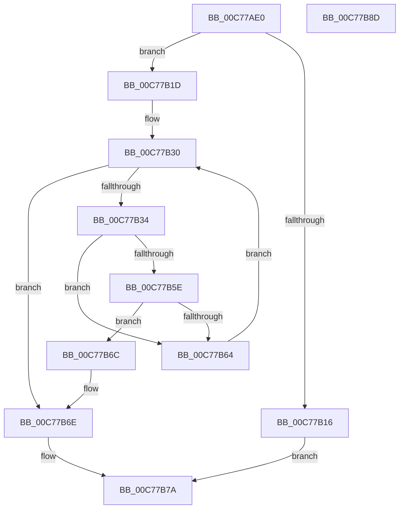

# PipCheckDependencies

- RVA: `0x00C77AE0`–`0x00C77B8E` (길이 `174` bytes)
- VA: `0x0000000140C77AE0`
- 실행 섹션: `INIT`
- PDB 이름 있음: `예`; PDB Function 태그: `아니요`
- unwind 정보 RVA: `0x000BEE5C`
- 디코드: `53`개 명령, `174/174` bytes 표시
- 미해석 바이트: `0` (있으면 어셈블리에 `.byte`로 보존)

> 이 문서는 커널 이미지의 기계어와 PDB 기호를 분석해 생성했습니다. 4번과 5번은 함수 원형과 자료형을 바이너리 사용 방식에서 추정한 C 해석이며 원본 소스 복구 결과는 아닙니다.

## 1. Dependencies

- 직접 호출 지점: **4**; 고유 호출 대상: **4**
- 직접 호출자로 확인된 함수: **2**
- RIP 상대 이미지 참조: **1**

### Outgoing calls
- `0x00C77B0D` → [IopGetRegistryValue](../../page/99/IopGetRegistryValue_function_009990EC.md) (function, `0x009990EC`)
- `0x00C77B3C` → [RtlInitUnicodeString](../../text/42/RtlInitUnicodeString_function_0042A780.md) (function, `0x0042A780`)
- `0x00C77B54` → [PipLookupGroupName](../C3/PipLookupGroupName_function_00C31578.md) (function, `0x00C31578`)
- `0x00C77B73` → [ExFreePoolWithTag](../../poolcode/B8/ExFreePoolWithTag_function_00B82870.md) (function, `0x00B82870`)

### Direct callers
- [IopInitializeBootDrivers](../C2/IopInitializeBootDrivers_function_00C2E6F4.md) at `0x00C2EBFA`
- [IopInitializeSystemDrivers](IopInitializeSystemDrivers_function_00C73590.md) at `0x00C7371C`

### Static image references
- `0x00C77AFF` → RVA `0x00C7A030` (` ?? ::PBOPGDP::`string'`; read)

## 2. Other-region calls and transfers

- 다른 실행 섹션으로 향하는 call: **3**
  - `0x00C77B0D` → [IopGetRegistryValue](../../page/99/IopGetRegistryValue_function_009990EC.md) (`INIT` → `PAGE`)
  - `0x00C77B3C` → [RtlInitUnicodeString](../../text/42/RtlInitUnicodeString_function_0042A780.md) (`INIT` → `.text`)
  - `0x00C77B73` → [ExFreePoolWithTag](../../poolcode/B8/ExFreePoolWithTag_function_00B82870.md) (`INIT` → `POOLCODE`)
- 별도 외부 분기/꼬리 이동을 확인하지 못했습니다.

## 3. Assembly (complete function range)

```asm
00C77AE0  48 8B C4                        mov rax, rsp
00C77AE3  48 89 58 08                     mov qword ptr [rax + 8], rbx
00C77AE7  48 89 68 18                     mov qword ptr [rax + 0x18], rbp
00C77AEB  56                              push rsi
00C77AEC  57                              push rdi
00C77AED  41 56                           push r14
00C77AEF  48 83 EC 30                     sub rsp, 0x30
00C77AF3  48 83 60 10 00                  and qword ptr [rax + 0x10], 0
00C77AF8  4C 8D 48 10                     lea r9, [rax + 0x10]
00C77AFC  0F 57 C0                        xorps xmm0, xmm0
00C77AFF  48 8D 15 2A 25 00 00            lea rdx, [rip + 0x252a]
00C77B06  45 33 C0                        xor r8d, r8d
00C77B09  0F 11 40 D8                     movups xmmword ptr [rax - 0x28], xmm0
00C77B0D  E8 DA 15 D2 FF                  call 0x1409990ec
00C77B12  85 C0                           test eax, eax
00C77B14  79 07                           jns 0x140c77b1d
00C77B16  B8 01 00 00 00                  mov eax, 1
00C77B1B  EB 5D                           jmp 0x140c77b7a
00C77B1D  48 8B 74 24 58                  mov rsi, qword ptr [rsp + 0x58]
00C77B22  BB 01 00 00 00                  mov ebx, 1
00C77B27  8B 7E 08                        mov edi, dword ptr [rsi + 8]
00C77B2A  8B 6E 0C                        mov ebp, dword ptr [rsi + 0xc]
00C77B2D  48 03 FE                        add rdi, rsi
00C77B30  85 ED                           test ebp, ebp
00C77B32  74 3A                           je 0x140c77b6e
00C77B34  48 8B D7                        mov rdx, rdi
00C77B37  48 8D 4C 24 20                  lea rcx, [rsp + 0x20]
00C77B3C  E8 3F 2C 7B FF                  call 0x14042a780
00C77B41  44 0F B7 74 24 22               movzx r14d, word ptr [rsp + 0x22]
00C77B47  48 8D 4C 24 20                  lea rcx, [rsp + 0x20]
00C77B4C  33 D2                           xor edx, edx
00C77B4E  66 44 89 74 24 20               mov word ptr [rsp + 0x20], r14w
00C77B54  E8 1F 9A FB FF                  call 0x140c31578
00C77B59  48 85 C0                        test rax, rax
00C77B5C  74 06                           je 0x140c77b64
00C77B5E  83 78 1C 00                     cmp dword ptr [rax + 0x1c], 0
00C77B62  74 08                           je 0x140c77b6c
00C77B64  41 2B EE                        sub ebp, r14d
00C77B67  49 03 FE                        add rdi, r14
00C77B6A  EB C4                           jmp 0x140c77b30
00C77B6C  33 DB                           xor ebx, ebx
00C77B6E  33 D2                           xor edx, edx
00C77B70  48 8B CE                        mov rcx, rsi
00C77B73  E8 F8 AC F0 FF                  call 0x140b82870
00C77B78  8B C3                           mov eax, ebx
00C77B7A  48 8B 5C 24 50                  mov rbx, qword ptr [rsp + 0x50]
00C77B7F  48 8B 6C 24 60                  mov rbp, qword ptr [rsp + 0x60]
00C77B84  48 83 C4 30                     add rsp, 0x30
00C77B88  41 5E                           pop r14
00C77B8A  5F                              pop rdi
00C77B8B  5E                              pop rsi
00C77B8C  C3                              ret
00C77B8D  CC                              int3
```

## 4. C-style interpretation (structured pseudocode)

```c
__int64 __fastcall PipCheckDependencies(__int64 a1, __int64 a2, int a3)
{
    __int64 result;
    __int64 v_rbp;
    __int64 v_rbx;
    __int64 v_rdi;
    __int64 v_rsp;
    unsigned __int16 v_stack_m26;
    unsigned __int64 v_stack_m28;
    unsigned __int64 v_stack_p10;
    unsigned __int64 v_stack_p18;
    unsigned __int64 v_stack_p8;

    *(unsigned __int64 *)(v_rsp + 8) = v_rbx;
    *(unsigned __int64 *)(v_rsp + 24) = v_rbp;
    v_rsp = (v_rsp) - (48);
    a3 = 0;
    *(unsigned __int64 *)(v_rsp - 40) = v_xmm0;
    result = IopGetRegistryValue(a1, v_rip + 9514, a3, v_rsp + 16);
    if (!sign_flag) goto loc_00C77B1D;
    goto loc_00C77B7A;
loc_00C77B1D:
    v_rdi = ((unsigned int)(*(unsigned int *)(v_stack_p10 + 8))) + (v_stack_p10);
loc_00C77B30:
    if ((unsigned int)((unsigned int)(*(unsigned int *)(v_stack_p10 + 12))) == 0) goto loc_00C77B6E;
    result = RtlInitUnicodeString(v_stack_m28, v_rdi, a3, v_rsp + 16);
    a2 = 0;
    v_stack_m28 = (unsigned __int16)(v_stack_m26);
    result = PipLookupGroupName(v_stack_m28, a2, a3, v_rsp + 16);
    if (result == 0) goto loc_00C77B64;
    if ((*(unsigned int *)(result + 28)) == 0) goto loc_00C77B6C;
loc_00C77B64:
    v_rbp = (unsigned int)(((unsigned int)(*(unsigned int *)(v_stack_p10 + 12))) - ((unsigned int)(v_stack_m26)));
    v_rdi = (v_rdi) + (v_stack_m26);
    goto loc_00C77B30;
loc_00C77B6C:
    v_rbx = 0;
loc_00C77B6E:
    a2 = 0;
    result = ExFreePoolWithTag(v_stack_p10, a2, a3, v_rsp + 16);
loc_00C77B7A:
    v_rsp = (v_rsp) + (48);
    return 0;
}
```

## 5. (Beta) C Style

```c
int64_t PipCheckDependencies(int64_t Arg1, int64_t Arg2, int32_t Arg3)
{
    int64_t result;
    int64_t local_rbp;
    int64_t local_rbx;
    int64_t local_rdi;
    int64_t local_rsp;
    uint16_t v_stack_m26;
    uint64_t v_stack_m28;
    uint64_t v_stack_p10;
    uint64_t v_stack_p18;
    uint64_t v_stack_p8;

    *(uint64_t *)(local_rsp + 0x8) = local_rbx;
    *(uint64_t *)(local_rsp + 0x18) = local_rbp;
    local_rsp = (local_rsp) - (48);
    Arg3 = 0;
    *(uint64_t *)(local_rsp - 0x28) = v_xmm0;
    result = IopGetRegistryValue(Arg1, v_rip + 9514, Arg3, local_rsp + 16);
    if (!sign_flag) goto loc_00C77B1D;
    goto loc_00C77B7A;
loc_00C77B1D:
    local_rdi = ((uint32_t)(*(uint32_t *)(v_stack_p10 + 0x8))) + (v_stack_p10);
loc_00C77B30:
    if ((uint32_t)((uint32_t)(*(uint32_t *)(v_stack_p10 + 0xC))) == 0) goto loc_00C77B6E;
    result = RtlInitUnicodeString(v_stack_m28, local_rdi, Arg3, local_rsp + 16);
    Arg2 = 0;
    v_stack_m28 = (uint16_t)(v_stack_m26);
    result = PipLookupGroupName(v_stack_m28, Arg2, Arg3, local_rsp + 16);
    if (result == 0) goto loc_00C77B64;
    if ((*(uint32_t *)(result + 0x1C)) == 0) goto loc_00C77B6C;
loc_00C77B64:
    local_rbp = (uint32_t)(((uint32_t)(*(uint32_t *)(v_stack_p10 + 0xC))) - ((uint32_t)(v_stack_m26)));
    local_rdi = (local_rdi) + (v_stack_m26);
    goto loc_00C77B30;
loc_00C77B6C:
    local_rbx = 0;
loc_00C77B6E:
    Arg2 = 0;
    result = ExFreePoolWithTag(v_stack_p10, Arg2, Arg3, local_rsp + 16);
loc_00C77B7A:
    local_rsp = (local_rsp) + (48);
    return 0;
}
```

## 6. Execution-region graph

[열기: 2D/3D 그래프와 함수 탐색 컨트롤 패널](../../../control-panel.html?section=init&rva=0x00C77AE0&view=graph)

- 2D 그래프는 위에서 아래로 흐르고, 3D 그래프는 빈 공간을 드래그해 회전합니다. Shift+드래그는 이동, 휠은 확대·축소, 함수 노드 선택은 대상 보고서 이동입니다.

### Static fallback


