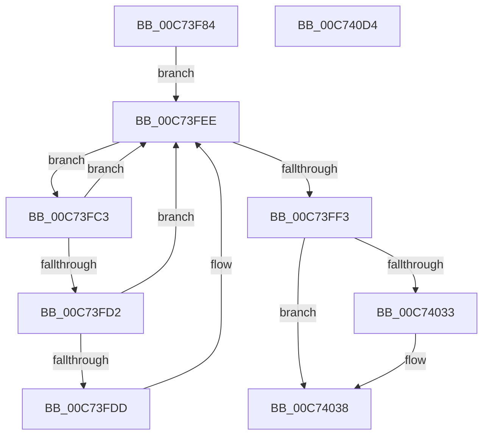

# PipInitializeCoreDriversAndElam

- RVA: `0x00C73F84`–`0x00C740D5` (길이 `337` bytes)
- VA: `0x0000000140C73F84`
- 실행 섹션: `INIT`
- PDB 이름 있음: `예`; PDB Function 태그: `아니요`
- unwind 정보 RVA: `0x000AAF70`
- 디코드: `79`개 명령, `337/337` bytes 표시
- 미해석 바이트: `0` (있으면 어셈블리에 `.byte`로 보존)

> 이 문서는 커널 이미지의 기계어와 PDB 기호를 분석해 생성했습니다. 4번과 5번은 함수 원형과 자료형을 바이너리 사용 방식에서 추정한 C 해석이며 원본 소스 복구 결과는 아닙니다.

## 1. Dependencies

- 직접 호출 지점: **17**; 고유 호출 대상: **14**
- 직접 호출자로 확인된 함수: **1**
- RIP 상대 이미지 참조: **10**

### Outgoing calls
- `0x00C73FA8` → [memset](../../text/6C/memset_function_006C6C40.md) (function, `0x006C6C40`)
- `0x00C73FB2` → [MiAcquireLoadLock](../../text/2A/MiAcquireLoadLock_function_002A3950.md) (function, `0x002A3950`)
- `0x00C73FE1` → [MmFindDataTableEntryByAddress](../../text/2A/MmFindDataTableEntryByAddress_function_002A3C0C.md) (function, `0x002A3C0C`)
- `0x00C73FE9` → [MmCallDllInitialize](../../page/7F/MmCallDllInitialize_function_007F836C.md) (function, `0x007F836C`)
- `0x00C73FF6` → [MmReleaseLoadLock](../../text/4D/MmReleaseLoadLock_function_004D36D0.md) (function, `0x004D36D0`)
- `0x00C74000` → [PipInitializeCoreDriversByGroup](PipInitializeCoreDriversByGroup_function_00C740DC.md) (function, `0x00C740DC`)
- `0x00C74025` → [KeInitAmd64SpecificState](../BE/KeInitAmd64SpecificState_function_00BEF1A0.md) (function, `0x00BEF1A0`)
- `0x00C74033` → [KeCheckedKernelInitialize](../BE/KeCheckedKernelInitialize_function_00BEFA6C.md) (function, `0x00BEFA6C`)
- `0x00C7404F` → [memset](../../text/6C/memset_function_006C6C40.md) (function, `0x006C6C40`)
- `0x00C7405E` → [VslRegisterBootDrivers](VslRegisterBootDrivers_function_00C7453C.md) (function, `0x00C7453C`)
- `0x00C74067` → [VslConnectSwInterrupt](VslConnectSwInterrupt_function_00C75C70.md) (function, `0x00C75C70`)
- `0x00C7406F` → [PipInitComputerIds](PipInitComputerIds_function_00C74734.md) (function, `0x00C74734`)
- `0x00C74077` → [PipInitializeEarlyLaunchDrivers](PipInitializeEarlyLaunchDrivers_function_00C74288.md) (function, `0x00C74288`)
- `0x00C74085` → [PnpNotifyEarlyLaunchStatusUpdate](../BE/PnpNotifyEarlyLaunchStatusUpdate_function_00BEF120.md) (function, `0x00BEF120`)
- `0x00C74092` → [PipInitializeDriverDependentDLLs](PipInitializeDriverDependentDLLs_function_00C74398.md) (function, `0x00C74398`)
- `0x00C7409F` → [PipInitializeCoreDriversByGroup](PipInitializeCoreDriversByGroup_function_00C740DC.md) (function, `0x00C740DC`)
- `0x00C740AC` → [PipInitializeCoreDriversByGroup](PipInitializeCoreDriversByGroup_function_00C740DC.md) (function, `0x00C740DC`)

### Direct callers
- [IopInitializeBootDrivers](../C2/IopInitializeBootDrivers_function_00C2E6F4.md) at `0x00C2E869`

### Static image references
- `0x00C74005` → RVA `0x00E00638` (`.data`; read)
- `0x00C7400C` → RVA `0x00F06580` (`.data`; write)
- `0x00C74013` → RVA `0x00E086E0` (`.data`; write)
- `0x00C7401A` → RVA `0x00E086E8` (`.data`; write)
- `0x00C7402A` → RVA `0x00FC5368` (`ALMOSTRO`; read)
- `0x00C74038` → RVA `0x00F06578` (`.data`; read/write)
- `0x00C74040` → RVA `0x00E086B0` (`.data`; read)
- `0x00C74057` → RVA `0x00E087E0` (`.data`; read)
- `0x00C7407E` → RVA `0x00F8CDD8` (`.data`; write)
- `0x00C740B9` → RVA `0x00F8CFB0` (`.data`; write)

## 2. Other-region calls and transfers

- 다른 실행 섹션으로 향하는 call: **6**
  - `0x00C73FA8` → [memset](../../text/6C/memset_function_006C6C40.md) (`INIT` → `.text`)
  - `0x00C73FB2` → [MiAcquireLoadLock](../../text/2A/MiAcquireLoadLock_function_002A3950.md) (`INIT` → `.text`)
  - `0x00C73FE1` → [MmFindDataTableEntryByAddress](../../text/2A/MmFindDataTableEntryByAddress_function_002A3C0C.md) (`INIT` → `.text`)
  - `0x00C73FE9` → [MmCallDllInitialize](../../page/7F/MmCallDllInitialize_function_007F836C.md) (`INIT` → `PAGE`)
  - `0x00C73FF6` → [MmReleaseLoadLock](../../text/4D/MmReleaseLoadLock_function_004D36D0.md) (`INIT` → `.text`)
  - `0x00C7404F` → [memset](../../text/6C/memset_function_006C6C40.md) (`INIT` → `.text`)
- 별도 외부 분기/꼬리 이동을 확인하지 못했습니다.

## 3. Assembly (complete function range)

```asm
00C73F84  48 8B C4                        mov rax, rsp
00C73F87  48 89 58 08                     mov qword ptr [rax + 8], rbx
00C73F8B  48 89 68 10                     mov qword ptr [rax + 0x10], rbp
00C73F8F  48 89 70 18                     mov qword ptr [rax + 0x18], rsi
00C73F93  57                              push rdi
00C73F94  48 81 EC 90 00 00 00            sub rsp, 0x90
00C73F9B  33 D2                           xor edx, edx
00C73F9D  48 8B F9                        mov rdi, rcx
00C73FA0  48 8D 48 88                     lea rcx, [rax - 0x78]
00C73FA4  44 8D 42 68                     lea r8d, [rdx + 0x68]
00C73FA8  E8 93 2C A5 FF                  call 0x1406c6c40
00C73FAD  B9 01 00 00 00                  mov ecx, 1
00C73FB2  E8 99 F9 62 FF                  call 0x1402a3950
00C73FB7  48 8D 77 10                     lea rsi, [rdi + 0x10]
00C73FBB  48 8B E8                        mov rbp, rax
00C73FBE  48 8B 1E                        mov rbx, qword ptr [rsi]
00C73FC1  EB 2B                           jmp 0x140c73fee
00C73FC3  48 8D 0B                        lea rcx, [rbx]
00C73FC6  48 8B 1B                        mov rbx, qword ptr [rbx]
00C73FC9  F7 41 68 00 00 00 04            test dword ptr [rcx + 0x68], 0x4000000
00C73FD0  74 1C                           je 0x140c73fee
00C73FD2  8B 91 1C 01 00 00               mov edx, dword ptr [rcx + 0x11c]
00C73FD8  F6 C2 01                        test dl, 1
00C73FDB  74 11                           je 0x140c73fee
00C73FDD  48 8B 49 30                     mov rcx, qword ptr [rcx + 0x30]
00C73FE1  E8 26 FC 62 FF                  call 0x1402a3c0c
00C73FE6  48 8B C8                        mov rcx, rax
00C73FE9  E8 7E 43 B8 FF                  call 0x1407f836c
00C73FEE  48 3B DE                        cmp rbx, rsi
00C73FF1  75 D0                           jne 0x140c73fc3
00C73FF3  48 8B CD                        mov rcx, rbp
00C73FF6  E8 D5 F6 85 FF                  call 0x1404d36d0
00C73FFB  48 8B D7                        mov rdx, rdi
00C73FFE  33 C9                           xor ecx, ecx
00C74000  E8 D7 00 00 00                  call 0x140c740dc
00C74005  48 8D 05 2C C6 18 00            lea rax, [rip + 0x18c62c]
00C7400C  C6 05 6D 25 29 00 01            mov byte ptr [rip + 0x29256d], 1
00C74013  48 89 05 C6 46 19 00            mov qword ptr [rip + 0x1946c6], rax
00C7401A  48 C7 05 C3 46 19 00 08 00 00 00  mov qword ptr [rip + 0x1946c3], 8
00C74025  E8 76 B1 F7 FF                  call 0x140bef1a0
00C7402A  83 3D 37 13 35 00 00            cmp dword ptr [rip + 0x351337], 0
00C74031  74 05                           je 0x140c74038
00C74033  E8 34 BA F7 FF                  call 0x140befa6c
00C74038  48 83 25 38 25 29 00 00         and qword ptr [rip + 0x292538], 0
00C74040  48 8D 0D 69 46 19 00            lea rcx, [rip + 0x194669]
00C74047  33 D2                           xor edx, edx
00C74049  41 B8 30 01 00 00               mov r8d, 0x130
00C7404F  E8 EC 2B A5 FF                  call 0x1406c6c40
00C74054  0F 57 C0                        xorps xmm0, xmm0
00C74057  0F 11 05 82 47 19 00            movups xmmword ptr [rip + 0x194782], xmm0
00C7405E  E8 D9 04 00 00                  call 0x140c7453c
00C74063  33 D2                           xor edx, edx
00C74065  33 C9                           xor ecx, ecx
00C74067  E8 04 1C 00 00                  call 0x140c75c70
00C7406C  48 8B CF                        mov rcx, rdi
00C7406F  E8 C0 06 00 00                  call 0x140c74734
00C74074  48 8B CF                        mov rcx, rdi
00C74077  E8 0C 02 00 00                  call 0x140c74288
00C7407C  33 C9                           xor ecx, ecx
00C7407E  C6 05 53 8D 31 00 01            mov byte ptr [rip + 0x318d53], 1
00C74085  E8 96 B0 F7 FF                  call 0x140bef120
00C7408A  48 8B D7                        mov rdx, rdi
00C7408D  B9 01 00 00 00                  mov ecx, 1
00C74092  E8 01 03 00 00                  call 0x140c74398
00C74097  48 8B D7                        mov rdx, rdi
00C7409A  B9 01 00 00 00                  mov ecx, 1
00C7409F  E8 38 00 00 00                  call 0x140c740dc
00C740A4  48 8B D7                        mov rdx, rdi
00C740A7  B9 02 00 00 00                  mov ecx, 2
00C740AC  E8 2B 00 00 00                  call 0x140c740dc
00C740B1  4C 8D 9C 24 90 00 00 00         lea r11, [rsp + 0x90]
00C740B9  C7 05 ED 8E 31 00 03 00 00 00   mov dword ptr [rip + 0x318eed], 3
00C740C3  49 8B 5B 10                     mov rbx, qword ptr [r11 + 0x10]
00C740C7  49 8B 6B 18                     mov rbp, qword ptr [r11 + 0x18]
00C740CB  49 8B 73 20                     mov rsi, qword ptr [r11 + 0x20]
00C740CF  49 8B E3                        mov rsp, r11
00C740D2  5F                              pop rdi
00C740D3  C3                              ret
00C740D4  CC                              int3
```

## 4. C-style interpretation (structured pseudocode)

```c
__int64 __fastcall PipInitializeCoreDriversAndElam(__int64 a1, int a2)
{
    __int64 result;
    __int64 v_rsp;
    unsigned __int64 v_stack_m8;

    *(unsigned __int64 *)(v_rsp + 8) = v_rbx;
    *(unsigned __int64 *)(v_rsp + 16) = v_rbp;
    *(unsigned __int64 *)(v_rsp + 24) = v_rsi;
    v_rsp = (v_rsp) - (144);
    a2 = 0;
    result = memset(v_rsp - 120, a2, a2 + 104, a4);
    result = MiAcquireLoadLock(1, a2, a2 + 104, a4);
    goto loc_00C73FEE;
loc_00C73FC3:
    if (((*(unsigned int *)(*(unsigned __int64 *)(a1 + 16) + 104)) & (0x4000000ULL)) == 0) goto loc_00C73FEE;
    if ((((unsigned __int8)((unsigned int)(*(unsigned int *)(*(unsigned __int64 *)(a1 + 16) + 284)))) & (1)) != 0) {
        a1 = *(unsigned __int64 *)(*(unsigned __int64 *)(a1 + 16) + 48);
        result = MmFindDataTableEntryByAddress(a1, (unsigned int)(*(unsigned int *)(*(unsigned __int64 *)(a1 + 16) + 284)), a2 + 104, a4);
        a1 = result;
        result = MmCallDllInitialize(a1, (unsigned int)(*(unsigned int *)(*(unsigned __int64 *)(a1 + 16) + 284)), a2 + 104, a4);
    }
    if ((*(unsigned __int64 *)(*(unsigned __int64 *)(a1 + 16))) != (a1 + 16)) goto loc_00C73FC3;
    result = MmReleaseLoadLock(result, (unsigned int)(*(unsigned int *)(*(unsigned __int64 *)(a1 + 16) + 284)), a2 + 104, a4);
    a1 = 0;
    result = PipInitializeCoreDriversByGroup(a1, a1, a2 + 104, a4);
    *(unsigned __int8 *)(v_rip + 2696557) = 1;
    *(unsigned __int64 *)(v_rip + 1656518) = v_rip + 1623596;
    *(unsigned __int64 *)(v_rip + 1656515) = 8;
    result = KeInitAmd64SpecificState(a1, a1, a2 + 104, a4);
    if ((*(unsigned int *)(v_rip + 3478327)) != 0) {
        result = KeCheckedKernelInitialize(a1, a1, a2 + 104, a4);
    }
    a2 = 0;
    result = memset(v_rip + 1656425, a2, 304, a4);
    *(unsigned __int64 *)(v_rip + 1656706) = v_xmm0;
    result = VslRegisterBootDrivers(v_rip + 1656425, a2, 304, a4);
    a2 = 0;
    a1 = 0;
    result = VslConnectSwInterrupt(a1, a2, 304, a4);
    result = PipInitComputerIds(0, a2, 304, a4);
    result = PipInitializeEarlyLaunchDrivers(0, a2, 304, a4);
    a1 = 0;
    *(unsigned __int8 *)(v_rip + 3247443) = 1;
    result = PnpNotifyEarlyLaunchStatusUpdate(a1, a2, 304, a4);
    result = PipInitializeDriverDependentDLLs(1, 0, 304, a4);
    result = PipInitializeCoreDriversByGroup(1, 0, 304, a4);
    result = PipInitializeCoreDriversByGroup(2, 0, 304, a4);
    *(unsigned int *)(v_rip + 3247853) = 3;
    return result;
}
```

## 5. (Beta) C Style

```c
int64_t PipInitializeCoreDriversAndElam(void *Arg1, int32_t Arg2)
{
    uint8_t *arg1 = (uint8_t *)Arg1;

    int64_t result;
    int64_t local_rsp;
    uint64_t v_stack_m8;

    *(uint64_t *)(local_rsp + 0x8) = local_rbx;
    *(uint64_t *)(local_rsp + 0x10) = local_rbp;
    *(uint64_t *)(local_rsp + 0x18) = local_rsi;
    local_rsp = (local_rsp) - (144);
    Arg2 = 0;
    result = memset(local_rsp - 120, Arg2, Arg2 + 104, a4);
    result = MiAcquireLoadLock(1, Arg2, Arg2 + 104, a4);
    goto loc_00C73FEE;
loc_00C73FC3:
    if (((*(uint32_t *)(*(uint64_t *)(arg1 + 0x10) + 0x68)) & (0x4000000ULL)) == 0) goto loc_00C73FEE;
    if ((((uint8_t)((uint32_t)(*(uint32_t *)(*(uint64_t *)(arg1 + 0x10) + 0x11C)))) & (1)) != 0) {
        Arg1 = *(uint64_t *)(*(uint64_t *)(arg1 + 0x10) + 0x30);
        result = MmFindDataTableEntryByAddress(Arg1, (uint32_t)(*(uint32_t *)(*(uint64_t *)(arg1 + 0x10) + 0x11C)), Arg2 + 104, a4);
        Arg1 = result;
        result = MmCallDllInitialize(Arg1, (uint32_t)(*(uint32_t *)(*(uint64_t *)(arg1 + 0x10) + 0x11C)), Arg2 + 104, a4);
    }
    if ((*(uint64_t *)(*(uint64_t *)(arg1 + 0x10))) != (Arg1 + 16)) goto loc_00C73FC3;
    result = MmReleaseLoadLock(result, (uint32_t)(*(uint32_t *)(*(uint64_t *)(arg1 + 0x10) + 0x11C)), Arg2 + 104, a4);
    Arg1 = 0;
    result = PipInitializeCoreDriversByGroup(Arg1, Arg1, Arg2 + 104, a4);
    *(uint8_t *)(v_rip + 0x29256D) = 1;
    *(uint64_t *)(v_rip + 0x1946C6) = v_rip + 1623596;
    *(uint64_t *)(v_rip + 0x1946C3) = 8;
    result = KeInitAmd64SpecificState(Arg1, Arg1, Arg2 + 104, a4);
    if ((*(uint32_t *)(v_rip + 0x351337)) != 0) {
        result = KeCheckedKernelInitialize(Arg1, Arg1, Arg2 + 104, a4);
    }
    Arg2 = 0;
    result = memset(v_rip + 1656425, Arg2, 304, a4);
    *(uint64_t *)(v_rip + 0x194782) = v_xmm0;
    result = VslRegisterBootDrivers(v_rip + 1656425, Arg2, 304, a4);
    Arg2 = 0;
    Arg1 = 0;
    result = VslConnectSwInterrupt(Arg1, Arg2, 304, a4);
    result = PipInitComputerIds(0, Arg2, 304, a4);
    result = PipInitializeEarlyLaunchDrivers(0, Arg2, 304, a4);
    Arg1 = 0;
    *(uint8_t *)(v_rip + 0x318D53) = 1;
    result = PnpNotifyEarlyLaunchStatusUpdate(Arg1, Arg2, 304, a4);
    result = PipInitializeDriverDependentDLLs(1, 0, 304, a4);
    result = PipInitializeCoreDriversByGroup(1, 0, 304, a4);
    result = PipInitializeCoreDriversByGroup(2, 0, 304, a4);
    *(uint32_t *)(v_rip + 0x318EED) = 3;
    return result;
}
```

### 관측된 메모리 오프셋

구조체 형식이 확인되지 않은 접근은 인자 기준의 오프셋으로만 기록했습니다.

| 기준 인자 | 오프셋 표현 | 폭 (bit) | 접근 |
|---|---:|---:|---|
| `Arg1` | `+ 0x0` | `64` | `R` |
| `Arg1` | `+ 0x10` | `64` | `R` |

## 6. Execution-region graph

[열기: 2D/3D 그래프와 함수 탐색 컨트롤 패널](../../../control-panel.html?section=init&rva=0x00C73F84&view=graph)

- 2D 그래프는 위에서 아래로 흐르고, 3D 그래프는 빈 공간을 드래그해 회전합니다. Shift+드래그는 이동, 휠은 확대·축소, 함수 노드 선택은 대상 보고서 이동입니다.

### Static fallback


