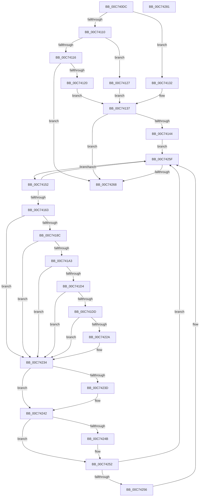

# PipInitializeCoreDriversByGroup

- RVA: `0x00C740DC`–`0x00C74282` (길이 `422` bytes)
- VA: `0x0000000140C740DC`
- 실행 섹션: `INIT`
- PDB 이름 있음: `예`; PDB Function 태그: `아니요`
- unwind 정보 RVA: `0x000BC9BC`
- 디코드: `116`개 명령, `422/422` bytes 표시
- 미해석 바이트: `0` (있으면 어셈블리에 `.byte`로 보존)

> 이 문서는 커널 이미지의 기계어와 PDB 기호를 분석해 생성했습니다. 4번과 5번은 함수 원형과 자료형을 바이너리 사용 방식에서 추정한 C 해석이며 원본 소스 복구 결과는 아닙니다.

## 1. Dependencies

- 직접 호출 지점: **12**; 고유 호출 대상: **12**
- 직접 호출자로 확인된 함수: **1**
- RIP 상대 이미지 참조: **1**

### Outgoing calls
- `0x00C7417D` → [IopOpenRegistryKeyEx](../../page/A5/IopOpenRegistryKeyEx_function_00A51B44.md) (function, `0x00A51B44`)
- `0x00C74194` → [IopGetDriverNameFromKeyNode](../../page/99/IopGetDriverNameFromKeyNode_function_00998808.md) (function, `0x00998808`)
- `0x00C741C9` → [PnpInitializeBootStartDriver](PnpInitializeBootStartDriver_function_00C760F0.md) (function, `0x00C760F0`)
- `0x00C741DD` → [PnpLockDeviceActionQueue](../../text/4A/PnpLockDeviceActionQueue_function_004A4388.md) (function, `0x004A4388`)
- `0x00C741EF` → [PipApplyFunctionToServiceInstances](../../page/72/PipApplyFunctionToServiceInstances_function_0072BF40.md) (function, `0x0072BF40`)
- `0x00C741F4` → [PnpUnlockDeviceActionQueue](../../text/4A/PnpUnlockDeviceActionQueue_function_004A42F4.md) (function, `0x004A42F4`)
- `0x00C741F9` → [PnpWaitForEmptyDeviceActionQueue](../../page/73/PnpWaitForEmptyDeviceActionQueue_function_007375AC.md) (function, `0x007375AC`)
- `0x00C7421C` → [PnpRequestDeviceAction](../../text/47/PnpRequestDeviceAction_function_00477FF8.md) (function, `0x00477FF8`)
- `0x00C74221` → [PnpWaitForEmptyDeviceEventQueue](../../page/70/PnpWaitForEmptyDeviceEventQueue_function_00704350.md) (function, `0x00704350`)
- `0x00C7422F` → [HeadlessKernelAddLogEntry](../../text/4B/HeadlessKernelAddLogEntry_function_004B7DEC.md) (function, `0x004B7DEC`)
- `0x00C7423D` → [ZwClose](../../text/6A/ZwClose_function_006AD2B0.md) (function, `0x006AD2B0`)
- `0x00C7424D` → [ExFreePoolWithTag](../../poolcode/B8/ExFreePoolWithTag_function_00B82870.md) (function, `0x00B82870`)

### Direct callers
- [PipInitializeCoreDriversAndElam](PipInitializeCoreDriversAndElam_function_00C73F84.md) at `0x00C74000`
- [PipInitializeCoreDriversAndElam](PipInitializeCoreDriversAndElam_function_00C73F84.md) at `0x00C7409F`
- [PipInitializeCoreDriversAndElam](PipInitializeCoreDriversAndElam_function_00C73F84.md) at `0x00C740AC`

### Static image references
- `0x00C74147` → RVA `0x00F8CFB0` (`.data`; write)

## 2. Other-region calls and transfers

- 다른 실행 섹션으로 향하는 call: **11**
  - `0x00C7417D` → [IopOpenRegistryKeyEx](../../page/A5/IopOpenRegistryKeyEx_function_00A51B44.md) (`INIT` → `PAGE`)
  - `0x00C74194` → [IopGetDriverNameFromKeyNode](../../page/99/IopGetDriverNameFromKeyNode_function_00998808.md) (`INIT` → `PAGE`)
  - `0x00C741DD` → [PnpLockDeviceActionQueue](../../text/4A/PnpLockDeviceActionQueue_function_004A4388.md) (`INIT` → `.text`)
  - `0x00C741EF` → [PipApplyFunctionToServiceInstances](../../page/72/PipApplyFunctionToServiceInstances_function_0072BF40.md) (`INIT` → `PAGE`)
  - `0x00C741F4` → [PnpUnlockDeviceActionQueue](../../text/4A/PnpUnlockDeviceActionQueue_function_004A42F4.md) (`INIT` → `.text`)
  - `0x00C741F9` → [PnpWaitForEmptyDeviceActionQueue](../../page/73/PnpWaitForEmptyDeviceActionQueue_function_007375AC.md) (`INIT` → `PAGE`)
  - `0x00C7421C` → [PnpRequestDeviceAction](../../text/47/PnpRequestDeviceAction_function_00477FF8.md) (`INIT` → `.text`)
  - `0x00C74221` → [PnpWaitForEmptyDeviceEventQueue](../../page/70/PnpWaitForEmptyDeviceEventQueue_function_00704350.md) (`INIT` → `PAGE`)
  - `0x00C7422F` → [HeadlessKernelAddLogEntry](../../text/4B/HeadlessKernelAddLogEntry_function_004B7DEC.md) (`INIT` → `.text`)
  - `0x00C7423D` → [ZwClose](../../text/6A/ZwClose_function_006AD2B0.md) (`INIT` → `.text`)
  - `0x00C7424D` → [ExFreePoolWithTag](../../poolcode/B8/ExFreePoolWithTag_function_00B82870.md) (`INIT` → `POOLCODE`)
- 별도 외부 분기/꼬리 이동을 확인하지 못했습니다.

## 3. Assembly (complete function range)

```asm
00C740DC  48 89 5C 24 08                  mov qword ptr [rsp + 8], rbx
00C740E1  48 89 74 24 10                  mov qword ptr [rsp + 0x10], rsi
00C740E6  55                              push rbp
00C740E7  57                              push rdi
00C740E8  41 54                           push r12
00C740EA  41 56                           push r14
00C740EC  41 57                           push r15
00C740EE  48 8B EC                        mov rbp, rsp
00C740F1  48 83 EC 50                     sub rsp, 0x50
00C740F5  48 83 65 48 00                  and qword ptr [rbp + 0x48], 0
00C740FA  45 33 E4                        xor r12d, r12d
00C740FD  48 83 65 40 00                  and qword ptr [rbp + 0x40], 0
00C74102  0F 57 C0                        xorps xmm0, xmm0
00C74105  44 8B C1                        mov r8d, ecx
00C74108  0F 11 45 F0                     movups xmmword ptr [rbp - 0x10], xmm0
00C7410C  85 C9                           test ecx, ecx
00C7410E  74 22                           je 0x140c74132
00C74110  41 83 E8 01                     sub r8d, 1
00C74114  74 11                           je 0x140c74127
00C74116  41 83 F8 01                     cmp r8d, 1
00C7411A  0F 85 48 01 00 00               jne 0x140c74268
00C74120  41 8D 44 24 70                  lea eax, [r12 + 0x70]
00C74125  EB 10                           jmp 0x140c74137
00C74127  B8 60 00 00 00                  mov eax, 0x60
00C7412C  44 8D 60 A1                     lea r12d, [rax - 0x5f]
00C74130  EB 05                           jmp 0x140c74137
00C74132  B8 50 00 00 00                  mov eax, 0x50
00C74137  48 8D 3C 10                     lea rdi, [rax + rdx]
00C7413B  48 85 FF                        test rdi, rdi
00C7413E  0F 84 24 01 00 00               je 0x140c74268
00C74144  48 8B 1F                        mov rbx, qword ptr [rdi]
00C74147  89 0D 63 8E 31 00               mov dword ptr [rip + 0x318e63], ecx
00C7414D  E9 0D 01 00 00                  jmp 0x140c7425f
00C74152  4C 8D 33                        lea r14, [rbx]
00C74155  48 8B 1B                        mov rbx, qword ptr [rbx]
00C74158  41 83 7E 38 00                  cmp dword ptr [r14 + 0x38], 0
00C7415D  0F 8C FC 00 00 00               jl 0x140c7425f
00C74163  48 83 65 F8 00                  and qword ptr [rbp - 8], 0
00C74168  4D 8D 46 20                     lea r8, [r14 + 0x20]
00C7416C  48 83 65 40 00                  and qword ptr [rbp + 0x40], 0
00C74171  48 8D 4D 40                     lea rcx, [rbp + 0x40]
00C74175  41 B9 19 00 02 00               mov r9d, 0x20019
00C7417B  33 D2                           xor edx, edx
00C7417D  E8 C2 D9 DD FF                  call 0x140a51b44
00C74182  8B F0                           mov esi, eax
00C74184  85 C0                           test eax, eax
00C74186  0F 88 A8 00 00 00               js 0x140c74234
00C7418C  48 8B 4D 40                     mov rcx, qword ptr [rbp + 0x40]
00C74190  48 8D 55 F0                     lea rdx, [rbp - 0x10]
00C74194  E8 6F 46 D2 FF                  call 0x140998808
00C74199  8B F0                           mov esi, eax
00C7419B  85 C0                           test eax, eax
00C7419D  0F 88 91 00 00 00               js 0x140c74234
00C741A3  4D 8B 46 30                     mov r8, qword ptr [r14 + 0x30]
00C741A7  48 8D 45 48                     lea rax, [rbp + 0x48]
00C741AB  48 89 44 24 38                  mov qword ptr [rsp + 0x38], rax
00C741B0  49 8D 56 20                     lea rdx, [r14 + 0x20]
00C741B4  4D 8B C8                        mov r9, r8
00C741B7  44 89 64 24 28                  mov dword ptr [rsp + 0x28], r12d
00C741BC  83 64 24 20 00                  and dword ptr [rsp + 0x20], 0
00C741C1  48 8D 4D F0                     lea rcx, [rbp - 0x10]
00C741C5  4D 8B 40 38                     mov r8, qword ptr [r8 + 0x38]
00C741C9  E8 22 1F 00 00                  call 0x140c760f0
00C741CE  8B F0                           mov esi, eax
00C741D0  85 C0                           test eax, eax
00C741D2  78 60                           js 0x140c74234
00C741D4  4C 8B 7D 48                     mov r15, qword ptr [rbp + 0x48]
00C741D8  4D 85 FF                        test r15, r15
00C741DB  74 57                           je 0x140c74234
00C741DD  E8 A6 01 83 FF                  call 0x1404a4388
00C741E2  49 8B 57 30                     mov rdx, qword ptr [r15 + 0x30]
00C741E6  48 83 C2 18                     add rdx, 0x18
00C741EA  4C 89 7C 24 28                  mov qword ptr [rsp + 0x28], r15
00C741EF  E8 4C 7D AB FF                  call 0x14072bf40
00C741F4  E8 FB 00 83 FF                  call 0x1404a42f4
00C741F9  E8 AE 33 AC FF                  call 0x1407375ac
00C741FE  48 83 64 24 30 00               and qword ptr [rsp + 0x30], 0
00C74204  45 33 C9                        xor r9d, r9d
00C74207  48 83 64 24 28 00               and qword ptr [rsp + 0x28], 0
00C7420D  45 33 C0                        xor r8d, r8d
00C74210  48 83 64 24 20 00               and qword ptr [rsp + 0x20], 0
00C74216  33 C9                           xor ecx, ecx
00C74218  41 8D 51 07                     lea edx, [r9 + 7]
00C7421C  E8 D7 3D 80 FF                  call 0x140477ff8
00C74221  E8 2A 01 A9 FF                  call 0x140704350
00C74226  85 C0                           test eax, eax
00C74228  79 0A                           jns 0x140c74234
00C7422A  33 D2                           xor edx, edx
00C7422C  8D 4A 12                        lea ecx, [rdx + 0x12]
00C7422F  E8 B8 3B 84 FF                  call 0x1404b7dec
00C74234  48 8B 4D 40                     mov rcx, qword ptr [rbp + 0x40]
00C74238  48 85 C9                        test rcx, rcx
00C7423B  74 05                           je 0x140c74242
00C7423D  E8 6E 90 A3 FF                  call 0x1406ad2b0
00C74242  48 8B 4D F8                     mov rcx, qword ptr [rbp - 8]
00C74246  48 85 C9                        test rcx, rcx
00C74249  74 07                           je 0x140c74252
00C7424B  33 D2                           xor edx, edx
00C7424D  E8 1E E6 F0 FF                  call 0x140b82870
00C74252  85 F6                           test esi, esi
00C74254  79 09                           jns 0x140c7425f
00C74256  49 8B 46 30                     mov rax, qword ptr [r14 + 0x30]
00C7425A  0F BA 68 68 11                  bts dword ptr [rax + 0x68], 0x11
00C7425F  48 3B DF                        cmp rbx, rdi
00C74262  0F 85 EA FE FF FF               jne 0x140c74152
00C74268  4C 8D 5C 24 50                  lea r11, [rsp + 0x50]
00C7426D  49 8B 5B 30                     mov rbx, qword ptr [r11 + 0x30]
00C74271  49 8B 73 38                     mov rsi, qword ptr [r11 + 0x38]
00C74275  49 8B E3                        mov rsp, r11
00C74278  41 5F                           pop r15
00C7427A  41 5E                           pop r14
00C7427C  41 5C                           pop r12
00C7427E  5F                              pop rdi
00C7427F  5D                              pop rbp
00C74280  C3                              ret
00C74281  CC                              int3
```

## 4. C-style interpretation (structured pseudocode)

```c
__int64 __fastcall PipInitializeCoreDriversByGroup(int a1, __int64 a2)
{
    __int64 result;
    __int64 v_r12;
    __int64 v_rsp;
    unsigned __int64 v_stack_m28;
    unsigned __int64 v_stack_m30;
    unsigned __int64 v_stack_m38;
    unsigned __int64 v_stack_m40;
    unsigned __int64 v_stack_m48;
    unsigned int v_stack_m50;
    unsigned int v_stack_m58;
    unsigned __int64 v_stack_p10;
    unsigned __int64 v_stack_p18;
    unsigned __int64 v_stack_p20;
    unsigned __int64 v_stack_p8;

    v_stack_p8 = v_rbx;
    v_stack_p10 = v_rsi;
    v_rsp = (v_rsp) - (80);
    v_r12 = 0;
    v_stack_m38 = v_xmm0;
    if (a1 == 0) goto loc_00C74132;
    a3 = (unsigned int)(((unsigned int)(a1)) - (1));
    if (condition_is_equal) goto loc_00C74127;
    if (((unsigned int)(a3)) != 1) goto loc_00C74268;
    goto loc_00C74137;
loc_00C74127:
    goto loc_00C74137;
loc_00C74132:
loc_00C74137:
    if (80 + a2 * 1 == 0) goto loc_00C74268;
    *(unsigned int *)(v_rip + 3247715) = a1;
    goto loc_00C7425F;
loc_00C74152:
    if ((*(unsigned int *)(*(unsigned __int64 *)(80 + a2 * 1) + 56)) < 0) goto loc_00C7425F;
    a2 = 0;
    result = IopOpenRegistryKeyEx(v_stack_p18, a2, *(unsigned __int64 *)(80 + a2 * 1) + 32, (unsigned int)(0x20019ULL));
    if (sign_flag) goto loc_00C74234;
    result = IopGetDriverNameFromKeyNode(v_stack_p18, v_stack_m38, *(unsigned __int64 *)(80 + a2 * 1) + 32, (unsigned int)(0x20019ULL));
    if (sign_flag) goto loc_00C74234;
    v_stack_m40 = v_stack_p20;
    v_stack_m50 = (unsigned int)(96 - 95);
    result = PnpInitializeBootStartDriver(v_stack_m38, *(unsigned __int64 *)(80 + a2 * 1) + 32, *(unsigned __int64 *)(*(unsigned __int64 *)(*(unsigned __int64 *)(80 + a2 * 1) + 48) + 56), *(unsigned __int64 *)(*(unsigned __int64 *)(80 + a2 * 1) + 48));
    if (sign_flag) goto loc_00C74234;
    if (v_stack_p20 == 0) goto loc_00C74234;
    result = PnpLockDeviceActionQueue(v_stack_m38, *(unsigned __int64 *)(80 + a2 * 1) + 32, *(unsigned __int64 *)(*(unsigned __int64 *)(*(unsigned __int64 *)(80 + a2 * 1) + 48) + 56), *(unsigned __int64 *)(*(unsigned __int64 *)(80 + a2 * 1) + 48));
    a2 = (*(unsigned __int64 *)(v_stack_p20 + 48)) + (24);
    v_stack_m50 = v_stack_p20;
    result = PipApplyFunctionToServiceInstances(v_stack_m38, a2, *(unsigned __int64 *)(*(unsigned __int64 *)(*(unsigned __int64 *)(80 + a2 * 1) + 48) + 56), *(unsigned __int64 *)(*(unsigned __int64 *)(80 + a2 * 1) + 48));
    result = PnpUnlockDeviceActionQueue(v_stack_m38, a2, *(unsigned __int64 *)(*(unsigned __int64 *)(*(unsigned __int64 *)(80 + a2 * 1) + 48) + 56), *(unsigned __int64 *)(*(unsigned __int64 *)(80 + a2 * 1) + 48));
    result = PnpWaitForEmptyDeviceActionQueue(v_stack_m38, a2, *(unsigned __int64 *)(*(unsigned __int64 *)(*(unsigned __int64 *)(80 + a2 * 1) + 48) + 56), *(unsigned __int64 *)(*(unsigned __int64 *)(80 + a2 * 1) + 48));
    a4 = 0;
    a3 = 0;
    a1 = 0;
    result = PnpRequestDeviceAction(a1, a4 + 7, a3, a4);
    result = PnpWaitForEmptyDeviceEventQueue(a1, a4 + 7, a3, a4);
    if (sign_flag) {
        a2 = 0;
        a1 = a2 + 18;
        result = HeadlessKernelAddLogEntry(a1, a2, a3, a4);
    }
    if (v_stack_p18 != 0) {
        result = ZwClose(v_stack_p18, a2, a3, a4);
    }
    if (v_stack_m30 != 0) {
        a2 = 0;
        result = ExFreePoolWithTag(v_stack_m30, a2, a3, a4);
    }
    if (sign_flag) {
        result = *(unsigned __int64 *)(*(unsigned __int64 *)(80 + a2 * 1) + 48);
    }
    if ((*(unsigned __int64 *)(*(unsigned __int64 *)(80 + a2 * 1))) != (80 + a2 * 1)) goto loc_00C74152;
loc_00C74268:
    return result;
}
```

## 5. (Beta) C Style

```c
int64_t PipInitializeCoreDriversByGroup(int32_t Arg1, int64_t Arg2)
{
    int64_t result;
    int64_t local_r12;
    int64_t local_rsp;
    uint64_t v_stack_m28;
    uint64_t v_stack_m30;
    uint64_t v_stack_m38;
    uint64_t v_stack_m40;
    uint64_t v_stack_m48;
    uint32_t v_stack_m50;
    uint32_t v_stack_m58;
    uint64_t v_stack_p10;
    uint64_t v_stack_p18;
    uint64_t v_stack_p20;
    uint64_t v_stack_p8;

    v_stack_p8 = local_rbx;
    v_stack_p10 = local_rsi;
    local_rsp = (local_rsp) - (80);
    local_r12 = 0;
    v_stack_m38 = v_xmm0;
    if (Arg1 == 0) goto loc_00C74132;
    a3 = (uint32_t)(((uint32_t)(Arg1)) - (1));
    if (condition_is_equal) goto loc_00C74127;
    if (((uint32_t)(a3)) != 1) goto loc_00C74268;
    goto loc_00C74137;
loc_00C74127:
    goto loc_00C74137;
loc_00C74132:
loc_00C74137:
    if (80 + Arg2 * 1 == 0) goto loc_00C74268;
    *(uint32_t *)(v_rip + 0x318E63) = Arg1;
    goto loc_00C7425F;
loc_00C74152:
    if ((*(uint32_t *)(*(uint64_t *)(80 + Arg2 * 1) + 0x38)) < 0) goto loc_00C7425F;
    Arg2 = 0;
    result = IopOpenRegistryKeyEx(v_stack_p18, Arg2, *(uint64_t *)(80 + Arg2 * 1) + 32, (uint32_t)(0x20019ULL));
    if (sign_flag) goto loc_00C74234;
    result = IopGetDriverNameFromKeyNode(v_stack_p18, v_stack_m38, *(uint64_t *)(80 + Arg2 * 1) + 32, (uint32_t)(0x20019ULL));
    if (sign_flag) goto loc_00C74234;
    v_stack_m40 = v_stack_p20;
    v_stack_m50 = (uint32_t)(96 - 95);
    result = PnpInitializeBootStartDriver(v_stack_m38, *(uint64_t *)(80 + Arg2 * 1) + 32, *(uint64_t *)(*(uint64_t *)(*(uint64_t *)(80 + Arg2 * 1) + 0x30) + 0x38), *(uint64_t *)(*(uint64_t *)(80 + Arg2 * 1) + 0x30));
    if (sign_flag) goto loc_00C74234;
    if (v_stack_p20 == 0) goto loc_00C74234;
    result = PnpLockDeviceActionQueue(v_stack_m38, *(uint64_t *)(80 + Arg2 * 1) + 32, *(uint64_t *)(*(uint64_t *)(*(uint64_t *)(80 + Arg2 * 1) + 0x30) + 0x38), *(uint64_t *)(*(uint64_t *)(80 + Arg2 * 1) + 0x30));
    Arg2 = (*(uint64_t *)(v_stack_p20 + 0x30)) + (24);
    v_stack_m50 = v_stack_p20;
    result = PipApplyFunctionToServiceInstances(v_stack_m38, Arg2, *(uint64_t *)(*(uint64_t *)(*(uint64_t *)(80 + Arg2 * 1) + 0x30) + 0x38), *(uint64_t *)(*(uint64_t *)(80 + Arg2 * 1) + 0x30));
    result = PnpUnlockDeviceActionQueue(v_stack_m38, Arg2, *(uint64_t *)(*(uint64_t *)(*(uint64_t *)(80 + Arg2 * 1) + 0x30) + 0x38), *(uint64_t *)(*(uint64_t *)(80 + Arg2 * 1) + 0x30));
    result = PnpWaitForEmptyDeviceActionQueue(v_stack_m38, Arg2, *(uint64_t *)(*(uint64_t *)(*(uint64_t *)(80 + Arg2 * 1) + 0x30) + 0x38), *(uint64_t *)(*(uint64_t *)(80 + Arg2 * 1) + 0x30));
    a4 = 0;
    a3 = 0;
    Arg1 = 0;
    result = PnpRequestDeviceAction(Arg1, a4 + 7, a3, a4);
    result = PnpWaitForEmptyDeviceEventQueue(Arg1, a4 + 7, a3, a4);
    if (sign_flag) {
        Arg2 = 0;
        Arg1 = Arg2 + 18;
        result = HeadlessKernelAddLogEntry(Arg1, Arg2, a3, a4);
    }
    if (v_stack_p18 != 0) {
        result = ZwClose(v_stack_p18, Arg2, a3, a4);
    }
    if (v_stack_m30 != 0) {
        Arg2 = 0;
        result = ExFreePoolWithTag(v_stack_m30, Arg2, a3, a4);
    }
    if (sign_flag) {
        result = *(uint64_t *)(*(uint64_t *)(80 + Arg2 * 1) + 0x30);
    }
    if ((*(uint64_t *)(*(uint64_t *)(80 + Arg2 * 1))) != (80 + Arg2 * 1)) goto loc_00C74152;
loc_00C74268:
    return result;
}
```

## 6. Execution-region graph

[열기: 2D/3D 그래프와 함수 탐색 컨트롤 패널](../../../control-panel.html?section=init&rva=0x00C740DC&view=graph)

- 2D 그래프는 위에서 아래로 흐르고, 3D 그래프는 빈 공간을 드래그해 회전합니다. Shift+드래그는 이동, 휠은 확대·축소, 함수 노드 선택은 대상 보고서 이동입니다.

### Static fallback


