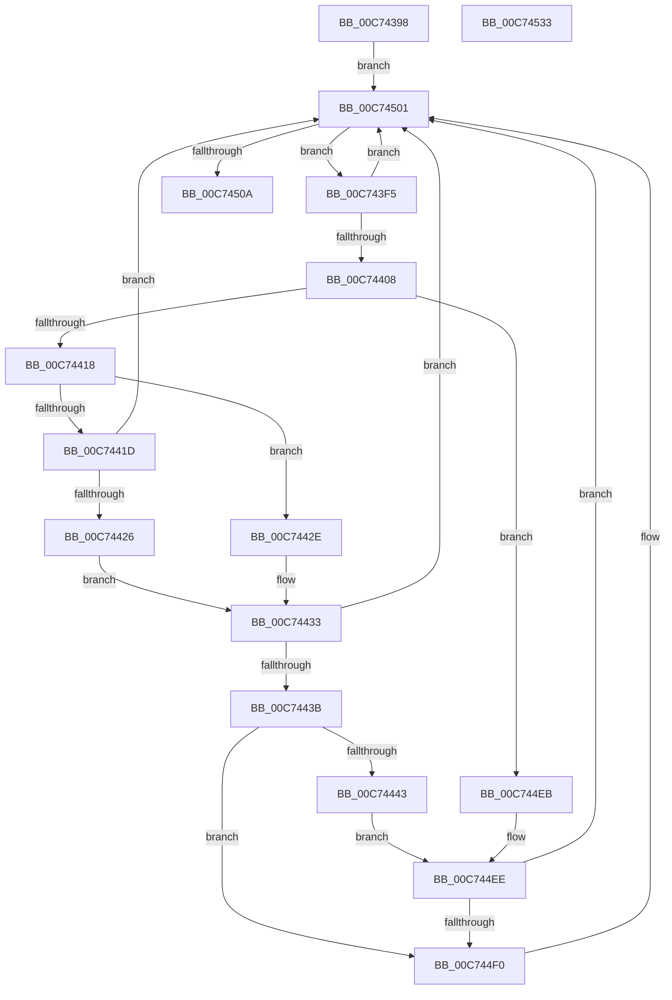

# PipInitializeDriverDependentDLLs

- RVA: `0x00C74398`–`0x00C74534` (길이 `412` bytes)
- VA: `0x0000000140C74398`
- 실행 섹션: `INIT`
- PDB 이름 있음: `예`; PDB Function 태그: `아니요`
- unwind 정보 RVA: `0x000BC0E8`
- 디코드: `107`개 명령, `412/412` bytes 표시
- 미해석 바이트: `0` (있으면 어셈블리에 `.byte`로 보존)

> 이 문서는 커널 이미지의 기계어와 PDB 기호를 분석해 생성했습니다. 4번과 5번은 함수 원형과 자료형을 바이너리 사용 방식에서 추정한 C 해석이며 원본 소스 복구 결과는 아닙니다.

## 1. Dependencies

- 직접 호출 지점: **8**; 고유 호출 대상: **7**
- 직접 호출자로 확인된 함수: **2**
- RIP 상대 이미지 참조: **1**

### Outgoing calls
- `0x00C743CA` → [memset](../../text/6C/memset_function_006C6C40.md) (function, `0x006C6C40`)
- `0x00C743E1` → [MiAcquireLoadLock](../../text/2A/MiAcquireLoadLock_function_002A3950.md) (function, `0x002A3950`)
- `0x00C74451` → [memset](../../text/6C/memset_function_006C6C40.md) (function, `0x006C6C40`)
- `0x00C744D7` → [PnpNotifyEarlyLaunchImageLoad](../C3/PnpNotifyEarlyLaunchImageLoad_function_00C32DE4.md) (function, `0x00C32DE4`)
- `0x00C744E2` → [PnpDoPolicyCheck](../BE/PnpDoPolicyCheck_function_00BEECE0.md) (function, `0x00BEECE0`)
- `0x00C744F4` → [MmFindDataTableEntryByAddress](../../text/2A/MmFindDataTableEntryByAddress_function_002A3C0C.md) (function, `0x002A3C0C`)
- `0x00C744FC` → [MmCallDllInitialize](../../page/7F/MmCallDllInitialize_function_007F836C.md) (function, `0x007F836C`)
- `0x00C7450D` → [MmReleaseLoadLock](../../text/4D/MmReleaseLoadLock_function_004D36D0.md) (function, `0x004D36D0`)

### Direct callers
- [IopInitializeBootDrivers](../C2/IopInitializeBootDrivers_function_00C2E6F4.md) at `0x00C2E998`
- [PipInitializeCoreDriversAndElam](PipInitializeCoreDriversAndElam_function_00C73F84.md) at `0x00C74092`

### Static image references
- `0x00C744AD` → RVA `0x00C7A210` (` ?? ::PBOPGDP::`string'`; read)

## 2. Other-region calls and transfers

- 다른 실행 섹션으로 향하는 call: **6**
  - `0x00C743CA` → [memset](../../text/6C/memset_function_006C6C40.md) (`INIT` → `.text`)
  - `0x00C743E1` → [MiAcquireLoadLock](../../text/2A/MiAcquireLoadLock_function_002A3950.md) (`INIT` → `.text`)
  - `0x00C74451` → [memset](../../text/6C/memset_function_006C6C40.md) (`INIT` → `.text`)
  - `0x00C744F4` → [MmFindDataTableEntryByAddress](../../text/2A/MmFindDataTableEntryByAddress_function_002A3C0C.md) (`INIT` → `.text`)
  - `0x00C744FC` → [MmCallDllInitialize](../../page/7F/MmCallDllInitialize_function_007F836C.md) (`INIT` → `PAGE`)
  - `0x00C7450D` → [MmReleaseLoadLock](../../text/4D/MmReleaseLoadLock_function_004D36D0.md) (`INIT` → `.text`)
- 별도 외부 분기/꼬리 이동을 확인하지 못했습니다.

## 3. Assembly (complete function range)

```asm
00C74398  48 8B C4                        mov rax, rsp
00C7439B  48 89 58 10                     mov qword ptr [rax + 0x10], rbx
00C7439F  48 89 70 18                     mov qword ptr [rax + 0x18], rsi
00C743A3  48 89 78 20                     mov qword ptr [rax + 0x20], rdi
00C743A7  55                              push rbp
00C743A8  41 54                           push r12
00C743AA  41 55                           push r13
00C743AC  41 56                           push r14
00C743AE  41 57                           push r15
00C743B0  48 8D 68 A1                     lea rbp, [rax - 0x5f]
00C743B4  48 81 EC 90 00 00 00            sub rsp, 0x90
00C743BB  4C 8B F2                        mov r14, rdx
00C743BE  8B F1                           mov esi, ecx
00C743C0  33 D2                           xor edx, edx
00C743C2  48 8D 4D C7                     lea rcx, [rbp - 0x39]
00C743C6  44 8D 42 68                     lea r8d, [rdx + 0x68]
00C743CA  E8 71 28 A5 FF                  call 0x1406c6c40
00C743CF  45 33 ED                        xor r13d, r13d
00C743D2  83 FE 01                        cmp esi, 1
00C743D5  44 89 6D 67                     mov dword ptr [rbp + 0x67], r13d
00C743D9  41 0F 95 C4                     setne r12b
00C743DD  41 8D 4D 01                     lea ecx, [r13 + 1]
00C743E1  E8 6A F5 62 FF                  call 0x1402a3950
00C743E6  49 83 C6 10                     add r14, 0x10
00C743EA  4C 8B F8                        mov r15, rax
00C743ED  49 8B 3E                        mov rdi, qword ptr [r14]
00C743F0  E9 0C 01 00 00                  jmp 0x140c74501
00C743F5  48 8D 1F                        lea rbx, [rdi]
00C743F8  48 8B 3F                        mov rdi, qword ptr [rdi]
00C743FB  F7 43 68 00 00 00 04            test dword ptr [rbx + 0x68], 0x4000000
00C74402  0F 84 F9 00 00 00               je 0x140c74501
00C74408  8B 8B 1C 01 00 00               mov ecx, dword ptr [rbx + 0x11c]
00C7440E  8B D6                           mov edx, esi
00C74410  85 F6                           test esi, esi
00C74412  0F 84 D3 00 00 00               je 0x140c744eb
00C74418  83 EA 01                        sub edx, 1
00C7441B  74 11                           je 0x140c7442e
00C7441D  83 FA 01                        cmp edx, 1
00C74420  0F 85 DB 00 00 00               jne 0x140c74501
00C74426  F6 C1 03                        test cl, 3
00C74429  0F 94 C1                        sete cl
00C7442C  EB 05                           jmp 0x140c74433
00C7442E  D1 E9                           shr ecx, 1
00C74430  80 E1 01                        and cl, 1
00C74433  84 C9                           test cl, cl
00C74435  0F 84 C6 00 00 00               je 0x140c74501
00C7443B  85 F6                           test esi, esi
00C7443D  0F 84 AD 00 00 00               je 0x140c744f0
00C74443  33 D2                           xor edx, edx
00C74445  44 89 6D 67                     mov dword ptr [rbp + 0x67], r13d
00C74449  48 8D 4D C7                     lea rcx, [rbp - 0x39]
00C7444D  44 8D 42 68                     lea r8d, [rdx + 0x68]
00C74451  E8 EA 27 A5 FF                  call 0x1406c6c40
00C74456  0F 10 43 48                     movups xmm0, xmmword ptr [rbx + 0x48]
00C7445A  48 8D 55 67                     lea rdx, [rbp + 0x67]
00C7445E  48 8D 4D C7                     lea rcx, [rbp - 0x39]
00C74462  F3 0F 7F 45 CF                  movdqu xmmword ptr [rbp - 0x31], xmm0
00C74467  8B 83 18 01 00 00               mov eax, dword ptr [rbx + 0x118]
00C7446D  83 E0 01                        and eax, 1
00C74470  89 45 CB                        mov dword ptr [rbp - 0x35], eax
00C74473  8B 83 D8 00 00 00               mov eax, dword ptr [rbx + 0xd8]
00C74479  89 45 1F                        mov dword ptr [rbp + 0x1f], eax
00C7447C  8B 83 E4 00 00 00               mov eax, dword ptr [rbx + 0xe4]
00C74482  89 45 27                        mov dword ptr [rbp + 0x27], eax
00C74485  48 8B 83 C0 00 00 00            mov rax, qword ptr [rbx + 0xc0]
00C7448C  48 89 45 0F                     mov qword ptr [rbp + 0xf], rax
00C74490  8B 83 DC 00 00 00               mov eax, dword ptr [rbx + 0xdc]
00C74496  89 45 23                        mov dword ptr [rbp + 0x23], eax
00C74499  8B 83 E8 00 00 00               mov eax, dword ptr [rbx + 0xe8]
00C7449F  89 45 2B                        mov dword ptr [rbp + 0x2b], eax
00C744A2  48 8B 83 C8 00 00 00            mov rax, qword ptr [rbx + 0xc8]
00C744A9  48 89 45 17                     mov qword ptr [rbp + 0x17], rax
00C744AD  48 8D 05 5C 5D 00 00            lea rax, [rip + 0x5d5c]
00C744B4  48 89 45 E7                     mov qword ptr [rbp - 0x19], rax
00C744B8  C7 45 DF 00 00 02 00            mov dword ptr [rbp - 0x21], 0x20000
00C744BF  0F 10 83 B0 00 00 00            movups xmm0, xmmword ptr [rbx + 0xb0]
00C744C6  F3 0F 7F 45 FF                  movdqu xmmword ptr [rbp - 1], xmm0
00C744CB  0F 10 8B A0 00 00 00            movups xmm1, xmmword ptr [rbx + 0xa0]
00C744D2  F3 0F 7F 4D EF                  movdqu xmmword ptr [rbp - 0x11], xmm1
00C744D7  E8 08 E9 FB FF                  call 0x140c32de4
00C744DC  8B 4D 67                        mov ecx, dword ptr [rbp + 0x67]
00C744DF  41 8A D4                        mov dl, r12b
00C744E2  E8 F9 A7 F7 FF                  call 0x140beece0
00C744E7  84 C0                           test al, al
00C744E9  EB 03                           jmp 0x140c744ee
00C744EB  F6 C1 01                        test cl, 1
00C744EE  74 11                           je 0x140c74501
00C744F0  48 8B 4B 30                     mov rcx, qword ptr [rbx + 0x30]
00C744F4  E8 13 F7 62 FF                  call 0x1402a3c0c
00C744F9  48 8B C8                        mov rcx, rax
00C744FC  E8 6B 3E B8 FF                  call 0x1407f836c
00C74501  49 3B FE                        cmp rdi, r14
00C74504  0F 85 EB FE FF FF               jne 0x140c743f5
00C7450A  49 8B CF                        mov rcx, r15
00C7450D  E8 BE F1 85 FF                  call 0x1404d36d0
00C74512  4C 8D 9C 24 90 00 00 00         lea r11, [rsp + 0x90]
00C7451A  49 8B 5B 38                     mov rbx, qword ptr [r11 + 0x38]
00C7451E  49 8B 73 40                     mov rsi, qword ptr [r11 + 0x40]
00C74522  49 8B 7B 48                     mov rdi, qword ptr [r11 + 0x48]
00C74526  49 8B E3                        mov rsp, r11
00C74529  41 5F                           pop r15
00C7452B  41 5E                           pop r14
00C7452D  41 5D                           pop r13
00C7452F  41 5C                           pop r12
00C74531  5D                              pop rbp
00C74532  C3                              ret
00C74533  CC                              int3
```

## 4. C-style interpretation (structured pseudocode)

```c
__int64 __fastcall PipInitializeDriverDependentDLLs(int a1, __int64 a2)
{
    __int64 result;
    __int64 v_r12;
    __int64 v_r13;
    __int64 v_r14;
    __int64 v_rsp;
    unsigned __int64 v_stack_m28;

    *(unsigned __int64 *)(v_rsp + 16) = v_rbx;
    *(unsigned __int64 *)(v_rsp + 24) = v_rsi;
    *(unsigned __int64 *)(v_rsp + 32) = v_rdi;
    v_rsp = (v_rsp) - (144);
    a2 = 0;
    result = memset(v_rsp - 95 - 57, a2, a2 + 104, a4);
    v_r13 = 0;
    *(unsigned int *)(v_rsp - 95 + 103) = 0;
    v_r12 = (((unsigned int)((unsigned int)(a1))) != 1) ? 1 : 0;
    result = MiAcquireLoadLock(v_r13 + 1, a2, a2 + 104, a4);
    v_r14 = (a2) + (16);
    goto loc_00C74501;
loc_00C743F5:
    if (((*(unsigned int *)(*(unsigned __int64 *)(v_r14) + 104)) & (0x4000000ULL)) == 0) goto loc_00C74501;
    if ((unsigned int)((unsigned int)(a1)) == 0) goto loc_00C744EB;
    a2 = (unsigned int)(((unsigned int)((unsigned int)((unsigned int)(a1)))) - (1));
    if (condition_is_equal) goto loc_00C7442E;
    if (((unsigned int)(a2)) != 1) goto loc_00C74501;
    a1 = ((((unsigned __int8)((unsigned int)(*(unsigned int *)(*(unsigned __int64 *)(v_r14) + 284)))) & (3)) == 0) ? 1 : 0;
    goto loc_00C74433;
loc_00C7442E:
    a1 = (unsigned int)((a1) >> (1));
    a1 = (unsigned __int8)((a1) & (1));
loc_00C74433:
    if ((unsigned __int8)(a1) == 0) goto loc_00C74501;
    if ((unsigned int)((unsigned int)(a1)) == 0) goto loc_00C744F0;
    a2 = 0;
    *(unsigned int *)(v_rsp - 95 + 103) = 0;
    result = memset(v_rsp - 95 - 57, a2, a2 + 104, a4);
    *(unsigned __int64 *)(v_rsp - 95 - 49) = v_xmm0;
    result = (unsigned int)(((unsigned int)(*(unsigned int *)(*(unsigned __int64 *)(v_r14) + 280))) & (1));
    *(unsigned int *)(v_rsp - 95 - 53) = (unsigned int)(result);
    *(unsigned int *)(v_rsp - 95 + 31) = (unsigned int)((unsigned int)(*(unsigned int *)(*(unsigned __int64 *)(v_r14) + 216)));
    *(unsigned int *)(v_rsp - 95 + 39) = (unsigned int)((unsigned int)(*(unsigned int *)(*(unsigned __int64 *)(v_r14) + 228)));
    *(unsigned __int64 *)(v_rsp - 95 + 15) = *(unsigned __int64 *)(*(unsigned __int64 *)(v_r14) + 192);
    *(unsigned int *)(v_rsp - 95 + 35) = (unsigned int)((unsigned int)(*(unsigned int *)(*(unsigned __int64 *)(v_r14) + 220)));
    *(unsigned int *)(v_rsp - 95 + 43) = (unsigned int)((unsigned int)(*(unsigned int *)(*(unsigned __int64 *)(v_r14) + 232)));
    *(unsigned __int64 *)(v_rsp - 95 + 23) = *(unsigned __int64 *)(*(unsigned __int64 *)(v_r14) + 200);
    *(unsigned __int64 *)(v_rsp - 95 - 25) = v_rip + 23900;
    *(unsigned int *)(v_rsp - 95 - 33) = 0x20000ULL;
    *(unsigned __int64 *)(v_rsp - 95 - 1) = v_xmm0;
    *(unsigned __int64 *)(v_rsp - 95 - 17) = v_xmm1;
    result = PnpNotifyEarlyLaunchImageLoad(v_rsp - 95 - 57, v_rsp - 95 + 103, a2 + 104, a4);
    result = PnpDoPolicyCheck((unsigned int)(*(unsigned int *)(v_rsp - 95 + 103)), (unsigned __int8)(v_r12), a2 + 104, a4);
    goto loc_00C744EE;
loc_00C744EB:
loc_00C744EE:
    if ((((unsigned __int8)((unsigned int)(*(unsigned int *)(v_rsp - 95 + 103)))) & (1)) != 0) {
        a1 = *(unsigned __int64 *)(*(unsigned __int64 *)(v_r14) + 48);
        result = MmFindDataTableEntryByAddress(a1, (unsigned __int8)(v_r12), a2 + 104, a4);
        a1 = result;
        result = MmCallDllInitialize(a1, (unsigned __int8)(v_r12), a2 + 104, a4);
    }
    if ((*(unsigned __int64 *)(*(unsigned __int64 *)(v_r14))) != v_r14) goto loc_00C743F5;
    result = MmReleaseLoadLock(result, (unsigned __int8)(v_r12), a2 + 104, a4);
    return result;
}
```

## 5. (Beta) C Style

```c
int64_t PipInitializeDriverDependentDLLs(int32_t Arg1, void *Arg2)
{
    uint8_t *arg2 = (uint8_t *)Arg2;

    int64_t result;
    int64_t local_r12;
    int64_t local_r13;
    int64_t local_r14;
    int64_t local_rsp;
    uint64_t v_stack_m28;

    *(uint64_t *)(local_rsp + 0x10) = local_rbx;
    *(uint64_t *)(local_rsp + 0x18) = local_rsi;
    *(uint64_t *)(local_rsp + 0x20) = local_rdi;
    local_rsp = (local_rsp) - (144);
    Arg2 = 0;
    result = memset(local_rsp - 95 - 57, Arg2, Arg2 + 104, a4);
    local_r13 = 0;
    *(uint32_t *)(local_rsp - 0x5F + 0x67) = 0;
    local_r12 = (((uint32_t)((uint32_t)(Arg1))) != 1) ? 1 : 0;
    result = MiAcquireLoadLock(local_r13 + 1, Arg2, Arg2 + 104, a4);
    local_r14 = (Arg2) + (16);
    goto loc_00C74501;
loc_00C743F5:
    if (((*(uint32_t *)(*(uint64_t *)(local_r14) + 0x68)) & (0x4000000ULL)) == 0) goto loc_00C74501;
    if ((uint32_t)((uint32_t)(Arg1)) == 0) goto loc_00C744EB;
    Arg2 = (uint32_t)(((uint32_t)((uint32_t)((uint32_t)(Arg1)))) - (1));
    if (condition_is_equal) goto loc_00C7442E;
    if (((uint32_t)(Arg2)) != 1) goto loc_00C74501;
    Arg1 = ((((uint8_t)((uint32_t)(*(uint32_t *)(*(uint64_t *)(local_r14) + 0x11C)))) & (3)) == 0) ? 1 : 0;
    goto loc_00C74433;
loc_00C7442E:
    Arg1 = (uint32_t)((Arg1) >> (1));
    Arg1 = (uint8_t)((Arg1) & (1));
loc_00C74433:
    if ((uint8_t)(Arg1) == 0) goto loc_00C74501;
    if ((uint32_t)((uint32_t)(Arg1)) == 0) goto loc_00C744F0;
    Arg2 = 0;
    *(uint32_t *)(local_rsp - 0x5F + 0x67) = 0;
    result = memset(local_rsp - 95 - 57, Arg2, Arg2 + 104, a4);
    *(uint64_t *)(local_rsp - 0x5F - 0x31) = v_xmm0;
    result = (uint32_t)(((uint32_t)(*(uint32_t *)(*(uint64_t *)(local_r14) + 0x118))) & (1));
    *(uint32_t *)(local_rsp - 0x5F - 0x35) = (uint32_t)(result);
    *(uint32_t *)(local_rsp - 0x5F + 0x1F) = (uint32_t)((uint32_t)(*(uint32_t *)(*(uint64_t *)(local_r14) + 0xD8)));
    *(uint32_t *)(local_rsp - 0x5F + 0x27) = (uint32_t)((uint32_t)(*(uint32_t *)(*(uint64_t *)(local_r14) + 0xE4)));
    *(uint64_t *)(local_rsp - 0x5F + 0xF) = *(uint64_t *)(*(uint64_t *)(local_r14) + 0xC0);
    *(uint32_t *)(local_rsp - 0x5F + 0x23) = (uint32_t)((uint32_t)(*(uint32_t *)(*(uint64_t *)(local_r14) + 0xDC)));
    *(uint32_t *)(local_rsp - 0x5F + 0x2B) = (uint32_t)((uint32_t)(*(uint32_t *)(*(uint64_t *)(local_r14) + 0xE8)));
    *(uint64_t *)(local_rsp - 0x5F + 0x17) = *(uint64_t *)(*(uint64_t *)(local_r14) + 0xC8);
    *(uint64_t *)(local_rsp - 0x5F - 0x19) = v_rip + 23900;
    *(uint32_t *)(local_rsp - 0x5F - 0x21) = 0x20000ULL;
    *(uint64_t *)(local_rsp - 0x5F - 0x1) = v_xmm0;
    *(uint64_t *)(local_rsp - 0x5F - 0x11) = v_xmm1;
    result = PnpNotifyEarlyLaunchImageLoad(local_rsp - 95 - 57, local_rsp - 95 + 103, Arg2 + 104, a4);
    result = PnpDoPolicyCheck((uint32_t)(*(uint32_t *)(local_rsp - 0x5F + 0x67)), (uint8_t)(local_r12), Arg2 + 104, a4);
    goto loc_00C744EE;
loc_00C744EB:
loc_00C744EE:
    if ((((uint8_t)((uint32_t)(*(uint32_t *)(local_rsp - 0x5F + 0x67)))) & (1)) != 0) {
        Arg1 = *(uint64_t *)(*(uint64_t *)(local_r14) + 0x30);
        result = MmFindDataTableEntryByAddress(Arg1, (uint8_t)(local_r12), Arg2 + 104, a4);
        Arg1 = result;
        result = MmCallDllInitialize(Arg1, (uint8_t)(local_r12), Arg2 + 104, a4);
    }
    if ((*(uint64_t *)(*(uint64_t *)(local_r14))) != local_r14) goto loc_00C743F5;
    result = MmReleaseLoadLock(result, (uint8_t)(local_r12), Arg2 + 104, a4);
    return result;
}
```

### 관측된 메모리 오프셋

구조체 형식이 확인되지 않은 접근은 인자 기준의 오프셋으로만 기록했습니다.

| 기준 인자 | 오프셋 표현 | 폭 (bit) | 접근 |
|---|---:|---:|---|
| `Arg2` | `+ 0x0` | `64` | `R` |

## 6. Execution-region graph

[열기: 2D/3D 그래프와 함수 탐색 컨트롤 패널](../../../control-panel.html?section=init&rva=0x00C74398&view=graph)

- 2D 그래프는 위에서 아래로 흐르고, 3D 그래프는 빈 공간을 드래그해 회전합니다. Shift+드래그는 이동, 휠은 확대·축소, 함수 노드 선택은 대상 보고서 이동입니다.

### Static fallback


