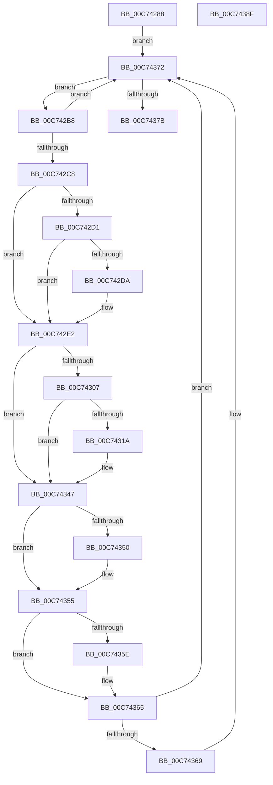

# PipInitializeEarlyLaunchDrivers

- RVA: `0x00C74288`–`0x00C74390` (길이 `264` bytes)
- VA: `0x0000000140C74288`
- 실행 섹션: `INIT`
- PDB 이름 있음: `예`; PDB Function 태그: `아니요`
- unwind 정보 RVA: `0x000BC9D8`
- 디코드: `78`개 명령, `264/264` bytes 표시
- 미해석 바이트: `0` (있으면 어셈블리에 `.byte`로 보존)

> 이 문서는 커널 이미지의 기계어와 PDB 기호를 분석해 생성했습니다. 4번과 5번은 함수 원형과 자료형을 바이너리 사용 방식에서 추정한 C 해석이며 원본 소스 복구 결과는 아닙니다.

## 1. Dependencies

- 직접 호출 지점: **6**; 고유 호출 대상: **6**
- 직접 호출자로 확인된 함수: **1**
- RIP 상대 이미지 참조: **0**

### Outgoing calls
- `0x00C742DD` → [SeRegisterElamCertResources](../../page/79/SeRegisterElamCertResources_function_0079B8C8.md) (function, `0x0079B8C8`)
- `0x00C742FC` → [IopOpenRegistryKeyEx](../../page/A5/IopOpenRegistryKeyEx_function_00A51B44.md) (function, `0x00A51B44`)
- `0x00C7430F` → [IopGetDriverNameFromKeyNode](../../page/99/IopGetDriverNameFromKeyNode_function_00998808.md) (function, `0x00998808`)
- `0x00C74340` → [PnpInitializeBootStartDriver](PnpInitializeBootStartDriver_function_00C760F0.md) (function, `0x00C760F0`)
- `0x00C74350` → [ZwClose](../../text/6A/ZwClose_function_006AD2B0.md) (function, `0x006AD2B0`)
- `0x00C74360` → [ExFreePoolWithTag](../../poolcode/B8/ExFreePoolWithTag_function_00B82870.md) (function, `0x00B82870`)

### Direct callers
- [PipInitializeCoreDriversAndElam](PipInitializeCoreDriversAndElam_function_00C73F84.md) at `0x00C74077`

### Static image references
- 디코드된 RIP-relative 메모리 참조가 없습니다.

## 2. Other-region calls and transfers

- 다른 실행 섹션으로 향하는 call: **5**
  - `0x00C742DD` → [SeRegisterElamCertResources](../../page/79/SeRegisterElamCertResources_function_0079B8C8.md) (`INIT` → `PAGE`)
  - `0x00C742FC` → [IopOpenRegistryKeyEx](../../page/A5/IopOpenRegistryKeyEx_function_00A51B44.md) (`INIT` → `PAGE`)
  - `0x00C7430F` → [IopGetDriverNameFromKeyNode](../../page/99/IopGetDriverNameFromKeyNode_function_00998808.md) (`INIT` → `PAGE`)
  - `0x00C74350` → [ZwClose](../../text/6A/ZwClose_function_006AD2B0.md) (`INIT` → `.text`)
  - `0x00C74360` → [ExFreePoolWithTag](../../poolcode/B8/ExFreePoolWithTag_function_00B82870.md) (`INIT` → `POOLCODE`)
- 별도 외부 분기/꼬리 이동을 확인하지 못했습니다.

## 3. Assembly (complete function range)

```asm
00C74288  48 89 5C 24 18                  mov qword ptr [rsp + 0x18], rbx
00C7428D  55                              push rbp
00C7428E  56                              push rsi
00C7428F  57                              push rdi
00C74290  41 56                           push r14
00C74292  41 57                           push r15
00C74294  48 8B EC                        mov rbp, rsp
00C74297  48 83 EC 50                     sub rsp, 0x50
00C7429B  48 83 65 38 00                  and qword ptr [rbp + 0x38], 0
00C742A0  4C 8D 71 40                     lea r14, [rcx + 0x40]
00C742A4  48 83 65 30 00                  and qword ptr [rbp + 0x30], 0
00C742A9  0F 57 C0                        xorps xmm0, xmm0
00C742AC  49 8B 1E                        mov rbx, qword ptr [r14]
00C742AF  0F 11 45 F0                     movups xmmword ptr [rbp - 0x10], xmm0
00C742B3  E9 BA 00 00 00                  jmp 0x140c74372
00C742B8  48 8D 3B                        lea rdi, [rbx]
00C742BB  48 8B 1B                        mov rbx, qword ptr [rbx]
00C742BE  83 7F 38 00                     cmp dword ptr [rdi + 0x38], 0
00C742C2  0F 8C AA 00 00 00               jl 0x140c74372
00C742C8  48 8B 47 30                     mov rax, qword ptr [rdi + 0x30]
00C742CC  48 85 C0                        test rax, rax
00C742CF  74 11                           je 0x140c742e2
00C742D1  48 8B 48 30                     mov rcx, qword ptr [rax + 0x30]
00C742D5  48 85 C9                        test rcx, rcx
00C742D8  74 08                           je 0x140c742e2
00C742DA  45 33 C0                        xor r8d, r8d
00C742DD  E8 E6 75 B2 FF                  call 0x14079b8c8
00C742E2  48 83 65 F8 00                  and qword ptr [rbp - 8], 0
00C742E7  4C 8D 47 20                     lea r8, [rdi + 0x20]
00C742EB  48 83 65 30 00                  and qword ptr [rbp + 0x30], 0
00C742F0  48 8D 4D 30                     lea rcx, [rbp + 0x30]
00C742F4  41 B9 19 00 02 00               mov r9d, 0x20019
00C742FA  33 D2                           xor edx, edx
00C742FC  E8 43 D8 DD FF                  call 0x140a51b44
00C74301  8B F0                           mov esi, eax
00C74303  85 C0                           test eax, eax
00C74305  78 40                           js 0x140c74347
00C74307  48 8B 4D 30                     mov rcx, qword ptr [rbp + 0x30]
00C7430B  48 8D 55 F0                     lea rdx, [rbp - 0x10]
00C7430F  E8 F4 44 D2 FF                  call 0x140998808
00C74314  8B F0                           mov esi, eax
00C74316  85 C0                           test eax, eax
00C74318  78 2D                           js 0x140c74347
00C7431A  4C 8B 47 30                     mov r8, qword ptr [rdi + 0x30]
00C7431E  48 8D 45 38                     lea rax, [rbp + 0x38]
00C74322  48 89 44 24 38                  mov qword ptr [rsp + 0x38], rax
00C74327  48 8D 57 20                     lea rdx, [rdi + 0x20]
00C7432B  83 64 24 28 00                  and dword ptr [rsp + 0x28], 0
00C74330  48 8D 4D F0                     lea rcx, [rbp - 0x10]
00C74334  83 64 24 20 00                  and dword ptr [rsp + 0x20], 0
00C74339  4D 8B C8                        mov r9, r8
00C7433C  4D 8B 40 38                     mov r8, qword ptr [r8 + 0x38]
00C74340  E8 AB 1D 00 00                  call 0x140c760f0
00C74345  8B F0                           mov esi, eax
00C74347  48 8B 4D 30                     mov rcx, qword ptr [rbp + 0x30]
00C7434B  48 85 C9                        test rcx, rcx
00C7434E  74 05                           je 0x140c74355
00C74350  E8 5B 8F A3 FF                  call 0x1406ad2b0
00C74355  48 8B 4D F8                     mov rcx, qword ptr [rbp - 8]
00C74359  48 85 C9                        test rcx, rcx
00C7435C  74 07                           je 0x140c74365
00C7435E  33 D2                           xor edx, edx
00C74360  E8 0B E5 F0 FF                  call 0x140b82870
00C74365  85 F6                           test esi, esi
00C74367  79 09                           jns 0x140c74372
00C74369  48 8B 47 30                     mov rax, qword ptr [rdi + 0x30]
00C7436D  0F BA 68 68 11                  bts dword ptr [rax + 0x68], 0x11
00C74372  49 3B DE                        cmp rbx, r14
00C74375  0F 85 3D FF FF FF               jne 0x140c742b8
00C7437B  48 8B 9C 24 90 00 00 00         mov rbx, qword ptr [rsp + 0x90]
00C74383  48 83 C4 50                     add rsp, 0x50
00C74387  41 5F                           pop r15
00C74389  41 5E                           pop r14
00C7438B  5F                              pop rdi
00C7438C  5E                              pop rsi
00C7438D  5D                              pop rbp
00C7438E  C3                              ret
00C7438F  CC                              int3
```

## 4. C-style interpretation (structured pseudocode)

```c
__int64 __fastcall PipInitializeEarlyLaunchDrivers(__int64 a1, int a2, int a3)
{
    __int64 result;
    __int64 v_rsi;
    __int64 v_rsp;
    unsigned __int64 v_stack_m30;
    unsigned __int64 v_stack_m38;
    unsigned __int64 v_stack_m40;
    unsigned int v_stack_m50;
    unsigned int v_stack_m58;
    unsigned __int64 v_stack_p10;
    unsigned __int64 v_stack_p18;
    unsigned __int64 v_stack_p8;

    v_stack_p18 = v_rbx;
    v_rsp = (v_rsp) - (80);
    v_stack_m38 = v_xmm0;
    goto loc_00C74372;
loc_00C742B8:
    if ((*(unsigned int *)(*(unsigned __int64 *)(a1 + 64) + 56)) < 0) goto loc_00C74372;
    if (*(unsigned __int64 *)(*(unsigned __int64 *)(a1 + 64) + 48) == 0) goto loc_00C742E2;
    result = *(unsigned __int64 *)(*(unsigned __int64 *)(a1 + 64) + 48);
    if (*(unsigned __int64 *)(*(unsigned __int64 *)(*(unsigned __int64 *)(a1 + 64) + 48) + 48) != 0) {
        a3 = 0;
        result = SeRegisterElamCertResources(*(unsigned __int64 *)(*(unsigned __int64 *)(*(unsigned __int64 *)(a1 + 64) + 48) + 48), a2, a3, a4);
    }
    a2 = 0;
    result = IopOpenRegistryKeyEx(v_stack_p8, a2, *(unsigned __int64 *)(a1 + 64) + 32, (unsigned int)(0x20019ULL));
    if (sign_flag) goto loc_00C74347;
    result = IopGetDriverNameFromKeyNode(v_stack_p8, v_stack_m38, *(unsigned __int64 *)(a1 + 64) + 32, (unsigned int)(0x20019ULL));
    v_rsi = (unsigned int)((unsigned int)(result));
    if (!(sign_flag)) {
        a3 = *(unsigned __int64 *)(*(unsigned __int64 *)(a1 + 64) + 48);
        result = v_stack_p10;
        v_stack_m40 = result;
        a2 = *(unsigned __int64 *)(a1 + 64) + 32;
        a1 = v_stack_m38;
        a4 = a3;
        a3 = *(unsigned __int64 *)(a3 + 56);
        result = PnpInitializeBootStartDriver(a1, a2, a3, a4);
        v_rsi = (unsigned int)(result);
    }
    if (v_stack_p8 != 0) {
        result = ZwClose(v_stack_p8, a2, a3, a4);
    }
    if (v_stack_m30 != 0) {
        a2 = 0;
        result = ExFreePoolWithTag(v_stack_m30, a2, a3, a4);
    }
    if (sign_flag) {
        result = *(unsigned __int64 *)(*(unsigned __int64 *)(a1 + 64) + 48);
    }
    if ((*(unsigned __int64 *)(*(unsigned __int64 *)(a1 + 64))) != (a1 + 64)) goto loc_00C742B8;
    v_rsp = (v_rsp) + (80);
    return result;
}
```

## 5. (Beta) C Style

```c
int64_t PipInitializeEarlyLaunchDrivers(void *Arg1, int32_t Arg2, int32_t Arg3)
{
    uint8_t *arg1 = (uint8_t *)Arg1;

    int64_t result;
    int64_t local_rsi;
    int64_t local_rsp;
    uint64_t v_stack_m30;
    uint64_t v_stack_m38;
    uint64_t v_stack_m40;
    uint32_t v_stack_m50;
    uint32_t v_stack_m58;
    uint64_t v_stack_p10;
    uint64_t v_stack_p18;
    uint64_t v_stack_p8;

    v_stack_p18 = local_rbx;
    local_rsp = (local_rsp) - (80);
    v_stack_m38 = v_xmm0;
    goto loc_00C74372;
loc_00C742B8:
    if ((*(uint32_t *)(*(uint64_t *)(arg1 + 0x40) + 0x38)) < 0) goto loc_00C74372;
    if (*(uint64_t *)(*(uint64_t *)(arg1 + 0x40) + 0x30) == 0) goto loc_00C742E2;
    result = *(uint64_t *)(*(uint64_t *)(arg1 + 0x40) + 0x30);
    if (*(uint64_t *)(*(uint64_t *)(*(uint64_t *)(arg1 + 0x40) + 0x30) + 0x30) != 0) {
        Arg3 = 0;
        result = SeRegisterElamCertResources(*(uint64_t *)(*(uint64_t *)(*(uint64_t *)(arg1 + 0x40) + 0x30) + 0x30), Arg2, Arg3, a4);
    }
    Arg2 = 0;
    result = IopOpenRegistryKeyEx(v_stack_p8, Arg2, *(uint64_t *)(arg1 + 0x40) + 32, (uint32_t)(0x20019ULL));
    if (sign_flag) goto loc_00C74347;
    result = IopGetDriverNameFromKeyNode(v_stack_p8, v_stack_m38, *(uint64_t *)(arg1 + 0x40) + 32, (uint32_t)(0x20019ULL));
    local_rsi = (uint32_t)((uint32_t)(result));
    if (!(sign_flag)) {
        Arg3 = *(uint64_t *)(*(uint64_t *)(arg1 + 0x40) + 0x30);
        result = v_stack_p10;
        v_stack_m40 = result;
        Arg2 = *(uint64_t *)(arg1 + 0x40) + 32;
        Arg1 = v_stack_m38;
        a4 = Arg3;
        Arg3 = *(uint64_t *)(Arg3 + 0x38);
        result = PnpInitializeBootStartDriver(Arg1, Arg2, Arg3, a4);
        local_rsi = (uint32_t)(result);
    }
    if (v_stack_p8 != 0) {
        result = ZwClose(v_stack_p8, Arg2, Arg3, a4);
    }
    if (v_stack_m30 != 0) {
        Arg2 = 0;
        result = ExFreePoolWithTag(v_stack_m30, Arg2, Arg3, a4);
    }
    if (sign_flag) {
        result = *(uint64_t *)(*(uint64_t *)(arg1 + 0x40) + 0x30);
    }
    if ((*(uint64_t *)(*(uint64_t *)(arg1 + 0x40))) != (Arg1 + 64)) goto loc_00C742B8;
    local_rsp = (local_rsp) + (80);
    return result;
}
```

### 관측된 메모리 오프셋

구조체 형식이 확인되지 않은 접근은 인자 기준의 오프셋으로만 기록했습니다.

| 기준 인자 | 오프셋 표현 | 폭 (bit) | 접근 |
|---|---:|---:|---|
| `Arg1` | `+ 0x0` | `64` | `R` |
| `Arg1` | `+ 0x40` | `64` | `R` |

## 6. Execution-region graph

[열기: 2D/3D 그래프와 함수 탐색 컨트롤 패널](../../../control-panel.html?section=init&rva=0x00C74288&view=graph)

- 2D 그래프는 위에서 아래로 흐르고, 3D 그래프는 빈 공간을 드래그해 회전합니다. Shift+드래그는 이동, 휠은 확대·축소, 함수 노드 선택은 대상 보고서 이동입니다.

### Static fallback


