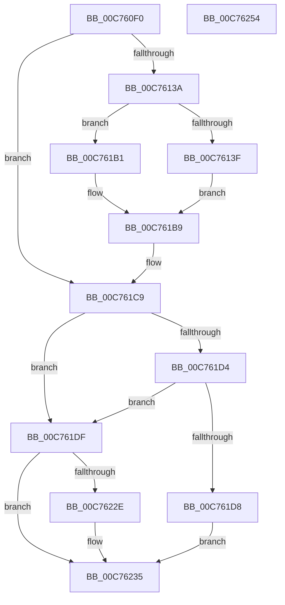

# PnpInitializeBootStartDriver

- RVA: `0x00C760F0`–`0x00C76255` (길이 `357` bytes)
- VA: `0x0000000140C760F0`
- 실행 섹션: `INIT`
- PDB 이름 있음: `예`; PDB Function 태그: `아니요`
- unwind 정보 RVA: `0x000BDB98`
- 디코드: `96`개 명령, `357/357` bytes 표시
- 미해석 바이트: `0` (있으면 어셈블리에 `.byte`로 보존)

> 이 문서는 커널 이미지의 기계어와 PDB 기호를 분석해 생성했습니다. 4번과 5번은 함수 원형과 자료형을 바이너리 사용 방식에서 추정한 C 해석이며 원본 소스 복구 결과는 아닙니다.

## 1. Dependencies

- 직접 호출 지점: **8**; 고유 호출 대상: **8**
- 직접 호출자로 확인된 함수: **4**
- RIP 상대 이미지 참조: **2**

### Outgoing calls
- `0x00C76125` → [memset](../../text/6C/memset_function_006C6C40.md) (function, `0x006C6C40`)
- `0x00C761C1` → [PnpNotifyEarlyLaunchImageLoad](../C3/PnpNotifyEarlyLaunchImageLoad_function_00C32DE4.md) (function, `0x00C32DE4`)
- `0x00C761CB` → [PnpDoPolicyCheck](../BE/PnpDoPolicyCheck_function_00BEECE0.md) (function, `0x00BEECE0`)
- `0x00C761DF` → [VfDriverInitStarting](../../pagevrfy/B9/VfDriverInitStarting_function_00B92248.md) (function, `0x00B92248`)
- `0x00C761F0` → [PnpDiagnosticTraceObject](../../text/26/PnpDiagnosticTraceObject_function_0026E834.md) (function, `0x0026E834`)
- `0x00C76211` → [IopInitializeBuiltinDriver](IopInitializeBuiltinDriver_function_00C7625C.md) (function, `0x00C7625C`)
- `0x00C76225` → [PnpDiagnosticTraceObjectWithStatus](../../text/4A/PnpDiagnosticTraceObjectWithStatus_function_004A9F58.md) (function, `0x004A9F58`)
- `0x00C76230` → [VfDriverInitSuccess](../../pagevrfy/B9/VfDriverInitSuccess_function_00B9A484.md) (function, `0x00B9A484`)

### Direct callers
- [IopInitializeBootDrivers](../C2/IopInitializeBootDrivers_function_00C2E6F4.md) at `0x00C2E8C4`
- [IopInitializeBootDrivers](../C2/IopInitializeBootDrivers_function_00C2E6F4.md) at `0x00C2EC42`
- [PipInitializeCoreDriversByGroup](PipInitializeCoreDriversByGroup_function_00C740DC.md) at `0x00C741C9`
- [PipInitializeEarlyLaunchDrivers](PipInitializeEarlyLaunchDrivers_function_00C74288.md) at `0x00C74340`
- [PnpLoadBootFilterDriver](PnpLoadBootFilterDriver_function_00C77938.md) at `0x00C77A54`

### Static image references
- `0x00C761E7` → RVA `0x0001E968` (`.rdata`; read)
- `0x00C76219` → RVA `0x0001E958` (`.rdata`; read)

## 2. Other-region calls and transfers

- 다른 실행 섹션으로 향하는 call: **5**
  - `0x00C76125` → [memset](../../text/6C/memset_function_006C6C40.md) (`INIT` → `.text`)
  - `0x00C761DF` → [VfDriverInitStarting](../../pagevrfy/B9/VfDriverInitStarting_function_00B92248.md) (`INIT` → `PAGEVRFY`)
  - `0x00C761F0` → [PnpDiagnosticTraceObject](../../text/26/PnpDiagnosticTraceObject_function_0026E834.md) (`INIT` → `.text`)
  - `0x00C76225` → [PnpDiagnosticTraceObjectWithStatus](../../text/4A/PnpDiagnosticTraceObjectWithStatus_function_004A9F58.md) (`INIT` → `.text`)
  - `0x00C76230` → [VfDriverInitSuccess](../../pagevrfy/B9/VfDriverInitSuccess_function_00B9A484.md) (`INIT` → `PAGEVRFY`)
- 별도 외부 분기/꼬리 이동을 확인하지 못했습니다.

## 3. Assembly (complete function range)

```asm
00C760F0  48 8B C4                        mov rax, rsp
00C760F3  48 89 58 08                     mov qword ptr [rax + 8], rbx
00C760F7  48 89 70 10                     mov qword ptr [rax + 0x10], rsi
00C760FB  48 89 78 18                     mov qword ptr [rax + 0x18], rdi
00C760FF  55                              push rbp
00C76100  41 56                           push r14
00C76102  41 57                           push r15
00C76104  48 8D 68 C1                     lea rbp, [rax - 0x3f]
00C76108  48 81 EC A0 00 00 00            sub rsp, 0xa0
00C7610F  4C 8B F2                        mov r14, rdx
00C76112  4D 8B F8                        mov r15, r8
00C76115  33 D2                           xor edx, edx
00C76117  48 8B F9                        mov rdi, rcx
00C7611A  48 8D 4D B7                     lea rcx, [rbp - 0x49]
00C7611E  49 8B D9                        mov rbx, r9
00C76121  44 8D 42 68                     lea r8d, [rdx + 0x68]
00C76125  E8 16 0B A5 FF                  call 0x1406c6c40
00C7612A  8B 75 6F                        mov esi, dword ptr [rbp + 0x6f]
00C7612D  33 C9                           xor ecx, ecx
00C7612F  89 4D 77                        mov dword ptr [rbp + 0x77], ecx
00C76132  85 F6                           test esi, esi
00C76134  0F 84 8F 00 00 00               je 0x140c761c9
00C7613A  48 85 DB                        test rbx, rbx
00C7613D  74 72                           je 0x140c761b1
00C7613F  8B 83 18 01 00 00               mov eax, dword ptr [rbx + 0x118]
00C76145  0F 10 43 48                     movups xmm0, xmmword ptr [rbx + 0x48]
00C76149  83 E0 01                        and eax, 1
00C7614C  0F 10 8B B0 00 00 00            movups xmm1, xmmword ptr [rbx + 0xb0]
00C76153  89 45 BB                        mov dword ptr [rbp - 0x45], eax
00C76156  8B 83 D8 00 00 00               mov eax, dword ptr [rbx + 0xd8]
00C7615C  89 45 0F                        mov dword ptr [rbp + 0xf], eax
00C7615F  8B 83 E4 00 00 00               mov eax, dword ptr [rbx + 0xe4]
00C76165  89 45 17                        mov dword ptr [rbp + 0x17], eax
00C76168  48 8B 83 C0 00 00 00            mov rax, qword ptr [rbx + 0xc0]
00C7616F  48 89 45 FF                     mov qword ptr [rbp - 1], rax
00C76173  8B 83 DC 00 00 00               mov eax, dword ptr [rbx + 0xdc]
00C76179  F3 0F 7F 45 BF                  movdqu xmmword ptr [rbp - 0x41], xmm0
00C7617E  89 45 13                        mov dword ptr [rbp + 0x13], eax
00C76181  41 0F 10 06                     movups xmm0, xmmword ptr [r14]
00C76185  8B 83 E8 00 00 00               mov eax, dword ptr [rbx + 0xe8]
00C7618B  89 45 1B                        mov dword ptr [rbp + 0x1b], eax
00C7618E  48 8B 83 C8 00 00 00            mov rax, qword ptr [rbx + 0xc8]
00C76195  F3 0F 7F 45 CF                  movdqu xmmword ptr [rbp - 0x31], xmm0
00C7619A  48 89 45 07                     mov qword ptr [rbp + 7], rax
00C7619E  0F 10 83 A0 00 00 00            movups xmm0, xmmword ptr [rbx + 0xa0]
00C761A5  F3 0F 7F 4D EF                  movdqu xmmword ptr [rbp - 0x11], xmm1
00C761AA  F3 0F 7F 45 DF                  movdqu xmmword ptr [rbp - 0x21], xmm0
00C761AF  EB 08                           jmp 0x140c761b9
00C761B1  0F 10 07                        movups xmm0, xmmword ptr [rdi]
00C761B4  F3 0F 7F 45 BF                  movdqu xmmword ptr [rbp - 0x41], xmm0
00C761B9  48 8D 55 77                     lea rdx, [rbp + 0x77]
00C761BD  48 8D 4D B7                     lea rcx, [rbp - 0x49]
00C761C1  E8 1E CC FB FF                  call 0x140c32de4
00C761C6  8B 4D 77                        mov ecx, dword ptr [rbp + 0x77]
00C761C9  B2 01                           mov dl, 1
00C761CB  E8 10 8B F7 FF                  call 0x140beece0
00C761D0  84 C0                           test al, al
00C761D2  75 0B                           jne 0x140c761df
00C761D4  85 F6                           test esi, esi
00C761D6  74 07                           je 0x140c761df
00C761D8  BB 22 00 00 C0                  mov ebx, 0xc0000022
00C761DD  EB 56                           jmp 0x140c76235
00C761DF  E8 64 C0 F1 FF                  call 0x140b92248
00C761E4  48 8B D7                        mov rdx, rdi
00C761E7  48 8D 0D 7A 87 3A FF            lea rcx, [rip - 0xc57886]
00C761EE  8B F0                           mov esi, eax
00C761F0  E8 3F 86 5F FF                  call 0x14026e834
00C761F5  48 8B 4D 7F                     mov rcx, qword ptr [rbp + 0x7f]
00C761F9  4C 8B CB                        mov r9, rbx
00C761FC  48 89 4C 24 28                  mov qword ptr [rsp + 0x28], rcx
00C76201  4D 8B C7                        mov r8, r15
00C76204  8A 4D 67                        mov cl, byte ptr [rbp + 0x67]
00C76207  49 8B D6                        mov rdx, r14
00C7620A  88 4C 24 20                     mov byte ptr [rsp + 0x20], cl
00C7620E  48 8B CF                        mov rcx, rdi
00C76211  E8 46 00 00 00                  call 0x140c7625c
00C76216  44 8B C0                        mov r8d, eax
00C76219  48 8D 0D 38 87 3A FF            lea rcx, [rip - 0xc578c8]
00C76220  48 8B D7                        mov rdx, rdi
00C76223  8B D8                           mov ebx, eax
00C76225  E8 2E 3D 83 FF                  call 0x1404a9f58
00C7622A  85 DB                           test ebx, ebx
00C7622C  78 07                           js 0x140c76235
00C7622E  8B CE                           mov ecx, esi
00C76230  E8 4F 42 F2 FF                  call 0x140b9a484
00C76235  4C 8D 9C 24 A0 00 00 00         lea r11, [rsp + 0xa0]
00C7623D  8B C3                           mov eax, ebx
00C7623F  49 8B 5B 20                     mov rbx, qword ptr [r11 + 0x20]
00C76243  49 8B 73 28                     mov rsi, qword ptr [r11 + 0x28]
00C76247  49 8B 7B 30                     mov rdi, qword ptr [r11 + 0x30]
00C7624B  49 8B E3                        mov rsp, r11
00C7624E  41 5F                           pop r15
00C76250  41 5E                           pop r14
00C76252  5D                              pop rbp
00C76253  C3                              ret
00C76254  CC                              int3
```

## 4. C-style interpretation (structured pseudocode)

```c
__int64 __fastcall PnpInitializeBootStartDriver(__int64 a1, __int64 a2, __int64 a3, __int64 a4)
{
    __int64 result;
    __int64 v_rsp;
    unsigned __int64 v_stack_m18;
    unsigned __int64 v_stack_m90;
    unsigned __int8 v_stack_m98;

    *(unsigned __int64 *)(v_rsp + 8) = v_rbx;
    *(unsigned __int64 *)(v_rsp + 16) = v_rsi;
    *(unsigned __int64 *)(v_rsp + 24) = v_rdi;
    v_rsp = (v_rsp) - (160);
    a2 = 0;
    result = memset(v_rsp - 63 - 73, a2, a2 + 104, a4);
    a1 = 0;
    *(unsigned int *)(v_rsp - 63 + 119) = 0;
    if ((unsigned int)((unsigned int)(*(unsigned int *)(v_rsp - 63 + 111))) == 0) goto loc_00C761C9;
    if (a4 == 0) goto loc_00C761B1;
    result = (unsigned int)(((unsigned int)(*(unsigned int *)(a4 + 280))) & (1));
    *(unsigned int *)(v_rsp - 63 - 69) = (unsigned int)(result);
    *(unsigned int *)(v_rsp - 63 + 15) = (unsigned int)((unsigned int)(*(unsigned int *)(a4 + 216)));
    *(unsigned int *)(v_rsp - 63 + 23) = (unsigned int)((unsigned int)(*(unsigned int *)(a4 + 228)));
    *(unsigned __int64 *)(v_rsp - 63 - 1) = *(unsigned __int64 *)(a4 + 192);
    *(unsigned __int64 *)(v_rsp - 63 - 65) = v_xmm0;
    *(unsigned int *)(v_rsp - 63 + 19) = (unsigned int)((unsigned int)(*(unsigned int *)(a4 + 220)));
    *(unsigned int *)(v_rsp - 63 + 27) = (unsigned int)((unsigned int)(*(unsigned int *)(a4 + 232)));
    *(unsigned __int64 *)(v_rsp - 63 - 49) = v_xmm0;
    *(unsigned __int64 *)(v_rsp - 63 + 7) = *(unsigned __int64 *)(a4 + 200);
    *(unsigned __int64 *)(v_rsp - 63 - 17) = v_xmm1;
    *(unsigned __int64 *)(v_rsp - 63 - 33) = v_xmm0;
    goto loc_00C761B9;
loc_00C761B1:
    *(unsigned __int64 *)(v_rsp - 63 - 65) = v_xmm0;
loc_00C761B9:
    result = PnpNotifyEarlyLaunchImageLoad(v_rsp - 63 - 73, v_rsp - 63 + 119, a2 + 104, a4);
loc_00C761C9:
    result = PnpDoPolicyCheck((unsigned int)(*(unsigned int *)(v_rsp - 63 + 119)), 1, a2 + 104, a4);
    if ((unsigned __int8)(result) != 0) goto loc_00C761DF;
    if ((unsigned int)((unsigned int)(*(unsigned int *)(v_rsp - 63 + 111))) == 0) goto loc_00C761DF;
    goto loc_00C76235;
loc_00C761DF:
    result = VfDriverInitStarting((unsigned int)(*(unsigned int *)(v_rsp - 63 + 119)), 1, a2 + 104, a4);
    result = PnpDiagnosticTraceObject(v_rip - 12941446, 0, a2 + 104, a4);
    v_stack_m90 = *(unsigned __int64 *)(v_rsp - 63 + 127);
    v_stack_m98 = (unsigned __int8)(*(unsigned __int8 *)(v_rsp - 63 + 103));
    result = IopInitializeBuiltinDriver(0, 0, a3, (unsigned int)(0xC0000022ULL));
    result = PnpDiagnosticTraceObjectWithStatus(v_rip - 12941512, 0, (unsigned int)((unsigned int)(result)), (unsigned int)(0xC0000022ULL));
    if (!(sign_flag)) {
        a1 = (unsigned int)((unsigned int)((unsigned int)(result)));
        result = VfDriverInitSuccess(a1, 0, (unsigned int)((unsigned int)(result)), (unsigned int)(0xC0000022ULL));
    }
    return (unsigned int)((unsigned int)((unsigned int)((unsigned int)(result))));
}
```

## 5. (Beta) C Style

```c
int64_t PnpInitializeBootStartDriver(void *Arg1, void *Arg2, int64_t Arg3, int64_t Arg4)
{
    uint8_t *arg1 = (uint8_t *)Arg1;
    uint8_t *arg2 = (uint8_t *)Arg2;

    int64_t result;
    int64_t local_rsp;
    uint64_t v_stack_m18;
    uint64_t v_stack_m90;
    uint8_t v_stack_m98;

    *(uint64_t *)(local_rsp + 0x8) = local_rbx;
    *(uint64_t *)(local_rsp + 0x10) = local_rsi;
    *(uint64_t *)(local_rsp + 0x18) = local_rdi;
    local_rsp = (local_rsp) - (160);
    Arg2 = 0;
    result = memset(local_rsp - 63 - 73, Arg2, Arg2 + 104, Arg4);
    Arg1 = 0;
    *(uint32_t *)(local_rsp - 0x3F + 0x77) = 0;
    if ((uint32_t)((uint32_t)(*(uint32_t *)(local_rsp - 0x3F + 0x6F))) == 0) goto loc_00C761C9;
    if (Arg4 == 0) goto loc_00C761B1;
    result = (uint32_t)(((uint32_t)(*(uint32_t *)(Arg4 + 0x118))) & (1));
    *(uint32_t *)(local_rsp - 0x3F - 0x45) = (uint32_t)(result);
    *(uint32_t *)(local_rsp - 0x3F + 0xF) = (uint32_t)((uint32_t)(*(uint32_t *)(Arg4 + 0xD8)));
    *(uint32_t *)(local_rsp - 0x3F + 0x17) = (uint32_t)((uint32_t)(*(uint32_t *)(Arg4 + 0xE4)));
    *(uint64_t *)(local_rsp - 0x3F - 0x1) = *(uint64_t *)(Arg4 + 0xC0);
    *(uint64_t *)(local_rsp - 0x3F - 0x41) = v_xmm0;
    *(uint32_t *)(local_rsp - 0x3F + 0x13) = (uint32_t)((uint32_t)(*(uint32_t *)(Arg4 + 0xDC)));
    *(uint32_t *)(local_rsp - 0x3F + 0x1B) = (uint32_t)((uint32_t)(*(uint32_t *)(Arg4 + 0xE8)));
    *(uint64_t *)(local_rsp - 0x3F - 0x31) = v_xmm0;
    *(uint64_t *)(local_rsp - 0x3F + 0x7) = *(uint64_t *)(Arg4 + 0xC8);
    *(uint64_t *)(local_rsp - 0x3F - 0x11) = v_xmm1;
    *(uint64_t *)(local_rsp - 0x3F - 0x21) = v_xmm0;
    goto loc_00C761B9;
loc_00C761B1:
    *(uint64_t *)(local_rsp - 0x3F - 0x41) = v_xmm0;
loc_00C761B9:
    result = PnpNotifyEarlyLaunchImageLoad(local_rsp - 63 - 73, local_rsp - 63 + 119, Arg2 + 104, Arg4);
loc_00C761C9:
    result = PnpDoPolicyCheck((uint32_t)(*(uint32_t *)(local_rsp - 0x3F + 0x77)), 1, Arg2 + 104, Arg4);
    if ((uint8_t)(result) != 0) goto loc_00C761DF;
    if ((uint32_t)((uint32_t)(*(uint32_t *)(local_rsp - 0x3F + 0x6F))) == 0) goto loc_00C761DF;
    goto loc_00C76235;
loc_00C761DF:
    result = VfDriverInitStarting((uint32_t)(*(uint32_t *)(local_rsp - 0x3F + 0x77)), 1, Arg2 + 104, Arg4);
    result = PnpDiagnosticTraceObject(v_rip - 12941446, 0, Arg2 + 104, Arg4);
    v_stack_m90 = *(uint64_t *)(local_rsp - 0x3F + 0x7F);
    v_stack_m98 = (uint8_t)(*(uint8_t *)(local_rsp - 0x3F + 0x67));
    result = IopInitializeBuiltinDriver(0, 0, Arg3, (uint32_t)(0xC0000022ULL));
    result = PnpDiagnosticTraceObjectWithStatus(v_rip - 12941512, 0, (uint32_t)((uint32_t)(result)), (uint32_t)(0xC0000022ULL));
    if (!(sign_flag)) {
        Arg1 = (uint32_t)((uint32_t)((uint32_t)(result)));
        result = VfDriverInitSuccess(Arg1, 0, (uint32_t)((uint32_t)(result)), (uint32_t)(0xC0000022ULL));
    }
    return (uint32_t)((uint32_t)((uint32_t)((uint32_t)(result))));
}
```

### 관측된 메모리 오프셋

구조체 형식이 확인되지 않은 접근은 인자 기준의 오프셋으로만 기록했습니다.

| 기준 인자 | 오프셋 표현 | 폭 (bit) | 접근 |
|---|---:|---:|---|
| `Arg1` | `+ 0x0` | `128` | `R` |
| `Arg2` | `+ 0x0` | `128` | `R` |

## 6. Execution-region graph

[열기: 2D/3D 그래프와 함수 탐색 컨트롤 패널](../../../control-panel.html?section=init&rva=0x00C760F0&view=graph)

- 2D 그래프는 위에서 아래로 흐르고, 3D 그래프는 빈 공간을 드래그해 회전합니다. Shift+드래그는 이동, 휠은 확대·축소, 함수 노드 선택은 대상 보고서 이동입니다.

### Static fallback


