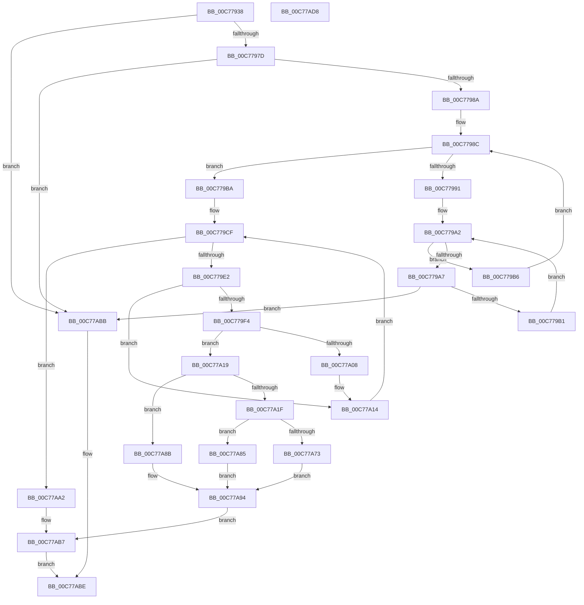

# PnpLoadBootFilterDriver

- RVA: `0x00C77938`–`0x00C77AD9` (길이 `417` bytes)
- VA: `0x0000000140C77938`
- 실행 섹션: `INIT`
- PDB 이름 있음: `예`; PDB Function 태그: `아니요`
- unwind 정보 RVA: `0x000BEC88`
- 디코드: `113`개 명령, `417/417` bytes 표시
- 미해석 바이트: `0` (있으면 어셈블리에 `.byte`로 보존)

> 이 문서는 커널 이미지의 기계어와 PDB 기호를 분석해 생성했습니다. 4번과 5번은 함수 원형과 자료형을 바이너리 사용 방식에서 추정한 C 해석이며 원본 소스 복구 결과는 아닙니다.

## 1. Dependencies

- 직접 호출 지점: **7**; 고유 호출 대상: **6**
- 직접 호출자로 확인된 함수: **1**
- RIP 상대 이미지 참조: **2**

### Outgoing calls
- `0x00C779EB` → [IopGetDriverNameFromKeyNode](../../page/99/IopGetDriverNameFromKeyNode_function_00998808.md) (function, `0x00998808`)
- `0x00C779FF` → [RtlEqualUnicodeString](../../page/93/RtlEqualUnicodeString_function_00932A20.md) (function, `0x00932A20`)
- `0x00C77A0F` → [ExFreePoolWithTag](../../poolcode/B8/ExFreePoolWithTag_function_00B82870.md) (function, `0x00B82870`)
- `0x00C77A54` → [PnpInitializeBootStartDriver](PnpInitializeBootStartDriver_function_00C760F0.md) (function, `0x00C760F0`)
- `0x00C77A7B` → [ObfReferenceObjectWithTag](../../text/21/ObfReferenceObjectWithTag_function_00210710.md) (function, `0x00210710`)
- `0x00C77A9B` → [ExFreePoolWithTag](../../poolcode/B8/ExFreePoolWithTag_function_00B82870.md) (function, `0x00B82870`)
- `0x00C77AA5` → [PipIs32bitKey](../../text/5A/PipIs32bitKey_function_005A45F0.md) (function, `0x005A45F0`)

### Direct callers
- [PipCallDriverAddDeviceQueryRoutine](../../page/99/PipCallDriverAddDeviceQueryRoutine_function_00996604.md) at `0x00996832`

### Static image references
- `0x00C7795F` → RVA `0x00F8CFA8` (`.data`; read)
- `0x00C7797D` → RVA `0x00F8CFA0` (`.data`; read)

## 2. Other-region calls and transfers

- 다른 실행 섹션으로 향하는 call: **6**
  - `0x00C779EB` → [IopGetDriverNameFromKeyNode](../../page/99/IopGetDriverNameFromKeyNode_function_00998808.md) (`INIT` → `PAGE`)
  - `0x00C779FF` → [RtlEqualUnicodeString](../../page/93/RtlEqualUnicodeString_function_00932A20.md) (`INIT` → `PAGE`)
  - `0x00C77A0F` → [ExFreePoolWithTag](../../poolcode/B8/ExFreePoolWithTag_function_00B82870.md) (`INIT` → `POOLCODE`)
  - `0x00C77A7B` → [ObfReferenceObjectWithTag](../../text/21/ObfReferenceObjectWithTag_function_00210710.md) (`INIT` → `.text`)
  - `0x00C77A9B` → [ExFreePoolWithTag](../../poolcode/B8/ExFreePoolWithTag_function_00B82870.md) (`INIT` → `POOLCODE`)
  - `0x00C77AA5` → [PipIs32bitKey](../../text/5A/PipIs32bitKey_function_005A45F0.md) (`INIT` → `.text`)
- 별도 외부 분기/꼬리 이동을 확인하지 못했습니다.

## 3. Assembly (complete function range)

```asm
00C77938  48 8B C4                        mov rax, rsp
00C7793B  48 89 58 08                     mov qword ptr [rax + 8], rbx
00C7793F  48 89 68 10                     mov qword ptr [rax + 0x10], rbp
00C77943  48 89 70 18                     mov qword ptr [rax + 0x18], rsi
00C77947  57                              push rdi
00C77948  41 55                           push r13
00C7794A  41 56                           push r14
00C7794C  48 83 EC 50                     sub rsp, 0x50
00C77950  48 83 60 20 00                  and qword ptr [rax + 0x20], 0
00C77955  0F 57 C0                        xorps xmm0, xmm0
00C77958  49 83 21 00                     and qword ptr [r9], 0
00C7795C  4D 8B F1                        mov r14, r9
00C7795F  48 83 3D 41 56 31 00 00         cmp qword ptr [rip + 0x315641], 0
00C77967  48 8B EA                        mov rbp, rdx
00C7796A  48 8B F1                        mov rsi, rcx
00C7796D  41 BD 01 00 00 C0               mov r13d, 0xc0000001
00C77973  0F 11 40 D8                     movups xmmword ptr [rax - 0x28], xmm0
00C77977  0F 84 3E 01 00 00               je 0x140c77abb
00C7797D  44 3B 05 1C 56 31 00            cmp r8d, dword ptr [rip + 0x31561c]
00C77984  0F 83 31 01 00 00               jae 0x140c77abb
00C7798A  33 D2                           xor edx, edx
00C7798C  41 3B D0                        cmp edx, r8d
00C7798F  73 29                           jae 0x140c779ba
00C77991  44 8B CA                        mov r9d, edx
00C77994  49 C1 E1 04                     shl r9, 4
00C77998  4C 03 0D 09 56 31 00            add r9, qword ptr [rip + 0x315609]
00C7799F  49 8B 01                        mov rax, qword ptr [r9]
00C779A2  49 3B C1                        cmp rax, r9
00C779A5  74 0F                           je 0x140c779b6
00C779A7  80 78 2F 00                     cmp byte ptr [rax + 0x2f], 0
00C779AB  0F 84 0A 01 00 00               je 0x140c77abb
00C779B1  48 8B 00                        mov rax, qword ptr [rax]
00C779B4  EB EC                           jmp 0x140c779a2
00C779B6  FF C2                           inc edx
00C779B8  EB D2                           jmp 0x140c7798c
00C779BA  0F AE E8                        lfence
00C779BD  48 8B 05 E4 55 31 00            mov rax, qword ptr [rip + 0x3155e4]
00C779C4  41 8B D8                        mov ebx, r8d
00C779C7  48 C1 E3 04                     shl rbx, 4
00C779CB  48 8B 3C 03                     mov rdi, qword ptr [rbx + rax]
00C779CF  48 8B 0D D2 55 31 00            mov rcx, qword ptr [rip + 0x3155d2]
00C779D6  48 03 CB                        add rcx, rbx
00C779D9  48 3B F9                        cmp rdi, rcx
00C779DC  0F 84 C0 00 00 00               je 0x140c77aa2
00C779E2  48 8B 4F 20                     mov rcx, qword ptr [rdi + 0x20]
00C779E6  48 8D 54 24 40                  lea rdx, [rsp + 0x40]
00C779EB  E8 18 0E D2 FF                  call 0x140998808
00C779F0  85 C0                           test eax, eax
00C779F2  78 20                           js 0x140c77a14
00C779F4  41 B0 01                        mov r8b, 1
00C779F7  48 8D 54 24 40                  lea rdx, [rsp + 0x40]
00C779FC  48 8B CD                        mov rcx, rbp
00C779FF  E8 1C B0 CB FF                  call 0x140932a20
00C77A04  84 C0                           test al, al
00C77A06  75 11                           jne 0x140c77a19
00C77A08  48 8B 4C 24 48                  mov rcx, qword ptr [rsp + 0x48]
00C77A0D  33 D2                           xor edx, edx
00C77A0F  E8 5C AE F0 FF                  call 0x140b82870
00C77A14  48 8B 3F                        mov rdi, qword ptr [rdi]
00C77A17  EB B6                           jmp 0x140c779cf
00C77A19  80 7F 2F 00                     cmp byte ptr [rdi + 0x2f], 0
00C77A1D  75 6C                           jne 0x140c77a8b
00C77A1F  48 8B 57 18                     mov rdx, qword ptr [rdi + 0x18]
00C77A23  48 8D 84 24 88 00 00 00         lea rax, [rsp + 0x88]
00C77A2B  48 89 44 24 38                  mov qword ptr [rsp + 0x38], rax
00C77A30  48 8D 4C 24 40                  lea rcx, [rsp + 0x40]
00C77A35  C7 44 24 28 01 00 00 00         mov dword ptr [rsp + 0x28], 1
00C77A3D  C7 44 24 20 01 00 00 00         mov dword ptr [rsp + 0x20], 1
00C77A45  4C 8B 42 30                     mov r8, qword ptr [rdx + 0x30]
00C77A49  48 83 C2 20                     add rdx, 0x20
00C77A4D  4D 8B C8                        mov r9, r8
00C77A50  4D 8B 40 38                     mov r8, qword ptr [r8 + 0x38]
00C77A54  E8 97 E6 FF FF                  call 0x140c760f0
00C77A59  48 8B B4 24 88 00 00 00         mov rsi, qword ptr [rsp + 0x88]
00C77A61  8B D8                           mov ebx, eax
00C77A63  89 47 28                        mov dword ptr [rdi + 0x28], eax
00C77A66  48 89 77 10                     mov qword ptr [rdi + 0x10], rsi
00C77A6A  C6 47 2F 01                     mov byte ptr [rdi + 0x2f], 1
00C77A6E  48 85 F6                        test rsi, rsi
00C77A71  74 12                           je 0x140c77a85
00C77A73  BA 44 66 6C 74                  mov edx, 0x746c6644
00C77A78  48 8B CE                        mov rcx, rsi
00C77A7B  E8 90 8C 59 FF                  call 0x140210710
00C77A80  49 89 36                        mov qword ptr [r14], rsi
00C77A83  EB 0F                           jmp 0x140c77a94
00C77A85  C6 47 2E 01                     mov byte ptr [rdi + 0x2e], 1
00C77A89  EB 09                           jmp 0x140c77a94
00C77A8B  8B 5F 28                        mov ebx, dword ptr [rdi + 0x28]
00C77A8E  85 DB                           test ebx, ebx
00C77A90  41 0F 49 DD                     cmovns ebx, r13d
00C77A94  48 8B 4C 24 48                  mov rcx, qword ptr [rsp + 0x48]
00C77A99  33 D2                           xor edx, edx
00C77A9B  E8 D0 AD F0 FF                  call 0x140b82870
00C77AA0  EB 15                           jmp 0x140c77ab7
00C77AA2  48 8B CE                        mov rcx, rsi
00C77AA5  E8 46 CB 92 FF                  call 0x1405a45f0
00C77AAA  85 C0                           test eax, eax
00C77AAC  41 8B DD                        mov ebx, r13d
00C77AAF  B9 6C 03 00 C0                  mov ecx, 0xc000036c
00C77AB4  0F 45 D9                        cmovne ebx, ecx
00C77AB7  8B C3                           mov eax, ebx
00C77AB9  EB 03                           jmp 0x140c77abe
00C77ABB  41 8B C5                        mov eax, r13d
00C77ABE  4C 8D 5C 24 50                  lea r11, [rsp + 0x50]
00C77AC3  49 8B 5B 20                     mov rbx, qword ptr [r11 + 0x20]
00C77AC7  49 8B 6B 28                     mov rbp, qword ptr [r11 + 0x28]
00C77ACB  49 8B 73 30                     mov rsi, qword ptr [r11 + 0x30]
00C77ACF  49 8B E3                        mov rsp, r11
00C77AD2  41 5E                           pop r14
00C77AD4  41 5D                           pop r13
00C77AD6  5F                              pop rdi
00C77AD7  C3                              ret
00C77AD8  CC                              int3
```

## 4. C-style interpretation (structured pseudocode)

```c
__int64 __fastcall PnpLoadBootFilterDriver(__int64 a1, __int64 a2, int a3, __int64 a4)
{
    __int64 result;
    __int64 v_rbx;
    __int64 v_rsp;
    unsigned __int64 v_stack_m18;
    unsigned __int64 v_stack_m20;
    unsigned __int64 v_stack_m28;
    unsigned __int64 v_stack_m30;
    unsigned int v_stack_m40;
    unsigned int v_stack_m48;
    unsigned __int64 v_stack_p20;

    *(unsigned __int64 *)(v_rsp + 8) = v_rbx;
    *(unsigned __int64 *)(v_rsp + 16) = v_rbp;
    *(unsigned __int64 *)(v_rsp + 24) = v_rsi;
    v_rsp = (v_rsp) - (80);
    *(unsigned __int64 *)(v_rsp - 40) = v_xmm0;
    if ((*(unsigned __int64 *)(v_rip + 3233345)) == 0) goto loc_00C77ABB;
    if (a3 >= (*(unsigned int *)(v_rip + 3233308))) goto loc_00C77ABB;
    a2 = 0;
loc_00C7798C:
    if (0 >= a3) goto loc_00C779BA;
    a4 = (0) << (4);
    a4 = (a4) + (*(unsigned __int64 *)(v_rip + 3233289));
loc_00C779A2:
    if ((*(unsigned __int64 *)(a4)) == a4) goto loc_00C779B6;
    if ((*(unsigned __int8 *)(*(unsigned __int64 *)(a4) + 47)) == 0) goto loc_00C77ABB;
    goto loc_00C779A2;
loc_00C779B6:
    a2 = (unsigned int)((a2) + 1);
    goto loc_00C7798C;
loc_00C779BA:
    v_rbx = ((unsigned int)(a3)) << (4);
loc_00C779CF:
    a1 = (*(unsigned __int64 *)(v_rip + 3233234)) + (v_rbx);
    if ((*(unsigned __int64 *)(v_rbx + *(unsigned __int64 *)(v_rip + 3233252) * 1)) == a1) goto loc_00C77AA2;
    result = IopGetDriverNameFromKeyNode(*(unsigned __int64 *)(*(unsigned __int64 *)(v_rbx + *(unsigned __int64 *)(v_rip + 3233252) * 1) + 32), v_stack_m28, a3, a4);
    if (sign_flag) goto loc_00C77A14;
    result = RtlEqualUnicodeString(a2, v_stack_m28, 1, a4);
    if ((unsigned __int8)(result) != 0) goto loc_00C77A19;
    a2 = 0;
    result = ExFreePoolWithTag(v_stack_m20, a2, 1, a4);
loc_00C77A14:
    goto loc_00C779CF;
loc_00C77A19:
    if ((*(unsigned __int8 *)(*(unsigned __int64 *)(*(unsigned __int64 *)(v_rbx + *(unsigned __int64 *)(v_rip + 3233252) * 1)) + 47)) != 0) goto loc_00C77A8B;
    v_stack_m30 = v_stack_p20;
    v_stack_m40 = 1;
    v_stack_m48 = 1;
    a2 = (*(unsigned __int64 *)(*(unsigned __int64 *)(*(unsigned __int64 *)(v_rbx + *(unsigned __int64 *)(v_rip + 3233252) * 1)) + 24)) + (32);
    result = PnpInitializeBootStartDriver(v_stack_m28, a2, *(unsigned __int64 *)(*(unsigned __int64 *)(*(unsigned __int64 *)(*(unsigned __int64 *)(*(unsigned __int64 *)(v_rbx + *(unsigned __int64 *)(v_rip + 3233252) * 1)) + 24) + 48) + 56), *(unsigned __int64 *)(*(unsigned __int64 *)(*(unsigned __int64 *)(*(unsigned __int64 *)(v_rbx + *(unsigned __int64 *)(v_rip + 3233252) * 1)) + 24) + 48));
    *(unsigned int *)(*(unsigned __int64 *)(*(unsigned __int64 *)(v_rbx + *(unsigned __int64 *)(v_rip + 3233252) * 1)) + 40) = (unsigned int)(result);
    *(unsigned __int64 *)(*(unsigned __int64 *)(*(unsigned __int64 *)(v_rbx + *(unsigned __int64 *)(v_rip + 3233252) * 1)) + 16) = v_stack_p20;
    *(unsigned __int8 *)(*(unsigned __int64 *)(*(unsigned __int64 *)(v_rbx + *(unsigned __int64 *)(v_rip + 3233252) * 1)) + 47) = 1;
    if (v_stack_p20 == 0) goto loc_00C77A85;
    result = ObfReferenceObjectWithTag(v_stack_p20, (unsigned int)(0x746C6644ULL), *(unsigned __int64 *)(*(unsigned __int64 *)(*(unsigned __int64 *)(*(unsigned __int64 *)(*(unsigned __int64 *)(v_rbx + *(unsigned __int64 *)(v_rip + 3233252) * 1)) + 24) + 48) + 56), *(unsigned __int64 *)(*(unsigned __int64 *)(*(unsigned __int64 *)(*(unsigned __int64 *)(v_rbx + *(unsigned __int64 *)(v_rip + 3233252) * 1)) + 24) + 48));
    *(unsigned __int64 *)(a4) = v_stack_p20;
    goto loc_00C77A94;
loc_00C77A85:
    *(unsigned __int8 *)(*(unsigned __int64 *)(*(unsigned __int64 *)(v_rbx + *(unsigned __int64 *)(v_rip + 3233252) * 1)) + 46) = 1;
    goto loc_00C77A94;
loc_00C77A8B:
    v_rbx = (unsigned int)(*(unsigned int *)(*(unsigned __int64 *)(*(unsigned __int64 *)(v_rbx + *(unsigned __int64 *)(v_rip + 3233252) * 1)) + 40));
    if (!sign_flag) { v_rbx = (unsigned int)((unsigned int)(0xC0000001ULL)); }
loc_00C77A94:
    a2 = 0;
    result = ExFreePoolWithTag(v_stack_m20, a2, *(unsigned __int64 *)(*(unsigned __int64 *)(*(unsigned __int64 *)(*(unsigned __int64 *)(*(unsigned __int64 *)(v_rbx + *(unsigned __int64 *)(v_rip + 3233252) * 1)) + 24) + 48) + 56), *(unsigned __int64 *)(*(unsigned __int64 *)(*(unsigned __int64 *)(*(unsigned __int64 *)(v_rbx + *(unsigned __int64 *)(v_rip + 3233252) * 1)) + 24) + 48));
    goto loc_00C77AB7;
loc_00C77AA2:
    result = PipIs32bitKey(v_stack_p20, a2, *(unsigned __int64 *)(*(unsigned __int64 *)(*(unsigned __int64 *)(*(unsigned __int64 *)(*(unsigned __int64 *)(v_rbx + *(unsigned __int64 *)(v_rip + 3233252) * 1)) + 24) + 48) + 56), *(unsigned __int64 *)(*(unsigned __int64 *)(*(unsigned __int64 *)(*(unsigned __int64 *)(v_rbx + *(unsigned __int64 *)(v_rip + 3233252) * 1)) + 24) + 48));
    v_rbx = (unsigned int)((unsigned int)((unsigned int)(0xC0000001ULL)));
    if ((unsigned int)(result) != 0) { v_rbx = (unsigned int)((unsigned int)(0xC000036CULL)); }
loc_00C77AB7:
    goto loc_00C77ABE;
loc_00C77ABB:
loc_00C77ABE:
    return (unsigned int)((unsigned int)((unsigned int)(0xC0000001ULL)));
}
```

## 5. (Beta) C Style

```c
int64_t PnpLoadBootFilterDriver(int64_t Arg1, int64_t Arg2, int32_t Arg3, void *Arg4)
{
    uint8_t *arg4 = (uint8_t *)Arg4;

    int64_t result;
    int64_t local_rbx;
    int64_t local_rsp;
    uint64_t v_stack_m18;
    uint64_t v_stack_m20;
    uint64_t v_stack_m28;
    uint64_t v_stack_m30;
    uint32_t v_stack_m40;
    uint32_t v_stack_m48;
    uint64_t v_stack_p20;

    *(uint64_t *)(local_rsp + 0x8) = local_rbx;
    *(uint64_t *)(local_rsp + 0x10) = local_rbp;
    *(uint64_t *)(local_rsp + 0x18) = local_rsi;
    local_rsp = (local_rsp) - (80);
    *(uint64_t *)(local_rsp - 0x28) = v_xmm0;
    if ((*(uint64_t *)(v_rip + 0x315641)) == 0) goto loc_00C77ABB;
    if (Arg3 >= (*(uint32_t *)(v_rip + 0x31561C))) goto loc_00C77ABB;
    Arg2 = 0;
loc_00C7798C:
    if (0 >= Arg3) goto loc_00C779BA;
    Arg4 = (0) << (4);
    Arg4 = (Arg4) + (*(uint64_t *)(v_rip + 0x315609));
loc_00C779A2:
    if ((*(uint64_t *)(arg4)) == Arg4) goto loc_00C779B6;
    if ((*(uint8_t *)(*(uint64_t *)(arg4) + 0x2F)) == 0) goto loc_00C77ABB;
    goto loc_00C779A2;
loc_00C779B6:
    Arg2 = (uint32_t)((Arg2) + 1);
    goto loc_00C7798C;
loc_00C779BA:
    local_rbx = ((uint32_t)(Arg3)) << (4);
loc_00C779CF:
    Arg1 = (*(uint64_t *)(v_rip + 0x3155D2)) + (local_rbx);
    if ((*(uint64_t *)(local_rbx + *(uint64_t *)(v_rip + 0x3155E4) * 1)) == Arg1) goto loc_00C77AA2;
    result = IopGetDriverNameFromKeyNode(*(uint64_t *)(*(uint64_t *)(local_rbx + *(uint64_t *)(v_rip + 0x3155E4) * 1) + 0x20), v_stack_m28, Arg3, Arg4);
    if (sign_flag) goto loc_00C77A14;
    result = RtlEqualUnicodeString(Arg2, v_stack_m28, 1, Arg4);
    if ((uint8_t)(result) != 0) goto loc_00C77A19;
    Arg2 = 0;
    result = ExFreePoolWithTag(v_stack_m20, Arg2, 1, Arg4);
loc_00C77A14:
    goto loc_00C779CF;
loc_00C77A19:
    if ((*(uint8_t *)(*(uint64_t *)(*(uint64_t *)(local_rbx + *(uint64_t *)(v_rip + 0x3155E4) * 1)) + 0x2F)) != 0) goto loc_00C77A8B;
    v_stack_m30 = v_stack_p20;
    v_stack_m40 = 1;
    v_stack_m48 = 1;
    Arg2 = (*(uint64_t *)(*(uint64_t *)(*(uint64_t *)(local_rbx + *(uint64_t *)(v_rip + 0x3155E4) * 1)) + 0x18)) + (32);
    result = PnpInitializeBootStartDriver(v_stack_m28, Arg2, *(uint64_t *)(*(uint64_t *)(*(uint64_t *)(*(uint64_t *)(*(uint64_t *)(local_rbx + *(uint64_t *)(v_rip + 0x3155E4) * 1)) + 0x18) + 0x30) + 0x38), *(uint64_t *)(*(uint64_t *)(*(uint64_t *)(*(uint64_t *)(local_rbx + *(uint64_t *)(v_rip + 0x3155E4) * 1)) + 0x18) + 0x30));
    *(uint32_t *)(*(uint64_t *)(*(uint64_t *)(local_rbx + *(uint64_t *)(v_rip + 0x3155E4) * 1)) + 0x28) = (uint32_t)(result);
    *(uint64_t *)(*(uint64_t *)(*(uint64_t *)(local_rbx + *(uint64_t *)(v_rip + 0x3155E4) * 1)) + 0x10) = v_stack_p20;
    *(uint8_t *)(*(uint64_t *)(*(uint64_t *)(local_rbx + *(uint64_t *)(v_rip + 0x3155E4) * 1)) + 0x2F) = 1;
    if (v_stack_p20 == 0) goto loc_00C77A85;
    result = ObfReferenceObjectWithTag(v_stack_p20, (uint32_t)(0x746C6644ULL), *(uint64_t *)(*(uint64_t *)(*(uint64_t *)(*(uint64_t *)(*(uint64_t *)(local_rbx + *(uint64_t *)(v_rip + 0x3155E4) * 1)) + 0x18) + 0x30) + 0x38), *(uint64_t *)(*(uint64_t *)(*(uint64_t *)(*(uint64_t *)(local_rbx + *(uint64_t *)(v_rip + 0x3155E4) * 1)) + 0x18) + 0x30));
    *(uint64_t *)(arg4) = v_stack_p20;
    goto loc_00C77A94;
loc_00C77A85:
    *(uint8_t *)(*(uint64_t *)(*(uint64_t *)(local_rbx + *(uint64_t *)(v_rip + 0x3155E4) * 1)) + 0x2E) = 1;
    goto loc_00C77A94;
loc_00C77A8B:
    local_rbx = (uint32_t)(*(uint32_t *)(*(uint64_t *)(*(uint64_t *)(local_rbx + *(uint64_t *)(v_rip + 0x3155E4) * 1)) + 0x28));
    if (!sign_flag) { local_rbx = (uint32_t)((uint32_t)(0xC0000001ULL)); }
loc_00C77A94:
    Arg2 = 0;
    result = ExFreePoolWithTag(v_stack_m20, Arg2, *(uint64_t *)(*(uint64_t *)(*(uint64_t *)(*(uint64_t *)(*(uint64_t *)(local_rbx + *(uint64_t *)(v_rip + 0x3155E4) * 1)) + 0x18) + 0x30) + 0x38), *(uint64_t *)(*(uint64_t *)(*(uint64_t *)(*(uint64_t *)(local_rbx + *(uint64_t *)(v_rip + 0x3155E4) * 1)) + 0x18) + 0x30));
    goto loc_00C77AB7;
loc_00C77AA2:
    result = PipIs32bitKey(v_stack_p20, Arg2, *(uint64_t *)(*(uint64_t *)(*(uint64_t *)(*(uint64_t *)(*(uint64_t *)(local_rbx + *(uint64_t *)(v_rip + 0x3155E4) * 1)) + 0x18) + 0x30) + 0x38), *(uint64_t *)(*(uint64_t *)(*(uint64_t *)(*(uint64_t *)(local_rbx + *(uint64_t *)(v_rip + 0x3155E4) * 1)) + 0x18) + 0x30));
    local_rbx = (uint32_t)((uint32_t)((uint32_t)(0xC0000001ULL)));
    if ((uint32_t)(result) != 0) { local_rbx = (uint32_t)((uint32_t)(0xC000036CULL)); }
loc_00C77AB7:
    goto loc_00C77ABE;
loc_00C77ABB:
loc_00C77ABE:
    return (uint32_t)((uint32_t)((uint32_t)(0xC0000001ULL)));
}
```

### 관측된 메모리 오프셋

구조체 형식이 확인되지 않은 접근은 인자 기준의 오프셋으로만 기록했습니다.

| 기준 인자 | 오프셋 표현 | 폭 (bit) | 접근 |
|---|---:|---:|---|
| `Arg4` | `+ 0x0` | `64` | `R/W` |
| `Arg4` | `+ 0x0` | `64` | `W` |

## 6. Execution-region graph

[열기: 2D/3D 그래프와 함수 탐색 컨트롤 패널](../../../control-panel.html?section=init&rva=0x00C77938&view=graph)

- 2D 그래프는 위에서 아래로 흐르고, 3D 그래프는 빈 공간을 드래그해 회전합니다. Shift+드래그는 이동, 휠은 확대·축소, 함수 노드 선택은 대상 보고서 이동입니다.

### Static fallback


