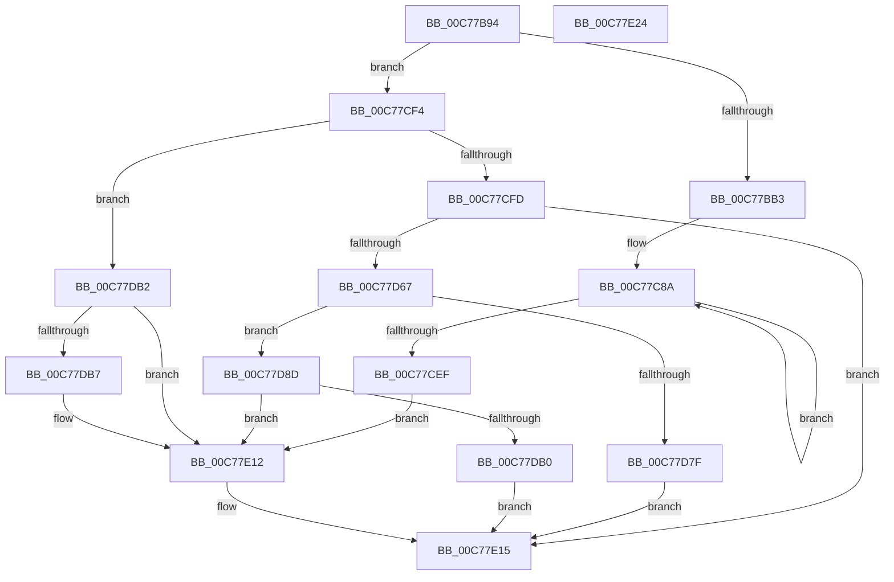

# PopPowerAggregatorInitialize

- RVA: `0x00C77B94`–`0x00C77E25` (길이 `657` bytes)
- VA: `0x0000000140C77B94`
- 실행 섹션: `INIT`
- PDB 이름 있음: `예`; PDB Function 태그: `아니요`
- unwind 정보 RVA: `0x000BF0EC`
- 디코드: `147`개 명령, `657/657` bytes 표시
- 미해석 바이트: `0` (있으면 어셈블리에 `.byte`로 보존)

> 이 문서는 커널 이미지의 기계어와 PDB 기호를 분석해 생성했습니다. 4번과 5번은 함수 원형과 자료형을 바이너리 사용 방식에서 추정한 C 해석이며 원본 소스 복구 결과는 아닙니다.

## 1. Dependencies

- 직접 호출 지점: **10**; 고유 호출 대상: **9**
- 직접 호출자로 확인된 함수: **1**
- RIP 상대 이미지 참조: **32**

### Outgoing calls
- `0x00C77BD7` → [memset](../../text/6C/memset_function_006C6C40.md) (function, `0x006C6C40`)
- `0x00C77C42` → [KiInitializeTimer2](../../text/3A/KiInitializeTimer2_function_003A3288.md) (function, `0x003A3288`)
- `0x00C77CA3` → [KeInitializeIRTimer](../../text/3A/KeInitializeIRTimer_function_003A4204.md) (function, `0x003A4204`)
- `0x00C77D1B` → [wcslen](../../text/50/wcslen_function_00501BA0.md) (function, `0x00501BA0`)
- `0x00C77D58` → [PoCaptureReasonContext](../../text/23/PoCaptureReasonContext_function_00230A38.md) (function, `0x00230A38`)
- `0x00C77D74` → [PopPowerRequestCreateCommon](../../text/23/PopPowerRequestCreateCommon_function_00230150.md) (function, `0x00230150`)
- `0x00C77D83` → [PoDestroyReasonContext](../../text/23/PoDestroyReasonContext_function_00230944.md) (function, `0x00230944`)
- `0x00C77DA5` → [PoRegisterPowerSettingCallback](../../page/A8/PoRegisterPowerSettingCallback_function_00A82150.md) (function, `0x00A82150`)
- `0x00C77DE1` → [ZwUpdateWnfStateData](../../text/6B/ZwUpdateWnfStateData_function_006B0D10.md) (function, `0x006B0D10`)
- `0x00C77E0D` → [ZwUpdateWnfStateData](../../text/6B/ZwUpdateWnfStateData_function_006B0D10.md) (function, `0x006B0D10`)

### Direct callers
- [PoInitSystem](PoInitSystem_function_00C72358.md) at `0x00C723E6`
- [PoInitSystem](PoInitSystem_function_00C72358.md) at `0x00C72D31`
- [PoInitSystem](PoInitSystem_function_00C72358.md) at `0x00C72F0B`

### Static image references
- `0x00C77BB5` → RVA `0x00F09718` (`.data`; write)
- `0x00C77BC2` → RVA `0x00F09710` (`.data`; write)
- `0x00C77BC9` → RVA `0x00F09740` (`.data`; read)
- `0x00C77BD0` → RVA `0x00F0AD38` (`.data`; write)
- `0x00C77BDC` → RVA `0x00911FB0` (`PopPowerAggregatorWorker`; read)
- `0x00C77BE3` → RVA `0x00F09758` (`.data`; write)
- `0x00C77BED` → RVA `0x00F0AD20` (`.data`; write)
- `0x00C77BF8` → RVA `0x00764FB0` (`PopPowerAggregatorSessionSwitchWorker`; read)
- `0x00C77BFF` → RVA `0x00F09778` (`.data`; write)
- `0x00C77C09` → RVA `0x00F097B0` (`.data`; write)
- `0x00C77C10` → RVA `0x005D92C0` (`PopPowerAggregatorSessionSwitchTimerCallback`; read)
- `0x00C77C17` → RVA `0x00F0AD28` (`.data`; write)
- `0x00C77C1E` → RVA `0x00F097C0` (`.data`; read)
- `0x00C77C25` → RVA `0x00F0AD10` (`.data`; write)
- `0x00C77C2C` → RVA `0x00F097B8` (`.data`; write)
- `0x00C77C33` → RVA `0x00F097A0` (`.data`; write)
- `0x00C77C3A` → RVA `0x00F097C2` (`.data`; write)
- `0x00C77C47` → RVA `0x00F09850` (`.data`; read)
- `0x00C77C4E` → RVA `0x00F09848` (`.data`; write)
- `0x00C77C5A` → RVA `0x00F09858` (`.data`; write)
- `0x00C77C61` → RVA `0x00F09850` (`.data`; write)
- `0x00C77C68` → RVA `0x00F09929` (`.data`; read)
- `0x00C77C6F` → RVA `0x00F0984A` (`.data`; write)
- `0x00C77C79` → RVA `0x00F0984C` (`.data`; write)
- `0x00C77C9C` → RVA `0x005D9170` (`PopPowerAggregatorDozeTimerCallback`; read)
- `0x00C77CAF` → RVA `0x00764490` (`PopPowerAggregatorDozeTimerWorker`; read)
- `0x00C77D03` → RVA `0x00C7C330` (` ?? ::PBOPGDP::`string'`; read)
- `0x00C77D6B` → RVA `0x00F0AD40` (`.data`; read)
- `0x00C77D95` → RVA `0x00764DE0` (`PopPowerAggregatorPowerSettingCallback`; read)
- `0x00C77D9E` → RVA `0x00024C18` (`.rdata`; read)
- `0x00C77DDA` → RVA `0x00020930` (`.rdata`; read)
- `0x00C77DF4` → RVA `0x00013340` (`.rdata`; read)

## 2. Other-region calls and transfers

- 다른 실행 섹션으로 향하는 call: **10**
  - `0x00C77BD7` → [memset](../../text/6C/memset_function_006C6C40.md) (`INIT` → `.text`)
  - `0x00C77C42` → [KiInitializeTimer2](../../text/3A/KiInitializeTimer2_function_003A3288.md) (`INIT` → `.text`)
  - `0x00C77CA3` → [KeInitializeIRTimer](../../text/3A/KeInitializeIRTimer_function_003A4204.md) (`INIT` → `.text`)
  - `0x00C77D1B` → [wcslen](../../text/50/wcslen_function_00501BA0.md) (`INIT` → `.text`)
  - `0x00C77D58` → [PoCaptureReasonContext](../../text/23/PoCaptureReasonContext_function_00230A38.md) (`INIT` → `.text`)
  - `0x00C77D74` → [PopPowerRequestCreateCommon](../../text/23/PopPowerRequestCreateCommon_function_00230150.md) (`INIT` → `.text`)
  - `0x00C77D83` → [PoDestroyReasonContext](../../text/23/PoDestroyReasonContext_function_00230944.md) (`INIT` → `.text`)
  - `0x00C77DA5` → [PoRegisterPowerSettingCallback](../../page/A8/PoRegisterPowerSettingCallback_function_00A82150.md) (`INIT` → `PAGE`)
  - `0x00C77DE1` → [ZwUpdateWnfStateData](../../text/6B/ZwUpdateWnfStateData_function_006B0D10.md) (`INIT` → `.text`)
  - `0x00C77E0D` → [ZwUpdateWnfStateData](../../text/6B/ZwUpdateWnfStateData_function_006B0D10.md) (`INIT` → `.text`)
- 별도 외부 분기/꼬리 이동을 확인하지 못했습니다.

## 3. Assembly (complete function range)

```asm
00C77B94  40 55                           push rbp
00C77B96  53                              push rbx
00C77B97  56                              push rsi
00C77B98  57                              push rdi
00C77B99  41 56                           push r14
00C77B9B  41 57                           push r15
00C77B9D  48 8B EC                        mov rbp, rsp
00C77BA0  48 83 EC 78                     sub rsp, 0x78
00C77BA4  45 33 FF                        xor r15d, r15d
00C77BA7  4C 89 7D 50                     mov qword ptr [rbp + 0x50], r15
00C77BAB  85 C9                           test ecx, ecx
00C77BAD  0F 85 41 01 00 00               jne 0x140c77cf4
00C77BB3  33 D2                           xor edx, edx
00C77BB5  4C 89 3D 5C 1B 29 00            mov qword ptr [rip + 0x291b5c], r15
00C77BBC  41 B8 F8 15 00 00               mov r8d, 0x15f8
00C77BC2  4C 89 3D 47 1B 29 00            mov qword ptr [rip + 0x291b47], r15
00C77BC9  48 8D 0D 70 1B 29 00            lea rcx, [rip + 0x291b70]
00C77BD0  44 88 3D 61 31 29 00            mov byte ptr [rip + 0x293161], r15b
00C77BD7  E8 64 F0 A4 FF                  call 0x1406c6c40
00C77BDC  48 8D 05 CD A3 C9 FF            lea rax, [rip - 0x365c33]
00C77BE3  C7 05 6B 1B 29 00 01 00 00 00   mov dword ptr [rip + 0x291b6b], 1
00C77BED  48 89 05 2C 31 29 00            mov qword ptr [rip + 0x29312c], rax
00C77BF4  45 8D 4F 08                     lea r9d, [r15 + 8]
00C77BF8  48 8D 05 B1 D3 AE FF            lea rax, [rip - 0x512c4f]
00C77BFF  44 89 3D 72 1B 29 00            mov dword ptr [rip + 0x291b72], r15d
00C77C06  45 33 C0                        xor r8d, r8d
00C77C09  48 89 05 A0 1B 29 00            mov qword ptr [rip + 0x291ba0], rax
00C77C10  48 8D 15 A9 16 96 FF            lea rdx, [rip - 0x69e957]
00C77C17  4C 89 3D 0A 31 29 00            mov qword ptr [rip + 0x29310a], r15
00C77C1E  48 8D 0D 9B 1B 29 00            lea rcx, [rip + 0x291b9b]
00C77C25  4C 89 3D E4 30 29 00            mov qword ptr [rip + 0x2930e4], r15
00C77C2C  4C 89 3D 85 1B 29 00            mov qword ptr [rip + 0x291b85], r15
00C77C33  4C 89 3D 66 1B 29 00            mov qword ptr [rip + 0x291b66], r15
00C77C3A  66 44 89 3D 80 1B 29 00         mov word ptr [rip + 0x291b80], r15w
00C77C42  E8 41 B6 72 FF                  call 0x1403a3288
00C77C47  48 8D 05 02 1C 29 00            lea rax, [rip + 0x291c02]
00C77C4E  66 44 89 3D F2 1B 29 00         mov word ptr [rip + 0x291bf2], r15w
00C77C56  41 8D 77 02                     lea esi, [r15 + 2]
00C77C5A  48 89 05 F7 1B 29 00            mov qword ptr [rip + 0x291bf7], rax
00C77C61  48 89 05 E8 1B 29 00            mov qword ptr [rip + 0x291be8], rax
00C77C68  48 8D 1D BA 1C 29 00            lea rbx, [rip + 0x291cba]
00C77C6F  C6 05 D4 1B 29 00 06            mov byte ptr [rip + 0x291bd4], 6
00C77C76  41 8B FF                        mov edi, r15d
00C77C79  44 89 3D CC 1B 29 00            mov dword ptr [rip + 0x291bcc], r15d
00C77C80  44 8B F6                        mov r14d, esi
00C77C83  C7 45 38 08 00 02 00            mov dword ptr [rbp + 0x38], 0x20008
00C77C8A  48 8D 8B 6F FF FF FF            lea rcx, [rbx - 0x91]
00C77C91  89 74 24 20                     mov dword ptr [rsp + 0x20], esi
00C77C95  4C 8D 4D 38                     lea r9, [rbp + 0x38]
00C77C99  4C 8B C7                        mov r8, rdi
00C77C9C  48 8D 15 CD 14 96 FF            lea rdx, [rip - 0x69eb33]
00C77CA3  E8 5C C5 72 FF                  call 0x1403a4204
00C77CA8  48 89 BB 67 FF FF FF            mov qword ptr [rbx - 0x99], rdi
00C77CAF  48 8D 05 DA C7 AE FF            lea rax, [rip - 0x513826]
00C77CB6  48 89 83 5F FF FF FF            mov qword ptr [rbx - 0xa1], rax
00C77CBD  48 FF C7                        inc rdi
00C77CC0  4C 89 BB 4F FF FF FF            mov qword ptr [rbx - 0xb1], r15
00C77CC7  48 8D 43 07                     lea rax, [rbx + 7]
00C77CCB  66 44 89 7B FF                  mov word ptr [rbx - 1], r15w
00C77CD0  C6 43 01 06                     mov byte ptr [rbx + 1], 6
00C77CD4  C7 43 03 01 00 00 00            mov dword ptr [rbx + 3], 1
00C77CDB  48 89 43 0F                     mov qword ptr [rbx + 0xf], rax
00C77CDF  48 8D 9B C8 00 00 00            lea rbx, [rbx + 0xc8]
00C77CE6  48 89 00                        mov qword ptr [rax], rax
00C77CE9  49 83 EE 01                     sub r14, 1
00C77CED  75 9B                           jne 0x140c77c8a
00C77CEF  E9 1E 01 00 00                  jmp 0x140c77e12
00C77CF4  83 F9 01                        cmp ecx, 1
00C77CF7  0F 85 B5 00 00 00               jne 0x140c77db2
00C77CFD  0F 57 C0                        xorps xmm0, xmm0
00C77D00  89 4D CC                        mov dword ptr [rbp - 0x34], ecx
00C77D03  48 8D 0D 26 46 00 00            lea rcx, [rip + 0x4626]
00C77D0A  44 89 7D C8                     mov dword ptr [rbp - 0x38], r15d
00C77D0E  0F 11 45 D0                     movups xmmword ptr [rbp - 0x30], xmm0
00C77D12  48 89 4D D8                     mov qword ptr [rbp - 0x28], rcx
00C77D16  F3 0F 7F 45 E0                  movdqu xmmword ptr [rbp - 0x20], xmm0
00C77D1B  E8 80 9E 88 FF                  call 0x140501ba0
00C77D20  48 03 C0                        add rax, rax
00C77D23  B9 FC FF 00 00                  mov ecx, 0xfffc
00C77D28  48 3D FE FF 00 00               cmp rax, 0xfffe
00C77D2E  41 B1 01                        mov r9b, 1
00C77D31  48 0F 43 C1                     cmovae rax, rcx
00C77D35  45 33 C0                        xor r8d, r8d
00C77D38  66 89 45 D0                     mov word ptr [rbp - 0x30], ax
00C77D3C  48 8D 4D C8                     lea rcx, [rbp - 0x38]
00C77D40  66 83 C0 02                     add ax, 2
00C77D44  33 D2                           xor edx, edx
00C77D46  66 89 45 D2                     mov word ptr [rbp - 0x2e], ax
00C77D4A  48 8D 45 50                     lea rax, [rbp + 0x50]
00C77D4E  48 89 44 24 28                  mov qword ptr [rsp + 0x28], rax
00C77D53  4C 89 7C 24 20                  mov qword ptr [rsp + 0x20], r15
00C77D58  E8 DB 8C 5B FF                  call 0x140230a38
00C77D5D  8B D8                           mov ebx, eax
00C77D5F  85 C0                           test eax, eax
00C77D61  0F 88 AE 00 00 00               js 0x140c77e15
00C77D67  48 8B 4D 50                     mov rcx, qword ptr [rbp + 0x50]
00C77D6B  4C 8D 05 CE 2F 29 00            lea r8, [rip + 0x292fce]
00C77D72  B2 01                           mov dl, 1
00C77D74  E8 D7 83 5B FF                  call 0x140230150
00C77D79  8B D8                           mov ebx, eax
00C77D7B  85 C0                           test eax, eax
00C77D7D  79 0E                           jns 0x140c77d8d
00C77D7F  48 8B 4D 50                     mov rcx, qword ptr [rbp + 0x50]
00C77D83  E8 BC 8B 5B FF                  call 0x140230944
00C77D88  E9 88 00 00 00                  jmp 0x140c77e15
00C77D8D  45 33 C9                        xor r9d, r9d
00C77D90  4C 89 7C 24 20                  mov qword ptr [rsp + 0x20], r15
00C77D95  4C 8D 05 44 D0 AE FF            lea r8, [rip - 0x512fbc]
00C77D9C  33 C9                           xor ecx, ecx
00C77D9E  48 8D 15 73 CE 3A FF            lea rdx, [rip - 0xc5318d]
00C77DA5  E8 A6 A3 E0 FF                  call 0x140a82150
00C77DAA  8B D8                           mov ebx, eax
00C77DAC  85 C0                           test eax, eax
00C77DAE  79 62                           jns 0x140c77e12
00C77DB0  EB 63                           jmp 0x140c77e15
00C77DB2  83 F9 03                        cmp ecx, 3
00C77DB5  75 5B                           jne 0x140c77e12
00C77DB7  8D 59 01                        lea ebx, [rcx + 1]
00C77DBA  44 89 7C 24 30                  mov dword ptr [rsp + 0x30], r15d
00C77DBF  44 8B C3                        mov r8d, ebx
00C77DC2  44 89 7C 24 28                  mov dword ptr [rsp + 0x28], r15d
00C77DC7  45 33 C9                        xor r9d, r9d
00C77DCA  C7 45 40 01 00 00 00            mov dword ptr [rbp + 0x40], 1
00C77DD1  48 8D 55 40                     lea rdx, [rbp + 0x40]
00C77DD5  4C 89 7C 24 20                  mov qword ptr [rsp + 0x20], r15
00C77DDA  48 8D 0D 4F 8B 3A FF            lea rcx, [rip - 0xc574b1]
00C77DE1  E8 2A 8F A3 FF                  call 0x1406b0d10
00C77DE6  44 89 7C 24 30                  mov dword ptr [rsp + 0x30], r15d
00C77DEB  48 8D 55 48                     lea rdx, [rbp + 0x48]
00C77DEF  44 89 7C 24 28                  mov dword ptr [rsp + 0x28], r15d
00C77DF4  48 8D 0D 45 B5 39 FF            lea rcx, [rip - 0xc64abb]
00C77DFB  45 33 C9                        xor r9d, r9d
00C77DFE  4C 89 7C 24 20                  mov qword ptr [rsp + 0x20], r15
00C77E03  44 8B C3                        mov r8d, ebx
00C77E06  C7 45 48 01 00 00 00            mov dword ptr [rbp + 0x48], 1
00C77E0D  E8 FE 8E A3 FF                  call 0x1406b0d10
00C77E12  41 8B DF                        mov ebx, r15d
00C77E15  8B C3                           mov eax, ebx
00C77E17  48 83 C4 78                     add rsp, 0x78
00C77E1B  41 5F                           pop r15
00C77E1D  41 5E                           pop r14
00C77E1F  5F                              pop rdi
00C77E20  5E                              pop rsi
00C77E21  5B                              pop rbx
00C77E22  5D                              pop rbp
00C77E23  C3                              ret
00C77E24  CC                              int3
```

## 4. C-style interpretation (structured pseudocode)

```c
__int64 __fastcall PopPowerAggregatorInitialize(int a1, int a2)
{
    __int64 result;
    __int64 v_r14;
    __int64 v_r15;
    __int64 v_rbx;
    __int64 v_rdi;
    __int64 v_rsp;
    unsigned __int64 v_stack_m50;
    unsigned __int64 v_stack_m58;
    unsigned __int16 v_stack_m5E;
    unsigned __int64 v_stack_m60;
    unsigned int v_stack_m64;
    unsigned int v_stack_m68;
    unsigned int v_stack_m78;
    unsigned __int64 v_stack_m80;
    unsigned int v_stack_m88;
    unsigned int v_stack_p10;
    unsigned __int64 v_stack_p18;
    unsigned __int64 v_stack_p20;
    unsigned int v_stack_p8;

    v_rsp = (v_rsp) - (120);
    v_r15 = 0;
    v_stack_p20 = 0;
    if (a1 != 0) goto loc_00C77CF4;
    a2 = 0;
    *(unsigned __int64 *)(v_rip + 2693980) = 0;
    *(unsigned __int64 *)(v_rip + 2693959) = 0;
    *(unsigned __int8 *)(v_rip + 2699617) = 0;
    result = memset(v_rip + 2694000, a2, (unsigned int)(0x15F8ULL), a4);
    *(unsigned int *)(v_rip + 2693995) = 1;
    *(unsigned __int64 *)(v_rip + 2699564) = v_rip - 3562547;
    *(unsigned int *)(v_rip + 2694002) = 0;
    a3 = 0;
    *(unsigned __int64 *)(v_rip + 2694048) = v_rip - 5319759;
    *(unsigned __int64 *)(v_rip + 2699530) = 0;
    *(unsigned __int64 *)(v_rip + 2699492) = 0;
    *(unsigned __int64 *)(v_rip + 2694021) = 0;
    *(unsigned __int64 *)(v_rip + 2693990) = 0;
    *(unsigned __int16 *)(v_rip + 2694016) = 0;
    result = KiInitializeTimer2(v_rip + 2694043, v_rip - 6941015, a3, v_r15 + 8);
    *(unsigned __int16 *)(v_rip + 2694130) = 0;
    *(unsigned __int64 *)(v_rip + 2694135) = v_rip + 2694146;
    *(unsigned __int64 *)(v_rip + 2694120) = v_rip + 2694146;
    *(unsigned __int8 *)(v_rip + 2694100) = 6;
    *(unsigned int *)(v_rip + 2694092) = 0;
    v_stack_p8 = 0x20008ULL;
loc_00C77C8A:
    v_stack_m88 = (unsigned int)(v_r15 + 2);
    result = KeInitializeIRTimer(v_rip + 2694330 - 145, v_rip - 6941491, 0, v_stack_p8);
    *(unsigned __int64 *)(v_rip + 2694330 - 153) = 0;
    *(unsigned __int64 *)(v_rip + 2694330 - 161) = v_rip - 5322790;
    v_rdi = (0) + 1;
    *(unsigned __int64 *)(v_rip + 2694330 - 177) = 0;
    *(unsigned __int16 *)(v_rip + 2694330 - 1) = 0;
    *(unsigned __int8 *)(v_rip + 2694330 + 1) = 6;
    *(unsigned int *)(v_rip + 2694330 + 3) = 1;
    *(unsigned __int64 *)(v_rip + 2694330 + 15) = v_rip + 2694330 + 7;
    *(unsigned __int64 *)(v_rip + 2694330 + 7) = v_rip + 2694330 + 7;
    v_r14 = ((unsigned int)((unsigned int)(v_r15 + 2))) - (1);
    if (condition_is_not_equal) goto loc_00C77C8A;
    goto loc_00C77E12;
loc_00C77CF4:
    if (((unsigned int)(v_rip + 2694330 - 145)) != 1) goto loc_00C77DB2;
    v_stack_m64 = (unsigned int)(v_rip + 2694330 - 145);
    v_stack_m68 = 0;
    v_stack_m60 = v_xmm0;
    v_stack_m58 = v_rip + 17958;
    v_stack_m50 = v_xmm0;
    result = wcslen(v_rip + 17958, v_rip - 6941491, 0, v_stack_p8);
    result = (result) + (result);
    if (result >= 0xFFFEULL) { result = (unsigned int)(0xFFFCULL); }
    a3 = 0;
    v_stack_m60 = (unsigned __int16)(result);
    result = (unsigned __int16)((result) + (2));
    a2 = 0;
    v_stack_m5E = (unsigned __int16)(result);
    v_stack_m80 = v_stack_p20;
    v_stack_m88 = 0;
    result = PoCaptureReasonContext(v_stack_m68, a2, a3, 1);
    if (sign_flag) goto loc_00C77E15;
    result = PopPowerRequestCreateCommon(v_stack_p20, 1, v_rip + 2699214, 1);
    if (!sign_flag) goto loc_00C77D8D;
    result = PoDestroyReasonContext(v_stack_p20, 1, v_rip + 2699214, 1);
    goto loc_00C77E15;
loc_00C77D8D:
    a4 = 0;
    v_stack_m88 = 0;
    a1 = 0;
    result = PoRegisterPowerSettingCallback(a1, v_rip - 12923277, v_rip - 5320636, a4);
    if (!sign_flag) goto loc_00C77E12;
    goto loc_00C77E15;
loc_00C77DB2:
    v_rbx = (unsigned int)((unsigned int)(result));
    if (0 == 3) {
        v_rbx = a1 + 1;
        v_stack_m78 = 0;
        a3 = (unsigned int)(v_rbx);
        v_stack_m80 = 0;
        a4 = 0;
        v_stack_p10 = 1;
        a2 = v_stack_p10;
        v_stack_m88 = 0;
        a1 = v_rip - 12940465;
        result = ZwUpdateWnfStateData(a1, a2, a3, a4);
        v_stack_m78 = 0;
        a2 = v_stack_p18;
        v_stack_m80 = 0;
        a1 = v_rip - 12995259;
        a4 = 0;
        v_stack_m88 = 0;
        a3 = (unsigned int)(v_rbx);
        v_stack_p18 = 1;
        result = ZwUpdateWnfStateData(a1, a2, a3, a4);
    }
loc_00C77E15:
    v_rsp = (v_rsp) + (120);
    return 0;
}
```

## 5. (Beta) C Style

```c
int64_t PopPowerAggregatorInitialize(int32_t Arg1, int32_t Arg2)
{
    int64_t result;
    int64_t local_r14;
    int64_t local_r15;
    int64_t local_rbx;
    int64_t local_rdi;
    int64_t local_rsp;
    uint64_t v_stack_m50;
    uint64_t v_stack_m58;
    uint16_t v_stack_m5E;
    uint64_t v_stack_m60;
    uint32_t v_stack_m64;
    uint32_t v_stack_m68;
    uint32_t v_stack_m78;
    uint64_t v_stack_m80;
    uint32_t v_stack_m88;
    uint32_t v_stack_p10;
    uint64_t v_stack_p18;
    uint64_t v_stack_p20;
    uint32_t v_stack_p8;

    local_rsp = (local_rsp) - (120);
    local_r15 = 0;
    v_stack_p20 = 0;
    if (Arg1 != 0) goto loc_00C77CF4;
    Arg2 = 0;
    *(uint64_t *)(v_rip + 0x291B5C) = 0;
    *(uint64_t *)(v_rip + 0x291B47) = 0;
    *(uint8_t *)(v_rip + 0x293161) = 0;
    result = memset(v_rip + 2694000, Arg2, (uint32_t)(0x15F8ULL), a4);
    *(uint32_t *)(v_rip + 0x291B6B) = 1;
    *(uint64_t *)(v_rip + 0x29312C) = v_rip - 3562547;
    *(uint32_t *)(v_rip + 0x291B72) = 0;
    a3 = 0;
    *(uint64_t *)(v_rip + 0x291BA0) = v_rip - 5319759;
    *(uint64_t *)(v_rip + 0x29310A) = 0;
    *(uint64_t *)(v_rip + 0x2930E4) = 0;
    *(uint64_t *)(v_rip + 0x291B85) = 0;
    *(uint64_t *)(v_rip + 0x291B66) = 0;
    *(uint16_t *)(v_rip + 0x291B80) = 0;
    result = KiInitializeTimer2(v_rip + 2694043, v_rip - 6941015, a3, local_r15 + 8);
    *(uint16_t *)(v_rip + 0x291BF2) = 0;
    *(uint64_t *)(v_rip + 0x291BF7) = v_rip + 2694146;
    *(uint64_t *)(v_rip + 0x291BE8) = v_rip + 2694146;
    *(uint8_t *)(v_rip + 0x291BD4) = 6;
    *(uint32_t *)(v_rip + 0x291BCC) = 0;
    v_stack_p8 = 0x20008ULL;
loc_00C77C8A:
    v_stack_m88 = (uint32_t)(local_r15 + 2);
    result = KeInitializeIRTimer(v_rip + 2694330 - 145, v_rip - 6941491, 0, v_stack_p8);
    *(uint64_t *)(v_rip + 0x291CBA - 0x99) = 0;
    *(uint64_t *)(v_rip + 0x291CBA - 0xA1) = v_rip - 5322790;
    local_rdi = (0) + 1;
    *(uint64_t *)(v_rip + 0x291CBA - 0xB1) = 0;
    *(uint16_t *)(v_rip + 0x291CBA - 0x1) = 0;
    *(uint8_t *)(v_rip + 0x291CBA + 0x1) = 6;
    *(uint32_t *)(v_rip + 0x291CBA + 0x3) = 1;
    *(uint64_t *)(v_rip + 0x291CBA + 0xF) = v_rip + 2694330 + 7;
    *(uint64_t *)(v_rip + 0x291CBA + 0x7) = v_rip + 2694330 + 7;
    local_r14 = ((uint32_t)((uint32_t)(local_r15 + 2))) - (1);
    if (condition_is_not_equal) goto loc_00C77C8A;
    goto loc_00C77E12;
loc_00C77CF4:
    if (((uint32_t)(v_rip + 2694330 - 145)) != 1) goto loc_00C77DB2;
    v_stack_m64 = (uint32_t)(v_rip + 2694330 - 145);
    v_stack_m68 = 0;
    v_stack_m60 = v_xmm0;
    v_stack_m58 = v_rip + 17958;
    v_stack_m50 = v_xmm0;
    result = wcslen(v_rip + 17958, v_rip - 6941491, 0, v_stack_p8);
    result = (result) + (result);
    if (result >= 0xFFFEULL) { result = (uint32_t)(0xFFFCULL); }
    a3 = 0;
    v_stack_m60 = (uint16_t)(result);
    result = (uint16_t)((result) + (2));
    Arg2 = 0;
    v_stack_m5E = (uint16_t)(result);
    v_stack_m80 = v_stack_p20;
    v_stack_m88 = 0;
    result = PoCaptureReasonContext(v_stack_m68, Arg2, a3, 1);
    if (sign_flag) goto loc_00C77E15;
    result = PopPowerRequestCreateCommon(v_stack_p20, 1, v_rip + 2699214, 1);
    if (!sign_flag) goto loc_00C77D8D;
    result = PoDestroyReasonContext(v_stack_p20, 1, v_rip + 2699214, 1);
    goto loc_00C77E15;
loc_00C77D8D:
    a4 = 0;
    v_stack_m88 = 0;
    Arg1 = 0;
    result = PoRegisterPowerSettingCallback(Arg1, v_rip - 12923277, v_rip - 5320636, a4);
    if (!sign_flag) goto loc_00C77E12;
    goto loc_00C77E15;
loc_00C77DB2:
    local_rbx = (uint32_t)((uint32_t)(result));
    if (0 == 3) {
        local_rbx = Arg1 + 1;
        v_stack_m78 = 0;
        a3 = (uint32_t)(local_rbx);
        v_stack_m80 = 0;
        a4 = 0;
        v_stack_p10 = 1;
        Arg2 = v_stack_p10;
        v_stack_m88 = 0;
        Arg1 = v_rip - 12940465;
        result = ZwUpdateWnfStateData(Arg1, Arg2, a3, a4);
        v_stack_m78 = 0;
        Arg2 = v_stack_p18;
        v_stack_m80 = 0;
        Arg1 = v_rip - 12995259;
        a4 = 0;
        v_stack_m88 = 0;
        a3 = (uint32_t)(local_rbx);
        v_stack_p18 = 1;
        result = ZwUpdateWnfStateData(Arg1, Arg2, a3, a4);
    }
loc_00C77E15:
    local_rsp = (local_rsp) + (120);
    return 0;
}
```

## 6. Execution-region graph

[열기: 2D/3D 그래프와 함수 탐색 컨트롤 패널](../../../control-panel.html?section=init&rva=0x00C77B94&view=graph)

- 2D 그래프는 위에서 아래로 흐르고, 3D 그래프는 빈 공간을 드래그해 회전합니다. Shift+드래그는 이동, 휠은 확대·축소, 함수 노드 선택은 대상 보고서 이동입니다.

### Static fallback


