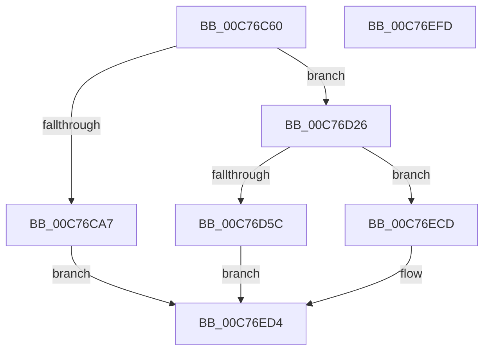

# PopSleepstudyInitialize

- RVA: `0x00C76C60`–`0x00C76EFE` (길이 `670` bytes)
- VA: `0x0000000140C76C60`
- 실행 섹션: `INIT`
- PDB 이름 있음: `예`; PDB Function 태그: `아니요`
- unwind 정보 RVA: `0x000BE060`
- 디코드: `147`개 명령, `670/670` bytes 표시
- 미해석 바이트: `0` (있으면 어셈블리에 `.byte`로 보존)

> 이 문서는 커널 이미지의 기계어와 PDB 기호를 분석해 생성했습니다. 4번과 5번은 함수 원형과 자료형을 바이너리 사용 방식에서 추정한 C 해석이며 원본 소스 복구 결과는 아닙니다.

## 1. Dependencies

- 직접 호출 지점: **11**; 고유 호출 대상: **7**
- 직접 호출자로 확인된 함수: **1**
- RIP 상대 이미지 참조: **30**

### Outgoing calls
- `0x00C76CDB` → [RtlGetInterruptTimePrecise](../../text/20/RtlGetInterruptTimePrecise_function_0020A4C0.md) (function, `0x0020A4C0`)
- `0x00C76D1C` → [KiInitializeTimer2](../../text/3A/KiInitializeTimer2_function_003A3288.md) (function, `0x003A3288`)
- `0x00C76D30` → [PopSleepstudySendSessionChangeWnf](../../page/A9/PopSleepstudySendSessionChangeWnf_function_00A928E8.md) (function, `0x00A928E8`)
- `0x00C76D4F` → [SleepstudyHelperCreateLibraryEx](../../text/4B/SleepstudyHelperCreateLibraryEx_function_004BAE50.md) (function, `0x004BAE50`)
- `0x00C76D6A` → [wcslen](../../text/50/wcslen_function_00501BA0.md) (function, `0x00501BA0`)
- `0x00C76DB7` → [wcslen](../../text/50/wcslen_function_00501BA0.md) (function, `0x00501BA0`)
- `0x00C76DFA` → [wcslen](../../text/50/wcslen_function_00501BA0.md) (function, `0x00501BA0`)
- `0x00C76E36` → [wcslen](../../text/50/wcslen_function_00501BA0.md) (function, `0x00501BA0`)
- `0x00C76E72` → [wcslen](../../text/50/wcslen_function_00501BA0.md) (function, `0x00501BA0`)
- `0x00C76EC6` → [SleepstudyHelperCreateBlockerData](../../page/AD/SleepstudyHelperCreateBlockerData_function_00AD40B0.md) (function, `0x00AD40B0`)
- `0x00C76EDB` → [_security_check_cookie](../../text/6A/_security_check_cookie_function_006AC640.md) (function, `0x006AC640`)

### Direct callers
- [PoInitSystem](PoInitSystem_function_00C72358.md) at `0x00C723DF`
- [PoInitSystem](PoInitSystem_function_00C72358.md) at `0x00C72EDF`

### Static image references
- `0x00C76C7F` → RVA `0x00E0A740` (`.data`; read)
- `0x00C76C8D` → RVA `0x00F0AE68` (`.data`; read)
- `0x00C76C99` → RVA `0x00F0AE70` (`.data`; read)
- `0x00C76CA7` → RVA `0x00F0AD88` (`.data`; write)
- `0x00C76CAE` → RVA `0x00F0ADA0` (`.data`; read)
- `0x00C76CB5` → RVA `0x00F0ADA8` (`.data`; write)
- `0x00C76CC0` → RVA `0x00F0ADA0` (`.data`; write)
- `0x00C76CC7` → RVA `0x00F0AD80` (`.data`; write)
- `0x00C76CE8` → RVA `0x00AC0100` (`PopSleepstudyScenarioStopWorker`; read)
- `0x00C76CEF` → RVA `0x00F0AE60` (`.data`; write)
- `0x00C76CF9` → RVA `0x00F0AE58` (`.data`; write)
- `0x00C76D00` → RVA `0x004CD070` (`PopSleepstudyScenarioStopTimerCallback`; read)
- `0x00C76D07` → RVA `0x00F0AE48` (`.data`; write)
- `0x00C76D0E` → RVA `0x00F0ADC0` (`.data`; read)
- `0x00C76D15` → RVA `0x00F0ADC2` (`.data`; write)
- `0x00C76D35` → RVA `0x00F0AD90` (`.data`; read)
- `0x00C76D5C` → RVA `0x00C7C1F0` (` ?? ::PBOPGDP::`string'`; read)
- `0x00C76D72` → RVA `0x00C7C230` (` ?? ::PBOPGDP::`string'`; read)
- `0x00C76D7F` → RVA `0x00AA3F30` (`PopSleepstudyUlongFormatter`; read)
- `0x00C76DAC` → RVA `0x00F0B660` (`.data`; read)
- `0x00C76DBF` → RVA `0x00C7C270` (` ?? ::PBOPGDP::`string'`; read)
- `0x00C76DC9` → RVA `0x00AA7060` (`PopSleepstudyUlong64Formatter`; read)
- `0x00C76DE7` → RVA `0x00F0B668` (`.data`; read)
- `0x00C76E09` → RVA `0x00C7C2B0` (` ?? ::PBOPGDP::`string'`; read)
- `0x00C76E23` → RVA `0x00F0B670` (`.data`; read)
- `0x00C76E45` → RVA `0x00C7C2F0` (` ?? ::PBOPGDP::`string'`; read)
- `0x00C76E5F` → RVA `0x00F0B678` (`.data`; read)
- `0x00C76E77` → RVA `0x0001EA18` (`.rdata`; read)
- `0x00C76EB2` → RVA `0x00F0B680` (`.data`; read)
- `0x00C76ECD` → RVA `0x00F0AD90` (`.data`; write)

## 2. Other-region calls and transfers

- 다른 실행 섹션으로 향하는 call: **11**
  - `0x00C76CDB` → [RtlGetInterruptTimePrecise](../../text/20/RtlGetInterruptTimePrecise_function_0020A4C0.md) (`INIT` → `.text`)
  - `0x00C76D1C` → [KiInitializeTimer2](../../text/3A/KiInitializeTimer2_function_003A3288.md) (`INIT` → `.text`)
  - `0x00C76D30` → [PopSleepstudySendSessionChangeWnf](../../page/A9/PopSleepstudySendSessionChangeWnf_function_00A928E8.md) (`INIT` → `PAGE`)
  - `0x00C76D4F` → [SleepstudyHelperCreateLibraryEx](../../text/4B/SleepstudyHelperCreateLibraryEx_function_004BAE50.md) (`INIT` → `.text`)
  - `0x00C76D6A` → [wcslen](../../text/50/wcslen_function_00501BA0.md) (`INIT` → `.text`)
  - `0x00C76DB7` → [wcslen](../../text/50/wcslen_function_00501BA0.md) (`INIT` → `.text`)
  - `0x00C76DFA` → [wcslen](../../text/50/wcslen_function_00501BA0.md) (`INIT` → `.text`)
  - `0x00C76E36` → [wcslen](../../text/50/wcslen_function_00501BA0.md) (`INIT` → `.text`)
  - `0x00C76E72` → [wcslen](../../text/50/wcslen_function_00501BA0.md) (`INIT` → `.text`)
  - `0x00C76EC6` → [SleepstudyHelperCreateBlockerData](../../page/AD/SleepstudyHelperCreateBlockerData_function_00AD40B0.md) (`INIT` → `PAGE`)
  - `0x00C76EDB` → [_security_check_cookie](../../text/6A/_security_check_cookie_function_006AC640.md) (`INIT` → `.text`)
- 별도 외부 분기/꼬리 이동을 확인하지 못했습니다.

## 3. Assembly (complete function range)

```asm
00C76C60  48 8B C4                        mov rax, rsp
00C76C63  48 89 58 08                     mov qword ptr [rax + 8], rbx
00C76C67  48 89 78 10                     mov qword ptr [rax + 0x10], rdi
00C76C6B  4C 89 70 18                     mov qword ptr [rax + 0x18], r14
00C76C6F  4C 89 78 20                     mov qword ptr [rax + 0x20], r15
00C76C73  55                              push rbp
00C76C74  48 8D 68 A1                     lea rbp, [rax - 0x5f]
00C76C78  48 81 EC 00 01 00 00            sub rsp, 0x100
00C76C7F  48 8B 05 BA 3A 19 00            mov rax, qword ptr [rip + 0x193aba]
00C76C86  48 33 C4                        xor rax, rsp
00C76C89  48 89 45 47                     mov qword ptr [rbp + 0x47], rax
00C76C8D  8B 05 D5 41 29 00               mov eax, dword ptr [rip + 0x2941d5]
00C76C93  33 FF                           xor edi, edi
00C76C95  48 6B D8 70                     imul rbx, rax, 0x70
00C76C99  48 8D 05 D0 41 29 00            lea rax, [rip + 0x2941d0]
00C76CA0  48 03 D8                        add rbx, rax
00C76CA3  85 C9                           test ecx, ecx
00C76CA5  75 7F                           jne 0x140c76d26
00C76CA7  48 89 3D DA 40 29 00            mov qword ptr [rip + 0x2940da], rdi
00C76CAE  48 8D 05 EB 40 29 00            lea rax, [rip + 0x2940eb]
00C76CB5  48 89 05 EC 40 29 00            mov qword ptr [rip + 0x2940ec], rax
00C76CBC  48 8D 4D 87                     lea rcx, [rbp - 0x79]
00C76CC0  48 89 05 D9 40 29 00            mov qword ptr [rip + 0x2940d9], rax
00C76CC7  48 89 3D B2 40 29 00            mov qword ptr [rip + 0x2940b2], rdi
00C76CCE  40 88 7B 23                     mov byte ptr [rbx + 0x23], dil
00C76CD2  81 63 20 00 00 00 FF            and dword ptr [rbx + 0x20], 0xff000000
00C76CD9  89 3B                           mov dword ptr [rbx], edi
00C76CDB  E8 E0 37 59 FF                  call 0x14020a4c0
00C76CE0  48 89 43 10                     mov qword ptr [rbx + 0x10], rax
00C76CE4  44 8D 4F 08                     lea r9d, [rdi + 8]
00C76CE8  48 8D 05 11 94 E4 FF            lea rax, [rip - 0x1b6bef]
00C76CEF  48 89 3D 6A 41 29 00            mov qword ptr [rip + 0x29416a], rdi
00C76CF6  45 33 C0                        xor r8d, r8d
00C76CF9  48 89 05 58 41 29 00            mov qword ptr [rip + 0x294158], rax
00C76D00  48 8D 15 69 63 85 FF            lea rdx, [rip - 0x7a9c97]
00C76D07  48 89 3D 3A 41 29 00            mov qword ptr [rip + 0x29413a], rdi
00C76D0E  48 8D 0D AB 40 29 00            lea rcx, [rip + 0x2940ab]
00C76D15  66 89 3D A6 40 29 00            mov word ptr [rip + 0x2940a6], di
00C76D1C  E8 67 C5 72 FF                  call 0x1403a3288
00C76D21  E9 AE 01 00 00                  jmp 0x140c76ed4
00C76D26  44 8B 43 20                     mov r8d, dword ptr [rbx + 0x20]
00C76D2A  8B 13                           mov edx, dword ptr [rbx]
00C76D2C  48 8B 4B 08                     mov rcx, qword ptr [rbx + 8]
00C76D30  E8 B3 BB E1 FF                  call 0x140a928e8
00C76D35  48 8D 15 54 40 29 00            lea rdx, [rip + 0x294054]
00C76D3C  48 C7 45 8B 53 53 4D 44         mov qword ptr [rbp - 0x75], 0x444d5353
00C76D44  48 8D 4D 87                     lea rcx, [rbp - 0x79]
00C76D48  C7 45 87 01 00 00 00            mov dword ptr [rbp - 0x79], 1
00C76D4F  E8 FC 40 84 FF                  call 0x1404bae50
00C76D54  85 C0                           test eax, eax
00C76D56  0F 88 71 01 00 00               js 0x140c76ecd
00C76D5C  48 8D 0D 8D 54 00 00            lea rcx, [rip + 0x548d]
00C76D63  89 7D AB                        mov dword ptr [rbp - 0x55], edi
00C76D66  48 89 4D AF                     mov qword ptr [rbp - 0x51], rcx
00C76D6A  E8 31 AE 88 FF                  call 0x140501ba0
00C76D6F  48 03 C0                        add rax, rax
00C76D72  48 8D 0D B7 54 00 00            lea rcx, [rip + 0x54b7]
00C76D79  41 BF FC FF 00 00               mov r15d, 0xfffc
00C76D7F  48 8D 3D AA D1 E2 FF            lea rdi, [rip - 0x1d2e56]
00C76D86  0F 57 C0                        xorps xmm0, xmm0
00C76D89  48 89 7D BF                     mov qword ptr [rbp - 0x41], rdi
00C76D8D  0F 11 45 C7                     movups xmmword ptr [rbp - 0x39], xmm0
00C76D91  48 89 4D CF                     mov qword ptr [rbp - 0x31], rcx
00C76D95  45 8D 77 02                     lea r14d, [r15 + 2]
00C76D99  49 3B C6                        cmp rax, r14
00C76D9C  49 0F 43 C7                     cmovae rax, r15
00C76DA0  66 89 45 A7                     mov word ptr [rbp - 0x59], ax
00C76DA4  66 83 C0 02                     add ax, 2
00C76DA8  66 89 45 A9                     mov word ptr [rbp - 0x57], ax
00C76DAC  48 8D 05 AD 48 29 00            lea rax, [rip + 0x2948ad]
00C76DB3  48 89 45 B7                     mov qword ptr [rbp - 0x49], rax
00C76DB7  E8 E4 AD 88 FF                  call 0x140501ba0
00C76DBC  48 03 C0                        add rax, rax
00C76DBF  48 8D 0D AA 54 00 00            lea rcx, [rip + 0x54aa]
00C76DC6  49 3B C6                        cmp rax, r14
00C76DC9  48 8D 1D 90 02 E3 FF            lea rbx, [rip - 0x1cfd70]
00C76DD0  0F 57 C0                        xorps xmm0, xmm0
00C76DD3  48 89 5D DF                     mov qword ptr [rbp - 0x21], rbx
00C76DD7  49 0F 43 C7                     cmovae rax, r15
00C76DDB  66 89 45 C7                     mov word ptr [rbp - 0x39], ax
00C76DDF  66 83 C0 02                     add ax, 2
00C76DE3  66 89 45 C9                     mov word ptr [rbp - 0x37], ax
00C76DE7  48 8D 05 7A 48 29 00            lea rax, [rip + 0x29487a]
00C76DEE  0F 11 45 E7                     movups xmmword ptr [rbp - 0x19], xmm0
00C76DF2  48 89 45 D7                     mov qword ptr [rbp - 0x29], rax
00C76DF6  48 89 4D EF                     mov qword ptr [rbp - 0x11], rcx
00C76DFA  E8 A1 AD 88 FF                  call 0x140501ba0
00C76DFF  48 03 C0                        add rax, rax
00C76E02  48 89 7D FF                     mov qword ptr [rbp - 1], rdi
00C76E06  49 3B C6                        cmp rax, r14
00C76E09  48 8D 0D A0 54 00 00            lea rcx, [rip + 0x54a0]
00C76E10  0F 57 C0                        xorps xmm0, xmm0
00C76E13  49 0F 43 C7                     cmovae rax, r15
00C76E17  66 89 45 E7                     mov word ptr [rbp - 0x19], ax
00C76E1B  66 83 C0 02                     add ax, 2
00C76E1F  66 89 45 E9                     mov word ptr [rbp - 0x17], ax
00C76E23  48 8D 05 46 48 29 00            lea rax, [rip + 0x294846]
00C76E2A  0F 11 45 07                     movups xmmword ptr [rbp + 7], xmm0
00C76E2E  48 89 45 F7                     mov qword ptr [rbp - 9], rax
00C76E32  48 89 4D 0F                     mov qword ptr [rbp + 0xf], rcx
00C76E36  E8 65 AD 88 FF                  call 0x140501ba0
00C76E3B  48 03 C0                        add rax, rax
00C76E3E  48 89 5D 1F                     mov qword ptr [rbp + 0x1f], rbx
00C76E42  49 3B C6                        cmp rax, r14
00C76E45  48 8D 0D A4 54 00 00            lea rcx, [rip + 0x54a4]
00C76E4C  0F 57 C0                        xorps xmm0, xmm0
00C76E4F  49 0F 43 C7                     cmovae rax, r15
00C76E53  66 89 45 07                     mov word ptr [rbp + 7], ax
00C76E57  66 83 C0 02                     add ax, 2
00C76E5B  66 89 45 09                     mov word ptr [rbp + 9], ax
00C76E5F  48 8D 05 12 48 29 00            lea rax, [rip + 0x294812]
00C76E66  0F 11 45 27                     movups xmmword ptr [rbp + 0x27], xmm0
00C76E6A  48 89 45 17                     mov qword ptr [rbp + 0x17], rax
00C76E6E  48 89 4D 2F                     mov qword ptr [rbp + 0x2f], rcx
00C76E72  E8 29 AD 88 FF                  call 0x140501ba0
00C76E77  0F 10 05 9A 7B 3A FF            movups xmm0, xmmword ptr [rip - 0xc58466]
00C76E7E  48 8B 0D 0B 3F 29 00            mov rcx, qword ptr [rip + 0x293f0b]
00C76E85  4C 8D 4D A7                     lea r9, [rbp - 0x59]
00C76E89  48 03 C0                        add rax, rax
00C76E8C  48 89 7D 3F                     mov qword ptr [rbp + 0x3f], rdi
00C76E90  49 3B C6                        cmp rax, r14
00C76E93  48 8D 55 97                     lea rdx, [rbp - 0x69]
00C76E97  F3 0F 7F 45 97                  movdqu xmmword ptr [rbp - 0x69], xmm0
00C76E9C  49 0F 43 C7                     cmovae rax, r15
00C76EA0  41 B8 05 00 00 00               mov r8d, 5
00C76EA6  66 89 45 27                     mov word ptr [rbp + 0x27], ax
00C76EAA  66 83 C0 02                     add ax, 2
00C76EAE  66 89 45 29                     mov word ptr [rbp + 0x29], ax
00C76EB2  48 8D 05 C7 47 29 00            lea rax, [rip + 0x2947c7]
00C76EB9  48 89 45 37                     mov qword ptr [rbp + 0x37], rax
00C76EBD  48 8D 45 87                     lea rax, [rbp - 0x79]
00C76EC1  48 89 44 24 20                  mov qword ptr [rsp + 0x20], rax
00C76EC6  E8 E5 D1 E5 FF                  call 0x140ad40b0
00C76ECB  EB 07                           jmp 0x140c76ed4
00C76ECD  48 89 3D BC 3E 29 00            mov qword ptr [rip + 0x293ebc], rdi
00C76ED4  48 8B 4D 47                     mov rcx, qword ptr [rbp + 0x47]
00C76ED8  48 33 CC                        xor rcx, rsp
00C76EDB  E8 60 57 A3 FF                  call 0x1406ac640
00C76EE0  4C 8D 9C 24 00 01 00 00         lea r11, [rsp + 0x100]
00C76EE8  49 8B 5B 10                     mov rbx, qword ptr [r11 + 0x10]
00C76EEC  49 8B 7B 18                     mov rdi, qword ptr [r11 + 0x18]
00C76EF0  4D 8B 73 20                     mov r14, qword ptr [r11 + 0x20]
00C76EF4  4D 8B 7B 28                     mov r15, qword ptr [r11 + 0x28]
00C76EF8  49 8B E3                        mov rsp, r11
00C76EFB  5D                              pop rbp
00C76EFC  C3                              ret
00C76EFD  CC                              int3
```

## 4. C-style interpretation (structured pseudocode)

```c
__int64 __fastcall PopSleepstudyInitialize(int a1, __int64 a2, int a3)
{
    __int64 result;
    __int64 v_rbx;
    __int64 v_rdi;
    __int64 v_rsp;
    unsigned __int64 v_stack_m8;
    unsigned __int64 v_stack_mE8;

    *(unsigned __int64 *)(v_rsp + 8) = v_rbx;
    *(unsigned __int64 *)(v_rsp + 16) = v_rdi;
    *(unsigned __int64 *)(v_rsp + 24) = v_r14;
    *(unsigned __int64 *)(v_rsp + 32) = v_r15;
    v_rsp = (v_rsp) - (256);
    result = (*(unsigned __int64 *)(v_rip + 1653434)) ^ (v_rsp);
    *(unsigned __int64 *)(v_rsp - 95 + 71) = result;
    v_rdi = 0;
    v_rbx = (v_rbx) * ((unsigned int)(*(unsigned int *)(v_rip + 2703829)));
    v_rbx = (v_rbx) + (v_rip + 2703824);
    if (a1 != 0) goto loc_00C76D26;
    *(unsigned __int64 *)(v_rip + 2703578) = 0;
    *(unsigned __int64 *)(v_rip + 2703596) = v_rip + 2703595;
    *(unsigned __int64 *)(v_rip + 2703577) = v_rip + 2703595;
    *(unsigned __int64 *)(v_rip + 2703538) = 0;
    *(unsigned __int8 *)(v_rbx + 35) = 0;
    *(unsigned int *)(v_rbx) = 0;
    result = RtlGetInterruptTimePrecise(v_rsp - 95 - 121, a2, a3, a4);
    *(unsigned __int64 *)(v_rbx + 16) = result;
    *(unsigned __int64 *)(v_rip + 2703722) = 0;
    a3 = 0;
    *(unsigned __int64 *)(v_rip + 2703704) = v_rip - 1797103;
    *(unsigned __int64 *)(v_rip + 2703674) = 0;
    *(unsigned __int16 *)(v_rip + 2703526) = 0;
    result = KiInitializeTimer2(v_rip + 2703531, v_rip - 8035479, a3, v_rdi + 8);
    goto loc_00C76ED4;
loc_00C76D26:
    result = PopSleepstudySendSessionChangeWnf(*(unsigned __int64 *)(v_rbx + 8), (unsigned int)(*(unsigned int *)(v_rbx)), (unsigned int)(*(unsigned int *)(v_rbx + 32)), v_rdi + 8);
    *(unsigned __int64 *)(v_rsp - 95 - 117) = 0x444D5353ULL;
    *(unsigned int *)(v_rsp - 95 - 121) = 1;
    result = SleepstudyHelperCreateLibraryEx(v_rsp - 95 - 121, v_rip + 2703444, (unsigned int)(*(unsigned int *)(v_rbx + 32)), v_rdi + 8);
    if (sign_flag) goto loc_00C76ECD;
    *(unsigned int *)(v_rsp - 95 - 85) = 0;
    *(unsigned __int64 *)(v_rsp - 95 - 81) = v_rip + 21645;
    result = wcslen(v_rip + 21645, v_rip + 2703444, (unsigned int)(*(unsigned int *)(v_rbx + 32)), v_rdi + 8);
    result = (result) + (result);
    *(unsigned __int64 *)(v_rsp - 95 - 65) = v_rip - 1912406;
    *(unsigned __int64 *)(v_rsp - 95 - 57) = v_xmm0;
    *(unsigned __int64 *)(v_rsp - 95 - 49) = v_rip + 21687;
    if (result >= ((unsigned int)(0xFFFCULL) + 2)) { result = (unsigned int)(0xFFFCULL); }
    *(unsigned __int16 *)(v_rsp - 95 - 89) = (unsigned __int16)(result);
    result = (unsigned __int16)((result) + (2));
    *(unsigned __int16 *)(v_rsp - 95 - 87) = (unsigned __int16)(result);
    *(unsigned __int64 *)(v_rsp - 95 - 73) = v_rip + 2705581;
    result = wcslen(v_rip + 21687, v_rip + 2703444, (unsigned int)(*(unsigned int *)(v_rbx + 32)), v_rdi + 8);
    result = (result) + (result);
    *(unsigned __int64 *)(v_rsp - 95 - 33) = v_rip - 1899888;
    if (result >= ((unsigned int)(0xFFFCULL) + 2)) { result = (unsigned int)(0xFFFCULL); }
    *(unsigned __int16 *)(v_rsp - 95 - 57) = (unsigned __int16)(result);
    result = (unsigned __int16)((result) + (2));
    *(unsigned __int16 *)(v_rsp - 95 - 55) = (unsigned __int16)(result);
    *(unsigned __int64 *)(v_rsp - 95 - 25) = v_xmm0;
    *(unsigned __int64 *)(v_rsp - 95 - 41) = v_rip + 2705530;
    *(unsigned __int64 *)(v_rsp - 95 - 17) = v_rip + 21674;
    result = wcslen(v_rip + 21674, v_rip + 2703444, (unsigned int)(*(unsigned int *)(v_rbx + 32)), v_rdi + 8);
    result = (result) + (result);
    *(unsigned __int64 *)(v_rsp - 95 - 1) = v_rip - 1912406;
    if (result >= ((unsigned int)(0xFFFCULL) + 2)) { result = (unsigned int)(0xFFFCULL); }
    *(unsigned __int16 *)(v_rsp - 95 - 25) = (unsigned __int16)(result);
    result = (unsigned __int16)((result) + (2));
    *(unsigned __int16 *)(v_rsp - 95 - 23) = (unsigned __int16)(result);
    *(unsigned __int64 *)(v_rsp - 95 + 7) = v_xmm0;
    *(unsigned __int64 *)(v_rsp - 95 - 9) = v_rip + 2705478;
    *(unsigned __int64 *)(v_rsp - 95 + 15) = v_rip + 21664;
    result = wcslen(v_rip + 21664, v_rip + 2703444, (unsigned int)(*(unsigned int *)(v_rbx + 32)), v_rdi + 8);
    result = (result) + (result);
    *(unsigned __int64 *)(v_rsp - 95 + 31) = v_rip - 1899888;
    if (result >= ((unsigned int)(0xFFFCULL) + 2)) { result = (unsigned int)(0xFFFCULL); }
    *(unsigned __int16 *)(v_rsp - 95 + 7) = (unsigned __int16)(result);
    result = (unsigned __int16)((result) + (2));
    *(unsigned __int16 *)(v_rsp - 95 + 9) = (unsigned __int16)(result);
    *(unsigned __int64 *)(v_rsp - 95 + 39) = v_xmm0;
    *(unsigned __int64 *)(v_rsp - 95 + 23) = v_rip + 2705426;
    *(unsigned __int64 *)(v_rsp - 95 + 47) = v_rip + 21668;
    result = wcslen(v_rip + 21668, v_rip + 2703444, (unsigned int)(*(unsigned int *)(v_rbx + 32)), v_rdi + 8);
    result = (result) + (result);
    *(unsigned __int64 *)(v_rsp - 95 + 63) = v_rip - 1912406;
    *(unsigned __int64 *)(v_rsp - 95 - 105) = v_xmm0;
    if (result >= ((unsigned int)(0xFFFCULL) + 2)) { result = (unsigned int)(0xFFFCULL); }
    *(unsigned __int16 *)(v_rsp - 95 + 39) = (unsigned __int16)(result);
    result = (unsigned __int16)((result) + (2));
    *(unsigned __int16 *)(v_rsp - 95 + 41) = (unsigned __int16)(result);
    *(unsigned __int64 *)(v_rsp - 95 + 55) = v_rip + 2705351;
    v_stack_mE8 = v_rsp - 95 - 121;
    result = SleepstudyHelperCreateBlockerData(*(unsigned __int64 *)(v_rip + 2703115), v_rsp - 95 - 105, 5, v_rsp - 95 - 89);
    goto loc_00C76ED4;
loc_00C76ECD:
    *(unsigned __int64 *)(v_rip + 2703036) = v_rip - 1912406;
loc_00C76ED4:
    a1 = (*(unsigned __int64 *)(v_rsp - 95 + 71)) ^ (v_rsp);
    result = _security_check_cookie(a1, v_rsp - 95 - 105, 5, v_rsp - 95 - 89);
    return result;
}
```

## 5. (Beta) C Style

```c
int64_t PopSleepstudyInitialize(int32_t Arg1, int64_t Arg2, int32_t Arg3)
{
    int64_t result;
    int64_t local_rbx;
    int64_t local_rdi;
    int64_t local_rsp;
    uint64_t v_stack_m8;
    uint64_t v_stack_mE8;

    *(uint64_t *)(local_rsp + 0x8) = local_rbx;
    *(uint64_t *)(local_rsp + 0x10) = local_rdi;
    *(uint64_t *)(local_rsp + 0x18) = local_r14;
    *(uint64_t *)(local_rsp + 0x20) = local_r15;
    local_rsp = (local_rsp) - (256);
    result = (*(uint64_t *)(v_rip + 0x193ABA)) ^ (local_rsp);
    *(uint64_t *)(local_rsp - 0x5F + 0x47) = result;
    local_rdi = 0;
    local_rbx = (local_rbx) * ((uint32_t)(*(uint32_t *)(v_rip + 0x2941D5)));
    local_rbx = (local_rbx) + (v_rip + 2703824);
    if (Arg1 != 0) goto loc_00C76D26;
    *(uint64_t *)(v_rip + 0x2940DA) = 0;
    *(uint64_t *)(v_rip + 0x2940EC) = v_rip + 2703595;
    *(uint64_t *)(v_rip + 0x2940D9) = v_rip + 2703595;
    *(uint64_t *)(v_rip + 0x2940B2) = 0;
    *(uint8_t *)(local_rbx + 0x23) = 0;
    *(uint32_t *)(local_rbx) = 0;
    result = RtlGetInterruptTimePrecise(local_rsp - 95 - 121, Arg2, Arg3, a4);
    *(uint64_t *)(local_rbx + 0x10) = result;
    *(uint64_t *)(v_rip + 0x29416A) = 0;
    Arg3 = 0;
    *(uint64_t *)(v_rip + 0x294158) = v_rip - 1797103;
    *(uint64_t *)(v_rip + 0x29413A) = 0;
    *(uint16_t *)(v_rip + 0x2940A6) = 0;
    result = KiInitializeTimer2(v_rip + 2703531, v_rip - 8035479, Arg3, local_rdi + 8);
    goto loc_00C76ED4;
loc_00C76D26:
    result = PopSleepstudySendSessionChangeWnf(*(uint64_t *)(local_rbx + 0x8), (uint32_t)(*(uint32_t *)(local_rbx)), (uint32_t)(*(uint32_t *)(local_rbx + 0x20)), local_rdi + 8);
    *(uint64_t *)(local_rsp - 0x5F - 0x75) = 0x444D5353ULL;
    *(uint32_t *)(local_rsp - 0x5F - 0x79) = 1;
    result = SleepstudyHelperCreateLibraryEx(local_rsp - 95 - 121, v_rip + 2703444, (uint32_t)(*(uint32_t *)(local_rbx + 0x20)), local_rdi + 8);
    if (sign_flag) goto loc_00C76ECD;
    *(uint32_t *)(local_rsp - 0x5F - 0x55) = 0;
    *(uint64_t *)(local_rsp - 0x5F - 0x51) = v_rip + 21645;
    result = wcslen(v_rip + 21645, v_rip + 2703444, (uint32_t)(*(uint32_t *)(local_rbx + 0x20)), local_rdi + 8);
    result = (result) + (result);
    *(uint64_t *)(local_rsp - 0x5F - 0x41) = v_rip - 1912406;
    *(uint64_t *)(local_rsp - 0x5F - 0x39) = v_xmm0;
    *(uint64_t *)(local_rsp - 0x5F - 0x31) = v_rip + 21687;
    if (result >= ((uint32_t)(0xFFFCULL) + 2)) { result = (uint32_t)(0xFFFCULL); }
    *(uint16_t *)(local_rsp - 0x5F - 0x59) = (uint16_t)(result);
    result = (uint16_t)((result) + (2));
    *(uint16_t *)(local_rsp - 0x5F - 0x57) = (uint16_t)(result);
    *(uint64_t *)(local_rsp - 0x5F - 0x49) = v_rip + 2705581;
    result = wcslen(v_rip + 21687, v_rip + 2703444, (uint32_t)(*(uint32_t *)(local_rbx + 0x20)), local_rdi + 8);
    result = (result) + (result);
    *(uint64_t *)(local_rsp - 0x5F - 0x21) = v_rip - 1899888;
    if (result >= ((uint32_t)(0xFFFCULL) + 2)) { result = (uint32_t)(0xFFFCULL); }
    *(uint16_t *)(local_rsp - 0x5F - 0x39) = (uint16_t)(result);
    result = (uint16_t)((result) + (2));
    *(uint16_t *)(local_rsp - 0x5F - 0x37) = (uint16_t)(result);
    *(uint64_t *)(local_rsp - 0x5F - 0x19) = v_xmm0;
    *(uint64_t *)(local_rsp - 0x5F - 0x29) = v_rip + 2705530;
    *(uint64_t *)(local_rsp - 0x5F - 0x11) = v_rip + 21674;
    result = wcslen(v_rip + 21674, v_rip + 2703444, (uint32_t)(*(uint32_t *)(local_rbx + 0x20)), local_rdi + 8);
    result = (result) + (result);
    *(uint64_t *)(local_rsp - 0x5F - 0x1) = v_rip - 1912406;
    if (result >= ((uint32_t)(0xFFFCULL) + 2)) { result = (uint32_t)(0xFFFCULL); }
    *(uint16_t *)(local_rsp - 0x5F - 0x19) = (uint16_t)(result);
    result = (uint16_t)((result) + (2));
    *(uint16_t *)(local_rsp - 0x5F - 0x17) = (uint16_t)(result);
    *(uint64_t *)(local_rsp - 0x5F + 0x7) = v_xmm0;
    *(uint64_t *)(local_rsp - 0x5F - 0x9) = v_rip + 2705478;
    *(uint64_t *)(local_rsp - 0x5F + 0xF) = v_rip + 21664;
    result = wcslen(v_rip + 21664, v_rip + 2703444, (uint32_t)(*(uint32_t *)(local_rbx + 0x20)), local_rdi + 8);
    result = (result) + (result);
    *(uint64_t *)(local_rsp - 0x5F + 0x1F) = v_rip - 1899888;
    if (result >= ((uint32_t)(0xFFFCULL) + 2)) { result = (uint32_t)(0xFFFCULL); }
    *(uint16_t *)(local_rsp - 0x5F + 0x7) = (uint16_t)(result);
    result = (uint16_t)((result) + (2));
    *(uint16_t *)(local_rsp - 0x5F + 0x9) = (uint16_t)(result);
    *(uint64_t *)(local_rsp - 0x5F + 0x27) = v_xmm0;
    *(uint64_t *)(local_rsp - 0x5F + 0x17) = v_rip + 2705426;
    *(uint64_t *)(local_rsp - 0x5F + 0x2F) = v_rip + 21668;
    result = wcslen(v_rip + 21668, v_rip + 2703444, (uint32_t)(*(uint32_t *)(local_rbx + 0x20)), local_rdi + 8);
    result = (result) + (result);
    *(uint64_t *)(local_rsp - 0x5F + 0x3F) = v_rip - 1912406;
    *(uint64_t *)(local_rsp - 0x5F - 0x69) = v_xmm0;
    if (result >= ((uint32_t)(0xFFFCULL) + 2)) { result = (uint32_t)(0xFFFCULL); }
    *(uint16_t *)(local_rsp - 0x5F + 0x27) = (uint16_t)(result);
    result = (uint16_t)((result) + (2));
    *(uint16_t *)(local_rsp - 0x5F + 0x29) = (uint16_t)(result);
    *(uint64_t *)(local_rsp - 0x5F + 0x37) = v_rip + 2705351;
    v_stack_mE8 = local_rsp - 95 - 121;
    result = SleepstudyHelperCreateBlockerData(*(uint64_t *)(v_rip + 0x293F0B), local_rsp - 95 - 105, 5, local_rsp - 95 - 89);
    goto loc_00C76ED4;
loc_00C76ECD:
    *(uint64_t *)(v_rip + 0x293EBC) = v_rip - 1912406;
loc_00C76ED4:
    Arg1 = (*(uint64_t *)(local_rsp - 0x5F + 0x47)) ^ (local_rsp);
    result = _security_check_cookie(Arg1, local_rsp - 95 - 105, 5, local_rsp - 95 - 89);
    return result;
}
```

## 6. Execution-region graph

[열기: 2D/3D 그래프와 함수 탐색 컨트롤 패널](../../../control-panel.html?section=init&rva=0x00C76C60&view=graph)

- 2D 그래프는 위에서 아래로 흐르고, 3D 그래프는 빈 공간을 드래그해 회전합니다. Shift+드래그는 이동, 휠은 확대·축소, 함수 노드 선택은 대상 보고서 이동입니다.

### Static fallback


