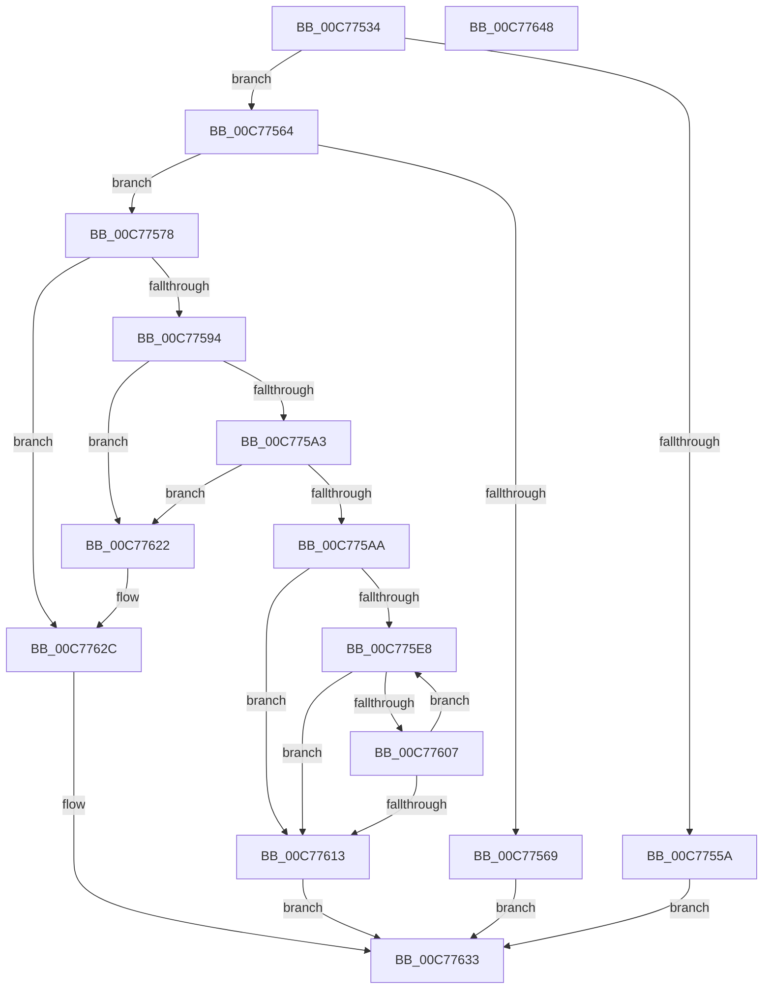

# PpInitGetGroupOrderIndex

- RVA: `0x00C77534`–`0x00C77649` (길이 `277` bytes)
- VA: `0x0000000140C77534`
- 실행 섹션: `INIT`
- PDB 이름 있음: `예`; PDB Function 태그: `아니요`
- unwind 정보 RVA: `0x000A7960`
- 디코드: `73`개 명령, `277/277` bytes 표시
- 미해석 바이트: `0` (있으면 어셈블리에 `.byte`로 보존)

> 이 문서는 커널 이미지의 기계어와 PDB 기호를 분석해 생성했습니다. 4번과 5번은 함수 원형과 자료형을 바이너리 사용 방식에서 추정한 C 해석이며 원본 소스 복구 결과는 아닙니다.

## 1. Dependencies

- 직접 호출 지점: **5**; 고유 호출 대상: **4**
- 직접 호출자로 확인된 함수: **2**
- RIP 상대 이미지 참조: **3**

### Outgoing calls
- `0x00C77587` → [IopGetRegistryValue](../../page/99/IopGetRegistryValue_function_009990EC.md) (function, `0x009990EC`)
- `0x00C775B9` → [PnpRegSzToString](../../page/A5/PnpRegSzToString_function_00A5DC40.md) (function, `0x00A5DC40`)
- `0x00C775FE` → [RtlEqualUnicodeString](../../page/93/RtlEqualUnicodeString_function_00932A20.md) (function, `0x00932A20`)
- `0x00C77618` → [ExFreePoolWithTag](../../poolcode/B8/ExFreePoolWithTag_function_00B82870.md) (function, `0x00B82870`)
- `0x00C77627` → [ExFreePoolWithTag](../../poolcode/B8/ExFreePoolWithTag_function_00B82870.md) (function, `0x00B82870`)

### Direct callers
- [PipCallDriverAddDeviceQueryRoutine](../../page/99/PipCallDriverAddDeviceQueryRoutine_function_00996604.md) at `0x0099681E`
- [IopInitializeBootDrivers](../C2/IopInitializeBootDrivers_function_00C2E6F4.md) at `0x00C2E8E5`
- [IopInitializeBootDrivers](../C2/IopInitializeBootDrivers_function_00C2E6F4.md) at `0x00C2EAAB`

### Static image references
- `0x00C7754A` → RVA `0x00E66248` (`.data`; read)
- `0x00C77569` → RVA `0x00E66250` (`.data`; read)
- `0x00C77580` → RVA `0x00C7A180` (` ?? ::PBOPGDP::`string'`; read)

## 2. Other-region calls and transfers

- 다른 실행 섹션으로 향하는 call: **5**
  - `0x00C77587` → [IopGetRegistryValue](../../page/99/IopGetRegistryValue_function_009990EC.md) (`INIT` → `PAGE`)
  - `0x00C775B9` → [PnpRegSzToString](../../page/A5/PnpRegSzToString_function_00A5DC40.md) (`INIT` → `PAGE`)
  - `0x00C775FE` → [RtlEqualUnicodeString](../../page/93/RtlEqualUnicodeString_function_00932A20.md) (`INIT` → `PAGE`)
  - `0x00C77618` → [ExFreePoolWithTag](../../poolcode/B8/ExFreePoolWithTag_function_00B82870.md) (`INIT` → `POOLCODE`)
  - `0x00C77627` → [ExFreePoolWithTag](../../poolcode/B8/ExFreePoolWithTag_function_00B82870.md) (`INIT` → `POOLCODE`)
- 별도 외부 분기/꼬리 이동을 확인하지 못했습니다.

## 3. Assembly (complete function range)

```asm
00C77534  48 8B C4                        mov rax, rsp
00C77537  48 89 58 08                     mov qword ptr [rax + 8], rbx
00C7753B  48 89 68 18                     mov qword ptr [rax + 0x18], rbp
00C7753F  48 89 70 20                     mov qword ptr [rax + 0x20], rsi
00C77543  57                              push rdi
00C77544  48 83 EC 30                     sub rsp, 0x30
00C77548  33 ED                           xor ebp, ebp
00C7754A  48 39 2D F7 EC 1E 00            cmp qword ptr [rip + 0x1eecf7], rbp
00C77551  89 68 EC                        mov dword ptr [rax - 0x14], ebp
00C77554  48 89 68 10                     mov qword ptr [rax + 0x10], rbp
00C77558  75 0A                           jne 0x140c77564
00C7755A  B8 FF FF 00 00                  mov eax, 0xffff
00C7755F  E9 CF 00 00 00                  jmp 0x140c77633
00C77564  48 85 C9                        test rcx, rcx
00C77567  75 0F                           jne 0x140c77578
00C77569  0F B7 05 E0 EC 1E 00            movzx eax, word ptr [rip + 0x1eece0]
00C77570  66 FF C0                        inc ax
00C77573  E9 BB 00 00 00                  jmp 0x140c77633
00C77578  4C 8D 4C 24 48                  lea r9, [rsp + 0x48]
00C7757D  45 33 C0                        xor r8d, r8d
00C77580  48 8D 15 F9 2B 00 00            lea rdx, [rip + 0x2bf9]
00C77587  E8 60 1B D2 FF                  call 0x1409990ec
00C7758C  85 C0                           test eax, eax
00C7758E  0F 88 98 00 00 00               js 0x140c7762c
00C77594  48 8B 5C 24 48                  mov rbx, qword ptr [rsp + 0x48]
00C77599  BF 01 00 00 00                  mov edi, 1
00C7759E  39 7B 04                        cmp dword ptr [rbx + 4], edi
00C775A1  75 7F                           jne 0x140c77622
00C775A3  8B 53 0C                        mov edx, dword ptr [rbx + 0xc]
00C775A6  85 D2                           test edx, edx
00C775A8  74 78                           je 0x140c77622
00C775AA  8B 4B 08                        mov ecx, dword ptr [rbx + 8]
00C775AD  4C 8D 44 24 48                  lea r8, [rsp + 0x48]
00C775B2  48 03 CB                        add rcx, rbx
00C775B5  89 6C 24 48                     mov dword ptr [rsp + 0x48], ebp
00C775B9  E8 82 66 DE FF                  call 0x140a5dc40
00C775BE  0F B7 43 0C                     movzx eax, word ptr [rbx + 0xc]
00C775C2  0F B7 F5                        movzx esi, bp
00C775C5  0F B7 4C 24 48                  movzx ecx, word ptr [rsp + 0x48]
00C775CA  66 89 44 24 22                  mov word ptr [rsp + 0x22], ax
00C775CF  8B 43 08                        mov eax, dword ptr [rbx + 8]
00C775D2  48 03 C3                        add rax, rbx
00C775D5  66 89 4C 24 20                  mov word ptr [rsp + 0x20], cx
00C775DA  66 3B 2D 6F EC 1E 00            cmp bp, word ptr [rip + 0x1eec6f]
00C775E1  48 89 44 24 28                  mov qword ptr [rsp + 0x28], rax
00C775E6  73 2B                           jae 0x140c77613
00C775E8  0F B7 D6                        movzx edx, si
00C775EB  48 8D 4C 24 20                  lea rcx, [rsp + 0x20]
00C775F0  48 C1 E2 04                     shl rdx, 4
00C775F4  44 8A C7                        mov r8b, dil
00C775F7  48 03 15 4A EC 1E 00            add rdx, qword ptr [rip + 0x1eec4a]
00C775FE  E8 1D B4 CB FF                  call 0x140932a20
00C77603  84 C0                           test al, al
00C77605  75 0C                           jne 0x140c77613
00C77607  66 03 F7                        add si, di
00C7760A  66 3B 35 3F EC 1E 00            cmp si, word ptr [rip + 0x1eec3f]
00C77611  72 D5                           jb 0x140c775e8
00C77613  33 D2                           xor edx, edx
00C77615  48 8B CB                        mov rcx, rbx
00C77618  E8 53 B2 F0 FF                  call 0x140b82870
00C7761D  0F B7 C6                        movzx eax, si
00C77620  EB 11                           jmp 0x140c77633
00C77622  33 D2                           xor edx, edx
00C77624  48 8B CB                        mov rcx, rbx
00C77627  E8 44 B2 F0 FF                  call 0x140b82870
00C7762C  0F B7 05 1D EC 1E 00            movzx eax, word ptr [rip + 0x1eec1d]
00C77633  48 8B 5C 24 40                  mov rbx, qword ptr [rsp + 0x40]
00C77638  48 8B 6C 24 50                  mov rbp, qword ptr [rsp + 0x50]
00C7763D  48 8B 74 24 58                  mov rsi, qword ptr [rsp + 0x58]
00C77642  48 83 C4 30                     add rsp, 0x30
00C77646  5F                              pop rdi
00C77647  C3                              ret
00C77648  CC                              int3
```

## 4. C-style interpretation (structured pseudocode)

```c
__int64 __fastcall PpInitGetGroupOrderIndex(__int64 a1, __int64 a2, int a3)
{
    __int64 result;
    __int64 v_rbp;
    __int64 v_rsi;
    __int64 v_rsp;
    unsigned __int64 v_stack_m10;
    unsigned __int16 v_stack_m16;
    unsigned __int16 v_stack_m18;
    unsigned __int64 v_stack_p10;
    unsigned __int64 v_stack_p18;
    unsigned __int64 v_stack_p20;
    unsigned __int64 v_stack_p8;

    *(unsigned __int64 *)(v_rsp + 8) = v_rbx;
    *(unsigned __int64 *)(v_rsp + 24) = v_rbp;
    *(unsigned __int64 *)(v_rsp + 32) = v_rsi;
    v_rsp = (v_rsp) - (48);
    v_rbp = 0;
    *(unsigned int *)(v_rsp - 20) = 0;
    *(unsigned __int64 *)(v_rsp + 16) = 0;
    if ((*(unsigned __int64 *)(v_rip + 2026743)) != 0) goto loc_00C77564;
    goto loc_00C77633;
loc_00C77564:
    if (a1 != 0) goto loc_00C77578;
    result = (unsigned __int16)((*(unsigned __int16 *)(v_rip + 2026720)) + 1);
    goto loc_00C77633;
loc_00C77578:
    a3 = 0;
    result = IopGetRegistryValue(a1, v_rip + 11257, a3, v_stack_p10);
    if (sign_flag) goto loc_00C7762C;
    if ((*(unsigned int *)(v_stack_p10 + 4)) != 1) goto loc_00C77622;
    if ((unsigned int)((unsigned int)(*(unsigned int *)(v_stack_p10 + 12))) == 0) goto loc_00C77622;
    a1 = ((unsigned int)(*(unsigned int *)(v_stack_p10 + 8))) + (v_stack_p10);
    v_stack_p10 = 0;
    result = PnpRegSzToString(a1, (unsigned int)(*(unsigned int *)(v_stack_p10 + 12)), v_stack_p10, v_stack_p10);
    v_stack_m16 = (unsigned __int16)(*(unsigned __int16 *)(v_stack_p10 + 12));
    result = ((unsigned int)(*(unsigned int *)(v_stack_p10 + 8))) + (v_stack_p10);
    v_stack_m18 = (unsigned __int16)(v_stack_p10);
    v_stack_m10 = result;
    if (0 >= (*(unsigned __int16 *)(v_rip + 2026607))) goto loc_00C77613;
loc_00C775E8:
    a2 = (0) << (4);
    a2 = (a2) + (*(unsigned __int64 *)(v_rip + 2026570));
    result = RtlEqualUnicodeString(v_stack_m18, a2, 1, v_stack_p10);
    if ((unsigned __int8)(result) != 0) goto loc_00C77613;
    v_rsi = (unsigned __int16)((0) + (1));
    if (((unsigned __int16)(v_rsi)) < (*(unsigned __int16 *)(v_rip + 2026559))) goto loc_00C775E8;
loc_00C77613:
    a2 = 0;
    result = ExFreePoolWithTag(v_stack_p10, a2, 1, v_stack_p10);
    goto loc_00C77633;
loc_00C77622:
    a2 = 0;
    result = ExFreePoolWithTag(v_stack_p10, a2, 1, v_stack_p10);
loc_00C7762C:
loc_00C77633:
    v_rsp = (v_rsp) + (48);
    return *(unsigned __int16 *)(v_rip + 2026525);
}
```

## 5. (Beta) C Style

```c
int64_t PpInitGetGroupOrderIndex(int64_t Arg1, int64_t Arg2, int32_t Arg3)
{
    int64_t result;
    int64_t local_rbp;
    int64_t local_rsi;
    int64_t local_rsp;
    uint64_t v_stack_m10;
    uint16_t v_stack_m16;
    uint16_t v_stack_m18;
    uint64_t v_stack_p10;
    uint64_t v_stack_p18;
    uint64_t v_stack_p20;
    uint64_t v_stack_p8;

    *(uint64_t *)(local_rsp + 0x8) = local_rbx;
    *(uint64_t *)(local_rsp + 0x18) = local_rbp;
    *(uint64_t *)(local_rsp + 0x20) = local_rsi;
    local_rsp = (local_rsp) - (48);
    local_rbp = 0;
    *(uint32_t *)(local_rsp - 0x14) = 0;
    *(uint64_t *)(local_rsp + 0x10) = 0;
    if ((*(uint64_t *)(v_rip + 0x1EECF7)) != 0) goto loc_00C77564;
    goto loc_00C77633;
loc_00C77564:
    if (Arg1 != 0) goto loc_00C77578;
    result = (uint16_t)((*(uint16_t *)(v_rip + 0x1EECE0)) + 1);
    goto loc_00C77633;
loc_00C77578:
    Arg3 = 0;
    result = IopGetRegistryValue(Arg1, v_rip + 11257, Arg3, v_stack_p10);
    if (sign_flag) goto loc_00C7762C;
    if ((*(uint32_t *)(v_stack_p10 + 0x4)) != 1) goto loc_00C77622;
    if ((uint32_t)((uint32_t)(*(uint32_t *)(v_stack_p10 + 0xC))) == 0) goto loc_00C77622;
    Arg1 = ((uint32_t)(*(uint32_t *)(v_stack_p10 + 0x8))) + (v_stack_p10);
    v_stack_p10 = 0;
    result = PnpRegSzToString(Arg1, (uint32_t)(*(uint32_t *)(v_stack_p10 + 0xC)), v_stack_p10, v_stack_p10);
    v_stack_m16 = (uint16_t)(*(uint16_t *)(v_stack_p10 + 0xC));
    result = ((uint32_t)(*(uint32_t *)(v_stack_p10 + 0x8))) + (v_stack_p10);
    v_stack_m18 = (uint16_t)(v_stack_p10);
    v_stack_m10 = result;
    if (0 >= (*(uint16_t *)(v_rip + 0x1EEC6F))) goto loc_00C77613;
loc_00C775E8:
    Arg2 = (0) << (4);
    Arg2 = (Arg2) + (*(uint64_t *)(v_rip + 0x1EEC4A));
    result = RtlEqualUnicodeString(v_stack_m18, Arg2, 1, v_stack_p10);
    if ((uint8_t)(result) != 0) goto loc_00C77613;
    local_rsi = (uint16_t)((0) + (1));
    if (((uint16_t)(local_rsi)) < (*(uint16_t *)(v_rip + 0x1EEC3F))) goto loc_00C775E8;
loc_00C77613:
    Arg2 = 0;
    result = ExFreePoolWithTag(v_stack_p10, Arg2, 1, v_stack_p10);
    goto loc_00C77633;
loc_00C77622:
    Arg2 = 0;
    result = ExFreePoolWithTag(v_stack_p10, Arg2, 1, v_stack_p10);
loc_00C7762C:
loc_00C77633:
    local_rsp = (local_rsp) + (48);
    return *(uint16_t *)(v_rip + 0x1EEC1D);
}
```

## 6. Execution-region graph

[열기: 2D/3D 그래프와 함수 탐색 컨트롤 패널](../../../control-panel.html?section=init&rva=0x00C77534&view=graph)

- 2D 그래프는 위에서 아래로 흐르고, 3D 그래프는 빈 공간을 드래그해 회전합니다. Shift+드래그는 이동, 휠은 확대·축소, 함수 노드 선택은 대상 보고서 이동입니다.

### Static fallback


