# PspInitPhase0

- RVA: `0x00C77E2C`–`0x00C78A40` (길이 `3,092` bytes)
- VA: `0x0000000140C77E2C`
- 실행 섹션: `INIT`
- PDB 이름 있음: `예`; PDB Function 태그: `아니요`
- unwind 정보 RVA: `0x000CE018`
- 디코드: `624`개 명령, `3,092/3,092` bytes 표시
- 미해석 바이트: `0` (있으면 어셈블리에 `.byte`로 보존)

> 이 문서는 커널 이미지의 기계어와 PDB 기호를 분석해 생성했습니다. 4번과 5번은 함수 원형과 자료형을 바이너리 사용 방식에서 추정한 C 해석이며 원본 소스 복구 결과는 아닙니다.

## 1. Dependencies

- 직접 호출 지점: **60**; 고유 호출 대상: **25**
- 직접 호출자로 확인된 함수: **1**
- RIP 상대 이미지 참조: **132**

### Outgoing calls
- `0x00C77F5D` → [memset](../../text/6C/memset_function_006C6C40.md) (function, `0x006C6C40`)
- `0x00C77F87` → [PspValidateMitigationOptions](../../page/A2/PspValidateMitigationOptions_function_00A2D34C.md) (function, `0x00A2D34C`)
- `0x00C77FF5` → [memset](../../text/6C/memset_function_006C6C40.md) (function, `0x006C6C40`)
- `0x00C78016` → [PspValidateMitigationAuditOptions](../../page/AB/PspValidateMitigationAuditOptions_function_00AB2694.md) (function, `0x00AB2694`)
- `0x00C78027` → [memset](../../text/6C/memset_function_006C6C40.md) (function, `0x006C6C40`)
- `0x00C7803A` → [CmSiRWLockInitialize](../../page/AD/CmSiRWLockInitialize_function_00AD69E0.md) (function, `0x00AD69E0`)
- `0x00C78052` → [CmSiRWLockInitialize](../../page/AD/CmSiRWLockInitialize_function_00AD69E0.md) (function, `0x00AD69E0`)
- `0x00C7806A` → [CmSiRWLockInitialize](../../page/AD/CmSiRWLockInitialize_function_00AD69E0.md) (function, `0x00AD69E0`)
- `0x00C78080` → [PsChangeQuantumTable](../../page/A3/PsChangeQuantumTable_function_00A3BE70.md) (function, `0x00A3BE70`)
- `0x00C7810E` → `ext-ms-win-ntos-win32k-l1-1-0.dll!Win32kAsyncProcessFreezeThawSupportIsActive` (import, 간접 대상; import `ext-ms-win-ntos-win32k-l1-1-0.dll!Win32kAsyncProcessFreezeThawSupportIsActive`)
- `0x00C781AD` → [memset](../../text/6C/memset_function_006C6C40.md) (function, `0x006C6C40`)
- `0x00C781CC` → [RtlInitUnicodeString](../../text/42/RtlInitUnicodeString_function_0042A780.md) (function, `0x0042A780`)
- `0x00C78211` → [ObCreateObjectType](../../page/70/ObCreateObjectType_function_00705230.md) (function, `0x00705230`)
- `0x00C7822A` → [RtlInitUnicodeString](../../text/42/RtlInitUnicodeString_function_0042A780.md) (function, `0x0042A780`)
- `0x00C7828B` → [ObCreateObjectType](../../page/70/ObCreateObjectType_function_00705230.md) (function, `0x00705230`)
- `0x00C782AC` → [RtlInitUnicodeString](../../text/42/RtlInitUnicodeString_function_0042A780.md) (function, `0x0042A780`)
- `0x00C78325` → [ObCreateObjectType](../../page/70/ObCreateObjectType_function_00705230.md) (function, `0x00705230`)
- `0x00C78332` → [Feature_OutsideInProtection__private_IsEnabledDeviceUsageNoInline](../../text/5C/Feature_OutsideInProtection__private_IsEnabledDeviceUsageNoInline_function_005CD968.md) (function, `0x005CD968`)
- `0x00C7833B` → [PspSetProcessObjectTypePolicy](../C4/PspSetProcessObjectTypePolicy_function_00C45EE4.md) (function, `0x00C45EE4`)
- `0x00C78354` → [RtlInitUnicodeString](../../text/42/RtlInitUnicodeString_function_0042A780.md) (function, `0x0042A780`)
- `0x00C783BE` → [ObCreateObjectType](../../page/70/ObCreateObjectType_function_00705230.md) (function, `0x00705230`)
- `0x00C783CB` → [Feature_OutsideInProtection__private_IsEnabledDeviceUsageNoInline](../../text/5C/Feature_OutsideInProtection__private_IsEnabledDeviceUsageNoInline_function_005CD968.md) (function, `0x005CD968`)
- `0x00C783D4` → [PspSetThreadObjectTypePolicy](../C4/PspSetThreadObjectTypePolicy_function_00C4604C.md) (function, `0x00C4604C`)
- `0x00C783ED` → [RtlInitUnicodeString](../../text/42/RtlInitUnicodeString_function_0042A780.md) (function, `0x0042A780`)
- `0x00C783FC` → [memset](../../text/6C/memset_function_006C6C40.md) (function, `0x006C6C40`)
- `0x00C78468` → [ObCreateObjectType](../../page/70/ObCreateObjectType_function_00705230.md) (function, `0x00705230`)
- `0x00C7847F` → [memset](../../text/6C/memset_function_006C6C40.md) (function, `0x006C6C40`)
- `0x00C784F0` → [ObCreateObjectType](../../page/70/ObCreateObjectType_function_00705230.md) (function, `0x00705230`)
- `0x00C78515` → [RtlInitUnicodeString](../../text/42/RtlInitUnicodeString_function_0042A780.md) (function, `0x0042A780`)
- `0x00C78524` → [memset](../../text/6C/memset_function_006C6C40.md) (function, `0x006C6C40`)
- `0x00C7857B` → [ObCreateObjectType](../../page/70/ObCreateObjectType_function_00705230.md) (function, `0x00705230`)
- `0x00C78594` → [RtlInitUnicodeString](../../text/42/RtlInitUnicodeString_function_0042A780.md) (function, `0x0042A780`)
- `0x00C785A3` → [memset](../../text/6C/memset_function_006C6C40.md) (function, `0x006C6C40`)
- `0x00C78604` → [ObCreateObjectType](../../page/70/ObCreateObjectType_function_00705230.md) (function, `0x00705230`)
- `0x00C7861D` → [RtlInitUnicodeString](../../text/42/RtlInitUnicodeString_function_0042A780.md) (function, `0x0042A780`)
- `0x00C7862C` → [memset](../../text/6C/memset_function_006C6C40.md) (function, `0x006C6C40`)
- `0x00C78683` → [ObCreateObjectType](../../page/70/ObCreateObjectType_function_00705230.md) (function, `0x00705230`)
- `0x00C7869C` → [RtlInitUnicodeString](../../text/42/RtlInitUnicodeString_function_0042A780.md) (function, `0x0042A780`)
- `0x00C786AB` → [memset](../../text/6C/memset_function_006C6C40.md) (function, `0x006C6C40`)
- `0x00C78705` → [ObCreateObjectType](../../page/70/ObCreateObjectType_function_00705230.md) (function, `0x00705230`)
- `0x00C7871E` → [RtlInitUnicodeString](../../text/42/RtlInitUnicodeString_function_0042A780.md) (function, `0x0042A780`)
- `0x00C7872D` → [memset](../../text/6C/memset_function_006C6C40.md) (function, `0x006C6C40`)
- `0x00C78787` → [ObCreateObjectType](../../page/70/ObCreateObjectType_function_00705230.md) (function, `0x00705230`)
- `0x00C78794` → [PspInitializeJobStructures](../C4/PspInitializeJobStructures_function_00C465D4.md) (function, `0x00C465D4`)
- `0x00C787A1` → [PspInitializeSiloStructures](../C4/PspInitializeSiloStructures_function_00C461B0.md) (function, `0x00C461B0`)
- `0x00C787D5` → [ExCreateHandleTable](../../page/94/ExCreateHandleTable_function_0094C7E8.md) (function, `0x0094C7E8`)
- `0x00C787F1` → [CmSiRWLockInitialize](../../page/AD/CmSiRWLockInitialize_function_00AD69E0.md) (function, `0x00AD69E0`)
- `0x00C787FD` → [CmSiRWLockInitialize](../../page/AD/CmSiRWLockInitialize_function_00AD69E0.md) (function, `0x00AD69E0`)
- `0x00C78868` → [PspTlsInitialize](../C4/PspTlsInitialize_function_00C46754.md) (function, `0x00C46754`)
- `0x00C7888E` → [PspInitializeSystemPartitionPhase0](../C4/PspInitializeSystemPartitionPhase0_function_00C46898.md) (function, `0x00C46898`)
- `0x00C788A2` → [PspInitializeCpuPartitionsPhase0](../C4/PspInitializeCpuPartitionsPhase0_function_00C45A2C.md) (function, `0x00C45A2C`)
- `0x00C788E1` → [PspCreateProcess](../../page/A1/PspCreateProcess_function_00A12758.md) (function, `0x00A12758`)
- `0x00C7890F` → [ObReferenceObjectByHandle](../../page/86/ObReferenceObjectByHandle_function_00868DB0.md) (function, `0x00868DB0`)
- `0x00C78976` → [strcpy_s](../../text/50/strcpy_s_function_00505FB0.md) (function, `0x00505FB0`)
- `0x00C78992` → [strcpy_s](../../text/50/strcpy_s_function_00505FB0.md) (function, `0x00505FB0`)
- `0x00C789A3` → [ExAllocatePool2](../../poolcode/B8/ExAllocatePool2_function_00B820F0.md) (function, `0x00B820F0`)
- `0x00C789E9` → [PsCreateSystemThread](../../page/9E/PsCreateSystemThread_function_009ED0D0.md) (function, `0x009ED0D0`)
- `0x00C789F8` → [ObCloseHandle](../../page/8A/ObCloseHandle_function_008A1870.md) (function, `0x008A1870`)
- `0x00C789FD` → [PspIumInitialize](../C4/PspIumInitialize_function_00C467A8.md) (function, `0x00C467A8`)
- `0x00C78A1E` → [_security_check_cookie](../../text/6A/_security_check_cookie_function_006AC640.md) (function, `0x006AC640`)

### Direct callers
- [PsInitSystem](../BE/PsInitSystem_function_00BEED58.md) at `0x00BEEDA4`

### Static image references
- `0x00C77E4D` → RVA `0x00E0A740` (`.data`; read)
- `0x00C77E5E` → RVA `0x00FD8240` (`PAGEDATA`; read/write)
- `0x00C77E6A` → RVA `0x00FD8248` (`PAGEDATA`; read/write)
- `0x00C77E75` → RVA `0x00000000` (`image boundary/outside`; read)
- `0x00C77E7C` → RVA `0x00042EB0` (`.rdata`; read)
- `0x00C77E98` → RVA `0x00042EA0` (`.rdata`; read)
- `0x00C77EC3` → RVA `0x00FC7568` (`ALMOSTRO`; read)
- `0x00C77EF7` → RVA `0x00FC7578` (`ALMOSTRO`; write)
- `0x00C77F3D` → RVA `0x00FC50D8` (`ALMOSTRO`; read)
- `0x00C77F62` → RVA `0x00FC7108` (`ALMOSTRO`; read)
- `0x00C77F70` → RVA `0x00FC7118` (`ALMOSTRO`; read)
- `0x00C77F7C` → RVA `0x00FC50D8` (`ALMOSTRO`; write)
- `0x00C77F9C` → RVA `0x00FC7118` (`ALMOSTRO`; write)
- `0x00C77FD8` → RVA `0x00FC50F0` (`ALMOSTRO`; read)
- `0x00C77FDE` → RVA `0x00FC7370` (`ALMOSTRO`; read)
- `0x00C78005` → RVA `0x00FC7380` (`ALMOSTRO`; read)
- `0x00C78031` → RVA `0x00F06120` (`.data`; read)
- `0x00C78048` → RVA `0x00F06320` (`.data`; read)
- `0x00C78060` → RVA `0x00F05F20` (`.data`; read)
- `0x00C78078` → RVA `0x01008174` (`INITDATA`; read)
- `0x00C78085` → RVA `0x00FD9AF8` (`PAGEDATA`; write)
- `0x00C7808C` → RVA `0x00F067C0` (`.data`; read)
- `0x00C78093` → RVA `0x00F067C8` (`.data`; write)
- `0x00C7809D` → RVA `0x00F067C0` (`.data`; write)
- `0x00C780AA` → RVA `0x00F066C0` (`.data`; read)
- `0x00C780B1` → RVA `0x00F066C8` (`.data`; write)
- `0x00C780B8` → RVA `0x00F066C0` (`.data`; write)
- `0x00C780CF` → RVA `0x00F05D30` (`.data`; read)
- `0x00C780D6` → RVA `0x00FC6B70` (`ALMOSTRO`; write)
- `0x00C780F2` → RVA `0x00F05D40` (`.data`; write)
- `0x00C780F9` → RVA `0x00F05D48` (`.data`; write)
- `0x00C78107` → RVA `0x00F05D50` (`.data`; write)
- `0x00C7810E` → RVA `0x00151678` (`ext-ms-win-ntos-win32k-l1-1-0.dll!Win32kAsyncProcessFreezeThawSupportIsActive (IAT)`; read)
- `0x00C7811E` → RVA `0x00F06730` (`.data`; read)
- `0x00C78125` → RVA `0x00F06720` (`.data`; write)
- `0x00C7812C` → RVA `0x00F06738` (`.data`; write)
- `0x00C78133` → RVA `0x00F06730` (`.data`; write)
- `0x00C7813A` → RVA `0x00A94CB0` (`PspPostFreezeOperationWorker`; read)
- `0x00C78141` → RVA `0x00F06750` (`.data`; write)
- `0x00C78148` → RVA `0x00F06720` (`.data`; read)
- `0x00C7814F` → RVA `0x00F06758` (`.data`; write)
- `0x00C78156` → RVA `0x00F06748` (`.data`; write)
- `0x00C7815D` → RVA `0x00F06728` (`.data`; write)
- `0x00C78164` → RVA `0x00F06740` (`.data`; write)
- `0x00C7816B` → RVA `0x00781740` (`PspProcessQosChangeNotificationWorker`; read)
- `0x00C78172` → RVA `0x00F06760` (`.data`; write)
- `0x00C7817C` → RVA `0x00F06788` (`.data`; write)
- `0x00C78185` → RVA `0x00F06780` (`.data`; write)
- `0x00C78191` → RVA `0x00F06768` (`.data`; write)
- `0x00C78198` → RVA `0x00F06770` (`.data`; write)
- `0x00C7819F` → RVA `0x00F06790` (`.data`; write)
- `0x00C781A6` → RVA `0x00F06778` (`.data`; write)
- `0x00C781BD` → RVA `0x00C7C770` (` ?? ::PBOPGDP::`string'`; read)
- `0x00C781D1` → RVA `0x00C825C0` (`PspSessionMapping`; read)
- `0x00C781DD` → RVA `0x00788E70` (`PsSessionObjectDelete`; read)
- `0x00C781E4` → RVA `0x00FC6E08` (`ALMOSTRO`; read)
- `0x00C7821E` → RVA `0x00C7C6A0` (` ?? ::PBOPGDP::`string'`; read)
- `0x00C7822F` → RVA `0x00C82680` (`PspJobMapping`; read)
- `0x00C7823B` → RVA `0x004BF8F0` (`PspJobDelete`; read)
- `0x00C78246` → RVA `0x00FC6C58` (`ALMOSTRO`; read)
- `0x00C7824D` → RVA `0x00916FE0` (`PspJobClose`; read)
- `0x00C78298` → RVA `0x00C7C6B0` (` ?? ::PBOPGDP::`string'`; read)
- `0x00C782B1` → RVA `0x00C82660` (`PspProcessMapping`; read)
- `0x00C782BD` → RVA `0x00907B90` (`PspProcessDelete`; read)
- `0x00C782C8` → RVA `0x00FC6A98` (`ALMOSTRO`; read)
- `0x00C782CF` → RVA `0x00AE3620` (`PspProcessOpen`; read)
- `0x00C782E7` → RVA `0x009F64D0` (`PspProcessClose`; read)
- `0x00C78348` → RVA `0x00C7C670` (` ?? ::PBOPGDP::`string'`; read)
- `0x00C78359` → RVA `0x00C82670` (`PspThreadMapping`; read)
- `0x00C78365` → RVA `0x00A79C20` (`PspThreadDelete`; read)
- `0x00C78370` → RVA `0x00FC6AC8` (`ALMOSTRO`; read)
- `0x00C78377` → RVA `0x00A0FED0` (`PspThreadOpen`; read)
- `0x00C783E1` → RVA `0x00C7C680` (` ?? ::PBOPGDP::`string'`; read)
- `0x00C78401` → RVA `0x00C82610` (`PspPartitionMapping`; read)
- `0x00C7840D` → RVA `0x00788440` (`PspOpenPartitionHandle`; read)
- `0x00C78418` → RVA `0x00FC6EB8` (`ALMOSTRO`; read)
- `0x00C7841F` → RVA `0x007882C0` (`PspClosePartitionHandle`; read)
- `0x00C78435` → RVA `0x00788400` (`PspDeletePartition`; read)
- `0x00C7848B` → RVA `0x00C82620` (`PspMemReserveMapping`; read)
- `0x00C784A3` → RVA `0x00FD8310` (`PAGEDATA`; read)
- `0x00C784DE` → RVA `0x00C82730` (`PspMemoryReserveObjectNames`; read)
- `0x00C78509` → RVA `0x00C7C710` (` ?? ::PBOPGDP::`string'`; read)
- `0x00C78529` → RVA `0x00C82650` (`PspActivityReferenceMapping`; read)
- `0x00C78535` → RVA `0x00AB6DE0` (`PspCloseActivityReference`; read)
- `0x00C7853C` → RVA `0x00FC72D8` (`ALMOSTRO`; read)
- `0x00C78588` → RVA `0x00C7C740` (` ?? ::PBOPGDP::`string'`; read)
- `0x00C785A8` → RVA `0x00C82630` (`PspProcessStateChangeMapping`; read)
- `0x00C785B4` → RVA `0x00784400` (`PspDeleteProcessStateChange`; read)
- `0x00C785CF` → RVA `0x00FC7238` (`ALMOSTRO`; read)
- `0x00C78611` → RVA `0x00C7C6C0` (` ?? ::PBOPGDP::`string'`; read)
- `0x00C78631` → RVA `0x00C82640` (`PspThreadStateChangeMapping`; read)
- `0x00C7863D` → RVA `0x00A9B010` (`PspDeleteThreadStateChange`; read)
- `0x00C78644` → RVA `0x00FC7230` (`ALMOSTRO`; read)
- `0x00C78690` → RVA `0x00C7C6F0` (` ?? ::PBOPGDP::`string'`; read)
- `0x00C786B0` → RVA `0x00C825F0` (`PspCpuPartitionMapping`; read)
- `0x00C786BC` → RVA `0x00784310` (`PspDeleteCpuPartition`; read)
- `0x00C786C3` → RVA `0x00FC6DF0` (`ALMOSTRO`; read)
- `0x00C78712` → RVA `0x00C7C7A0` (` ?? ::PBOPGDP::`string'`; read)
- `0x00C78732` → RVA `0x00C82600` (`PspSchedulerSharedDataMapping`; read)
- `0x00C7873E` → RVA `0x00A777A0` (`PspSchedulerSharedDataRegionDelete`; read)
- `0x00C78745` → RVA `0x00FC7030` (`ALMOSTRO`; read)
- `0x00C787AE` → RVA `0x00FC70A0` (`ALMOSTRO`; read)
- `0x00C787B5` → RVA `0x00FC70B0` (`ALMOSTRO`; write)
- `0x00C787BE` → RVA `0x00FC70A8` (`ALMOSTRO`; write)
- `0x00C787C7` → RVA `0x00FC70A0` (`ALMOSTRO`; write)
- `0x00C787CE` → RVA `0x00FD9DB0` (`PAGEDATA`; write)
- `0x00C787DA` → RVA `0x00FC6CA8` (`ALMOSTRO`; write)
- `0x00C787EA` → RVA `0x00F05F08` (`.data`; read)
- `0x00C787F6` → RVA `0x00F05F10` (`.data`; read)
- `0x00C78802` → RVA `0x00FC6CA8` (`ALMOSTRO`; read)
- `0x00C7880D` → RVA `0x002A1220` (`PspReaper`; read)
- `0x00C78814` → RVA `0x00F067B0` (`.data`; write)
- `0x00C7881B` → RVA `0x00AC31D0` (`PspProcessRundownWorker`; read)
- `0x00C78822` → RVA `0x00F066F0` (`.data`; write)
- `0x00C78829` → RVA `0x00ABCC10` (`PspProcessRundownWorkerSingle`; read)
- `0x00C78830` → RVA `0x00F06710` (`.data`; write)
- `0x00C78837` → RVA `0x00F06798` (`.data`; write)
- `0x00C7883E` → RVA `0x00F067B8` (`.data`; write)
- `0x00C78845` → RVA `0x00F067A0` (`.data`; write)
- `0x00C7884C` → RVA `0x00F066F8` (`.data`; write)
- `0x00C78853` → RVA `0x00F066E0` (`.data`; write)
- `0x00C7885A` → RVA `0x00F06718` (`.data`; write)
- `0x00C78861` → RVA `0x00F06700` (`.data`; write)
- `0x00C78875` → RVA `0x00FC6B70` (`ALMOSTRO`; read)
- `0x00C78887` → RVA `0x01008728` (`INITDATA`; write)
- `0x00C7889B` → RVA `0x00FC6EA0` (`ALMOSTRO`; read)
- `0x00C78924` → RVA `0x00FC6AB0` (`ALMOSTRO`; write)
- `0x00C78936` → RVA `0x00FC6AB0` (`ALMOSTRO`; read)
- `0x00C78961` → RVA `0x00C7C7D0` (` ?? ::PBOPGDP::`string'`; read)
- `0x00C78982` → RVA `0x00C7C780` (` ?? ::PBOPGDP::`string'`; read)
- `0x00C789C6` → RVA `0x007062C0` (`Phase1Initialization`; read)
- `0x00C78A06` → RVA `0x00F06620` (`.data`; write)

## 2. Other-region calls and transfers

- 다른 실행 섹션으로 향하는 call: **51**
  - `0x00C77F5D` → [memset](../../text/6C/memset_function_006C6C40.md) (`INIT` → `.text`)
  - `0x00C77F87` → [PspValidateMitigationOptions](../../page/A2/PspValidateMitigationOptions_function_00A2D34C.md) (`INIT` → `PAGE`)
  - `0x00C77FF5` → [memset](../../text/6C/memset_function_006C6C40.md) (`INIT` → `.text`)
  - `0x00C78016` → [PspValidateMitigationAuditOptions](../../page/AB/PspValidateMitigationAuditOptions_function_00AB2694.md) (`INIT` → `PAGE`)
  - `0x00C78027` → [memset](../../text/6C/memset_function_006C6C40.md) (`INIT` → `.text`)
  - `0x00C7803A` → [CmSiRWLockInitialize](../../page/AD/CmSiRWLockInitialize_function_00AD69E0.md) (`INIT` → `PAGE`)
  - `0x00C78052` → [CmSiRWLockInitialize](../../page/AD/CmSiRWLockInitialize_function_00AD69E0.md) (`INIT` → `PAGE`)
  - `0x00C7806A` → [CmSiRWLockInitialize](../../page/AD/CmSiRWLockInitialize_function_00AD69E0.md) (`INIT` → `PAGE`)
  - `0x00C78080` → [PsChangeQuantumTable](../../page/A3/PsChangeQuantumTable_function_00A3BE70.md) (`INIT` → `PAGE`)
  - `0x00C781AD` → [memset](../../text/6C/memset_function_006C6C40.md) (`INIT` → `.text`)
  - `0x00C781CC` → [RtlInitUnicodeString](../../text/42/RtlInitUnicodeString_function_0042A780.md) (`INIT` → `.text`)
  - `0x00C78211` → [ObCreateObjectType](../../page/70/ObCreateObjectType_function_00705230.md) (`INIT` → `PAGE`)
  - `0x00C7822A` → [RtlInitUnicodeString](../../text/42/RtlInitUnicodeString_function_0042A780.md) (`INIT` → `.text`)
  - `0x00C7828B` → [ObCreateObjectType](../../page/70/ObCreateObjectType_function_00705230.md) (`INIT` → `PAGE`)
  - `0x00C782AC` → [RtlInitUnicodeString](../../text/42/RtlInitUnicodeString_function_0042A780.md) (`INIT` → `.text`)
  - `0x00C78325` → [ObCreateObjectType](../../page/70/ObCreateObjectType_function_00705230.md) (`INIT` → `PAGE`)
  - `0x00C78332` → [Feature_OutsideInProtection__private_IsEnabledDeviceUsageNoInline](../../text/5C/Feature_OutsideInProtection__private_IsEnabledDeviceUsageNoInline_function_005CD968.md) (`INIT` → `.text`)
  - `0x00C78354` → [RtlInitUnicodeString](../../text/42/RtlInitUnicodeString_function_0042A780.md) (`INIT` → `.text`)
  - `0x00C783BE` → [ObCreateObjectType](../../page/70/ObCreateObjectType_function_00705230.md) (`INIT` → `PAGE`)
  - `0x00C783CB` → [Feature_OutsideInProtection__private_IsEnabledDeviceUsageNoInline](../../text/5C/Feature_OutsideInProtection__private_IsEnabledDeviceUsageNoInline_function_005CD968.md) (`INIT` → `.text`)
  - `0x00C783ED` → [RtlInitUnicodeString](../../text/42/RtlInitUnicodeString_function_0042A780.md) (`INIT` → `.text`)
  - `0x00C783FC` → [memset](../../text/6C/memset_function_006C6C40.md) (`INIT` → `.text`)
  - `0x00C78468` → [ObCreateObjectType](../../page/70/ObCreateObjectType_function_00705230.md) (`INIT` → `PAGE`)
  - `0x00C7847F` → [memset](../../text/6C/memset_function_006C6C40.md) (`INIT` → `.text`)
  - `0x00C784F0` → [ObCreateObjectType](../../page/70/ObCreateObjectType_function_00705230.md) (`INIT` → `PAGE`)
  - `0x00C78515` → [RtlInitUnicodeString](../../text/42/RtlInitUnicodeString_function_0042A780.md) (`INIT` → `.text`)
  - `0x00C78524` → [memset](../../text/6C/memset_function_006C6C40.md) (`INIT` → `.text`)
  - `0x00C7857B` → [ObCreateObjectType](../../page/70/ObCreateObjectType_function_00705230.md) (`INIT` → `PAGE`)
  - `0x00C78594` → [RtlInitUnicodeString](../../text/42/RtlInitUnicodeString_function_0042A780.md) (`INIT` → `.text`)
  - `0x00C785A3` → [memset](../../text/6C/memset_function_006C6C40.md) (`INIT` → `.text`)
  - `0x00C78604` → [ObCreateObjectType](../../page/70/ObCreateObjectType_function_00705230.md) (`INIT` → `PAGE`)
  - `0x00C7861D` → [RtlInitUnicodeString](../../text/42/RtlInitUnicodeString_function_0042A780.md) (`INIT` → `.text`)
  - `0x00C7862C` → [memset](../../text/6C/memset_function_006C6C40.md) (`INIT` → `.text`)
  - `0x00C78683` → [ObCreateObjectType](../../page/70/ObCreateObjectType_function_00705230.md) (`INIT` → `PAGE`)
  - `0x00C7869C` → [RtlInitUnicodeString](../../text/42/RtlInitUnicodeString_function_0042A780.md) (`INIT` → `.text`)
  - `0x00C786AB` → [memset](../../text/6C/memset_function_006C6C40.md) (`INIT` → `.text`)
  - `0x00C78705` → [ObCreateObjectType](../../page/70/ObCreateObjectType_function_00705230.md) (`INIT` → `PAGE`)
  - `0x00C7871E` → [RtlInitUnicodeString](../../text/42/RtlInitUnicodeString_function_0042A780.md) (`INIT` → `.text`)
  - `0x00C7872D` → [memset](../../text/6C/memset_function_006C6C40.md) (`INIT` → `.text`)
  - `0x00C78787` → [ObCreateObjectType](../../page/70/ObCreateObjectType_function_00705230.md) (`INIT` → `PAGE`)
  - `0x00C787D5` → [ExCreateHandleTable](../../page/94/ExCreateHandleTable_function_0094C7E8.md) (`INIT` → `PAGE`)
  - `0x00C787F1` → [CmSiRWLockInitialize](../../page/AD/CmSiRWLockInitialize_function_00AD69E0.md) (`INIT` → `PAGE`)
  - `0x00C787FD` → [CmSiRWLockInitialize](../../page/AD/CmSiRWLockInitialize_function_00AD69E0.md) (`INIT` → `PAGE`)
  - `0x00C788E1` → [PspCreateProcess](../../page/A1/PspCreateProcess_function_00A12758.md) (`INIT` → `PAGE`)
  - `0x00C7890F` → [ObReferenceObjectByHandle](../../page/86/ObReferenceObjectByHandle_function_00868DB0.md) (`INIT` → `PAGE`)
  - `0x00C78976` → [strcpy_s](../../text/50/strcpy_s_function_00505FB0.md) (`INIT` → `.text`)
  - `0x00C78992` → [strcpy_s](../../text/50/strcpy_s_function_00505FB0.md) (`INIT` → `.text`)
  - `0x00C789A3` → [ExAllocatePool2](../../poolcode/B8/ExAllocatePool2_function_00B820F0.md) (`INIT` → `POOLCODE`)
  - `0x00C789E9` → [PsCreateSystemThread](../../page/9E/PsCreateSystemThread_function_009ED0D0.md) (`INIT` → `PAGE`)
  - `0x00C789F8` → [ObCloseHandle](../../page/8A/ObCloseHandle_function_008A1870.md) (`INIT` → `PAGE`)
  - `0x00C78A1E` → [_security_check_cookie](../../text/6A/_security_check_cookie_function_006AC640.md) (`INIT` → `.text`)
- 별도 외부 분기/꼬리 이동을 확인하지 못했습니다.

## 3. Assembly (complete function range)

```asm
00C77E2C  48 89 5C 24 10                  mov qword ptr [rsp + 0x10], rbx
00C77E31  48 89 74 24 18                  mov qword ptr [rsp + 0x18], rsi
00C77E36  55                              push rbp
00C77E37  57                              push rdi
00C77E38  41 54                           push r12
00C77E3A  41 56                           push r14
00C77E3C  41 57                           push r15
00C77E3E  48 8D AC 24 70 FF FF FF         lea rbp, [rsp - 0x90]
00C77E46  48 81 EC 90 01 00 00            sub rsp, 0x190
00C77E4D  48 8B 05 EC 28 19 00            mov rax, qword ptr [rip + 0x1928ec]
00C77E54  48 33 C4                        xor rax, rsp
00C77E57  48 89 85 80 00 00 00            mov qword ptr [rbp + 0x80], rax
00C77E5E  48 83 05 DA 03 36 00 1E         add qword ptr [rip + 0x3603da], 0x1e
00C77E66  4C 8D 4D 34                     lea r9, [rbp + 0x34]
00C77E6A  48 81 05 D3 03 36 00 2C 01 00 00  add qword ptr [rip + 0x3603d3], 0x12c
00C77E75  4C 8D 25 84 81 38 FF            lea r12, [rip - 0xc77e7c]
00C77E7C  66 0F 6F 0D 2C B0 3C FF         movdqa xmm1, xmmword ptr [rip - 0xc34fd4]
00C77E84  45 33 F6                        xor r14d, r14d
00C77E87  0F 57 C0                        xorps xmm0, xmm0
00C77E8A  4C 89 75 E8                     mov qword ptr [rbp - 0x18], r14
00C77E8E  0F 11 44 24 50                  movups xmmword ptr [rsp + 0x50], xmm0
00C77E93  33 C0                           xor eax, eax
00C77E95  48 8B F1                        mov rsi, rcx
00C77E98  66 0F 6F 05 00 B0 3C FF         movdqa xmm0, xmmword ptr [rip - 0xc35000]
00C77EA0  45 8D 7E 01                     lea r15d, [r14 + 1]
00C77EA4  41 8D 5E 03                     lea ebx, [r14 + 3]
00C77EA8  44 89 75 30                     mov dword ptr [rbp + 0x30], r14d
00C77EAC  F3 0F 7F 45 60                  movdqu xmmword ptr [rbp + 0x60], xmm0
00C77EB1  44 88 7D 34                     mov byte ptr [rbp + 0x34], r15b
00C77EB5  45 8D 56 06                     lea r10d, [r14 + 6]
00C77EB9  0F 57 C0                        xorps xmm0, xmm0
00C77EBC  C7 45 38 02 00 00 00            mov dword ptr [rbp + 0x38], 2
00C77EC3  0F 11 05 9E F6 34 00            movups xmmword ptr [rip + 0x34f69e], xmm0
00C77ECA  88 5D 3C                        mov byte ptr [rbp + 0x3c], bl
00C77ECD  89 5D 40                        mov dword ptr [rbp + 0x40], ebx
00C77ED0  44 88 7D 44                     mov byte ptr [rbp + 0x44], r15b
00C77ED4  44 89 7D 48                     mov dword ptr [rbp + 0x48], r15d
00C77ED8  44 88 7D 4C                     mov byte ptr [rbp + 0x4c], r15b
00C77EDC  C7 45 50 04 00 00 00            mov dword ptr [rbp + 0x50], 4
00C77EE3  44 88 7D 54                     mov byte ptr [rbp + 0x54], r15b
00C77EE7  C7 45 58 05 00 00 00            mov dword ptr [rbp + 0x58], 5
00C77EEE  44 88 7D 5C                     mov byte ptr [rbp + 0x5c], r15b
00C77EF2  F3 0F 7F 4D 70                  movdqu xmmword ptr [rbp + 0x70], xmm1
00C77EF7  48 89 05 7A F6 34 00            mov qword ptr [rip + 0x34f67a], rax
00C77EFE  41 8B 41 FC                     mov eax, dword ptr [r9 - 4]
00C77F02  48 8B D3                        mov rdx, rbx
00C77F05  C1 E0 02                        shl eax, 2
00C77F08  8B C8                           mov ecx, eax
00C77F0A  44 8B C0                        mov r8d, eax
00C77F0D  41 0F B6 01                     movzx eax, byte ptr [r9]
00C77F11  83 E1 3F                        and ecx, 0x3f
00C77F14  48 D3 E2                        shl rdx, cl
00C77F17  4D 8D 49 08                     lea r9, [r9 + 8]
00C77F1B  49 C1 E8 06                     shr r8, 6
00C77F1F  48 F7 D2                        not rdx
00C77F22  48 D3 E0                        shl rax, cl
00C77F25  4B 23 94 C4 68 75 FC 00         and rdx, qword ptr [r12 + r8*8 + 0xfc7568]
00C77F2D  48 0B D0                        or rdx, rax
00C77F30  4B 89 94 C4 68 75 FC 00         mov qword ptr [r12 + r8*8 + 0xfc7568], rdx
00C77F38  4D 2B D7                        sub r10, r15
00C77F3B  75 C1                           jne 0x140c77efe
00C77F3D  8B 05 95 D1 34 00               mov eax, dword ptr [rip + 0x34d195]
00C77F43  41 8D 7A 18                     lea edi, [r10 + 0x18]
00C77F47  3B C7                           cmp eax, edi
00C77F49  73 17                           jae 0x140c77f62
00C77F4B  48 8D 88 08 71 FC 00            lea rcx, [rax + 0xfc7108]
00C77F52  44 8B C7                        mov r8d, edi
00C77F55  4C 2B C0                        sub r8, rax
00C77F58  49 03 CC                        add rcx, r12
00C77F5B  33 D2                           xor edx, edx
00C77F5D  E8 DE EC A4 FF                  call 0x1406c6c40
00C77F62  0F 10 05 9F F1 34 00            movups xmm0, xmmword ptr [rip + 0x34f19f]
00C77F69  48 8D 4D F0                     lea rcx, [rbp - 0x10]
00C77F6D  41 8A D7                        mov dl, r15b
00C77F70  F2 0F 10 0D A0 F1 34 00         movsd xmm1, qword ptr [rip + 0x34f1a0]
00C77F78  0F 29 45 F0                     movaps xmmword ptr [rbp - 0x10], xmm0
00C77F7C  89 3D 56 D1 34 00               mov dword ptr [rip + 0x34d156], edi
00C77F82  F2 0F 11 4D 00                  movsd qword ptr [rbp], xmm1
00C77F87  E8 C0 53 DB FF                  call 0x140a2d34c
00C77F8C  85 C0                           test eax, eax
00C77F8E  79 13                           jns 0x140c77fa3
00C77F90  0F 57 C0                        xorps xmm0, xmm0
00C77F93  33 C0                           xor eax, eax
00C77F95  0F 11 05 6C F1 34 00            movups xmmword ptr [rip + 0x34f16c], xmm0
00C77F9C  48 89 05 75 F1 34 00            mov qword ptr [rip + 0x34f175], rax
00C77FA3  4C 8D 45 60                     lea r8, [rbp + 0x60]
00C77FA7  41 B9 08 00 00 00               mov r9d, 8
00C77FAD  41 8B 00                        mov eax, dword ptr [r8]
00C77FB0  4D 8D 40 04                     lea r8, [r8 + 4]
00C77FB4  C1 E0 02                        shl eax, 2
00C77FB7  8B C8                           mov ecx, eax
00C77FB9  8B D0                           mov edx, eax
00C77FBB  83 E1 3F                        and ecx, 0x3f
00C77FBE  48 C1 EA 06                     shr rdx, 6
00C77FC2  48 8B C3                        mov rax, rbx
00C77FC5  48 D3 E0                        shl rax, cl
00C77FC8  48 F7 D0                        not rax
00C77FCB  49 21 84 D4 08 71 FC 00         and qword ptr [r12 + rdx*8 + 0xfc7108], rax
00C77FD3  4D 2B CF                        sub r9, r15
00C77FD6  75 D5                           jne 0x140c77fad
00C77FD8  8B 1D 12 D1 34 00               mov ebx, dword ptr [rip + 0x34d112]
00C77FDE  4C 8D 25 8B F3 34 00            lea r12, [rip + 0x34f38b]
00C77FE5  3B DF                           cmp ebx, edi
00C77FE7  73 11                           jae 0x140c77ffa
00C77FE9  4C 8B C7                        mov r8, rdi
00C77FEC  4A 8D 0C 23                     lea rcx, [rbx + r12]
00C77FF0  4C 2B C3                        sub r8, rbx
00C77FF3  33 D2                           xor edx, edx
00C77FF5  E8 46 EC A4 FF                  call 0x1406c6c40
00C77FFA  0F 10 05 6F F3 34 00            movups xmm0, xmmword ptr [rip + 0x34f36f]
00C78001  48 8D 4D 10                     lea rcx, [rbp + 0x10]
00C78005  F2 0F 10 0D 73 F3 34 00         movsd xmm1, qword ptr [rip + 0x34f373]
00C7800D  0F 29 45 10                     movaps xmmword ptr [rbp + 0x10], xmm0
00C78011  F2 0F 11 4D 20                  movsd qword ptr [rbp + 0x20], xmm1
00C78016  E8 79 A6 E3 FF                  call 0x140ab2694
00C7801B  85 C0                           test eax, eax
00C7801D  79 0D                           jns 0x140c7802c
00C7801F  4C 8B C3                        mov r8, rbx
00C78022  33 D2                           xor edx, edx
00C78024  49 8B CC                        mov rcx, r12
00C78027  E8 14 EC A4 FF                  call 0x1406c6c40
00C7802C  BA 40 00 00 00                  mov edx, 0x40
00C78031  48 8D 0D E8 E0 28 00            lea rcx, [rip + 0x28e0e8]
00C78038  8B C2                           mov eax, edx
00C7803A  E8 A1 E9 E5 FF                  call 0x140ad69e0
00C7803F  48 83 C1 08                     add rcx, 8
00C78043  49 2B C7                        sub rax, r15
00C78046  75 F2                           jne 0x140c7803a
00C78048  48 8D 0D D1 E2 28 00            lea rcx, [rip + 0x28e2d1]
00C7804F  48 8B C2                        mov rax, rdx
00C78052  E8 89 E9 E5 FF                  call 0x140ad69e0
00C78057  48 83 C1 08                     add rcx, 8
00C7805B  49 2B C7                        sub rax, r15
00C7805E  75 F2                           jne 0x140c78052
00C78060  48 8D 0D B9 DE 28 00            lea rcx, [rip + 0x28deb9]
00C78067  48 8B C2                        mov rax, rdx
00C7806A  E8 71 E9 E5 FF                  call 0x140ad69e0
00C7806F  48 83 C1 08                     add rcx, 8
00C78073  49 2B C7                        sub rax, r15
00C78076  75 F2                           jne 0x140c7806a
00C78078  8B 15 F6 00 39 00               mov edx, dword ptr [rip + 0x3900f6]
00C7807E  33 C9                           xor ecx, ecx
00C78080  E8 EB 3D DC FF                  call 0x140a3be70
00C78085  4C 89 35 6C 1A 36 00            mov qword ptr [rip + 0x361a6c], r14
00C7808C  48 8D 05 2D E7 28 00            lea rax, [rip + 0x28e72d]
00C78093  48 89 05 2E E7 28 00            mov qword ptr [rip + 0x28e72e], rax
00C7809A  0F 57 C0                        xorps xmm0, xmm0
00C7809D  48 89 05 1C E7 28 00            mov qword ptr [rip + 0x28e71c], rax
00C780A4  41 BC 80 00 00 00               mov r12d, 0x80
00C780AA  48 8D 05 0F E6 28 00            lea rax, [rip + 0x28e60f]
00C780B1  48 89 05 10 E6 28 00            mov qword ptr [rip + 0x28e610], rax
00C780B8  48 89 05 01 E6 28 00            mov qword ptr [rip + 0x28e601], rax
00C780BF  65 48 8B 04 25 88 01 00 00      mov rax, qword ptr gs:[0x188]
00C780C8  48 8B 88 B8 00 00 00            mov rcx, qword ptr [rax + 0xb8]
00C780CF  48 8D 05 5A DC 28 00            lea rax, [rip + 0x28dc5a]
00C780D6  48 89 0D 93 EA 34 00            mov qword ptr [rip + 0x34ea93], rcx
00C780DD  4C 89 B1 C8 01 00 00            mov qword ptr [rcx + 0x1c8], r14
00C780E4  4C 89 B1 E8 01 00 00            mov qword ptr [rcx + 0x1e8], r14
00C780EB  4C 89 B1 38 01 00 00            mov qword ptr [rcx + 0x138], r14
00C780F2  44 89 25 47 DC 28 00            mov dword ptr [rip + 0x28dc47], r12d
00C780F9  48 89 05 48 DC 28 00            mov qword ptr [rip + 0x28dc48], rax
00C78100  0F 11 05 29 DC 28 00            movups xmmword ptr [rip + 0x28dc29], xmm0
00C78107  4C 89 35 42 DC 28 00            mov qword ptr [rip + 0x28dc42], r14
00C7810E  48 FF 15 63 95 4D FF            call qword ptr [rip - 0xb26a9d]
00C78115  0F 1F 44 00 00                  nop dword ptr [rax + rax]
00C7811A  84 C0                           test al, al
00C7811C  74 4D                           je 0x140c7816b
00C7811E  48 8D 05 0B E6 28 00            lea rax, [rip + 0x28e60b]
00C78125  4C 89 35 F4 E5 28 00            mov qword ptr [rip + 0x28e5f4], r14
00C7812C  48 89 05 05 E6 28 00            mov qword ptr [rip + 0x28e605], rax
00C78133  48 89 05 F6 E5 28 00            mov qword ptr [rip + 0x28e5f6], rax
00C7813A  48 8D 05 6F CB E1 FF            lea rax, [rip - 0x1e3491]
00C78141  48 89 05 08 E6 28 00            mov qword ptr [rip + 0x28e608], rax
00C78148  48 8D 05 D1 E5 28 00            lea rax, [rip + 0x28e5d1]
00C7814F  48 89 05 02 E6 28 00            mov qword ptr [rip + 0x28e602], rax
00C78156  4C 89 35 EB E5 28 00            mov qword ptr [rip + 0x28e5eb], r14
00C7815D  4C 89 35 C4 E5 28 00            mov qword ptr [rip + 0x28e5c4], r14
00C78164  4C 89 35 D5 E5 28 00            mov qword ptr [rip + 0x28e5d5], r14
00C7816B  48 8D 05 CE 95 B0 FF            lea rax, [rip - 0x4f6a32]
00C78172  4C 89 35 E7 E5 28 00            mov qword ptr [rip + 0x28e5e7], r14
00C78179  4D 8B C4                        mov r8, r12
00C7817C  48 89 05 05 E6 28 00            mov qword ptr [rip + 0x28e605], rax
00C78183  33 D2                           xor edx, edx
00C78185  4C 89 35 F4 E5 28 00            mov qword ptr [rip + 0x28e5f4], r14
00C7818C  48 8D 4C 24 60                  lea rcx, [rsp + 0x60]
00C78191  4C 89 35 D0 E5 28 00            mov qword ptr [rip + 0x28e5d0], r14
00C78198  4C 89 35 D1 E5 28 00            mov qword ptr [rip + 0x28e5d1], r14
00C7819F  4C 89 35 EA E5 28 00            mov qword ptr [rip + 0x28e5ea], r14
00C781A6  4C 89 35 CB E5 28 00            mov qword ptr [rip + 0x28e5cb], r14
00C781AD  E8 8E EA A4 FF                  call 0x1406c6c40
00C781B2  BF 00 02 00 00                  mov edi, 0x200
00C781B7  66 44 89 64 24 60               mov word ptr [rsp + 0x60], r12w
00C781BD  48 8D 15 AC 45 00 00            lea rdx, [rip + 0x45ac]
00C781C4  89 7D 84                        mov dword ptr [rbp - 0x7c], edi
00C781C7  48 8D 4C 24 50                  lea rcx, [rsp + 0x50]
00C781CC  E8 AF 25 7B FF                  call 0x14042a780
00C781D1  0F 10 05 E8 A3 00 00            movups xmm0, xmmword ptr [rip + 0xa3e8]
00C781D8  80 4C 24 62 0C                  or byte ptr [rsp + 0x62], 0xc
00C781DD  48 8D 05 8C 0C B1 FF            lea rax, [rip - 0x4ef374]
00C781E4  4C 8D 0D 1D EC 34 00            lea r9, [rip + 0x34ec1d]
00C781EB  C7 45 8C 28 00 00 00            mov dword ptr [rbp - 0x74], 0x28
00C781F2  45 33 C0                        xor r8d, r8d
00C781F5  C7 44 24 7C 03 00 0F 00         mov dword ptr [rsp + 0x7c], 0xf0003
00C781FD  48 8D 54 24 60                  lea rdx, [rsp + 0x60]
00C78202  48 89 45 A8                     mov qword ptr [rbp - 0x58], rax
00C78206  48 8D 4C 24 50                  lea rcx, [rsp + 0x50]
00C7820B  F3 0F 7F 44 24 6C               movdqu xmmword ptr [rsp + 0x6c], xmm0
00C78211  E8 1A D0 A8 FF                  call 0x140705230
00C78216  85 C0                           test eax, eax
00C78218  0F 88 F4 07 00 00               js 0x140c78a12
00C7821E  48 8D 15 7B 44 00 00            lea rdx, [rip + 0x447b]
00C78225  48 8D 4C 24 50                  lea rcx, [rsp + 0x50]
00C7822A  E8 51 25 7B FF                  call 0x14042a780
00C7822F  0F 10 05 4A A4 00 00            movups xmm0, xmmword ptr [rip + 0xa44a]
00C78236  80 64 24 62 7B                  and byte ptr [rsp + 0x62], 0x7b
00C7823B  48 8D 05 AE 76 84 FF            lea rax, [rip - 0x7b8952]
00C78242  48 89 45 A8                     mov qword ptr [rbp - 0x58], rax
00C78246  4C 8D 0D 0B EA 34 00            lea r9, [rip + 0x34ea0b]
00C7824D  48 8D 05 8C ED C9 FF            lea rax, [rip - 0x361274]
00C78254  48 C7 44 24 64 00 08 00 00      mov qword ptr [rsp + 0x64], 0x800
00C7825D  45 33 C0                        xor r8d, r8d
00C78260  48 89 45 A0                     mov qword ptr [rbp - 0x60], rax
00C78264  48 8D 54 24 60                  lea rdx, [rsp + 0x60]
00C78269  44 89 75 88                     mov dword ptr [rbp - 0x78], r14d
00C7826D  48 8D 4C 24 50                  lea rcx, [rsp + 0x50]
00C78272  C7 45 8C 28 07 00 00            mov dword ptr [rbp - 0x74], 0x728
00C78279  C7 44 24 7C 3F 00 1F 00         mov dword ptr [rsp + 0x7c], 0x1f003f
00C78281  F3 0F 7F 44 24 6C               movdqu xmmword ptr [rsp + 0x6c], xmm0
00C78287  44 89 7D D8                     mov dword ptr [rbp - 0x28], r15d
00C7828B  E8 A0 CF A8 FF                  call 0x140705230
00C78290  85 C0                           test eax, eax
00C78292  0F 88 7A 07 00 00               js 0x140c78a12
00C78298  48 8D 15 11 44 00 00            lea rdx, [rip + 0x4411]
00C7829F  C7 44 24 68 B0 00 00 00         mov dword ptr [rsp + 0x68], 0xb0
00C782A7  48 8D 4C 24 50                  lea rcx, [rsp + 0x50]
00C782AC  E8 CF 24 7B FF                  call 0x14042a780
00C782B1  0F 10 05 A8 A3 00 00            movups xmm0, xmmword ptr [rip + 0xa3a8]
00C782B8  80 4C 24 62 C2                  or byte ptr [rsp + 0x62], 0xc2
00C782BD  48 8D 05 CC F8 C8 FF            lea rax, [rip - 0x370734]
00C782C4  48 89 45 A8                     mov qword ptr [rbp - 0x58], rax
00C782C8  4C 8D 0D C9 E7 34 00            lea r9, [rip + 0x34e7c9]
00C782CF  48 8D 05 4A B3 E6 FF            lea rax, [rip - 0x194cb6]
00C782D6  C7 44 24 64 20 00 00 00         mov dword ptr [rsp + 0x64], 0x20
00C782DE  48 89 45 98                     mov qword ptr [rbp - 0x68], rax
00C782E2  48 8D 54 24 60                  lea rdx, [rsp + 0x60]
00C782E7  48 8D 05 E2 E1 D7 FF            lea rax, [rip - 0x281e1e]
00C782EE  C7 45 88 00 10 00 00            mov dword ptr [rbp - 0x78], 0x1000
00C782F5  BB FF FF 1F 00                  mov ebx, 0x1fffff
00C782FA  48 89 45 A0                     mov qword ptr [rbp - 0x60], rax
00C782FE  45 33 C0                        xor r8d, r8d
00C78301  C7 45 8C 40 08 00 00            mov dword ptr [rbp - 0x74], 0x840
00C78308  48 8D 4C 24 50                  lea rcx, [rsp + 0x50]
00C7830D  89 5C 24 7C                     mov dword ptr [rsp + 0x7c], ebx
00C78311  C7 45 80 00 10 10 00            mov dword ptr [rbp - 0x80], 0x101000
00C78318  F3 0F 7F 44 24 6C               movdqu xmmword ptr [rsp + 0x6c], xmm0
00C7831E  C7 45 D8 03 00 00 00            mov dword ptr [rbp - 0x28], 3
00C78325  E8 06 CF A8 FF                  call 0x140705230
00C7832A  85 C0                           test eax, eax
00C7832C  0F 88 E0 06 00 00               js 0x140c78a12
00C78332  E8 31 56 95 FF                  call 0x1405cd968
00C78337  85 C0                           test eax, eax
00C78339  74 0D                           je 0x140c78348
00C7833B  E8 A4 DB FC FF                  call 0x140c45ee4
00C78340  85 C0                           test eax, eax
00C78342  0F 88 CA 06 00 00               js 0x140c78a12
00C78348  48 8D 15 21 43 00 00            lea rdx, [rip + 0x4321]
00C7834F  48 8D 4C 24 50                  lea rcx, [rsp + 0x50]
00C78354  E8 27 24 7B FF                  call 0x14042a780
00C78359  0F 10 05 10 A3 00 00            movups xmm0, xmmword ptr [rip + 0xa310]
00C78360  44 08 64 24 62                  or byte ptr [rsp + 0x62], r12b
00C78365  48 8D 05 B4 18 E0 FF            lea rax, [rip - 0x1fe74c]
00C7836C  48 89 45 A8                     mov qword ptr [rbp - 0x58], rax
00C78370  4C 8D 0D 51 E7 34 00            lea r9, [rip + 0x34e751]
00C78377  48 8D 05 52 7B D9 FF            lea rax, [rip - 0x2684ae]
00C7837E  C7 44 24 64 04 00 00 00         mov dword ptr [rsp + 0x64], 4
00C78386  45 33 C0                        xor r8d, r8d
00C78389  48 89 45 98                     mov qword ptr [rbp - 0x68], rax
00C7838D  48 8D 54 24 60                  lea rdx, [rsp + 0x60]
00C78392  44 89 75 88                     mov dword ptr [rbp - 0x78], r14d
00C78396  48 8D 4C 24 50                  lea rcx, [rsp + 0x50]
00C7839B  C7 45 8C 98 07 00 00            mov dword ptr [rbp - 0x74], 0x798
00C783A2  4C 89 75 A0                     mov qword ptr [rbp - 0x60], r14
00C783A6  89 5C 24 7C                     mov dword ptr [rsp + 0x7c], ebx
00C783AA  C7 45 80 00 18 10 00            mov dword ptr [rbp - 0x80], 0x101800
00C783B1  F3 0F 7F 44 24 6C               movdqu xmmword ptr [rsp + 0x6c], xmm0
00C783B7  C7 45 D8 03 00 00 00            mov dword ptr [rbp - 0x28], 3
00C783BE  E8 6D CE A8 FF                  call 0x140705230
00C783C3  85 C0                           test eax, eax
00C783C5  0F 88 47 06 00 00               js 0x140c78a12
00C783CB  E8 98 55 95 FF                  call 0x1405cd968
00C783D0  85 C0                           test eax, eax
00C783D2  74 0D                           je 0x140c783e1
00C783D4  E8 73 DC FC FF                  call 0x140c4604c
00C783D9  85 C0                           test eax, eax
00C783DB  0F 88 31 06 00 00               js 0x140c78a12
00C783E1  48 8D 15 98 42 00 00            lea rdx, [rip + 0x4298]
00C783E8  48 8D 4C 24 50                  lea rcx, [rsp + 0x50]
00C783ED  E8 8E 23 7B FF                  call 0x14042a780
00C783F2  4D 8B C4                        mov r8, r12
00C783F5  48 8D 4C 24 60                  lea rcx, [rsp + 0x60]
00C783FA  33 D2                           xor edx, edx
00C783FC  E8 3F E8 A4 FF                  call 0x1406c6c40
00C78401  0F 10 05 08 A2 00 00            movups xmm0, xmmword ptr [rip + 0xa208]
00C78408  80 4C 24 62 0C                  or byte ptr [rsp + 0x62], 0xc
00C7840D  48 8D 05 2C 00 B1 FF            lea rax, [rip - 0x4effd4]
00C78414  48 89 45 98                     mov qword ptr [rbp - 0x68], rax
00C78418  4C 8D 0D 99 EA 34 00            lea r9, [rip + 0x34ea99]
00C7841F  48 8D 05 9A FE B0 FF            lea rax, [rip - 0x4f0166]
00C78426  66 44 89 64 24 60               mov word ptr [rsp + 0x60], r12w
00C7842C  48 89 45 A0                     mov qword ptr [rbp - 0x60], rax
00C78430  48 8D 54 24 60                  lea rdx, [rsp + 0x60]
00C78435  48 8D 05 C4 FF B0 FF            lea rax, [rip - 0x4f003c]
00C7843C  C7 44 24 68 10 00 00 00         mov dword ptr [rsp + 0x68], 0x10
00C78444  45 33 C0                        xor r8d, r8d
00C78447  48 89 45 A8                     mov qword ptr [rbp - 0x58], rax
00C7844B  48 8D 4C 24 50                  lea rcx, [rsp + 0x50]
00C78450  C7 44 24 7C 03 00 1F 00         mov dword ptr [rsp + 0x7c], 0x1f0003
00C78458  F3 0F 7F 44 24 6C               movdqu xmmword ptr [rsp + 0x6c], xmm0
00C7845E  89 7D 84                        mov dword ptr [rbp - 0x7c], edi
00C78461  C7 45 8C 90 00 00 00            mov dword ptr [rbp - 0x74], 0x90
00C78468  E8 C3 CD A8 FF                  call 0x140705230
00C7846D  85 C0                           test eax, eax
00C7846F  0F 88 9D 05 00 00               js 0x140c78a12
00C78475  4D 8B C4                        mov r8, r12
00C78478  48 8D 4C 24 60                  lea rcx, [rsp + 0x60]
00C7847D  33 D2                           xor edx, edx
00C7847F  E8 BC E7 A4 FF                  call 0x1406c6c40
00C78484  8A 44 24 62                     mov al, byte ptr [rsp + 0x62]
00C78488  41 8B DE                        mov ebx, r14d
00C7848B  0F 10 05 8E A1 00 00            movups xmm0, xmmword ptr [rip + 0xa18e]
00C78492  24 7D                           and al, 0x7d
00C78494  89 7D 84                        mov dword ptr [rbp - 0x7c], edi
00C78497  0C 02                           or al, 2
00C78499  66 44 89 64 24 60               mov word ptr [rsp + 0x60], r12w
00C7849F  88 44 24 62                     mov byte ptr [rsp + 0x62], al
00C784A3  48 8D 3D 66 FE 35 00            lea rdi, [rip + 0x35fe66]
00C784AA  C7 44 24 68 B0 00 00 00         mov dword ptr [rsp + 0x68], 0xb0
00C784B2  F3 0F 7F 44 24 6C               movdqu xmmword ptr [rsp + 0x6c], xmm0
00C784B8  C7 44 24 7C 03 00 0F 00         mov dword ptr [rsp + 0x7c], 0xf0003
00C784C0  8B 07                           mov eax, dword ptr [rdi]
00C784C2  48 8D 54 24 60                  lea rdx, [rsp + 0x60]
00C784C7  89 45 8C                        mov dword ptr [rbp - 0x74], eax
00C784CA  45 33 C0                        xor r8d, r8d
00C784CD  48 63 CB                        movsxd rcx, ebx
00C784D0  48 8D 05 29 7B 38 FF            lea rax, [rip - 0xc784d7]
00C784D7  4C 8D 88 40 73 FC 00            lea r9, [rax + 0xfc7340]
00C784DE  48 8D 05 4B A2 00 00            lea rax, [rip + 0xa24b]
00C784E5  4D 8D 0C C9                     lea r9, [r9 + rcx*8]
00C784E9  48 C1 E1 04                     shl rcx, 4
00C784ED  48 03 C8                        add rcx, rax
00C784F0  E8 3B CD A8 FF                  call 0x140705230
00C784F5  85 C0                           test eax, eax
00C784F7  0F 88 15 05 00 00               js 0x140c78a12
00C784FD  41 03 DF                        add ebx, r15d
00C78500  48 83 C7 08                     add rdi, 8
00C78504  83 FB 02                        cmp ebx, 2
00C78507  7C B7                           jl 0x140c784c0
00C78509  48 8D 15 00 42 00 00            lea rdx, [rip + 0x4200]
00C78510  48 8D 4C 24 50                  lea rcx, [rsp + 0x50]
00C78515  E8 66 22 7B FF                  call 0x14042a780
00C7851A  4D 8B C4                        mov r8, r12
00C7851D  48 8D 4C 24 60                  lea rcx, [rsp + 0x60]
00C78522  33 D2                           xor edx, edx
00C78524  E8 17 E7 A4 FF                  call 0x1406c6c40
00C78529  0F 10 05 20 A1 00 00            movups xmm0, xmmword ptr [rip + 0xa120]
00C78530  80 4C 24 62 04                  or byte ptr [rsp + 0x62], 4
00C78535  48 8D 05 A4 E8 E3 FF            lea rax, [rip - 0x1c175c]
00C7853C  4C 8D 0D 95 ED 34 00            lea r9, [rip + 0x34ed95]
00C78543  66 44 89 64 24 60               mov word ptr [rsp + 0x60], r12w
00C78549  45 33 C0                        xor r8d, r8d
00C7854C  44 89 7D 84                     mov dword ptr [rbp - 0x7c], r15d
00C78550  48 8D 54 24 60                  lea rdx, [rsp + 0x60]
00C78555  C7 45 88 08 00 00 00            mov dword ptr [rbp - 0x78], 8
00C7855C  48 8D 4C 24 50                  lea rcx, [rsp + 0x50]
00C78561  C7 44 24 68 92 01 00 00         mov dword ptr [rsp + 0x68], 0x192
00C78569  F3 0F 7F 44 24 6C               movdqu xmmword ptr [rsp + 0x6c], xmm0
00C7856F  C7 44 24 7C 00 00 1F 00         mov dword ptr [rsp + 0x7c], 0x1f0000
00C78577  48 89 45 A0                     mov qword ptr [rbp - 0x60], rax
00C7857B  E8 B0 CC A8 FF                  call 0x140705230
00C78580  85 C0                           test eax, eax
00C78582  0F 88 8A 04 00 00               js 0x140c78a12
00C78588  48 8D 15 B1 41 00 00            lea rdx, [rip + 0x41b1]
00C7858F  48 8D 4C 24 50                  lea rcx, [rsp + 0x50]
00C78594  E8 E7 21 7B FF                  call 0x14042a780
00C78599  4D 8B C4                        mov r8, r12
00C7859C  48 8D 4C 24 60                  lea rcx, [rsp + 0x60]
00C785A1  33 D2                           xor edx, edx
00C785A3  E8 98 E6 A4 FF                  call 0x1406c6c40
00C785A8  0F 10 05 81 A0 00 00            movups xmm0, xmmword ptr [rip + 0xa081]
00C785AF  80 4C 24 62 06                  or byte ptr [rsp + 0x62], 6
00C785B4  48 8D 05 45 BE B0 FF            lea rax, [rip - 0x4f41bb]
00C785BB  BB 92 00 00 00                  mov ebx, 0x92
00C785C0  66 44 89 64 24 60               mov word ptr [rsp + 0x60], r12w
00C785C6  BF 01 00 0F 00                  mov edi, 0xf0001
00C785CB  89 5C 24 68                     mov dword ptr [rsp + 0x68], ebx
00C785CF  4C 8D 0D 62 EC 34 00            lea r9, [rip + 0x34ec62]
00C785D6  89 7C 24 7C                     mov dword ptr [rsp + 0x7c], edi
00C785DA  45 33 C0                        xor r8d, r8d
00C785DD  44 89 7D 84                     mov dword ptr [rbp - 0x7c], r15d
00C785E1  48 8D 54 24 60                  lea rdx, [rsp + 0x60]
00C785E6  C7 45 88 18 00 00 00            mov dword ptr [rbp - 0x78], 0x18
00C785ED  48 8D 4C 24 50                  lea rcx, [rsp + 0x50]
00C785F2  4C 89 75 98                     mov qword ptr [rbp - 0x68], r14
00C785F6  F3 0F 7F 44 24 6C               movdqu xmmword ptr [rsp + 0x6c], xmm0
00C785FC  4C 89 75 A0                     mov qword ptr [rbp - 0x60], r14
00C78600  48 89 45 A8                     mov qword ptr [rbp - 0x58], rax
00C78604  E8 27 CC A8 FF                  call 0x140705230
00C78609  85 C0                           test eax, eax
00C7860B  0F 88 01 04 00 00               js 0x140c78a12
00C78611  48 8D 15 A8 40 00 00            lea rdx, [rip + 0x40a8]
00C78618  48 8D 4C 24 50                  lea rcx, [rsp + 0x50]
00C7861D  E8 5E 21 7B FF                  call 0x14042a780
00C78622  4D 8B C4                        mov r8, r12
00C78625  48 8D 4C 24 60                  lea rcx, [rsp + 0x60]
00C7862A  33 D2                           xor edx, edx
00C7862C  E8 0F E6 A4 FF                  call 0x1406c6c40
00C78631  0F 10 05 08 A0 00 00            movups xmm0, xmmword ptr [rip + 0xa008]
00C78638  80 4C 24 62 06                  or byte ptr [rsp + 0x62], 6
00C7863D  48 8D 05 CC 29 E2 FF            lea rax, [rip - 0x1dd634]
00C78644  4C 8D 0D E5 EB 34 00            lea r9, [rip + 0x34ebe5]
00C7864B  66 44 89 64 24 60               mov word ptr [rsp + 0x60], r12w
00C78651  45 33 C0                        xor r8d, r8d
00C78654  89 5C 24 68                     mov dword ptr [rsp + 0x68], ebx
00C78658  48 8D 54 24 60                  lea rdx, [rsp + 0x60]
00C7865D  89 7C 24 7C                     mov dword ptr [rsp + 0x7c], edi
00C78661  48 8D 4C 24 50                  lea rcx, [rsp + 0x50]
00C78666  44 89 7D 84                     mov dword ptr [rbp - 0x7c], r15d
00C7866A  F3 0F 7F 44 24 6C               movdqu xmmword ptr [rsp + 0x6c], xmm0
00C78670  C7 45 88 18 00 00 00            mov dword ptr [rbp - 0x78], 0x18
00C78677  4C 89 75 98                     mov qword ptr [rbp - 0x68], r14
00C7867B  4C 89 75 A0                     mov qword ptr [rbp - 0x60], r14
00C7867F  48 89 45 A8                     mov qword ptr [rbp - 0x58], rax
00C78683  E8 A8 CB A8 FF                  call 0x140705230
00C78688  85 C0                           test eax, eax
00C7868A  0F 88 82 03 00 00               js 0x140c78a12
00C78690  48 8D 15 59 40 00 00            lea rdx, [rip + 0x4059]
00C78697  48 8D 4C 24 50                  lea rcx, [rsp + 0x50]
00C7869C  E8 DF 20 7B FF                  call 0x14042a780
00C786A1  4D 8B C4                        mov r8, r12
00C786A4  48 8D 4C 24 60                  lea rcx, [rsp + 0x60]
00C786A9  33 D2                           xor edx, edx
00C786AB  E8 90 E5 A4 FF                  call 0x1406c6c40
00C786B0  0F 10 05 39 9F 00 00            movups xmm0, xmmword ptr [rip + 0x9f39]
00C786B7  80 4C 24 62 04                  or byte ptr [rsp + 0x62], 4
00C786BC  48 8D 05 4D BC B0 FF            lea rax, [rip - 0x4f43b3]
00C786C3  4C 8D 0D 26 E7 34 00            lea r9, [rip + 0x34e726]
00C786CA  66 44 89 64 24 60               mov word ptr [rsp + 0x60], r12w
00C786D0  45 33 C0                        xor r8d, r8d
00C786D3  C7 44 24 7C 07 00 0F 00         mov dword ptr [rsp + 0x7c], 0xf0007
00C786DB  48 8D 54 24 60                  lea rdx, [rsp + 0x60]
00C786E0  C7 45 84 00 02 00 00            mov dword ptr [rbp - 0x7c], 0x200
00C786E7  48 8D 4C 24 50                  lea rcx, [rsp + 0x50]
00C786EC  C7 45 8C 20 00 00 00            mov dword ptr [rbp - 0x74], 0x20
00C786F3  F3 0F 7F 44 24 6C               movdqu xmmword ptr [rsp + 0x6c], xmm0
00C786F9  4C 89 75 98                     mov qword ptr [rbp - 0x68], r14
00C786FD  4C 89 75 A0                     mov qword ptr [rbp - 0x60], r14
00C78701  48 89 45 A8                     mov qword ptr [rbp - 0x58], rax
00C78705  E8 26 CB A8 FF                  call 0x140705230
00C7870A  85 C0                           test eax, eax
00C7870C  0F 88 00 03 00 00               js 0x140c78a12
00C78712  48 8D 15 87 40 00 00            lea rdx, [rip + 0x4087]
00C78719  48 8D 4C 24 50                  lea rcx, [rsp + 0x50]
00C7871E  E8 5D 20 7B FF                  call 0x14042a780
00C78723  4D 8B C4                        mov r8, r12
00C78726  48 8D 4C 24 60                  lea rcx, [rsp + 0x60]
00C7872B  33 D2                           xor edx, edx
00C7872D  E8 0E E5 A4 FF                  call 0x1406c6c40
00C78732  0F 10 05 C7 9E 00 00            movups xmm0, xmmword ptr [rip + 0x9ec7]
00C78739  80 4C 24 62 06                  or byte ptr [rsp + 0x62], 6
00C7873E  48 8D 05 5B F0 DF FF            lea rax, [rip - 0x200fa5]
00C78745  4C 8D 0D E4 E8 34 00            lea r9, [rip + 0x34e8e4]
00C7874C  66 44 89 64 24 60               mov word ptr [rsp + 0x60], r12w
00C78752  45 33 C0                        xor r8d, r8d
00C78755  89 5C 24 68                     mov dword ptr [rsp + 0x68], ebx
00C78759  48 8D 54 24 60                  lea rdx, [rsp + 0x60]
00C7875E  89 7C 24 7C                     mov dword ptr [rsp + 0x7c], edi
00C78762  48 8D 4C 24 50                  lea rcx, [rsp + 0x50]
00C78767  C7 45 84 00 02 00 00            mov dword ptr [rbp - 0x7c], 0x200
00C7876E  F3 0F 7F 44 24 6C               movdqu xmmword ptr [rsp + 0x6c], xmm0
00C78774  C7 45 88 F8 00 00 00            mov dword ptr [rbp - 0x78], 0xf8
00C7877B  4C 89 75 98                     mov qword ptr [rbp - 0x68], r14
00C7877F  4C 89 75 A0                     mov qword ptr [rbp - 0x60], r14
00C78783  48 89 45 A8                     mov qword ptr [rbp - 0x58], rax
00C78787  E8 A4 CA A8 FF                  call 0x140705230
00C7878C  85 C0                           test eax, eax
00C7878E  0F 88 7E 02 00 00               js 0x140c78a12
00C78794  E8 3B DE FC FF                  call 0x140c465d4
00C78799  84 C0                           test al, al
00C7879B  0F 84 71 02 00 00               je 0x140c78a12
00C787A1  E8 0A DA FC FF                  call 0x140c461b0
00C787A6  84 C0                           test al, al
00C787A8  0F 84 64 02 00 00               je 0x140c78a12
00C787AE  48 8D 05 EB E8 34 00            lea rax, [rip + 0x34e8eb]
00C787B5  4C 89 35 F4 E8 34 00            mov qword ptr [rip + 0x34e8f4], r14
00C787BC  33 D2                           xor edx, edx
00C787BE  48 89 05 E3 E8 34 00            mov qword ptr [rip + 0x34e8e3], rax
00C787C5  33 C9                           xor ecx, ecx
00C787C7  48 89 05 D2 E8 34 00            mov qword ptr [rip + 0x34e8d2], rax
00C787CE  4C 89 35 DB 15 36 00            mov qword ptr [rip + 0x3615db], r14
00C787D5  E8 0E 40 CD FF                  call 0x14094c7e8
00C787DA  48 89 05 C7 E4 34 00            mov qword ptr [rip + 0x34e4c7], rax
00C787E1  48 85 C0                        test rax, rax
00C787E4  0F 84 28 02 00 00               je 0x140c78a12
00C787EA  48 8D 0D 17 D7 28 00            lea rcx, [rip + 0x28d717]
00C787F1  E8 EA E1 E5 FF                  call 0x140ad69e0
00C787F6  48 8D 0D 13 D7 28 00            lea rcx, [rip + 0x28d713]
00C787FD  E8 DE E1 E5 FF                  call 0x140ad69e0
00C78802  48 8B 05 9F E4 34 00            mov rax, qword ptr [rip + 0x34e49f]
00C78809  44 08 78 2C                     or byte ptr [rax + 0x2c], r15b
00C7880D  48 8D 05 0C 8A 62 FF            lea rax, [rip - 0x9d75f4]
00C78814  48 89 05 95 DF 28 00            mov qword ptr [rip + 0x28df95], rax
00C7881B  48 8D 05 AE A9 E4 FF            lea rax, [rip - 0x1b5652]
00C78822  48 89 05 C7 DE 28 00            mov qword ptr [rip + 0x28dec7], rax
00C78829  48 8D 05 E0 43 E4 FF            lea rax, [rip - 0x1bbc20]
00C78830  48 89 05 D9 DE 28 00            mov qword ptr [rip + 0x28ded9], rax
00C78837  4C 89 35 5A DF 28 00            mov qword ptr [rip + 0x28df5a], r14
00C7883E  4C 89 35 73 DF 28 00            mov qword ptr [rip + 0x28df73], r14
00C78845  4C 89 35 54 DF 28 00            mov qword ptr [rip + 0x28df54], r14
00C7884C  4C 89 35 A5 DE 28 00            mov qword ptr [rip + 0x28dea5], r14
00C78853  4C 89 35 86 DE 28 00            mov qword ptr [rip + 0x28de86], r14
00C7885A  4C 89 35 B7 DE 28 00            mov qword ptr [rip + 0x28deb7], r14
00C78861  4C 89 35 98 DE 28 00            mov qword ptr [rip + 0x28de98], r14
00C78868  E8 E7 DE FC FF                  call 0x140c46754
00C7886D  85 C0                           test eax, eax
00C7886F  0F 88 9D 01 00 00               js 0x140c78a12
00C78875  48 8B 05 F4 E2 34 00            mov rax, qword ptr [rip + 0x34e2f4]
00C7887C  48 8B 88 48 02 00 00            mov rcx, qword ptr [rax + 0x248]
00C78883  48 83 E1 F0                     and rcx, 0xfffffffffffffff0
00C78887  48 89 0D 9A FE 38 00            mov qword ptr [rip + 0x38fe9a], rcx
00C7888E  E8 05 E0 FC FF                  call 0x140c46898
00C78893  85 C0                           test eax, eax
00C78895  0F 88 77 01 00 00               js 0x140c78a12
00C7889B  48 8B 1D FE E5 34 00            mov rbx, qword ptr [rip + 0x34e5fe]
00C788A2  E8 85 D1 FC FF                  call 0x140c45a2c
00C788A7  85 C0                           test eax, eax
00C788A9  0F 88 63 01 00 00               js 0x140c78a12
00C788AF  4C 89 74 24 40                  mov qword ptr [rsp + 0x40], r14
00C788B4  48 8D BB 80 00 00 00            lea rdi, [rbx + 0x80]
00C788BB  4C 89 74 24 38                  mov qword ptr [rsp + 0x38], r14
00C788C0  41 BC FF FF 1F 00               mov r12d, 0x1fffff
00C788C6  4C 89 74 24 30                  mov qword ptr [rsp + 0x30], r14
00C788CB  45 33 C9                        xor r9d, r9d
00C788CE  44 89 74 24 28                  mov dword ptr [rsp + 0x28], r14d
00C788D3  45 33 C0                        xor r8d, r8d
00C788D6  41 8B D4                        mov edx, r12d
00C788D9  44 88 74 24 20                  mov byte ptr [rsp + 0x20], r14b
00C788DE  48 8B CF                        mov rcx, rdi
00C788E1  E8 72 9E D9 FF                  call 0x140a12758
00C788E6  85 C0                           test eax, eax
00C788E8  0F 88 24 01 00 00               js 0x140c78a12
00C788EE  4C 8B 05 A3 E1 34 00            mov r8, qword ptr [rip + 0x34e1a3]
00C788F5  48 8D 45 E0                     lea rax, [rbp - 0x20]
00C788F9  48 8B 0F                        mov rcx, qword ptr [rdi]
00C788FC  45 33 C9                        xor r9d, r9d
00C788FF  4C 89 74 24 28                  mov qword ptr [rsp + 0x28], r14
00C78904  33 D2                           xor edx, edx
00C78906  48 89 44 24 20                  mov qword ptr [rsp + 0x20], rax
00C7890B  4C 89 75 E0                     mov qword ptr [rbp - 0x20], r14
00C7890F  E8 9C 04 BF FF                  call 0x140868db0
00C78914  48 8B 4D E0                     mov rcx, qword ptr [rbp - 0x20]
00C78918  48 89 4B 78                     mov qword ptr [rbx + 0x78], rcx
00C7891C  85 C0                           test eax, eax
00C7891E  0F 88 EE 00 00 00               js 0x140c78a12
00C78924  48 89 0D 85 E1 34 00            mov qword ptr [rip + 0x34e185], rcx
00C7892B  F0 81 89 50 07 00 00 00 00 00 40  lock or dword ptr [rcx + 0x750], 0x40000000
00C78936  48 8B 05 73 E1 34 00            mov rax, qword ptr [rip + 0x34e173]
00C7893D  F0 81 88 54 07 00 00 00 20 00 00  lock or dword ptr [rax + 0x754], 0x2000
00C78948  48 8B 05 61 E1 34 00            mov rax, qword ptr [rip + 0x34e161]
00C7894F  F0 81 88 FC 05 00 00 00 10 00 00  lock or dword ptr [rax + 0x5fc], 0x1000
00C7895A  48 8B 0D 0F E2 34 00            mov rcx, qword ptr [rip + 0x34e20f]
00C78961  4C 8D 05 68 3E 00 00            lea r8, [rip + 0x3e68]
00C78968  BB 0F 00 00 00                  mov ebx, 0xf
00C7896D  48 81 C1 38 03 00 00            add rcx, 0x338
00C78974  8B D3                           mov edx, ebx
00C78976  E8 35 D6 88 FF                  call 0x140505fb0
00C7897B  48 8B 0D 2E E1 34 00            mov rcx, qword ptr [rip + 0x34e12e]
00C78982  4C 8D 05 F7 3D 00 00            lea r8, [rip + 0x3df7]
00C78989  48 81 C1 38 03 00 00            add rcx, 0x338
00C78990  8B D3                           mov edx, ebx
00C78992  E8 19 D6 88 FF                  call 0x140505fb0
00C78997  8D 53 01                        lea edx, [rbx + 1]
00C7899A  41 B8 53 65 50 61               mov r8d, 0x61506553
00C789A0  8D 4B 31                        lea ecx, [rbx + 0x31]
00C789A3  E8 48 97 F0 FF                  call 0x140b820f0
00C789A8  48 8B 0D 01 E1 34 00            mov rcx, qword ptr [rip + 0x34e101]
00C789AF  48 89 81 50 03 00 00            mov qword ptr [rcx + 0x350], rax
00C789B6  48 8B 05 F3 E0 34 00            mov rax, qword ptr [rip + 0x34e0f3]
00C789BD  4C 39 B0 50 03 00 00            cmp qword ptr [rax + 0x350], r14
00C789C4  74 4C                           je 0x140c78a12
00C789C6  48 8D 05 F3 D8 A8 FF            lea rax, [rip - 0x57270d]
00C789CD  48 89 74 24 30                  mov qword ptr [rsp + 0x30], rsi
00C789D2  48 89 44 24 28                  mov qword ptr [rsp + 0x28], rax
00C789D7  48 8D 4D E8                     lea rcx, [rbp - 0x18]
00C789DB  45 33 C9                        xor r9d, r9d
00C789DE  4C 89 74 24 20                  mov qword ptr [rsp + 0x20], r14
00C789E3  45 33 C0                        xor r8d, r8d
00C789E6  41 8B D4                        mov edx, r12d
00C789E9  E8 E2 46 D7 FF                  call 0x1409ed0d0
00C789EE  85 C0                           test eax, eax
00C789F0  78 20                           js 0x140c78a12
00C789F2  48 8B 4D E8                     mov rcx, qword ptr [rbp - 0x18]
00C789F6  33 D2                           xor edx, edx
00C789F8  E8 73 8E C2 FF                  call 0x1408a1870
00C789FD  E8 A6 DD FC FF                  call 0x140c467a8
00C78A02  84 C0                           test al, al
00C78A04  74 0C                           je 0x140c78a12
00C78A06  4C 89 35 13 DC 28 00            mov qword ptr [rip + 0x28dc13], r14
00C78A0D  41 8A C7                        mov al, r15b
00C78A10  EB 02                           jmp 0x140c78a14
00C78A12  32 C0                           xor al, al
00C78A14  48 8B 8D 80 00 00 00            mov rcx, qword ptr [rbp + 0x80]
00C78A1B  48 33 CC                        xor rcx, rsp
00C78A1E  E8 1D 3C A3 FF                  call 0x1406ac640
00C78A23  4C 8D 9C 24 90 01 00 00         lea r11, [rsp + 0x190]
00C78A2B  49 8B 5B 38                     mov rbx, qword ptr [r11 + 0x38]
00C78A2F  49 8B 73 40                     mov rsi, qword ptr [r11 + 0x40]
00C78A33  49 8B E3                        mov rsp, r11
00C78A36  41 5F                           pop r15
00C78A38  41 5E                           pop r14
00C78A3A  41 5C                           pop r12
00C78A3C  5F                              pop rdi
00C78A3D  5D                              pop rbp
00C78A3E  C3                              ret
00C78A3F  CC                              int3
```

## 4. C-style interpretation (structured pseudocode)

```c
__int64 __fastcall PspInitPhase0(__int64 a1)
{
    __int64 result;
    __int64 v_r10;
    __int64 v_r14;
    __int64 v_rbx;
    __int64 v_rdi;
    __int64 v_rsp;
    unsigned __int64 v_stack_m110;
    unsigned __int64 v_stack_m118;
    unsigned __int64 v_stack_m120;
    unsigned int v_stack_m12C;
    unsigned int v_stack_m130;
    unsigned int v_stack_m134;
    unsigned int v_stack_m138;
    unsigned int v_stack_m13C;
    unsigned __int64 v_stack_m14C;
    unsigned int v_stack_m150;
    unsigned __int64 v_stack_m154;
    unsigned __int8 v_stack_m156;
    unsigned __int64 v_stack_m158;
    unsigned __int64 v_stack_m168;
    unsigned __int64 v_stack_m178;
    unsigned __int64 v_stack_m180;
    unsigned __int64 v_stack_m188;
    unsigned int v_stack_m190;
    unsigned __int8 v_stack_m198;
    unsigned __int64 v_stack_m28;
    unsigned __int64 v_stack_m38;
    unsigned __int64 v_stack_m48;
    unsigned __int64 v_stack_m58;
    unsigned __int8 v_stack_m5C;
    unsigned int v_stack_m60;
    unsigned __int8 v_stack_m64;
    unsigned int v_stack_m68;
    unsigned __int8 v_stack_m6C;
    unsigned int v_stack_m70;
    unsigned __int8 v_stack_m74;
    unsigned int v_stack_m78;
    unsigned __int8 v_stack_m7C;
    unsigned int v_stack_m80;
    unsigned __int64 v_stack_m84;
    unsigned int v_stack_m88;
    unsigned __int64 v_stack_m98;
    unsigned __int64 v_stack_mA8;
    unsigned __int64 v_stack_mB8;
    unsigned __int64 v_stack_mC8;
    unsigned __int64 v_stack_mD0;
    unsigned __int64 v_stack_mD8;
    unsigned int v_stack_mE0;
    unsigned __int64 v_stack_p10;
    unsigned __int64 v_stack_p18;

    v_stack_p10 = v_rbx;
    v_stack_p18 = v_rsi;
    v_rsp = (v_rsp) - (400);
    result = (*(unsigned __int64 *)(v_rip + 1648876)) ^ (v_rsp);
    v_stack_m38 = result;
    v_r14 = 0;
    v_stack_mD0 = 0;
    v_stack_m168 = v_xmm0;
    result = 0;
    v_stack_m88 = 0;
    v_stack_m58 = v_xmm0;
    v_stack_m84 = (unsigned __int8)(v_r14 + 1);
    v_stack_m80 = 2;
    *(unsigned __int64 *)(v_rip + 3471006) = v_xmm0;
    v_stack_m7C = (unsigned __int8)(v_r14 + 3);
    v_stack_m78 = (unsigned int)(v_r14 + 3);
    v_stack_m74 = (unsigned __int8)(v_r14 + 1);
    v_stack_m70 = (unsigned int)(v_r14 + 1);
    v_stack_m6C = (unsigned __int8)(v_r14 + 1);
    v_stack_m68 = 4;
    v_stack_m64 = (unsigned __int8)(v_r14 + 1);
    v_stack_m60 = 5;
    v_stack_m5C = (unsigned __int8)(v_r14 + 1);
    v_stack_m48 = v_xmm1;
    *(unsigned __int64 *)(v_rip + 3470970) = 0;
loc_00C77EFE:
    result = (unsigned int)(((unsigned int)(*(unsigned int *)(v_stack_m84 - 4))) << (2));
    a1 = (unsigned int)(((unsigned int)((unsigned int)(result))) & (63));
    a2 = (v_r14 + 3) << ((unsigned __int8)(a1));
    a3 = ((unsigned int)((unsigned int)(result))) >> (6);
    a2 = ~(a2);
    result = (*(unsigned __int8 *)(v_stack_m84)) << ((unsigned __int8)(a1));
    a2 = (a2) & (*(unsigned __int64 *)(v_rip - 13074044 + a3 * 8 + 16545128));
    a2 = (a2) | (result);
    *(unsigned __int64 *)(v_rip - 13074044 + a3 * 8 + 16545128) = a2;
    v_r10 = (v_r14 + 6) - (v_r14 + 1);
    if (condition_is_not_equal) goto loc_00C77EFE;
    result = (unsigned int)(*(unsigned int *)(v_rip + 3461525));
    if (((unsigned int)((unsigned int)(*(unsigned int *)(v_rip + 3461525)))) < ((unsigned int)(v_r10 + 24))) {
        a1 = (unsigned int)(*(unsigned int *)(v_rip + 3461525)) + 16544008;
        a3 = (unsigned int)(v_r10 + 24);
        a3 = (a3) - ((unsigned int)(*(unsigned int *)(v_rip + 3461525)));
        a1 = (a1) + (v_rip - 13074044);
        a2 = 0;
        result = memset(a1, a2, a3, v_stack_m84 + 8);
    }
    v_stack_mC8 = v_xmm0;
    *(unsigned int *)(v_rip + 3461462) = (unsigned int)(v_r10 + 24);
    v_stack_mB8 = v_xmm1;
    result = PspValidateMitigationOptions(v_stack_mC8, (unsigned __int8)(v_r14 + 1), a3, v_stack_m84 + 8);
    if (sign_flag) {
        result = 0;
        *(unsigned __int64 *)(v_rip + 3469676) = v_xmm0;
        *(unsigned __int64 *)(v_rip + 3469685) = 0;
    }
loc_00C77FAD:
    result = (unsigned int)(((unsigned int)(*(unsigned int *)(v_stack_m58))) << (2));
    a1 = (unsigned int)(((unsigned int)((unsigned int)(result))) & (63));
    a2 = ((unsigned int)((unsigned int)(result))) >> (6);
    result = (v_r14 + 3) << ((unsigned __int8)(a1));
    result = ~(result);
    a4 = (8) - (v_r14 + 1);
    if (condition_is_not_equal) goto loc_00C77FAD;
    if (((unsigned int)((unsigned int)(*(unsigned int *)(v_rip + 3461394)))) < ((unsigned int)(v_r10 + 24))) {
        a3 = v_r10 + 24;
        a1 = (unsigned int)(*(unsigned int *)(v_rip + 3461394)) + v_rip + 3470219 * 1;
        a3 = (a3) - ((unsigned int)(*(unsigned int *)(v_rip + 3461394)));
        a2 = 0;
        result = memset(a1, a2, a3, a4);
    }
    v_stack_mA8 = v_xmm0;
    v_stack_m98 = v_xmm1;
    result = PspValidateMitigationAuditOptions(v_stack_mA8, a2, a3, a4);
    if (sign_flag) {
        a3 = (unsigned int)(*(unsigned int *)(v_rip + 3461394));
        a2 = 0;
        a1 = v_rip + 3470219;
        result = memset(a1, a2, a3, a4);
    }
loc_00C7803A:
    result = CmSiRWLockInitialize(v_rip + 2679016, 64, a3, a4);
    a1 = (v_rip + 2679016) + (8);
    result = (result) - (v_r14 + 1);
    if (condition_is_not_equal) goto loc_00C7803A;
loc_00C78052:
    result = CmSiRWLockInitialize(v_rip + 2679505, 64, a3, a4);
    a1 = (v_rip + 2679505) + (8);
    result = (result) - (v_r14 + 1);
    if (condition_is_not_equal) goto loc_00C78052;
loc_00C7806A:
    result = CmSiRWLockInitialize(v_rip + 2678457, 64, a3, a4);
    a1 = (v_rip + 2678457) + (8);
    result = (result) - (v_r14 + 1);
    if (condition_is_not_equal) goto loc_00C7806A;
    a1 = 0;
    result = PsChangeQuantumTable(a1, (unsigned int)(*(unsigned int *)(v_rip + 3735798)), a3, a4);
    *(unsigned __int64 *)(v_rip + 3545708) = 0;
    *(unsigned __int64 *)(v_rip + 2680622) = v_rip + 2680621;
    *(unsigned __int64 *)(v_rip + 2680604) = v_rip + 2680621;
    *(unsigned __int64 *)(v_rip + 2680336) = v_rip + 2680335;
    *(unsigned __int64 *)(v_rip + 2680321) = v_rip + 2680335;
    *(unsigned __int64 *)(v_rip + 3467923) = *(unsigned __int64 *)(*(unsigned __int64 *)(gs_base + (0 + 392)) + 184);
    *(unsigned __int64 *)(*(unsigned __int64 *)(*(unsigned __int64 *)(gs_base + (0 + 392)) + 184) + 456) = 0;
    *(unsigned __int64 *)(*(unsigned __int64 *)(*(unsigned __int64 *)(gs_base + (0 + 392)) + 184) + 488) = 0;
    *(unsigned __int64 *)(*(unsigned __int64 *)(*(unsigned __int64 *)(gs_base + (0 + 392)) + 184) + 312) = 0;
    *(unsigned int *)(v_rip + 2677831) = 128;
    *(unsigned __int64 *)(v_rip + 2677832) = v_rip + 2677850;
    *(unsigned __int64 *)(v_rip + 2677801) = v_xmm0;
    *(unsigned __int64 *)(v_rip + 2677826) = 0;
    result = ext_ms_win_ntos_win32k_l1_1_0_dll_Win32kAsyncProcessFreezeThawSupportIsActive(*(unsigned __int64 *)(*(unsigned __int64 *)(gs_base + (0 + 392)) + 184), (unsigned int)(*(unsigned int *)(v_rip + 3735798)), a3, a4);
    if ((unsigned __int8)(result) != 0) {
        result = v_rip + 2680331;
        *(unsigned __int64 *)(v_rip + 2680308) = 0;
        *(unsigned __int64 *)(v_rip + 2680325) = result;
        *(unsigned __int64 *)(v_rip + 2680310) = result;
        result = v_rip - 1979537;
        *(unsigned __int64 *)(v_rip + 2680328) = result;
        result = v_rip + 2680273;
        *(unsigned __int64 *)(v_rip + 2680322) = result;
        *(unsigned __int64 *)(v_rip + 2680299) = 0;
        *(unsigned __int64 *)(v_rip + 2680260) = 0;
        *(unsigned __int64 *)(v_rip + 2680277) = 0;
    }
    *(unsigned __int64 *)(v_rip + 2680295) = 0;
    *(unsigned __int64 *)(v_rip + 2680325) = v_rip - 5204530;
    a2 = 0;
    *(unsigned __int64 *)(v_rip + 2680308) = 0;
    *(unsigned __int64 *)(v_rip + 2680272) = 0;
    *(unsigned __int64 *)(v_rip + 2680273) = 0;
    *(unsigned __int64 *)(v_rip + 2680298) = 0;
    *(unsigned __int64 *)(v_rip + 2680267) = 0;
    result = memset(v_stack_m158, a2, 128, a4);
    v_stack_m158 = 128;
    v_stack_m134 = 512;
    result = RtlInitUnicodeString(v_stack_m168, v_rip + 17836, 128, a4);
    v_stack_m12C = 40;
    a3 = 0;
    v_stack_m13C = 0xF0003ULL;
    v_stack_m110 = v_rip - 5174132;
    v_stack_m14C = v_xmm0;
    result = ObCreateObjectType(v_stack_m168, v_stack_m158, a3, v_rip + 3468317);
    if (sign_flag) goto loc_00C78A12;
    result = RtlInitUnicodeString(v_stack_m168, v_rip + 17531, a3, v_rip + 3468317);
    v_stack_m110 = v_rip - 8096082;
    v_stack_m154 = 0x800ULL;
    a3 = 0;
    v_stack_m118 = v_rip - 3543668;
    v_stack_m130 = 0;
    v_stack_m12C = 0x728ULL;
    v_stack_m13C = 0x1F003FULL;
    v_stack_m14C = v_xmm0;
    v_stack_mE0 = (unsigned int)(v_r14 + 1);
    result = ObCreateObjectType(v_stack_m168, v_stack_m158, a3, v_rip + 3467787);
    if (sign_flag) goto loc_00C78A12;
    v_stack_m150 = 176;
    result = RtlInitUnicodeString(v_stack_m168, v_rip + 17425, a3, v_rip + 3467787);
    v_stack_m110 = v_rip - 3606324;
    v_stack_m154 = 32;
    v_stack_m120 = v_rip - 1658038;
    v_stack_m130 = 0x1000ULL;
    v_stack_m118 = v_rip - 2629150;
    a3 = 0;
    v_stack_m12C = 0x840ULL;
    v_stack_m13C = (unsigned int)((unsigned int)(0x1FFFFFULL));
    v_stack_m138 = 0x101000ULL;
    v_stack_m14C = v_xmm0;
    v_stack_mE0 = 3;
    result = ObCreateObjectType(v_stack_m168, v_stack_m158, a3, v_rip + 3467209);
    if (sign_flag) goto loc_00C78A12;
    result = Feature_OutsideInProtection__private_IsEnabledDeviceUsageNoInline(v_stack_m168, v_stack_m158, a3, v_rip + 3467209);
    if ((unsigned int)(result) == 0) goto loc_00C78348;
    result = PspSetProcessObjectTypePolicy(v_stack_m168, v_stack_m158, a3, v_rip + 3467209);
    if (sign_flag) goto loc_00C78A12;
loc_00C78348:
    result = RtlInitUnicodeString(v_stack_m168, v_rip + 17185, a3, v_rip + 3467209);
    v_stack_m110 = v_rip - 2090828;
    v_stack_m154 = 4;
    a3 = 0;
    v_stack_m120 = v_rip - 2524334;
    v_stack_m130 = 0;
    v_stack_m12C = 0x798ULL;
    v_stack_m118 = 0;
    v_stack_m13C = (unsigned int)((unsigned int)(0x1FFFFFULL));
    v_stack_m138 = 0x101800ULL;
    v_stack_m14C = v_xmm0;
    v_stack_mE0 = 3;
    result = ObCreateObjectType(v_stack_m168, v_stack_m158, a3, v_rip + 3467089);
    if (sign_flag) goto loc_00C78A12;
    result = Feature_OutsideInProtection__private_IsEnabledDeviceUsageNoInline(v_stack_m168, v_stack_m158, a3, v_rip + 3467089);
    if ((unsigned int)(result) == 0) goto loc_00C783E1;
    result = PspSetThreadObjectTypePolicy(v_stack_m168, v_stack_m158, a3, v_rip + 3467089);
    if (sign_flag) goto loc_00C78A12;
loc_00C783E1:
    result = RtlInitUnicodeString(v_stack_m168, v_rip + 17048, a3, v_rip + 3467089);
    a2 = 0;
    result = memset(v_stack_m158, a2, 128, v_rip + 3467089);
    v_stack_m120 = v_rip - 5177300;
    v_stack_m158 = 128;
    v_stack_m118 = v_rip - 5177702;
    v_stack_m150 = 16;
    a3 = 0;
    v_stack_m110 = v_rip - 5177404;
    v_stack_m13C = 0x1F0003ULL;
    v_stack_m14C = v_xmm0;
    v_stack_m134 = 512;
    v_stack_m12C = 144;
    result = ObCreateObjectType(v_stack_m168, v_stack_m158, a3, v_rip + 3467929);
    if (sign_flag) goto loc_00C78A12;
    a2 = 0;
    result = memset(v_stack_m158, a2, 128, v_rip + 3467929);
    result = (unsigned __int8)((v_stack_m156) & (125));
    v_stack_m134 = 512;
    result = (unsigned __int8)((result) | (2));
    v_stack_m158 = 128;
    v_stack_m156 = (unsigned __int8)(result);
    v_stack_m150 = 176;
    v_stack_m14C = v_xmm0;
    v_stack_m13C = 0xF0003ULL;
loc_00C784C0:
    v_stack_m12C = (unsigned int)((unsigned int)(*(unsigned int *)(v_rip + 3538534)));
    a3 = 0;
    a1 = ((int)(0)) << (4);
    a1 = (a1) + (v_rip + 41547);
    result = ObCreateObjectType(a1, v_stack_m158, a3, v_rip - 13075671 + 16544576 + (int)(0) * 8);
    if (sign_flag) goto loc_00C78A12;
    v_rbx = (unsigned int)((0) + ((unsigned int)(v_r14 + 1)));
    v_rdi = (v_rip + 3538534) + (8);
    if (((unsigned int)(v_rbx)) < 2) goto loc_00C784C0;
    result = RtlInitUnicodeString(v_stack_m168, v_rip + 16896, a3, v_rip - 13075671 + 16544576 + (int)(0) * 8);
    a2 = 0;
    result = memset(v_stack_m158, a2, 128, v_rip - 13075671 + 16544576 + (int)(0) * 8);
    v_stack_m158 = 128;
    a3 = 0;
    v_stack_m134 = (unsigned int)(v_r14 + 1);
    v_stack_m130 = 8;
    v_stack_m150 = 402;
    v_stack_m14C = v_xmm0;
    v_stack_m13C = 0x1F0000ULL;
    v_stack_m118 = v_rip - 1840988;
    result = ObCreateObjectType(v_stack_m168, v_stack_m158, a3, v_rip + 3468693);
    if (sign_flag) goto loc_00C78A12;
    result = RtlInitUnicodeString(v_stack_m168, v_rip + 16817, a3, v_rip + 3468693);
    a2 = 0;
    result = memset(v_stack_m158, a2, 128, v_rip + 3468693);
    v_stack_m158 = 128;
    v_stack_m150 = 146;
    v_stack_m13C = (unsigned int)((unsigned int)(0xF0001ULL));
    a3 = 0;
    v_stack_m134 = (unsigned int)(v_r14 + 1);
    v_stack_m130 = 24;
    v_stack_m120 = 0;
    v_stack_m14C = v_xmm0;
    v_stack_m118 = 0;
    v_stack_m110 = v_rip - 5194171;
    result = ObCreateObjectType(v_stack_m168, v_stack_m158, a3, v_rip + 3468386);
    if (sign_flag) goto loc_00C78A12;
    result = RtlInitUnicodeString(v_stack_m168, v_rip + 16552, a3, v_rip + 3468386);
    a2 = 0;
    result = memset(v_stack_m158, a2, 128, v_rip + 3468386);
    v_stack_m158 = 128;
    a3 = 0;
    v_stack_m150 = 146;
    v_stack_m13C = (unsigned int)((unsigned int)(0xF0001ULL));
    v_stack_m134 = (unsigned int)(v_r14 + 1);
    v_stack_m14C = v_xmm0;
    v_stack_m130 = 24;
    v_stack_m120 = 0;
    v_stack_m118 = 0;
    v_stack_m110 = v_rip - 1955380;
    result = ObCreateObjectType(v_stack_m168, v_stack_m158, a3, v_rip + 3468261);
    if (sign_flag) goto loc_00C78A12;
    result = RtlInitUnicodeString(v_stack_m168, v_rip + 16473, a3, v_rip + 3468261);
    a2 = 0;
    result = memset(v_stack_m158, a2, 128, v_rip + 3468261);
    v_stack_m158 = 128;
    a3 = 0;
    v_stack_m13C = 0xF0007ULL;
    v_stack_m134 = 512;
    v_stack_m12C = 32;
    v_stack_m14C = v_xmm0;
    v_stack_m120 = 0;
    v_stack_m118 = 0;
    v_stack_m110 = v_rip - 5194675;
    result = ObCreateObjectType(v_stack_m168, v_stack_m158, a3, v_rip + 3467046);
    if (sign_flag) goto loc_00C78A12;
    result = RtlInitUnicodeString(v_stack_m168, v_rip + 16519, a3, v_rip + 3467046);
    a2 = 0;
    result = memset(v_stack_m158, a2, 128, v_rip + 3467046);
    v_stack_m158 = 128;
    a3 = 0;
    v_stack_m150 = 146;
    v_stack_m13C = (unsigned int)((unsigned int)(0xF0001ULL));
    v_stack_m134 = 512;
    v_stack_m14C = v_xmm0;
    v_stack_m130 = 248;
    v_stack_m120 = 0;
    v_stack_m118 = 0;
    v_stack_m110 = v_rip - 2101157;
    result = ObCreateObjectType(v_stack_m168, v_stack_m158, a3, v_rip + 3467492);
    if (sign_flag) goto loc_00C78A12;
    result = PspInitializeJobStructures(v_stack_m168, v_stack_m158, a3, v_rip + 3467492);
    if ((unsigned __int8)(result) == 0) goto loc_00C78A12;
    result = PspInitializeSiloStructures(v_stack_m168, v_stack_m158, a3, v_rip + 3467492);
    if ((unsigned __int8)(result) == 0) goto loc_00C78A12;
    *(unsigned __int64 *)(v_rip + 3467508) = 0;
    a2 = 0;
    *(unsigned __int64 *)(v_rip + 3467491) = v_rip + 3467499;
    a1 = 0;
    *(unsigned __int64 *)(v_rip + 3467474) = v_rip + 3467499;
    *(unsigned __int64 *)(v_rip + 3544539) = 0;
    result = ExCreateHandleTable(a1, a2, a3, v_rip + 3467492);
    *(unsigned __int64 *)(v_rip + 3466439) = result;
    if (result == 0) goto loc_00C78A12;
    result = CmSiRWLockInitialize(v_rip + 2676503, a2, a3, v_rip + 3467492);
    result = CmSiRWLockInitialize(v_rip + 2676499, a2, a3, v_rip + 3467492);
    *(unsigned __int64 *)(v_rip + 2678677) = v_rip - 10319348;
    *(unsigned __int64 *)(v_rip + 2678471) = v_rip - 1791570;
    *(unsigned __int64 *)(v_rip + 2678489) = v_rip - 1817632;
    *(unsigned __int64 *)(v_rip + 2678618) = 0;
    *(unsigned __int64 *)(v_rip + 2678643) = 0;
    *(unsigned __int64 *)(v_rip + 2678612) = 0;
    *(unsigned __int64 *)(v_rip + 2678437) = 0;
    *(unsigned __int64 *)(v_rip + 2678406) = 0;
    *(unsigned __int64 *)(v_rip + 2678455) = 0;
    *(unsigned __int64 *)(v_rip + 2678424) = 0;
    result = PspTlsInitialize(v_rip + 2676499, a2, a3, v_rip + 3467492);
    if (sign_flag) goto loc_00C78A12;
    a1 = (*(unsigned __int64 *)(*(unsigned __int64 *)(v_rip + 3465972) + 584)) & (-16);
    *(unsigned __int64 *)(v_rip + 3735194) = a1;
    result = PspInitializeSystemPartitionPhase0(a1, a2, a3, v_rip + 3467492);
    if (sign_flag) goto loc_00C78A12;
    result = PspInitializeCpuPartitionsPhase0(a1, a2, a3, v_rip + 3467492);
    if (sign_flag) goto loc_00C78A12;
    v_stack_m178 = 0;
    v_stack_m180 = 0;
    v_stack_m188 = 0;
    a4 = 0;
    v_stack_m190 = 0;
    a3 = 0;
    v_stack_m198 = 0;
    result = PspCreateProcess(*(unsigned __int64 *)(v_rip + 3466750) + 128, (unsigned int)((unsigned int)((unsigned int)(0x1FFFFFULL))), a3, a4);
    if (sign_flag) goto loc_00C78A12;
    a4 = 0;
    v_stack_m190 = 0;
    a2 = 0;
    v_stack_m198 = v_stack_mD8;
    v_stack_mD8 = 0;
    result = ObReferenceObjectByHandle(*(unsigned __int64 *)(*(unsigned __int64 *)(v_rip + 3466750) + 128), a2, *(unsigned __int64 *)(v_rip + 3465635), a4);
    *(unsigned __int64 *)(*(unsigned __int64 *)(v_rip + 3466750) + 120) = v_stack_mD8;
    if (sign_flag) goto loc_00C78A12;
    *(unsigned __int64 *)(v_rip + 3465605) = v_stack_mD8;
    a1 = (*(unsigned __int64 *)(v_rip + 3465743)) + (824);
    result = strcpy_s(a1, 15, v_rip + 15976, a4);
    a1 = (*(unsigned __int64 *)(v_rip + 3465518)) + (824);
    result = strcpy_s(a1, 15, v_rip + 15863, a4);
    result = ExAllocatePool2(15 + 49, 15 + 1, (unsigned int)(0x61506553ULL), a4);
    *(unsigned __int64 *)(*(unsigned __int64 *)(v_rip + 3465473) + 848) = result;
    if ((*(unsigned __int64 *)(*(unsigned __int64 *)(v_rip + 3465459) + 848)) == 0) goto loc_00C78A12;
    v_stack_m188 = a1;
    v_stack_m190 = v_rip - 5711629;
    a4 = 0;
    v_stack_m198 = 0;
    a3 = 0;
    result = PsCreateSystemThread(v_stack_mD0, (unsigned int)((unsigned int)((unsigned int)(0x1FFFFFULL))), a3, a4);
    if (sign_flag) goto loc_00C78A12;
    a2 = 0;
    result = ObCloseHandle(v_stack_mD0, a2, a3, a4);
    result = PspIumInitialize(v_stack_mD0, a2, a3, a4);
    if ((unsigned __int8)(result) == 0) goto loc_00C78A12;
    *(unsigned __int64 *)(v_rip + 2677779) = 0;
    goto loc_00C78A14;
loc_00C78A12:
    result = 0;
loc_00C78A14:
    a1 = (v_stack_m38) ^ (v_rsp);
    result = _security_check_cookie(a1, a2, a3, a4);
    return result;
}
```

## 5. (Beta) C Style

```c
int64_t PspInitPhase0(int64_t Arg1)
{
    int64_t result;
    int64_t local_r10;
    int64_t local_r14;
    int64_t local_rbx;
    int64_t local_rdi;
    int64_t local_rsp;
    uint64_t v_stack_m110;
    uint64_t v_stack_m118;
    uint64_t v_stack_m120;
    uint32_t v_stack_m12C;
    uint32_t v_stack_m130;
    uint32_t v_stack_m134;
    uint32_t v_stack_m138;
    uint32_t v_stack_m13C;
    uint64_t v_stack_m14C;
    uint32_t v_stack_m150;
    uint64_t v_stack_m154;
    uint8_t v_stack_m156;
    uint64_t v_stack_m158;
    uint64_t v_stack_m168;
    uint64_t v_stack_m178;
    uint64_t v_stack_m180;
    uint64_t v_stack_m188;
    uint32_t v_stack_m190;
    uint8_t v_stack_m198;
    uint64_t v_stack_m28;
    uint64_t v_stack_m38;
    uint64_t v_stack_m48;
    uint64_t v_stack_m58;
    uint8_t v_stack_m5C;
    uint32_t v_stack_m60;
    uint8_t v_stack_m64;
    uint32_t v_stack_m68;
    uint8_t v_stack_m6C;
    uint32_t v_stack_m70;
    uint8_t v_stack_m74;
    uint32_t v_stack_m78;
    uint8_t v_stack_m7C;
    uint32_t v_stack_m80;
    uint64_t v_stack_m84;
    uint32_t v_stack_m88;
    uint64_t v_stack_m98;
    uint64_t v_stack_mA8;
    uint64_t v_stack_mB8;
    uint64_t v_stack_mC8;
    uint64_t v_stack_mD0;
    uint64_t v_stack_mD8;
    uint32_t v_stack_mE0;
    uint64_t v_stack_p10;
    uint64_t v_stack_p18;

    v_stack_p10 = local_rbx;
    v_stack_p18 = local_rsi;
    local_rsp = (local_rsp) - (400);
    result = (*(uint64_t *)(v_rip + 0x1928EC)) ^ (local_rsp);
    v_stack_m38 = result;
    local_r14 = 0;
    v_stack_mD0 = 0;
    v_stack_m168 = v_xmm0;
    result = 0;
    v_stack_m88 = 0;
    v_stack_m58 = v_xmm0;
    v_stack_m84 = (uint8_t)(local_r14 + 1);
    v_stack_m80 = 2;
    *(uint64_t *)(v_rip + 0x34F69E) = v_xmm0;
    v_stack_m7C = (uint8_t)(local_r14 + 3);
    v_stack_m78 = (uint32_t)(local_r14 + 3);
    v_stack_m74 = (uint8_t)(local_r14 + 1);
    v_stack_m70 = (uint32_t)(local_r14 + 1);
    v_stack_m6C = (uint8_t)(local_r14 + 1);
    v_stack_m68 = 4;
    v_stack_m64 = (uint8_t)(local_r14 + 1);
    v_stack_m60 = 5;
    v_stack_m5C = (uint8_t)(local_r14 + 1);
    v_stack_m48 = v_xmm1;
    *(uint64_t *)(v_rip + 0x34F67A) = 0;
loc_00C77EFE:
    result = (uint32_t)(((uint32_t)(*(uint32_t *)(v_stack_m84 - 0x4))) << (2));
    Arg1 = (uint32_t)(((uint32_t)((uint32_t)(result))) & (63));
    a2 = (local_r14 + 3) << ((uint8_t)(Arg1));
    a3 = ((uint32_t)((uint32_t)(result))) >> (6);
    a2 = ~(a2);
    result = (*(uint8_t *)(v_stack_m84)) << ((uint8_t)(Arg1));
    a2 = (a2) & (*(uint64_t *)(v_rip - 0xC77E7C + a3 * 8 + 0xFC7568));
    a2 = (a2) | (result);
    *(uint64_t *)(v_rip - 0xC77E7C + a3 * 8 + 0xFC7568) = a2;
    local_r10 = (local_r14 + 6) - (local_r14 + 1);
    if (condition_is_not_equal) goto loc_00C77EFE;
    result = (uint32_t)(*(uint32_t *)(v_rip + 0x34D195));
    if (((uint32_t)((uint32_t)(*(uint32_t *)(v_rip + 0x34D195)))) < ((uint32_t)(local_r10 + 24))) {
        Arg1 = (uint32_t)(*(uint32_t *)(v_rip + 0x34D195)) + 16544008;
        a3 = (uint32_t)(local_r10 + 24);
        a3 = (a3) - ((uint32_t)(*(uint32_t *)(v_rip + 0x34D195)));
        Arg1 = (Arg1) + (v_rip - 13074044);
        a2 = 0;
        result = memset(Arg1, a2, a3, v_stack_m84 + 8);
    }
    v_stack_mC8 = v_xmm0;
    *(uint32_t *)(v_rip + 0x34D156) = (uint32_t)(local_r10 + 24);
    v_stack_mB8 = v_xmm1;
    result = PspValidateMitigationOptions(v_stack_mC8, (uint8_t)(local_r14 + 1), a3, v_stack_m84 + 8);
    if (sign_flag) {
        result = 0;
        *(uint64_t *)(v_rip + 0x34F16C) = v_xmm0;
        *(uint64_t *)(v_rip + 0x34F175) = 0;
    }
loc_00C77FAD:
    result = (uint32_t)(((uint32_t)(*(uint32_t *)(v_stack_m58))) << (2));
    Arg1 = (uint32_t)(((uint32_t)((uint32_t)(result))) & (63));
    a2 = ((uint32_t)((uint32_t)(result))) >> (6);
    result = (local_r14 + 3) << ((uint8_t)(Arg1));
    result = ~(result);
    a4 = (8) - (local_r14 + 1);
    if (condition_is_not_equal) goto loc_00C77FAD;
    if (((uint32_t)((uint32_t)(*(uint32_t *)(v_rip + 0x34D112)))) < ((uint32_t)(local_r10 + 24))) {
        a3 = local_r10 + 24;
        Arg1 = (uint32_t)(*(uint32_t *)(v_rip + 0x34D112)) + v_rip + 3470219 * 1;
        a3 = (a3) - ((uint32_t)(*(uint32_t *)(v_rip + 0x34D112)));
        a2 = 0;
        result = memset(Arg1, a2, a3, a4);
    }
    v_stack_mA8 = v_xmm0;
    v_stack_m98 = v_xmm1;
    result = PspValidateMitigationAuditOptions(v_stack_mA8, a2, a3, a4);
    if (sign_flag) {
        a3 = (uint32_t)(*(uint32_t *)(v_rip + 0x34D112));
        a2 = 0;
        Arg1 = v_rip + 3470219;
        result = memset(Arg1, a2, a3, a4);
    }
loc_00C7803A:
    result = CmSiRWLockInitialize(v_rip + 2679016, 64, a3, a4);
    Arg1 = (v_rip + 2679016) + (8);
    result = (result) - (local_r14 + 1);
    if (condition_is_not_equal) goto loc_00C7803A;
loc_00C78052:
    result = CmSiRWLockInitialize(v_rip + 2679505, 64, a3, a4);
    Arg1 = (v_rip + 2679505) + (8);
    result = (result) - (local_r14 + 1);
    if (condition_is_not_equal) goto loc_00C78052;
loc_00C7806A:
    result = CmSiRWLockInitialize(v_rip + 2678457, 64, a3, a4);
    Arg1 = (v_rip + 2678457) + (8);
    result = (result) - (local_r14 + 1);
    if (condition_is_not_equal) goto loc_00C7806A;
    Arg1 = 0;
    result = PsChangeQuantumTable(Arg1, (uint32_t)(*(uint32_t *)(v_rip + 0x3900F6)), a3, a4);
    *(uint64_t *)(v_rip + 0x361A6C) = 0;
    *(uint64_t *)(v_rip + 0x28E72E) = v_rip + 2680621;
    *(uint64_t *)(v_rip + 0x28E71C) = v_rip + 2680621;
    *(uint64_t *)(v_rip + 0x28E610) = v_rip + 2680335;
    *(uint64_t *)(v_rip + 0x28E601) = v_rip + 2680335;
    *(uint64_t *)(v_rip + 0x34EA93) = *(uint64_t *)(*(uint64_t *)(gs_base + (0 + 0x188)) + 0xB8);
    *(uint64_t *)(*(uint64_t *)(*(uint64_t *)(gs_base + (0 + 0x188)) + 0xB8) + 0x1C8) = 0;
    *(uint64_t *)(*(uint64_t *)(*(uint64_t *)(gs_base + (0 + 0x188)) + 0xB8) + 0x1E8) = 0;
    *(uint64_t *)(*(uint64_t *)(*(uint64_t *)(gs_base + (0 + 0x188)) + 0xB8) + 0x138) = 0;
    *(uint32_t *)(v_rip + 0x28DC47) = 128;
    *(uint64_t *)(v_rip + 0x28DC48) = v_rip + 2677850;
    *(uint64_t *)(v_rip + 0x28DC29) = v_xmm0;
    *(uint64_t *)(v_rip + 0x28DC42) = 0;
    result = kernel_indirect_call(*(uint64_t *)(*(uint64_t *)(gs_base + (0 + 0x188)) + 0xB8), (uint32_t)(*(uint32_t *)(v_rip + 0x3900F6)), a3, a4);
    if ((uint8_t)(result) != 0) {
        result = v_rip + 2680331;
        *(uint64_t *)(v_rip + 0x28E5F4) = 0;
        *(uint64_t *)(v_rip + 0x28E605) = result;
        *(uint64_t *)(v_rip + 0x28E5F6) = result;
        result = v_rip - 1979537;
        *(uint64_t *)(v_rip + 0x28E608) = result;
        result = v_rip + 2680273;
        *(uint64_t *)(v_rip + 0x28E602) = result;
        *(uint64_t *)(v_rip + 0x28E5EB) = 0;
        *(uint64_t *)(v_rip + 0x28E5C4) = 0;
        *(uint64_t *)(v_rip + 0x28E5D5) = 0;
    }
    *(uint64_t *)(v_rip + 0x28E5E7) = 0;
    *(uint64_t *)(v_rip + 0x28E605) = v_rip - 5204530;
    a2 = 0;
    *(uint64_t *)(v_rip + 0x28E5F4) = 0;
    *(uint64_t *)(v_rip + 0x28E5D0) = 0;
    *(uint64_t *)(v_rip + 0x28E5D1) = 0;
    *(uint64_t *)(v_rip + 0x28E5EA) = 0;
    *(uint64_t *)(v_rip + 0x28E5CB) = 0;
    result = memset(v_stack_m158, a2, 128, a4);
    v_stack_m158 = 128;
    v_stack_m134 = 512;
    result = RtlInitUnicodeString(v_stack_m168, v_rip + 17836, 128, a4);
    v_stack_m12C = 40;
    a3 = 0;
    v_stack_m13C = 0xF0003ULL;
    v_stack_m110 = v_rip - 5174132;
    v_stack_m14C = v_xmm0;
    result = ObCreateObjectType(v_stack_m168, v_stack_m158, a3, v_rip + 3468317);
    if (sign_flag) goto loc_00C78A12;
    result = RtlInitUnicodeString(v_stack_m168, v_rip + 17531, a3, v_rip + 3468317);
    v_stack_m110 = v_rip - 8096082;
    v_stack_m154 = 0x800ULL;
    a3 = 0;
    v_stack_m118 = v_rip - 3543668;
    v_stack_m130 = 0;
    v_stack_m12C = 0x728ULL;
    v_stack_m13C = 0x1F003FULL;
    v_stack_m14C = v_xmm0;
    v_stack_mE0 = (uint32_t)(local_r14 + 1);
    result = ObCreateObjectType(v_stack_m168, v_stack_m158, a3, v_rip + 3467787);
    if (sign_flag) goto loc_00C78A12;
    v_stack_m150 = 176;
    result = RtlInitUnicodeString(v_stack_m168, v_rip + 17425, a3, v_rip + 3467787);
    v_stack_m110 = v_rip - 3606324;
    v_stack_m154 = 32;
    v_stack_m120 = v_rip - 1658038;
    v_stack_m130 = 0x1000ULL;
    v_stack_m118 = v_rip - 2629150;
    a3 = 0;
    v_stack_m12C = 0x840ULL;
    v_stack_m13C = (uint32_t)((uint32_t)(0x1FFFFFULL));
    v_stack_m138 = 0x101000ULL;
    v_stack_m14C = v_xmm0;
    v_stack_mE0 = 3;
    result = ObCreateObjectType(v_stack_m168, v_stack_m158, a3, v_rip + 3467209);
    if (sign_flag) goto loc_00C78A12;
    result = Feature_OutsideInProtection__private_IsEnabledDeviceUsageNoInline(v_stack_m168, v_stack_m158, a3, v_rip + 3467209);
    if ((uint32_t)(result) == 0) goto loc_00C78348;
    result = PspSetProcessObjectTypePolicy(v_stack_m168, v_stack_m158, a3, v_rip + 3467209);
    if (sign_flag) goto loc_00C78A12;
loc_00C78348:
    result = RtlInitUnicodeString(v_stack_m168, v_rip + 17185, a3, v_rip + 3467209);
    v_stack_m110 = v_rip - 2090828;
    v_stack_m154 = 4;
    a3 = 0;
    v_stack_m120 = v_rip - 2524334;
    v_stack_m130 = 0;
    v_stack_m12C = 0x798ULL;
    v_stack_m118 = 0;
    v_stack_m13C = (uint32_t)((uint32_t)(0x1FFFFFULL));
    v_stack_m138 = 0x101800ULL;
    v_stack_m14C = v_xmm0;
    v_stack_mE0 = 3;
    result = ObCreateObjectType(v_stack_m168, v_stack_m158, a3, v_rip + 3467089);
    if (sign_flag) goto loc_00C78A12;
    result = Feature_OutsideInProtection__private_IsEnabledDeviceUsageNoInline(v_stack_m168, v_stack_m158, a3, v_rip + 3467089);
    if ((uint32_t)(result) == 0) goto loc_00C783E1;
    result = PspSetThreadObjectTypePolicy(v_stack_m168, v_stack_m158, a3, v_rip + 3467089);
    if (sign_flag) goto loc_00C78A12;
loc_00C783E1:
    result = RtlInitUnicodeString(v_stack_m168, v_rip + 17048, a3, v_rip + 3467089);
    a2 = 0;
    result = memset(v_stack_m158, a2, 128, v_rip + 3467089);
    v_stack_m120 = v_rip - 5177300;
    v_stack_m158 = 128;
    v_stack_m118 = v_rip - 5177702;
    v_stack_m150 = 16;
    a3 = 0;
    v_stack_m110 = v_rip - 5177404;
    v_stack_m13C = 0x1F0003ULL;
    v_stack_m14C = v_xmm0;
    v_stack_m134 = 512;
    v_stack_m12C = 144;
    result = ObCreateObjectType(v_stack_m168, v_stack_m158, a3, v_rip + 3467929);
    if (sign_flag) goto loc_00C78A12;
    a2 = 0;
    result = memset(v_stack_m158, a2, 128, v_rip + 3467929);
    result = (uint8_t)((v_stack_m156) & (125));
    v_stack_m134 = 512;
    result = (uint8_t)((result) | (2));
    v_stack_m158 = 128;
    v_stack_m156 = (uint8_t)(result);
    v_stack_m150 = 176;
    v_stack_m14C = v_xmm0;
    v_stack_m13C = 0xF0003ULL;
loc_00C784C0:
    v_stack_m12C = (uint32_t)((uint32_t)(*(uint32_t *)(v_rip + 0x35FE66)));
    a3 = 0;
    Arg1 = ((int32_t)(0)) << (4);
    Arg1 = (Arg1) + (v_rip + 41547);
    result = ObCreateObjectType(Arg1, v_stack_m158, a3, v_rip - 13075671 + 16544576 + (int32_t)(0) * 8);
    if (sign_flag) goto loc_00C78A12;
    local_rbx = (uint32_t)((0) + ((uint32_t)(local_r14 + 1)));
    local_rdi = (v_rip + 3538534) + (8);
    if (((uint32_t)(local_rbx)) < 2) goto loc_00C784C0;
    result = RtlInitUnicodeString(v_stack_m168, v_rip + 16896, a3, v_rip - 13075671 + 16544576 + (int32_t)(0) * 8);
    a2 = 0;
    result = memset(v_stack_m158, a2, 128, v_rip - 13075671 + 16544576 + (int32_t)(0) * 8);
    v_stack_m158 = 128;
    a3 = 0;
    v_stack_m134 = (uint32_t)(local_r14 + 1);
    v_stack_m130 = 8;
    v_stack_m150 = 402;
    v_stack_m14C = v_xmm0;
    v_stack_m13C = 0x1F0000ULL;
    v_stack_m118 = v_rip - 1840988;
    result = ObCreateObjectType(v_stack_m168, v_stack_m158, a3, v_rip + 3468693);
    if (sign_flag) goto loc_00C78A12;
    result = RtlInitUnicodeString(v_stack_m168, v_rip + 16817, a3, v_rip + 3468693);
    a2 = 0;
    result = memset(v_stack_m158, a2, 128, v_rip + 3468693);
    v_stack_m158 = 128;
    v_stack_m150 = 146;
    v_stack_m13C = (uint32_t)((uint32_t)(0xF0001ULL));
    a3 = 0;
    v_stack_m134 = (uint32_t)(local_r14 + 1);
    v_stack_m130 = 24;
    v_stack_m120 = 0;
    v_stack_m14C = v_xmm0;
    v_stack_m118 = 0;
    v_stack_m110 = v_rip - 5194171;
    result = ObCreateObjectType(v_stack_m168, v_stack_m158, a3, v_rip + 3468386);
    if (sign_flag) goto loc_00C78A12;
    result = RtlInitUnicodeString(v_stack_m168, v_rip + 16552, a3, v_rip + 3468386);
    a2 = 0;
    result = memset(v_stack_m158, a2, 128, v_rip + 3468386);
    v_stack_m158 = 128;
    a3 = 0;
    v_stack_m150 = 146;
    v_stack_m13C = (uint32_t)((uint32_t)(0xF0001ULL));
    v_stack_m134 = (uint32_t)(local_r14 + 1);
    v_stack_m14C = v_xmm0;
    v_stack_m130 = 24;
    v_stack_m120 = 0;
    v_stack_m118 = 0;
    v_stack_m110 = v_rip - 1955380;
    result = ObCreateObjectType(v_stack_m168, v_stack_m158, a3, v_rip + 3468261);
    if (sign_flag) goto loc_00C78A12;
    result = RtlInitUnicodeString(v_stack_m168, v_rip + 16473, a3, v_rip + 3468261);
    a2 = 0;
    result = memset(v_stack_m158, a2, 128, v_rip + 3468261);
    v_stack_m158 = 128;
    a3 = 0;
    v_stack_m13C = 0xF0007ULL;
    v_stack_m134 = 512;
    v_stack_m12C = 32;
    v_stack_m14C = v_xmm0;
    v_stack_m120 = 0;
    v_stack_m118 = 0;
    v_stack_m110 = v_rip - 5194675;
    result = ObCreateObjectType(v_stack_m168, v_stack_m158, a3, v_rip + 3467046);
    if (sign_flag) goto loc_00C78A12;
    result = RtlInitUnicodeString(v_stack_m168, v_rip + 16519, a3, v_rip + 3467046);
    a2 = 0;
    result = memset(v_stack_m158, a2, 128, v_rip + 3467046);
    v_stack_m158 = 128;
    a3 = 0;
    v_stack_m150 = 146;
    v_stack_m13C = (uint32_t)((uint32_t)(0xF0001ULL));
    v_stack_m134 = 512;
    v_stack_m14C = v_xmm0;
    v_stack_m130 = 248;
    v_stack_m120 = 0;
    v_stack_m118 = 0;
    v_stack_m110 = v_rip - 2101157;
    result = ObCreateObjectType(v_stack_m168, v_stack_m158, a3, v_rip + 3467492);
    if (sign_flag) goto loc_00C78A12;
    result = PspInitializeJobStructures(v_stack_m168, v_stack_m158, a3, v_rip + 3467492);
    if ((uint8_t)(result) == 0) goto loc_00C78A12;
    result = PspInitializeSiloStructures(v_stack_m168, v_stack_m158, a3, v_rip + 3467492);
    if ((uint8_t)(result) == 0) goto loc_00C78A12;
    *(uint64_t *)(v_rip + 0x34E8F4) = 0;
    a2 = 0;
    *(uint64_t *)(v_rip + 0x34E8E3) = v_rip + 3467499;
    Arg1 = 0;
    *(uint64_t *)(v_rip + 0x34E8D2) = v_rip + 3467499;
    *(uint64_t *)(v_rip + 0x3615DB) = 0;
    result = ExCreateHandleTable(Arg1, a2, a3, v_rip + 3467492);
    *(uint64_t *)(v_rip + 0x34E4C7) = result;
    if (result == 0) goto loc_00C78A12;
    result = CmSiRWLockInitialize(v_rip + 2676503, a2, a3, v_rip + 3467492);
    result = CmSiRWLockInitialize(v_rip + 2676499, a2, a3, v_rip + 3467492);
    *(uint64_t *)(v_rip + 0x28DF95) = v_rip - 10319348;
    *(uint64_t *)(v_rip + 0x28DEC7) = v_rip - 1791570;
    *(uint64_t *)(v_rip + 0x28DED9) = v_rip - 1817632;
    *(uint64_t *)(v_rip + 0x28DF5A) = 0;
    *(uint64_t *)(v_rip + 0x28DF73) = 0;
    *(uint64_t *)(v_rip + 0x28DF54) = 0;
    *(uint64_t *)(v_rip + 0x28DEA5) = 0;
    *(uint64_t *)(v_rip + 0x28DE86) = 0;
    *(uint64_t *)(v_rip + 0x28DEB7) = 0;
    *(uint64_t *)(v_rip + 0x28DE98) = 0;
    result = PspTlsInitialize(v_rip + 2676499, a2, a3, v_rip + 3467492);
    if (sign_flag) goto loc_00C78A12;
    Arg1 = (*(uint64_t *)(*(uint64_t *)(v_rip + 0x34E2F4) + 0x248)) & (-16);
    *(uint64_t *)(v_rip + 0x38FE9A) = Arg1;
    result = PspInitializeSystemPartitionPhase0(Arg1, a2, a3, v_rip + 3467492);
    if (sign_flag) goto loc_00C78A12;
    result = PspInitializeCpuPartitionsPhase0(Arg1, a2, a3, v_rip + 3467492);
    if (sign_flag) goto loc_00C78A12;
    v_stack_m178 = 0;
    v_stack_m180 = 0;
    v_stack_m188 = 0;
    a4 = 0;
    v_stack_m190 = 0;
    a3 = 0;
    v_stack_m198 = 0;
    result = PspCreateProcess(*(uint64_t *)(v_rip + 0x34E5FE) + 128, (uint32_t)((uint32_t)((uint32_t)(0x1FFFFFULL))), a3, a4);
    if (sign_flag) goto loc_00C78A12;
    a4 = 0;
    v_stack_m190 = 0;
    a2 = 0;
    v_stack_m198 = v_stack_mD8;
    v_stack_mD8 = 0;
    result = ObReferenceObjectByHandle(*(uint64_t *)(*(uint64_t *)(v_rip + 0x34E5FE) + 0x80), a2, *(uint64_t *)(v_rip + 0x34E1A3), a4);
    *(uint64_t *)(*(uint64_t *)(v_rip + 0x34E5FE) + 0x78) = v_stack_mD8;
    if (sign_flag) goto loc_00C78A12;
    *(uint64_t *)(v_rip + 0x34E185) = v_stack_mD8;
    Arg1 = (*(uint64_t *)(v_rip + 0x34E20F)) + (824);
    result = strcpy_s(Arg1, 15, v_rip + 15976, a4);
    Arg1 = (*(uint64_t *)(v_rip + 0x34E12E)) + (824);
    result = strcpy_s(Arg1, 15, v_rip + 15863, a4);
    result = ExAllocatePool2(15 + 49, 15 + 1, (uint32_t)(0x61506553ULL), a4);
    *(uint64_t *)(*(uint64_t *)(v_rip + 0x34E101) + 0x350) = result;
    if ((*(uint64_t *)(*(uint64_t *)(v_rip + 0x34E0F3) + 0x350)) == 0) goto loc_00C78A12;
    v_stack_m188 = Arg1;
    v_stack_m190 = v_rip - 5711629;
    a4 = 0;
    v_stack_m198 = 0;
    a3 = 0;
    result = PsCreateSystemThread(v_stack_mD0, (uint32_t)((uint32_t)((uint32_t)(0x1FFFFFULL))), a3, a4);
    if (sign_flag) goto loc_00C78A12;
    a2 = 0;
    result = ObCloseHandle(v_stack_mD0, a2, a3, a4);
    result = PspIumInitialize(v_stack_mD0, a2, a3, a4);
    if ((uint8_t)(result) == 0) goto loc_00C78A12;
    *(uint64_t *)(v_rip + 0x28DC13) = 0;
    goto loc_00C78A14;
loc_00C78A12:
    result = 0;
loc_00C78A14:
    Arg1 = (v_stack_m38) ^ (local_rsp);
    result = _security_check_cookie(Arg1, a2, a3, a4);
    return result;
}
```

## 6. Execution-region graph

[열기: 2D/3D 그래프와 함수 탐색 컨트롤 패널](../../../control-panel.html?section=init&rva=0x00C77E2C&view=graph)

- 2D 그래프는 위에서 아래로 흐르고, 3D 그래프는 빈 공간을 드래그해 회전합니다. Shift+드래그는 이동, 휠은 확대·축소, 함수 노드 선택은 대상 보고서 이동입니다.

### Static fallback

```mermaid
flowchart TD
  bb_00C77E2C[BB_00C77E2C]
  bb_00C77EFE[BB_00C77EFE]
  bb_00C77F3D[BB_00C77F3D]
  bb_00C77F4B[BB_00C77F4B]
  bb_00C77F62[BB_00C77F62]
  bb_00C77F90[BB_00C77F90]
  bb_00C77FA3[BB_00C77FA3]
  bb_00C77FAD[BB_00C77FAD]
  bb_00C77FD8[BB_00C77FD8]
  bb_00C77FE9[BB_00C77FE9]
  bb_00C77FFA[BB_00C77FFA]
  bb_00C7801F[BB_00C7801F]
  bb_00C7802C[BB_00C7802C]
  bb_00C7803A[BB_00C7803A]
  bb_00C78048[BB_00C78048]
  bb_00C78052[BB_00C78052]
  bb_00C78060[BB_00C78060]
  bb_00C7806A[BB_00C7806A]
  bb_00C78078[BB_00C78078]
  bb_00C7811E[BB_00C7811E]
  bb_00C7816B[BB_00C7816B]
  bb_00C7821E[BB_00C7821E]
  bb_00C78298[BB_00C78298]
  bb_00C78332[BB_00C78332]
  bb_00C7833B[BB_00C7833B]
  bb_00C78348[BB_00C78348]
  bb_00C783CB[BB_00C783CB]
  bb_00C783D4[BB_00C783D4]
  bb_00C783E1[BB_00C783E1]
  bb_00C78475[BB_00C78475]
  bb_00C784C0[BB_00C784C0]
  bb_00C784FD[BB_00C784FD]
  bb_00C78509[BB_00C78509]
  bb_00C78588[BB_00C78588]
  bb_00C78611[BB_00C78611]
  bb_00C78690[BB_00C78690]
  bb_00C78712[BB_00C78712]
  bb_00C78794[BB_00C78794]
  bb_00C787A1[BB_00C787A1]
  bb_00C787AE[BB_00C787AE]
  bb_00C787EA[BB_00C787EA]
  bb_00C78875[BB_00C78875]
  bb_00C7889B[BB_00C7889B]
  bb_00C788AF[BB_00C788AF]
  bb_00C788EE[BB_00C788EE]
  bb_00C78924[BB_00C78924]
  bb_00C789C6[BB_00C789C6]
  bb_00C789F2[BB_00C789F2]
  bb_00C78A06[BB_00C78A06]
  bb_00C78A12[BB_00C78A12]
  bb_00C78A14[BB_00C78A14]
  bb_00C78A3F[BB_00C78A3F]
  bb_00C77E2C -->|flow| bb_00C77EFE
  bb_00C77EFE -->|branch| bb_00C77EFE
  bb_00C77EFE -->|fallthrough| bb_00C77F3D
  bb_00C77F3D -->|branch| bb_00C77F62
  bb_00C77F3D -->|fallthrough| bb_00C77F4B
  bb_00C77F4B -->|flow| bb_00C77F62
  bb_00C77F62 -->|branch| bb_00C77FA3
  bb_00C77F62 -->|fallthrough| bb_00C77F90
  bb_00C77F90 -->|flow| bb_00C77FA3
  bb_00C77FA3 -->|flow| bb_00C77FAD
  bb_00C77FAD -->|branch| bb_00C77FAD
  bb_00C77FAD -->|fallthrough| bb_00C77FD8
  bb_00C77FD8 -->|branch| bb_00C77FFA
  bb_00C77FD8 -->|fallthrough| bb_00C77FE9
  bb_00C77FE9 -->|flow| bb_00C77FFA
  bb_00C77FFA -->|branch| bb_00C7802C
  bb_00C77FFA -->|fallthrough| bb_00C7801F
  bb_00C7801F -->|flow| bb_00C7802C
  bb_00C7802C -->|flow| bb_00C7803A
  bb_00C7803A -->|branch| bb_00C7803A
  bb_00C7803A -->|fallthrough| bb_00C78048
  bb_00C78048 -->|flow| bb_00C78052
  bb_00C78052 -->|branch| bb_00C78052
  bb_00C78052 -->|fallthrough| bb_00C78060
  bb_00C78060 -->|flow| bb_00C7806A
  bb_00C7806A -->|branch| bb_00C7806A
  bb_00C7806A -->|fallthrough| bb_00C78078
  bb_00C78078 -->|branch| bb_00C7816B
  bb_00C78078 -->|fallthrough| bb_00C7811E
  bb_00C7811E -->|flow| bb_00C7816B
  bb_00C7816B -->|branch| bb_00C78A12
  bb_00C7816B -->|fallthrough| bb_00C7821E
  bb_00C7821E -->|branch| bb_00C78A12
  bb_00C7821E -->|fallthrough| bb_00C78298
  bb_00C78298 -->|branch| bb_00C78A12
  bb_00C78298 -->|fallthrough| bb_00C78332
  bb_00C78332 -->|branch| bb_00C78348
  bb_00C78332 -->|fallthrough| bb_00C7833B
  bb_00C7833B -->|branch| bb_00C78A12
  bb_00C7833B -->|fallthrough| bb_00C78348
  bb_00C78348 -->|branch| bb_00C78A12
  bb_00C78348 -->|fallthrough| bb_00C783CB
  bb_00C783CB -->|branch| bb_00C783E1
  bb_00C783CB -->|fallthrough| bb_00C783D4
  bb_00C783D4 -->|branch| bb_00C78A12
  bb_00C783D4 -->|fallthrough| bb_00C783E1
  bb_00C783E1 -->|branch| bb_00C78A12
  bb_00C783E1 -->|fallthrough| bb_00C78475
  bb_00C78475 -->|flow| bb_00C784C0
  bb_00C784C0 -->|branch| bb_00C78A12
  bb_00C784C0 -->|fallthrough| bb_00C784FD
  bb_00C784FD -->|branch| bb_00C784C0
  bb_00C784FD -->|fallthrough| bb_00C78509
  bb_00C78509 -->|branch| bb_00C78A12
  bb_00C78509 -->|fallthrough| bb_00C78588
  bb_00C78588 -->|branch| bb_00C78A12
  bb_00C78588 -->|fallthrough| bb_00C78611
  bb_00C78611 -->|branch| bb_00C78A12
  bb_00C78611 -->|fallthrough| bb_00C78690
  bb_00C78690 -->|branch| bb_00C78A12
  bb_00C78690 -->|fallthrough| bb_00C78712
  bb_00C78712 -->|branch| bb_00C78A12
  bb_00C78712 -->|fallthrough| bb_00C78794
  bb_00C78794 -->|branch| bb_00C78A12
  bb_00C78794 -->|fallthrough| bb_00C787A1
  bb_00C787A1 -->|branch| bb_00C78A12
  bb_00C787A1 -->|fallthrough| bb_00C787AE
  bb_00C787AE -->|branch| bb_00C78A12
  bb_00C787AE -->|fallthrough| bb_00C787EA
  bb_00C787EA -->|branch| bb_00C78A12
  bb_00C787EA -->|fallthrough| bb_00C78875
  bb_00C78875 -->|branch| bb_00C78A12
  bb_00C78875 -->|fallthrough| bb_00C7889B
  bb_00C7889B -->|branch| bb_00C78A12
  bb_00C7889B -->|fallthrough| bb_00C788AF
  bb_00C788AF -->|branch| bb_00C78A12
  bb_00C788AF -->|fallthrough| bb_00C788EE
  bb_00C788EE -->|branch| bb_00C78A12
  bb_00C788EE -->|fallthrough| bb_00C78924
  bb_00C78924 -->|branch| bb_00C78A12
  bb_00C78924 -->|fallthrough| bb_00C789C6
  bb_00C789C6 -->|branch| bb_00C78A12
  bb_00C789C6 -->|fallthrough| bb_00C789F2
  bb_00C789F2 -->|branch| bb_00C78A12
  bb_00C789F2 -->|fallthrough| bb_00C78A06
  bb_00C78A06 -->|branch| bb_00C78A14
  bb_00C78A12 -->|flow| bb_00C78A14
```


