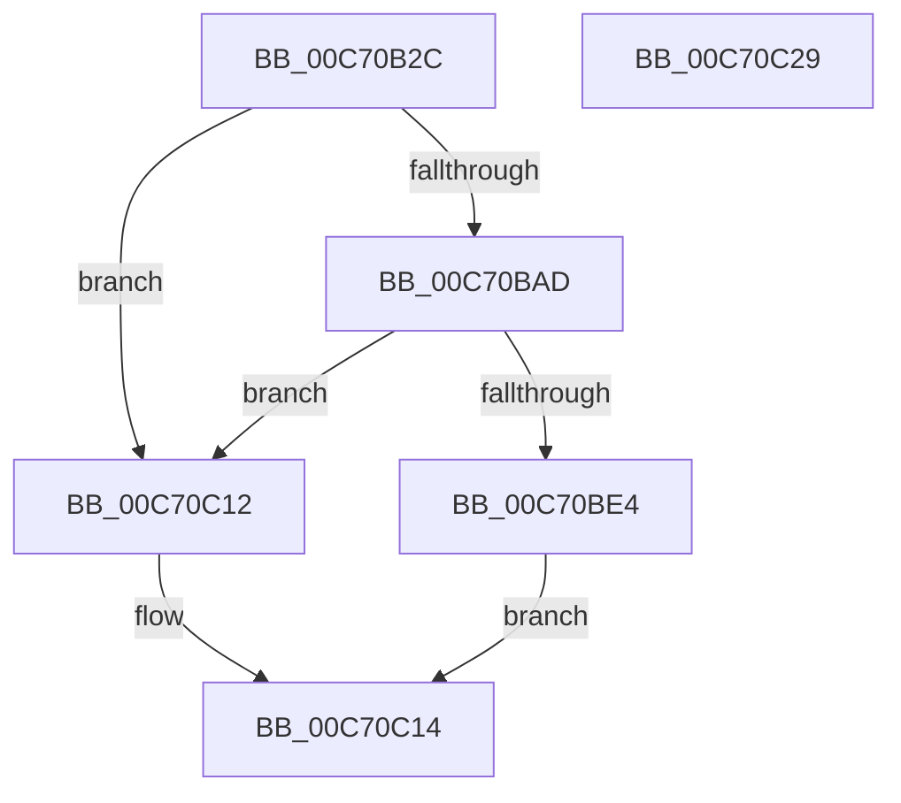

# SeRmInitPhase1

- RVA: `0x00C70B2C`–`0x00C70C2A` (길이 `254` bytes)
- VA: `0x0000000140C70B2C`
- 실행 섹션: `INIT`
- PDB 이름 있음: `예`; PDB Function 태그: `아니요`
- unwind 정보 RVA: `0x000BAEE4`
- 디코드: `57`개 명령, `254/254` bytes 표시
- 미해석 바이트: `0` (있으면 어셈블리에 `.byte`로 보존)

> 이 문서는 커널 이미지의 기계어와 PDB 기호를 분석해 생성했습니다. 4번과 5번은 함수 원형과 자료형을 바이너리 사용 방식에서 추정한 C 해석이며 원본 소스 복구 결과는 아닙니다.

## 1. Dependencies

- 직접 호출 지점: **8**; 고유 호출 대상: **8**
- 직접 호출자로 확인된 함수: **1**
- RIP 상대 이미지 참조: **7**

### Outgoing calls
- `0x00C70B81` → [memset](../../text/6C/memset_function_006C6C40.md) (function, `0x006C6C40`)
- `0x00C70BA4` → [ZwAlpcCreatePort](../../text/6A/ZwAlpcCreatePort_function_006AE070.md) (function, `0x006AE070`)
- `0x00C70BAD` → [SepAdtInitializeAuditingOptions](../C4/SepAdtInitializeAuditingOptions_function_00C4BC1C.md) (function, `0x00C4BC1C`)
- `0x00C70BDB` → [PsCreateSystemThread](../../page/9E/PsCreateSystemThread_function_009ED0D0.md) (function, `0x009ED0D0`)
- `0x00C70BE4` → [AuthzBasepInitializeSystemSecurityAttributes](../../page/82/AuthzBasepInitializeSystemSecurityAttributes_function_00821E08.md) (function, `0x00821E08`)
- `0x00C70BF0` → [ZwClose](../../text/6A/ZwClose_function_006AD2B0.md) (function, `0x006AD2B0`)
- `0x00C70C09` → [TraceLoggingRegisterEx_EtwRegister_EtwSetInformation](../../page/92/TraceLoggingRegisterEx_EtwRegister_EtwSetInformation_function_009208A0.md) (function, `0x009208A0`)
- `0x00C70C1B` → [_security_check_cookie](../../text/6A/_security_check_cookie_function_006AC640.md) (function, `0x006AC640`)

### Direct callers
- [Phase1InitializationIoReady](Phase1InitializationIoReady_function_00C70458.md) at `0x00C7063F`

### Static image references
- `0x00C70B3A` → RVA `0x00E0A740` (`.data`; read)
- `0x00C70B4C` → RVA `0x00B4BE38` (`SepRmCommandPortName`; read)
- `0x00C70B9D` → RVA `0x00FD9F18` (`PAGEDATA`; read)
- `0x00C70BB8` → RVA `0x00A6A8D0` (`SepRmCommandServerThread`; read)
- `0x00C70BCD` → RVA `0x00FD9F10` (`PAGEDATA`; read)
- `0x00C70BF5` → RVA `0x00FD9F10` (`PAGEDATA`; read/write)
- `0x00C70BFD` → RVA `0x00E08908` (`.data`; read)

## 2. Other-region calls and transfers

- 다른 실행 섹션으로 향하는 call: **7**
  - `0x00C70B81` → [memset](../../text/6C/memset_function_006C6C40.md) (`INIT` → `.text`)
  - `0x00C70BA4` → [ZwAlpcCreatePort](../../text/6A/ZwAlpcCreatePort_function_006AE070.md) (`INIT` → `.text`)
  - `0x00C70BDB` → [PsCreateSystemThread](../../page/9E/PsCreateSystemThread_function_009ED0D0.md) (`INIT` → `PAGE`)
  - `0x00C70BE4` → [AuthzBasepInitializeSystemSecurityAttributes](../../page/82/AuthzBasepInitializeSystemSecurityAttributes_function_00821E08.md) (`INIT` → `PAGE`)
  - `0x00C70BF0` → [ZwClose](../../text/6A/ZwClose_function_006AD2B0.md) (`INIT` → `.text`)
  - `0x00C70C09` → [TraceLoggingRegisterEx_EtwRegister_EtwSetInformation](../../page/92/TraceLoggingRegisterEx_EtwRegister_EtwSetInformation_function_009208A0.md) (`INIT` → `PAGE`)
  - `0x00C70C1B` → [_security_check_cookie](../../text/6A/_security_check_cookie_function_006AC640.md) (`INIT` → `.text`)
- 별도 외부 분기/꼬리 이동을 확인하지 못했습니다.

## 3. Assembly (complete function range)

```asm
00C70B2C  40 55                           push rbp
00C70B2E  48 8D 6C 24 A9                  lea rbp, [rsp - 0x57]
00C70B33  48 81 EC D0 00 00 00            sub rsp, 0xd0
00C70B3A  48 8B 05 FF 9B 19 00            mov rax, qword ptr [rip + 0x199bff]
00C70B41  48 33 C4                        xor rax, rsp
00C70B44  48 89 45 47                     mov qword ptr [rbp + 0x47], rax
00C70B48  83 65 E3 00                     and dword ptr [rbp - 0x1d], 0
00C70B4C  48 8D 05 E5 B2 ED FF            lea rax, [rip - 0x124d1b]
00C70B53  48 83 65 CF 00                  and qword ptr [rbp - 0x31], 0
00C70B58  48 8D 4D F7                     lea rcx, [rbp - 9]
00C70B5C  33 D2                           xor edx, edx
00C70B5E  48 C7 45 C7 30 00 00 00         mov qword ptr [rbp - 0x39], 0x30
00C70B66  83 65 CB 00                     and dword ptr [rbp - 0x35], 0
00C70B6A  0F 57 C0                        xorps xmm0, xmm0
00C70B6D  C7 45 DF 00 02 00 00            mov dword ptr [rbp - 0x21], 0x200
00C70B74  48 89 45 D7                     mov qword ptr [rbp - 0x29], rax
00C70B78  44 8D 42 48                     lea r8d, [rdx + 0x48]
00C70B7C  F3 0F 7F 45 E7                  movdqu xmmword ptr [rbp - 0x19], xmm0
00C70B81  E8 BA 60 A5 FF                  call 0x1406c6c40
00C70B86  4C 8D 45 F7                     lea r8, [rbp - 9]
00C70B8A  C7 45 F7 00 00 12 00            mov dword ptr [rbp - 9], 0x120000
00C70B91  48 8D 55 C7                     lea rdx, [rbp - 0x39]
00C70B95  48 C7 45 07 00 02 00 00         mov qword ptr [rbp + 7], 0x200
00C70B9D  48 8D 0D 74 93 36 00            lea rcx, [rip + 0x369374]
00C70BA4  E8 C7 D4 A3 FF                  call 0x1406ae070
00C70BA9  85 C0                           test eax, eax
00C70BAB  78 65                           js 0x140c70c12
00C70BAD  E8 6A B0 FD FF                  call 0x140c4bc1c
00C70BB2  48 83 64 24 30 00               and qword ptr [rsp + 0x30], 0
00C70BB8  48 8D 05 11 9D DF FF            lea rax, [rip - 0x2062ef]
00C70BBF  45 33 C9                        xor r9d, r9d
00C70BC2  48 89 44 24 28                  mov qword ptr [rsp + 0x28], rax
00C70BC7  48 83 64 24 20 00               and qword ptr [rsp + 0x20], 0
00C70BCD  48 8D 0D 3C 93 36 00            lea rcx, [rip + 0x36933c]
00C70BD4  45 33 C0                        xor r8d, r8d
00C70BD7  41 8D 51 38                     lea edx, [r9 + 0x38]
00C70BDB  E8 F0 C4 D7 FF                  call 0x1409ed0d0
00C70BE0  85 C0                           test eax, eax
00C70BE2  78 2E                           js 0x140c70c12
00C70BE4  E8 1F 12 BB FF                  call 0x140821e08
00C70BE9  48 8B 0D 20 93 36 00            mov rcx, qword ptr [rip + 0x369320]
00C70BF0  E8 BB C6 A3 FF                  call 0x1406ad2b0
00C70BF5  48 83 25 13 93 36 00 00         and qword ptr [rip + 0x369313], 0
00C70BFD  48 8D 0D 04 7D 19 00            lea rcx, [rip + 0x197d04]
00C70C04  45 33 C0                        xor r8d, r8d
00C70C07  33 D2                           xor edx, edx
00C70C09  E8 92 FC CA FF                  call 0x1409208a0
00C70C0E  B0 01                           mov al, 1
00C70C10  EB 02                           jmp 0x140c70c14
00C70C12  32 C0                           xor al, al
00C70C14  48 8B 4D 47                     mov rcx, qword ptr [rbp + 0x47]
00C70C18  48 33 CC                        xor rcx, rsp
00C70C1B  E8 20 BA A3 FF                  call 0x1406ac640
00C70C20  48 81 C4 D0 00 00 00            add rsp, 0xd0
00C70C27  5D                              pop rbp
00C70C28  C3                              ret
00C70C29  CC                              int3
```

## 4. C-style interpretation (structured pseudocode)

```c
__int64 __fastcall SeRmInitPhase1(__int64 a1, int a2, __int64 a3, int a4)
{
    __int64 result;
    __int64 v_rsp;
    unsigned __int64 v_stack_m18;
    unsigned __int64 v_stack_m58;
    unsigned __int64 v_stack_m5F;
    unsigned __int64 v_stack_m68;
    unsigned __int64 v_stack_m78;
    unsigned int v_stack_m7C;
    unsigned int v_stack_m80;
    unsigned __int64 v_stack_m88;
    unsigned __int64 v_stack_m90;
    unsigned int v_stack_m94;
    unsigned __int64 v_stack_m98;
    unsigned __int64 v_stack_mA8;
    unsigned __int64 v_stack_mB0;
    unsigned __int64 v_stack_mB8;

    v_rsp = (v_rsp) - (208);
    result = (*(unsigned __int64 *)(v_rip + 1678335)) ^ (v_rsp);
    v_stack_m18 = result;
    a2 = 0;
    v_stack_m98 = 48;
    v_stack_m80 = 512;
    v_stack_m88 = v_rip - 1199387;
    v_stack_m78 = v_xmm0;
    result = memset(v_stack_m68, a2, a2 + 72, a4);
    v_stack_m68 = 0x120000ULL;
    v_stack_m58 = 512;
    result = ZwAlpcCreatePort(v_rip + 3576692, v_stack_m98, v_stack_m68, a4);
    if (sign_flag) goto loc_00C70C12;
    result = SepAdtInitializeAuditingOptions(v_rip + 3576692, v_stack_m98, v_stack_m68, a4);
    a4 = 0;
    v_stack_mB0 = v_rip - 2122479;
    a3 = 0;
    result = PsCreateSystemThread(v_rip + 3576636, a4 + 56, a3, a4);
    if (sign_flag) goto loc_00C70C12;
    result = AuthzBasepInitializeSystemSecurityAttributes(v_rip + 3576636, a4 + 56, a3, a4);
    result = ZwClose(*(unsigned __int64 *)(v_rip + 3576608), a4 + 56, a3, a4);
    a3 = 0;
    a2 = 0;
    result = TraceLoggingRegisterEx_EtwRegister_EtwSetInformation(v_rip + 1670404, a2, a3, a4);
    goto loc_00C70C14;
loc_00C70C12:
    result = 0;
loc_00C70C14:
    a1 = (v_stack_m18) ^ (v_rsp);
    result = _security_check_cookie(a1, a2, a3, a4);
    v_rsp = (v_rsp) + (208);
    return result;
}
```

## 5. (Beta) C Style

```c
int64_t SeRmInitPhase1(int64_t Arg1, int32_t Arg2, int64_t Arg3, int32_t Arg4)
{
    int64_t result;
    int64_t local_rsp;
    uint64_t v_stack_m18;
    uint64_t v_stack_m58;
    uint64_t v_stack_m5F;
    uint64_t v_stack_m68;
    uint64_t v_stack_m78;
    uint32_t v_stack_m7C;
    uint32_t v_stack_m80;
    uint64_t v_stack_m88;
    uint64_t v_stack_m90;
    uint32_t v_stack_m94;
    uint64_t v_stack_m98;
    uint64_t v_stack_mA8;
    uint64_t v_stack_mB0;
    uint64_t v_stack_mB8;

    local_rsp = (local_rsp) - (208);
    result = (*(uint64_t *)(v_rip + 0x199BFF)) ^ (local_rsp);
    v_stack_m18 = result;
    Arg2 = 0;
    v_stack_m98 = 48;
    v_stack_m80 = 512;
    v_stack_m88 = v_rip - 1199387;
    v_stack_m78 = v_xmm0;
    result = memset(v_stack_m68, Arg2, Arg2 + 72, Arg4);
    v_stack_m68 = 0x120000ULL;
    v_stack_m58 = 512;
    result = ZwAlpcCreatePort(v_rip + 3576692, v_stack_m98, v_stack_m68, Arg4);
    if (sign_flag) goto loc_00C70C12;
    result = SepAdtInitializeAuditingOptions(v_rip + 3576692, v_stack_m98, v_stack_m68, Arg4);
    Arg4 = 0;
    v_stack_mB0 = v_rip - 2122479;
    Arg3 = 0;
    result = PsCreateSystemThread(v_rip + 3576636, Arg4 + 56, Arg3, Arg4);
    if (sign_flag) goto loc_00C70C12;
    result = AuthzBasepInitializeSystemSecurityAttributes(v_rip + 3576636, Arg4 + 56, Arg3, Arg4);
    result = ZwClose(*(uint64_t *)(v_rip + 0x369320), Arg4 + 56, Arg3, Arg4);
    Arg3 = 0;
    Arg2 = 0;
    result = TraceLoggingRegisterEx_EtwRegister_EtwSetInformation(v_rip + 1670404, Arg2, Arg3, Arg4);
    goto loc_00C70C14;
loc_00C70C12:
    result = 0;
loc_00C70C14:
    Arg1 = (v_stack_m18) ^ (local_rsp);
    result = _security_check_cookie(Arg1, Arg2, Arg3, Arg4);
    local_rsp = (local_rsp) + (208);
    return result;
}
```

## 6. Execution-region graph

[열기: 2D/3D 그래프와 함수 탐색 컨트롤 패널](../../../control-panel.html?section=init&rva=0x00C70B2C&view=graph)

- 2D 그래프는 위에서 아래로 흐르고, 3D 그래프는 빈 공간을 드래그해 회전합니다. Shift+드래그는 이동, 휠은 확대·축소, 함수 노드 선택은 대상 보고서 이동입니다.

### Static fallback


