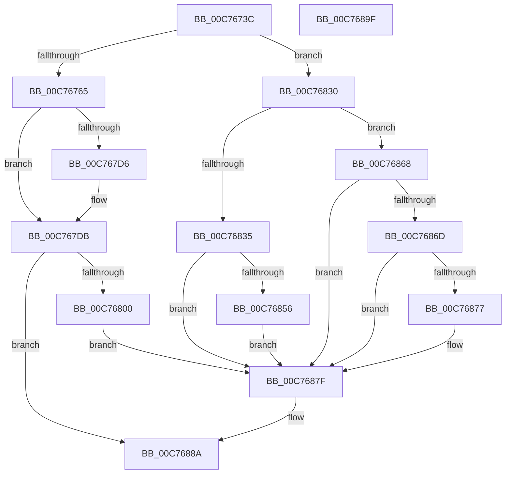

# SmInitSystem

- RVA: `0x00C7673C`–`0x00C768A0` (길이 `356` bytes)
- VA: `0x0000000140C7673C`
- 실행 섹션: `INIT`
- PDB 이름 있음: `예`; PDB Function 태그: `아니요`
- unwind 정보 RVA: `0x0005C954`
- 디코드: `76`개 명령, `356/356` bytes 표시
- 미해석 바이트: `0` (있으면 어셈블리에 `.byte`로 보존)

> 이 문서는 커널 이미지의 기계어와 PDB 기호를 분석해 생성했습니다. 4번과 5번은 함수 원형과 자료형을 바이너리 사용 방식에서 추정한 C 해석이며 원본 소스 복구 결과는 아닙니다.

## 1. Dependencies

- 직접 호출 지점: **6**; 고유 호출 대상: **6**
- 직접 호출자로 확인된 함수: **2**
- RIP 상대 이미지 참조: **21**

### Outgoing calls
- `0x00C76774` → [memset](../../text/6C/memset_function_006C6C40.md) (function, `0x006C6C40`)
- `0x00C7679D` → [SmHwAcceleratorMgrInitialize](../../page/AB/SmHwAcceleratorMgrInitialize_function_00AB5F48.md) (function, `0x00AB5F48`)
- `0x00C767F3` → [SmQueryRegistry](SmQueryRegistry_function_00C768A8.md) (function, `0x00C768A8`)
- `0x00C7681B` → [KeRegisterBugCheckReasonCallback](../../text/47/KeRegisterBugCheckReasonCallback_function_004720A0.md) (function, `0x004720A0`)
- `0x00C7684D` → [EtwRegister](../../page/92/EtwRegister_function_00920960.md) (function, `0x00920960`)
- `0x00C7687A` → [SmpSystemStoreCreate](../../page/7A/SmpSystemStoreCreate_function_007A8024.md) (function, `0x007A8024`)

### Direct callers
- [Phase1InitializationDiscard](../C1/Phase1InitializationDiscard_function_00C1C728.md) at `0x00C1D5D6`
- [IoInitSystemPreDrivers](../C2/IoInitSystemPreDrivers_function_00C2AC3C.md) at `0x00C2BC42`

### Static image references
- `0x00C76750` → RVA `0x00FC6EA0` (`ALMOSTRO`; read)
- `0x00C76767` → RVA `0x00E28380` (`.data`; read)
- `0x00C76779` → RVA `0x00E288C8` (`.data`; read/write)
- `0x00C76781` → RVA `0x00E288B8` (`.data`; read)
- `0x00C76788` → RVA `0x00E28388` (`.data`; read)
- `0x00C7678F` → RVA `0x00E288C0` (`.data`; write)
- `0x00C76796` → RVA `0x00E288B8` (`.data`; write)
- `0x00C767A2` → RVA `0x00FC6AB0` (`ALMOSTRO`; read)
- `0x00C767A9` → RVA `0x00E288C0` (`.data`; read)
- `0x00C767B0` → RVA `0x00E28948` (`.data`; write)
- `0x00C767B7` → RVA `0x00E28934` (`.data`; write)
- `0x00C767BD` → RVA `0x00E288F4` (`.data`; write)
- `0x00C76800` → RVA `0x00C7CF80` (` ?? ::PBOPGDP::`string'`; read)
- `0x00C7680D` → RVA `0x00610370` (`SmBugcheckCallback`; read)
- `0x00C76814` → RVA `0x00E28908` (`.data`; read)
- `0x00C76835` → RVA `0x00E288D0` (`.data`; read)
- `0x00C7683F` → RVA `0x007AA080` (`SmEtwEnableCallback`; read)
- `0x00C76846` → RVA `0x000218E0` (`.rdata`; read)
- `0x00C76856` → RVA `0x00E288D8` (`.data`; read/write)
- `0x00C7685C` → RVA `0x00E288DC` (`.data`; write)
- `0x00C76882` → RVA `0x00E288F0` (`.data`; write)

## 2. Other-region calls and transfers

- 다른 실행 섹션으로 향하는 call: **5**
  - `0x00C76774` → [memset](../../text/6C/memset_function_006C6C40.md) (`INIT` → `.text`)
  - `0x00C7679D` → [SmHwAcceleratorMgrInitialize](../../page/AB/SmHwAcceleratorMgrInitialize_function_00AB5F48.md) (`INIT` → `PAGE`)
  - `0x00C7681B` → [KeRegisterBugCheckReasonCallback](../../text/47/KeRegisterBugCheckReasonCallback_function_004720A0.md) (`INIT` → `.text`)
  - `0x00C7684D` → [EtwRegister](../../page/92/EtwRegister_function_00920960.md) (`INIT` → `PAGE`)
  - `0x00C7687A` → [SmpSystemStoreCreate](../../page/7A/SmpSystemStoreCreate_function_007A8024.md) (`INIT` → `PAGE`)
- 별도 외부 분기/꼬리 이동을 확인하지 못했습니다.

## 3. Assembly (complete function range)

```asm
00C7673C  48 89 5C 24 08                  mov qword ptr [rsp + 8], rbx
00C76741  48 89 6C 24 10                  mov qword ptr [rsp + 0x10], rbp
00C76746  48 89 74 24 18                  mov qword ptr [rsp + 0x18], rsi
00C7674B  57                              push rdi
00C7674C  48 83 EC 20                     sub rsp, 0x20
00C76750  48 8B 35 49 07 35 00            mov rsi, qword ptr [rip + 0x350749]
00C76757  8B D9                           mov ebx, ecx
00C76759  48 8B 7E 18                     mov rdi, qword ptr [rsi + 0x18]
00C7675D  85 C9                           test ecx, ecx
00C7675F  0F 85 CB 00 00 00               jne 0x140c76830
00C76765  33 D2                           xor edx, edx
00C76767  48 8D 0D 12 1C 1B 00            lea rcx, [rip + 0x1b1c12]
00C7676E  41 B8 C8 05 00 00               mov r8d, 0x5c8
00C76774  E8 C7 04 A5 FF                  call 0x1406c6c40
00C76779  48 83 25 47 21 1B 00 00         and qword ptr [rip + 0x1b2147], 0
00C76781  48 8D 2D 30 21 1B 00            lea rbp, [rip + 0x1b2130]
00C76788  48 8D 0D F9 1B 1B 00            lea rcx, [rip + 0x1b1bf9]
00C7678F  48 89 2D 2A 21 1B 00            mov qword ptr [rip + 0x1b212a], rbp
00C76796  48 89 2D 1B 21 1B 00            mov qword ptr [rip + 0x1b211b], rbp
00C7679D  E8 A6 F7 E3 FF                  call 0x140ab5f48
00C767A2  48 8B 05 07 03 35 00            mov rax, qword ptr [rip + 0x350307]
00C767A9  48 8B 0D 10 21 1B 00            mov rcx, qword ptr [rip + 0x1b2110]
00C767B0  48 89 05 91 21 1B 00            mov qword ptr [rip + 0x1b2191], rax
00C767B7  88 1D 77 21 1B 00               mov byte ptr [rip + 0x1b2177], bl
00C767BD  C7 05 2D 21 1B 00 06 00 00 00   mov dword ptr [rip + 0x1b212d], 6
00C767C7  48 8B 46 18                     mov rax, qword ptr [rsi + 0x18]
00C767CB  48 05 48 08 00 00               add rax, 0x848
00C767D1  48 39 29                        cmp qword ptr [rcx], rbp
00C767D4  74 05                           je 0x140c767db
00C767D6  8D 4B 03                        lea ecx, [rbx + 3]
00C767D9  CD 29                           int 0x29
00C767DB  48 89 48 08                     mov qword ptr [rax + 8], rcx
00C767DF  48 89 28                        mov qword ptr [rax], rbp
00C767E2  48 89 01                        mov qword ptr [rcx], rax
00C767E5  48 8D 0D 94 1B 1B 00            lea rcx, [rip + 0x1b1b94]
00C767EC  48 89 05 CD 20 1B 00            mov qword ptr [rip + 0x1b20cd], rax
00C767F3  E8 B0 00 00 00                  call 0x140c768a8
00C767F8  85 C0                           test eax, eax
00C767FA  0F 88 8A 00 00 00               js 0x140c7688a
00C76800  4C 8D 0D 79 67 00 00            lea r9, [rip + 0x6779]
00C76807  41 B8 02 00 00 00               mov r8d, 2
00C7680D  48 8D 15 5C 9B 99 FF            lea rdx, [rip - 0x6664a4]
00C76814  48 8D 0D ED 20 1B 00            lea rcx, [rip + 0x1b20ed]
00C7681B  E8 80 B8 7F FF                  call 0x1404720a0
00C76820  48 8B 05 59 1B 1B 00            mov rax, qword ptr [rip + 0x1b1b59]
00C76827  48 89 87 B0 08 00 00            mov qword ptr [rdi + 0x8b0], rax
00C7682E  EB 4F                           jmp 0x140c7687f
00C76830  83 FB 01                        cmp ebx, 1
00C76833  75 33                           jne 0x140c76868
00C76835  4C 8D 0D 94 20 1B 00            lea r9, [rip + 0x1b2094]
00C7683C  45 33 C0                        xor r8d, r8d
00C7683F  48 8D 15 3A 38 B3 FF            lea rdx, [rip - 0x4cc7c6]
00C76846  48 8D 0D 93 B0 3A FF            lea rcx, [rip - 0xc54f6d]
00C7684D  E8 0E A1 CA FF                  call 0x140920960
00C76852  85 C0                           test eax, eax
00C76854  78 29                           js 0x140c7687f
00C76856  09 1D 7C 20 1B 00               or dword ptr [rip + 0x1b207c], ebx
00C7685C  C7 05 76 20 1B 00 40 00 00 00   mov dword ptr [rip + 0x1b2076], 0x40
00C76866  EB 17                           jmp 0x140c7687f
00C76868  83 FB 02                        cmp ebx, 2
00C7686B  75 12                           jne 0x140c7687f
00C7686D  8B 87 B0 08 00 00               mov eax, dword ptr [rdi + 0x8b0]
00C76873  A8 03                           test al, 3
00C76875  74 08                           je 0x140c7687f
00C76877  48 8B CF                        mov rcx, rdi
00C7687A  E8 A5 17 B3 FF                  call 0x1407a8024
00C7687F  8D 43 01                        lea eax, [rbx + 1]
00C76882  89 05 68 20 1B 00               mov dword ptr [rip + 0x1b2068], eax
00C76888  33 C0                           xor eax, eax
00C7688A  48 8B 5C 24 30                  mov rbx, qword ptr [rsp + 0x30]
00C7688F  48 8B 6C 24 38                  mov rbp, qword ptr [rsp + 0x38]
00C76894  48 8B 74 24 40                  mov rsi, qword ptr [rsp + 0x40]
00C76899  48 83 C4 20                     add rsp, 0x20
00C7689D  5F                              pop rdi
00C7689E  C3                              ret
00C7689F  CC                              int3
```

## 4. C-style interpretation (structured pseudocode)

```c
__int64 __fastcall SmInitSystem(int a1, int a2)
{
    __int64 result;
    __int64 v_rsp;
    unsigned __int64 v_stack_p10;
    unsigned __int64 v_stack_p18;
    unsigned __int64 v_stack_p8;

    v_stack_p8 = v_rbx;
    v_stack_p10 = v_rbp;
    v_stack_p18 = v_rsi;
    v_rsp = (v_rsp) - (32);
    if (a1 != 0) goto loc_00C76830;
    a2 = 0;
    result = memset(v_rip + 1776658, a2, (unsigned int)(0x5C8ULL), a4);
    *(unsigned __int64 *)(v_rip + 1777962) = v_rip + 1777968;
    *(unsigned __int64 *)(v_rip + 1777947) = v_rip + 1777968;
    result = SmHwAcceleratorMgrInitialize(v_rip + 1776633, a2, (unsigned int)(0x5C8ULL), a4);
    *(unsigned __int64 *)(v_rip + 1778065) = *(unsigned __int64 *)(v_rip + 3474183);
    *(unsigned __int8 *)(v_rip + 1778039) = (unsigned __int8)((unsigned int)(a1));
    *(unsigned int *)(v_rip + 1777965) = 6;
    result = (*(unsigned __int64 *)(*(unsigned __int64 *)(v_rip + 3475273) + 24)) + (0x848ULL);
    if ((*(unsigned __int64 *)(*(unsigned __int64 *)(v_rip + 1777936))) != (v_rip + 1777968)) {
        a1 = (unsigned int)(a1) + 3;
    }
    *(unsigned __int64 *)(result + 8) = a1;
    *(unsigned __int64 *)(result) = v_rip + 1777968;
    *(unsigned __int64 *)(a1) = result;
    *(unsigned __int64 *)(v_rip + 1777869) = result;
    result = SmQueryRegistry(v_rip + 1776532, a2, (unsigned int)(0x5C8ULL), a4);
    if (sign_flag) goto loc_00C7688A;
    result = KeRegisterBugCheckReasonCallback(v_rip + 1777901, v_rip - 6710436, 2, v_rip + 26489);
    *(unsigned __int64 *)(*(unsigned __int64 *)(*(unsigned __int64 *)(v_rip + 3475273) + 24) + 2224) = *(unsigned __int64 *)(v_rip + 1776473);
    goto loc_00C7687F;
loc_00C76830:
    if (((unsigned int)((unsigned int)(a1))) != 1) goto loc_00C76868;
    a3 = 0;
    result = EtwRegister(v_rip - 12930925, v_rip - 5031878, a3, v_rip + 1777812);
    if (sign_flag) goto loc_00C7687F;
    *(unsigned int *)(v_rip + 1777782) = 64;
    goto loc_00C7687F;
loc_00C76868:
    if (((unsigned int)((unsigned int)(a1))) != 2) goto loc_00C7687F;
    result = (unsigned int)(*(unsigned int *)(*(unsigned __int64 *)(*(unsigned __int64 *)(v_rip + 3475273) + 24) + 2224));
    if ((((unsigned __int8)((unsigned int)(*(unsigned int *)(*(unsigned __int64 *)(*(unsigned __int64 *)(v_rip + 3475273) + 24) + 2224)))) & (3)) != 0) {
        a1 = *(unsigned __int64 *)(*(unsigned __int64 *)(v_rip + 3475273) + 24);
        result = SmpSystemStoreCreate(a1, v_rip - 5031878, a3, v_rip + 1777812);
    }
    *(unsigned int *)(v_rip + 1777768) = (unsigned int)((unsigned int)(a1) + 1);
    result = 0;
loc_00C7688A:
    v_rsp = (v_rsp) + (32);
    return result;
}
```

## 5. (Beta) C Style

```c
int64_t SmInitSystem(void *Arg1, int32_t Arg2)
{
    uint8_t *arg1 = (uint8_t *)Arg1;

    int64_t result;
    int64_t local_rsp;
    uint64_t v_stack_p10;
    uint64_t v_stack_p18;
    uint64_t v_stack_p8;

    v_stack_p8 = local_rbx;
    v_stack_p10 = local_rbp;
    v_stack_p18 = local_rsi;
    local_rsp = (local_rsp) - (32);
    if (Arg1 != NULL) goto loc_00C76830;
    Arg2 = 0;
    result = memset(v_rip + 1776658, Arg2, (uint32_t)(0x5C8ULL), a4);
    *(uint64_t *)(v_rip + 0x1B212A) = v_rip + 1777968;
    *(uint64_t *)(v_rip + 0x1B211B) = v_rip + 1777968;
    result = SmHwAcceleratorMgrInitialize(v_rip + 1776633, Arg2, (uint32_t)(0x5C8ULL), a4);
    *(uint64_t *)(v_rip + 0x1B2191) = *(uint64_t *)(v_rip + 0x350307);
    *(uint8_t *)(v_rip + 0x1B2177) = (uint8_t)((uint32_t)(Arg1));
    *(uint32_t *)(v_rip + 0x1B212D) = 6;
    result = (*(uint64_t *)(*(uint64_t *)(v_rip + 0x350749) + 0x18)) + (0x848ULL);
    if ((*(uint64_t *)(*(uint64_t *)(v_rip + 0x1B2110))) != (v_rip + 1777968)) {
        Arg1 = (uint32_t)(Arg1) + 3;
    }
    *(void **)(result + 0x8) = Arg1;
    *(uint64_t *)(result) = v_rip + 1777968;
    *(uint64_t *)(arg1) = result;
    *(uint64_t *)(v_rip + 0x1B20CD) = result;
    result = SmQueryRegistry(v_rip + 1776532, Arg2, (uint32_t)(0x5C8ULL), a4);
    if (sign_flag) goto loc_00C7688A;
    result = KeRegisterBugCheckReasonCallback(v_rip + 1777901, v_rip - 6710436, 2, v_rip + 26489);
    *(uint64_t *)(*(uint64_t *)(*(uint64_t *)(v_rip + 0x350749) + 0x18) + 0x8B0) = *(uint64_t *)(v_rip + 0x1B1B59);
    goto loc_00C7687F;
loc_00C76830:
    if (((uint32_t)((uint32_t)(Arg1))) != 1) goto loc_00C76868;
    a3 = 0;
    result = EtwRegister(v_rip - 12930925, v_rip - 5031878, a3, v_rip + 1777812);
    if (sign_flag) goto loc_00C7687F;
    *(uint32_t *)(v_rip + 0x1B2076) = 64;
    goto loc_00C7687F;
loc_00C76868:
    if (((uint32_t)((uint32_t)(Arg1))) != 2) goto loc_00C7687F;
    result = (uint32_t)(*(uint32_t *)(*(uint64_t *)(*(uint64_t *)(v_rip + 0x350749) + 0x18) + 0x8B0));
    if ((((uint8_t)((uint32_t)(*(uint32_t *)(*(uint64_t *)(*(uint64_t *)(v_rip + 0x350749) + 0x18) + 0x8B0)))) & (3)) != 0) {
        Arg1 = *(uint64_t *)(*(uint64_t *)(v_rip + 0x350749) + 0x18);
        result = SmpSystemStoreCreate(Arg1, v_rip - 5031878, a3, v_rip + 1777812);
    }
    *(uint32_t *)(v_rip + 0x1B2068) = (uint32_t)((uint32_t)(Arg1) + 1);
    result = 0;
loc_00C7688A:
    local_rsp = (local_rsp) + (32);
    return result;
}
```

### 관측된 메모리 오프셋

구조체 형식이 확인되지 않은 접근은 인자 기준의 오프셋으로만 기록했습니다.

| 기준 인자 | 오프셋 표현 | 폭 (bit) | 접근 |
|---|---:|---:|---|
| `Arg1` | `+ 0x3` | `32` | `R` |

## 6. Execution-region graph

[열기: 2D/3D 그래프와 함수 탐색 컨트롤 패널](../../../control-panel.html?section=init&rva=0x00C7673C&view=graph)

- 2D 그래프는 위에서 아래로 흐르고, 3D 그래프는 빈 공간을 드래그해 회전합니다. Shift+드래그는 이동, 휠은 확대·축소, 함수 노드 선택은 대상 보고서 이동입니다.

### Static fallback


