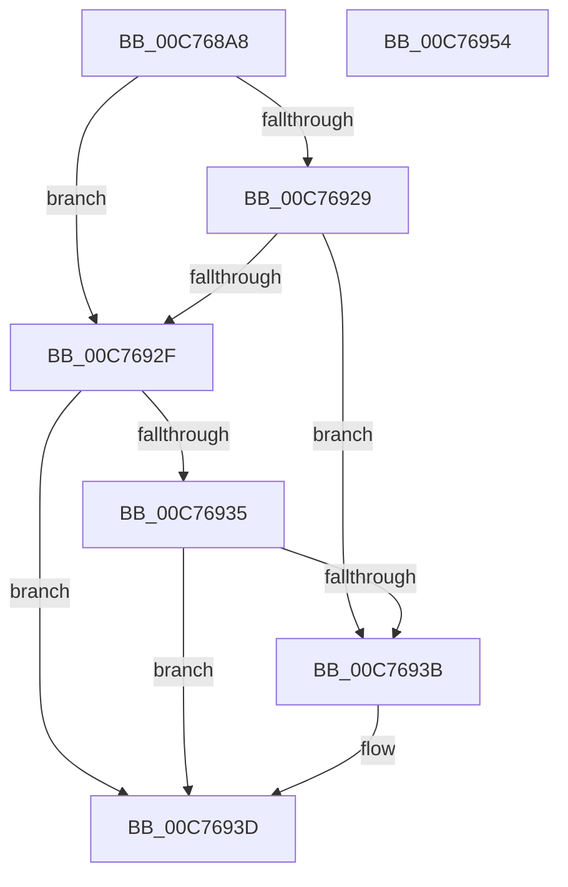

# SmQueryRegistry

- RVA: `0x00C768A8`–`0x00C76955` (길이 `173` bytes)
- VA: `0x0000000140C768A8`
- 실행 섹션: `INIT`
- PDB 이름 있음: `예`; PDB Function 태그: `아니요`
- unwind 정보 RVA: `0x000BDF14`
- 디코드: `47`개 명령, `173/173` bytes 표시
- 미해석 바이트: `0` (있으면 어셈블리에 `.byte`로 보존)

> 이 문서는 커널 이미지의 기계어와 PDB 기호를 분석해 생성했습니다. 4번과 5번은 함수 원형과 자료형을 바이너리 사용 방식에서 추정한 C 해석이며 원본 소스 복구 결과는 아닙니다.

## 1. Dependencies

- 직접 호출 지점: **1**; 고유 호출 대상: **1**
- 직접 호출자로 확인된 함수: **1**
- RIP 상대 이미지 참조: **2**

### Outgoing calls
- `0x00C7691A` → [RtlQueryRegistryValuesEx](../../page/8C/RtlQueryRegistryValuesEx_function_008C8FF0.md) (function, `0x008C8FF0`)

### Direct callers
- [SmInitSystem](SmInitSystem_function_00C7673C.md) at `0x00C767F3`

### Static image references
- `0x00C768CC` → RVA `0x00C7CE80` (` ?? ::PBOPGDP::`string'`; read)
- `0x00C768EB` → RVA `0x00C7CEB0` (` ?? ::PBOPGDP::`string'`; read)

## 2. Other-region calls and transfers

- 다른 실행 섹션으로 향하는 call: **1**
  - `0x00C7691A` → [RtlQueryRegistryValuesEx](../../page/8C/RtlQueryRegistryValuesEx_function_008C8FF0.md) (`INIT` → `PAGE`)
- 별도 외부 분기/꼬리 이동을 확인하지 못했습니다.

## 3. Assembly (complete function range)

```asm
00C768A8  48 89 5C 24 08                  mov qword ptr [rsp + 8], rbx
00C768AD  48 89 7C 24 10                  mov qword ptr [rsp + 0x10], rdi
00C768B2  55                              push rbp
00C768B3  48 8D 6C 24 A9                  lea rbp, [rsp - 0x57]
00C768B8  48 81 EC A0 00 00 00            sub rsp, 0xa0
00C768BF  33 FF                           xor edi, edi
00C768C1  48 89 4D FF                     mov qword ptr [rbp - 1], rcx
00C768C5  48 8B D9                        mov rbx, rcx
00C768C8  48 89 7D E7                     mov qword ptr [rbp - 0x19], rdi
00C768CC  48 8D 05 AD 65 00 00            lea rax, [rip + 0x65ad]
00C768D3  48 89 7D 0F                     mov qword ptr [rbp + 0xf], rdi
00C768D7  33 C9                           xor ecx, ecx
00C768D9  48 89 45 F7                     mov qword ptr [rbp - 9], rax
00C768DD  45 33 C9                        xor r9d, r9d
00C768E0  89 7D 17                        mov dword ptr [rbp + 0x17], edi
00C768E3  4C 8D 45 E7                     lea r8, [rbp - 0x19]
00C768E7  48 89 7D 1F                     mov qword ptr [rbp + 0x1f], rdi
00C768EB  48 8D 15 BE 65 00 00            lea rdx, [rip + 0x65be]
00C768F2  89 7D 27                        mov dword ptr [rbp + 0x27], edi
00C768F5  48 89 7D 2F                     mov qword ptr [rbp + 0x2f], rdi
00C768F9  48 89 7D 37                     mov qword ptr [rbp + 0x37], rdi
00C768FD  89 7D 3F                        mov dword ptr [rbp + 0x3f], edi
00C76900  48 89 7D 47                     mov qword ptr [rbp + 0x47], rdi
00C76904  89 7D 4F                        mov dword ptr [rbp + 0x4f], edi
00C76907  48 89 7C 24 20                  mov qword ptr [rsp + 0x20], rdi
00C7690C  C7 45 EF 20 01 00 00            mov dword ptr [rbp - 0x11], 0x120
00C76913  C7 45 07 00 00 00 04            mov dword ptr [rbp + 7], 0x4000000
00C7691A  E8 D1 26 C5 FF                  call 0x1408c8ff0
00C7691F  8B 0B                           mov ecx, dword ptr [rbx]
00C76921  8B C1                           mov eax, ecx
00C76923  0F BA E1 08                     bt ecx, 8
00C76927  73 06                           jae 0x140c7692f
00C76929  0F BA E1 09                     bt ecx, 9
00C7692D  73 0C                           jae 0x140c7693b
00C7692F  0F BA E0 0D                     bt eax, 0xd
00C76933  73 08                           jae 0x140c7693d
00C76935  0F BA E0 09                     bt eax, 9
00C76939  72 02                           jb 0x140c7693d
00C7693B  89 3B                           mov dword ptr [rbx], edi
00C7693D  4C 8D 9C 24 A0 00 00 00         lea r11, [rsp + 0xa0]
00C76945  33 C0                           xor eax, eax
00C76947  49 8B 5B 10                     mov rbx, qword ptr [r11 + 0x10]
00C7694B  49 8B 7B 18                     mov rdi, qword ptr [r11 + 0x18]
00C7694F  49 8B E3                        mov rsp, r11
00C76952  5D                              pop rbp
00C76953  C3                              ret
00C76954  CC                              int3
```

## 4. C-style interpretation (structured pseudocode)

```c
__int64 __fastcall SmQueryRegistry(__int64 a1, __int64 a2, __int64 a3, int a4)
{
    __int64 result;
    __int64 v_rdi;
    __int64 v_rsp;
    unsigned int v_stack_m10;
    unsigned __int64 v_stack_m18;
    unsigned int v_stack_m20;
    unsigned __int64 v_stack_m28;
    unsigned __int64 v_stack_m30;
    unsigned int v_stack_m38;
    unsigned __int64 v_stack_m40;
    unsigned int v_stack_m48;
    unsigned __int64 v_stack_m50;
    unsigned int v_stack_m58;
    unsigned __int64 v_stack_m5F;
    unsigned __int64 v_stack_m60;
    unsigned __int64 v_stack_m68;
    unsigned int v_stack_m70;
    unsigned __int64 v_stack_m78;
    unsigned __int64 v_stack_m8;
    unsigned __int64 v_stack_m88;
    unsigned __int64 v_stack_p10;
    unsigned __int64 v_stack_p8;

    v_stack_p8 = v_rbx;
    v_stack_p10 = v_rdi;
    v_rsp = (v_rsp) - (160);
    v_rdi = 0;
    v_stack_m60 = a1;
    v_stack_m78 = 0;
    v_stack_m50 = 0;
    a1 = 0;
    v_stack_m68 = v_rip + 26029;
    a4 = 0;
    v_stack_m48 = 0;
    v_stack_m40 = 0;
    v_stack_m38 = 0;
    v_stack_m30 = 0;
    v_stack_m28 = 0;
    v_stack_m20 = 0;
    v_stack_m18 = 0;
    v_stack_m10 = 0;
    v_stack_m88 = 0;
    v_stack_m70 = 288;
    v_stack_m58 = 0x4000000ULL;
    result = RtlQueryRegistryValuesEx(a1, v_rip + 26046, v_stack_m78, a4);
    if (condition_is_above_or_equal) goto loc_00C7692F;
    if (condition_is_above_or_equal) goto loc_00C7693B;
loc_00C7692F:
    if (condition_is_above_or_equal) goto loc_00C7693D;
    if (!(condition_is_below)) {
        *(unsigned int *)(a1) = 0;
    }
    result = 0;
    return result;
}
```

## 5. (Beta) C Style

```c
int64_t SmQueryRegistry(void *Arg1, int64_t Arg2, int64_t Arg3, int32_t Arg4)
{
    uint8_t *arg1 = (uint8_t *)Arg1;

    int64_t result;
    int64_t local_rdi;
    int64_t local_rsp;
    uint32_t v_stack_m10;
    uint64_t v_stack_m18;
    uint32_t v_stack_m20;
    uint64_t v_stack_m28;
    uint64_t v_stack_m30;
    uint32_t v_stack_m38;
    uint64_t v_stack_m40;
    uint32_t v_stack_m48;
    uint64_t v_stack_m50;
    uint32_t v_stack_m58;
    uint64_t v_stack_m5F;
    uint64_t v_stack_m60;
    uint64_t v_stack_m68;
    uint32_t v_stack_m70;
    uint64_t v_stack_m78;
    uint64_t v_stack_m8;
    uint64_t v_stack_m88;
    uint64_t v_stack_p10;
    uint64_t v_stack_p8;

    v_stack_p8 = local_rbx;
    v_stack_p10 = local_rdi;
    local_rsp = (local_rsp) - (160);
    local_rdi = 0;
    v_stack_m60 = Arg1;
    v_stack_m78 = 0;
    v_stack_m50 = 0;
    Arg1 = 0;
    v_stack_m68 = v_rip + 26029;
    Arg4 = 0;
    v_stack_m48 = 0;
    v_stack_m40 = 0;
    v_stack_m38 = 0;
    v_stack_m30 = 0;
    v_stack_m28 = 0;
    v_stack_m20 = 0;
    v_stack_m18 = 0;
    v_stack_m10 = 0;
    v_stack_m88 = 0;
    v_stack_m70 = 288;
    v_stack_m58 = 0x4000000ULL;
    result = RtlQueryRegistryValuesEx(Arg1, v_rip + 26046, v_stack_m78, Arg4);
    if (condition_is_above_or_equal) goto loc_00C7692F;
    if (condition_is_above_or_equal) goto loc_00C7693B;
loc_00C7692F:
    if (condition_is_above_or_equal) goto loc_00C7693D;
    if (!(condition_is_below)) {
        *(uint32_t *)(arg1) = 0;
    }
    result = 0;
    return result;
}
```

### 관측된 메모리 오프셋

구조체 형식이 확인되지 않은 접근은 인자 기준의 오프셋으로만 기록했습니다.

| 기준 인자 | 오프셋 표현 | 폭 (bit) | 접근 |
|---|---:|---:|---|
| `Arg1` | `+ 0x0` | `32` | `R` |
| `Arg1` | `+ 0x0` | `32` | `W` |

## 6. Execution-region graph

[열기: 2D/3D 그래프와 함수 탐색 컨트롤 패널](../../../control-panel.html?section=init&rva=0x00C768A8&view=graph)

- 2D 그래프는 위에서 아래로 흐르고, 3D 그래프는 빈 공간을 드래그해 회전합니다. Shift+드래그는 이동, 휠은 확대·축소, 함수 노드 선택은 대상 보고서 이동입니다.

### Static fallback


