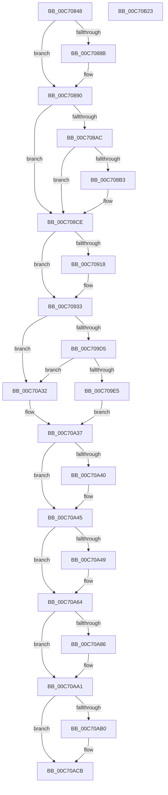

# StartFirstUserProcess

- RVA: `0x00C70848`–`0x00C70B24` (길이 `732` bytes)
- VA: `0x0000000140C70848`
- 실행 섹션: `INIT`
- PDB 이름 있음: `예`; PDB Function 태그: `아니요`
- unwind 정보 RVA: `0x000BAEC8`
- 디코드: `187`개 명령, `732/732` bytes 표시
- 미해석 바이트: `0` (있으면 어셈블리에 `.byte`로 보존)

> 이 문서는 커널 이미지의 기계어와 PDB 기호를 분석해 생성했습니다. 4번과 5번은 함수 원형과 자료형을 바이너리 사용 방식에서 추정한 C 해석이며 원본 소스 복구 결과는 아닙니다.

## 1. Dependencies

- 직접 호출 지점: **24**; 고유 호출 대상: **17**
- 직접 호출자로 확인된 함수: **1**
- RIP 상대 이미지 참조: **7**

### Outgoing calls
- `0x00C7087D` → [memset](../../text/6C/memset_function_006C6C40.md) (function, `0x006C6C40`)
- `0x00C70882` → [QueryRegistryHideMachine](../C6/QueryRegistryHideMachine_function_00C6FC84.md) (function, `0x00C6FC84`)
- `0x00C7088B` → [RegistryOverwriteCentralProcessor](../C1/RegistryOverwriteCentralProcessor_function_00C1DB4C.md) (function, `0x00C1DB4C`)
- `0x00C70894` → `ext-ms-win-ntos-runlevels-l1-1-0.dll!ExpInitializeRunLevel0` (import, 간접 대상; import `ext-ms-win-ntos-runlevels-l1-1-0.dll!ExpInitializeRunLevel0`)
- `0x00C708C8` → [KeBugCheckEx](../../text/4F/KeBugCheckEx_function_004FD660.md) (function, `0x004FD660`)
- `0x00C7090B` → [ExAllocatePool2](../../poolcode/B8/ExAllocatePool2_function_00B820F0.md) (function, `0x00B820F0`)
- `0x00C7092D` → [KeBugCheckEx](../../text/4F/KeBugCheckEx_function_004FD660.md) (function, `0x004FD660`)
- `0x00C7097C` → [RtlCopyUnicodeString](../../text/3F/RtlCopyUnicodeString_function_003FEF30.md) (function, `0x003FEF30`)
- `0x00C7099E` → [RtlCopyUnicodeString](../../text/3F/RtlCopyUnicodeString_function_003FEF30.md) (function, `0x003FEF30`)
- `0x00C709CB` → [RtlCopyUnicodeString](../../text/3F/RtlCopyUnicodeString_function_003FEF30.md) (function, `0x003FEF30`)
- `0x00C709D8` → [RtlNormalizeProcessParams](../C4/RtlNormalizeProcessParams_function_00C47318.md) (function, `0x00C47318`)
- `0x00C70A29` → [RtlpCreateUserProcess](../C4/RtlpCreateUserProcess_function_00C473EC.md) (function, `0x00C473EC`)
- `0x00C70A37` → [InbvIsBootDriverInstalled](../../text/4F/InbvIsBootDriverInstalled_function_004FC1E0.md) (function, `0x004FC1E0`)
- `0x00C70A40` → [FinalizeBootLogo](../../text/59/FinalizeBootLogo_function_0059062C.md) (function, `0x0059062C`)
- `0x00C70A5E` → [KeBugCheckEx](../../text/4F/KeBugCheckEx_function_004FD660.md) (function, `0x004FD660`)
- `0x00C70A7D` → [ZwSetInformationProcess](../../text/6A/ZwSetInformationProcess_function_006AD450.md) (function, `0x006AD450`)
- `0x00C70A9B` → [KeBugCheckEx](../../text/4F/KeBugCheckEx_function_004FD660.md) (function, `0x004FD660`)
- `0x00C70AA7` → [ZwResumeThread](../../text/6A/ZwResumeThread_function_006ADB10.md) (function, `0x006ADB10`)
- `0x00C70AC5` → [KeBugCheckEx](../../text/4F/KeBugCheckEx_function_004FD660.md) (function, `0x004FD660`)
- `0x00C70AE2` → [KeDelayExecutionThread](../../text/20/KeDelayExecutionThread_function_00209550.md) (function, `0x00209550`)
- `0x00C70AEB` → [ZwClose](../../text/6A/ZwClose_function_006AD2B0.md) (function, `0x006AD2B0`)
- `0x00C70AF4` → [ZwClose](../../text/6A/ZwClose_function_006AD2B0.md) (function, `0x006AD2B0`)
- `0x00C70AFE` → [ExFreePoolWithTag](../../poolcode/B8/ExFreePoolWithTag_function_00B82870.md) (function, `0x00B82870`)
- `0x00C70B07` → [RtlFreeAnsiString](../../page/9C/RtlFreeAnsiString_function_009C0800.md) (function, `0x009C0800`)

### Direct callers
- [Phase1InitializationIoReady](Phase1InitializationIoReady_function_00C70458.md) at `0x00C7067B`

### Static image references
- `0x00C70894` → RVA `0x00151358` (`ext-ms-win-ntos-runlevels-l1-1-0.dll!ExpInitializeRunLevel0 (IAT)`; read)
- `0x00C708CE` → RVA `0x00FCFD0A` (`CACHEALI`; read)
- `0x00C708D5` → RVA `0x00C826F0` (`NtInitialUserProcess`; read)
- `0x00C708DC` → RVA `0x00FCFD1A` (`CACHEALI`; read)
- `0x00C7093C` → RVA `0x00FCFD08` (`CACHEALI`; read)
- `0x00C709AD` → RVA `0x00FCFD18` (`CACHEALI`; read)
- `0x00C70ACF` → RVA `0x00E65E4C` (`.data`; write)

## 2. Other-region calls and transfers

- 다른 실행 섹션으로 향하는 call: **19**
  - `0x00C7087D` → [memset](../../text/6C/memset_function_006C6C40.md) (`INIT` → `.text`)
  - `0x00C708C8` → [KeBugCheckEx](../../text/4F/KeBugCheckEx_function_004FD660.md) (`INIT` → `.text`)
  - `0x00C7090B` → [ExAllocatePool2](../../poolcode/B8/ExAllocatePool2_function_00B820F0.md) (`INIT` → `POOLCODE`)
  - `0x00C7092D` → [KeBugCheckEx](../../text/4F/KeBugCheckEx_function_004FD660.md) (`INIT` → `.text`)
  - `0x00C7097C` → [RtlCopyUnicodeString](../../text/3F/RtlCopyUnicodeString_function_003FEF30.md) (`INIT` → `.text`)
  - `0x00C7099E` → [RtlCopyUnicodeString](../../text/3F/RtlCopyUnicodeString_function_003FEF30.md) (`INIT` → `.text`)
  - `0x00C709CB` → [RtlCopyUnicodeString](../../text/3F/RtlCopyUnicodeString_function_003FEF30.md) (`INIT` → `.text`)
  - `0x00C70A37` → [InbvIsBootDriverInstalled](../../text/4F/InbvIsBootDriverInstalled_function_004FC1E0.md) (`INIT` → `.text`)
  - `0x00C70A40` → [FinalizeBootLogo](../../text/59/FinalizeBootLogo_function_0059062C.md) (`INIT` → `.text`)
  - `0x00C70A5E` → [KeBugCheckEx](../../text/4F/KeBugCheckEx_function_004FD660.md) (`INIT` → `.text`)
  - `0x00C70A7D` → [ZwSetInformationProcess](../../text/6A/ZwSetInformationProcess_function_006AD450.md) (`INIT` → `.text`)
  - `0x00C70A9B` → [KeBugCheckEx](../../text/4F/KeBugCheckEx_function_004FD660.md) (`INIT` → `.text`)
  - `0x00C70AA7` → [ZwResumeThread](../../text/6A/ZwResumeThread_function_006ADB10.md) (`INIT` → `.text`)
  - `0x00C70AC5` → [KeBugCheckEx](../../text/4F/KeBugCheckEx_function_004FD660.md) (`INIT` → `.text`)
  - `0x00C70AE2` → [KeDelayExecutionThread](../../text/20/KeDelayExecutionThread_function_00209550.md) (`INIT` → `.text`)
  - `0x00C70AEB` → [ZwClose](../../text/6A/ZwClose_function_006AD2B0.md) (`INIT` → `.text`)
  - `0x00C70AF4` → [ZwClose](../../text/6A/ZwClose_function_006AD2B0.md) (`INIT` → `.text`)
  - `0x00C70AFE` → [ExFreePoolWithTag](../../poolcode/B8/ExFreePoolWithTag_function_00B82870.md) (`INIT` → `POOLCODE`)
  - `0x00C70B07` → [RtlFreeAnsiString](../../page/9C/RtlFreeAnsiString_function_009C0800.md) (`INIT` → `PAGE`)
- 별도 외부 분기/꼬리 이동을 확인하지 못했습니다.

## 3. Assembly (complete function range)

```asm
00C70848  48 89 5C 24 18                  mov qword ptr [rsp + 0x18], rbx
00C7084D  55                              push rbp
00C7084E  56                              push rsi
00C7084F  57                              push rdi
00C70850  41 56                           push r14
00C70852  41 57                           push r15
00C70854  48 8D 6C 24 C9                  lea rbp, [rsp - 0x37]
00C70859  48 81 EC C0 00 00 00            sub rsp, 0xc0
00C70860  45 33 FF                        xor r15d, r15d
00C70863  48 8D 4D C7                     lea rcx, [rbp - 0x39]
00C70867  0F 57 C0                        xorps xmm0, xmm0
00C7086A  44 89 7D AB                     mov dword ptr [rbp - 0x55], r15d
00C7086E  33 C0                           xor eax, eax
00C70870  33 D2                           xor edx, edx
00C70872  0F 11 45 B7                     movups xmmword ptr [rbp - 0x49], xmm0
00C70876  45 8D 47 64                     lea r8d, [r15 + 0x64]
00C7087A  89 45 CB                        mov dword ptr [rbp - 0x35], eax
00C7087D  E8 BE 63 A5 FF                  call 0x1406c6c40
00C70882  E8 FD F3 FF FF                  call 0x140c6fc84
00C70887  84 C0                           test al, al
00C70889  74 05                           je 0x140c70890
00C7088B  E8 BC D2 FA FF                  call 0x140c1db4c
00C70890  48 8D 4D B7                     lea rcx, [rbp - 0x49]
00C70894  48 FF 15 BD 0A 4E FF            call qword ptr [rip - 0xb1f543]
00C7089B  0F 1F 44 00 00                  nop dword ptr [rax + rax]
00C708A0  BA 00 00 00 80                  mov edx, 0x80000000
00C708A5  8D 0C 10                        lea ecx, [rax + rdx]
00C708A8  85 CA                           test edx, ecx
00C708AA  75 22                           jne 0x140c708ce
00C708AC  3D BB 00 00 C0                  cmp eax, 0xc00000bb
00C708B1  74 1B                           je 0x140c708ce
00C708B3  41 B9 04 00 00 00               mov r9d, 4
00C708B9  48 63 D0                        movsxd rdx, eax
00C708BC  45 33 C0                        xor r8d, r8d
00C708BF  4C 89 7C 24 20                  mov qword ptr [rsp + 0x20], r15
00C708C4  41 8D 49 69                     lea ecx, [r9 + 0x69]
00C708C8  E8 93 CD 88 FF                  call 0x1404fd660
00C708CD  CC                              int3
00C708CE  0F B7 1D 35 F4 35 00            movzx ebx, word ptr [rip + 0x35f435]
00C708D5  48 8D 0D 14 1E 01 00            lea rcx, [rip + 0x11e14]
00C708DC  44 0F B7 35 36 F4 35 00         movzx r14d, word ptr [rip + 0x35f436]
00C708E4  48 8D 75 B7                     lea rsi, [rbp - 0x49]
00C708E8  85 C0                           test eax, eax
00C708EA  41 B8 50 73 53 62               mov r8d, 0x62537350
00C708F0  48 0F 48 F1                     cmovs rsi, rcx
00C708F4  48 81 C3 50 04 00 00            add rbx, 0x450
00C708FB  0F B7 4E 02                     movzx ecx, word ptr [rsi + 2]
00C708FF  48 03 D9                        add rbx, rcx
00C70902  B9 40 00 00 00                  mov ecx, 0x40
00C70907  4A 8D 14 33                     lea rdx, [rbx + r14]
00C7090B  E8 E0 17 F1 FF                  call 0x140b820f0
00C70910  48 8B F8                        mov rdi, rax
00C70913  48 85 C0                        test rax, rax
00C70916  75 1B                           jne 0x140c70933
00C70918  45 33 C9                        xor r9d, r9d
00C7091B  4C 89 7C 24 20                  mov qword ptr [rsp + 0x20], r15
00C70920  45 33 C0                        xor r8d, r8d
00C70923  8D 48 6D                        lea ecx, [rax + 0x6d]
00C70926  48 C7 C2 9A 00 00 C0            mov rdx, 0xffffffffc000009a
00C7092D  E8 2E CD 88 FF                  call 0x1404fd660
00C70932  CC                              int3
00C70933  89 58 04                        mov dword ptr [rax + 4], ebx
00C70936  48 8D 4F 38                     lea rcx, [rdi + 0x38]
00C7093A  89 18                           mov dword ptr [rax], ebx
00C7093C  48 8D 15 C5 F3 35 00            lea rdx, [rip + 0x35f3c5]
00C70943  C7 40 08 01 00 40 00            mov dword ptr [rax + 8], 0x400001
00C7094A  0F 57 C0                        xorps xmm0, xmm0
00C7094D  48 03 C3                        add rax, rbx
00C70950  4C 89 B7 F0 03 00 00            mov qword ptr [rdi + 0x3f0], r14
00C70957  48 89 87 80 00 00 00            mov qword ptr [rdi + 0x80], rax
00C7095E  48 8D 9F 50 04 00 00            lea rbx, [rdi + 0x450]
00C70965  0F 11 47 50                     movups xmmword ptr [rdi + 0x50], xmm0
00C70969  4C 89 7F 58                     mov qword ptr [rdi + 0x58], r15
00C7096D  48 89 5F 40                     mov qword ptr [rdi + 0x40], rbx
00C70971  0F B7 05 92 F3 35 00            movzx eax, word ptr [rip + 0x35f392]
00C70978  66 89 47 3A                     mov word ptr [rdi + 0x3a], ax
00C7097C  E8 AF E5 78 FF                  call 0x1403fef30
00C70981  0F B7 47 3A                     movzx eax, word ptr [rdi + 0x3a]
00C70985  48 8B D6                        mov rdx, rsi
00C70988  48 03 C3                        add rax, rbx
00C7098B  48 8D 5F 60                     lea rbx, [rdi + 0x60]
00C7098F  48 89 47 68                     mov qword ptr [rdi + 0x68], rax
00C70993  48 8B CB                        mov rcx, rbx
00C70996  0F B7 46 02                     movzx eax, word ptr [rsi + 2]
00C7099A  66 89 47 62                     mov word ptr [rdi + 0x62], ax
00C7099E  E8 8D E5 78 FF                  call 0x1403fef30
00C709A3  0F 10 03                        movups xmm0, xmmword ptr [rbx]
00C709A6  48 8B 87 80 00 00 00            mov rax, qword ptr [rdi + 0x80]
00C709AD  48 8D 15 64 F3 35 00            lea rdx, [rip + 0x35f364]
00C709B4  48 8D 4D A7                     lea rcx, [rbp - 0x59]
00C709B8  48 89 45 AF                     mov qword ptr [rbp - 0x51], rax
00C709BC  F3 0F 7F 47 70                  movdqu xmmword ptr [rdi + 0x70], xmm0
00C709C1  66 44 89 7D A7                  mov word ptr [rbp - 0x59], r15w
00C709C6  66 44 89 75 A9                  mov word ptr [rbp - 0x57], r14w
00C709CB  E8 60 E5 78 FF                  call 0x1403fef30
00C709D0  48 85 DB                        test rbx, rbx
00C709D3  74 5D                           je 0x140c70a32
00C709D5  48 8B CF                        mov rcx, rdi
00C709D8  E8 3B 69 FD FF                  call 0x140c47318
00C709DD  48 8B C8                        mov rcx, rax
00C709E0  48 85 C0                        test rax, rax
00C709E3  74 4D                           je 0x140c70a32
00C709E5  44 8B 50 08                     mov r10d, dword ptr [rax + 8]
00C709E9  41 8B D2                        mov edx, r10d
00C709EC  C1 EA 0B                        shr edx, 0xb
00C709EF  81 E2 80 00 00 00               and edx, 0x80
00C709F5  4C 89 78 48                     mov qword ptr [rax + 0x48], r15
00C709F9  44 8B CA                        mov r9d, edx
00C709FC  48 8D 45 C7                     lea rax, [rbp - 0x39]
00C70A00  41 83 C9 40                     or r9d, 0x40
00C70A04  48 89 44 24 28                  mov qword ptr [rsp + 0x28], rax
00C70A09  41 0F BA E2 16                  bt r10d, 0x16
00C70A0E  44 0F 43 CA                     cmovae r9d, edx
00C70A12  48 8B D1                        mov rdx, rcx
00C70A15  45 8B C1                        mov r8d, r9d
00C70A18  48 8B CB                        mov rcx, rbx
00C70A1B  41 0F BA E8 12                  bts r8d, 0x12
00C70A20  41 0F BA E2 17                  bt r10d, 0x17
00C70A25  45 0F 43 C1                     cmovae r8d, r9d
00C70A29  E8 BE 69 FD FF                  call 0x140c473ec
00C70A2E  8B D8                           mov ebx, eax
00C70A30  EB 05                           jmp 0x140c70a37
00C70A32  BB 0D 00 00 C0                  mov ebx, 0xc000000d
00C70A37  E8 A4 B7 88 FF                  call 0x1404fc1e0
00C70A3C  84 C0                           test al, al
00C70A3E  74 05                           je 0x140c70a45
00C70A40  E8 E7 FB 91 FF                  call 0x14059062c
00C70A45  85 DB                           test ebx, ebx
00C70A47  79 1B                           jns 0x140c70a64
00C70A49  41 B9 01 00 00 00               mov r9d, 1
00C70A4F  48 63 D3                        movsxd rdx, ebx
00C70A52  45 33 C0                        xor r8d, r8d
00C70A55  4C 89 7C 24 20                  mov qword ptr [rsp + 0x20], r15
00C70A5A  41 8D 49 6C                     lea ecx, [r9 + 0x6c]
00C70A5E  E8 FD CB 88 FF                  call 0x1404fd660
00C70A63  CC                              int3
00C70A64  48 8B 4D CF                     mov rcx, qword ptr [rbp - 0x31]
00C70A68  4C 8D 45 67                     lea r8, [rbp + 0x67]
00C70A6C  41 B9 04 00 00 00               mov r9d, 4
00C70A72  C7 45 67 01 00 00 00            mov dword ptr [rbp + 0x67], 1
00C70A79  41 8D 51 19                     lea edx, [r9 + 0x19]
00C70A7D  E8 CE C9 A3 FF                  call 0x1406ad450
00C70A82  85 C0                           test eax, eax
00C70A84  79 1B                           jns 0x140c70aa1
00C70A86  41 B9 02 00 00 00               mov r9d, 2
00C70A8C  48 63 D0                        movsxd rdx, eax
00C70A8F  45 33 C0                        xor r8d, r8d
00C70A92  4C 89 7C 24 20                  mov qword ptr [rsp + 0x20], r15
00C70A97  41 8D 49 6B                     lea ecx, [r9 + 0x6b]
00C70A9B  E8 C0 CB 88 FF                  call 0x1404fd660
00C70AA0  CC                              int3
00C70AA1  48 8B 4D D7                     mov rcx, qword ptr [rbp - 0x29]
00C70AA5  33 D2                           xor edx, edx
00C70AA7  E8 64 D0 A3 FF                  call 0x1406adb10
00C70AAC  85 C0                           test eax, eax
00C70AAE  79 1B                           jns 0x140c70acb
00C70AB0  41 B9 03 00 00 00               mov r9d, 3
00C70AB6  48 63 D0                        movsxd rdx, eax
00C70AB9  45 33 C0                        xor r8d, r8d
00C70ABC  4C 89 7C 24 20                  mov qword ptr [rsp + 0x20], r15
00C70AC1  41 8D 49 6A                     lea ecx, [r9 + 0x6a]
00C70AC5  E8 96 CB 88 FF                  call 0x1404fd660
00C70ACA  CC                              int3
00C70ACB  4C 8D 45 6F                     lea r8, [rbp + 0x6f]
00C70ACF  C6 05 76 53 1F 00 01            mov byte ptr [rip + 0x1f5376], 1
00C70AD6  33 D2                           xor edx, edx
00C70AD8  48 C7 45 6F 80 0F 05 FD         mov qword ptr [rbp + 0x6f], 0xfffffffffd050f80
00C70AE0  33 C9                           xor ecx, ecx
00C70AE2  E8 69 8A 59 FF                  call 0x140209550
00C70AE7  48 8B 4D D7                     mov rcx, qword ptr [rbp - 0x29]
00C70AEB  E8 C0 C7 A3 FF                  call 0x1406ad2b0
00C70AF0  48 8B 4D CF                     mov rcx, qword ptr [rbp - 0x31]
00C70AF4  E8 B7 C7 A3 FF                  call 0x1406ad2b0
00C70AF9  33 D2                           xor edx, edx
00C70AFB  48 8B CF                        mov rcx, rdi
00C70AFE  E8 6D 1D F1 FF                  call 0x140b82870
00C70B03  48 8D 4D B7                     lea rcx, [rbp - 0x49]
00C70B07  E8 F4 FC D4 FF                  call 0x1409c0800
00C70B0C  48 8B 9C 24 00 01 00 00         mov rbx, qword ptr [rsp + 0x100]
00C70B14  48 81 C4 C0 00 00 00            add rsp, 0xc0
00C70B1B  41 5F                           pop r15
00C70B1D  41 5E                           pop r14
00C70B1F  5F                              pop rdi
00C70B20  5E                              pop rsi
00C70B21  5D                              pop rbp
00C70B22  C3                              ret
00C70B23  CC                              int3
```

## 4. C-style interpretation (structured pseudocode)

```c
__int64 __fastcall StartFirstUserProcess(__int64 a1, int a2)
{
    __int64 result;
    __int64 v_r15;
    __int64 v_rbx;
    __int64 v_rsi;
    __int64 v_rsp;
    unsigned __int64 v_stack_m5F;
    unsigned __int64 v_stack_m88;
    unsigned __int64 v_stack_m90;
    unsigned int v_stack_m94;
    unsigned __int64 v_stack_m98;
    unsigned __int64 v_stack_mA8;
    unsigned __int64 v_stack_mB0;
    unsigned int v_stack_mB4;
    unsigned __int16 v_stack_mB6;
    unsigned __int64 v_stack_mB8;
    unsigned __int64 v_stack_mC0;
    unsigned __int64 v_stack_mC8;
    unsigned __int64 v_stack_p10;
    unsigned __int64 v_stack_p18;
    unsigned __int64 v_stack_p8;

    v_stack_p18 = v_rbx;
    v_rsp = (v_rsp) - (192);
    v_r15 = 0;
    v_stack_mB4 = 0;
    result = 0;
    a2 = 0;
    v_stack_mA8 = v_xmm0;
    v_stack_m94 = 0;
    result = memset(v_stack_m98, a2, v_r15 + 100, a4);
    result = QueryRegistryHideMachine(v_stack_m98, a2, v_r15 + 100, a4);
    if ((unsigned __int8)(result) != 0) {
        result = RegistryOverwriteCentralProcessor(v_stack_m98, a2, v_r15 + 100, a4);
    }
    result = ext_ms_win_ntos_runlevels_l1_1_0_dll_ExpInitializeRunLevel0(v_stack_mA8, a2, v_r15 + 100, a4);
    if ((((unsigned int)((unsigned int)(0x80000000ULL))) & ((unsigned int)(result + (unsigned int)(0x80000000ULL) * 1))) != 0) goto loc_00C708CE;
    if (((unsigned int)(result)) != 0xC00000BBULL) {
        a4 = 4;
        a2 = (int)((unsigned int)(result));
        a3 = 0;
        v_stack_mC8 = 0;
        a1 = a4 + 105;
        result = KeBugCheckEx(a1, a2, a3, a4);
    }
    v_rsi = v_stack_mA8;
    if (sign_flag) { v_rsi = v_rip + 73236; }
    v_rbx = (*(unsigned __int16 *)(v_rip + 3535925)) + (0x450ULL);
    v_rbx = (v_rbx) + (*(unsigned __int16 *)(v_rsi + 2));
    result = ExAllocatePool2(64, v_rbx + *(unsigned __int16 *)(v_rip + 3535926) * 1, (unsigned int)(0x62537350ULL), a4);
    if (result == 0) {
        a4 = 0;
        v_stack_mC8 = 0;
        a3 = 0;
        a1 = result + 109;
        a2 = 0xFFFFFFFFC000009AULL;
        result = KeBugCheckEx(a1, a2, a3, a4);
    }
    *(unsigned int *)(result + 4) = (unsigned int)(v_rbx);
    *(unsigned int *)(result) = (unsigned int)(v_rbx);
    *(unsigned int *)(result + 8) = 0x400001ULL;
    result = (result) + (v_rbx);
    *(unsigned __int64 *)(result + 1008) = *(unsigned __int16 *)(v_rip + 3535926);
    *(unsigned __int64 *)(result + 128) = result;
    *(unsigned __int64 *)(result + 80) = v_xmm0;
    *(unsigned __int64 *)(result + 88) = 0;
    *(unsigned __int64 *)(result + 64) = result + 1104;
    *(unsigned __int16 *)(result + 58) = (unsigned __int16)(*(unsigned __int16 *)(v_rip + 3535762));
    result = RtlCopyUnicodeString(result + 56, v_rip + 3535813, a3, a4);
    result = (*(unsigned __int16 *)(result + 58)) + (result + 1104);
    *(unsigned __int64 *)(result + 104) = result;
    *(unsigned __int16 *)(result + 98) = (unsigned __int16)(*(unsigned __int16 *)(v_rsi + 2));
    result = RtlCopyUnicodeString(result + 96, v_rsi, a3, a4);
    v_stack_mB0 = *(unsigned __int64 *)(result + 128);
    *(unsigned __int64 *)(result + 112) = v_xmm0;
    v_stack_mB8 = 0;
    v_stack_mB6 = (unsigned __int16)(*(unsigned __int16 *)(v_rip + 3535926));
    result = RtlCopyUnicodeString(v_stack_mB8, v_rip + 3535716, a3, a4);
    if (result + 96 == 0) goto loc_00C70A32;
    result = RtlNormalizeProcessParams(result, v_rip + 3535716, a3, a4);
    if (result == 0) goto loc_00C70A32;
    a2 = (unsigned int)(((unsigned int)((unsigned int)((unsigned int)(*(unsigned int *)(result + 8))))) >> (11));
    a2 = (unsigned int)((a2) & (128));
    *(unsigned __int64 *)(result + 72) = 0;
    a4 = (unsigned int)(((unsigned int)(a2)) | (64));
    v_stack_mC0 = v_stack_m98;
    if (condition_is_above_or_equal) { a4 = a2; }
    a3 = (unsigned int)((unsigned int)(a4));
    if (condition_is_above_or_equal) { a3 = (unsigned int)(a4); }
    result = RtlpCreateUserProcess(result + 96, result, a3, a4);
    goto loc_00C70A37;
loc_00C70A32:
loc_00C70A37:
    result = InbvIsBootDriverInstalled(result + 96, result, a3, a4);
    if ((unsigned __int8)(result) != 0) {
        result = FinalizeBootLogo(result + 96, result, a3, a4);
    }
    if (sign_flag) {
        a4 = 1;
        a2 = (int)((unsigned int)((unsigned int)(0xC000000DULL)));
        a3 = 0;
        v_stack_mC8 = 0;
        a1 = a4 + 108;
        result = KeBugCheckEx(a1, a2, a3, a4);
    }
    v_stack_p8 = 1;
    result = ZwSetInformationProcess(v_stack_m90, 4 + 25, v_stack_p8, 4);
    if (sign_flag) {
        a4 = 2;
        a2 = (int)((unsigned int)(result));
        a3 = 0;
        v_stack_mC8 = 0;
        a1 = a4 + 107;
        result = KeBugCheckEx(a1, a2, a3, a4);
    }
    a2 = 0;
    result = ZwResumeThread(v_stack_m88, a2, a3, a4);
    if (sign_flag) {
        a4 = 3;
        a2 = (int)((unsigned int)(result));
        a3 = 0;
        v_stack_mC8 = 0;
        a1 = a4 + 106;
        result = KeBugCheckEx(a1, a2, a3, a4);
    }
    *(unsigned __int8 *)(v_rip + 2052982) = 1;
    a2 = 0;
    v_stack_p10 = 0xFFFFFFFFFD050F80ULL;
    a1 = 0;
    result = KeDelayExecutionThread(a1, a2, v_stack_p10, a4);
    result = ZwClose(v_stack_m88, a2, v_stack_p10, a4);
    result = ZwClose(v_stack_m90, a2, v_stack_p10, a4);
    a2 = 0;
    result = ExFreePoolWithTag(result, a2, v_stack_p10, a4);
    result = RtlFreeAnsiString(v_stack_mA8, a2, v_stack_p10, a4);
    v_rsp = (v_rsp) + (192);
    return result;
}
```

## 5. (Beta) C Style

```c
int64_t StartFirstUserProcess(int64_t Arg1, int32_t Arg2)
{
    int64_t result;
    int64_t local_r15;
    int64_t local_rbx;
    int64_t local_rsi;
    int64_t local_rsp;
    uint64_t v_stack_m5F;
    uint64_t v_stack_m88;
    uint64_t v_stack_m90;
    uint32_t v_stack_m94;
    uint64_t v_stack_m98;
    uint64_t v_stack_mA8;
    uint64_t v_stack_mB0;
    uint32_t v_stack_mB4;
    uint16_t v_stack_mB6;
    uint64_t v_stack_mB8;
    uint64_t v_stack_mC0;
    uint64_t v_stack_mC8;
    uint64_t v_stack_p10;
    uint64_t v_stack_p18;
    uint64_t v_stack_p8;

    v_stack_p18 = local_rbx;
    local_rsp = (local_rsp) - (192);
    local_r15 = 0;
    v_stack_mB4 = 0;
    result = 0;
    Arg2 = 0;
    v_stack_mA8 = v_xmm0;
    v_stack_m94 = 0;
    result = memset(v_stack_m98, Arg2, local_r15 + 100, a4);
    result = QueryRegistryHideMachine(v_stack_m98, Arg2, local_r15 + 100, a4);
    if ((uint8_t)(result) != 0) {
        result = RegistryOverwriteCentralProcessor(v_stack_m98, Arg2, local_r15 + 100, a4);
    }
    result = kernel_indirect_call(v_stack_mA8, Arg2, local_r15 + 100, a4);
    if ((((uint32_t)((uint32_t)(0x80000000ULL))) & ((uint32_t)(result + (uint32_t)(0x80000000ULL) * 1))) != 0) goto loc_00C708CE;
    if (((uint32_t)(result)) != 0xC00000BBULL) {
        a4 = 4;
        Arg2 = (int32_t)((uint32_t)(result));
        a3 = 0;
        v_stack_mC8 = 0;
        Arg1 = a4 + 105;
        result = KeBugCheckEx(Arg1, Arg2, a3, a4);
    }
    local_rsi = v_stack_mA8;
    if (sign_flag) { local_rsi = v_rip + 73236; }
    local_rbx = (*(uint16_t *)(v_rip + 0x35F435)) + (0x450ULL);
    local_rbx = (local_rbx) + (*(uint16_t *)(local_rsi + 0x2));
    result = ExAllocatePool2(64, local_rbx + *(uint16_t *)(v_rip + 0x35F436) * 1, (uint32_t)(0x62537350ULL), a4);
    if (result == 0) {
        a4 = 0;
        v_stack_mC8 = 0;
        a3 = 0;
        Arg1 = result + 109;
        Arg2 = 0xFFFFFFFFC000009AULL;
        result = KeBugCheckEx(Arg1, Arg2, a3, a4);
    }
    *(uint32_t *)(result + 0x4) = (uint32_t)(local_rbx);
    *(uint32_t *)(result) = (uint32_t)(local_rbx);
    *(uint32_t *)(result + 0x8) = 0x400001ULL;
    result = (result) + (local_rbx);
    *(uint64_t *)(result + 0x3F0) = *(uint16_t *)(v_rip + 0x35F436);
    *(uint64_t *)(result + 0x80) = result;
    *(uint64_t *)(result + 0x50) = v_xmm0;
    *(uint64_t *)(result + 0x58) = 0;
    *(uint64_t *)(result + 0x40) = result + 1104;
    *(uint16_t *)(result + 0x3A) = (uint16_t)(*(uint16_t *)(v_rip + 0x35F392));
    result = RtlCopyUnicodeString(result + 56, v_rip + 3535813, a3, a4);
    result = (*(uint16_t *)(result + 0x3A)) + (result + 1104);
    *(uint64_t *)(result + 0x68) = result;
    *(uint16_t *)(result + 0x62) = (uint16_t)(*(uint16_t *)(local_rsi + 0x2));
    result = RtlCopyUnicodeString(result + 96, local_rsi, a3, a4);
    v_stack_mB0 = *(uint64_t *)(result + 0x80);
    *(uint64_t *)(result + 0x70) = v_xmm0;
    v_stack_mB8 = 0;
    v_stack_mB6 = (uint16_t)(*(uint16_t *)(v_rip + 0x35F436));
    result = RtlCopyUnicodeString(v_stack_mB8, v_rip + 3535716, a3, a4);
    if (result + 96 == 0) goto loc_00C70A32;
    result = RtlNormalizeProcessParams(result, v_rip + 3535716, a3, a4);
    if (result == 0) goto loc_00C70A32;
    Arg2 = (uint32_t)(((uint32_t)((uint32_t)((uint32_t)(*(uint32_t *)(result + 0x8))))) >> (11));
    Arg2 = (uint32_t)((Arg2) & (128));
    *(uint64_t *)(result + 0x48) = 0;
    a4 = (uint32_t)(((uint32_t)(Arg2)) | (64));
    v_stack_mC0 = v_stack_m98;
    if (condition_is_above_or_equal) { a4 = Arg2; }
    a3 = (uint32_t)((uint32_t)(a4));
    if (condition_is_above_or_equal) { a3 = (uint32_t)(a4); }
    result = RtlpCreateUserProcess(result + 96, result, a3, a4);
    goto loc_00C70A37;
loc_00C70A32:
loc_00C70A37:
    result = InbvIsBootDriverInstalled(result + 96, result, a3, a4);
    if ((uint8_t)(result) != 0) {
        result = FinalizeBootLogo(result + 96, result, a3, a4);
    }
    if (sign_flag) {
        a4 = 1;
        Arg2 = (int32_t)((uint32_t)((uint32_t)(0xC000000DULL)));
        a3 = 0;
        v_stack_mC8 = 0;
        Arg1 = a4 + 108;
        result = KeBugCheckEx(Arg1, Arg2, a3, a4);
    }
    v_stack_p8 = 1;
    result = ZwSetInformationProcess(v_stack_m90, 4 + 25, v_stack_p8, 4);
    if (sign_flag) {
        a4 = 2;
        Arg2 = (int32_t)((uint32_t)(result));
        a3 = 0;
        v_stack_mC8 = 0;
        Arg1 = a4 + 107;
        result = KeBugCheckEx(Arg1, Arg2, a3, a4);
    }
    Arg2 = 0;
    result = ZwResumeThread(v_stack_m88, Arg2, a3, a4);
    if (sign_flag) {
        a4 = 3;
        Arg2 = (int32_t)((uint32_t)(result));
        a3 = 0;
        v_stack_mC8 = 0;
        Arg1 = a4 + 106;
        result = KeBugCheckEx(Arg1, Arg2, a3, a4);
    }
    *(uint8_t *)(v_rip + 0x1F5376) = 1;
    Arg2 = 0;
    v_stack_p10 = 0xFFFFFFFFFD050F80ULL;
    Arg1 = 0;
    result = KeDelayExecutionThread(Arg1, Arg2, v_stack_p10, a4);
    result = ZwClose(v_stack_m88, Arg2, v_stack_p10, a4);
    result = ZwClose(v_stack_m90, Arg2, v_stack_p10, a4);
    Arg2 = 0;
    result = ExFreePoolWithTag(result, Arg2, v_stack_p10, a4);
    result = RtlFreeAnsiString(v_stack_mA8, Arg2, v_stack_p10, a4);
    local_rsp = (local_rsp) + (192);
    return result;
}
```

## 6. Execution-region graph

[열기: 2D/3D 그래프와 함수 탐색 컨트롤 패널](../../../control-panel.html?section=init&rva=0x00C70848&view=graph)

- 2D 그래프는 위에서 아래로 흐르고, 3D 그래프는 빈 공간을 드래그해 회전합니다. Shift+드래그는 이동, 휠은 확대·축소, 함수 노드 선택은 대상 보고서 이동입니다.

### Static fallback


