# VslConnectSwInterrupt

- RVA: `0x00C75C70`–`0x00C7600A` (길이 `922` bytes)
- VA: `0x0000000140C75C70`
- 실행 섹션: `INIT`
- PDB 이름 있음: `예`; PDB Function 태그: `아니요`
- unwind 정보 RVA: `0x000BCA40`
- 디코드: `241`개 명령, `922/922` bytes 표시
- 미해석 바이트: `0` (있으면 어셈블리에 `.byte`로 보존)

> 이 문서는 커널 이미지의 기계어와 PDB 기호를 분석해 생성했습니다. 4번과 5번은 함수 원형과 자료형을 바이너리 사용 방식에서 추정한 C 해석이며 원본 소스 복구 결과는 아닙니다.

## 1. Dependencies

- 직접 호출 지점: **21**; 고유 호출 대상: **12**
- 직접 호출자로 확인된 함수: **2**
- RIP 상대 이미지 참조: **7**

### Outgoing calls
- `0x00C75CC6` → [memset](../../text/6C/memset_function_006C6C40.md) (function, `0x006C6C40`)
- `0x00C75CE2` → [memset](../../text/6C/memset_function_006C6C40.md) (function, `0x006C6C40`)
- `0x00C75CF2` → [VslpRecordBootRanges](VslpRecordBootRanges_function_00C76F04.md) (function, `0x00C76F04`)
- `0x00C75D12` → [KeBugCheckEx](../../text/4F/KeBugCheckEx_function_004FD660.md) (function, `0x004FD660`)
- `0x00C75D39` → [VslpLockPagesForTransfer](../../text/29/VslpLockPagesForTransfer_function_0029E0FC.md) (function, `0x0029E0FC`)
- `0x00C75D5D` → [KeBugCheckEx](../../text/4F/KeBugCheckEx_function_004FD660.md) (function, `0x004FD660`)
- `0x00C75D6D` → [memset](../../text/6C/memset_function_006C6C40.md) (function, `0x006C6C40`)
- `0x00C75D87` → [KiAreCodePatchesAllowed](../C3/KiAreCodePatchesAllowed_function_00C36DF0.md) (function, `0x00C36DF0`)
- `0x00C75DB0` → [ExAllocatePool2](../../poolcode/B8/ExAllocatePool2_function_00B820F0.md) (function, `0x00B820F0`)
- `0x00C75DD6` → [VslpLockPagesForTransfer](../../text/29/VslpLockPagesForTransfer_function_0029E0FC.md) (function, `0x0029E0FC`)
- `0x00C75DFA` → [KeBugCheckEx](../../text/4F/KeBugCheckEx_function_004FD660.md) (function, `0x004FD660`)
- `0x00C75E3E` → [KeEnumerateNextProcessor](../../text/41/KeEnumerateNextProcessor_function_00415480.md) (function, `0x00415480`)
- `0x00C75E4B` → [KeGetPrcb](../../text/2D/KeGetPrcb_function_002D85D0.md) (function, `0x002D85D0`)
- `0x00C75E71` → [HvlIsCoreSharingPossible](../../text/58/HvlIsCoreSharingPossible_function_00583B38.md) (function, `0x00583B38`)
- `0x00C75EDA` → [VslpLockPagesForTransfer](../../text/29/VslpLockPagesForTransfer_function_0029E0FC.md) (function, `0x0029E0FC`)
- `0x00C75F45` → [VslpEnterIumSecureMode](../../text/23/VslpEnterIumSecureMode_function_00235E50.md) (function, `0x00235E50`)
- `0x00C75F61` → [VslpUnlockPagesForTransfer](../../text/29/VslpUnlockPagesForTransfer_function_0029EE4C.md) (function, `0x0029EE4C`)
- `0x00C75F97` → [KeBugCheckEx](../../text/4F/KeBugCheckEx_function_004FD660.md) (function, `0x004FD660`)
- `0x00C75FAB` → [VslpUnlockPagesForTransfer](../../text/29/VslpUnlockPagesForTransfer_function_0029EE4C.md) (function, `0x0029EE4C`)
- `0x00C75FD4` → [KeBugCheckEx](../../text/4F/KeBugCheckEx_function_004FD660.md) (function, `0x004FD660`)
- `0x00C75FE9` → [_security_check_cookie](../../text/6A/_security_check_cookie_function_006AC640.md) (function, `0x006AC640`)

### Direct callers
- [KiConnectSwInterrupt](../C3/KiConnectSwInterrupt_function_00C388E4.md) at `0x00C388EE`
- [PipInitializeCoreDriversAndElam](PipInitializeCoreDriversAndElam_function_00C73F84.md) at `0x00C74067`

### Static image references
- `0x00C75C8F` → RVA `0x00E0A740` (`.data`; read)
- `0x00C75CCB` → RVA `0x01201860` (`CFGRO`; read)
- `0x00C75D28` → RVA `0x00FCE260` (`ALMOSTRO`; read)
- `0x00C75D94` → RVA `0x00FC6E00` (`ALMOSTRO`; read)
- `0x00C75DB5` → RVA `0x00FC6E00` (`ALMOSTRO`; write)
- `0x00C75E16` → RVA `0x00FC7128` (`ALMOSTRO`; read)
- `0x00C75E22` → RVA `0x00FC7120` (`ALMOSTRO`; read)

## 2. Other-region calls and transfers

- 다른 실행 섹션으로 향하는 call: **19**
  - `0x00C75CC6` → [memset](../../text/6C/memset_function_006C6C40.md) (`INIT` → `.text`)
  - `0x00C75CE2` → [memset](../../text/6C/memset_function_006C6C40.md) (`INIT` → `.text`)
  - `0x00C75D12` → [KeBugCheckEx](../../text/4F/KeBugCheckEx_function_004FD660.md) (`INIT` → `.text`)
  - `0x00C75D39` → [VslpLockPagesForTransfer](../../text/29/VslpLockPagesForTransfer_function_0029E0FC.md) (`INIT` → `.text`)
  - `0x00C75D5D` → [KeBugCheckEx](../../text/4F/KeBugCheckEx_function_004FD660.md) (`INIT` → `.text`)
  - `0x00C75D6D` → [memset](../../text/6C/memset_function_006C6C40.md) (`INIT` → `.text`)
  - `0x00C75DB0` → [ExAllocatePool2](../../poolcode/B8/ExAllocatePool2_function_00B820F0.md) (`INIT` → `POOLCODE`)
  - `0x00C75DD6` → [VslpLockPagesForTransfer](../../text/29/VslpLockPagesForTransfer_function_0029E0FC.md) (`INIT` → `.text`)
  - `0x00C75DFA` → [KeBugCheckEx](../../text/4F/KeBugCheckEx_function_004FD660.md) (`INIT` → `.text`)
  - `0x00C75E3E` → [KeEnumerateNextProcessor](../../text/41/KeEnumerateNextProcessor_function_00415480.md) (`INIT` → `.text`)
  - `0x00C75E4B` → [KeGetPrcb](../../text/2D/KeGetPrcb_function_002D85D0.md) (`INIT` → `.text`)
  - `0x00C75E71` → [HvlIsCoreSharingPossible](../../text/58/HvlIsCoreSharingPossible_function_00583B38.md) (`INIT` → `.text`)
  - `0x00C75EDA` → [VslpLockPagesForTransfer](../../text/29/VslpLockPagesForTransfer_function_0029E0FC.md) (`INIT` → `.text`)
  - `0x00C75F45` → [VslpEnterIumSecureMode](../../text/23/VslpEnterIumSecureMode_function_00235E50.md) (`INIT` → `.text`)
  - `0x00C75F61` → [VslpUnlockPagesForTransfer](../../text/29/VslpUnlockPagesForTransfer_function_0029EE4C.md) (`INIT` → `.text`)
  - `0x00C75F97` → [KeBugCheckEx](../../text/4F/KeBugCheckEx_function_004FD660.md) (`INIT` → `.text`)
  - `0x00C75FAB` → [VslpUnlockPagesForTransfer](../../text/29/VslpUnlockPagesForTransfer_function_0029EE4C.md) (`INIT` → `.text`)
  - `0x00C75FD4` → [KeBugCheckEx](../../text/4F/KeBugCheckEx_function_004FD660.md) (`INIT` → `.text`)
  - `0x00C75FE9` → [_security_check_cookie](../../text/6A/_security_check_cookie_function_006AC640.md) (`INIT` → `.text`)
- 별도 외부 분기/꼬리 이동을 확인하지 못했습니다.

## 3. Assembly (complete function range)

```asm
00C75C70  48 89 5C 24 18                  mov qword ptr [rsp + 0x18], rbx
00C75C75  55                              push rbp
00C75C76  56                              push rsi
00C75C77  57                              push rdi
00C75C78  41 54                           push r12
00C75C7A  41 55                           push r13
00C75C7C  41 56                           push r14
00C75C7E  41 57                           push r15
00C75C80  48 8D AC 24 E0 FE FF FF         lea rbp, [rsp - 0x120]
00C75C88  48 81 EC 20 02 00 00            sub rsp, 0x220
00C75C8F  48 8B 05 AA 4A 19 00            mov rax, qword ptr [rip + 0x194aaa]
00C75C96  48 33 C4                        xor rax, rsp
00C75C99  48 89 85 10 01 00 00            mov qword ptr [rbp + 0x110], rax
00C75CA0  45 33 ED                        xor r13d, r13d
00C75CA3  48 8B FA                        mov rdi, rdx
00C75CA6  48 8B D9                        mov rbx, rcx
00C75CA9  44 89 6C 24 4A                  mov dword ptr [rsp + 0x4a], r13d
00C75CAE  33 D2                           xor edx, edx
00C75CB0  66 44 89 6C 24 4E               mov word ptr [rsp + 0x4e], r13w
00C75CB6  48 8D 4D C0                     lea rcx, [rbp - 0x40]
00C75CBA  44 89 6C 24 30                  mov dword ptr [rsp + 0x30], r13d
00C75CBF  45 8D 7D 68                     lea r15d, [r13 + 0x68]
00C75CC3  45 8B C7                        mov r8d, r15d
00C75CC6  E8 75 0F A5 FF                  call 0x1406c6c40
00C75CCB  4C 39 2D 8E BB 58 00            cmp qword ptr [rip + 0x58bb8e], r13
00C75CD2  0F 84 02 03 00 00               je 0x140c75fda
00C75CD8  33 D2                           xor edx, edx
00C75CDA  45 8D 47 70                     lea r8d, [r15 + 0x70]
00C75CDE  48 8D 4D 30                     lea rcx, [rbp + 0x30]
00C75CE2  E8 59 0F A5 FF                  call 0x1406c6c40
00C75CE7  48 85 DB                        test rbx, rbx
00C75CEA  74 2C                           je 0x140c75d18
00C75CEC  48 8B D7                        mov rdx, rdi
00C75CEF  48 8B CB                        mov rcx, rbx
00C75CF2  E8 0D 12 00 00                  call 0x140c76f04
00C75CF7  85 C0                           test eax, eax
00C75CF9  79 1D                           jns 0x140c75d18
00C75CFB  48 98                           cdqe
00C75CFD  4C 8B CF                        mov r9, rdi
00C75D00  4C 8B C3                        mov r8, rbx
00C75D03  48 89 44 24 20                  mov qword ptr [rsp + 0x20], rax
00C75D08  BA FA FF FF FF                  mov edx, 0xfffffffa
00C75D0D  B9 3D 01 00 00                  mov ecx, 0x13d
00C75D12  E8 49 79 88 FF                  call 0x1404fd660
00C75D17  CC                              int3
00C75D18  41 BE 02 00 00 00               mov r14d, 2
00C75D1E  44 89 6C 24 20                  mov dword ptr [rsp + 0x20], r13d
00C75D23  BE 08 0A 00 00                  mov esi, 0xa08
00C75D28  48 8D 15 31 85 35 00            lea rdx, [rip + 0x358531]
00C75D2F  45 8B CE                        mov r9d, r14d
00C75D32  48 8D 4D 78                     lea rcx, [rbp + 0x78]
00C75D36  44 8B C6                        mov r8d, esi
00C75D39  E8 BE 83 62 FF                  call 0x14029e0fc
00C75D3E  85 C0                           test eax, eax
00C75D40  79 21                           jns 0x140c75d63
00C75D42  48 98                           cdqe
00C75D44  4C 8D 05 15 85 35 00            lea r8, [rip + 0x358515]
00C75D4B  44 8B CE                        mov r9d, esi
00C75D4E  48 89 44 24 20                  mov qword ptr [rsp + 0x20], rax
00C75D53  BA FC FF FF FF                  mov edx, 0xfffffffc
00C75D58  B9 3D 01 00 00                  mov ecx, 0x13d
00C75D5D  E8 FE 78 88 FF                  call 0x1404fd660
00C75D62  CC                              int3
00C75D63  4D 8B C7                        mov r8, r15
00C75D66  48 8D 4C 24 50                  lea rcx, [rsp + 0x50]
00C75D6B  33 D2                           xor edx, edx
00C75D6D  E8 CE 0E A5 FF                  call 0x1406c6c40
00C75D72  48 8B 45 78                     mov rax, qword ptr [rbp + 0x78]
00C75D76  48 89 44 24 70                  mov qword ptr [rsp + 0x70], rax
00C75D7B  48 8B 85 B0 00 00 00            mov rax, qword ptr [rbp + 0xb0]
00C75D82  48 89 44 24 78                  mov qword ptr [rsp + 0x78], rax
00C75D87  E8 64 10 FC FF                  call 0x140c36df0
00C75D8C  85 C0                           test eax, eax
00C75D8E  0F 84 82 00 00 00               je 0x140c75e16
00C75D94  48 8B 05 65 10 35 00            mov rax, qword ptr [rip + 0x351065]
00C75D9B  BE 08 00 05 00                  mov esi, 0x50008
00C75DA0  48 85 C0                        test rax, rax
00C75DA3  75 1C                           jne 0x140c75dc1
00C75DA5  41 B8 48 4C 6F 67               mov r8d, 0x676f4c48
00C75DAB  8D 48 40                        lea ecx, [rax + 0x40]
00C75DAE  8B D6                           mov edx, esi
00C75DB0  E8 3B C3 F0 FF                  call 0x140b820f0
00C75DB5  48 89 05 44 10 35 00            mov qword ptr [rip + 0x351044], rax
00C75DBC  48 85 C0                        test rax, rax
00C75DBF  74 55                           je 0x140c75e16
00C75DC1  45 8B CE                        mov r9d, r14d
00C75DC4  44 89 74 24 20                  mov dword ptr [rsp + 0x20], r14d
00C75DC9  44 8B C6                        mov r8d, esi
00C75DCC  48 8D 8D C0 00 00 00            lea rcx, [rbp + 0xc0]
00C75DD3  48 8B D0                        mov rdx, rax
00C75DD6  E8 21 83 62 FF                  call 0x14029e0fc
00C75DDB  85 C0                           test eax, eax
00C75DDD  79 21                           jns 0x140c75e00
00C75DDF  4C 8B 05 1A 10 35 00            mov r8, qword ptr [rip + 0x35101a]
00C75DE6  4C 8B CE                        mov r9, rsi
00C75DE9  48 98                           cdqe
00C75DEB  BA FB FF FF FF                  mov edx, 0xfffffffb
00C75DF0  B9 3D 01 00 00                  mov ecx, 0x13d
00C75DF5  48 89 44 24 20                  mov qword ptr [rsp + 0x20], rax
00C75DFA  E8 61 78 88 FF                  call 0x1404fd660
00C75DFF  CC                              int3
00C75E00  48 8B 85 C0 00 00 00            mov rax, qword ptr [rbp + 0xc0]
00C75E07  48 89 45 80                     mov qword ptr [rbp - 0x80], rax
00C75E0B  48 8B 85 F8 00 00 00            mov rax, qword ptr [rbp + 0xf8]
00C75E12  48 89 45 88                     mov qword ptr [rbp - 0x78], rax
00C75E16  48 8B 05 0B 13 35 00            mov rax, qword ptr [rip + 0x35130b]
00C75E1D  48 89 44 24 40                  mov qword ptr [rsp + 0x40], rax
00C75E22  48 8D 05 F7 12 35 00            lea rax, [rip + 0x3512f7]
00C75E29  48 89 44 24 38                  mov qword ptr [rsp + 0x38], rax
00C75E2E  66 44 89 6C 24 48               mov word ptr [rsp + 0x48], r13w
00C75E34  48 8D 54 24 38                  lea rdx, [rsp + 0x38]
00C75E39  48 8D 4C 24 30                  lea rcx, [rsp + 0x30]
00C75E3E  E8 3D F6 79 FF                  call 0x140415480
00C75E43  85 C0                           test eax, eax
00C75E45  75 26                           jne 0x140c75e6d
00C75E47  8B 4C 24 30                     mov ecx, dword ptr [rsp + 0x30]
00C75E4B  E8 80 27 66 FF                  call 0x1402d85d0
00C75E50  48 8B 88 60 8E 00 00            mov rcx, qword ptr [rax + 0x8e60]
00C75E57  48 8D 41 FF                     lea rax, [rcx - 1]
00C75E5B  48 85 C1                        test rcx, rax
00C75E5E  74 D4                           je 0x140c75e34
00C75E60  8B 54 24 68                     mov edx, dword ptr [rsp + 0x68]
00C75E64  83 CA 01                        or edx, 1
00C75E67  89 54 24 68                     mov dword ptr [rsp + 0x68], edx
00C75E6B  EB 04                           jmp 0x140c75e71
00C75E6D  8B 54 24 68                     mov edx, dword ptr [rsp + 0x68]
00C75E71  E8 C2 DC 90 FF                  call 0x140583b38
00C75E76  84 C0                           test al, al
00C75E78  74 07                           je 0x140c75e81
00C75E7A  83 CA 01                        or edx, 1
00C75E7D  89 54 24 68                     mov dword ptr [rsp + 0x68], edx
00C75E81  4D 8B FD                        mov r15, r13
00C75E84  4C 89 6D 98                     mov qword ptr [rbp - 0x68], r13
00C75E88  48 89 7D 90                     mov qword ptr [rbp - 0x70], rdi
00C75E8C  49 8B F5                        mov rsi, r13
00C75E8F  4C 89 6D A0                     mov qword ptr [rbp - 0x60], r13
00C75E93  49 8B C5                        mov rax, r13
00C75E96  49 8B D5                        mov rdx, r13
00C75E99  4D 8B C5                        mov r8, r13
00C75E9C  41 B9 00 A0 1F 00               mov r9d, 0x1fa000
00C75EA2  48 85 DB                        test rbx, rbx
00C75EA5  74 52                           je 0x140c75ef9
00C75EA7  48 8B CF                        mov rcx, rdi
00C75EAA  48 2B C8                        sub rcx, rax
00C75EAD  49 3B C9                        cmp rcx, r9
00C75EB0  76 05                           jbe 0x140c75eb7
00C75EB2  41 8B F1                        mov esi, r9d
00C75EB5  EB 06                           jmp 0x140c75ebd
00C75EB7  48 8B F7                        mov rsi, rdi
00C75EBA  49 2B F7                        sub rsi, r15
00C75EBD  49 3B C9                        cmp rcx, r9
00C75EC0  48 89 75 A0                     mov qword ptr [rbp - 0x60], rsi
00C75EC4  48 8D 4D 30                     lea rcx, [rbp + 0x30]
00C75EC8  44 89 6C 24 20                  mov dword ptr [rsp + 0x20], r13d
00C75ECD  49 0F 46 D0                     cmovbe rdx, r8
00C75ED1  45 33 C9                        xor r9d, r9d
00C75ED4  48 03 D3                        add rdx, rbx
00C75ED7  44 8B C6                        mov r8d, esi
00C75EDA  E8 1D 82 62 FF                  call 0x14029e0fc
00C75EDF  85 C0                           test eax, eax
00C75EE1  0F 88 99 00 00 00               js 0x140c75f80
00C75EE7  48 8B 45 30                     mov rax, qword ptr [rbp + 0x30]
00C75EEB  48 89 44 24 58                  mov qword ptr [rsp + 0x58], rax
00C75EF0  48 8B 45 68                     mov rax, qword ptr [rbp + 0x68]
00C75EF4  48 89 44 24 60                  mov qword ptr [rsp + 0x60], rax
00C75EF9  0F 28 44 24 50                  movaps xmm0, xmmword ptr [rsp + 0x50]
00C75EFE  4C 8D 4D C0                     lea r9, [rbp - 0x40]
00C75F02  0F 28 4C 24 60                  movaps xmm1, xmmword ptr [rsp + 0x60]
00C75F07  BA 37 00 00 00                  mov edx, 0x37
00C75F0C  0F 29 45 C0                     movaps xmmword ptr [rbp - 0x40], xmm0
00C75F10  45 33 C0                        xor r8d, r8d
00C75F13  0F 28 44 24 70                  movaps xmm0, xmmword ptr [rsp + 0x70]
00C75F18  41 8A CE                        mov cl, r14b
00C75F1B  0F 29 45 E0                     movaps xmmword ptr [rbp - 0x20], xmm0
00C75F1F  0F 28 45 80                     movaps xmm0, xmmword ptr [rbp - 0x80]
00C75F23  0F 29 45 F0                     movaps xmmword ptr [rbp - 0x10], xmm0
00C75F27  0F 28 45 90                     movaps xmm0, xmmword ptr [rbp - 0x70]
00C75F2B  0F 29 45 00                     movaps xmmword ptr [rbp], xmm0
00C75F2F  F2 0F 10 45 B0                  movsd xmm0, qword ptr [rbp - 0x50]
00C75F34  0F 29 4D D0                     movaps xmmword ptr [rbp - 0x30], xmm1
00C75F38  0F 28 4D A0                     movaps xmm1, xmmword ptr [rbp - 0x60]
00C75F3C  F2 0F 11 45 20                  movsd qword ptr [rbp + 0x20], xmm0
00C75F41  0F 29 4D 10                     movaps xmmword ptr [rbp + 0x10], xmm1
00C75F45  E8 06 FF 5B FF                  call 0x140235e50
00C75F4A  4C 63 E0                        movsxd r12, eax
00C75F4D  85 C0                           test eax, eax
00C75F4F  78 6E                           js 0x140c75fbf
00C75F51  48 85 DB                        test rbx, rbx
00C75F54  74 10                           je 0x140c75f66
00C75F56  66 44 39 6D 42                  cmp word ptr [rbp + 0x42], r13w
00C75F5B  74 09                           je 0x140c75f66
00C75F5D  48 8D 4D 30                     lea rcx, [rbp + 0x30]
00C75F61  E8 E6 8E 62 FF                  call 0x14029ee4c
00C75F66  4C 03 FE                        add r15, rsi
00C75F69  4C 89 7D 98                     mov qword ptr [rbp - 0x68], r15
00C75F6D  49 8B C7                        mov rax, r15
00C75F70  4C 3B FF                        cmp r15, rdi
00C75F73  73 28                           jae 0x140c75f9d
00C75F75  48 8B D0                        mov rdx, rax
00C75F78  4C 8B C0                        mov r8, rax
00C75F7B  E9 1C FF FF FF                  jmp 0x140c75e9c
00C75F80  48 98                           cdqe
00C75F82  4C 8B CF                        mov r9, rdi
00C75F85  4C 8B C3                        mov r8, rbx
00C75F88  48 89 44 24 20                  mov qword ptr [rsp + 0x20], rax
00C75F8D  BA FE FF FF FF                  mov edx, 0xfffffffe
00C75F92  B9 3D 01 00 00                  mov ecx, 0x13d
00C75F97  E8 C4 76 88 FF                  call 0x1404fd660
00C75F9C  CC                              int3
00C75F9D  48 8D 5D 78                     lea rbx, [rbp + 0x78]
00C75FA1  66 44 39 6B 12                  cmp word ptr [rbx + 0x12], r13w
00C75FA6  74 08                           je 0x140c75fb0
00C75FA8  48 8B CB                        mov rcx, rbx
00C75FAB  E8 9C 8E 62 FF                  call 0x14029ee4c
00C75FB0  48 83 C3 48                     add rbx, 0x48
00C75FB4  49 83 EE 01                     sub r14, 1
00C75FB8  75 E7                           jne 0x140c75fa1
00C75FBA  41 8B C4                        mov eax, r12d
00C75FBD  EB 20                           jmp 0x140c75fdf
00C75FBF  4C 8B CF                        mov r9, rdi
00C75FC2  4C 89 64 24 20                  mov qword ptr [rsp + 0x20], r12
00C75FC7  4C 8B C3                        mov r8, rbx
00C75FCA  BA FD FF FF FF                  mov edx, 0xfffffffd
00C75FCF  B9 3D 01 00 00                  mov ecx, 0x13d
00C75FD4  E8 87 76 88 FF                  call 0x1404fd660
00C75FD9  CC                              int3
00C75FDA  B8 1E 00 35 C0                  mov eax, 0xc035001e
00C75FDF  48 8B 8D 10 01 00 00            mov rcx, qword ptr [rbp + 0x110]
00C75FE6  48 33 CC                        xor rcx, rsp
00C75FE9  E8 52 66 A3 FF                  call 0x1406ac640
00C75FEE  48 8B 9C 24 70 02 00 00         mov rbx, qword ptr [rsp + 0x270]
00C75FF6  48 81 C4 20 02 00 00            add rsp, 0x220
00C75FFD  41 5F                           pop r15
00C75FFF  41 5E                           pop r14
00C76001  41 5D                           pop r13
00C76003  41 5C                           pop r12
00C76005  5F                              pop rdi
00C76006  5E                              pop rsi
00C76007  5D                              pop rbp
00C76008  C3                              ret
00C76009  CC                              int3
```

## 4. C-style interpretation (structured pseudocode)

```c
__int64 __fastcall VslConnectSwInterrupt(__int64 a1, __int64 a2)
{
    __int64 result;
    __int64 v_r13;
    __int64 v_r14;
    __int64 v_r15;
    __int64 v_rbx;
    __int64 v_rsi;
    __int64 v_rsp;
    unsigned __int16 v_stack_m116;
    unsigned __int64 v_stack_m128;
    unsigned __int64 v_stack_m138;
    unsigned __int64 v_stack_m148;
    unsigned __int64 v_stack_m158;
    unsigned __int64 v_stack_m168;
    unsigned __int64 v_stack_m178;
    unsigned __int64 v_stack_m188;
    unsigned __int64 v_stack_m198;
    unsigned __int64 v_stack_m1A8;
    unsigned __int64 v_stack_m1B8;
    unsigned __int64 v_stack_m1C0;
    unsigned __int64 v_stack_m1C8;
    unsigned __int64 v_stack_m1D0;
    unsigned __int64 v_stack_m1D8;
    unsigned __int64 v_stack_m1E0;
    unsigned __int64 v_stack_m1E8;
    unsigned int v_stack_m1F0;
    unsigned __int64 v_stack_m1F8;
    unsigned __int64 v_stack_m200;
    unsigned __int64 v_stack_m208;
    unsigned __int16 v_stack_m20A;
    unsigned int v_stack_m20E;
    unsigned __int16 v_stack_m210;
    unsigned __int64 v_stack_m218;
    unsigned __int64 v_stack_m220;
    unsigned int v_stack_m228;
    unsigned __int64 v_stack_m238;
    unsigned __int64 v_stack_m48;
    unsigned __int64 v_stack_m60;
    unsigned __int64 v_stack_m98;
    unsigned __int64 v_stack_mA8;
    unsigned __int64 v_stack_mE0;
    unsigned __int64 v_stack_mF0;
    unsigned __int64 v_stack_p18;

    v_stack_p18 = v_rbx;
    v_rsp = (v_rsp) - (544);
    result = (*(unsigned __int64 *)(v_rip + 1657514)) ^ (v_rsp);
    v_stack_m48 = result;
    v_r13 = 0;
    v_stack_m20E = 0;
    a2 = 0;
    v_stack_m20A = 0;
    v_stack_m228 = 0;
    result = memset(v_stack_m198, a2, (unsigned int)((unsigned int)(v_r13 + 104)), a4);
    if ((*(unsigned __int64 *)(v_rip + 5815182)) == 0) goto loc_00C75FDA;
    a2 = 0;
    result = memset(v_stack_m128, a2, v_r13 + 104 + 112, a4);
    if (a1 == 0) goto loc_00C75D18;
    result = VslpRecordBootRanges(a1, 0, v_r13 + 104 + 112, a4);
    if (sign_flag) {
        a4 = 0;
        a3 = a1;
        v_stack_m238 = result;
        a2 = 0xFFFFFFFAULL;
        a1 = 317;
        result = KeBugCheckEx(a1, a2, a3, a4);
    }
    v_stack_m238 = 0;
    result = VslpLockPagesForTransfer(v_stack_mE0, v_rip + 3507505, (unsigned int)((unsigned int)((unsigned int)(0xA08ULL))), 2);
    if (sign_flag) {
        a3 = v_rip + 3507477;
        a4 = (unsigned int)((unsigned int)(0xA08ULL));
        v_stack_m238 = result;
        a2 = 0xFFFFFFFCULL;
        a1 = 317;
        result = KeBugCheckEx(a1, a2, a3, a4);
    }
    a2 = 0;
    result = memset(v_stack_m208, a2, v_r13 + 104, a4);
    v_stack_m1E8 = v_stack_mE0;
    v_stack_m1E0 = v_stack_mA8;
    result = KiAreCodePatchesAllowed(v_stack_m208, a2, v_r13 + 104, a4);
    if ((unsigned int)(result) == 0) goto loc_00C75E16;
    if (*(unsigned __int64 *)(v_rip + 3477605) != 0) goto loc_00C75DC1;
    result = ExAllocatePool2(*(unsigned __int64 *)(v_rip + 3477605) + 64, (unsigned int)((unsigned int)((unsigned int)(0x50008ULL))), (unsigned int)(0x676F4C48ULL), a4);
    *(unsigned __int64 *)(v_rip + 3477572) = result;
    if (result == 0) goto loc_00C75E16;
loc_00C75DC1:
    v_stack_m238 = 2;
    result = VslpLockPagesForTransfer(v_stack_m98, result, (unsigned int)((unsigned int)((unsigned int)(0x50008ULL))), 2);
    if (sign_flag) {
        a3 = *(unsigned __int64 *)(v_rip + 3477530);
        a4 = (unsigned int)(0x50008ULL);
        a2 = 0xFFFFFFFBULL;
        a1 = 317;
        v_stack_m238 = result;
        result = KeBugCheckEx(a1, a2, a3, a4);
    }
    v_stack_m1D8 = v_stack_m98;
    v_stack_m1D0 = v_stack_m60;
loc_00C75E16:
    v_stack_m218 = *(unsigned __int64 *)(v_rip + 3478283);
    v_stack_m220 = v_rip + 3478263;
    v_stack_m210 = 0;
loc_00C75E34:
    result = KeEnumerateNextProcessor(v_stack_m228, v_stack_m220, a3, a4);
    if ((unsigned int)(result) != 0) goto loc_00C75E6D;
    result = KeGetPrcb((unsigned int)(v_stack_m228), v_stack_m220, a3, a4);
    if (((*(unsigned __int64 *)(result + 36448)) & (*(unsigned __int64 *)(result + 36448) - 1)) == 0) goto loc_00C75E34;
    a2 = (unsigned int)(((unsigned int)(v_stack_m1F0)) | (1));
    v_stack_m1F0 = (unsigned int)(a2);
    goto loc_00C75E71;
loc_00C75E6D:
loc_00C75E71:
    result = HvlIsCoreSharingPossible(*(unsigned __int64 *)(result + 36448), (unsigned int)(v_stack_m1F0), a3, a4);
    if ((unsigned __int8)(result) != 0) {
        a2 = (unsigned int)(((unsigned int)(v_stack_m1F0)) | (1));
        v_stack_m1F0 = (unsigned int)(a2);
    }
    v_stack_m1C0 = 0;
    v_stack_m1C8 = a2;
    v_stack_m1B8 = 0;
loc_00C75E9C:
    if (a1 == 0) goto loc_00C75EF9;
    a1 = (a2) - (0);
    if (a1 <= ((unsigned int)(0x1FA000ULL))) goto loc_00C75EB7;
    goto loc_00C75EBD;
loc_00C75EB7:
    v_rsi = (a2) - (0);
loc_00C75EBD:
    v_stack_m1B8 = v_rsi;
    v_stack_m238 = 0;
    a2 = 0;
    if (a1 <= ((unsigned int)(0x1FA000ULL))) { a2 = 0; }
    a4 = 0;
    a2 = (a2) + (a1);
    result = VslpLockPagesForTransfer(v_stack_m128, a2, (unsigned int)((unsigned int)(v_rsi)), a4);
    if (sign_flag) goto loc_00C75F80;
    v_stack_m200 = v_stack_m128;
    v_stack_m1F8 = v_stack_mF0;
loc_00C75EF9:
    v_stack_m198 = v_xmm0;
    a3 = 0;
    v_stack_m178 = v_xmm0;
    v_stack_m168 = v_xmm0;
    v_stack_m158 = v_xmm0;
    v_stack_m188 = v_xmm1;
    v_stack_m138 = v_xmm0;
    v_stack_m148 = v_xmm1;
    result = VslpEnterIumSecureMode(2, 55, a3, v_stack_m198);
    if (sign_flag) goto loc_00C75FBF;
    if (a1 == 0) goto loc_00C75F66;
    if (v_stack_m116 != 0) {
        a1 = v_stack_m128;
        result = VslpUnlockPagesForTransfer(a1, 55, a3, v_stack_m198);
    }
    v_r15 = (0) + (v_rsi);
    v_stack_m1C0 = v_r15;
    if (v_r15 >= a2) goto loc_00C75F9D;
    goto loc_00C75E9C;
loc_00C75F80:
    v_stack_m238 = v_r15;
    result = KeBugCheckEx(317, (unsigned int)(0xFFFFFFFEULL), a1, a2);
loc_00C75F9D:
loc_00C75FA1:
    if ((*(unsigned __int16 *)(v_stack_mE0 + 18)) != 0) {
        a1 = v_stack_mE0;
        result = VslpUnlockPagesForTransfer(a1, (unsigned int)(0xFFFFFFFEULL), a1, a2);
    }
    v_rbx = (v_stack_mE0) + (72);
    v_r14 = (2) - (1);
    if (condition_is_not_equal) goto loc_00C75FA1;
    goto loc_00C75FDF;
loc_00C75FBF:
    v_stack_m238 = (int)((unsigned int)(result));
    result = KeBugCheckEx(317, (unsigned int)(0xFFFFFFFDULL), v_rbx, a2);
loc_00C75FDA:
loc_00C75FDF:
    a1 = (v_stack_m48) ^ (v_rsp);
    result = _security_check_cookie(a1, (unsigned int)(0xFFFFFFFDULL), v_rbx, a2);
    v_rsp = (v_rsp) + (544);
    return result;
}
```

## 5. (Beta) C Style

```c
int64_t VslConnectSwInterrupt(int64_t Arg1, int64_t Arg2)
{
    int64_t result;
    int64_t local_r13;
    int64_t local_r14;
    int64_t local_r15;
    int64_t local_rbx;
    int64_t local_rsi;
    int64_t local_rsp;
    uint16_t v_stack_m116;
    uint64_t v_stack_m128;
    uint64_t v_stack_m138;
    uint64_t v_stack_m148;
    uint64_t v_stack_m158;
    uint64_t v_stack_m168;
    uint64_t v_stack_m178;
    uint64_t v_stack_m188;
    uint64_t v_stack_m198;
    uint64_t v_stack_m1A8;
    uint64_t v_stack_m1B8;
    uint64_t v_stack_m1C0;
    uint64_t v_stack_m1C8;
    uint64_t v_stack_m1D0;
    uint64_t v_stack_m1D8;
    uint64_t v_stack_m1E0;
    uint64_t v_stack_m1E8;
    uint32_t v_stack_m1F0;
    uint64_t v_stack_m1F8;
    uint64_t v_stack_m200;
    uint64_t v_stack_m208;
    uint16_t v_stack_m20A;
    uint32_t v_stack_m20E;
    uint16_t v_stack_m210;
    uint64_t v_stack_m218;
    uint64_t v_stack_m220;
    uint32_t v_stack_m228;
    uint64_t v_stack_m238;
    uint64_t v_stack_m48;
    uint64_t v_stack_m60;
    uint64_t v_stack_m98;
    uint64_t v_stack_mA8;
    uint64_t v_stack_mE0;
    uint64_t v_stack_mF0;
    uint64_t v_stack_p18;

    v_stack_p18 = local_rbx;
    local_rsp = (local_rsp) - (544);
    result = (*(uint64_t *)(v_rip + 0x194AAA)) ^ (local_rsp);
    v_stack_m48 = result;
    local_r13 = 0;
    v_stack_m20E = 0;
    Arg2 = 0;
    v_stack_m20A = 0;
    v_stack_m228 = 0;
    result = memset(v_stack_m198, Arg2, (uint32_t)((uint32_t)(local_r13 + 104)), a4);
    if ((*(uint64_t *)(v_rip + 0x58BB8E)) == 0) goto loc_00C75FDA;
    Arg2 = 0;
    result = memset(v_stack_m128, Arg2, local_r13 + 104 + 112, a4);
    if (Arg1 == 0) goto loc_00C75D18;
    result = VslpRecordBootRanges(Arg1, 0, local_r13 + 104 + 112, a4);
    if (sign_flag) {
        a4 = 0;
        a3 = Arg1;
        v_stack_m238 = result;
        Arg2 = 0xFFFFFFFAULL;
        Arg1 = 317;
        result = KeBugCheckEx(Arg1, Arg2, a3, a4);
    }
    v_stack_m238 = 0;
    result = VslpLockPagesForTransfer(v_stack_mE0, v_rip + 3507505, (uint32_t)((uint32_t)((uint32_t)(0xA08ULL))), 2);
    if (sign_flag) {
        a3 = v_rip + 3507477;
        a4 = (uint32_t)((uint32_t)(0xA08ULL));
        v_stack_m238 = result;
        Arg2 = 0xFFFFFFFCULL;
        Arg1 = 317;
        result = KeBugCheckEx(Arg1, Arg2, a3, a4);
    }
    Arg2 = 0;
    result = memset(v_stack_m208, Arg2, local_r13 + 104, a4);
    v_stack_m1E8 = v_stack_mE0;
    v_stack_m1E0 = v_stack_mA8;
    result = KiAreCodePatchesAllowed(v_stack_m208, Arg2, local_r13 + 104, a4);
    if ((uint32_t)(result) == 0) goto loc_00C75E16;
    if (*(uint64_t *)(v_rip + 0x351065) != 0) goto loc_00C75DC1;
    result = ExAllocatePool2(*(uint64_t *)(v_rip + 0x351065) + 64, (uint32_t)((uint32_t)((uint32_t)(0x50008ULL))), (uint32_t)(0x676F4C48ULL), a4);
    *(uint64_t *)(v_rip + 0x351044) = result;
    if (result == 0) goto loc_00C75E16;
loc_00C75DC1:
    v_stack_m238 = 2;
    result = VslpLockPagesForTransfer(v_stack_m98, result, (uint32_t)((uint32_t)((uint32_t)(0x50008ULL))), 2);
    if (sign_flag) {
        a3 = *(uint64_t *)(v_rip + 0x35101A);
        a4 = (uint32_t)(0x50008ULL);
        Arg2 = 0xFFFFFFFBULL;
        Arg1 = 317;
        v_stack_m238 = result;
        result = KeBugCheckEx(Arg1, Arg2, a3, a4);
    }
    v_stack_m1D8 = v_stack_m98;
    v_stack_m1D0 = v_stack_m60;
loc_00C75E16:
    v_stack_m218 = *(uint64_t *)(v_rip + 0x35130B);
    v_stack_m220 = v_rip + 3478263;
    v_stack_m210 = 0;
loc_00C75E34:
    result = KeEnumerateNextProcessor(v_stack_m228, v_stack_m220, a3, a4);
    if ((uint32_t)(result) != 0) goto loc_00C75E6D;
    result = KeGetPrcb((uint32_t)(v_stack_m228), v_stack_m220, a3, a4);
    if (((*(uint64_t *)(result + 0x8E60)) & (*(uint64_t *)(result + 0x8E60) - 1)) == 0) goto loc_00C75E34;
    Arg2 = (uint32_t)(((uint32_t)(v_stack_m1F0)) | (1));
    v_stack_m1F0 = (uint32_t)(Arg2);
    goto loc_00C75E71;
loc_00C75E6D:
loc_00C75E71:
    result = HvlIsCoreSharingPossible(*(uint64_t *)(result + 0x8E60), (uint32_t)(v_stack_m1F0), a3, a4);
    if ((uint8_t)(result) != 0) {
        Arg2 = (uint32_t)(((uint32_t)(v_stack_m1F0)) | (1));
        v_stack_m1F0 = (uint32_t)(Arg2);
    }
    v_stack_m1C0 = 0;
    v_stack_m1C8 = Arg2;
    v_stack_m1B8 = 0;
loc_00C75E9C:
    if (Arg1 == 0) goto loc_00C75EF9;
    Arg1 = (Arg2) - (0);
    if (Arg1 <= ((uint32_t)(0x1FA000ULL))) goto loc_00C75EB7;
    goto loc_00C75EBD;
loc_00C75EB7:
    local_rsi = (Arg2) - (0);
loc_00C75EBD:
    v_stack_m1B8 = local_rsi;
    v_stack_m238 = 0;
    Arg2 = 0;
    if (Arg1 <= ((uint32_t)(0x1FA000ULL))) { Arg2 = 0; }
    a4 = 0;
    Arg2 = (Arg2) + (Arg1);
    result = VslpLockPagesForTransfer(v_stack_m128, Arg2, (uint32_t)((uint32_t)(local_rsi)), a4);
    if (sign_flag) goto loc_00C75F80;
    v_stack_m200 = v_stack_m128;
    v_stack_m1F8 = v_stack_mF0;
loc_00C75EF9:
    v_stack_m198 = v_xmm0;
    a3 = 0;
    v_stack_m178 = v_xmm0;
    v_stack_m168 = v_xmm0;
    v_stack_m158 = v_xmm0;
    v_stack_m188 = v_xmm1;
    v_stack_m138 = v_xmm0;
    v_stack_m148 = v_xmm1;
    result = VslpEnterIumSecureMode(2, 55, a3, v_stack_m198);
    if (sign_flag) goto loc_00C75FBF;
    if (Arg1 == 0) goto loc_00C75F66;
    if (v_stack_m116 != 0) {
        Arg1 = v_stack_m128;
        result = VslpUnlockPagesForTransfer(Arg1, 55, a3, v_stack_m198);
    }
    local_r15 = (0) + (local_rsi);
    v_stack_m1C0 = local_r15;
    if (local_r15 >= Arg2) goto loc_00C75F9D;
    goto loc_00C75E9C;
loc_00C75F80:
    v_stack_m238 = local_r15;
    result = KeBugCheckEx(317, (uint32_t)(0xFFFFFFFEULL), Arg1, Arg2);
loc_00C75F9D:
loc_00C75FA1:
    if ((*(uint16_t *)(v_stack_mE0 + 0x12)) != 0) {
        Arg1 = v_stack_mE0;
        result = VslpUnlockPagesForTransfer(Arg1, (uint32_t)(0xFFFFFFFEULL), Arg1, Arg2);
    }
    local_rbx = (v_stack_mE0) + (72);
    local_r14 = (2) - (1);
    if (condition_is_not_equal) goto loc_00C75FA1;
    goto loc_00C75FDF;
loc_00C75FBF:
    v_stack_m238 = (int32_t)((uint32_t)(result));
    result = KeBugCheckEx(317, (uint32_t)(0xFFFFFFFDULL), local_rbx, Arg2);
loc_00C75FDA:
loc_00C75FDF:
    Arg1 = (v_stack_m48) ^ (local_rsp);
    result = _security_check_cookie(Arg1, (uint32_t)(0xFFFFFFFDULL), local_rbx, Arg2);
    local_rsp = (local_rsp) + (544);
    return result;
}
```

## 6. Execution-region graph

[열기: 2D/3D 그래프와 함수 탐색 컨트롤 패널](../../../control-panel.html?section=init&rva=0x00C75C70&view=graph)

- 2D 그래프는 위에서 아래로 흐르고, 3D 그래프는 빈 공간을 드래그해 회전합니다. Shift+드래그는 이동, 휠은 확대·축소, 함수 노드 선택은 대상 보고서 이동입니다.

### Static fallback

```mermaid
flowchart TD
  bb_00C75C70[BB_00C75C70]
  bb_00C75CD8[BB_00C75CD8]
  bb_00C75CEC[BB_00C75CEC]
  bb_00C75CFB[BB_00C75CFB]
  bb_00C75D18[BB_00C75D18]
  bb_00C75D42[BB_00C75D42]
  bb_00C75D63[BB_00C75D63]
  bb_00C75D94[BB_00C75D94]
  bb_00C75DA5[BB_00C75DA5]
  bb_00C75DC1[BB_00C75DC1]
  bb_00C75DDF[BB_00C75DDF]
  bb_00C75E00[BB_00C75E00]
  bb_00C75E16[BB_00C75E16]
  bb_00C75E34[BB_00C75E34]
  bb_00C75E47[BB_00C75E47]
  bb_00C75E60[BB_00C75E60]
  bb_00C75E6D[BB_00C75E6D]
  bb_00C75E71[BB_00C75E71]
  bb_00C75E7A[BB_00C75E7A]
  bb_00C75E81[BB_00C75E81]
  bb_00C75E9C[BB_00C75E9C]
  bb_00C75EA7[BB_00C75EA7]
  bb_00C75EB2[BB_00C75EB2]
  bb_00C75EB7[BB_00C75EB7]
  bb_00C75EBD[BB_00C75EBD]
  bb_00C75EE7[BB_00C75EE7]
  bb_00C75EF9[BB_00C75EF9]
  bb_00C75F51[BB_00C75F51]
  bb_00C75F56[BB_00C75F56]
  bb_00C75F5D[BB_00C75F5D]
  bb_00C75F66[BB_00C75F66]
  bb_00C75F75[BB_00C75F75]
  bb_00C75F80[BB_00C75F80]
  bb_00C75F9D[BB_00C75F9D]
  bb_00C75FA1[BB_00C75FA1]
  bb_00C75FA8[BB_00C75FA8]
  bb_00C75FB0[BB_00C75FB0]
  bb_00C75FBA[BB_00C75FBA]
  bb_00C75FBF[BB_00C75FBF]
  bb_00C75FDA[BB_00C75FDA]
  bb_00C75FDF[BB_00C75FDF]
  bb_00C76009[BB_00C76009]
  bb_00C75C70 -->|branch| bb_00C75FDA
  bb_00C75C70 -->|fallthrough| bb_00C75CD8
  bb_00C75CD8 -->|branch| bb_00C75D18
  bb_00C75CD8 -->|fallthrough| bb_00C75CEC
  bb_00C75CEC -->|branch| bb_00C75D18
  bb_00C75CEC -->|fallthrough| bb_00C75CFB
  bb_00C75CFB -->|flow| bb_00C75D18
  bb_00C75D18 -->|branch| bb_00C75D63
  bb_00C75D18 -->|fallthrough| bb_00C75D42
  bb_00C75D42 -->|flow| bb_00C75D63
  bb_00C75D63 -->|branch| bb_00C75E16
  bb_00C75D63 -->|fallthrough| bb_00C75D94
  bb_00C75D94 -->|branch| bb_00C75DC1
  bb_00C75D94 -->|fallthrough| bb_00C75DA5
  bb_00C75DA5 -->|branch| bb_00C75E16
  bb_00C75DA5 -->|fallthrough| bb_00C75DC1
  bb_00C75DC1 -->|branch| bb_00C75E00
  bb_00C75DC1 -->|fallthrough| bb_00C75DDF
  bb_00C75DDF -->|flow| bb_00C75E00
  bb_00C75E00 -->|flow| bb_00C75E16
  bb_00C75E16 -->|flow| bb_00C75E34
  bb_00C75E34 -->|branch| bb_00C75E6D
  bb_00C75E34 -->|fallthrough| bb_00C75E47
  bb_00C75E47 -->|branch| bb_00C75E34
  bb_00C75E47 -->|fallthrough| bb_00C75E60
  bb_00C75E60 -->|branch| bb_00C75E71
  bb_00C75E6D -->|flow| bb_00C75E71
  bb_00C75E71 -->|branch| bb_00C75E81
  bb_00C75E71 -->|fallthrough| bb_00C75E7A
  bb_00C75E7A -->|flow| bb_00C75E81
  bb_00C75E81 -->|flow| bb_00C75E9C
  bb_00C75E9C -->|branch| bb_00C75EF9
  bb_00C75E9C -->|fallthrough| bb_00C75EA7
  bb_00C75EA7 -->|branch| bb_00C75EB7
  bb_00C75EA7 -->|fallthrough| bb_00C75EB2
  bb_00C75EB2 -->|branch| bb_00C75EBD
  bb_00C75EB7 -->|flow| bb_00C75EBD
  bb_00C75EBD -->|branch| bb_00C75F80
  bb_00C75EBD -->|fallthrough| bb_00C75EE7
  bb_00C75EE7 -->|flow| bb_00C75EF9
  bb_00C75EF9 -->|branch| bb_00C75FBF
  bb_00C75EF9 -->|fallthrough| bb_00C75F51
  bb_00C75F51 -->|branch| bb_00C75F66
  bb_00C75F51 -->|fallthrough| bb_00C75F56
  bb_00C75F56 -->|branch| bb_00C75F66
  bb_00C75F56 -->|fallthrough| bb_00C75F5D
  bb_00C75F5D -->|flow| bb_00C75F66
  bb_00C75F66 -->|branch| bb_00C75F9D
  bb_00C75F66 -->|fallthrough| bb_00C75F75
  bb_00C75F75 -->|branch| bb_00C75E9C
  bb_00C75F80 -->|flow| bb_00C75F9D
  bb_00C75F9D -->|flow| bb_00C75FA1
  bb_00C75FA1 -->|branch| bb_00C75FB0
  bb_00C75FA1 -->|fallthrough| bb_00C75FA8
  bb_00C75FA8 -->|flow| bb_00C75FB0
  bb_00C75FB0 -->|branch| bb_00C75FA1
  bb_00C75FB0 -->|fallthrough| bb_00C75FBA
  bb_00C75FBA -->|branch| bb_00C75FDF
  bb_00C75FBF -->|flow| bb_00C75FDA
  bb_00C75FDA -->|flow| bb_00C75FDF
```


