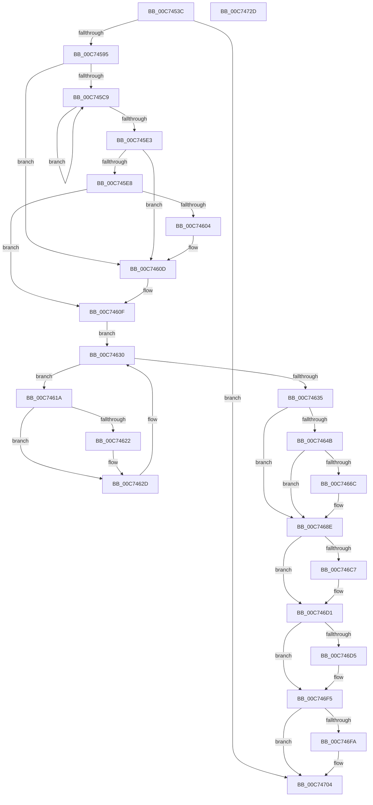

# VslRegisterBootDrivers

- RVA: `0x00C7453C`–`0x00C7472E` (길이 `498` bytes)
- VA: `0x0000000140C7453C`
- 실행 섹션: `INIT`
- PDB 이름 있음: `예`; PDB Function 태그: `아니요`
- unwind 정보 RVA: `0x000BC9F0`
- 디코드: `121`개 명령, `498/498` bytes 표시
- 미해석 바이트: `0` (있으면 어셈블리에 `.byte`로 보존)

> 이 문서는 커널 이미지의 기계어와 PDB 기호를 분석해 생성했습니다. 4번과 5번은 함수 원형과 자료형을 바이너리 사용 방식에서 추정한 C 해석이며 원본 소스 복구 결과는 아닙니다.

## 1. Dependencies

- 직접 호출 지점: **14**; 고유 호출 대상: **12**
- 직접 호출자로 확인된 함수: **1**
- RIP 상대 이미지 참조: **4**

### Outgoing calls
- `0x00C74572` → [memset](../../text/6C/memset_function_006C6C40.md) (function, `0x006C6C40`)
- `0x00C74582` → [memset](../../text/6C/memset_function_006C6C40.md) (function, `0x006C6C40`)
- `0x00C745AF` → [ExAcquireResourceSharedLite](../../text/21/ExAcquireResourceSharedLite_function_00211BC0.md) (function, `0x00211BC0`)
- `0x00C745F7` → [ExAllocatePool2](../../poolcode/B8/ExAllocatePool2_function_00B820F0.md) (function, `0x00B820F0`)
- `0x00C74607` → [KeBugCheck](../../text/4F/KeBugCheck_function_004FD640.md) (function, `0x004FD640`)
- `0x00C7463C` → [ExReleaseResourceLite](../../text/25/ExReleaseResourceLite_function_0025FA10.md) (function, `0x0025FA10`)
- `0x00C74641` → [KeLeaveCriticalRegion](../../text/25/KeLeaveCriticalRegion_function_0025D8B0.md) (function, `0x0025D8B0`)
- `0x00C74663` → [VslpLockPagesForTransfer](../../text/29/VslpLockPagesForTransfer_function_0029E0FC.md) (function, `0x0029E0FC`)
- `0x00C74688` → [KeBugCheckEx](../../text/4F/KeBugCheckEx_function_004FD660.md) (function, `0x004FD660`)
- `0x00C746BA` → [VslpEnterIumSecureMode](../../text/23/VslpEnterIumSecureMode_function_00235E50.md) (function, `0x00235E50`)
- `0x00C746CC` → [VslpUnlockPagesForTransfer](../../text/29/VslpUnlockPagesForTransfer_function_0029EE4C.md) (function, `0x0029EE4C`)
- `0x00C746EF` → [KeBugCheckEx](../../text/4F/KeBugCheckEx_function_004FD660.md) (function, `0x004FD660`)
- `0x00C746FF` → [ExFreePoolWithTag](../../poolcode/B8/ExFreePoolWithTag_function_00B82870.md) (function, `0x00B82870`)
- `0x00C7470F` → [_security_check_cookie](../../text/6A/_security_check_cookie_function_006AC640.md) (function, `0x006AC640`)

### Direct callers
- [PipInitializeCoreDriversAndElam](PipInitializeCoreDriversAndElam_function_00C73F84.md) at `0x00C7405E`

### Static image references
- `0x00C74553` → RVA `0x00E0A740` (`.data`; read)
- `0x00C74587` → RVA `0x01201860` (`CFGRO`; read)
- `0x00C7459E` → RVA `0x00EF54E0` (`.data`; read)
- `0x00C745B4` → RVA `0x00EF54C0` (`.data`; read)

## 2. Other-region calls and transfers

- 다른 실행 섹션으로 향하는 call: **14**
  - `0x00C74572` → [memset](../../text/6C/memset_function_006C6C40.md) (`INIT` → `.text`)
  - `0x00C74582` → [memset](../../text/6C/memset_function_006C6C40.md) (`INIT` → `.text`)
  - `0x00C745AF` → [ExAcquireResourceSharedLite](../../text/21/ExAcquireResourceSharedLite_function_00211BC0.md) (`INIT` → `.text`)
  - `0x00C745F7` → [ExAllocatePool2](../../poolcode/B8/ExAllocatePool2_function_00B820F0.md) (`INIT` → `POOLCODE`)
  - `0x00C74607` → [KeBugCheck](../../text/4F/KeBugCheck_function_004FD640.md) (`INIT` → `.text`)
  - `0x00C7463C` → [ExReleaseResourceLite](../../text/25/ExReleaseResourceLite_function_0025FA10.md) (`INIT` → `.text`)
  - `0x00C74641` → [KeLeaveCriticalRegion](../../text/25/KeLeaveCriticalRegion_function_0025D8B0.md) (`INIT` → `.text`)
  - `0x00C74663` → [VslpLockPagesForTransfer](../../text/29/VslpLockPagesForTransfer_function_0029E0FC.md) (`INIT` → `.text`)
  - `0x00C74688` → [KeBugCheckEx](../../text/4F/KeBugCheckEx_function_004FD660.md) (`INIT` → `.text`)
  - `0x00C746BA` → [VslpEnterIumSecureMode](../../text/23/VslpEnterIumSecureMode_function_00235E50.md) (`INIT` → `.text`)
  - `0x00C746CC` → [VslpUnlockPagesForTransfer](../../text/29/VslpUnlockPagesForTransfer_function_0029EE4C.md) (`INIT` → `.text`)
  - `0x00C746EF` → [KeBugCheckEx](../../text/4F/KeBugCheckEx_function_004FD660.md) (`INIT` → `.text`)
  - `0x00C746FF` → [ExFreePoolWithTag](../../poolcode/B8/ExFreePoolWithTag_function_00B82870.md) (`INIT` → `POOLCODE`)
  - `0x00C7470F` → [_security_check_cookie](../../text/6A/_security_check_cookie_function_006AC640.md) (`INIT` → `.text`)
- 별도 외부 분기/꼬리 이동을 확인하지 못했습니다.

## 3. Assembly (complete function range)

```asm
00C7453C  4C 8B DC                        mov r11, rsp
00C7453F  49 89 5B 08                     mov qword ptr [r11 + 8], rbx
00C74543  49 89 6B 10                     mov qword ptr [r11 + 0x10], rbp
00C74547  49 89 73 18                     mov qword ptr [r11 + 0x18], rsi
00C7454B  57                              push rdi
00C7454C  48 81 EC 00 01 00 00            sub rsp, 0x100
00C74553  48 8B 05 E6 61 19 00            mov rax, qword ptr [rip + 0x1961e6]
00C7455A  48 33 C4                        xor rax, rsp
00C7455D  48 89 84 24 F0 00 00 00         mov qword ptr [rsp + 0xf0], rax
00C74565  33 D2                           xor edx, edx
00C74567  49 8D 8B 78 FF FF FF            lea rcx, [r11 - 0x88]
00C7456E  44 8D 42 68                     lea r8d, [rdx + 0x68]
00C74572  E8 C9 26 A5 FF                  call 0x1406c6c40
00C74577  33 D2                           xor edx, edx
00C74579  48 8D 4C 24 30                  lea rcx, [rsp + 0x30]
00C7457E  44 8D 42 48                     lea r8d, [rdx + 0x48]
00C74582  E8 B9 26 A5 FF                  call 0x1406c6c40
00C74587  48 83 3D D1 D2 58 00 00         cmp qword ptr [rip + 0x58d2d1], 0
00C7458F  0F 84 6F 01 00 00               je 0x140c74704
00C74595  65 48 8B 04 25 88 01 00 00      mov rax, qword ptr gs:[0x188]
00C7459E  48 8D 0D 3B 0F 28 00            lea rcx, [rip + 0x280f3b]
00C745A5  B2 01                           mov dl, 1
00C745A7  66 FF 88 E4 01 00 00            dec word ptr [rax + 0x1e4]
00C745AE  90                              nop
00C745AF  E8 0C D6 59 FF                  call 0x140211bc0
00C745B4  4C 8B 05 05 0F 28 00            mov r8, qword ptr [rip + 0x280f05]
00C745BB  48 8D 35 FE 0E 28 00            lea rsi, [rip + 0x280efe]
00C745C2  33 D2                           xor edx, edx
00C745C4  4C 3B C6                        cmp r8, rsi
00C745C7  74 44                           je 0x140c7460d
00C745C9  66 41 0F BA 60 6E 08            bt word ptr [r8 + 0x6e], 8
00C745D0  48 8B CA                        mov rcx, rdx
00C745D3  4D 8B 00                        mov r8, qword ptr [r8]
00C745D6  48 8D 52 01                     lea rdx, [rdx + 1]
00C745DA  48 0F 43 D1                     cmovae rdx, rcx
00C745DE  4C 3B C6                        cmp r8, rsi
00C745E1  75 E6                           jne 0x140c745c9
00C745E3  48 85 D2                        test rdx, rdx
00C745E6  74 25                           je 0x140c7460d
00C745E8  48 C1 E2 03                     shl rdx, 3
00C745EC  B9 40 00 00 00                  mov ecx, 0x40
00C745F1  41 B8 53 6B 42 65               mov r8d, 0x65426b53
00C745F7  E8 F4 DA F0 FF                  call 0x140b820f0
00C745FC  48 8B D8                        mov rbx, rax
00C745FF  48 85 C0                        test rax, rax
00C74602  75 0B                           jne 0x140c7460f
00C74604  8D 48 7D                        lea ecx, [rax + 0x7d]
00C74607  E8 34 90 88 FF                  call 0x1404fd640
00C7460C  CC                              int3
00C7460D  33 DB                           xor ebx, ebx
00C7460F  48 8B 15 AA 0E 28 00            mov rdx, qword ptr [rip + 0x280eaa]
00C74616  33 FF                           xor edi, edi
00C74618  EB 16                           jmp 0x140c74630
00C7461A  66 0F BA 62 6E 08               bt word ptr [rdx + 0x6e], 8
00C74620  73 0B                           jae 0x140c7462d
00C74622  48 8B 42 30                     mov rax, qword ptr [rdx + 0x30]
00C74626  48 89 04 FB                     mov qword ptr [rbx + rdi*8], rax
00C7462A  48 FF C7                        inc rdi
00C7462D  48 8B 12                        mov rdx, qword ptr [rdx]
00C74630  48 3B D6                        cmp rdx, rsi
00C74633  75 E5                           jne 0x140c7461a
00C74635  48 8D 0D A4 0E 28 00            lea rcx, [rip + 0x280ea4]
00C7463C  E8 CF B3 5E FF                  call 0x14025fa10
00C74641  E8 6A 92 5E FF                  call 0x14025d8b0
00C74646  48 85 FF                        test rdi, rdi
00C74649  74 43                           je 0x140c7468e
00C7464B  83 64 24 20 00                  and dword ptr [rsp + 0x20], 0
00C74650  44 8D 04 FD 00 00 00 00         lea r8d, [rdi*8]
00C74658  45 33 C9                        xor r9d, r9d
00C7465B  48 8D 4C 24 30                  lea rcx, [rsp + 0x30]
00C74660  48 8B D3                        mov rdx, rbx
00C74663  E8 94 9A 62 FF                  call 0x14029e0fc
00C74668  85 C0                           test eax, eax
00C7466A  79 22                           jns 0x140c7468e
00C7466C  48 98                           cdqe
00C7466E  4C 8D 0C FD 00 00 00 00         lea r9, [rdi*8]
00C74676  4C 8B C3                        mov r8, rbx
00C74679  48 89 44 24 20                  mov qword ptr [rsp + 0x20], rax
00C7467E  BA FC FF FF FF                  mov edx, 0xfffffffc
00C74683  B9 3D 01 00 00                  mov ecx, 0x13d
00C74688  E8 D3 8F 88 FF                  call 0x1404fd660
00C7468D  CC                              int3
00C7468E  48 8B 44 24 30                  mov rax, qword ptr [rsp + 0x30]
00C74693  4C 8D 8C 24 80 00 00 00         lea r9, [rsp + 0x80]
00C7469B  48 89 84 24 88 00 00 00         mov qword ptr [rsp + 0x88], rax
00C746A3  BA 39 00 00 00                  mov edx, 0x39
00C746A8  48 8B 44 24 68                  mov rax, qword ptr [rsp + 0x68]
00C746AD  45 33 C0                        xor r8d, r8d
00C746B0  B1 02                           mov cl, 2
00C746B2  48 89 84 24 90 00 00 00         mov qword ptr [rsp + 0x90], rax
00C746BA  E8 91 17 5C FF                  call 0x140235e50
00C746BF  48 63 F0                        movsxd rsi, eax
00C746C2  48 85 FF                        test rdi, rdi
00C746C5  74 0A                           je 0x140c746d1
00C746C7  48 8D 4C 24 30                  lea rcx, [rsp + 0x30]
00C746CC  E8 7B A7 62 FF                  call 0x14029ee4c
00C746D1  85 F6                           test esi, esi
00C746D3  79 20                           jns 0x140c746f5
00C746D5  4C 8D 0C FD 00 00 00 00         lea r9, [rdi*8]
00C746DD  48 89 74 24 20                  mov qword ptr [rsp + 0x20], rsi
00C746E2  4C 8B C3                        mov r8, rbx
00C746E5  BA FB FF FF FF                  mov edx, 0xfffffffb
00C746EA  B9 3D 01 00 00                  mov ecx, 0x13d
00C746EF  E8 6C 8F 88 FF                  call 0x1404fd660
00C746F4  CC                              int3
00C746F5  48 85 DB                        test rbx, rbx
00C746F8  74 0A                           je 0x140c74704
00C746FA  33 D2                           xor edx, edx
00C746FC  48 8B CB                        mov rcx, rbx
00C746FF  E8 6C E1 F0 FF                  call 0x140b82870
00C74704  48 8B 8C 24 F0 00 00 00         mov rcx, qword ptr [rsp + 0xf0]
00C7470C  48 33 CC                        xor rcx, rsp
00C7470F  E8 2C 7F A3 FF                  call 0x1406ac640
00C74714  4C 8D 9C 24 00 01 00 00         lea r11, [rsp + 0x100]
00C7471C  49 8B 5B 10                     mov rbx, qword ptr [r11 + 0x10]
00C74720  49 8B 6B 18                     mov rbp, qword ptr [r11 + 0x18]
00C74724  49 8B 73 20                     mov rsi, qword ptr [r11 + 0x20]
00C74728  49 8B E3                        mov rsp, r11
00C7472B  5F                              pop rdi
00C7472C  C3                              ret
00C7472D  CC                              int3
```

## 4. C-style interpretation (structured pseudocode)

```c
__int64 __fastcall VslRegisterBootDrivers(__int64 a1, int a2, __int64 a3, int a4)
{
    __int64 result;
    __int64 v_rbx;
    __int64 v_rdi;
    __int64 v_rsp;
    unsigned __int64 v_stack_m18;
    unsigned __int64 v_stack_m78;
    unsigned __int64 v_stack_m8;
    unsigned __int64 v_stack_m80;
    unsigned __int64 v_stack_m88;
    unsigned __int64 v_stack_mA0;
    unsigned __int64 v_stack_mD8;
    unsigned int v_stack_mE8;

    *(unsigned __int64 *)(v_rsp + 8) = v_rbx;
    *(unsigned __int64 *)(v_rsp + 16) = v_rbp;
    *(unsigned __int64 *)(v_rsp + 24) = v_rsi;
    v_rsp = (v_rsp) - (256);
    result = (*(unsigned __int64 *)(v_rip + 1663462)) ^ (v_rsp);
    v_stack_m18 = result;
    a2 = 0;
    result = memset(v_rsp - 136, a2, a2 + 104, a4);
    a2 = 0;
    result = memset(v_stack_mD8, a2, a2 + 72, a4);
    if ((*(unsigned __int64 *)(v_rip + 5821137)) == 0) goto loc_00C74704;
    result = ExAcquireResourceSharedLite(v_rip + 2625339, 1, a2 + 72, a4);
    a2 = 0;
    if ((*(unsigned __int64 *)(v_rip + 2625285)) == (v_rip + 2625278)) goto loc_00C7460D;
loc_00C745C9:
    a2 = a2 + 1;
    if ((*(unsigned __int64 *)(v_rip + 2625285)) >= (v_rip + 2625278)) { a2 = 0; }
    if ((*(unsigned __int64 *)(*(unsigned __int64 *)(v_rip + 2625285))) != (v_rip + 2625278)) goto loc_00C745C9;
    if (a2 == 0) goto loc_00C7460D;
    a2 = (a2) << (3);
    result = ExAllocatePool2(64, a2, (unsigned int)(0x65426B53ULL), a4);
    if (result != 0) goto loc_00C7460F;
    result = KeBugCheck(result + 125, a2, (unsigned int)(0x65426B53ULL), a4);
loc_00C7460D:
    v_rbx = 0;
loc_00C7460F:
    v_rdi = 0;
    goto loc_00C74630;
loc_00C7461A:
    if (!(condition_is_above_or_equal)) {
        result = *(unsigned __int64 *)(*(unsigned __int64 *)(v_rip + 2625194) + 48);
        *(unsigned __int64 *)(v_rbx + v_rdi * 8) = result;
        v_rdi = (v_rdi) + 1;
    }
loc_00C74630:
    if ((*(unsigned __int64 *)(*(unsigned __int64 *)(v_rip + 2625194))) != (v_rip + 2625278)) goto loc_00C7461A;
    result = ExReleaseResourceLite(v_rip + 2625188, *(unsigned __int64 *)(*(unsigned __int64 *)(v_rip + 2625194)), (unsigned int)(0x65426B53ULL), a4);
    result = KeLeaveCriticalRegion(v_rip + 2625188, *(unsigned __int64 *)(*(unsigned __int64 *)(v_rip + 2625194)), (unsigned int)(0x65426B53ULL), a4);
    if (v_rdi == 0) goto loc_00C7468E;
    a4 = 0;
    result = VslpLockPagesForTransfer(v_stack_mD8, 0, v_rdi * 8, a4);
    if (sign_flag) {
        a4 = v_rdi * 8;
        a3 = 0;
        v_stack_mE8 = result;
        a2 = 0xFFFFFFFCULL;
        a1 = 317;
        result = KeBugCheckEx(a1, a2, a3, a4);
    }
    v_stack_m80 = v_stack_mD8;
    a3 = 0;
    v_stack_m78 = v_stack_mA0;
    result = VslpEnterIumSecureMode(2, 57, a3, v_stack_m88);
    if (v_rdi != 0) {
        a1 = v_stack_mD8;
        result = VslpUnlockPagesForTransfer(a1, 57, a3, v_stack_m88);
    }
    if (sign_flag) {
        a4 = v_rdi * 8;
        v_stack_mE8 = (int)((unsigned int)(result));
        a3 = 0;
        a2 = 0xFFFFFFFBULL;
        a1 = 317;
        result = KeBugCheckEx(a1, a2, a3, a4);
    }
    if (0 != 0) {
        a2 = 0;
        a1 = 0;
        result = ExFreePoolWithTag(a1, a2, a3, a4);
    }
    a1 = (v_stack_m18) ^ (v_rsp);
    result = _security_check_cookie(a1, a2, a3, a4);
    return result;
}
```

## 5. (Beta) C Style

```c
int64_t VslRegisterBootDrivers(int64_t Arg1, int32_t Arg2, int64_t Arg3, int32_t Arg4)
{
    int64_t result;
    int64_t local_rbx;
    int64_t local_rdi;
    int64_t local_rsp;
    uint64_t v_stack_m18;
    uint64_t v_stack_m78;
    uint64_t v_stack_m8;
    uint64_t v_stack_m80;
    uint64_t v_stack_m88;
    uint64_t v_stack_mA0;
    uint64_t v_stack_mD8;
    uint32_t v_stack_mE8;

    *(uint64_t *)(local_rsp + 0x8) = local_rbx;
    *(uint64_t *)(local_rsp + 0x10) = local_rbp;
    *(uint64_t *)(local_rsp + 0x18) = local_rsi;
    local_rsp = (local_rsp) - (256);
    result = (*(uint64_t *)(v_rip + 0x1961E6)) ^ (local_rsp);
    v_stack_m18 = result;
    Arg2 = 0;
    result = memset(local_rsp - 136, Arg2, Arg2 + 104, Arg4);
    Arg2 = 0;
    result = memset(v_stack_mD8, Arg2, Arg2 + 72, Arg4);
    if ((*(uint64_t *)(v_rip + 0x58D2D1)) == 0) goto loc_00C74704;
    result = ExAcquireResourceSharedLite(v_rip + 2625339, 1, Arg2 + 72, Arg4);
    Arg2 = 0;
    if ((*(uint64_t *)(v_rip + 0x280F05)) == (v_rip + 2625278)) goto loc_00C7460D;
loc_00C745C9:
    Arg2 = Arg2 + 1;
    if ((*(uint64_t *)(v_rip + 0x280F05)) >= (v_rip + 2625278)) { Arg2 = 0; }
    if ((*(uint64_t *)(*(uint64_t *)(v_rip + 0x280F05))) != (v_rip + 2625278)) goto loc_00C745C9;
    if (Arg2 == 0) goto loc_00C7460D;
    Arg2 = (Arg2) << (3);
    result = ExAllocatePool2(64, Arg2, (uint32_t)(0x65426B53ULL), Arg4);
    if (result != 0) goto loc_00C7460F;
    result = KeBugCheck(result + 125, Arg2, (uint32_t)(0x65426B53ULL), Arg4);
loc_00C7460D:
    local_rbx = 0;
loc_00C7460F:
    local_rdi = 0;
    goto loc_00C74630;
loc_00C7461A:
    if (!(condition_is_above_or_equal)) {
        result = *(uint64_t *)(*(uint64_t *)(v_rip + 0x280EAA) + 0x30);
        *(uint64_t *)(local_rbx + local_rdi * 8) = result;
        local_rdi = (local_rdi) + 1;
    }
loc_00C74630:
    if ((*(uint64_t *)(*(uint64_t *)(v_rip + 0x280EAA))) != (v_rip + 2625278)) goto loc_00C7461A;
    result = ExReleaseResourceLite(v_rip + 2625188, *(uint64_t *)(*(uint64_t *)(v_rip + 0x280EAA)), (uint32_t)(0x65426B53ULL), Arg4);
    result = KeLeaveCriticalRegion(v_rip + 2625188, *(uint64_t *)(*(uint64_t *)(v_rip + 0x280EAA)), (uint32_t)(0x65426B53ULL), Arg4);
    if (local_rdi == 0) goto loc_00C7468E;
    Arg4 = 0;
    result = VslpLockPagesForTransfer(v_stack_mD8, 0, local_rdi * 8, Arg4);
    if (sign_flag) {
        Arg4 = local_rdi * 8;
        Arg3 = 0;
        v_stack_mE8 = result;
        Arg2 = 0xFFFFFFFCULL;
        Arg1 = 317;
        result = KeBugCheckEx(Arg1, Arg2, Arg3, Arg4);
    }
    v_stack_m80 = v_stack_mD8;
    Arg3 = 0;
    v_stack_m78 = v_stack_mA0;
    result = VslpEnterIumSecureMode(2, 57, Arg3, v_stack_m88);
    if (local_rdi != 0) {
        Arg1 = v_stack_mD8;
        result = VslpUnlockPagesForTransfer(Arg1, 57, Arg3, v_stack_m88);
    }
    if (sign_flag) {
        Arg4 = local_rdi * 8;
        v_stack_mE8 = (int32_t)((uint32_t)(result));
        Arg3 = 0;
        Arg2 = 0xFFFFFFFBULL;
        Arg1 = 317;
        result = KeBugCheckEx(Arg1, Arg2, Arg3, Arg4);
    }
    if (0 != 0) {
        Arg2 = 0;
        Arg1 = 0;
        result = ExFreePoolWithTag(Arg1, Arg2, Arg3, Arg4);
    }
    Arg1 = (v_stack_m18) ^ (local_rsp);
    result = _security_check_cookie(Arg1, Arg2, Arg3, Arg4);
    return result;
}
```

## 6. Execution-region graph

[열기: 2D/3D 그래프와 함수 탐색 컨트롤 패널](../../../control-panel.html?section=init&rva=0x00C7453C&view=graph)

- 2D 그래프는 위에서 아래로 흐르고, 3D 그래프는 빈 공간을 드래그해 회전합니다. Shift+드래그는 이동, 휠은 확대·축소, 함수 노드 선택은 대상 보고서 이동입니다.

### Static fallback


