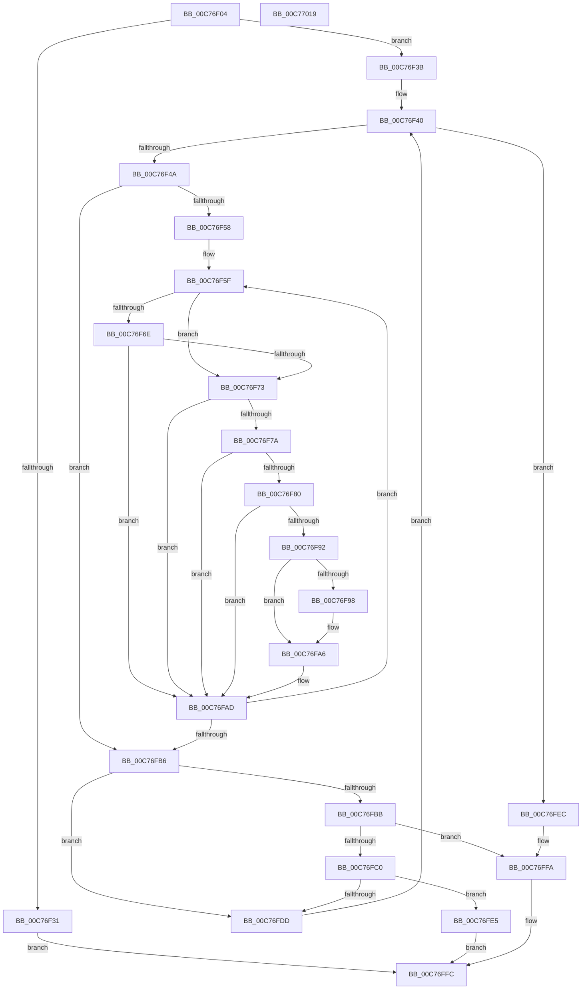

# VslpRecordBootRanges

- RVA: `0x00C76F04`–`0x00C7701A` (길이 `278` bytes)
- VA: `0x0000000140C76F04`
- 실행 섹션: `INIT`
- PDB 이름 있음: `예`; PDB Function 태그: `아니요`
- unwind 정보 RVA: `0x000BCF54`
- 디코드: `83`개 명령, `278/278` bytes 표시
- 미해석 바이트: `0` (있으면 어셈블리에 `.byte`로 보존)

> 이 문서는 커널 이미지의 기계어와 PDB 기호를 분석해 생성했습니다. 4번과 5번은 함수 원형과 자료형을 바이너리 사용 방식에서 추정한 C 해석이며 원본 소스 복구 결과는 아닙니다.

## 1. Dependencies

- 직접 호출 지점: **2**; 고유 호출 대상: **2**
- 직접 호출자로 확인된 함수: **1**
- RIP 상대 이미지 참조: **3**

### Outgoing calls
- `0x00C76F88` → [RtlPcToFileHeader](../../text/2F/RtlPcToFileHeader_function_002F1C50.md) (function, `0x002F1C50`)
- `0x00C76FD0` → [ExAllocatePool2](../../poolcode/B8/ExAllocatePool2_function_00B820F0.md) (function, `0x00B820F0`)

### Direct callers
- [VslConnectSwInterrupt](VslConnectSwInterrupt_function_00C75C70.md) at `0x00C75CF2`

### Static image references
- `0x00C76F25` → RVA `0x00F8EC38` (`.data`; read)
- `0x00C76FEC` → RVA `0x00F8EC38` (`.data`; write)
- `0x00C76FF3` → RVA `0x00F8EC40` (`.data`; write)

## 2. Other-region calls and transfers

- 다른 실행 섹션으로 향하는 call: **2**
  - `0x00C76F88` → [RtlPcToFileHeader](../../text/2F/RtlPcToFileHeader_function_002F1C50.md) (`INIT` → `.text`)
  - `0x00C76FD0` → [ExAllocatePool2](../../poolcode/B8/ExAllocatePool2_function_00B820F0.md) (`INIT` → `POOLCODE`)
- 별도 외부 분기/꼬리 이동을 확인하지 못했습니다.

## 3. Assembly (complete function range)

```asm
00C76F04  48 89 5C 24 08                  mov qword ptr [rsp + 8], rbx
00C76F09  48 89 6C 24 10                  mov qword ptr [rsp + 0x10], rbp
00C76F0E  48 89 74 24 20                  mov qword ptr [rsp + 0x20], rsi
00C76F13  57                              push rdi
00C76F14  41 54                           push r12
00C76F16  41 55                           push r13
00C76F18  41 56                           push r14
00C76F1A  41 57                           push r15
00C76F1C  48 83 EC 20                     sub rsp, 0x20
00C76F20  33 DB                           xor ebx, ebx
00C76F22  4C 8B E2                        mov r12, rdx
00C76F25  48 39 1D 0C 7D 31 00            cmp qword ptr [rip + 0x317d0c], rbx
00C76F2C  4C 8B E9                        mov r13, rcx
00C76F2F  74 0A                           je 0x140c76f3b
00C76F31  B8 89 01 00 C0                  mov eax, 0xc0000189
00C76F36  E9 C1 00 00 00                  jmp 0x140c76ffc
00C76F3B  45 33 F6                        xor r14d, r14d
00C76F3E  33 F6                           xor esi, esi
00C76F40  48 83 FE 02                     cmp rsi, 2
00C76F44  0F 83 A2 00 00 00               jae 0x140c76fec
00C76F4A  49 8B EC                        mov rbp, r12
00C76F4D  33 DB                           xor ebx, ebx
00C76F4F  48 C1 ED 06                     shr rbp, 6
00C76F53  48 85 ED                        test rbp, rbp
00C76F56  74 5E                           je 0x140c76fb6
00C76F58  49 8D 7D 08                     lea rdi, [r13 + 8]
00C76F5C  4D 8B FE                        mov r15, r14
00C76F5F  0F B7 4F 10                     movzx ecx, word ptr [rdi + 0x10]
00C76F63  48 FF CD                        dec rbp
00C76F66  81 E9 01 10 00 00               sub ecx, 0x1001
00C76F6C  74 05                           je 0x140c76f73
00C76F6E  83 F9 08                        cmp ecx, 8
00C76F71  75 3A                           jne 0x140c76fad
00C76F73  48 83 7F 08 00                  cmp qword ptr [rdi + 8], 0
00C76F78  74 33                           je 0x140c76fad
00C76F7A  F6 47 12 01                     test byte ptr [rdi + 0x12], 1
00C76F7E  75 2D                           jne 0x140c76fad
00C76F80  48 8B 0F                        mov rcx, qword ptr [rdi]
00C76F83  48 8D 54 24 60                  lea rdx, [rsp + 0x60]
00C76F88  E8 C3 AC 67 FF                  call 0x1402f1c50
00C76F8D  48 85 C0                        test rax, rax
00C76F90  75 1B                           jne 0x140c76fad
00C76F92  48 83 FE 01                     cmp rsi, 1
00C76F96  75 0E                           jne 0x140c76fa6
00C76F98  48 8B 07                        mov rax, qword ptr [rdi]
00C76F9B  49 89 07                        mov qword ptr [r15], rax
00C76F9E  48 8B 47 08                     mov rax, qword ptr [rdi + 8]
00C76FA2  49 89 47 08                     mov qword ptr [r15 + 8], rax
00C76FA6  48 FF C3                        inc rbx
00C76FA9  49 83 C7 10                     add r15, 0x10
00C76FAD  48 83 C7 40                     add rdi, 0x40
00C76FB1  48 85 ED                        test rbp, rbp
00C76FB4  75 A9                           jne 0x140c76f5f
00C76FB6  48 85 F6                        test rsi, rsi
00C76FB9  75 22                           jne 0x140c76fdd
00C76FBB  48 85 DB                        test rbx, rbx
00C76FBE  74 3A                           je 0x140c76ffa
00C76FC0  48 8B D3                        mov rdx, rbx
00C76FC3  8D 4E 40                        lea ecx, [rsi + 0x40]
00C76FC6  48 C1 E2 04                     shl rdx, 4
00C76FCA  41 B8 56 73 6C 52               mov r8d, 0x526c7356
00C76FD0  E8 1B B1 F0 FF                  call 0x140b820f0
00C76FD5  4C 8B F0                        mov r14, rax
00C76FD8  48 85 C0                        test rax, rax
00C76FDB  74 08                           je 0x140c76fe5
00C76FDD  48 FF C6                        inc rsi
00C76FE0  E9 5B FF FF FF                  jmp 0x140c76f40
00C76FE5  B8 9A 00 00 C0                  mov eax, 0xc000009a
00C76FEA  EB 10                           jmp 0x140c76ffc
00C76FEC  4C 89 35 45 7C 31 00            mov qword ptr [rip + 0x317c45], r14
00C76FF3  48 89 1D 46 7C 31 00            mov qword ptr [rip + 0x317c46], rbx
00C76FFA  33 C0                           xor eax, eax
00C76FFC  48 8B 5C 24 50                  mov rbx, qword ptr [rsp + 0x50]
00C77001  48 8B 6C 24 58                  mov rbp, qword ptr [rsp + 0x58]
00C77006  48 8B 74 24 68                  mov rsi, qword ptr [rsp + 0x68]
00C7700B  48 83 C4 20                     add rsp, 0x20
00C7700F  41 5F                           pop r15
00C77011  41 5E                           pop r14
00C77013  41 5D                           pop r13
00C77015  41 5C                           pop r12
00C77017  5F                              pop rdi
00C77018  C3                              ret
00C77019  CC                              int3
```

## 4. C-style interpretation (structured pseudocode)

```c
__int64 __fastcall VslpRecordBootRanges(__int64 a1, __int64 a2)
{
    __int64 result;
    __int64 v_r14;
    __int64 v_r15;
    __int64 v_rbp;
    __int64 v_rbx;
    __int64 v_rdi;
    __int64 v_rsi;
    __int64 v_rsp;
    unsigned __int64 v_stack_p10;
    unsigned __int64 v_stack_p18;
    unsigned __int64 v_stack_p20;
    unsigned __int64 v_stack_p8;

    v_stack_p8 = v_rbx;
    v_stack_p10 = v_rbp;
    v_stack_p20 = v_rsi;
    v_rsp = (v_rsp) - (32);
    v_rbx = 0;
    if ((*(unsigned __int64 *)(v_rip + 3243276)) == 0) goto loc_00C76F3B;
    goto loc_00C76FFC;
loc_00C76F3B:
    v_r14 = 0;
    v_rsi = 0;
loc_00C76F40:
    if (0 >= 2) goto loc_00C76FEC;
    v_rbx = 0;
    v_rbp = (a2) >> (6);
    if (v_rbp == 0) goto loc_00C76FB6;
loc_00C76F5F:
    v_rbp = (v_rbp) - 1;
    a1 = (unsigned int)((*(unsigned __int16 *)(a1 + 8 + 16)) - (0x1001ULL));
    if (condition_is_equal) goto loc_00C76F73;
    if (((unsigned int)(a1)) != 8) goto loc_00C76FAD;
loc_00C76F73:
    if ((*(unsigned __int64 *)(a1 + 8 + 8)) == 0) goto loc_00C76FAD;
    if (((*(unsigned __int8 *)(a1 + 8 + 18)) & (1)) != 0) goto loc_00C76FAD;
    result = RtlPcToFileHeader(*(unsigned __int64 *)(a1 + 8), v_stack_p18, a3, a4);
    if (result != 0) goto loc_00C76FAD;
    if (0 == 1) {
        result = *(unsigned __int64 *)(a1 + 8);
        *(unsigned __int64 *)(0) = result;
        result = *(unsigned __int64 *)(a1 + 8 + 8);
        *(unsigned __int64 *)(0 + 8) = result;
    }
    v_rbx = (v_rbx) + 1;
    v_r15 = (0) + (16);
loc_00C76FAD:
    v_rdi = (a1 + 8) + (64);
    if (v_rbp != 0) goto loc_00C76F5F;
loc_00C76FB6:
    if (0 != 0) goto loc_00C76FDD;
    if (v_rbx == 0) goto loc_00C76FFA;
    a2 = (v_rbx) << (4);
    result = ExAllocatePool2(v_rsi + 64, a2, (unsigned int)(0x526C7356ULL), a4);
    if (result == 0) goto loc_00C76FE5;
loc_00C76FDD:
    v_rsi = (v_rsi) + 1;
    goto loc_00C76F40;
loc_00C76FE5:
    goto loc_00C76FFC;
loc_00C76FEC:
    *(unsigned __int64 *)(v_rip + 3243077) = result;
    *(unsigned __int64 *)(v_rip + 3243078) = v_rbx;
loc_00C76FFA:
    result = 0;
loc_00C76FFC:
    v_rsp = (v_rsp) + (32);
    return result;
}
```

## 5. (Beta) C Style

```c
int64_t VslpRecordBootRanges(void *Arg1, int64_t Arg2)
{
    uint8_t *arg1 = (uint8_t *)Arg1;

    int64_t result;
    int64_t local_r14;
    int64_t local_r15;
    int64_t local_rbp;
    int64_t local_rbx;
    int64_t local_rdi;
    int64_t local_rsi;
    int64_t local_rsp;
    uint64_t v_stack_p10;
    uint64_t v_stack_p18;
    uint64_t v_stack_p20;
    uint64_t v_stack_p8;

    v_stack_p8 = local_rbx;
    v_stack_p10 = local_rbp;
    v_stack_p20 = local_rsi;
    local_rsp = (local_rsp) - (32);
    local_rbx = 0;
    if ((*(uint64_t *)(v_rip + 0x317D0C)) == 0) goto loc_00C76F3B;
    goto loc_00C76FFC;
loc_00C76F3B:
    local_r14 = 0;
    local_rsi = 0;
loc_00C76F40:
    if (0 >= 2) goto loc_00C76FEC;
    local_rbx = 0;
    local_rbp = (Arg2) >> (6);
    if (local_rbp == 0) goto loc_00C76FB6;
loc_00C76F5F:
    local_rbp = (local_rbp) - 1;
    Arg1 = (uint32_t)((*(uint16_t *)(arg1 + 0x8 + 0x10)) - (0x1001ULL));
    if (condition_is_equal) goto loc_00C76F73;
    if (((uint32_t)(Arg1)) != 8) goto loc_00C76FAD;
loc_00C76F73:
    if ((*(uint64_t *)(arg1 + 0x8 + 0x8)) == 0) goto loc_00C76FAD;
    if (((*(uint8_t *)(arg1 + 0x8 + 0x12)) & (1)) != 0) goto loc_00C76FAD;
    result = RtlPcToFileHeader(*(uint64_t *)(arg1 + 0x8), v_stack_p18, a3, a4);
    if (result != 0) goto loc_00C76FAD;
    if (0 == 1) {
        result = *(uint64_t *)(arg1 + 0x8);
        *(uint64_t *)(0) = result;
        result = *(uint64_t *)(arg1 + 0x8 + 0x8);
        *(uint64_t *)(0 + 0x8) = result;
    }
    local_rbx = (local_rbx) + 1;
    local_r15 = (0) + (16);
loc_00C76FAD:
    local_rdi = (Arg1 + 8) + (64);
    if (local_rbp != 0) goto loc_00C76F5F;
loc_00C76FB6:
    if (0 != 0) goto loc_00C76FDD;
    if (local_rbx == 0) goto loc_00C76FFA;
    Arg2 = (local_rbx) << (4);
    result = ExAllocatePool2(local_rsi + 64, Arg2, (uint32_t)(0x526C7356ULL), a4);
    if (result == 0) goto loc_00C76FE5;
loc_00C76FDD:
    local_rsi = (local_rsi) + 1;
    goto loc_00C76F40;
loc_00C76FE5:
    goto loc_00C76FFC;
loc_00C76FEC:
    *(uint64_t *)(v_rip + 0x317C45) = result;
    *(uint64_t *)(v_rip + 0x317C46) = local_rbx;
loc_00C76FFA:
    result = 0;
loc_00C76FFC:
    local_rsp = (local_rsp) + (32);
    return result;
}
```

### 관측된 메모리 오프셋

구조체 형식이 확인되지 않은 접근은 인자 기준의 오프셋으로만 기록했습니다.

| 기준 인자 | 오프셋 표현 | 폭 (bit) | 접근 |
|---|---:|---:|---|
| `Arg1` | `+ 0x0` | `64` | `R` |
| `Arg1` | `+ 0x8` | `64` | `R` |
| `Arg1` | `+ 0x10` | `16` | `R` |
| `Arg1` | `+ 0x12` | `8` | `R` |

## 6. Execution-region graph

[열기: 2D/3D 그래프와 함수 탐색 컨트롤 패널](../../../control-panel.html?section=init&rva=0x00C76F04&view=graph)

- 2D 그래프는 위에서 아래로 흐르고, 3D 그래프는 빈 공간을 드래그해 회전합니다. Shift+드래그는 이동, 휠은 확대·축소, 함수 노드 선택은 대상 보고서 이동입니다.

### Static fallback


