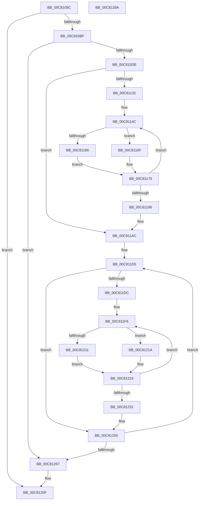

# BcpDisplayEarlyBugCheckScreen

- RVA: `0x00C8108C`–`0x00C8128B` (길이 `511` bytes)
- VA: `0x0000000140C8108C`
- 실행 섹션: `INIT`
- PDB 이름 있음: `예`; PDB Function 태그: `아니요`
- unwind 정보 RVA: `0x000A1FF8`
- 디코드: `144`개 명령, `511/511` bytes 표시
- 미해석 바이트: `0` (있으면 어셈블리에 `.byte`로 보존)

> 이 문서는 커널 이미지의 기계어와 PDB 기호를 분석해 생성했습니다. 4번과 5번은 함수 원형과 자료형을 바이너리 사용 방식에서 추정한 C 해석이며 원본 소스 복구 결과는 아닙니다.

## 1. Dependencies

- 직접 호출 지점: **14**; 고유 호출 대상: **3**
- 직접 호출자로 확인된 함수: **2**
- RIP 상대 이미지 참조: **6**

### Outgoing calls
- `0x00C810AC` → [BgConsoleGetInterface](../../pagebgfx/BC/BgConsoleGetInterface_function_00BC09A0.md) (function, `0x00BC09A0`)
- `0x00C810D1` → `indirect target` (indirect, 간접 대상)
- `0x00C810E2` → `indirect target` (indirect, 간접 대상)
- `0x00C810F2` → `indirect target` (indirect, 간접 대상)
- `0x00C81102` → `indirect target` (indirect, 간접 대상)
- `0x00C81112` → `indirect target` (indirect, 간접 대상)
- `0x00C81122` → `indirect target` (indirect, 간접 대상)
- `0x00C81197` → `indirect target` (indirect, 간접 대상)
- `0x00C811A7` → `indirect target` (indirect, 간접 대상)
- `0x00C811B7` → `indirect target` (indirect, 간접 대상)
- `0x00C811C7` → `indirect target` (indirect, 간접 대상)
- `0x00C81240` → `indirect target` (indirect, 간접 대상)
- `0x00C81250` → `indirect target` (indirect, 간접 대상)
- `0x00C8126A` → [BgConsoleDestroyInterface](../../pagebgfx/BC/BgConsoleDestroyInterface_function_00BC0940.md) (function, `0x00BC0940`)

### Direct callers
- [BgpFwDisplayBugCheckScreen](../../text/6A/BgpFwDisplayBugCheckScreen_function_006A0FE8.md) at `0x006A102D`
- [BgpFwDisplayBugCheckScreenModernized](../../text/6A/BgpFwDisplayBugCheckScreenModernized_function_006A1338.md) at `0x006A138F`

### Static image references
- `0x00C810EB` → RVA `0x00C81D20` (` ?? ::NKKEPPGN::`string'`; read)
- `0x00C810FB` → RVA `0x00C81D60` (` ?? ::NKKEPPGN::`string'`; read)
- `0x00C8110B` → RVA `0x00C81DB0` (` ?? ::NKKEPPGN::`string'`; read)
- `0x00C8111B` → RVA `0x00C81DD0` (` ?? ::NKKEPPGN::`string'`; read)
- `0x00C811A0` → RVA `0x00C81DE0` (` ?? ::NKKEPPGN::`string'`; read)
- `0x00C811B0` → RVA `0x00C81DF0` (` ?? ::NKKEPPGN::`string'`; read)

## 2. Other-region calls and transfers

- 다른 실행 섹션으로 향하는 call: **2**
  - `0x00C810AC` → [BgConsoleGetInterface](../../pagebgfx/BC/BgConsoleGetInterface_function_00BC09A0.md) (`INIT` → `PAGEBGFX`)
  - `0x00C8126A` → [BgConsoleDestroyInterface](../../pagebgfx/BC/BgConsoleDestroyInterface_function_00BC0940.md) (`INIT` → `PAGEBGFX`)
- 별도 외부 분기/꼬리 이동을 확인하지 못했습니다.

## 3. Assembly (complete function range)

```asm
00C8108C  48 89 5C 24 08                  mov qword ptr [rsp + 8], rbx
00C81091  48 89 6C 24 10                  mov qword ptr [rsp + 0x10], rbp
00C81096  48 89 74 24 18                  mov qword ptr [rsp + 0x18], rsi
00C8109B  57                              push rdi
00C8109C  41 54                           push r12
00C8109E  41 56                           push r14
00C810A0  48 83 EC 20                     sub rsp, 0x20
00C810A4  49 8B F8                        mov rdi, r8
00C810A7  4C 8B F2                        mov r14, rdx
00C810AA  8B F1                           mov esi, ecx
00C810AC  E8 EF F8 F3 FF                  call 0x140bc09a0
00C810B1  33 ED                           xor ebp, ebp
00C810B3  48 8B D8                        mov rbx, rax
00C810B6  48 85 C0                        test rax, rax
00C810B9  0F 84 B0 01 00 00               je 0x140c8126f
00C810BF  48 8B 00                        mov rax, qword ptr [rax]
00C810C2  8D 4D 02                        lea ecx, [rbp + 2]
00C810C5  45 33 C9                        xor r9d, r9d
00C810C8  41 B8 00 00 00 FF               mov r8d, 0xff000000
00C810CE  83 CA FF                        or edx, 0xffffffff
00C810D1  FF D0                           call rax
00C810D3  0F 1F 00                        nop dword ptr [rax]
00C810D6  85 C0                           test eax, eax
00C810D8  0F 88 89 01 00 00               js 0x140c81267
00C810DE  48 8B 43 08                     mov rax, qword ptr [rbx + 8]
00C810E2  FF D0                           call rax
00C810E4  0F 1F 00                        nop dword ptr [rax]
00C810E7  48 8B 43 18                     mov rax, qword ptr [rbx + 0x18]
00C810EB  48 8D 0D 2E 0C 00 00            lea rcx, [rip + 0xc2e]
00C810F2  FF D0                           call rax
00C810F4  0F 1F 00                        nop dword ptr [rax]
00C810F7  48 8B 43 18                     mov rax, qword ptr [rbx + 0x18]
00C810FB  48 8D 0D 5E 0C 00 00            lea rcx, [rip + 0xc5e]
00C81102  FF D0                           call rax
00C81104  0F 1F 00                        nop dword ptr [rax]
00C81107  48 8B 43 18                     mov rax, qword ptr [rbx + 0x18]
00C8110B  48 8D 0D 9E 0C 00 00            lea rcx, [rip + 0xc9e]
00C81112  FF D0                           call rax
00C81114  0F 1F 00                        nop dword ptr [rax]
00C81117  48 8B 43 18                     mov rax, qword ptr [rbx + 0x18]
00C8111B  48 8D 0D AE 0C 00 00            lea rcx, [rip + 0xcae]
00C81122  FF D0                           call rax
00C81124  0F 1F 00                        nop dword ptr [rax]
00C81127  66 83 7F 12 16                  cmp word ptr [rdi + 0x12], 0x16
00C8112C  44 8D 65 30                     lea r12d, [rbp + 0x30]
00C81130  72 7A                           jb 0x140c811ac
00C81132  48 8B 47 18                     mov rax, qword ptr [rdi + 0x18]
00C81136  44 8D 45 02                     lea r8d, [rbp + 2]
00C8113A  44 8D 55 1C                     lea r10d, [rbp + 0x1c]
00C8113E  66 44 89 20                     mov word ptr [rax], r12w
00C81142  48 8B 47 18                     mov rax, qword ptr [rdi + 0x18]
00C81146  66 C7 40 02 78 00               mov word ptr [rax + 2], 0x78
00C8114C  48 8B 47 18                     mov rax, qword ptr [rdi + 0x18]
00C81150  41 8B CA                        mov ecx, r10d
00C81153  8B D6                           mov edx, esi
00C81155  D3 EA                           shr edx, cl
00C81157  41 8B C8                        mov ecx, r8d
00C8115A  80 E2 0F                        and dl, 0xf
00C8115D  4C 8D 0C 48                     lea r9, [rax + rcx*2]
00C81161  80 FA 0A                        cmp dl, 0xa
00C81164  73 09                           jae 0x140c8116f
00C81166  0F B6 C2                        movzx eax, dl
00C81169  66 41 03 C4                     add ax, r12w
00C8116D  EB 0A                           jmp 0x140c81179
00C8116F  80 EA 0A                        sub dl, 0xa
00C81172  0F B6 C2                        movzx eax, dl
00C81175  66 83 C0 41                     add ax, 0x41
00C81179  41 FF C0                        inc r8d
00C8117C  66 41 89 01                     mov word ptr [r9], ax
00C81180  41 83 EA 04                     sub r10d, 4
00C81184  79 C6                           jns 0x140c8114c
00C81186  48 8B 47 18                     mov rax, qword ptr [rdi + 0x18]
00C8118A  66 42 89 2C 40                  mov word ptr [rax + r8*2], bp
00C8118F  48 8B 43 18                     mov rax, qword ptr [rbx + 0x18]
00C81193  48 8B 4F 18                     mov rcx, qword ptr [rdi + 0x18]
00C81197  FF D0                           call rax
00C81199  0F 1F 00                        nop dword ptr [rax]
00C8119C  48 8B 43 18                     mov rax, qword ptr [rbx + 0x18]
00C811A0  48 8D 0D 39 0C 00 00            lea rcx, [rip + 0xc39]
00C811A7  FF D0                           call rax
00C811A9  0F 1F 00                        nop dword ptr [rax]
00C811AC  48 8B 43 18                     mov rax, qword ptr [rbx + 0x18]
00C811B0  48 8D 0D 39 0C 00 00            lea rcx, [rip + 0xc39]
00C811B7  FF D0                           call rax
00C811B9  0F 1F 00                        nop dword ptr [rax]
00C811BC  48 8B 43 18                     mov rax, qword ptr [rbx + 0x18]
00C811C0  48 8D 0D 19 0C 00 00            lea rcx, [rip + 0xc19]
00C811C7  FF D0                           call rax
00C811C9  0F 1F 00                        nop dword ptr [rax]
00C811CC  48 83 C7 28                     add rdi, 0x28
00C811D0  BE 04 00 00 00                  mov esi, 4
00C811D5  66 83 7F FA 26                  cmp word ptr [rdi - 6], 0x26
00C811DA  72 79                           jb 0x140c81255
00C811DC  48 8B 07                        mov rax, qword ptr [rdi]
00C811DF  41 B8 02 00 00 00               mov r8d, 2
00C811E5  66 44 89 20                     mov word ptr [rax], r12w
00C811E9  45 8D 48 3A                     lea r9d, [r8 + 0x3a]
00C811ED  48 8B 07                        mov rax, qword ptr [rdi]
00C811F0  66 C7 40 02 78 00               mov word ptr [rax + 2], 0x78
00C811F6  49 8B 16                        mov rdx, qword ptr [r14]
00C811F9  41 8B C9                        mov ecx, r9d
00C811FC  48 8B 07                        mov rax, qword ptr [rdi]
00C811FF  48 D3 EA                        shr rdx, cl
00C81202  41 8B C8                        mov ecx, r8d
00C81205  80 E2 0F                        and dl, 0xf
00C81208  4C 8D 14 48                     lea r10, [rax + rcx*2]
00C8120C  80 FA 0A                        cmp dl, 0xa
00C8120F  73 09                           jae 0x140c8121a
00C81211  0F B6 C2                        movzx eax, dl
00C81214  66 41 03 C4                     add ax, r12w
00C81218  EB 0A                           jmp 0x140c81224
00C8121A  80 EA 0A                        sub dl, 0xa
00C8121D  0F B6 C2                        movzx eax, dl
00C81220  66 83 C0 41                     add ax, 0x41
00C81224  41 FF C0                        inc r8d
00C81227  66 41 89 02                     mov word ptr [r10], ax
00C8122B  41 83 E9 04                     sub r9d, 4
00C8122F  79 C5                           jns 0x140c811f6
00C81231  48 8B 07                        mov rax, qword ptr [rdi]
00C81234  66 42 89 2C 40                  mov word ptr [rax + r8*2], bp
00C81239  48 8B 43 18                     mov rax, qword ptr [rbx + 0x18]
00C8123D  48 8B 0F                        mov rcx, qword ptr [rdi]
00C81240  FF D0                           call rax
00C81242  0F 1F 00                        nop dword ptr [rax]
00C81245  48 8B 43 18                     mov rax, qword ptr [rbx + 0x18]
00C81249  48 8D 0D 90 0B 00 00            lea rcx, [rip + 0xb90]
00C81250  FF D0                           call rax
00C81252  0F 1F 00                        nop dword ptr [rax]
00C81255  49 83 C6 08                     add r14, 8
00C81259  48 83 C7 10                     add rdi, 0x10
00C8125D  48 83 EE 01                     sub rsi, 1
00C81261  0F 85 6E FF FF FF               jne 0x140c811d5
00C81267  48 8B CB                        mov rcx, rbx
00C8126A  E8 D1 F6 F3 FF                  call 0x140bc0940
00C8126F  48 8B 5C 24 40                  mov rbx, qword ptr [rsp + 0x40]
00C81274  33 C0                           xor eax, eax
00C81276  48 8B 6C 24 48                  mov rbp, qword ptr [rsp + 0x48]
00C8127B  48 8B 74 24 50                  mov rsi, qword ptr [rsp + 0x50]
00C81280  48 83 C4 20                     add rsp, 0x20
00C81284  41 5E                           pop r14
00C81286  41 5C                           pop r12
00C81288  5F                              pop rdi
00C81289  C3                              ret
00C8128A  CC                              int3
```

## 4. C-style interpretation (structured pseudocode)

```c
__int64 __fastcall BcpDisplayEarlyBugCheckScreen(int a1, __int64 a2, __int64 a3, int a4)
{
    __int64 result;
    __int64 v_r10;
    __int64 v_r14;
    __int64 v_rbp;
    __int64 v_rdi;
    __int64 v_rsi;
    __int64 v_rsp;
    unsigned __int64 v_stack_p10;
    unsigned __int64 v_stack_p18;
    unsigned __int64 v_stack_p8;

    v_stack_p8 = v_rbx;
    v_stack_p10 = v_rbp;
    v_stack_p18 = v_rsi;
    v_rsp = (v_rsp) - (32);
    result = BgConsoleGetInterface(a1, a2, a3, a4);
    v_rbp = 0;
    if (result == 0) goto loc_00C8126F;
    a4 = 0;
    a2 = (unsigned int)((a2) | (0xFFFFFFFFULL));
    result = kernel_indirect_call(v_rbp + 2, a2, (unsigned int)(0xFF000000ULL), a4);
    if (sign_flag) goto loc_00C81267;
    result = kernel_indirect_call(v_rbp + 2, a2, (unsigned int)(0xFF000000ULL), a4);
    result = kernel_indirect_call(v_rip + 3118, a2, (unsigned int)(0xFF000000ULL), a4);
    result = kernel_indirect_call(v_rip + 3166, a2, (unsigned int)(0xFF000000ULL), a4);
    result = kernel_indirect_call(v_rip + 3230, a2, (unsigned int)(0xFF000000ULL), a4);
    result = kernel_indirect_call(v_rip + 3246, a2, (unsigned int)(0xFF000000ULL), a4);
    if ((*(unsigned __int16 *)(a3 + 18)) < 22) goto loc_00C811AC;
    *(unsigned __int16 *)(*(unsigned __int64 *)(a3 + 24)) = (unsigned __int16)(v_rbp + 48);
    *(unsigned __int16 *)(*(unsigned __int64 *)(a3 + 24) + 2) = 120;
loc_00C8114C:
    a2 = (unsigned int)(((unsigned int)((unsigned int)((unsigned int)(a1)))) >> ((unsigned __int8)((unsigned int)((unsigned int)(v_rbp + 28)))));
    a2 = (unsigned __int8)((a2) & (15));
    if (((unsigned __int8)(a2)) >= 10) goto loc_00C8116F;
    result = (unsigned __int16)(((unsigned __int8)(a2)) + ((unsigned __int16)(v_rbp + 48)));
    goto loc_00C81179;
loc_00C8116F:
    a2 = (unsigned __int8)((a2) - (10));
    result = (unsigned __int16)(((unsigned __int8)(a2)) + (65));
loc_00C81179:
    a3 = (unsigned int)((v_rbp + 2) + 1);
    *(unsigned __int16 *)(*(unsigned __int64 *)(a3 + 24) + (unsigned int)((unsigned int)(v_rbp + 2)) * 2) = (unsigned __int16)(result);
    v_r10 = (unsigned int)((v_rbp + 28) - (4));
    if (!sign_flag) goto loc_00C8114C;
    *(unsigned __int16 *)(*(unsigned __int64 *)(a3 + 24) + a3 * 2) = 0;
    result = kernel_indirect_call(*(unsigned __int64 *)(a3 + 24), a2, a3, *(unsigned __int64 *)(a3 + 24) + (unsigned int)((unsigned int)(v_rbp + 2)) * 2);
    result = kernel_indirect_call(v_rip + 3129, a2, a3, *(unsigned __int64 *)(a3 + 24) + (unsigned int)((unsigned int)(v_rbp + 2)) * 2);
loc_00C811AC:
    result = kernel_indirect_call(v_rip + 3129, a2, a3, *(unsigned __int64 *)(a3 + 24) + (unsigned int)((unsigned int)(v_rbp + 2)) * 2);
    result = kernel_indirect_call(v_rip + 3097, a2, a3, *(unsigned __int64 *)(a3 + 24) + (unsigned int)((unsigned int)(v_rbp + 2)) * 2);
    v_rdi = (a3) + (40);
loc_00C811D5:
    if ((*(unsigned __int16 *)(v_rdi - 6)) < 38) goto loc_00C81255;
    *(unsigned __int16 *)(*(unsigned __int64 *)(v_rdi)) = (unsigned __int16)(v_rbp + 48);
    *(unsigned __int16 *)(*(unsigned __int64 *)(v_rdi) + 2) = 120;
loc_00C811F6:
    a2 = (*(unsigned __int64 *)(a2)) >> ((unsigned __int8)((unsigned int)((unsigned int)(2 + 58))));
    a2 = (unsigned __int8)((a2) & (15));
    if (((unsigned __int8)(a2)) >= 10) goto loc_00C8121A;
    result = (unsigned __int16)(((unsigned __int8)(a2)) + ((unsigned __int16)(v_rbp + 48)));
    goto loc_00C81224;
loc_00C8121A:
    a2 = (unsigned __int8)((a2) - (10));
    result = (unsigned __int16)(((unsigned __int8)(a2)) + (65));
loc_00C81224:
    a3 = (unsigned int)((2) + 1);
    *(unsigned __int16 *)(*(unsigned __int64 *)(v_rdi) + 2 * 2) = (unsigned __int16)(result);
    a4 = (unsigned int)((2 + 58) - (4));
    if (!sign_flag) goto loc_00C811F6;
    *(unsigned __int16 *)(*(unsigned __int64 *)(v_rdi) + a3 * 2) = 0;
    result = kernel_indirect_call(*(unsigned __int64 *)(v_rdi), a2, a3, a4);
    result = kernel_indirect_call(v_rip + 2960, a2, a3, a4);
loc_00C81255:
    v_r14 = (a2) + (8);
    v_rdi = (v_rdi) + (16);
    v_rsi = (4) - (1);
    if (condition_is_not_equal) goto loc_00C811D5;
loc_00C81267:
    result = BgConsoleDestroyInterface(result, a2, a3, a4);
loc_00C8126F:
    result = 0;
    v_rsp = (v_rsp) + (32);
    return result;
}
```

## 5. (Beta) C Style

```c
int64_t BcpDisplayEarlyBugCheckScreen(int32_t Arg1, void *Arg2, void *Arg3, int32_t Arg4)
{
    uint8_t *arg2 = (uint8_t *)Arg2;
    uint8_t *arg3 = (uint8_t *)Arg3;

    int64_t result;
    int64_t local_r10;
    int64_t local_r14;
    int64_t local_rbp;
    int64_t local_rdi;
    int64_t local_rsi;
    int64_t local_rsp;
    uint64_t v_stack_p10;
    uint64_t v_stack_p18;
    uint64_t v_stack_p8;

    v_stack_p8 = local_rbx;
    v_stack_p10 = local_rbp;
    v_stack_p18 = local_rsi;
    local_rsp = (local_rsp) - (32);
    result = BgConsoleGetInterface(Arg1, Arg2, Arg3, Arg4);
    local_rbp = 0;
    if (result == 0) goto loc_00C8126F;
    Arg4 = 0;
    Arg2 = (uint32_t)((Arg2) | (0xFFFFFFFFULL));
    result = kernel_indirect_call(local_rbp + 2, Arg2, (uint32_t)(0xFF000000ULL), Arg4);
    if (sign_flag) goto loc_00C81267;
    result = kernel_indirect_call(local_rbp + 2, Arg2, (uint32_t)(0xFF000000ULL), Arg4);
    result = kernel_indirect_call(v_rip + 3118, Arg2, (uint32_t)(0xFF000000ULL), Arg4);
    result = kernel_indirect_call(v_rip + 3166, Arg2, (uint32_t)(0xFF000000ULL), Arg4);
    result = kernel_indirect_call(v_rip + 3230, Arg2, (uint32_t)(0xFF000000ULL), Arg4);
    result = kernel_indirect_call(v_rip + 3246, Arg2, (uint32_t)(0xFF000000ULL), Arg4);
    if ((*(uint16_t *)(arg3 + 0x12)) < 22) goto loc_00C811AC;
    *(uint16_t *)(*(uint64_t *)(arg3 + 0x18)) = (uint16_t)(local_rbp + 48);
    *(uint16_t *)(*(uint64_t *)(arg3 + 0x18) + 0x2) = 120;
loc_00C8114C:
    Arg2 = (uint32_t)(((uint32_t)((uint32_t)((uint32_t)(Arg1)))) >> ((uint8_t)((uint32_t)((uint32_t)(local_rbp + 28)))));
    Arg2 = (uint8_t)((Arg2) & (15));
    if (((uint8_t)(Arg2)) >= 10) goto loc_00C8116F;
    result = (uint16_t)(((uint8_t)(Arg2)) + ((uint16_t)(local_rbp + 48)));
    goto loc_00C81179;
loc_00C8116F:
    Arg2 = (uint8_t)((Arg2) - (10));
    result = (uint16_t)(((uint8_t)(Arg2)) + (65));
loc_00C81179:
    Arg3 = (uint32_t)((local_rbp + 2) + 1);
    *(uint16_t *)(*(uint64_t *)(arg3 + 0x18) + (uint32_t)((uint32_t)(local_rbp + 0x2)) * 2) = (uint16_t)(result);
    local_r10 = (uint32_t)((local_rbp + 28) - (4));
    if (!sign_flag) goto loc_00C8114C;
    *(uint16_t *)(*(uint64_t *)(arg3 + 0x18) + arg3 * 2) = 0;
    result = kernel_indirect_call(*(uint64_t *)(arg3 + 0x18), Arg2, Arg3, *(uint64_t *)(arg3 + 0x18) + (uint32_t)((uint32_t)(local_rbp + 2)) * 2);
    result = kernel_indirect_call(v_rip + 3129, Arg2, Arg3, *(uint64_t *)(arg3 + 0x18) + (uint32_t)((uint32_t)(local_rbp + 2)) * 2);
loc_00C811AC:
    result = kernel_indirect_call(v_rip + 3129, Arg2, Arg3, *(uint64_t *)(arg3 + 0x18) + (uint32_t)((uint32_t)(local_rbp + 2)) * 2);
    result = kernel_indirect_call(v_rip + 3097, Arg2, Arg3, *(uint64_t *)(arg3 + 0x18) + (uint32_t)((uint32_t)(local_rbp + 2)) * 2);
    local_rdi = (Arg3) + (40);
loc_00C811D5:
    if ((*(uint16_t *)(local_rdi - 0x6)) < 38) goto loc_00C81255;
    *(uint16_t *)(*(uint64_t *)(local_rdi)) = (uint16_t)(local_rbp + 48);
    *(uint16_t *)(*(uint64_t *)(local_rdi) + 0x2) = 120;
loc_00C811F6:
    Arg2 = (*(uint64_t *)(arg2)) >> ((uint8_t)((uint32_t)((uint32_t)(2 + 58))));
    Arg2 = (uint8_t)((Arg2) & (15));
    if (((uint8_t)(Arg2)) >= 10) goto loc_00C8121A;
    result = (uint16_t)(((uint8_t)(Arg2)) + ((uint16_t)(local_rbp + 48)));
    goto loc_00C81224;
loc_00C8121A:
    Arg2 = (uint8_t)((Arg2) - (10));
    result = (uint16_t)(((uint8_t)(Arg2)) + (65));
loc_00C81224:
    Arg3 = (uint32_t)((2) + 1);
    *(uint16_t *)(*(uint64_t *)(local_rdi) + 0x2 * 2) = (uint16_t)(result);
    Arg4 = (uint32_t)((2 + 58) - (4));
    if (!sign_flag) goto loc_00C811F6;
    *(uint16_t *)(*(uint64_t *)(local_rdi) + arg3 * 2) = 0;
    result = kernel_indirect_call(*(uint64_t *)(local_rdi), Arg2, Arg3, Arg4);
    result = kernel_indirect_call(v_rip + 2960, Arg2, Arg3, Arg4);
loc_00C81255:
    local_r14 = (Arg2) + (8);
    local_rdi = (local_rdi) + (16);
    local_rsi = (4) - (1);
    if (condition_is_not_equal) goto loc_00C811D5;
loc_00C81267:
    result = BgConsoleDestroyInterface(result, Arg2, Arg3, Arg4);
loc_00C8126F:
    result = 0;
    local_rsp = (local_rsp) + (32);
    return result;
}
```

### 관측된 메모리 오프셋

구조체 형식이 확인되지 않은 접근은 인자 기준의 오프셋으로만 기록했습니다.

| 기준 인자 | 오프셋 표현 | 폭 (bit) | 접근 |
|---|---:|---:|---|
| `Arg2` | `+ 0x0` | `64` | `R` |
| `Arg3` | `- 0x6` | `16` | `R` |
| `Arg3` | `+ 0x0` | `64` | `R` |
| `Arg3` | `+ 0x12` | `16` | `R` |
| `Arg3` | `+ 0x18` | `64` | `R` |

## 6. Execution-region graph

[열기: 2D/3D 그래프와 함수 탐색 컨트롤 패널](../../../control-panel.html?section=init&rva=0x00C8108C&view=graph)

- 2D 그래프는 위에서 아래로 흐르고, 3D 그래프는 빈 공간을 드래그해 회전합니다. Shift+드래그는 이동, 휠은 확대·축소, 함수 노드 선택은 대상 보고서 이동입니다.

### Static fallback


