# BcpFindMessage

- RVA: `0x00C81294`–`0x00C8144E` (길이 `442` bytes)
- VA: `0x0000000140C81294`
- 실행 섹션: `INIT`
- PDB 이름 있음: `예`; PDB Function 태그: `아니요`
- unwind 정보 RVA: `0x0005CAAC`
- 디코드: `110`개 명령, `442/442` bytes 표시
- 미해석 바이트: `0` (있으면 어셈블리에 `.byte`로 보존)

> 이 문서는 커널 이미지의 기계어와 PDB 기호를 분석해 생성했습니다. 4번과 5번은 함수 원형과 자료형을 바이너리 사용 방식에서 추정한 C 해석이며 원본 소스 복구 결과는 아닙니다.

## 1. Dependencies

- 직접 호출 지점: **1**; 고유 호출 대상: **1**
- 직접 호출자로 확인된 함수: **2**
- RIP 상대 이미지 참조: **17**

### Outgoing calls
- `0x00C812BA` → [ResFwFindMessage](../../pagebgfx/BC/ResFwFindMessage_function_00BC197C.md) (function, `0x00BC197C`)

### Direct callers
- [BcpGetProgressMessages](../../text/6A/BcpGetProgressMessages_function_006A0B48.md) at `0x006A0B6B`
- [BgpBcInitializeCriticalMode](BgpBcInitializeCriticalMode_function_00C81454.md) at `0x00C814D5`
- [BgpBcInitializeCriticalMode](BgpBcInitializeCriticalMode_function_00C81454.md) at `0x00C814EE`
- [BgpBcInitializeCriticalMode](BgpBcInitializeCriticalMode_function_00C81454.md) at `0x00C81507`
- [BgpBcInitializeCriticalMode](BgpBcInitializeCriticalMode_function_00C81454.md) at `0x00C81520`
- [BgpBcInitializeCriticalMode](BgpBcInitializeCriticalMode_function_00C81454.md) at `0x00C81539`
- [BgpBcInitializeCriticalMode](BgpBcInitializeCriticalMode_function_00C81454.md) at `0x00C815CD`
- [BgpBcInitializeCriticalMode](BgpBcInitializeCriticalMode_function_00C81454.md) at `0x00C815E6`
- [BgpBcInitializeCriticalMode](BgpBcInitializeCriticalMode_function_00C81454.md) at `0x00C815FF`
- [BgpBcInitializeCriticalMode](BgpBcInitializeCriticalMode_function_00C81454.md) at `0x00C81618`
- [BgpBcInitializeCriticalMode](BgpBcInitializeCriticalMode_function_00C81454.md) at `0x00C81631`
- [BgpBcInitializeCriticalMode](BgpBcInitializeCriticalMode_function_00C81454.md) at `0x00C8164A`
- [BgpBcInitializeCriticalMode](BgpBcInitializeCriticalMode_function_00C81454.md) at `0x00C81663`
- [BgpBcInitializeCriticalMode](BgpBcInitializeCriticalMode_function_00C81454.md) at `0x00C8167C`
- [BgpBcInitializeCriticalMode](BgpBcInitializeCriticalMode_function_00C81454.md) at `0x00C816F4`
- [BgpBcInitializeCriticalMode](BgpBcInitializeCriticalMode_function_00C81454.md) at `0x00C8188D`

### Static image references
- `0x00C812AA` → RVA `0x00EF04E0` (`.data`; read)
- `0x00C81354` → RVA `0x00041ED0` (`.rdata`; read)
- `0x00C81360` → RVA `0x00041E30` (`.rdata`; read)
- `0x00C8136C` → RVA `0x00041EB8` (`.rdata`; read)
- `0x00C81378` → RVA `0x00041E10` (`.rdata`; read)
- `0x00C81384` → RVA `0x00041DE8` (`.rdata`; read)
- `0x00C81390` → RVA `0x00041D08` (`.rdata`; read)
- `0x00C8139C` → RVA `0x00041D40` (`.rdata`; read)
- `0x00C813A8` → RVA `0x00041E2C` (`.rdata`; read)
- `0x00C813B4` → RVA `0x00041F60` (`.rdata`; read)
- `0x00C81405` → RVA `0x00041DC8` (`.rdata`; read)
- `0x00C8140E` → RVA `0x00041C10` (`.rdata`; read)
- `0x00C81417` → RVA `0x00041CA0` (`.rdata`; read)
- `0x00C81420` → RVA `0x00041BA0` (`.rdata`; read)
- `0x00C81429` → RVA `0x00042060` (`.rdata`; read)
- `0x00C81432` → RVA `0x00041FB0` (`.rdata`; read)
- `0x00C8143B` → RVA `0x00042010` (`.rdata`; read)

## 2. Other-region calls and transfers

- 다른 실행 섹션으로 향하는 call: **1**
  - `0x00C812BA` → [ResFwFindMessage](../../pagebgfx/BC/ResFwFindMessage_function_00BC197C.md) (`INIT` → `PAGEBGFX`)
- 별도 외부 분기/꼬리 이동을 확인하지 못했습니다.

## 3. Assembly (complete function range)

```asm
00C81294  48 89 5C 24 08                  mov qword ptr [rsp + 8], rbx
00C81299  57                              push rdi
00C8129A  48 83 EC 20                     sub rsp, 0x20
00C8129E  33 FF                           xor edi, edi
00C812A0  8B D9                           mov ebx, ecx
00C812A2  81 F9 18 80 00 41               cmp ecx, 0x41008018
00C812A8  75 10                           jne 0x140c812ba
00C812AA  48 8B 05 2F F2 26 00            mov rax, qword ptr [rip + 0x26f22f]
00C812B1  48 85 C0                        test rax, rax
00C812B4  0F 85 88 01 00 00               jne 0x140c81442
00C812BA  E8 BD 06 F4 FF                  call 0x140bc197c
00C812BF  48 85 C0                        test rax, rax
00C812C2  74 4F                           je 0x140c81313
00C812C4  49 83 C9 FF                     or r9, 0xffffffffffffffff
00C812C8  44 8B C7                        mov r8d, edi
00C812CB  49 8B C9                        mov rcx, r9
00C812CE  48 FF C1                        inc rcx
00C812D1  66 39 3C 48                     cmp word ptr [rax + rcx*2], di
00C812D5  75 F7                           jne 0x140c812ce
00C812D7  48 85 C9                        test rcx, rcx
00C812DA  0F 84 62 01 00 00               je 0x140c81442
00C812E0  48 8B CF                        mov rcx, rdi
00C812E3  0F B7 14 48                     movzx edx, word ptr [rax + rcx*2]
00C812E7  66 83 FA 0D                     cmp dx, 0xd
00C812EB  74 06                           je 0x140c812f3
00C812ED  66 83 FA 0A                     cmp dx, 0xa
00C812F1  75 04                           jne 0x140c812f7
00C812F3  66 89 3C 48                     mov word ptr [rax + rcx*2], di
00C812F7  41 FF C0                        inc r8d
00C812FA  49 8B D1                        mov rdx, r9
00C812FD  41 8B C8                        mov ecx, r8d
00C81300  48 FF C2                        inc rdx
00C81303  66 39 3C 50                     cmp word ptr [rax + rdx*2], di
00C81307  75 F7                           jne 0x140c81300
00C81309  48 3B CA                        cmp rcx, rdx
00C8130C  72 D5                           jb 0x140c812e3
00C8130E  E9 2F 01 00 00                  jmp 0x140c81442
00C81313  81 FB 18 80 00 41               cmp ebx, 0x41008018
00C81319  0F 87 A1 00 00 00               ja 0x140c813c0
00C8131F  0F 84 8F 00 00 00               je 0x140c813b4
00C81325  81 EB 06 80 00 41               sub ebx, 0x41008006
00C8132B  74 7B                           je 0x140c813a8
00C8132D  83 EB 03                        sub ebx, 3
00C81330  74 6A                           je 0x140c8139c
00C81332  83 EB 07                        sub ebx, 7
00C81335  74 59                           je 0x140c81390
00C81337  83 EB 01                        sub ebx, 1
00C8133A  74 48                           je 0x140c81384
00C8133C  83 EB 03                        sub ebx, 3
00C8133F  74 37                           je 0x140c81378
00C81341  83 EB 01                        sub ebx, 1
00C81344  74 26                           je 0x140c8136c
00C81346  83 EB 01                        sub ebx, 1
00C81349  74 15                           je 0x140c81360
00C8134B  83 FB 01                        cmp ebx, 1
00C8134E  0F 85 AC 00 00 00               jne 0x140c81400
00C81354  48 8D 05 75 0B 3C FF            lea rax, [rip - 0xc3f48b]
00C8135B  E9 E2 00 00 00                  jmp 0x140c81442
00C81360  48 8D 05 C9 0A 3C FF            lea rax, [rip - 0xc3f537]
00C81367  E9 D6 00 00 00                  jmp 0x140c81442
00C8136C  48 8D 05 45 0B 3C FF            lea rax, [rip - 0xc3f4bb]
00C81373  E9 CA 00 00 00                  jmp 0x140c81442
00C81378  48 8D 05 91 0A 3C FF            lea rax, [rip - 0xc3f56f]
00C8137F  E9 BE 00 00 00                  jmp 0x140c81442
00C81384  48 8D 05 5D 0A 3C FF            lea rax, [rip - 0xc3f5a3]
00C8138B  E9 B2 00 00 00                  jmp 0x140c81442
00C81390  48 8D 05 71 09 3C FF            lea rax, [rip - 0xc3f68f]
00C81397  E9 A6 00 00 00                  jmp 0x140c81442
00C8139C  48 8D 05 9D 09 3C FF            lea rax, [rip - 0xc3f663]
00C813A3  E9 9A 00 00 00                  jmp 0x140c81442
00C813A8  48 8D 05 7D 0A 3C FF            lea rax, [rip - 0xc3f583]
00C813AF  E9 8E 00 00 00                  jmp 0x140c81442
00C813B4  48 8D 05 A5 0B 3C FF            lea rax, [rip - 0xc3f45b]
00C813BB  E9 82 00 00 00                  jmp 0x140c81442
00C813C0  81 FB 19 80 00 41               cmp ebx, 0x41008019
00C813C6  74 73                           je 0x140c8143b
00C813C8  81 FB 20 80 00 41               cmp ebx, 0x41008020
00C813CE  74 62                           je 0x140c81432
00C813D0  81 FB 21 80 00 41               cmp ebx, 0x41008021
00C813D6  74 51                           je 0x140c81429
00C813D8  81 FB 01 80 00 C1               cmp ebx, 0xc1008001
00C813DE  74 40                           je 0x140c81420
00C813E0  81 FB 03 80 00 C1               cmp ebx, 0xc1008003
00C813E6  74 2F                           je 0x140c81417
00C813E8  81 FB 08 80 00 C1               cmp ebx, 0xc1008008
00C813EE  74 1E                           je 0x140c8140e
00C813F0  81 FB 12 80 00 C1               cmp ebx, 0xc1008012
00C813F6  74 0D                           je 0x140c81405
00C813F8  81 FB 13 80 00 C1               cmp ebx, 0xc1008013
00C813FE  74 05                           je 0x140c81405
00C81400  48 8B C7                        mov rax, rdi
00C81403  EB 3D                           jmp 0x140c81442
00C81405  48 8D 05 BC 09 3C FF            lea rax, [rip - 0xc3f644]
00C8140C  EB 34                           jmp 0x140c81442
00C8140E  48 8D 05 FB 07 3C FF            lea rax, [rip - 0xc3f805]
00C81415  EB 2B                           jmp 0x140c81442
00C81417  48 8D 05 82 08 3C FF            lea rax, [rip - 0xc3f77e]
00C8141E  EB 22                           jmp 0x140c81442
00C81420  48 8D 05 79 07 3C FF            lea rax, [rip - 0xc3f887]
00C81427  EB 19                           jmp 0x140c81442
00C81429  48 8D 05 30 0C 3C FF            lea rax, [rip - 0xc3f3d0]
00C81430  EB 10                           jmp 0x140c81442
00C81432  48 8D 05 77 0B 3C FF            lea rax, [rip - 0xc3f489]
00C81439  EB 07                           jmp 0x140c81442
00C8143B  48 8D 05 CE 0B 3C FF            lea rax, [rip - 0xc3f432]
00C81442  48 8B 5C 24 30                  mov rbx, qword ptr [rsp + 0x30]
00C81447  48 83 C4 20                     add rsp, 0x20
00C8144B  5F                              pop rdi
00C8144C  C3                              ret
00C8144D  CC                              int3
```

## 4. C-style interpretation (structured pseudocode)

```c
__int64 __fastcall BcpFindMessage(int a1, __int64 a2, __int64 a3, __int64 a4)
{
    __int64 result;
    __int64 v_rbx;
    __int64 v_rdi;
    __int64 v_rsp;
    unsigned __int64 v_stack_p8;

    v_stack_p8 = v_rbx;
    v_rsp = (v_rsp) - (32);
    v_rdi = 0;
    if (a1 != 0x41008018ULL) goto loc_00C812BA;
    if (*(unsigned __int64 *)(v_rip + 2552367) != 0) goto loc_00C81442;
loc_00C812BA:
    result = ResFwFindMessage(a1, a2, a3, a4);
    if (result == 0) goto loc_00C81313;
    a4 = (a4) | (-1);
loc_00C812CE:
    a1 = (a4) + 1;
    if ((*(unsigned __int16 *)(result + a1 * 2)) != 0) goto loc_00C812CE;
    if (a1 == 0) goto loc_00C81442;
loc_00C812E3:
    if (((unsigned __int16)(*(unsigned __int16 *)(result + 0 * 2))) == 13) goto loc_00C812F3;
    if (((unsigned __int16)(*(unsigned __int16 *)(result + 0 * 2))) == 10) {
        *(unsigned __int16 *)(result + 0 * 2) = 0;
    }
    a3 = (unsigned int)((0) + 1);
loc_00C81300:
    a2 = (a4) + 1;
    if ((*(unsigned __int16 *)(result + a2 * 2)) != 0) goto loc_00C81300;
    if (((unsigned int)((unsigned int)(a3))) < a2) goto loc_00C812E3;
    goto loc_00C81442;
loc_00C81313:
    if (((unsigned int)((unsigned int)(a1))) > 0x41008018ULL) goto loc_00C813C0;
    if (((unsigned int)((unsigned int)(a1))) == 0x41008018ULL) goto loc_00C813B4;
    v_rbx = (unsigned int)(((unsigned int)(a1)) - (0x41008006ULL));
    if (condition_is_equal) goto loc_00C813A8;
    v_rbx = (unsigned int)((v_rbx) - (3));
    if (condition_is_equal) goto loc_00C8139C;
    v_rbx = (unsigned int)((v_rbx) - (7));
    if (condition_is_equal) goto loc_00C81390;
    v_rbx = (unsigned int)((v_rbx) - (1));
    if (condition_is_equal) goto loc_00C81384;
    v_rbx = (unsigned int)((v_rbx) - (3));
    if (condition_is_equal) goto loc_00C81378;
    v_rbx = (unsigned int)((v_rbx) - (1));
    if (condition_is_equal) goto loc_00C8136C;
    v_rbx = (unsigned int)((v_rbx) - (1));
    if (condition_is_equal) goto loc_00C81360;
    if (((unsigned int)(v_rbx)) != 1) goto loc_00C81400;
    goto loc_00C81442;
loc_00C81360:
    goto loc_00C81442;
loc_00C8136C:
    goto loc_00C81442;
loc_00C81378:
    goto loc_00C81442;
loc_00C81384:
    goto loc_00C81442;
loc_00C81390:
    goto loc_00C81442;
loc_00C8139C:
    goto loc_00C81442;
loc_00C813A8:
    goto loc_00C81442;
loc_00C813B4:
    goto loc_00C81442;
loc_00C813C0:
    if (((unsigned int)(v_rbx)) == 0x41008019ULL) goto loc_00C8143B;
    if (((unsigned int)(v_rbx)) == 0x41008020ULL) goto loc_00C81432;
    if (((unsigned int)(v_rbx)) == 0x41008021ULL) goto loc_00C81429;
    if (((unsigned int)(v_rbx)) == 0xC1008001ULL) goto loc_00C81420;
    if (((unsigned int)(v_rbx)) == 0xC1008003ULL) goto loc_00C81417;
    if (((unsigned int)(v_rbx)) == 0xC1008008ULL) goto loc_00C8140E;
    if (((unsigned int)(v_rbx)) == 0xC1008012ULL) goto loc_00C81405;
    if (((unsigned int)(v_rbx)) == 0xC1008013ULL) goto loc_00C81405;
loc_00C81400:
    goto loc_00C81442;
loc_00C81405:
    goto loc_00C81442;
loc_00C8140E:
    goto loc_00C81442;
loc_00C81417:
    goto loc_00C81442;
loc_00C81420:
    goto loc_00C81442;
loc_00C81429:
    goto loc_00C81442;
loc_00C81432:
    goto loc_00C81442;
loc_00C8143B:
loc_00C81442:
    v_rsp = (v_rsp) + (32);
    return v_rip - 12842034;
}
```

## 5. (Beta) C Style

```c
int64_t BcpFindMessage(int32_t Arg1, int64_t Arg2, int64_t Arg3, int64_t Arg4)
{
    int64_t result;
    int64_t local_rbx;
    int64_t local_rdi;
    int64_t local_rsp;
    uint64_t v_stack_p8;

    v_stack_p8 = local_rbx;
    local_rsp = (local_rsp) - (32);
    local_rdi = 0;
    if (Arg1 != 0x41008018ULL) goto loc_00C812BA;
    if (*(uint64_t *)(v_rip + 0x26F22F) != 0) goto loc_00C81442;
loc_00C812BA:
    result = ResFwFindMessage(Arg1, Arg2, Arg3, Arg4);
    if (result == 0) goto loc_00C81313;
    Arg4 = (Arg4) | (-1);
loc_00C812CE:
    Arg1 = (Arg4) + 1;
    if ((*(uint16_t *)(result + Arg1 * 2)) != 0) goto loc_00C812CE;
    if (Arg1 == 0) goto loc_00C81442;
loc_00C812E3:
    if (((uint16_t)(*(uint16_t *)(result + 0x0 * 2))) == 13) goto loc_00C812F3;
    if (((uint16_t)(*(uint16_t *)(result + 0x0 * 2))) == 10) {
        *(uint16_t *)(result + 0x0 * 2) = 0;
    }
    Arg3 = (uint32_t)((0) + 1);
loc_00C81300:
    Arg2 = (Arg4) + 1;
    if ((*(uint16_t *)(result + Arg2 * 2)) != 0) goto loc_00C81300;
    if (((uint32_t)((uint32_t)(Arg3))) < Arg2) goto loc_00C812E3;
    goto loc_00C81442;
loc_00C81313:
    if (((uint32_t)((uint32_t)(Arg1))) > 0x41008018ULL) goto loc_00C813C0;
    if (((uint32_t)((uint32_t)(Arg1))) == 0x41008018ULL) goto loc_00C813B4;
    local_rbx = (uint32_t)(((uint32_t)(Arg1)) - (0x41008006ULL));
    if (condition_is_equal) goto loc_00C813A8;
    local_rbx = (uint32_t)((local_rbx) - (3));
    if (condition_is_equal) goto loc_00C8139C;
    local_rbx = (uint32_t)((local_rbx) - (7));
    if (condition_is_equal) goto loc_00C81390;
    local_rbx = (uint32_t)((local_rbx) - (1));
    if (condition_is_equal) goto loc_00C81384;
    local_rbx = (uint32_t)((local_rbx) - (3));
    if (condition_is_equal) goto loc_00C81378;
    local_rbx = (uint32_t)((local_rbx) - (1));
    if (condition_is_equal) goto loc_00C8136C;
    local_rbx = (uint32_t)((local_rbx) - (1));
    if (condition_is_equal) goto loc_00C81360;
    if (((uint32_t)(local_rbx)) != 1) goto loc_00C81400;
    goto loc_00C81442;
loc_00C81360:
    goto loc_00C81442;
loc_00C8136C:
    goto loc_00C81442;
loc_00C81378:
    goto loc_00C81442;
loc_00C81384:
    goto loc_00C81442;
loc_00C81390:
    goto loc_00C81442;
loc_00C8139C:
    goto loc_00C81442;
loc_00C813A8:
    goto loc_00C81442;
loc_00C813B4:
    goto loc_00C81442;
loc_00C813C0:
    if (((uint32_t)(local_rbx)) == 0x41008019ULL) goto loc_00C8143B;
    if (((uint32_t)(local_rbx)) == 0x41008020ULL) goto loc_00C81432;
    if (((uint32_t)(local_rbx)) == 0x41008021ULL) goto loc_00C81429;
    if (((uint32_t)(local_rbx)) == 0xC1008001ULL) goto loc_00C81420;
    if (((uint32_t)(local_rbx)) == 0xC1008003ULL) goto loc_00C81417;
    if (((uint32_t)(local_rbx)) == 0xC1008008ULL) goto loc_00C8140E;
    if (((uint32_t)(local_rbx)) == 0xC1008012ULL) goto loc_00C81405;
    if (((uint32_t)(local_rbx)) == 0xC1008013ULL) goto loc_00C81405;
loc_00C81400:
    goto loc_00C81442;
loc_00C81405:
    goto loc_00C81442;
loc_00C8140E:
    goto loc_00C81442;
loc_00C81417:
    goto loc_00C81442;
loc_00C81420:
    goto loc_00C81442;
loc_00C81429:
    goto loc_00C81442;
loc_00C81432:
    goto loc_00C81442;
loc_00C8143B:
loc_00C81442:
    local_rsp = (local_rsp) + (32);
    return v_rip - 12842034;
}
```

## 6. Execution-region graph

[열기: 2D/3D 그래프와 함수 탐색 컨트롤 패널](../../../control-panel.html?section=init&rva=0x00C81294&view=graph)

- 2D 그래프는 위에서 아래로 흐르고, 3D 그래프는 빈 공간을 드래그해 회전합니다. Shift+드래그는 이동, 휠은 확대·축소, 함수 노드 선택은 대상 보고서 이동입니다.

### Static fallback

```mermaid
flowchart TD
  bb_00C81294[BB_00C81294]
  bb_00C812AA[BB_00C812AA]
  bb_00C812BA[BB_00C812BA]
  bb_00C812C4[BB_00C812C4]
  bb_00C812CE[BB_00C812CE]
  bb_00C812D7[BB_00C812D7]
  bb_00C812E0[BB_00C812E0]
  bb_00C812E3[BB_00C812E3]
  bb_00C812ED[BB_00C812ED]
  bb_00C812F3[BB_00C812F3]
  bb_00C812F7[BB_00C812F7]
  bb_00C81300[BB_00C81300]
  bb_00C81309[BB_00C81309]
  bb_00C8130E[BB_00C8130E]
  bb_00C81313[BB_00C81313]
  bb_00C8131F[BB_00C8131F]
  bb_00C81325[BB_00C81325]
  bb_00C8132D[BB_00C8132D]
  bb_00C81332[BB_00C81332]
  bb_00C81337[BB_00C81337]
  bb_00C8133C[BB_00C8133C]
  bb_00C81341[BB_00C81341]
  bb_00C81346[BB_00C81346]
  bb_00C8134B[BB_00C8134B]
  bb_00C81354[BB_00C81354]
  bb_00C81360[BB_00C81360]
  bb_00C8136C[BB_00C8136C]
  bb_00C81378[BB_00C81378]
  bb_00C81384[BB_00C81384]
  bb_00C81390[BB_00C81390]
  bb_00C8139C[BB_00C8139C]
  bb_00C813A8[BB_00C813A8]
  bb_00C813B4[BB_00C813B4]
  bb_00C813C0[BB_00C813C0]
  bb_00C813C8[BB_00C813C8]
  bb_00C813D0[BB_00C813D0]
  bb_00C813D8[BB_00C813D8]
  bb_00C813E0[BB_00C813E0]
  bb_00C813E8[BB_00C813E8]
  bb_00C813F0[BB_00C813F0]
  bb_00C813F8[BB_00C813F8]
  bb_00C81400[BB_00C81400]
  bb_00C81405[BB_00C81405]
  bb_00C8140E[BB_00C8140E]
  bb_00C81417[BB_00C81417]
  bb_00C81420[BB_00C81420]
  bb_00C81429[BB_00C81429]
  bb_00C81432[BB_00C81432]
  bb_00C8143B[BB_00C8143B]
  bb_00C81442[BB_00C81442]
  bb_00C8144D[BB_00C8144D]
  bb_00C81294 -->|branch| bb_00C812BA
  bb_00C81294 -->|fallthrough| bb_00C812AA
  bb_00C812AA -->|branch| bb_00C81442
  bb_00C812AA -->|fallthrough| bb_00C812BA
  bb_00C812BA -->|branch| bb_00C81313
  bb_00C812BA -->|fallthrough| bb_00C812C4
  bb_00C812C4 -->|flow| bb_00C812CE
  bb_00C812CE -->|branch| bb_00C812CE
  bb_00C812CE -->|fallthrough| bb_00C812D7
  bb_00C812D7 -->|branch| bb_00C81442
  bb_00C812D7 -->|fallthrough| bb_00C812E0
  bb_00C812E0 -->|flow| bb_00C812E3
  bb_00C812E3 -->|branch| bb_00C812F3
  bb_00C812E3 -->|fallthrough| bb_00C812ED
  bb_00C812ED -->|branch| bb_00C812F7
  bb_00C812ED -->|fallthrough| bb_00C812F3
  bb_00C812F3 -->|flow| bb_00C812F7
  bb_00C812F7 -->|flow| bb_00C81300
  bb_00C81300 -->|branch| bb_00C81300
  bb_00C81300 -->|fallthrough| bb_00C81309
  bb_00C81309 -->|branch| bb_00C812E3
  bb_00C81309 -->|fallthrough| bb_00C8130E
  bb_00C8130E -->|branch| bb_00C81442
  bb_00C81313 -->|branch| bb_00C813C0
  bb_00C81313 -->|fallthrough| bb_00C8131F
  bb_00C8131F -->|branch| bb_00C813B4
  bb_00C8131F -->|fallthrough| bb_00C81325
  bb_00C81325 -->|branch| bb_00C813A8
  bb_00C81325 -->|fallthrough| bb_00C8132D
  bb_00C8132D -->|branch| bb_00C8139C
  bb_00C8132D -->|fallthrough| bb_00C81332
  bb_00C81332 -->|branch| bb_00C81390
  bb_00C81332 -->|fallthrough| bb_00C81337
  bb_00C81337 -->|branch| bb_00C81384
  bb_00C81337 -->|fallthrough| bb_00C8133C
  bb_00C8133C -->|branch| bb_00C81378
  bb_00C8133C -->|fallthrough| bb_00C81341
  bb_00C81341 -->|branch| bb_00C8136C
  bb_00C81341 -->|fallthrough| bb_00C81346
  bb_00C81346 -->|branch| bb_00C81360
  bb_00C81346 -->|fallthrough| bb_00C8134B
  bb_00C8134B -->|branch| bb_00C81400
  bb_00C8134B -->|fallthrough| bb_00C81354
  bb_00C81354 -->|branch| bb_00C81442
  bb_00C81360 -->|branch| bb_00C81442
  bb_00C8136C -->|branch| bb_00C81442
  bb_00C81378 -->|branch| bb_00C81442
  bb_00C81384 -->|branch| bb_00C81442
  bb_00C81390 -->|branch| bb_00C81442
  bb_00C8139C -->|branch| bb_00C81442
  bb_00C813A8 -->|branch| bb_00C81442
  bb_00C813B4 -->|branch| bb_00C81442
  bb_00C813C0 -->|branch| bb_00C8143B
  bb_00C813C0 -->|fallthrough| bb_00C813C8
  bb_00C813C8 -->|branch| bb_00C81432
  bb_00C813C8 -->|fallthrough| bb_00C813D0
  bb_00C813D0 -->|branch| bb_00C81429
  bb_00C813D0 -->|fallthrough| bb_00C813D8
  bb_00C813D8 -->|branch| bb_00C81420
  bb_00C813D8 -->|fallthrough| bb_00C813E0
  bb_00C813E0 -->|branch| bb_00C81417
  bb_00C813E0 -->|fallthrough| bb_00C813E8
  bb_00C813E8 -->|branch| bb_00C8140E
  bb_00C813E8 -->|fallthrough| bb_00C813F0
  bb_00C813F0 -->|branch| bb_00C81405
  bb_00C813F0 -->|fallthrough| bb_00C813F8
  bb_00C813F8 -->|branch| bb_00C81405
  bb_00C813F8 -->|fallthrough| bb_00C81400
  bb_00C81400 -->|branch| bb_00C81442
  bb_00C81405 -->|branch| bb_00C81442
  bb_00C8140E -->|branch| bb_00C81442
  bb_00C81417 -->|branch| bb_00C81442
  bb_00C81420 -->|branch| bb_00C81442
  bb_00C81429 -->|branch| bb_00C81442
  bb_00C81432 -->|branch| bb_00C81442
  bb_00C8143B -->|flow| bb_00C81442
```


