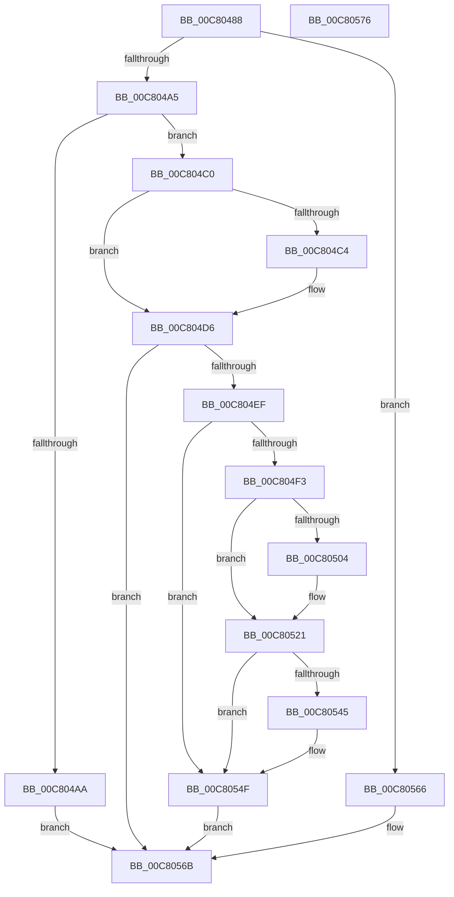

# BgkInitialize

- RVA: `0x00C80488`–`0x00C80577` (길이 `239` bytes)
- VA: `0x0000000140C80488`
- 실행 섹션: `INIT`
- PDB 이름 있음: `예`; PDB Function 태그: `아니요`
- unwind 정보 RVA: `0x0008A658`
- 디코드: `59`개 명령, `239/239` bytes 표시
- 미해석 바이트: `0` (있으면 어셈블리에 `.byte`로 보존)

> 이 문서는 커널 이미지의 기계어와 PDB 기호를 분석해 생성했습니다. 4번과 5번은 함수 원형과 자료형을 바이너리 사용 방식에서 추정한 C 해석이며 원본 소스 복구 결과는 아닙니다.

## 1. Dependencies

- 직접 호출 지점: **7**; 고유 호출 대상: **6**
- 직접 호출자로 확인된 함수: **1**
- RIP 상대 이미지 참조: **10**

### Outgoing calls
- `0x00C804C4` → [BgkDestroy](../../pagebgfx/BC/BgkDestroy_function_00BC0170.md) (function, `0x00BC0170`)
- `0x00C804D1` → [BgkpLockBgfxCodeSection](../../pagebgfx/BC/BgkpLockBgfxCodeSection_function_00BC04F0.md) (function, `0x00BC04F0`)
- `0x00C804E6` → [BgLibraryInitialize](../../pagebgfx/BC/BgLibraryInitialize_function_00BC0760.md) (function, `0x00BC0760`)
- `0x00C804F3` → [BgConsoleGetInterface](../../pagebgfx/BC/BgConsoleGetInterface_function_00BC09A0.md) (function, `0x00BC09A0`)
- `0x00C8051C` → [guard_dispatch_icall](../../text/6B/guard_dispatch_icall_function_006BAAD0.md) (function, `0x006BAAD0`)
- `0x00C8053C` → [guard_dispatch_icall](../../text/6B/guard_dispatch_icall_function_006BAAD0.md) (function, `0x006BAAD0`)
- `0x00C8055D` → [BgkpTryEnableConsole](../../text/59/BgkpTryEnableConsole_function_005912D0.md) (function, `0x005912D0`)

### Direct callers
- [InbvDriverInitialize](../C2/InbvDriverInitialize_function_00C2A420.md) at `0x00C2A450`

### Static image references
- `0x00C804AA` → RVA `0x00E65EB0` (`.data`; read)
- `0x00C804C9` → RVA `0x00E3EE20` (`.data`; read/write)
- `0x00C804F8` → RVA `0x00E65E70` (`.data`; write)
- `0x00C8050A` → RVA `0x00E65EB4` (`.data`; read)
- `0x00C80516` → RVA `0x00FD9E38` (`PAGEDATA`; read)
- `0x00C80521` → RVA `0x00E00638` (`.data`; read)
- `0x00C80532` → RVA `0x00E3EE18` (`.data`; read)
- `0x00C80545` → RVA `0x00E3EE18` (`.data`; write)
- `0x00C8054F` → RVA `0x00E65EB0` (`.data`; write)
- `0x00C80556` → RVA `0x00E65EBA` (`.data`; write)

## 2. Other-region calls and transfers

- 다른 실행 섹션으로 향하는 call: **7**
  - `0x00C804C4` → [BgkDestroy](../../pagebgfx/BC/BgkDestroy_function_00BC0170.md) (`INIT` → `PAGEBGFX`)
  - `0x00C804D1` → [BgkpLockBgfxCodeSection](../../pagebgfx/BC/BgkpLockBgfxCodeSection_function_00BC04F0.md) (`INIT` → `PAGEBGFX`)
  - `0x00C804E6` → [BgLibraryInitialize](../../pagebgfx/BC/BgLibraryInitialize_function_00BC0760.md) (`INIT` → `PAGEBGFX`)
  - `0x00C804F3` → [BgConsoleGetInterface](../../pagebgfx/BC/BgConsoleGetInterface_function_00BC09A0.md) (`INIT` → `PAGEBGFX`)
  - `0x00C8051C` → [guard_dispatch_icall](../../text/6B/guard_dispatch_icall_function_006BAAD0.md) (`INIT` → `.text`)
  - `0x00C8053C` → [guard_dispatch_icall](../../text/6B/guard_dispatch_icall_function_006BAAD0.md) (`INIT` → `.text`)
  - `0x00C8055D` → [BgkpTryEnableConsole](../../text/59/BgkpTryEnableConsole_function_005912D0.md) (`INIT` → `.text`)
- 별도 외부 분기/꼬리 이동을 확인하지 못했습니다.

## 3. Assembly (complete function range)

```asm
00C80488  48 89 5C 24 10                  mov qword ptr [rsp + 0x10], rbx
00C8048D  57                              push rdi
00C8048E  48 83 EC 30                     sub rsp, 0x30
00C80492  83 64 24 40 00                  and dword ptr [rsp + 0x40], 0
00C80497  8B DA                           mov ebx, edx
00C80499  48 8B F9                        mov rdi, rcx
00C8049C  48 85 C9                        test rcx, rcx
00C8049F  0F 84 C1 00 00 00               je 0x140c80566
00C804A5  83 FA 01                        cmp edx, 1
00C804A8  75 16                           jne 0x140c804c0
00C804AA  8A 05 00 5A 1E 00               mov al, byte ptr [rip + 0x1e5a00]
00C804B0  F6 D8                           neg al
00C804B2  1B C0                           sbb eax, eax
00C804B4  F7 D0                           not eax
00C804B6  25 01 00 00 C0                  and eax, 0xc0000001
00C804BB  E9 AB 00 00 00                  jmp 0x140c8056b
00C804C0  85 DB                           test ebx, ebx
00C804C2  75 12                           jne 0x140c804d6
00C804C4  E8 A7 FC F3 FF                  call 0x140bc0170
00C804C9  48 83 25 4F E9 1B 00 00         and qword ptr [rip + 0x1be94f], 0
00C804D1  E8 1A 00 F4 FF                  call 0x140bc04f0
00C804D6  48 8B 8F F0 00 00 00            mov rcx, qword ptr [rdi + 0xf0]
00C804DD  8B D3                           mov edx, ebx
00C804DF  48 8B 89 20 01 00 00            mov rcx, qword ptr [rcx + 0x120]
00C804E6  E8 75 02 F4 FF                  call 0x140bc0760
00C804EB  85 C0                           test eax, eax
00C804ED  78 7C                           js 0x140c8056b
00C804EF  85 DB                           test ebx, ebx
00C804F1  75 5C                           jne 0x140c8054f
00C804F3  E8 A8 04 F4 FF                  call 0x140bc09a0
00C804F8  48 89 05 71 59 1E 00            mov qword ptr [rip + 0x1e5971], rax
00C804FF  48 85 C0                        test rax, rax
00C80502  74 1D                           je 0x140c80521
00C80504  48 8B 00                        mov rax, qword ptr [rax]
00C80507  45 33 C9                        xor r9d, r9d
00C8050A  44 8B 05 A3 59 1E 00            mov r8d, dword ptr [rip + 0x1e59a3]
00C80511  BA C6 C6 C6 FF                  mov edx, 0xffc6c6c6
00C80516  8B 0D 1C 99 35 00               mov ecx, dword ptr [rip + 0x35991c]
00C8051C  E8 AF A5 A3 FF                  call 0x1406baad0
00C80521  48 8B 05 10 01 18 00            mov rax, qword ptr [rip + 0x180110]
00C80528  4C 8D 4C 24 40                  lea r9, [rsp + 0x40]
00C8052D  BA 04 00 00 00                  mov edx, 4
00C80532  4C 8D 05 DF E8 1B 00            lea r8, [rip + 0x1be8df]
00C80539  8D 4A 05                        lea ecx, [rdx + 5]
00C8053C  E8 8F A5 A3 FF                  call 0x1406baad0
00C80541  85 C0                           test eax, eax
00C80543  79 0A                           jns 0x140c8054f
00C80545  C7 05 C9 E8 1B 00 02 00 00 00   mov dword ptr [rip + 0x1be8c9], 2
00C8054F  C6 05 5A 59 1E 00 01            mov byte ptr [rip + 0x1e595a], 1
00C80556  C6 05 5D 59 1E 00 01            mov byte ptr [rip + 0x1e595d], 1
00C8055D  E8 6E 0D 91 FF                  call 0x1405912d0
00C80562  33 C0                           xor eax, eax
00C80564  EB 05                           jmp 0x140c8056b
00C80566  B8 01 00 00 C0                  mov eax, 0xc0000001
00C8056B  48 8B 5C 24 48                  mov rbx, qword ptr [rsp + 0x48]
00C80570  48 83 C4 30                     add rsp, 0x30
00C80574  5F                              pop rdi
00C80575  C3                              ret
00C80576  CC                              int3
```

## 4. C-style interpretation (structured pseudocode)

```c
__int64 __fastcall BgkInitialize(__int64 a1, int a2, __int64 a3, int a4)
{
    __int64 result;
    __int64 v_rsp;
    unsigned __int64 v_stack_p10;
    unsigned int v_stack_p8;

    v_stack_p10 = v_rbx;
    v_rsp = (v_rsp) - (48);
    if (a1 == 0) goto loc_00C80566;
    if (a2 != 1) goto loc_00C804C0;
    result = (unsigned __int8)(-(*(unsigned __int8 *)(v_rip + 1989120)));
    result = (unsigned int)(~(result));
    result = (unsigned int)((result) & (0xC0000001ULL));
    goto loc_00C8056B;
loc_00C804C0:
    if ((unsigned int)((unsigned int)(a2)) == 0) {
        result = BgkDestroy(a1, a2, a3, a4);
        result = BgkpLockBgfxCodeSection(a1, a2, a3, a4);
    }
    result = BgLibraryInitialize(*(unsigned __int64 *)(*(unsigned __int64 *)(a1 + 240) + 288), (unsigned int)((unsigned int)((unsigned int)(a2))), a3, a4);
    if (sign_flag) goto loc_00C8056B;
    if ((unsigned int)((unsigned int)(a2)) != 0) goto loc_00C8054F;
    result = BgConsoleGetInterface(*(unsigned __int64 *)(*(unsigned __int64 *)(a1 + 240) + 288), (unsigned int)((unsigned int)((unsigned int)(a2))), a3, a4);
    *(unsigned __int64 *)(v_rip + 1988977) = result;
    if (result != 0) {
        result = *(unsigned __int64 *)(result);
        a4 = 0;
        a3 = *(unsigned int *)(v_rip + 1989027);
        a2 = 0xFFC6C6C6ULL;
        a1 = *(unsigned int *)(v_rip + 3512604);
        result = guard_dispatch_icall(a1, a2, a3, a4);
    }
    result = guard_dispatch_icall(4 + 5, 4, v_rip + 1829087, v_stack_p8);
    if (sign_flag) {
        *(unsigned int *)(v_rip + 1829065) = 2;
    }
    *(unsigned __int8 *)(v_rip + 1988954) = 1;
    *(unsigned __int8 *)(v_rip + 1988957) = 1;
    result = BgkpTryEnableConsole(4 + 5, 4, v_rip + 1829087, v_stack_p8);
    result = 0;
    goto loc_00C8056B;
loc_00C80566:
loc_00C8056B:
    v_rsp = (v_rsp) + (48);
    return (unsigned int)(0xC0000001ULL);
}
```

## 5. (Beta) C Style

```c
int64_t BgkInitialize(void *Arg1, int32_t Arg2, int64_t Arg3, int32_t Arg4)
{
    uint8_t *arg1 = (uint8_t *)Arg1;

    int64_t result;
    int64_t local_rsp;
    uint64_t v_stack_p10;
    uint32_t v_stack_p8;

    v_stack_p10 = local_rbx;
    local_rsp = (local_rsp) - (48);
    if (Arg1 == NULL) goto loc_00C80566;
    if (Arg2 != 1) goto loc_00C804C0;
    result = (uint8_t)(-(*(uint8_t *)(v_rip + 0x1E5A00)));
    result = (uint32_t)(~(result));
    result = (uint32_t)((result) & (0xC0000001ULL));
    goto loc_00C8056B;
loc_00C804C0:
    if ((uint32_t)((uint32_t)(Arg2)) == 0) {
        result = BgkDestroy(Arg1, Arg2, Arg3, Arg4);
        result = BgkpLockBgfxCodeSection(Arg1, Arg2, Arg3, Arg4);
    }
    result = BgLibraryInitialize(*(uint64_t *)(*(uint64_t *)(arg1 + 0xF0) + 0x120), (uint32_t)((uint32_t)((uint32_t)(Arg2))), Arg3, Arg4);
    if (sign_flag) goto loc_00C8056B;
    if ((uint32_t)((uint32_t)(Arg2)) != 0) goto loc_00C8054F;
    result = BgConsoleGetInterface(*(uint64_t *)(*(uint64_t *)(arg1 + 0xF0) + 0x120), (uint32_t)((uint32_t)((uint32_t)(Arg2))), Arg3, Arg4);
    *(uint64_t *)(v_rip + 0x1E5971) = result;
    if (result != 0) {
        result = *(uint64_t *)(result);
        Arg4 = 0;
        Arg3 = *(uint32_t *)(v_rip + 0x1E59A3);
        Arg2 = 0xFFC6C6C6ULL;
        Arg1 = *(uint32_t *)(v_rip + 0x35991C);
        result = guard_dispatch_icall(Arg1, Arg2, Arg3, Arg4);
    }
    result = guard_dispatch_icall(4 + 5, 4, v_rip + 1829087, v_stack_p8);
    if (sign_flag) {
        *(uint32_t *)(v_rip + 0x1BE8C9) = 2;
    }
    *(uint8_t *)(v_rip + 0x1E595A) = 1;
    *(uint8_t *)(v_rip + 0x1E595D) = 1;
    result = BgkpTryEnableConsole(4 + 5, 4, v_rip + 1829087, v_stack_p8);
    result = 0;
    goto loc_00C8056B;
loc_00C80566:
loc_00C8056B:
    local_rsp = (local_rsp) + (48);
    return (uint32_t)(0xC0000001ULL);
}
```

### 관측된 메모리 오프셋

구조체 형식이 확인되지 않은 접근은 인자 기준의 오프셋으로만 기록했습니다.

| 기준 인자 | 오프셋 표현 | 폭 (bit) | 접근 |
|---|---:|---:|---|
| `Arg1` | `+ 0xF0` | `64` | `R` |

## 6. Execution-region graph

[열기: 2D/3D 그래프와 함수 탐색 컨트롤 패널](../../../control-panel.html?section=init&rva=0x00C80488&view=graph)

- 2D 그래프는 위에서 아래로 흐르고, 3D 그래프는 빈 공간을 드래그해 회전합니다. Shift+드래그는 이동, 휠은 확대·축소, 함수 노드 선택은 대상 보고서 이동입니다.

### Static fallback


