# BgpBcInitializeCriticalMode

- RVA: `0x00C81454`–`0x00C81A23` (길이 `1,487` bytes)
- VA: `0x0000000140C81454`
- 실행 섹션: `INIT`
- PDB 이름 있음: `예`; PDB Function 태그: `아니요`
- unwind 정보 RVA: `0x000D9574`
- 디코드: `326`개 명령, `1,487/1,487` bytes 표시
- 미해석 바이트: `0` (있으면 어셈블리에 `.byte`로 보존)

> 이 문서는 커널 이미지의 기계어와 PDB 기호를 분석해 생성했습니다. 4번과 5번은 함수 원형과 자료형을 바이너리 사용 방식에서 추정한 C 해석이며 원본 소스 복구 결과는 아닙니다.

## 1. Dependencies

- 직접 호출 지점: **62**; 고유 호출 대상: **11**
- 직접 호출자로 확인된 함수: **1**
- RIP 상대 이미지 참조: **41**

### Outgoing calls
- `0x00C81487` → [Feature_50070238__private_IsEnabledDeviceUsageNoInline](../../text/6A/Feature_50070238__private_IsEnabledDeviceUsageNoInline_function_006A1834.md) (function, `0x006A1834`)
- `0x00C814D5` → [BcpFindMessage](BcpFindMessage_function_00C81294.md) (function, `0x00C81294`)
- `0x00C814E4` → [RtlInitUnicodeString](../../text/42/RtlInitUnicodeString_function_0042A780.md) (function, `0x0042A780`)
- `0x00C814EE` → [BcpFindMessage](BcpFindMessage_function_00C81294.md) (function, `0x00C81294`)
- `0x00C814FD` → [RtlInitUnicodeString](../../text/42/RtlInitUnicodeString_function_0042A780.md) (function, `0x0042A780`)
- `0x00C81507` → [BcpFindMessage](BcpFindMessage_function_00C81294.md) (function, `0x00C81294`)
- `0x00C81516` → [RtlInitUnicodeString](../../text/42/RtlInitUnicodeString_function_0042A780.md) (function, `0x0042A780`)
- `0x00C81520` → [BcpFindMessage](BcpFindMessage_function_00C81294.md) (function, `0x00C81294`)
- `0x00C8152F` → [RtlInitUnicodeString](../../text/42/RtlInitUnicodeString_function_0042A780.md) (function, `0x0042A780`)
- `0x00C81539` → [BcpFindMessage](BcpFindMessage_function_00C81294.md) (function, `0x00C81294`)
- `0x00C81548` → [RtlInitUnicodeString](../../text/42/RtlInitUnicodeString_function_0042A780.md) (function, `0x0042A780`)
- `0x00C81588` → [RtlUShortAdd](../../text/47/RtlUShortAdd_function_00474F70.md) (function, `0x00474F70`)
- `0x00C8159F` → [RtlUShortAdd](../../text/47/RtlUShortAdd_function_00474F70.md) (function, `0x00474F70`)
- `0x00C815B3` → [BgpFwAllocateMemory](../../text/3E/BgpFwAllocateMemory_function_003E4374.md) (function, `0x003E4374`)
- `0x00C815CD` → [BcpFindMessage](BcpFindMessage_function_00C81294.md) (function, `0x00C81294`)
- `0x00C815DC` → [RtlInitUnicodeString](../../text/42/RtlInitUnicodeString_function_0042A780.md) (function, `0x0042A780`)
- `0x00C815E6` → [BcpFindMessage](BcpFindMessage_function_00C81294.md) (function, `0x00C81294`)
- `0x00C815F5` → [RtlInitUnicodeString](../../text/42/RtlInitUnicodeString_function_0042A780.md) (function, `0x0042A780`)
- `0x00C815FF` → [BcpFindMessage](BcpFindMessage_function_00C81294.md) (function, `0x00C81294`)
- `0x00C8160E` → [RtlInitUnicodeString](../../text/42/RtlInitUnicodeString_function_0042A780.md) (function, `0x0042A780`)
- `0x00C81618` → [BcpFindMessage](BcpFindMessage_function_00C81294.md) (function, `0x00C81294`)
- `0x00C81627` → [RtlInitUnicodeString](../../text/42/RtlInitUnicodeString_function_0042A780.md) (function, `0x0042A780`)
- `0x00C81631` → [BcpFindMessage](BcpFindMessage_function_00C81294.md) (function, `0x00C81294`)
- `0x00C81640` → [RtlInitUnicodeString](../../text/42/RtlInitUnicodeString_function_0042A780.md) (function, `0x0042A780`)
- `0x00C8164A` → [BcpFindMessage](BcpFindMessage_function_00C81294.md) (function, `0x00C81294`)
- `0x00C81659` → [RtlInitUnicodeString](../../text/42/RtlInitUnicodeString_function_0042A780.md) (function, `0x0042A780`)
- `0x00C81663` → [BcpFindMessage](BcpFindMessage_function_00C81294.md) (function, `0x00C81294`)
- `0x00C81672` → [RtlInitUnicodeString](../../text/42/RtlInitUnicodeString_function_0042A780.md) (function, `0x0042A780`)
- `0x00C8167C` → [BcpFindMessage](BcpFindMessage_function_00C81294.md) (function, `0x00C81294`)
- `0x00C8168B` → [RtlInitUnicodeString](../../text/42/RtlInitUnicodeString_function_0042A780.md) (function, `0x0042A780`)
- `0x00C816AD` → [RtlUShortAdd](../../text/47/RtlUShortAdd_function_00474F70.md) (function, `0x00474F70`)
- `0x00C816C6` → [RtlUShortAdd](../../text/47/RtlUShortAdd_function_00474F70.md) (function, `0x00474F70`)
- `0x00C816DA` → [BgpFwAllocateMemory](../../text/3E/BgpFwAllocateMemory_function_003E4374.md) (function, `0x003E4374`)
- `0x00C816F4` → [BcpFindMessage](BcpFindMessage_function_00C81294.md) (function, `0x00C81294`)
- `0x00C81703` → [RtlInitUnicodeString](../../text/42/RtlInitUnicodeString_function_0042A780.md) (function, `0x0042A780`)
- `0x00C81715` → [BcpGetProgressMessages](../../text/6A/BcpGetProgressMessages_function_006A0B48.md) (function, `0x006A0B48`)
- `0x00C8172D` → [RtlInitUnicodeString](../../text/42/RtlInitUnicodeString_function_0042A780.md) (function, `0x0042A780`)
- `0x00C8173D` → [RtlInitUnicodeString](../../text/42/RtlInitUnicodeString_function_0042A780.md) (function, `0x0042A780`)
- `0x00C8174F` → [BcpGetProgressMessages](../../text/6A/BcpGetProgressMessages_function_006A0B48.md) (function, `0x006A0B48`)
- `0x00C8176A` → [RtlInitUnicodeString](../../text/42/RtlInitUnicodeString_function_0042A780.md) (function, `0x0042A780`)
- `0x00C8177A` → [RtlInitUnicodeString](../../text/42/RtlInitUnicodeString_function_0042A780.md) (function, `0x0042A780`)
- `0x00C817A1` → [RtlUShortAdd](../../text/47/RtlUShortAdd_function_00474F70.md) (function, `0x00474F70`)
- `0x00C817BC` → [RtlUShortAdd](../../text/47/RtlUShortAdd_function_00474F70.md) (function, `0x00474F70`)
- `0x00C817D7` → [RtlUShortAdd](../../text/47/RtlUShortAdd_function_00474F70.md) (function, `0x00474F70`)
- `0x00C817F0` → [RtlUShortAdd](../../text/47/RtlUShortAdd_function_00474F70.md) (function, `0x00474F70`)
- `0x00C81804` → [BgpFwAllocateMemory](../../text/3E/BgpFwAllocateMemory_function_003E4374.md) (function, `0x003E4374`)
- `0x00C8181E` → [BgpFwAllocateMemory](../../text/3E/BgpFwAllocateMemory_function_003E4374.md) (function, `0x003E4374`)
- `0x00C81846` → [RtlUShortAdd](../../text/47/RtlUShortAdd_function_00474F70.md) (function, `0x00474F70`)
- `0x00C8185F` → [RtlUShortAdd](../../text/47/RtlUShortAdd_function_00474F70.md) (function, `0x00474F70`)
- `0x00C81873` → [BgpFwAllocateMemory](../../text/3E/BgpFwAllocateMemory_function_003E4374.md) (function, `0x003E4374`)
- `0x00C8188D` → [BcpFindMessage](BcpFindMessage_function_00C81294.md) (function, `0x00C81294`)
- `0x00C81904` → [BgpFoDetermineFontInformation](BgpFoDetermineFontInformation_function_00C805DC.md) (function, `0x00C805DC`)
- `0x00C81936` → [BcpGetMaxResourceProfile](../../text/6A/BcpGetMaxResourceProfile_function_006A0A88.md) (function, `0x006A0A88`)
- `0x00C81946` → [BgpFwAllocateMemory](../../text/3E/BgpFwAllocateMemory_function_003E4374.md) (function, `0x003E4374`)
- `0x00C81980` → [BgpDisplayCharacterGetContext](../../pagebgfx/BC/BgpDisplayCharacterGetContext_function_00BC0860.md) (function, `0x00BC0860`)
- `0x00C819A5` → [BgpFwFreeMemory](../../text/3E/BgpFwFreeMemory_function_003E25E0.md) (function, `0x003E25E0`)
- `0x00C819B2` → [BgpFwFreeMemory](../../text/3E/BgpFwFreeMemory_function_003E25E0.md) (function, `0x003E25E0`)
- `0x00C819CC` → [BgpFwFreeMemory](../../text/3E/BgpFwFreeMemory_function_003E25E0.md) (function, `0x003E25E0`)
- `0x00C819DD` → [BgpFwFreeMemory](../../text/3E/BgpFwFreeMemory_function_003E25E0.md) (function, `0x003E25E0`)
- `0x00C819EE` → [BgpFwFreeMemory](../../text/3E/BgpFwFreeMemory_function_003E25E0.md) (function, `0x003E25E0`)
- `0x00C819FF` → [BgpFwFreeMemory](../../text/3E/BgpFwFreeMemory_function_003E25E0.md) (function, `0x003E25E0`)
- `0x00C81A10` → [BgpDisplayCharacterDestroyContext](../../pagebgfx/BC/BgpDisplayCharacterDestroyContext_function_00BC0834.md) (function, `0x00BC0834`)

### Direct callers
- [BgpFwLibraryInitialize](../../pagebgfx/BC/BgpFwLibraryInitialize_function_00BC5400.md) at `0x00BC5629`
- [BgpFwLibraryInitialize](../../pagebgfx/BC/BgpFwLibraryInitialize_function_00BC5400.md) at `0x00BC5B71`

### Static image references
- `0x00C81496` → RVA `0x00EF03D0` (`.data`; write)
- `0x00C814A1` → RVA `0x00EF0450` (`.data`; read/write)
- `0x00C814B2` → RVA `0x00EEFF18` (`.data`; write)
- `0x00C814DD` → RVA `0x00E3EA80` (`.data`; read)
- `0x00C814F6` → RVA `0x00E3EAA0` (`.data`; read)
- `0x00C8150F` → RVA `0x00E3EAB0` (`.data`; read)
- `0x00C81528` → RVA `0x00E3EAC0` (`.data`; read)
- `0x00C81541` → RVA `0x00E3EAD0` (`.data`; read)
- `0x00C8154D` → RVA `0x00EF03D0` (`.data`; read)
- `0x00C8155C` → RVA `0x00E3EBE8` (`.data`; read)
- `0x00C815B8` → RVA `0x00E3EBE0` (`.data`; write)
- `0x00C815D5` → RVA `0x00E3EA90` (`.data`; read)
- `0x00C815EE` → RVA `0x00E3EB20` (`.data`; read)
- `0x00C81607` → RVA `0x00E3EB30` (`.data`; read)
- `0x00C81620` → RVA `0x00E3EB40` (`.data`; read)
- `0x00C81639` → RVA `0x00E3EB50` (`.data`; read)
- `0x00C81652` → RVA `0x00E3EB60` (`.data`; read)
- `0x00C8166B` → RVA `0x00E3EB70` (`.data`; read)
- `0x00C81684` → RVA `0x00E3EB80` (`.data`; read)
- `0x00C8169F` → RVA `0x00E3EBD8` (`.data`; read)
- `0x00C816DF` → RVA `0x00E3EBD0` (`.data`; write)
- `0x00C816FC` → RVA `0x00E3EB90` (`.data`; read)
- `0x00C81726` → RVA `0x00E3EAE0` (`.data`; read)
- `0x00C81736` → RVA `0x00E3EAF0` (`.data`; read)
- `0x00C81763` → RVA `0x00E3EB00` (`.data`; read)
- `0x00C81773` → RVA `0x00E3EB10` (`.data`; read)
- `0x00C81793` → RVA `0x00E3EBB8` (`.data`; read)
- `0x00C81809` → RVA `0x00E3EBB0` (`.data`; write)
- `0x00C81823` → RVA `0x00E3EBA8` (`.data`; write)
- `0x00C8183A` → RVA `0x00E3EBC8` (`.data`; read)
- `0x00C81878` → RVA `0x00E3EBC0` (`.data`; write)
- `0x00C818DF` → RVA `0x00E0EF60` (`.data`; read)
- `0x00C81950` → RVA `0x00EF0370` (`.data`; read/write)
- `0x00C8195C` → RVA `0x00EF0360` (`.data`; write)
- `0x00C81979` → RVA `0x00EF0368` (`.data`; write)
- `0x00C81985` → RVA `0x00E3EBA0` (`.data`; write)
- `0x00C819C0` → RVA `0x00E3EBD0` (`.data`; read)
- `0x00C819D1` → RVA `0x00E3EBB0` (`.data`; read)
- `0x00C819E2` → RVA `0x00E3EBA8` (`.data`; read)
- `0x00C819F3` → RVA `0x00E3EBC0` (`.data`; read)
- `0x00C81A04` → RVA `0x00E3EBA0` (`.data`; read)

## 2. Other-region calls and transfers

- 다른 실행 섹션으로 향하는 call: **46**
  - `0x00C81487` → [Feature_50070238__private_IsEnabledDeviceUsageNoInline](../../text/6A/Feature_50070238__private_IsEnabledDeviceUsageNoInline_function_006A1834.md) (`INIT` → `.text`)
  - `0x00C814E4` → [RtlInitUnicodeString](../../text/42/RtlInitUnicodeString_function_0042A780.md) (`INIT` → `.text`)
  - `0x00C814FD` → [RtlInitUnicodeString](../../text/42/RtlInitUnicodeString_function_0042A780.md) (`INIT` → `.text`)
  - `0x00C81516` → [RtlInitUnicodeString](../../text/42/RtlInitUnicodeString_function_0042A780.md) (`INIT` → `.text`)
  - `0x00C8152F` → [RtlInitUnicodeString](../../text/42/RtlInitUnicodeString_function_0042A780.md) (`INIT` → `.text`)
  - `0x00C81548` → [RtlInitUnicodeString](../../text/42/RtlInitUnicodeString_function_0042A780.md) (`INIT` → `.text`)
  - `0x00C81588` → [RtlUShortAdd](../../text/47/RtlUShortAdd_function_00474F70.md) (`INIT` → `.text`)
  - `0x00C8159F` → [RtlUShortAdd](../../text/47/RtlUShortAdd_function_00474F70.md) (`INIT` → `.text`)
  - `0x00C815B3` → [BgpFwAllocateMemory](../../text/3E/BgpFwAllocateMemory_function_003E4374.md) (`INIT` → `.text`)
  - `0x00C815DC` → [RtlInitUnicodeString](../../text/42/RtlInitUnicodeString_function_0042A780.md) (`INIT` → `.text`)
  - `0x00C815F5` → [RtlInitUnicodeString](../../text/42/RtlInitUnicodeString_function_0042A780.md) (`INIT` → `.text`)
  - `0x00C8160E` → [RtlInitUnicodeString](../../text/42/RtlInitUnicodeString_function_0042A780.md) (`INIT` → `.text`)
  - `0x00C81627` → [RtlInitUnicodeString](../../text/42/RtlInitUnicodeString_function_0042A780.md) (`INIT` → `.text`)
  - `0x00C81640` → [RtlInitUnicodeString](../../text/42/RtlInitUnicodeString_function_0042A780.md) (`INIT` → `.text`)
  - `0x00C81659` → [RtlInitUnicodeString](../../text/42/RtlInitUnicodeString_function_0042A780.md) (`INIT` → `.text`)
  - `0x00C81672` → [RtlInitUnicodeString](../../text/42/RtlInitUnicodeString_function_0042A780.md) (`INIT` → `.text`)
  - `0x00C8168B` → [RtlInitUnicodeString](../../text/42/RtlInitUnicodeString_function_0042A780.md) (`INIT` → `.text`)
  - `0x00C816AD` → [RtlUShortAdd](../../text/47/RtlUShortAdd_function_00474F70.md) (`INIT` → `.text`)
  - `0x00C816C6` → [RtlUShortAdd](../../text/47/RtlUShortAdd_function_00474F70.md) (`INIT` → `.text`)
  - `0x00C816DA` → [BgpFwAllocateMemory](../../text/3E/BgpFwAllocateMemory_function_003E4374.md) (`INIT` → `.text`)
  - `0x00C81703` → [RtlInitUnicodeString](../../text/42/RtlInitUnicodeString_function_0042A780.md) (`INIT` → `.text`)
  - `0x00C81715` → [BcpGetProgressMessages](../../text/6A/BcpGetProgressMessages_function_006A0B48.md) (`INIT` → `.text`)
  - `0x00C8172D` → [RtlInitUnicodeString](../../text/42/RtlInitUnicodeString_function_0042A780.md) (`INIT` → `.text`)
  - `0x00C8173D` → [RtlInitUnicodeString](../../text/42/RtlInitUnicodeString_function_0042A780.md) (`INIT` → `.text`)
  - `0x00C8174F` → [BcpGetProgressMessages](../../text/6A/BcpGetProgressMessages_function_006A0B48.md) (`INIT` → `.text`)
  - `0x00C8176A` → [RtlInitUnicodeString](../../text/42/RtlInitUnicodeString_function_0042A780.md) (`INIT` → `.text`)
  - `0x00C8177A` → [RtlInitUnicodeString](../../text/42/RtlInitUnicodeString_function_0042A780.md) (`INIT` → `.text`)
  - `0x00C817A1` → [RtlUShortAdd](../../text/47/RtlUShortAdd_function_00474F70.md) (`INIT` → `.text`)
  - `0x00C817BC` → [RtlUShortAdd](../../text/47/RtlUShortAdd_function_00474F70.md) (`INIT` → `.text`)
  - `0x00C817D7` → [RtlUShortAdd](../../text/47/RtlUShortAdd_function_00474F70.md) (`INIT` → `.text`)
  - `0x00C817F0` → [RtlUShortAdd](../../text/47/RtlUShortAdd_function_00474F70.md) (`INIT` → `.text`)
  - `0x00C81804` → [BgpFwAllocateMemory](../../text/3E/BgpFwAllocateMemory_function_003E4374.md) (`INIT` → `.text`)
  - `0x00C8181E` → [BgpFwAllocateMemory](../../text/3E/BgpFwAllocateMemory_function_003E4374.md) (`INIT` → `.text`)
  - `0x00C81846` → [RtlUShortAdd](../../text/47/RtlUShortAdd_function_00474F70.md) (`INIT` → `.text`)
  - `0x00C8185F` → [RtlUShortAdd](../../text/47/RtlUShortAdd_function_00474F70.md) (`INIT` → `.text`)
  - `0x00C81873` → [BgpFwAllocateMemory](../../text/3E/BgpFwAllocateMemory_function_003E4374.md) (`INIT` → `.text`)
  - `0x00C81936` → [BcpGetMaxResourceProfile](../../text/6A/BcpGetMaxResourceProfile_function_006A0A88.md) (`INIT` → `.text`)
  - `0x00C81946` → [BgpFwAllocateMemory](../../text/3E/BgpFwAllocateMemory_function_003E4374.md) (`INIT` → `.text`)
  - `0x00C81980` → [BgpDisplayCharacterGetContext](../../pagebgfx/BC/BgpDisplayCharacterGetContext_function_00BC0860.md) (`INIT` → `PAGEBGFX`)
  - `0x00C819A5` → [BgpFwFreeMemory](../../text/3E/BgpFwFreeMemory_function_003E25E0.md) (`INIT` → `.text`)
  - `0x00C819B2` → [BgpFwFreeMemory](../../text/3E/BgpFwFreeMemory_function_003E25E0.md) (`INIT` → `.text`)
  - `0x00C819CC` → [BgpFwFreeMemory](../../text/3E/BgpFwFreeMemory_function_003E25E0.md) (`INIT` → `.text`)
  - `0x00C819DD` → [BgpFwFreeMemory](../../text/3E/BgpFwFreeMemory_function_003E25E0.md) (`INIT` → `.text`)
  - `0x00C819EE` → [BgpFwFreeMemory](../../text/3E/BgpFwFreeMemory_function_003E25E0.md) (`INIT` → `.text`)
  - `0x00C819FF` → [BgpFwFreeMemory](../../text/3E/BgpFwFreeMemory_function_003E25E0.md) (`INIT` → `.text`)
  - `0x00C81A10` → [BgpDisplayCharacterDestroyContext](../../pagebgfx/BC/BgpDisplayCharacterDestroyContext_function_00BC0834.md) (`INIT` → `PAGEBGFX`)
- 별도 외부 분기/꼬리 이동을 확인하지 못했습니다.

## 3. Assembly (complete function range)

```asm
00C81454  40 55                           push rbp
00C81456  53                              push rbx
00C81457  56                              push rsi
00C81458  57                              push rdi
00C81459  41 57                           push r15
00C8145B  48 8B EC                        mov rbp, rsp
00C8145E  48 83 EC 70                     sub rsp, 0x70
00C81462  33 C0                           xor eax, eax
00C81464  0F 57 C0                        xorps xmm0, xmm0
00C81467  48 21 45 C0                     and qword ptr [rbp - 0x40], rax
00C8146B  0F 57 C9                        xorps xmm1, xmm1
00C8146E  48 21 45 30                     and qword ptr [rbp + 0x30], rax
00C81472  8B FA                           mov edi, edx
00C81474  48 8B F1                        mov rsi, rcx
00C81477  48 89 45 C8                     mov qword ptr [rbp - 0x38], rax
00C8147B  89 45 D0                        mov dword ptr [rbp - 0x30], eax
00C8147E  0F 11 45 D8                     movups xmmword ptr [rbp - 0x28], xmm0
00C81482  F3 0F 7F 4D F0                  movdqu xmmword ptr [rbp - 0x10], xmm1
00C81487  E8 A8 03 A2 FF                  call 0x1406a1834
00C8148C  85 C0                           test eax, eax
00C8148E  B9 00 00 40 00                  mov ecx, 0x400000
00C81493  8B 46 78                        mov eax, dword ptr [rsi + 0x78]
00C81496  0F 95 05 33 EF 26 00            setne byte ptr [rip + 0x26ef33]
00C8149D  85 C1                           test ecx, eax
00C8149F  74 0B                           je 0x140c814ac
00C814A1  09 0D A9 EF 26 00               or dword ptr [rip + 0x26efa9], ecx
00C814A7  E9 69 05 00 00                  jmp 0x140c81a15
00C814AC  0F BA E0 19                     bt eax, 0x19
00C814B0  73 07                           jae 0x140c814b9
00C814B2  C6 05 5F EA 26 00 01            mov byte ptr [rip + 0x26ea5f], 1
00C814B9  33 DB                           xor ebx, ebx
00C814BB  41 83 CF FF                     or r15d, 0xffffffff
00C814BF  48 21 5D 40                     and qword ptr [rbp + 0x40], rbx
00C814C3  48 89 5D 48                     mov qword ptr [rbp + 0x48], rbx
00C814C7  41 3B FF                        cmp edi, r15d
00C814CA  0F 84 45 05 00 00               je 0x140c81a15
00C814D0  B9 01 80 00 C1                  mov ecx, 0xc1008001
00C814D5  E8 BA FD FF FF                  call 0x140c81294
00C814DA  48 8B D0                        mov rdx, rax
00C814DD  48 8D 0D 9C D5 1B 00            lea rcx, [rip + 0x1bd59c]
00C814E4  E8 97 92 7A FF                  call 0x14042a780
00C814E9  B9 08 80 00 C1                  mov ecx, 0xc1008008
00C814EE  E8 A1 FD FF FF                  call 0x140c81294
00C814F3  48 8B D0                        mov rdx, rax
00C814F6  48 8D 0D A3 D5 1B 00            lea rcx, [rip + 0x1bd5a3]
00C814FD  E8 7E 92 7A FF                  call 0x14042a780
00C81502  B9 09 80 00 41                  mov ecx, 0x41008009
00C81507  E8 88 FD FF FF                  call 0x140c81294
00C8150C  48 8B D0                        mov rdx, rax
00C8150F  48 8D 0D 9A D5 1B 00            lea rcx, [rip + 0x1bd59a]
00C81516  E8 65 92 7A FF                  call 0x14042a780
00C8151B  B9 10 80 00 41                  mov ecx, 0x41008010
00C81520  E8 6F FD FF FF                  call 0x140c81294
00C81525  48 8B D0                        mov rdx, rax
00C81528  48 8D 0D 91 D5 1B 00            lea rcx, [rip + 0x1bd591]
00C8152F  E8 4C 92 7A FF                  call 0x14042a780
00C81534  B9 11 80 00 41                  mov ecx, 0x41008011
00C81539  E8 56 FD FF FF                  call 0x140c81294
00C8153E  48 8B D0                        mov rdx, rax
00C81541  48 8D 0D 88 D5 1B 00            lea rcx, [rip + 0x1bd588]
00C81548  E8 33 92 7A FF                  call 0x14042a780
00C8154D  38 1D 7D EE 26 00               cmp byte ptr [rip + 0x26ee7d], bl
00C81553  74 73                           je 0x140c815c8
00C81555  0F B7 15 74 D5 1B 00            movzx edx, word ptr [rip + 0x1bd574]
00C8155C  4C 8D 05 85 D6 1B 00            lea r8, [rip + 0x1bd685]
00C81563  66 39 15 46 D5 1B 00            cmp word ptr [rip + 0x1bd546], dx
00C8156A  0F B7 0D 0F D5 1B 00            movzx ecx, word ptr [rip + 0x1bd50f]
00C81571  66 0F 43 15 37 D5 1B 00         cmovae dx, word ptr [rip + 0x1bd537]
00C81579  66 3B 15 40 D5 1B 00            cmp dx, word ptr [rip + 0x1bd540]
00C81580  66 0F 42 15 38 D5 1B 00         cmovb dx, word ptr [rip + 0x1bd538]
00C81588  E8 E3 39 7F FF                  call 0x140474f70
00C8158D  85 C0                           test eax, eax
00C8158F  0F 88 22 04 00 00               js 0x140c819b7
00C81595  0F B7 0D 4C D6 1B 00            movzx ecx, word ptr [rip + 0x1bd64c]
00C8159C  8D 53 04                        lea edx, [rbx + 4]
00C8159F  E8 CC 39 7F FF                  call 0x140474f70
00C815A4  85 C0                           test eax, eax
00C815A6  0F 88 0B 04 00 00               js 0x140c819b7
00C815AC  0F B7 0D 35 D6 1B 00            movzx ecx, word ptr [rip + 0x1bd635]
00C815B3  E8 BC 2D 76 FF                  call 0x1403e4374
00C815B8  48 89 05 21 D6 1B 00            mov qword ptr [rip + 0x1bd621], rax
00C815BF  48 85 C0                        test rax, rax
00C815C2  0F 84 EF 03 00 00               je 0x140c819b7
00C815C8  B9 03 80 00 C1                  mov ecx, 0xc1008003
00C815CD  E8 C2 FC FF FF                  call 0x140c81294
00C815D2  48 8B D0                        mov rdx, rax
00C815D5  48 8D 0D B4 D4 1B 00            lea rcx, [rip + 0x1bd4b4]
00C815DC  E8 9F 91 7A FF                  call 0x14042a780
00C815E1  B9 14 80 00 41                  mov ecx, 0x41008014
00C815E6  E8 A9 FC FF FF                  call 0x140c81294
00C815EB  48 8B D0                        mov rdx, rax
00C815EE  48 8D 0D 2B D5 1B 00            lea rcx, [rip + 0x1bd52b]
00C815F5  E8 86 91 7A FF                  call 0x14042a780
00C815FA  B9 15 80 00 41                  mov ecx, 0x41008015
00C815FF  E8 90 FC FF FF                  call 0x140c81294
00C81604  48 8B D0                        mov rdx, rax
00C81607  48 8D 0D 22 D5 1B 00            lea rcx, [rip + 0x1bd522]
00C8160E  E8 6D 91 7A FF                  call 0x14042a780
00C81613  B9 16 80 00 41                  mov ecx, 0x41008016
00C81618  E8 77 FC FF FF                  call 0x140c81294
00C8161D  48 8B D0                        mov rdx, rax
00C81620  48 8D 0D 19 D5 1B 00            lea rcx, [rip + 0x1bd519]
00C81627  E8 54 91 7A FF                  call 0x14042a780
00C8162C  B9 18 80 00 41                  mov ecx, 0x41008018
00C81631  E8 5E FC FF FF                  call 0x140c81294
00C81636  48 8B D0                        mov rdx, rax
00C81639  48 8D 0D 10 D5 1B 00            lea rcx, [rip + 0x1bd510]
00C81640  E8 3B 91 7A FF                  call 0x14042a780
00C81645  B9 17 80 00 41                  mov ecx, 0x41008017
00C8164A  E8 45 FC FF FF                  call 0x140c81294
00C8164F  48 8B D0                        mov rdx, rax
00C81652  48 8D 0D 07 D5 1B 00            lea rcx, [rip + 0x1bd507]
00C81659  E8 22 91 7A FF                  call 0x14042a780
00C8165E  B9 19 80 00 41                  mov ecx, 0x41008019
00C81663  E8 2C FC FF FF                  call 0x140c81294
00C81668  48 8B D0                        mov rdx, rax
00C8166B  48 8D 0D FE D4 1B 00            lea rcx, [rip + 0x1bd4fe]
00C81672  E8 09 91 7A FF                  call 0x14042a780
00C81677  B9 20 80 00 41                  mov ecx, 0x41008020
00C8167C  E8 13 FC FF FF                  call 0x140c81294
00C81681  48 8B D0                        mov rdx, rax
00C81684  48 8D 0D F5 D4 1B 00            lea rcx, [rip + 0x1bd4f5]
00C8168B  E8 F0 90 7A FF                  call 0x14042a780
00C81690  38 1D 3A ED 26 00               cmp byte ptr [rip + 0x26ed3a], bl
00C81696  74 57                           je 0x140c816ef
00C81698  0F B7 15 E1 D4 1B 00            movzx edx, word ptr [rip + 0x1bd4e1]
00C8169F  4C 8D 05 32 D5 1B 00            lea r8, [rip + 0x1bd532]
00C816A6  0F B7 0D C3 D4 1B 00            movzx ecx, word ptr [rip + 0x1bd4c3]
00C816AD  E8 BE 38 7F FF                  call 0x140474f70
00C816B2  85 C0                           test eax, eax
00C816B4  0F 88 FD 02 00 00               js 0x140c819b7
00C816BA  0F B7 0D 17 D5 1B 00            movzx ecx, word ptr [rip + 0x1bd517]
00C816C1  BA 04 00 00 00                  mov edx, 4
00C816C6  E8 A5 38 7F FF                  call 0x140474f70
00C816CB  85 C0                           test eax, eax
00C816CD  0F 88 E4 02 00 00               js 0x140c819b7
00C816D3  0F B7 0D FE D4 1B 00            movzx ecx, word ptr [rip + 0x1bd4fe]
00C816DA  E8 95 2C 76 FF                  call 0x1403e4374
00C816DF  48 89 05 EA D4 1B 00            mov qword ptr [rip + 0x1bd4ea], rax
00C816E6  48 85 C0                        test rax, rax
00C816E9  0F 84 C8 02 00 00               je 0x140c819b7
00C816EF  B9 21 80 00 41                  mov ecx, 0x41008021
00C816F4  E8 9B FB FF FF                  call 0x140c81294
00C816F9  48 8B D0                        mov rdx, rax
00C816FC  48 8D 0D 8D D4 1B 00            lea rcx, [rip + 0x1bd48d]
00C81703  E8 78 90 7A FF                  call 0x14042a780
00C81708  4C 8D 45 30                     lea r8, [rbp + 0x30]
00C8170C  B9 12 80 00 C1                  mov ecx, 0xc1008012
00C81711  48 8D 55 40                     lea rdx, [rbp + 0x40]
00C81715  E8 2E F4 A1 FF                  call 0x1406a0b48
00C8171A  85 C0                           test eax, eax
00C8171C  0F 88 78 02 00 00               js 0x140c8199a
00C81722  48 8B 55 40                     mov rdx, qword ptr [rbp + 0x40]
00C81726  48 8D 0D B3 D3 1B 00            lea rcx, [rip + 0x1bd3b3]
00C8172D  E8 4E 90 7A FF                  call 0x14042a780
00C81732  48 8B 55 30                     mov rdx, qword ptr [rbp + 0x30]
00C81736  48 8D 0D B3 D3 1B 00            lea rcx, [rip + 0x1bd3b3]
00C8173D  E8 3E 90 7A FF                  call 0x14042a780
00C81742  4C 8D 45 30                     lea r8, [rbp + 0x30]
00C81746  B9 13 80 00 C1                  mov ecx, 0xc1008013
00C8174B  48 8D 55 48                     lea rdx, [rbp + 0x48]
00C8174F  E8 F4 F3 A1 FF                  call 0x1406a0b48
00C81754  48 8B 5D 48                     mov rbx, qword ptr [rbp + 0x48]
00C81758  85 C0                           test eax, eax
00C8175A  0F 88 3A 02 00 00               js 0x140c8199a
00C81760  48 8B D3                        mov rdx, rbx
00C81763  48 8D 0D 96 D3 1B 00            lea rcx, [rip + 0x1bd396]
00C8176A  E8 11 90 7A FF                  call 0x14042a780
00C8176F  48 8B 55 30                     mov rdx, qword ptr [rbp + 0x30]
00C81773  48 8D 0D 96 D3 1B 00            lea rcx, [rip + 0x1bd396]
00C8177A  E8 01 90 7A FF                  call 0x14042a780
00C8177F  80 3D 4A EC 26 00 00            cmp byte ptr [rip + 0x26ec4a], 0
00C81786  0F 84 FC 00 00 00               je 0x140c81888
00C8178C  0F B7 15 5D D3 1B 00            movzx edx, word ptr [rip + 0x1bd35d]
00C81793  4C 8D 05 1E D4 1B 00            lea r8, [rip + 0x1bd41e]
00C8179A  0F B7 0D 3F D3 1B 00            movzx ecx, word ptr [rip + 0x1bd33f]
00C817A1  E8 CA 37 7F FF                  call 0x140474f70
00C817A6  85 C0                           test eax, eax
00C817A8  0F 88 EC 01 00 00               js 0x140c8199a
00C817AE  0F B7 15 4B D3 1B 00            movzx edx, word ptr [rip + 0x1bd34b]
00C817B5  0F B7 0D FC D3 1B 00            movzx ecx, word ptr [rip + 0x1bd3fc]
00C817BC  E8 AF 37 7F FF                  call 0x140474f70
00C817C1  85 C0                           test eax, eax
00C817C3  0F 88 D1 01 00 00               js 0x140c8199a
00C817C9  0F B7 15 40 D3 1B 00            movzx edx, word ptr [rip + 0x1bd340]
00C817D0  0F B7 0D E1 D3 1B 00            movzx ecx, word ptr [rip + 0x1bd3e1]
00C817D7  E8 94 37 7F FF                  call 0x140474f70
00C817DC  85 C0                           test eax, eax
00C817DE  0F 88 B6 01 00 00               js 0x140c8199a
00C817E4  0F B7 0D CD D3 1B 00            movzx ecx, word ptr [rip + 0x1bd3cd]
00C817EB  BA 08 00 00 00                  mov edx, 8
00C817F0  E8 7B 37 7F FF                  call 0x140474f70
00C817F5  85 C0                           test eax, eax
00C817F7  0F 88 9D 01 00 00               js 0x140c8199a
00C817FD  0F B7 0D B4 D3 1B 00            movzx ecx, word ptr [rip + 0x1bd3b4]
00C81804  E8 6B 2B 76 FF                  call 0x1403e4374
00C81809  48 89 05 A0 D3 1B 00            mov qword ptr [rip + 0x1bd3a0], rax
00C81810  48 85 C0                        test rax, rax
00C81813  0F 84 81 01 00 00               je 0x140c8199a
00C81819  B9 00 04 00 00                  mov ecx, 0x400
00C8181E  E8 51 2B 76 FF                  call 0x1403e4374
00C81823  48 89 05 7E D3 1B 00            mov qword ptr [rip + 0x1bd37e], rax
00C8182A  48 85 C0                        test rax, rax
00C8182D  0F 84 67 01 00 00               je 0x140c8199a
00C81833  0F B7 0D E6 D2 1B 00            movzx ecx, word ptr [rip + 0x1bd2e6]
00C8183A  4C 8D 05 87 D3 1B 00            lea r8, [rip + 0x1bd387]
00C81841  BA 04 00 00 00                  mov edx, 4
00C81846  E8 25 37 7F FF                  call 0x140474f70
00C8184B  85 C0                           test eax, eax
00C8184D  0F 88 47 01 00 00               js 0x140c8199a
00C81853  0F B7 0D 6E D3 1B 00            movzx ecx, word ptr [rip + 0x1bd36e]
00C8185A  BA 00 01 00 00                  mov edx, 0x100
00C8185F  E8 0C 37 7F FF                  call 0x140474f70
00C81864  85 C0                           test eax, eax
00C81866  0F 88 2E 01 00 00               js 0x140c8199a
00C8186C  0F B7 0D 55 D3 1B 00            movzx ecx, word ptr [rip + 0x1bd355]
00C81873  E8 FC 2A 76 FF                  call 0x1403e4374
00C81878  48 89 05 41 D3 1B 00            mov qword ptr [rip + 0x1bd341], rax
00C8187F  48 85 C0                        test rax, rax
00C81882  0F 84 12 01 00 00               je 0x140c8199a
00C81888  B9 06 80 00 41                  mov ecx, 0x41008006
00C8188D  E8 02 FA FF FF                  call 0x140c81294
00C81892  66 83 38 30                     cmp word ptr [rax], 0x30
00C81896  75 08                           jne 0x140c818a0
00C81898  0F BA 2D B0 EB 26 00 11         bts dword ptr [rip + 0x26ebb0], 0x11
00C818A0  F7 46 78 00 00 00 10            test dword ptr [rsi + 0x78], 0x10000000
00C818A7  74 09                           je 0x140c818b2
00C818A9  C7 45 E8 24 6F 24 FF            mov dword ptr [rbp - 0x18], 0xff246f24
00C818B0  EB 19                           jmp 0x140c818cb
00C818B2  8A 05 18 EB 26 00               mov al, byte ptr [rip + 0x26eb18]
00C818B8  F6 D8                           neg al
00C818BA  1B C9                           sbb ecx, ecx
00C818BC  81 E1 6E C2 FF FF               and ecx, 0xffffc26e
00C818C2  81 C1 92 3D 00 FF               add ecx, 0xff003d92
00C818C8  89 4D E8                        mov dword ptr [rbp - 0x18], ecx
00C818CB  44 89 7D EC                     mov dword ptr [rbp - 0x14], r15d
00C818CF  33 FF                           xor edi, edi
00C818D1  48 83 FF 69                     cmp rdi, 0x69
00C818D5  7D 53                           jge 0x140c8192a
00C818D7  33 F6                           xor esi, esi
00C818D9  48 83 FE 04                     cmp rsi, 4
00C818DD  7D 45                           jge 0x140c81924
00C818DF  48 8D 05 7A D6 18 00            lea rax, [rip + 0x18d67a]
00C818E6  4C 8D 3C 37                     lea r15, [rdi + rsi]
00C818EA  42 8B 0C B8                     mov ecx, dword ptr [rax + r15*4]
00C818EE  4C 8D 4D C0                     lea r9, [rbp - 0x40]
00C818F2  48 8D 45 F0                     lea rax, [rbp - 0x10]
00C818F6  48 89 44 24 28                  mov qword ptr [rsp + 0x28], rax
00C818FB  48 8D 45 F8                     lea rax, [rbp - 8]
00C818FF  48 89 44 24 20                  mov qword ptr [rsp + 0x20], rax
00C81904  E8 D3 EC FF FF                  call 0x140c805dc
00C81909  85 C0                           test eax, eax
00C8190B  0F 88 89 00 00 00               js 0x140c8199a
00C81911  8B 45 F8                        mov eax, dword ptr [rbp - 8]
00C81914  48 8D 0D 45 D6 18 00            lea rcx, [rip + 0x18d645]
00C8191B  42 89 04 B9                     mov dword ptr [rcx + r15*4], eax
00C8191F  48 FF C6                        inc rsi
00C81922  EB B5                           jmp 0x140c818d9
00C81924  48 83 C7 15                     add rdi, 0x15
00C81928  EB A7                           jmp 0x140c818d1
00C8192A  83 65 FC 00                     and dword ptr [rbp - 4], 0
00C8192E  48 8D 55 D8                     lea rdx, [rbp - 0x28]
00C81932  48 8D 4D E8                     lea rcx, [rbp - 0x18]
00C81936  E8 4D F1 A1 FF                  call 0x1406a0a88
00C8193B  85 C0                           test eax, eax
00C8193D  78 5B                           js 0x140c8199a
00C8193F  48 8B 7D D8                     mov rdi, qword ptr [rbp - 0x28]
00C81943  48 8B CF                        mov rcx, rdi
00C81946  E8 29 2A 76 FF                  call 0x1403e4374
00C8194B  48 85 C0                        test rax, rax
00C8194E  74 4A                           je 0x140c8199a
00C81950  48 83 25 18 EA 26 00 00         and qword ptr [rip + 0x26ea18], 0
00C81958  48 8D 55 C8                     lea rdx, [rbp - 0x38]
00C8195C  48 89 05 FD E9 26 00            mov qword ptr [rip + 0x26e9fd], rax
00C81963  48 8D 4D E8                     lea rcx, [rbp - 0x18]
00C81967  8B 45 E0                        mov eax, dword ptr [rbp - 0x20]
00C8196A  41 B8 03 00 00 00               mov r8d, 3
00C81970  89 45 C8                        mov dword ptr [rbp - 0x38], eax
00C81973  8B 45 C4                        mov eax, dword ptr [rbp - 0x3c]
00C81976  89 45 CC                        mov dword ptr [rbp - 0x34], eax
00C81979  48 89 3D E8 E9 26 00            mov qword ptr [rip + 0x26e9e8], rdi
00C81980  E8 DB EE F3 FF                  call 0x140bc0860
00C81985  48 89 05 14 D2 1B 00            mov qword ptr [rip + 0x1bd214], rax
00C8198C  48 85 C0                        test rax, rax
00C8198F  74 09                           je 0x140c8199a
00C81991  83 0D B8 EA 26 00 10            or dword ptr [rip + 0x26eab8], 0x10
00C81998  EB 7B                           jmp 0x140c81a15
00C8199A  48 83 7D 40 00                  cmp qword ptr [rbp + 0x40], 0
00C8199F  74 09                           je 0x140c819aa
00C819A1  48 8B 4D 40                     mov rcx, qword ptr [rbp + 0x40]
00C819A5  E8 36 0C 76 FF                  call 0x1403e25e0
00C819AA  48 85 DB                        test rbx, rbx
00C819AD  74 08                           je 0x140c819b7
00C819AF  48 8B CB                        mov rcx, rbx
00C819B2  E8 29 0C 76 FF                  call 0x1403e25e0
00C819B7  80 3D 12 EA 26 00 00            cmp byte ptr [rip + 0x26ea12], 0
00C819BE  74 44                           je 0x140c81a04
00C819C0  48 8B 0D 09 D2 1B 00            mov rcx, qword ptr [rip + 0x1bd209]
00C819C7  48 85 C9                        test rcx, rcx
00C819CA  74 05                           je 0x140c819d1
00C819CC  E8 0F 0C 76 FF                  call 0x1403e25e0
00C819D1  48 8B 0D D8 D1 1B 00            mov rcx, qword ptr [rip + 0x1bd1d8]
00C819D8  48 85 C9                        test rcx, rcx
00C819DB  74 05                           je 0x140c819e2
00C819DD  E8 FE 0B 76 FF                  call 0x1403e25e0
00C819E2  48 8B 0D BF D1 1B 00            mov rcx, qword ptr [rip + 0x1bd1bf]
00C819E9  48 85 C9                        test rcx, rcx
00C819EC  74 05                           je 0x140c819f3
00C819EE  E8 ED 0B 76 FF                  call 0x1403e25e0
00C819F3  48 8B 0D C6 D1 1B 00            mov rcx, qword ptr [rip + 0x1bd1c6]
00C819FA  48 85 C9                        test rcx, rcx
00C819FD  74 05                           je 0x140c81a04
00C819FF  E8 DC 0B 76 FF                  call 0x1403e25e0
00C81A04  48 8B 0D 95 D1 1B 00            mov rcx, qword ptr [rip + 0x1bd195]
00C81A0B  48 85 C9                        test rcx, rcx
00C81A0E  74 05                           je 0x140c81a15
00C81A10  E8 1F EE F3 FF                  call 0x140bc0834
00C81A15  33 C0                           xor eax, eax
00C81A17  48 83 C4 70                     add rsp, 0x70
00C81A1B  41 5F                           pop r15
00C81A1D  5F                              pop rdi
00C81A1E  5E                              pop rsi
00C81A1F  5B                              pop rbx
00C81A20  5D                              pop rbp
00C81A21  C3                              ret
00C81A22  CC                              int3
```

## 4. C-style interpretation (structured pseudocode)

```c
__int64 __fastcall BgpBcInitializeCriticalMode(__int64 a1, int a2)
{
    __int64 result;
    __int64 v_r15;
    __int64 v_rbx;
    __int64 v_rdi;
    __int64 v_rsi;
    __int64 v_rsp;
    unsigned int v_stack_m2C;
    unsigned __int64 v_stack_m30;
    unsigned __int64 v_stack_m38;
    unsigned int v_stack_m3C;
    unsigned int v_stack_m40;
    unsigned int v_stack_m48;
    unsigned __int64 v_stack_m50;
    unsigned int v_stack_m58;
    unsigned int v_stack_m5C;
    unsigned __int64 v_stack_m60;
    unsigned int v_stack_m64;
    unsigned __int64 v_stack_m68;
    unsigned __int64 v_stack_m70;
    unsigned __int64 v_stack_m78;
    unsigned __int64 v_stack_p18;
    unsigned __int64 v_stack_p20;
    unsigned __int64 v_stack_p8;

    v_rsp = (v_rsp) - (112);
    result = 0;
    v_stack_m60 = 0;
    v_stack_m58 = 0;
    v_stack_m50 = v_xmm0;
    v_stack_m38 = v_xmm1;
    result = Feature_50070238__private_IsEnabledDeviceUsageNoInline(a1, a2, a3, a4);
    if ((((unsigned int)((unsigned int)(0x400000ULL))) & ((unsigned int)((unsigned int)(*(unsigned int *)(a1 + 120))))) == 0) goto loc_00C814AC;
    goto loc_00C81A15;
loc_00C814AC:
    if (!(condition_is_above_or_equal)) {
        *(unsigned __int8 *)(v_rip + 2550367) = 1;
    }
    v_rbx = 0;
    v_r15 = (unsigned int)((v_r15) | (0xFFFFFFFFULL));
    v_stack_p20 = 0;
    if (((unsigned int)((unsigned int)(a2))) == ((unsigned int)(v_r15))) goto loc_00C81A15;
    result = BcpFindMessage((unsigned int)(0xC1008001ULL), a2, a3, a4);
    result = RtlInitUnicodeString(v_rip + 1824156, result, a3, a4);
    result = BcpFindMessage((unsigned int)(0xC1008008ULL), result, a3, a4);
    result = RtlInitUnicodeString(v_rip + 1824163, result, a3, a4);
    result = BcpFindMessage((unsigned int)(0x41008009ULL), result, a3, a4);
    result = RtlInitUnicodeString(v_rip + 1824154, result, a3, a4);
    result = BcpFindMessage((unsigned int)(0x41008010ULL), result, a3, a4);
    result = RtlInitUnicodeString(v_rip + 1824145, result, a3, a4);
    result = BcpFindMessage((unsigned int)(0x41008011ULL), result, a3, a4);
    result = RtlInitUnicodeString(v_rip + 1824136, result, a3, a4);
    if ((*(unsigned __int8 *)(v_rip + 2551421)) == 0) goto loc_00C815C8;
    a2 = *(unsigned __int16 *)(v_rip + 1824116);
    if ((*(unsigned __int16 *)(v_rip + 1824070)) >= ((unsigned __int16)(*(unsigned __int16 *)(v_rip + 1824116)))) { a2 = *(unsigned __int16 *)(v_rip + 1824055); }
    if (((unsigned __int16)(a2)) < (*(unsigned __int16 *)(v_rip + 1824064))) { a2 = *(unsigned __int16 *)(v_rip + 1824056); }
    result = RtlUShortAdd(*(unsigned __int16 *)(v_rip + 1824015), a2, v_rip + 1824389, a4);
    if (sign_flag) goto loc_00C819B7;
    result = RtlUShortAdd(*(unsigned __int16 *)(v_rip + 1824332), v_rbx + 4, v_rip + 1824389, a4);
    if (sign_flag) goto loc_00C819B7;
    result = BgpFwAllocateMemory(*(unsigned __int16 *)(v_rip + 1824309), v_rbx + 4, v_rip + 1824389, a4);
    *(unsigned __int64 *)(v_rip + 1824289) = result;
    if (result == 0) goto loc_00C819B7;
loc_00C815C8:
    result = BcpFindMessage((unsigned int)(0xC1008003ULL), v_rbx + 4, v_rip + 1824389, a4);
    result = RtlInitUnicodeString(v_rip + 1823924, result, v_rip + 1824389, a4);
    result = BcpFindMessage((unsigned int)(0x41008014ULL), result, v_rip + 1824389, a4);
    result = RtlInitUnicodeString(v_rip + 1824043, result, v_rip + 1824389, a4);
    result = BcpFindMessage((unsigned int)(0x41008015ULL), result, v_rip + 1824389, a4);
    result = RtlInitUnicodeString(v_rip + 1824034, result, v_rip + 1824389, a4);
    result = BcpFindMessage((unsigned int)(0x41008016ULL), result, v_rip + 1824389, a4);
    result = RtlInitUnicodeString(v_rip + 1824025, result, v_rip + 1824389, a4);
    result = BcpFindMessage((unsigned int)(0x41008018ULL), result, v_rip + 1824389, a4);
    result = RtlInitUnicodeString(v_rip + 1824016, result, v_rip + 1824389, a4);
    result = BcpFindMessage((unsigned int)(0x41008017ULL), result, v_rip + 1824389, a4);
    result = RtlInitUnicodeString(v_rip + 1824007, result, v_rip + 1824389, a4);
    result = BcpFindMessage((unsigned int)(0x41008019ULL), result, v_rip + 1824389, a4);
    result = RtlInitUnicodeString(v_rip + 1823998, result, v_rip + 1824389, a4);
    result = BcpFindMessage((unsigned int)(0x41008020ULL), result, v_rip + 1824389, a4);
    result = RtlInitUnicodeString(v_rip + 1823989, result, v_rip + 1824389, a4);
    if ((*(unsigned __int8 *)(v_rip + 2551098)) == 0) goto loc_00C816EF;
    result = RtlUShortAdd(*(unsigned __int16 *)(v_rip + 1823939), *(unsigned __int16 *)(v_rip + 1823969), v_rip + 1824050, a4);
    if (sign_flag) goto loc_00C819B7;
    result = RtlUShortAdd(*(unsigned __int16 *)(v_rip + 1824023), 4, v_rip + 1824050, a4);
    if (sign_flag) goto loc_00C819B7;
    result = BgpFwAllocateMemory(*(unsigned __int16 *)(v_rip + 1823998), 4, v_rip + 1824050, a4);
    *(unsigned __int64 *)(v_rip + 1823978) = result;
    if (result == 0) goto loc_00C819B7;
loc_00C816EF:
    result = BcpFindMessage((unsigned int)(0x41008021ULL), 4, v_rip + 1824050, a4);
    result = RtlInitUnicodeString(v_rip + 1823885, result, v_rip + 1824050, a4);
    result = BcpGetProgressMessages((unsigned int)(0xC1008012ULL), v_stack_p18, v_stack_p8, a4);
    if (sign_flag) goto loc_00C8199A;
    result = RtlInitUnicodeString(v_rip + 1823667, v_stack_p18, v_stack_p8, a4);
    result = RtlInitUnicodeString(v_rip + 1823667, v_stack_p8, v_stack_p8, a4);
    result = BcpGetProgressMessages((unsigned int)(0xC1008013ULL), v_stack_p20, v_stack_p8, a4);
    if (sign_flag) goto loc_00C8199A;
    result = RtlInitUnicodeString(v_rip + 1823638, v_stack_p20, v_stack_p8, a4);
    result = RtlInitUnicodeString(v_rip + 1823638, v_stack_p8, v_stack_p8, a4);
    if ((*(unsigned __int8 *)(v_rip + 2550858)) == 0) goto loc_00C81888;
    result = RtlUShortAdd(*(unsigned __int16 *)(v_rip + 1823551), *(unsigned __int16 *)(v_rip + 1823581), v_rip + 1823774, a4);
    if (sign_flag) goto loc_00C8199A;
    result = RtlUShortAdd(*(unsigned __int16 *)(v_rip + 1823740), *(unsigned __int16 *)(v_rip + 1823563), v_rip + 1823774, a4);
    if (sign_flag) goto loc_00C8199A;
    result = RtlUShortAdd(*(unsigned __int16 *)(v_rip + 1823713), *(unsigned __int16 *)(v_rip + 1823552), v_rip + 1823774, a4);
    if (sign_flag) goto loc_00C8199A;
    result = RtlUShortAdd(*(unsigned __int16 *)(v_rip + 1823693), 8, v_rip + 1823774, a4);
    if (sign_flag) goto loc_00C8199A;
    result = BgpFwAllocateMemory(*(unsigned __int16 *)(v_rip + 1823668), 8, v_rip + 1823774, a4);
    *(unsigned __int64 *)(v_rip + 1823648) = result;
    if (result == 0) goto loc_00C8199A;
    result = BgpFwAllocateMemory((unsigned int)(0x400ULL), 8, v_rip + 1823774, a4);
    *(unsigned __int64 *)(v_rip + 1823614) = result;
    if (result == 0) goto loc_00C8199A;
    result = RtlUShortAdd(*(unsigned __int16 *)(v_rip + 1823462), 4, v_rip + 1823623, a4);
    if (sign_flag) goto loc_00C8199A;
    result = RtlUShortAdd(*(unsigned __int16 *)(v_rip + 1823598), 256, v_rip + 1823623, a4);
    if (sign_flag) goto loc_00C8199A;
    result = BgpFwAllocateMemory(*(unsigned __int16 *)(v_rip + 1823573), 256, v_rip + 1823623, a4);
    *(unsigned __int64 *)(v_rip + 1823553) = result;
    if (result == 0) goto loc_00C8199A;
loc_00C81888:
    result = BcpFindMessage((unsigned int)(0x41008006ULL), 256, v_rip + 1823623, a4);
    if ((*(unsigned __int16 *)(result)) == 48) {
    }
    if (((*(unsigned int *)(a1 + 120)) & (0x10000000ULL)) == 0) goto loc_00C818B2;
    v_stack_m40 = 0xFF246F24ULL;
    goto loc_00C818CB;
loc_00C818B2:
    result = (unsigned __int8)(-(*(unsigned __int8 *)(v_rip + 2550552)));
    a1 = (unsigned int)(((unsigned int)(0x41008006ULL)) & (0xFFFFC26EULL));
    a1 = (unsigned int)((a1) + (0xFF003D92ULL));
    v_stack_m40 = (unsigned int)(a1);
loc_00C818CB:
    v_stack_m3C = (unsigned int)(v_r15);
    v_rdi = 0;
loc_00C818D1:
    if (0 >= 105) goto loc_00C8192A;
    v_rsi = 0;
loc_00C818D9:
    if (0 >= 4) goto loc_00C81924;
    v_stack_m70 = v_stack_m38;
    v_stack_m78 = v_stack_m30;
    result = BgpFoDetermineFontInformation((unsigned int)(*(unsigned int *)(v_rip + 1627770 + v_rdi + v_rsi * 1 * 4)), 256, v_rip + 1823623, v_stack_m68);
    if (sign_flag) goto loc_00C8199A;
    *(unsigned int *)(v_rip + 1627717 + v_rdi + v_rsi * 1 * 4) = (unsigned int)((unsigned int)(v_stack_m30));
    v_rsi = (v_rsi) + 1;
    goto loc_00C818D9;
loc_00C81924:
    v_rdi = (v_rdi) + (21);
    goto loc_00C818D1;
loc_00C8192A:
    result = BcpGetMaxResourceProfile(v_stack_m40, v_stack_m50, v_rip + 1823623, v_stack_m68);
    if (sign_flag) goto loc_00C8199A;
    result = BgpFwAllocateMemory(v_stack_m50, v_stack_m50, v_rip + 1823623, v_stack_m68);
    if (result == 0) goto loc_00C8199A;
    *(unsigned __int64 *)(v_rip + 2550269) = result;
    v_stack_m60 = (unsigned int)((unsigned int)(v_stack_m48));
    v_stack_m5C = (unsigned int)((unsigned int)(v_stack_m64));
    *(unsigned __int64 *)(v_rip + 2550248) = v_stack_m50;
    result = BgpDisplayCharacterGetContext(v_stack_m40, v_stack_m60, 3, v_stack_m68);
    *(unsigned __int64 *)(v_rip + 1823252) = result;
    if (result == 0) goto loc_00C8199A;
    goto loc_00C81A15;
loc_00C8199A:
    if (v_stack_p18 != 0) {
        a1 = v_stack_p18;
        result = BgpFwFreeMemory(a1, v_stack_m60, 3, v_stack_m68);
    }
    if (v_stack_p20 != 0) {
        a1 = v_stack_p20;
        result = BgpFwFreeMemory(a1, v_stack_m60, 3, v_stack_m68);
    }
    if ((*(unsigned __int8 *)(v_rip + 2550290)) == 0) goto loc_00C81A04;
    if (*(unsigned __int64 *)(v_rip + 1823241) != 0) {
        result = BgpFwFreeMemory(*(unsigned __int64 *)(v_rip + 1823241), v_stack_m60, 3, v_stack_m68);
    }
    if (*(unsigned __int64 *)(v_rip + 1823192) != 0) {
        result = BgpFwFreeMemory(*(unsigned __int64 *)(v_rip + 1823192), v_stack_m60, 3, v_stack_m68);
    }
    if (*(unsigned __int64 *)(v_rip + 1823167) != 0) {
        result = BgpFwFreeMemory(*(unsigned __int64 *)(v_rip + 1823167), v_stack_m60, 3, v_stack_m68);
    }
    if (*(unsigned __int64 *)(v_rip + 1823174) != 0) {
        result = BgpFwFreeMemory(*(unsigned __int64 *)(v_rip + 1823174), v_stack_m60, 3, v_stack_m68);
    }
    if (*(unsigned __int64 *)(v_rip + 1823125) != 0) {
        result = BgpDisplayCharacterDestroyContext(*(unsigned __int64 *)(v_rip + 1823125), v_stack_m60, 3, v_stack_m68);
    }
    result = 0;
    v_rsp = (v_rsp) + (112);
    return result;
}
```

## 5. (Beta) C Style

```c
int64_t BgpBcInitializeCriticalMode(void *Arg1, int32_t Arg2)
{
    uint8_t *arg1 = (uint8_t *)Arg1;

    int64_t result;
    int64_t local_r15;
    int64_t local_rbx;
    int64_t local_rdi;
    int64_t local_rsi;
    int64_t local_rsp;
    uint32_t v_stack_m2C;
    uint64_t v_stack_m30;
    uint64_t v_stack_m38;
    uint32_t v_stack_m3C;
    uint32_t v_stack_m40;
    uint32_t v_stack_m48;
    uint64_t v_stack_m50;
    uint32_t v_stack_m58;
    uint32_t v_stack_m5C;
    uint64_t v_stack_m60;
    uint32_t v_stack_m64;
    uint64_t v_stack_m68;
    uint64_t v_stack_m70;
    uint64_t v_stack_m78;
    uint64_t v_stack_p18;
    uint64_t v_stack_p20;
    uint64_t v_stack_p8;

    local_rsp = (local_rsp) - (112);
    result = 0;
    v_stack_m60 = 0;
    v_stack_m58 = 0;
    v_stack_m50 = v_xmm0;
    v_stack_m38 = v_xmm1;
    result = Feature_50070238__private_IsEnabledDeviceUsageNoInline(Arg1, Arg2, a3, a4);
    if ((((uint32_t)((uint32_t)(0x400000ULL))) & ((uint32_t)((uint32_t)(*(uint32_t *)(arg1 + 0x78))))) == 0) goto loc_00C814AC;
    goto loc_00C81A15;
loc_00C814AC:
    if (!(condition_is_above_or_equal)) {
        *(uint8_t *)(v_rip + 0x26EA5F) = 1;
    }
    local_rbx = 0;
    local_r15 = (uint32_t)((local_r15) | (0xFFFFFFFFULL));
    v_stack_p20 = 0;
    if (((uint32_t)((uint32_t)(Arg2))) == ((uint32_t)(local_r15))) goto loc_00C81A15;
    result = BcpFindMessage((uint32_t)(0xC1008001ULL), Arg2, a3, a4);
    result = RtlInitUnicodeString(v_rip + 1824156, result, a3, a4);
    result = BcpFindMessage((uint32_t)(0xC1008008ULL), result, a3, a4);
    result = RtlInitUnicodeString(v_rip + 1824163, result, a3, a4);
    result = BcpFindMessage((uint32_t)(0x41008009ULL), result, a3, a4);
    result = RtlInitUnicodeString(v_rip + 1824154, result, a3, a4);
    result = BcpFindMessage((uint32_t)(0x41008010ULL), result, a3, a4);
    result = RtlInitUnicodeString(v_rip + 1824145, result, a3, a4);
    result = BcpFindMessage((uint32_t)(0x41008011ULL), result, a3, a4);
    result = RtlInitUnicodeString(v_rip + 1824136, result, a3, a4);
    if ((*(uint8_t *)(v_rip + 0x26EE7D)) == 0) goto loc_00C815C8;
    Arg2 = *(uint16_t *)(v_rip + 0x1BD574);
    if ((*(uint16_t *)(v_rip + 0x1BD546)) >= ((uint16_t)(*(uint16_t *)(v_rip + 0x1BD574)))) { Arg2 = *(uint16_t *)(v_rip + 0x1BD537); }
    if (((uint16_t)(Arg2)) < (*(uint16_t *)(v_rip + 0x1BD540))) { Arg2 = *(uint16_t *)(v_rip + 0x1BD538); }
    result = RtlUShortAdd(*(uint16_t *)(v_rip + 0x1BD50F), Arg2, v_rip + 1824389, a4);
    if (sign_flag) goto loc_00C819B7;
    result = RtlUShortAdd(*(uint16_t *)(v_rip + 0x1BD64C), local_rbx + 4, v_rip + 1824389, a4);
    if (sign_flag) goto loc_00C819B7;
    result = BgpFwAllocateMemory(*(uint16_t *)(v_rip + 0x1BD635), local_rbx + 4, v_rip + 1824389, a4);
    *(uint64_t *)(v_rip + 0x1BD621) = result;
    if (result == 0) goto loc_00C819B7;
loc_00C815C8:
    result = BcpFindMessage((uint32_t)(0xC1008003ULL), local_rbx + 4, v_rip + 1824389, a4);
    result = RtlInitUnicodeString(v_rip + 1823924, result, v_rip + 1824389, a4);
    result = BcpFindMessage((uint32_t)(0x41008014ULL), result, v_rip + 1824389, a4);
    result = RtlInitUnicodeString(v_rip + 1824043, result, v_rip + 1824389, a4);
    result = BcpFindMessage((uint32_t)(0x41008015ULL), result, v_rip + 1824389, a4);
    result = RtlInitUnicodeString(v_rip + 1824034, result, v_rip + 1824389, a4);
    result = BcpFindMessage((uint32_t)(0x41008016ULL), result, v_rip + 1824389, a4);
    result = RtlInitUnicodeString(v_rip + 1824025, result, v_rip + 1824389, a4);
    result = BcpFindMessage((uint32_t)(0x41008018ULL), result, v_rip + 1824389, a4);
    result = RtlInitUnicodeString(v_rip + 1824016, result, v_rip + 1824389, a4);
    result = BcpFindMessage((uint32_t)(0x41008017ULL), result, v_rip + 1824389, a4);
    result = RtlInitUnicodeString(v_rip + 1824007, result, v_rip + 1824389, a4);
    result = BcpFindMessage((uint32_t)(0x41008019ULL), result, v_rip + 1824389, a4);
    result = RtlInitUnicodeString(v_rip + 1823998, result, v_rip + 1824389, a4);
    result = BcpFindMessage((uint32_t)(0x41008020ULL), result, v_rip + 1824389, a4);
    result = RtlInitUnicodeString(v_rip + 1823989, result, v_rip + 1824389, a4);
    if ((*(uint8_t *)(v_rip + 0x26ED3A)) == 0) goto loc_00C816EF;
    result = RtlUShortAdd(*(uint16_t *)(v_rip + 0x1BD4C3), *(uint16_t *)(v_rip + 0x1BD4E1), v_rip + 1824050, a4);
    if (sign_flag) goto loc_00C819B7;
    result = RtlUShortAdd(*(uint16_t *)(v_rip + 0x1BD517), 4, v_rip + 1824050, a4);
    if (sign_flag) goto loc_00C819B7;
    result = BgpFwAllocateMemory(*(uint16_t *)(v_rip + 0x1BD4FE), 4, v_rip + 1824050, a4);
    *(uint64_t *)(v_rip + 0x1BD4EA) = result;
    if (result == 0) goto loc_00C819B7;
loc_00C816EF:
    result = BcpFindMessage((uint32_t)(0x41008021ULL), 4, v_rip + 1824050, a4);
    result = RtlInitUnicodeString(v_rip + 1823885, result, v_rip + 1824050, a4);
    result = BcpGetProgressMessages((uint32_t)(0xC1008012ULL), v_stack_p18, v_stack_p8, a4);
    if (sign_flag) goto loc_00C8199A;
    result = RtlInitUnicodeString(v_rip + 1823667, v_stack_p18, v_stack_p8, a4);
    result = RtlInitUnicodeString(v_rip + 1823667, v_stack_p8, v_stack_p8, a4);
    result = BcpGetProgressMessages((uint32_t)(0xC1008013ULL), v_stack_p20, v_stack_p8, a4);
    if (sign_flag) goto loc_00C8199A;
    result = RtlInitUnicodeString(v_rip + 1823638, v_stack_p20, v_stack_p8, a4);
    result = RtlInitUnicodeString(v_rip + 1823638, v_stack_p8, v_stack_p8, a4);
    if ((*(uint8_t *)(v_rip + 0x26EC4A)) == 0) goto loc_00C81888;
    result = RtlUShortAdd(*(uint16_t *)(v_rip + 0x1BD33F), *(uint16_t *)(v_rip + 0x1BD35D), v_rip + 1823774, a4);
    if (sign_flag) goto loc_00C8199A;
    result = RtlUShortAdd(*(uint16_t *)(v_rip + 0x1BD3FC), *(uint16_t *)(v_rip + 0x1BD34B), v_rip + 1823774, a4);
    if (sign_flag) goto loc_00C8199A;
    result = RtlUShortAdd(*(uint16_t *)(v_rip + 0x1BD3E1), *(uint16_t *)(v_rip + 0x1BD340), v_rip + 1823774, a4);
    if (sign_flag) goto loc_00C8199A;
    result = RtlUShortAdd(*(uint16_t *)(v_rip + 0x1BD3CD), 8, v_rip + 1823774, a4);
    if (sign_flag) goto loc_00C8199A;
    result = BgpFwAllocateMemory(*(uint16_t *)(v_rip + 0x1BD3B4), 8, v_rip + 1823774, a4);
    *(uint64_t *)(v_rip + 0x1BD3A0) = result;
    if (result == 0) goto loc_00C8199A;
    result = BgpFwAllocateMemory((uint32_t)(0x400ULL), 8, v_rip + 1823774, a4);
    *(uint64_t *)(v_rip + 0x1BD37E) = result;
    if (result == 0) goto loc_00C8199A;
    result = RtlUShortAdd(*(uint16_t *)(v_rip + 0x1BD2E6), 4, v_rip + 1823623, a4);
    if (sign_flag) goto loc_00C8199A;
    result = RtlUShortAdd(*(uint16_t *)(v_rip + 0x1BD36E), 256, v_rip + 1823623, a4);
    if (sign_flag) goto loc_00C8199A;
    result = BgpFwAllocateMemory(*(uint16_t *)(v_rip + 0x1BD355), 256, v_rip + 1823623, a4);
    *(uint64_t *)(v_rip + 0x1BD341) = result;
    if (result == 0) goto loc_00C8199A;
loc_00C81888:
    result = BcpFindMessage((uint32_t)(0x41008006ULL), 256, v_rip + 1823623, a4);
    if ((*(uint16_t *)(result)) == 48) {
    }
    if (((*(uint32_t *)(arg1 + 0x78)) & (0x10000000ULL)) == 0) goto loc_00C818B2;
    v_stack_m40 = 0xFF246F24ULL;
    goto loc_00C818CB;
loc_00C818B2:
    result = (uint8_t)(-(*(uint8_t *)(v_rip + 0x26EB18)));
    Arg1 = (uint32_t)(((uint32_t)(0x41008006ULL)) & (0xFFFFC26EULL));
    Arg1 = (uint32_t)((Arg1) + (0xFF003D92ULL));
    v_stack_m40 = (uint32_t)(Arg1);
loc_00C818CB:
    v_stack_m3C = (uint32_t)(local_r15);
    local_rdi = 0;
loc_00C818D1:
    if (0 >= 105) goto loc_00C8192A;
    local_rsi = 0;
loc_00C818D9:
    if (0 >= 4) goto loc_00C81924;
    v_stack_m70 = v_stack_m38;
    v_stack_m78 = v_stack_m30;
    result = BgpFoDetermineFontInformation((uint32_t)(*(uint32_t *)(v_rip + 0x18D67A + local_rdi + local_rsi * 1 * 4)), 256, v_rip + 1823623, v_stack_m68);
    if (sign_flag) goto loc_00C8199A;
    *(uint32_t *)(v_rip + 0x18D645 + local_rdi + local_rsi * 1 * 4) = (uint32_t)((uint32_t)(v_stack_m30));
    local_rsi = (local_rsi) + 1;
    goto loc_00C818D9;
loc_00C81924:
    local_rdi = (local_rdi) + (21);
    goto loc_00C818D1;
loc_00C8192A:
    result = BcpGetMaxResourceProfile(v_stack_m40, v_stack_m50, v_rip + 1823623, v_stack_m68);
    if (sign_flag) goto loc_00C8199A;
    result = BgpFwAllocateMemory(v_stack_m50, v_stack_m50, v_rip + 1823623, v_stack_m68);
    if (result == 0) goto loc_00C8199A;
    *(uint64_t *)(v_rip + 0x26E9FD) = result;
    v_stack_m60 = (uint32_t)((uint32_t)(v_stack_m48));
    v_stack_m5C = (uint32_t)((uint32_t)(v_stack_m64));
    *(uint64_t *)(v_rip + 0x26E9E8) = v_stack_m50;
    result = BgpDisplayCharacterGetContext(v_stack_m40, v_stack_m60, 3, v_stack_m68);
    *(uint64_t *)(v_rip + 0x1BD214) = result;
    if (result == 0) goto loc_00C8199A;
    goto loc_00C81A15;
loc_00C8199A:
    if (v_stack_p18 != 0) {
        Arg1 = v_stack_p18;
        result = BgpFwFreeMemory(Arg1, v_stack_m60, 3, v_stack_m68);
    }
    if (v_stack_p20 != 0) {
        Arg1 = v_stack_p20;
        result = BgpFwFreeMemory(Arg1, v_stack_m60, 3, v_stack_m68);
    }
    if ((*(uint8_t *)(v_rip + 0x26EA12)) == 0) goto loc_00C81A04;
    if (*(uint64_t *)(v_rip + 0x1BD209) != 0) {
        result = BgpFwFreeMemory(*(uint64_t *)(v_rip + 0x1BD209), v_stack_m60, 3, v_stack_m68);
    }
    if (*(uint64_t *)(v_rip + 0x1BD1D8) != 0) {
        result = BgpFwFreeMemory(*(uint64_t *)(v_rip + 0x1BD1D8), v_stack_m60, 3, v_stack_m68);
    }
    if (*(uint64_t *)(v_rip + 0x1BD1BF) != 0) {
        result = BgpFwFreeMemory(*(uint64_t *)(v_rip + 0x1BD1BF), v_stack_m60, 3, v_stack_m68);
    }
    if (*(uint64_t *)(v_rip + 0x1BD1C6) != 0) {
        result = BgpFwFreeMemory(*(uint64_t *)(v_rip + 0x1BD1C6), v_stack_m60, 3, v_stack_m68);
    }
    if (*(uint64_t *)(v_rip + 0x1BD195) != 0) {
        result = BgpDisplayCharacterDestroyContext(*(uint64_t *)(v_rip + 0x1BD195), v_stack_m60, 3, v_stack_m68);
    }
    result = 0;
    local_rsp = (local_rsp) + (112);
    return result;
}
```

### 관측된 메모리 오프셋

구조체 형식이 확인되지 않은 접근은 인자 기준의 오프셋으로만 기록했습니다.

| 기준 인자 | 오프셋 표현 | 폭 (bit) | 접근 |
|---|---:|---:|---|
| `Arg1` | `+ 0x78` | `32` | `R` |

## 6. Execution-region graph

[열기: 2D/3D 그래프와 함수 탐색 컨트롤 패널](../../../control-panel.html?section=init&rva=0x00C81454&view=graph)

- 2D 그래프는 위에서 아래로 흐르고, 3D 그래프는 빈 공간을 드래그해 회전합니다. Shift+드래그는 이동, 휠은 확대·축소, 함수 노드 선택은 대상 보고서 이동입니다.

### Static fallback

```mermaid
flowchart TD
  bb_00C81454[BB_00C81454]
  bb_00C814A1[BB_00C814A1]
  bb_00C814AC[BB_00C814AC]
  bb_00C814B2[BB_00C814B2]
  bb_00C814B9[BB_00C814B9]
  bb_00C814D0[BB_00C814D0]
  bb_00C81555[BB_00C81555]
  bb_00C81595[BB_00C81595]
  bb_00C815AC[BB_00C815AC]
  bb_00C815C8[BB_00C815C8]
  bb_00C81698[BB_00C81698]
  bb_00C816BA[BB_00C816BA]
  bb_00C816D3[BB_00C816D3]
  bb_00C816EF[BB_00C816EF]
  bb_00C81722[BB_00C81722]
  bb_00C81760[BB_00C81760]
  bb_00C8178C[BB_00C8178C]
  bb_00C817AE[BB_00C817AE]
  bb_00C817C9[BB_00C817C9]
  bb_00C817E4[BB_00C817E4]
  bb_00C817FD[BB_00C817FD]
  bb_00C81819[BB_00C81819]
  bb_00C81833[BB_00C81833]
  bb_00C81853[BB_00C81853]
  bb_00C8186C[BB_00C8186C]
  bb_00C81888[BB_00C81888]
  bb_00C81898[BB_00C81898]
  bb_00C818A0[BB_00C818A0]
  bb_00C818A9[BB_00C818A9]
  bb_00C818B2[BB_00C818B2]
  bb_00C818CB[BB_00C818CB]
  bb_00C818D1[BB_00C818D1]
  bb_00C818D7[BB_00C818D7]
  bb_00C818D9[BB_00C818D9]
  bb_00C818DF[BB_00C818DF]
  bb_00C81911[BB_00C81911]
  bb_00C81924[BB_00C81924]
  bb_00C8192A[BB_00C8192A]
  bb_00C8193F[BB_00C8193F]
  bb_00C81950[BB_00C81950]
  bb_00C81991[BB_00C81991]
  bb_00C8199A[BB_00C8199A]
  bb_00C819A1[BB_00C819A1]
  bb_00C819AA[BB_00C819AA]
  bb_00C819AF[BB_00C819AF]
  bb_00C819B7[BB_00C819B7]
  bb_00C819C0[BB_00C819C0]
  bb_00C819CC[BB_00C819CC]
  bb_00C819D1[BB_00C819D1]
  bb_00C819DD[BB_00C819DD]
  bb_00C819E2[BB_00C819E2]
  bb_00C819EE[BB_00C819EE]
  bb_00C819F3[BB_00C819F3]
  bb_00C819FF[BB_00C819FF]
  bb_00C81A04[BB_00C81A04]
  bb_00C81A10[BB_00C81A10]
  bb_00C81A15[BB_00C81A15]
  bb_00C81A22[BB_00C81A22]
  bb_00C81454 -->|branch| bb_00C814AC
  bb_00C81454 -->|fallthrough| bb_00C814A1
  bb_00C814A1 -->|branch| bb_00C81A15
  bb_00C814AC -->|branch| bb_00C814B9
  bb_00C814AC -->|fallthrough| bb_00C814B2
  bb_00C814B2 -->|flow| bb_00C814B9
  bb_00C814B9 -->|branch| bb_00C81A15
  bb_00C814B9 -->|fallthrough| bb_00C814D0
  bb_00C814D0 -->|branch| bb_00C815C8
  bb_00C814D0 -->|fallthrough| bb_00C81555
  bb_00C81555 -->|branch| bb_00C819B7
  bb_00C81555 -->|fallthrough| bb_00C81595
  bb_00C81595 -->|branch| bb_00C819B7
  bb_00C81595 -->|fallthrough| bb_00C815AC
  bb_00C815AC -->|branch| bb_00C819B7
  bb_00C815AC -->|fallthrough| bb_00C815C8
  bb_00C815C8 -->|branch| bb_00C816EF
  bb_00C815C8 -->|fallthrough| bb_00C81698
  bb_00C81698 -->|branch| bb_00C819B7
  bb_00C81698 -->|fallthrough| bb_00C816BA
  bb_00C816BA -->|branch| bb_00C819B7
  bb_00C816BA -->|fallthrough| bb_00C816D3
  bb_00C816D3 -->|branch| bb_00C819B7
  bb_00C816D3 -->|fallthrough| bb_00C816EF
  bb_00C816EF -->|branch| bb_00C8199A
  bb_00C816EF -->|fallthrough| bb_00C81722
  bb_00C81722 -->|branch| bb_00C8199A
  bb_00C81722 -->|fallthrough| bb_00C81760
  bb_00C81760 -->|branch| bb_00C81888
  bb_00C81760 -->|fallthrough| bb_00C8178C
  bb_00C8178C -->|branch| bb_00C8199A
  bb_00C8178C -->|fallthrough| bb_00C817AE
  bb_00C817AE -->|branch| bb_00C8199A
  bb_00C817AE -->|fallthrough| bb_00C817C9
  bb_00C817C9 -->|branch| bb_00C8199A
  bb_00C817C9 -->|fallthrough| bb_00C817E4
  bb_00C817E4 -->|branch| bb_00C8199A
  bb_00C817E4 -->|fallthrough| bb_00C817FD
  bb_00C817FD -->|branch| bb_00C8199A
  bb_00C817FD -->|fallthrough| bb_00C81819
  bb_00C81819 -->|branch| bb_00C8199A
  bb_00C81819 -->|fallthrough| bb_00C81833
  bb_00C81833 -->|branch| bb_00C8199A
  bb_00C81833 -->|fallthrough| bb_00C81853
  bb_00C81853 -->|branch| bb_00C8199A
  bb_00C81853 -->|fallthrough| bb_00C8186C
  bb_00C8186C -->|branch| bb_00C8199A
  bb_00C8186C -->|fallthrough| bb_00C81888
  bb_00C81888 -->|branch| bb_00C818A0
  bb_00C81888 -->|fallthrough| bb_00C81898
  bb_00C81898 -->|flow| bb_00C818A0
  bb_00C818A0 -->|branch| bb_00C818B2
  bb_00C818A0 -->|fallthrough| bb_00C818A9
  bb_00C818A9 -->|branch| bb_00C818CB
  bb_00C818B2 -->|flow| bb_00C818CB
  bb_00C818CB -->|flow| bb_00C818D1
  bb_00C818D1 -->|branch| bb_00C8192A
  bb_00C818D1 -->|fallthrough| bb_00C818D7
  bb_00C818D7 -->|flow| bb_00C818D9
  bb_00C818D9 -->|branch| bb_00C81924
  bb_00C818D9 -->|fallthrough| bb_00C818DF
  bb_00C818DF -->|branch| bb_00C8199A
  bb_00C818DF -->|fallthrough| bb_00C81911
  bb_00C81911 -->|branch| bb_00C818D9
  bb_00C81924 -->|branch| bb_00C818D1
  bb_00C8192A -->|branch| bb_00C8199A
  bb_00C8192A -->|fallthrough| bb_00C8193F
  bb_00C8193F -->|branch| bb_00C8199A
  bb_00C8193F -->|fallthrough| bb_00C81950
  bb_00C81950 -->|branch| bb_00C8199A
  bb_00C81950 -->|fallthrough| bb_00C81991
  bb_00C81991 -->|branch| bb_00C81A15
  bb_00C8199A -->|branch| bb_00C819AA
  bb_00C8199A -->|fallthrough| bb_00C819A1
  bb_00C819A1 -->|flow| bb_00C819AA
  bb_00C819AA -->|branch| bb_00C819B7
  bb_00C819AA -->|fallthrough| bb_00C819AF
  bb_00C819AF -->|flow| bb_00C819B7
  bb_00C819B7 -->|branch| bb_00C81A04
  bb_00C819B7 -->|fallthrough| bb_00C819C0
  bb_00C819C0 -->|branch| bb_00C819D1
  bb_00C819C0 -->|fallthrough| bb_00C819CC
  bb_00C819CC -->|flow| bb_00C819D1
  bb_00C819D1 -->|branch| bb_00C819E2
  bb_00C819D1 -->|fallthrough| bb_00C819DD
  bb_00C819DD -->|flow| bb_00C819E2
  bb_00C819E2 -->|branch| bb_00C819F3
  bb_00C819E2 -->|fallthrough| bb_00C819EE
  bb_00C819EE -->|flow| bb_00C819F3
  bb_00C819F3 -->|branch| bb_00C81A04
  bb_00C819F3 -->|fallthrough| bb_00C819FF
  bb_00C819FF -->|flow| bb_00C81A04
  bb_00C81A04 -->|branch| bb_00C81A15
  bb_00C81A04 -->|fallthrough| bb_00C81A10
  bb_00C81A10 -->|flow| bb_00C81A15
```


