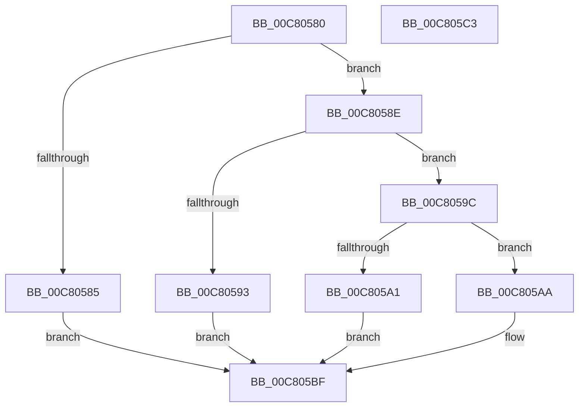

# BgpConsoleGetFontName

- RVA: `0x00C80580`–`0x00C805C4` (길이 `68` bytes)
- VA: `0x0000000140C80580`
- 실행 섹션: `INIT`
- PDB 이름 있음: `예`; PDB Function 태그: `아니요`
- unwind 정보 RVA: `0x000DB714`
- 디코드: `19`개 명령, `68/68` bytes 표시
- 미해석 바이트: `0` (있으면 어셈블리에 `.byte`로 보존)

> 이 문서는 커널 이미지의 기계어와 PDB 기호를 분석해 생성했습니다. 4번과 5번은 함수 원형과 자료형을 바이너리 사용 방식에서 추정한 C 해석이며 원본 소스 복구 결과는 아닙니다.

## 1. Dependencies

- 직접 호출 지점: **0**; 고유 호출 대상: **0**
- 직접 호출자로 확인된 함수: **1**
- RIP 상대 이미지 참조: **5**

### Outgoing calls
- 직접 디코드된 call 명령이 없습니다.

### Direct callers
- [BgpConsoleInitialize](../../pagebgfx/BC/BgpConsoleInitialize_function_00BC10B0.md) at `0x00BC1198`

### Static image references
- `0x00C80585` → RVA `0x00C81C40` (` ?? ::NKKEPPGN::`string'`; read)
- `0x00C80593` → RVA `0x00C81C60` (` ?? ::NKKEPPGN::`string'`; read)
- `0x00C805A1` → RVA `0x00C81C90` (` ?? ::NKKEPPGN::`string'`; read)
- `0x00C805AD` → RVA `0x00C81CC0` (` ?? ::NKKEPPGN::`string'`; read)
- `0x00C805B4` → RVA `0x00C81D00` (` ?? ::NKKEPPGN::`string'`; read)

## 2. Other-region calls and transfers

- 다른 실행 섹션으로 향하는 call: **0**
- 별도 외부 분기/꼬리 이동을 확인하지 못했습니다.

## 3. Assembly (complete function range)

```asm
00C80580  83 F9 02                        cmp ecx, 2
00C80583  75 09                           jne 0x140c8058e
00C80585  48 8D 05 B4 16 00 00            lea rax, [rip + 0x16b4]
00C8058C  EB 31                           jmp 0x140c805bf
00C8058E  83 F9 01                        cmp ecx, 1
00C80591  75 09                           jne 0x140c8059c
00C80593  48 8D 05 C6 16 00 00            lea rax, [rip + 0x16c6]
00C8059A  EB 23                           jmp 0x140c805bf
00C8059C  83 F9 03                        cmp ecx, 3
00C8059F  75 09                           jne 0x140c805aa
00C805A1  48 8D 05 E8 16 00 00            lea rax, [rip + 0x16e8]
00C805A8  EB 15                           jmp 0x140c805bf
00C805AA  83 F9 04                        cmp ecx, 4
00C805AD  48 8D 05 0C 17 00 00            lea rax, [rip + 0x170c]
00C805B4  4C 8D 05 45 17 00 00            lea r8, [rip + 0x1745]
00C805BB  49 0F 45 C0                     cmovne rax, r8
00C805BF  48 89 02                        mov qword ptr [rdx], rax
00C805C2  C3                              ret
00C805C3  CC                              int3
```

## 4. C-style interpretation (structured pseudocode)

```c
__int64 __fastcall BgpConsoleGetFontName(int a1, __int64 a2)
{
    __int64 result;

    if (a1 != 2) goto loc_00C8058E;
    goto loc_00C805BF;
loc_00C8058E:
    if (a1 != 1) goto loc_00C8059C;
    goto loc_00C805BF;
loc_00C8059C:
    if (a1 != 3) goto loc_00C805AA;
    goto loc_00C805BF;
loc_00C805AA:
    result = v_rip + 5900;
    if (a1 != 4) { result = v_rip + 5957; }
loc_00C805BF:
    *(unsigned __int64 *)(a2) = result;
    return result;
}
```

## 5. (Beta) C Style

```c
int64_t BgpConsoleGetFontName(int32_t Arg1, void *Arg2)
{
    uint8_t *arg2 = (uint8_t *)Arg2;

    int64_t result;

    if (Arg1 != 2) goto loc_00C8058E;
    goto loc_00C805BF;
loc_00C8058E:
    if (Arg1 != 1) goto loc_00C8059C;
    goto loc_00C805BF;
loc_00C8059C:
    if (Arg1 != 3) goto loc_00C805AA;
    goto loc_00C805BF;
loc_00C805AA:
    result = v_rip + 5900;
    if (Arg1 != 4) { result = v_rip + 5957; }
loc_00C805BF:
    *(uint64_t *)(arg2) = result;
    return result;
}
```

### 관측된 메모리 오프셋

구조체 형식이 확인되지 않은 접근은 인자 기준의 오프셋으로만 기록했습니다.

| 기준 인자 | 오프셋 표현 | 폭 (bit) | 접근 |
|---|---:|---:|---|
| `Arg2` | `+ 0x0` | `64` | `W` |

## 6. Execution-region graph

[열기: 2D/3D 그래프와 함수 탐색 컨트롤 패널](../../../control-panel.html?section=init&rva=0x00C80580&view=graph)

- 2D 그래프는 위에서 아래로 흐르고, 3D 그래프는 빈 공간을 드래그해 회전합니다. Shift+드래그는 이동, 휠은 확대·축소, 함수 노드 선택은 대상 보고서 이동입니다.

### Static fallback


