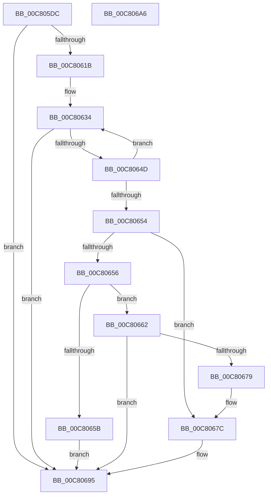

# BgpFoDetermineFontInformation

- RVA: `0x00C805DC`–`0x00C806A7` (길이 `203` bytes)
- VA: `0x0000000140C805DC`
- 실행 섹션: `INIT`
- PDB 이름 있음: `예`; PDB Function 태그: `아니요`
- unwind 정보 RVA: `0x000DA520`
- 디코드: `67`개 명령, `203/203` bytes 표시
- 미해석 바이트: `0` (있으면 어셈블리에 `.byte`로 보존)

> 이 문서는 커널 이미지의 기계어와 PDB 기호를 분석해 생성했습니다. 4번과 5번은 함수 원형과 자료형을 바이너리 사용 방식에서 추정한 C 해석이며 원본 소스 복구 결과는 아닙니다.

## 1. Dependencies

- 직접 호출 지점: **3**; 고유 호출 대상: **2**
- 직접 호출자로 확인된 함수: **1**
- RIP 상대 이미지 참조: **0**

### Outgoing calls
- `0x00C80612` → [BgpFoGetFontHandle](../../pagebgfx/BC/BgpFoGetFontHandle_function_00BC52B0.md) (function, `0x00BC52B0`)
- `0x00C80644` → [BgpFoGetTextMetrics](../../text/4E/BgpFoGetTextMetrics_function_004E3FC4.md) (function, `0x004E3FC4`)
- `0x00C80670` → [BgpFoGetTextMetrics](../../text/4E/BgpFoGetTextMetrics_function_004E3FC4.md) (function, `0x004E3FC4`)

### Direct callers
- [BgpBcInitializeCriticalMode](BgpBcInitializeCriticalMode_function_00C81454.md) at `0x00C81904`

### Static image references
- 디코드된 RIP-relative 메모리 참조가 없습니다.

## 2. Other-region calls and transfers

- 다른 실행 섹션으로 향하는 call: **3**
  - `0x00C80612` → [BgpFoGetFontHandle](../../pagebgfx/BC/BgpFoGetFontHandle_function_00BC52B0.md) (`INIT` → `PAGEBGFX`)
  - `0x00C80644` → [BgpFoGetTextMetrics](../../text/4E/BgpFoGetTextMetrics_function_004E3FC4.md) (`INIT` → `.text`)
  - `0x00C80670` → [BgpFoGetTextMetrics](../../text/4E/BgpFoGetTextMetrics_function_004E3FC4.md) (`INIT` → `.text`)
- 별도 외부 분기/꼬리 이동을 확인하지 못했습니다.

## 3. Assembly (complete function range)

```asm
00C805DC  48 89 5C 24 08                  mov qword ptr [rsp + 8], rbx
00C805E1  4C 89 44 24 18                  mov qword ptr [rsp + 0x18], r8
00C805E6  48 89 54 24 10                  mov qword ptr [rsp + 0x10], rdx
00C805EB  55                              push rbp
00C805EC  56                              push rsi
00C805ED  57                              push rdi
00C805EE  41 56                           push r14
00C805F0  41 57                           push r15
00C805F2  48 8B EC                        mov rbp, rsp
00C805F5  48 83 EC 40                     sub rsp, 0x40
00C805F9  83 65 F0 00                     and dword ptr [rbp - 0x10], 0
00C805FD  48 8D 55 38                     lea rdx, [rbp + 0x38]
00C80601  48 83 65 38 00                  and qword ptr [rbp + 0x38], 0
00C80606  8B F1                           mov esi, ecx
00C80608  48 83 65 40 00                  and qword ptr [rbp + 0x40], 0
00C8060D  33 C9                           xor ecx, ecx
00C8060F  4D 8B F1                        mov r14, r9
00C80612  E8 99 4C F4 FF                  call 0x140bc52b0
00C80617  85 C0                           test eax, eax
00C80619  78 7A                           js 0x140c80695
00C8061B  83 65 E0 00                     and dword ptr [rbp - 0x20], 0
00C8061F  BB 04 00 00 00                  mov ebx, 4
00C80624  83 4D E4 FF                     or dword ptr [rbp - 0x1c], 0xffffffff
00C80628  48 8B 7D 38                     mov rdi, qword ptr [rbp + 0x38]
00C8062C  83 65 F4 00                     and dword ptr [rbp - 0xc], 0
00C80630  48 89 7D E8                     mov qword ptr [rbp - 0x18], rdi
00C80634  44 8B FB                        mov r15d, ebx
00C80637  48 8D 55 40                     lea rdx, [rbp + 0x40]
00C8063B  FF C3                           inc ebx
00C8063D  48 8D 4D E0                     lea rcx, [rbp - 0x20]
00C80641  89 5D F0                        mov dword ptr [rbp - 0x10], ebx
00C80644  E8 7B 39 86 FF                  call 0x1404e3fc4
00C80649  85 C0                           test eax, eax
00C8064B  78 48                           js 0x140c80695
00C8064D  8B 4D 44                        mov ecx, dword ptr [rbp + 0x44]
00C80650  3B CE                           cmp ecx, esi
00C80652  72 E0                           jb 0x140c80634
00C80654  76 26                           jbe 0x140c8067c
00C80656  83 FB 05                        cmp ebx, 5
00C80659  77 07                           ja 0x140c80662
00C8065B  B8 01 00 00 C0                  mov eax, 0xc0000001
00C80660  EB 33                           jmp 0x140c80695
00C80662  41 8B DF                        mov ebx, r15d
00C80665  48 8D 55 40                     lea rdx, [rbp + 0x40]
00C80669  48 8D 4D E0                     lea rcx, [rbp - 0x20]
00C8066D  89 5D F0                        mov dword ptr [rbp - 0x10], ebx
00C80670  E8 4F 39 86 FF                  call 0x1404e3fc4
00C80675  85 C0                           test eax, eax
00C80677  78 1C                           js 0x140c80695
00C80679  8B 4D 44                        mov ecx, dword ptr [rbp + 0x44]
00C8067C  8B 45 40                        mov eax, dword ptr [rbp + 0x40]
00C8067F  41 89 06                        mov dword ptr [r14], eax
00C80682  48 8B 45 50                     mov rax, qword ptr [rbp + 0x50]
00C80686  41 89 4E 04                     mov dword ptr [r14 + 4], ecx
00C8068A  89 18                           mov dword ptr [rax], ebx
00C8068C  48 8B 45 58                     mov rax, qword ptr [rbp + 0x58]
00C80690  48 89 38                        mov qword ptr [rax], rdi
00C80693  33 C0                           xor eax, eax
00C80695  48 8B 5C 24 70                  mov rbx, qword ptr [rsp + 0x70]
00C8069A  48 83 C4 40                     add rsp, 0x40
00C8069E  41 5F                           pop r15
00C806A0  41 5E                           pop r14
00C806A2  5F                              pop rdi
00C806A3  5E                              pop rsi
00C806A4  5D                              pop rbp
00C806A5  C3                              ret
00C806A6  CC                              int3
```

## 4. C-style interpretation (structured pseudocode)

```c
__int64 __fastcall BgpFoDetermineFontInformation(int a1, __int64 a2, __int64 a3, __int64 a4, __int64 a5, __int64 a6)
{
    __int64 result;
    __int64 v_rbx;
    __int64 v_rsp;
    unsigned int v_stack_m34;
    unsigned int v_stack_m38;
    unsigned __int64 v_stack_m40;
    unsigned int v_stack_m44;
    unsigned int v_stack_m48;
    unsigned __int64 v_stack_p10;
    unsigned __int64 v_stack_p18;
    unsigned int v_stack_p1C;
    unsigned __int64 v_stack_p8;

    v_stack_p8 = v_rbx;
    v_stack_p18 = a3;
    v_stack_p10 = a2;
    v_rsp = (v_rsp) - (64);
    a1 = 0;
    result = BgpFoGetFontHandle(a1, v_stack_p10, a3, a4);
    if (sign_flag) goto loc_00C80695;
    v_stack_m40 = v_stack_p10;
loc_00C80634:
    v_rbx = (unsigned int)((4) + 1);
    v_stack_m38 = (unsigned int)(v_rbx);
    result = BgpFoGetTextMetrics(v_stack_m48, v_stack_p18, a3, a4);
    if (sign_flag) goto loc_00C80695;
    if (((unsigned int)((unsigned int)(v_stack_p1C))) < ((unsigned int)((unsigned int)(a1)))) goto loc_00C80634;
    if (((unsigned int)((unsigned int)(v_stack_p1C))) <= ((unsigned int)((unsigned int)(a1)))) goto loc_00C8067C;
    if (((unsigned int)(v_rbx)) > 5) goto loc_00C80662;
    goto loc_00C80695;
loc_00C80662:
    v_stack_m38 = 4;
    result = BgpFoGetTextMetrics(v_stack_m48, v_stack_p18, a3, a4);
    if (sign_flag) goto loc_00C80695;
loc_00C8067C:
    *(unsigned int *)(a4) = (unsigned int)((unsigned int)(v_stack_p18));
    *(unsigned int *)(a4 + 4) = (unsigned int)((unsigned int)(v_stack_p1C));
    *(unsigned int *)(a5) = 4;
    *(unsigned __int64 *)(a6) = v_stack_p10;
    result = 0;
loc_00C80695:
    v_rsp = (v_rsp) + (64);
    return result;
}
```

## 5. (Beta) C Style

```c
int64_t BgpFoDetermineFontInformation(int32_t Arg1, int64_t Arg2, int64_t Arg3, void *Arg4, void *Arg5, void *Arg6)
{
    uint8_t *arg4 = (uint8_t *)Arg4;
    uint8_t *arg5 = (uint8_t *)Arg5;
    uint8_t *arg6 = (uint8_t *)Arg6;

    int64_t result;
    int64_t local_rbx;
    int64_t local_rsp;
    uint32_t v_stack_m34;
    uint32_t v_stack_m38;
    uint64_t v_stack_m40;
    uint32_t v_stack_m44;
    uint32_t v_stack_m48;
    uint64_t v_stack_p10;
    uint64_t v_stack_p18;
    uint32_t v_stack_p1C;
    uint64_t v_stack_p8;

    v_stack_p8 = local_rbx;
    v_stack_p18 = Arg3;
    v_stack_p10 = Arg2;
    local_rsp = (local_rsp) - (64);
    Arg1 = 0;
    result = BgpFoGetFontHandle(Arg1, v_stack_p10, Arg3, Arg4);
    if (sign_flag) goto loc_00C80695;
    v_stack_m40 = v_stack_p10;
loc_00C80634:
    local_rbx = (uint32_t)((4) + 1);
    v_stack_m38 = (uint32_t)(local_rbx);
    result = BgpFoGetTextMetrics(v_stack_m48, v_stack_p18, Arg3, Arg4);
    if (sign_flag) goto loc_00C80695;
    if (((uint32_t)((uint32_t)(v_stack_p1C))) < ((uint32_t)((uint32_t)(Arg1)))) goto loc_00C80634;
    if (((uint32_t)((uint32_t)(v_stack_p1C))) <= ((uint32_t)((uint32_t)(Arg1)))) goto loc_00C8067C;
    if (((uint32_t)(local_rbx)) > 5) goto loc_00C80662;
    goto loc_00C80695;
loc_00C80662:
    v_stack_m38 = 4;
    result = BgpFoGetTextMetrics(v_stack_m48, v_stack_p18, Arg3, Arg4);
    if (sign_flag) goto loc_00C80695;
loc_00C8067C:
    *(uint32_t *)(arg4) = (uint32_t)((uint32_t)(v_stack_p18));
    *(uint32_t *)(arg4 + 0x4) = (uint32_t)((uint32_t)(v_stack_p1C));
    *(uint32_t *)(arg5) = 4;
    *(uint64_t *)(arg6) = v_stack_p10;
    result = 0;
loc_00C80695:
    local_rsp = (local_rsp) + (64);
    return result;
}
```

### 관측된 메모리 오프셋

구조체 형식이 확인되지 않은 접근은 인자 기준의 오프셋으로만 기록했습니다.

| 기준 인자 | 오프셋 표현 | 폭 (bit) | 접근 |
|---|---:|---:|---|
| `Arg4` | `+ 0x0` | `32` | `W` |
| `Arg4` | `+ 0x4` | `32` | `W` |
| `Arg5` | `+ 0x0` | `32` | `W` |
| `Arg6` | `+ 0x0` | `64` | `W` |

## 6. Execution-region graph

[열기: 2D/3D 그래프와 함수 탐색 컨트롤 패널](../../../control-panel.html?section=init&rva=0x00C805DC&view=graph)

- 2D 그래프는 위에서 아래로 흐르고, 3D 그래프는 빈 공간을 드래그해 회전합니다. Shift+드래그는 이동, 휠은 확대·축소, 함수 노드 선택은 대상 보고서 이동입니다.

### Static fallback


