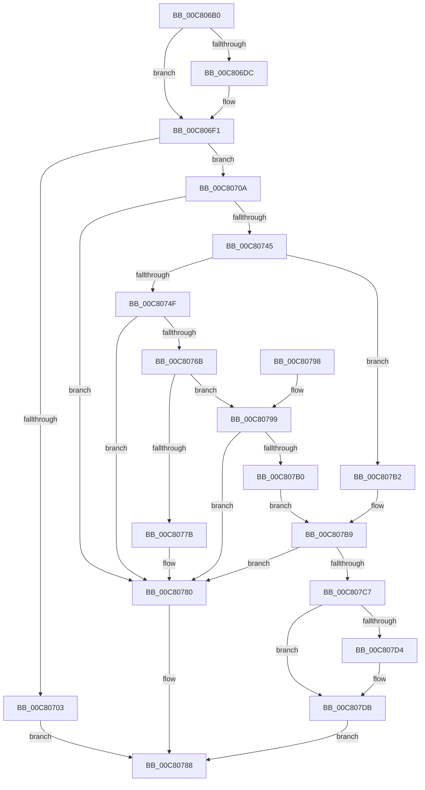

# BgpFoInitialize

- RVA: `0x00C806B0`–`0x00C807EF` (길이 `319` bytes)
- VA: `0x0000000140C806B0`
- 실행 섹션: `INIT`
- PDB 이름 있음: `예`; PDB Function 태그: `아니요`
- unwind 정보 RVA: `0x000DA4F4`
- 디코드: `89`개 명령, `319/319` bytes 표시
- 미해석 바이트: `0` (있으면 어셈블리에 `.byte`로 보존)

> 이 문서는 커널 이미지의 기계어와 PDB 기호를 분석해 생성했습니다. 4번과 5번은 함수 원형과 자료형을 바이너리 사용 방식에서 추정한 C 해석이며 원본 소스 복구 결과는 아닙니다.

## 1. Dependencies

- 직접 호출 지점: **6**; 고유 호출 대상: **4**
- 직접 호출자로 확인된 함수: **1**
- RIP 상대 이미지 참조: **5**

### Outgoing calls
- `0x00C806F6` → [BgpFwAllocateMemory](../../text/3E/BgpFwAllocateMemory_function_003E4374.md) (function, `0x003E4374`)
- `0x00C8073A` → [FioFwReadUlongAtOffset](../../text/6A/FioFwReadUlongAtOffset_function_006A2BB4.md) (function, `0x006A2BB4`)
- `0x00C80760` → [FioFwReadUlongAtOffset](../../text/6A/FioFwReadUlongAtOffset_function_006A2BB4.md) (function, `0x006A2BB4`)
- `0x00C80783` → [BgpFwFreeMemory](../../text/3E/BgpFwFreeMemory_function_003E25E0.md) (function, `0x003E25E0`)
- `0x00C807A5` → [FioFwReadUlongAtOffset](../../text/6A/FioFwReadUlongAtOffset_function_006A2BB4.md) (function, `0x006A2BB4`)
- `0x00C807BC` → [FopInitializeFonts](FopInitializeFonts_function_00C808FC.md) (function, `0x00C808FC`)

### Direct callers
- [BgpFwLibraryInitialize](../../pagebgfx/BC/BgpFwLibraryInitialize_function_00BC5400.md) at `0x00BC55E7`
- [BgpFwLibraryInitialize](../../pagebgfx/BC/BgpFwLibraryInitialize_function_00BC5400.md) at `0x00BC593F`
- [BgpFwLibraryInitialize](../../pagebgfx/BC/BgpFwLibraryInitialize_function_00BC5400.md) at `0x00BC5B00`

### Static image references
- `0x00C806C2` → RVA `0x00EF03C0` (`.data`; read)
- `0x00C806D0` → RVA `0x00EF03B4` (`.data`; read)
- `0x00C806DC` → RVA `0x00EF03C8` (`.data`; write)
- `0x00C806E3` → RVA `0x00EF03C0` (`.data`; write)
- `0x00C806EA` → RVA `0x00EF03B4` (`.data`; write)

## 2. Other-region calls and transfers

- 다른 실행 섹션으로 향하는 call: **5**
  - `0x00C806F6` → [BgpFwAllocateMemory](../../text/3E/BgpFwAllocateMemory_function_003E4374.md) (`INIT` → `.text`)
  - `0x00C8073A` → [FioFwReadUlongAtOffset](../../text/6A/FioFwReadUlongAtOffset_function_006A2BB4.md) (`INIT` → `.text`)
  - `0x00C80760` → [FioFwReadUlongAtOffset](../../text/6A/FioFwReadUlongAtOffset_function_006A2BB4.md) (`INIT` → `.text`)
  - `0x00C80783` → [BgpFwFreeMemory](../../text/3E/BgpFwFreeMemory_function_003E25E0.md) (`INIT` → `.text`)
  - `0x00C807A5` → [FioFwReadUlongAtOffset](../../text/6A/FioFwReadUlongAtOffset_function_006A2BB4.md) (`INIT` → `.text`)
- 별도 외부 분기/꼬리 이동을 확인하지 못했습니다.

## 3. Assembly (complete function range)

```asm
00C806B0  48 89 5C 24 08                  mov qword ptr [rsp + 8], rbx
00C806B5  56                              push rsi
00C806B6  57                              push rdi
00C806B7  41 56                           push r14
00C806B9  48 83 EC 20                     sub rsp, 0x20
00C806BD  83 64 24 50 00                  and dword ptr [rsp + 0x50], 0
00C806C2  4C 8D 35 F7 FC 26 00            lea r14, [rip + 0x26fcf7]
00C806C9  83 64 24 58 00                  and dword ptr [rsp + 0x58], 0
00C806CE  8B FA                           mov edi, edx
00C806D0  80 3D DD FC 26 00 00            cmp byte ptr [rip + 0x26fcdd], 0
00C806D7  48 8B F1                        mov rsi, rcx
00C806DA  75 15                           jne 0x140c806f1
00C806DC  4C 89 35 E5 FC 26 00            mov qword ptr [rip + 0x26fce5], r14
00C806E3  4C 89 35 D6 FC 26 00            mov qword ptr [rip + 0x26fcd6], r14
00C806EA  C6 05 C3 FC 26 00 01            mov byte ptr [rip + 0x26fcc3], 1
00C806F1  B9 38 00 00 00                  mov ecx, 0x38
00C806F6  E8 79 3C 76 FF                  call 0x1403e4374
00C806FB  48 8B D8                        mov rbx, rax
00C806FE  48 85 C0                        test rax, rax
00C80701  75 07                           jne 0x140c8070a
00C80703  BF 17 00 00 C0                  mov edi, 0xc0000017
00C80708  EB 7E                           jmp 0x140c80788
00C8070A  0F 57 C0                        xorps xmm0, xmm0
00C8070D  4C 8D 44 24 50                  lea r8, [rsp + 0x50]
00C80712  0F 11 03                        movups xmmword ptr [rbx], xmm0
00C80715  33 C0                           xor eax, eax
00C80717  33 D2                           xor edx, edx
00C80719  0F 11 43 10                     movups xmmword ptr [rbx + 0x10], xmm0
00C8071D  48 8B CE                        mov rcx, rsi
00C80720  0F 11 43 20                     movups xmmword ptr [rbx + 0x20], xmm0
00C80724  48 89 43 30                     mov qword ptr [rbx + 0x30], rax
00C80728  48 8D 43 28                     lea rax, [rbx + 0x28]
00C8072C  48 89 40 08                     mov qword ptr [rax + 8], rax
00C80730  48 89 00                        mov qword ptr [rax], rax
00C80733  48 89 73 10                     mov qword ptr [rbx + 0x10], rsi
00C80737  89 7B 1C                        mov dword ptr [rbx + 0x1c], edi
00C8073A  E8 75 24 A2 FF                  call 0x1406a2bb4
00C8073F  8B F8                           mov edi, eax
00C80741  85 C0                           test eax, eax
00C80743  78 3B                           js 0x140c80780
00C80745  81 7C 24 50 66 63 74 74         cmp dword ptr [rsp + 0x50], 0x74746366
00C8074D  75 63                           jne 0x140c807b2
00C8074F  83 4B 20 01                     or dword ptr [rbx + 0x20], 1
00C80753  4C 8D 44 24 58                  lea r8, [rsp + 0x58]
00C80758  BA 04 00 00 00                  mov edx, 4
00C8075D  48 8B CE                        mov rcx, rsi
00C80760  E8 4F 24 A2 FF                  call 0x1406a2bb4
00C80765  8B F8                           mov edi, eax
00C80767  85 C0                           test eax, eax
00C80769  78 15                           js 0x140c80780
00C8076B  8B 44 24 58                     mov eax, dword ptr [rsp + 0x58]
00C8076F  05 00 00 FF FF                  add eax, 0xffff0000
00C80774  A9 FF FF FE FF                  test eax, 0xfffeffff
00C80779  74 1E                           je 0x140c80799
00C8077B  BF 7B 00 00 C0                  mov edi, 0xc000007b
00C80780  48 8B CB                        mov rcx, rbx
00C80783  E8 58 1E 76 FF                  call 0x1403e25e0
00C80788  48 8B 5C 24 40                  mov rbx, qword ptr [rsp + 0x40]
00C8078D  8B C7                           mov eax, edi
00C8078F  48 83 C4 20                     add rsp, 0x20
00C80793  41 5E                           pop r14
00C80795  5F                              pop rdi
00C80796  5E                              pop rsi
00C80797  C3                              ret
00C80798  CC                              int3
00C80799  4C 8D 43 18                     lea r8, [rbx + 0x18]
00C8079D  BA 08 00 00 00                  mov edx, 8
00C807A2  48 8B CE                        mov rcx, rsi
00C807A5  E8 0A 24 A2 FF                  call 0x1406a2bb4
00C807AA  8B F8                           mov edi, eax
00C807AC  85 C0                           test eax, eax
00C807AE  78 D0                           js 0x140c80780
00C807B0  EB 07                           jmp 0x140c807b9
00C807B2  C7 43 18 01 00 00 00            mov dword ptr [rbx + 0x18], 1
00C807B9  48 8B CB                        mov rcx, rbx
00C807BC  E8 3B 01 00 00                  call 0x140c808fc
00C807C1  8B F8                           mov edi, eax
00C807C3  85 C0                           test eax, eax
00C807C5  78 B9                           js 0x140c80780
00C807C7  48 8B 05 F2 FB 26 00            mov rax, qword ptr [rip + 0x26fbf2]
00C807CE  4C 39 70 08                     cmp qword ptr [rax + 8], r14
00C807D2  74 07                           je 0x140c807db
00C807D4  B9 03 00 00 00                  mov ecx, 3
00C807D9  CD 29                           int 0x29
00C807DB  48 89 03                        mov qword ptr [rbx], rax
00C807DE  4C 89 73 08                     mov qword ptr [rbx + 8], r14
00C807E2  48 89 58 08                     mov qword ptr [rax + 8], rbx
00C807E6  48 89 1D D3 FB 26 00            mov qword ptr [rip + 0x26fbd3], rbx
00C807ED  EB 99                           jmp 0x140c80788
```

## 4. C-style interpretation (structured pseudocode)

```c
__int64 __fastcall BgpFoInitialize(__int64 a1, int a2)
{
    __int64 result;
    __int64 v_rsp;
    unsigned int v_stack_p18;
    unsigned int v_stack_p20;
    unsigned __int64 v_stack_p8;

    v_stack_p8 = v_rbx;
    v_rsp = (v_rsp) - (32);
    if ((*(unsigned __int8 *)(v_rip + 2555101)) == 0) {
        *(unsigned __int64 *)(v_rip + 2555109) = v_rip + 2555127;
        *(unsigned __int64 *)(v_rip + 2555094) = v_rip + 2555127;
        *(unsigned __int8 *)(v_rip + 2555075) = 1;
    }
    result = BgpFwAllocateMemory(56, a2, a3, a4);
    if (result != 0) goto loc_00C8070A;
    goto loc_00C80788;
loc_00C8070A:
    *(unsigned __int64 *)(result) = v_xmm0;
    result = 0;
    a2 = 0;
    *(unsigned __int64 *)(result + 16) = v_xmm0;
    *(unsigned __int64 *)(result + 32) = v_xmm0;
    *(unsigned __int64 *)(result + 48) = 0;
    *(unsigned __int64 *)(result + 40 + 8) = result + 40;
    *(unsigned __int64 *)(result + 40) = result + 40;
    *(unsigned __int64 *)(result + 16) = a1;
    *(unsigned int *)(result + 28) = (unsigned int)((unsigned int)(0xC0000017ULL));
    result = FioFwReadUlongAtOffset(a1, a2, v_stack_p18, a4);
    if (sign_flag) goto loc_00C80780;
    if (v_stack_p18 != 0x74746366ULL) goto loc_00C807B2;
    result = FioFwReadUlongAtOffset(a1, 4, v_stack_p20, a4);
    if (sign_flag) goto loc_00C80780;
    result = (unsigned int)(((unsigned int)(v_stack_p20)) + (0xFFFF0000ULL));
    if ((((unsigned int)(result)) & (0xFFFEFFFFULL)) == 0) goto loc_00C80799;
loc_00C80780:
    result = BgpFwFreeMemory(result, 4, v_stack_p20, a4);
loc_00C80788:
    v_rsp = (v_rsp) + (32);
    return (unsigned int)((unsigned int)((unsigned int)(0xC000007BULL)));
loc_00C80799:
    result = FioFwReadUlongAtOffset(a1, 8, v_stack_p8 + 24, a4);
    if (sign_flag) goto loc_00C80780;
    goto loc_00C807B9;
loc_00C807B2:
    *(unsigned int *)(v_stack_p8 + 24) = 1;
loc_00C807B9:
    result = FopInitializeFonts(v_stack_p8, 8, v_stack_p8 + 24, a4);
    if (sign_flag) goto loc_00C80780;
    if ((*(unsigned __int64 *)(*(unsigned __int64 *)(v_rip + 2554866) + 8)) != (v_rip + 2555127)) {
        a1 = 3;
    }
    *(unsigned __int64 *)(v_stack_p8) = *(unsigned __int64 *)(v_rip + 2554866);
    *(unsigned __int64 *)(v_stack_p8 + 8) = v_rip + 2555127;
    *(unsigned __int64 *)(*(unsigned __int64 *)(v_rip + 2554866) + 8) = v_stack_p8;
    *(unsigned __int64 *)(v_rip + 2554835) = v_stack_p8;
    goto loc_00C80788;
}
```

## 5. (Beta) C Style

```c
int64_t BgpFoInitialize(int64_t Arg1, int32_t Arg2)
{
    int64_t result;
    int64_t local_rsp;
    uint32_t v_stack_p18;
    uint32_t v_stack_p20;
    uint64_t v_stack_p8;

    v_stack_p8 = local_rbx;
    local_rsp = (local_rsp) - (32);
    if ((*(uint8_t *)(v_rip + 0x26FCDD)) == 0) {
        *(uint64_t *)(v_rip + 0x26FCE5) = v_rip + 2555127;
        *(uint64_t *)(v_rip + 0x26FCD6) = v_rip + 2555127;
        *(uint8_t *)(v_rip + 0x26FCC3) = 1;
    }
    result = BgpFwAllocateMemory(56, Arg2, a3, a4);
    if (result != 0) goto loc_00C8070A;
    goto loc_00C80788;
loc_00C8070A:
    *(uint64_t *)(result) = v_xmm0;
    result = 0;
    Arg2 = 0;
    *(uint64_t *)(result + 0x10) = v_xmm0;
    *(uint64_t *)(result + 0x20) = v_xmm0;
    *(uint64_t *)(result + 0x30) = 0;
    *(uint64_t *)(result + 0x28 + 0x8) = result + 40;
    *(uint64_t *)(result + 0x28) = result + 40;
    *(uint64_t *)(result + 0x10) = Arg1;
    *(uint32_t *)(result + 0x1C) = (uint32_t)((uint32_t)(0xC0000017ULL));
    result = FioFwReadUlongAtOffset(Arg1, Arg2, v_stack_p18, a4);
    if (sign_flag) goto loc_00C80780;
    if (v_stack_p18 != 0x74746366ULL) goto loc_00C807B2;
    result = FioFwReadUlongAtOffset(Arg1, 4, v_stack_p20, a4);
    if (sign_flag) goto loc_00C80780;
    result = (uint32_t)(((uint32_t)(v_stack_p20)) + (0xFFFF0000ULL));
    if ((((uint32_t)(result)) & (0xFFFEFFFFULL)) == 0) goto loc_00C80799;
loc_00C80780:
    result = BgpFwFreeMemory(result, 4, v_stack_p20, a4);
loc_00C80788:
    local_rsp = (local_rsp) + (32);
    return (uint32_t)((uint32_t)((uint32_t)(0xC000007BULL)));
loc_00C80799:
    result = FioFwReadUlongAtOffset(Arg1, 8, v_stack_p8 + 24, a4);
    if (sign_flag) goto loc_00C80780;
    goto loc_00C807B9;
loc_00C807B2:
    *(uint32_t *)(v_stack_p8 + 0x18) = 1;
loc_00C807B9:
    result = FopInitializeFonts(v_stack_p8, 8, v_stack_p8 + 24, a4);
    if (sign_flag) goto loc_00C80780;
    if ((*(uint64_t *)(*(uint64_t *)(v_rip + 0x26FBF2) + 0x8)) != (v_rip + 2555127)) {
        Arg1 = 3;
    }
    *(uint64_t *)(v_stack_p8) = *(uint64_t *)(v_rip + 0x26FBF2);
    *(uint64_t *)(v_stack_p8 + 0x8) = v_rip + 2555127;
    *(uint64_t *)(*(uint64_t *)(v_rip + 0x26FBF2) + 0x8) = v_stack_p8;
    *(uint64_t *)(v_rip + 0x26FBD3) = v_stack_p8;
    goto loc_00C80788;
}
```

## 6. Execution-region graph

[열기: 2D/3D 그래프와 함수 탐색 컨트롤 패널](../../../control-panel.html?section=init&rva=0x00C806B0&view=graph)

- 2D 그래프는 위에서 아래로 흐르고, 3D 그래프는 빈 공간을 드래그해 회전합니다. Shift+드래그는 이동, 휠은 확대·축소, 함수 노드 선택은 대상 보고서 이동입니다.

### Static fallback


