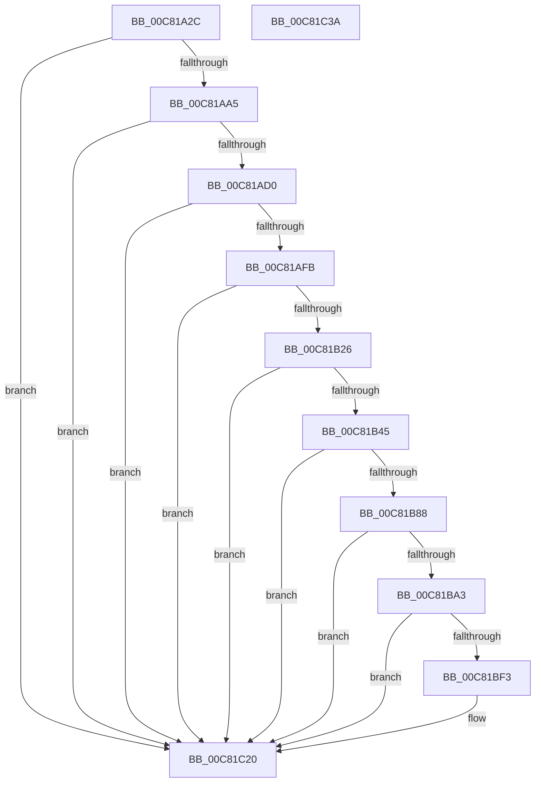

# BgpRasInitializeRasterizer

- RVA: `0x00C81A2C`–`0x00C81C3B` (길이 `527` bytes)
- VA: `0x0000000140C81A2C`
- 실행 섹션: `INIT`
- PDB 이름 있음: `예`; PDB Function 태그: `아니요`
- unwind 정보 RVA: `0x000C7270`
- 디코드: `134`개 명령, `527/527` bytes 표시
- 미해석 바이트: `0` (있으면 어셈블리에 `.byte`로 보존)

> 이 문서는 커널 이미지의 기계어와 PDB 기호를 분석해 생성했습니다. 4번과 5번은 함수 원형과 자료형을 바이너리 사용 방식에서 추정한 C 해석이며 원본 소스 복구 결과는 아닙니다.

## 1. Dependencies

- 직접 호출 지점: **7**; 고유 호출 대상: **2**
- 직접 호출자로 확인된 함수: **1**
- RIP 상대 이미지 참조: **7**

### Outgoing calls
- `0x00C81A96` → [FopGetTableOffsetAndSize](FopGetTableOffsetAndSize_function_00C807F8.md) (function, `0x00C807F8`)
- `0x00C81AC1` → [FopGetTableOffsetAndSize](FopGetTableOffsetAndSize_function_00C807F8.md) (function, `0x00C807F8`)
- `0x00C81AEC` → [FopGetTableOffsetAndSize](FopGetTableOffsetAndSize_function_00C807F8.md) (function, `0x00C807F8`)
- `0x00C81B17` → [FopGetTableOffsetAndSize](FopGetTableOffsetAndSize_function_00C807F8.md) (function, `0x00C807F8`)
- `0x00C81B36` → [FioFwReadBytesAtOffset](../../text/3E/FioFwReadBytesAtOffset_function_003E5948.md) (function, `0x003E5948`)
- `0x00C81B79` → [FopGetTableOffsetAndSize](FopGetTableOffsetAndSize_function_00C807F8.md) (function, `0x00C807F8`)
- `0x00C81B98` → [FioFwReadBytesAtOffset](../../text/3E/FioFwReadBytesAtOffset_function_003E5948.md) (function, `0x003E5948`)

### Direct callers
- [FopInitializeFonts](FopInitializeFonts_function_00C808FC.md) at `0x00C809E0`

### Static image references
- `0x00C81BD7` → RVA `0x00EF02E8` (`.data`; read)
- `0x00C81BF3` → RVA `0x00EF0334` (`.data`; read/write)
- `0x00C81BFA` → RVA `0x00EF0300` (`.data`; read)
- `0x00C81C01` → RVA `0x00EF0308` (`.data`; write)
- `0x00C81C08` → RVA `0x00EF0300` (`.data`; write)
- `0x00C81C0F` → RVA `0x00EF0330` (`.data`; write)
- `0x00C81C19` → RVA `0x00EF02E8` (`.data`; write)

## 2. Other-region calls and transfers

- 다른 실행 섹션으로 향하는 call: **2**
  - `0x00C81B36` → [FioFwReadBytesAtOffset](../../text/3E/FioFwReadBytesAtOffset_function_003E5948.md) (`INIT` → `.text`)
  - `0x00C81B98` → [FioFwReadBytesAtOffset](../../text/3E/FioFwReadBytesAtOffset_function_003E5948.md) (`INIT` → `.text`)
- 별도 외부 분기/꼬리 이동을 확인하지 못했습니다.

## 3. Assembly (complete function range)

```asm
00C81A2C  48 89 5C 24 18                  mov qword ptr [rsp + 0x18], rbx
00C81A31  48 89 74 24 20                  mov qword ptr [rsp + 0x20], rsi
00C81A36  55                              push rbp
00C81A37  57                              push rdi
00C81A38  41 56                           push r14
00C81A3A  48 8D 6C 24 B9                  lea rbp, [rsp - 0x47]
00C81A3F  48 81 EC 90 00 00 00            sub rsp, 0x90
00C81A46  8B 71 2C                        mov esi, dword ptr [rcx + 0x2c]
00C81A49  4C 8D 49 40                     lea r9, [rcx + 0x40]
00C81A4D  83 65 6F 00                     and dword ptr [rbp + 0x6f], 0
00C81A51  33 C0                           xor eax, eax
00C81A53  21 45 67                        and dword ptr [rbp + 0x67], eax
00C81A56  0F 57 C0                        xorps xmm0, xmm0
00C81A59  89 45 3F                        mov dword ptr [rbp + 0x3f], eax
00C81A5C  48 8B D9                        mov rbx, rcx
00C81A5F  66 89 45 43                     mov word ptr [rbp + 0x43], ax
00C81A63  41 B8 64 61 65 68               mov r8d, 0x68656164
00C81A69  89 45 07                        mov dword ptr [rbp + 7], eax
00C81A6C  8B D6                           mov edx, esi
00C81A6E  48 8B 41 10                     mov rax, qword ptr [rcx + 0x10]
00C81A72  0F 11 45 0F                     movups xmmword ptr [rbp + 0xf], xmm0
00C81A76  0F 11 45 1F                     movups xmmword ptr [rbp + 0x1f], xmm0
00C81A7A  48 8B 78 10                     mov rdi, qword ptr [rax + 0x10]
00C81A7E  48 8D 45 6F                     lea rax, [rbp + 0x6f]
00C81A82  48 8B CF                        mov rcx, rdi
00C81A85  48 89 44 24 20                  mov qword ptr [rsp + 0x20], rax
00C81A8A  0F 11 45 2F                     movups xmmword ptr [rbp + 0x2f], xmm0
00C81A8E  0F 11 45 E7                     movups xmmword ptr [rbp - 0x19], xmm0
00C81A92  0F 11 45 F7                     movups xmmword ptr [rbp - 9], xmm0
00C81A96  E8 5D ED FF FF                  call 0x140c807f8
00C81A9B  8B D0                           mov edx, eax
00C81A9D  85 C0                           test eax, eax
00C81A9F  0F 88 7B 01 00 00               js 0x140c81c20
00C81AA5  83 65 6F 00                     and dword ptr [rbp + 0x6f], 0
00C81AA9  48 8D 45 6F                     lea rax, [rbp + 0x6f]
00C81AAD  4C 8D 4B 3C                     lea r9, [rbx + 0x3c]
00C81AB1  48 89 44 24 20                  mov qword ptr [rsp + 0x20], rax
00C81AB6  41 B8 66 79 6C 67               mov r8d, 0x676c7966
00C81ABC  8B D6                           mov edx, esi
00C81ABE  48 8B CF                        mov rcx, rdi
00C81AC1  E8 32 ED FF FF                  call 0x140c807f8
00C81AC6  8B D0                           mov edx, eax
00C81AC8  85 C0                           test eax, eax
00C81ACA  0F 88 50 01 00 00               js 0x140c81c20
00C81AD0  83 65 6F 00                     and dword ptr [rbp + 0x6f], 0
00C81AD4  48 8D 45 6F                     lea rax, [rbp + 0x6f]
00C81AD8  4C 8D 4B 48                     lea r9, [rbx + 0x48]
00C81ADC  48 89 44 24 20                  mov qword ptr [rsp + 0x20], rax
00C81AE1  41 B8 61 63 6F 6C               mov r8d, 0x6c6f6361
00C81AE7  8B D6                           mov edx, esi
00C81AE9  48 8B CF                        mov rcx, rdi
00C81AEC  E8 07 ED FF FF                  call 0x140c807f8
00C81AF1  8B D0                           mov edx, eax
00C81AF3  85 C0                           test eax, eax
00C81AF5  0F 88 25 01 00 00               js 0x140c81c20
00C81AFB  83 65 6F 00                     and dword ptr [rbp + 0x6f], 0
00C81AFF  48 8D 45 6F                     lea rax, [rbp + 0x6f]
00C81B03  4C 8D 4B 44                     lea r9, [rbx + 0x44]
00C81B07  48 89 44 24 20                  mov qword ptr [rsp + 0x20], rax
00C81B0C  41 B8 78 74 6D 68               mov r8d, 0x686d7478
00C81B12  8B D6                           mov edx, esi
00C81B14  48 8B CF                        mov rcx, rdi
00C81B17  E8 DC EC FF FF                  call 0x140c807f8
00C81B1C  8B D0                           mov edx, eax
00C81B1E  85 C0                           test eax, eax
00C81B20  0F 88 FA 00 00 00               js 0x140c81c20
00C81B26  8B 53 40                        mov edx, dword ptr [rbx + 0x40]
00C81B29  4C 8D 4D 0F                     lea r9, [rbp + 0xf]
00C81B2D  41 B8 36 00 00 00               mov r8d, 0x36
00C81B33  48 8B CF                        mov rcx, rdi
00C81B36  E8 0D 3E 76 FF                  call 0x1403e5948
00C81B3B  8B D0                           mov edx, eax
00C81B3D  85 C0                           test eax, eax
00C81B3F  0F 88 DB 00 00 00               js 0x140c81c20
00C81B45  0F B7 45 41                     movzx eax, word ptr [rbp + 0x41]
00C81B49  4C 8D 4D 67                     lea r9, [rbp + 0x67]
00C81B4D  83 65 6F 00                     and dword ptr [rbp + 0x6f], 0
00C81B51  41 B8 61 65 68 68               mov r8d, 0x68686561
00C81B57  66 C1 C8 08                     ror ax, 8
00C81B5B  8B D6                           mov edx, esi
00C81B5D  66 89 43 4C                     mov word ptr [rbx + 0x4c], ax
00C81B61  48 8B CF                        mov rcx, rdi
00C81B64  0F B7 45 21                     movzx eax, word ptr [rbp + 0x21]
00C81B68  66 C1 C8 08                     ror ax, 8
00C81B6C  66 89 43 78                     mov word ptr [rbx + 0x78], ax
00C81B70  48 8D 45 6F                     lea rax, [rbp + 0x6f]
00C81B74  48 89 44 24 20                  mov qword ptr [rsp + 0x20], rax
00C81B79  E8 7A EC FF FF                  call 0x140c807f8
00C81B7E  8B D0                           mov edx, eax
00C81B80  85 C0                           test eax, eax
00C81B82  0F 88 98 00 00 00               js 0x140c81c20
00C81B88  8B 55 67                        mov edx, dword ptr [rbp + 0x67]
00C81B8B  4C 8D 4D E7                     lea r9, [rbp - 0x19]
00C81B8F  41 B8 24 00 00 00               mov r8d, 0x24
00C81B95  48 8B CF                        mov rcx, rdi
00C81B98  E8 AB 3D 76 FF                  call 0x1403e5948
00C81B9D  8B D0                           mov edx, eax
00C81B9F  85 C0                           test eax, eax
00C81BA1  78 7D                           js 0x140c81c20
00C81BA3  0F B7 45 09                     movzx eax, word ptr [rbp + 9]
00C81BA7  0F B7 4D EB                     movzx ecx, word ptr [rbp - 0x15]
00C81BAB  66 C1 C8 08                     ror ax, 8
00C81BAF  66 89 43 58                     mov word ptr [rbx + 0x58], ax
00C81BB3  0F B7 45 F1                     movzx eax, word ptr [rbp - 0xf]
00C81BB7  66 C1 C8 08                     ror ax, 8
00C81BBB  66 89 43 4E                     mov word ptr [rbx + 0x4e], ax
00C81BBF  0F B7 45 ED                     movzx eax, word ptr [rbp - 0x13]
00C81BC3  66 C1 C8 08                     ror ax, 8
00C81BC7  66 C1 C9 08                     ror cx, 8
00C81BCB  66 89 43 54                     mov word ptr [rbx + 0x54], ax
00C81BCF  0F B7 45 F7                     movzx eax, word ptr [rbp - 9]
00C81BD3  66 C1 C8 08                     ror ax, 8
00C81BD7  80 3D 0A E7 26 00 00            cmp byte ptr [rip + 0x26e70a], 0
00C81BDE  66 89 4B 52                     mov word ptr [rbx + 0x52], cx
00C81BE2  66 89 43 50                     mov word ptr [rbx + 0x50], ax
00C81BE6  66 89 4B 56                     mov word ptr [rbx + 0x56], cx
00C81BEA  C7 43 60 60 00 00 00            mov dword ptr [rbx + 0x60], 0x60
00C81BF1  75 2D                           jne 0x140c81c20
00C81BF3  83 25 3A E7 26 00 00            and dword ptr [rip + 0x26e73a], 0
00C81BFA  48 8D 05 FF E6 26 00            lea rax, [rip + 0x26e6ff]
00C81C01  48 89 05 00 E7 26 00            mov qword ptr [rip + 0x26e700], rax
00C81C08  48 89 05 F1 E6 26 00            mov qword ptr [rip + 0x26e6f1], rax
00C81C0F  C7 05 17 E7 26 00 64 00 00 00   mov dword ptr [rip + 0x26e717], 0x64
00C81C19  C6 05 C8 E6 26 00 01            mov byte ptr [rip + 0x26e6c8], 1
00C81C20  4C 8D 9C 24 90 00 00 00         lea r11, [rsp + 0x90]
00C81C28  8B C2                           mov eax, edx
00C81C2A  49 8B 5B 30                     mov rbx, qword ptr [r11 + 0x30]
00C81C2E  49 8B 73 38                     mov rsi, qword ptr [r11 + 0x38]
00C81C32  49 8B E3                        mov rsp, r11
00C81C35  41 5E                           pop r14
00C81C37  5F                              pop rdi
00C81C38  5D                              pop rbp
00C81C39  C3                              ret
00C81C3A  CC                              int3
```

## 4. C-style interpretation (structured pseudocode)

```c
__int64 __fastcall BgpRasInitializeRasterizer(__int64 a1)
{
    __int64 result;
    __int64 v_rsp;
    unsigned __int64 v_stack_m18;
    unsigned __int16 v_stack_m1C;
    unsigned __int16 v_stack_m1E;
    unsigned int v_stack_m20;
    unsigned __int64 v_stack_m30;
    unsigned __int16 v_stack_m3E;
    unsigned __int64 v_stack_m40;
    unsigned __int64 v_stack_m50;
    unsigned __int16 v_stack_m56;
    unsigned int v_stack_m58;
    unsigned __int64 v_stack_m5F;
    unsigned __int64 v_stack_m68;
    unsigned __int16 v_stack_m6E;
    unsigned __int16 v_stack_m72;
    unsigned __int16 v_stack_m74;
    unsigned __int64 v_stack_m78;
    unsigned __int64 v_stack_m88;
    unsigned int v_stack_p10;
    unsigned __int64 v_stack_p18;
    unsigned __int64 v_stack_p20;
    unsigned int v_stack_p8;

    v_stack_p18 = v_rbx;
    v_stack_p20 = v_rsi;
    v_rsp = (v_rsp) - (144);
    result = 0;
    v_stack_m20 = 0;
    v_stack_m1C = 0;
    v_stack_m58 = 0;
    v_stack_m50 = v_xmm0;
    v_stack_m40 = v_xmm0;
    v_stack_m88 = v_stack_p10;
    v_stack_m30 = v_xmm0;
    v_stack_m78 = v_xmm0;
    v_stack_m68 = v_xmm0;
    result = FopGetTableOffsetAndSize(*(unsigned __int64 *)(*(unsigned __int64 *)(a1 + 16) + 16), (unsigned int)((unsigned int)((unsigned int)(*(unsigned int *)(a1 + 44)))), (unsigned int)(0x68656164ULL), a1 + 64);
    if (sign_flag) goto loc_00C81C20;
    v_stack_m88 = v_stack_p10;
    result = FopGetTableOffsetAndSize(*(unsigned __int64 *)(*(unsigned __int64 *)(a1 + 16) + 16), (unsigned int)((unsigned int)((unsigned int)(*(unsigned int *)(a1 + 44)))), (unsigned int)(0x676C7966ULL), a1 + 60);
    if (sign_flag) goto loc_00C81C20;
    v_stack_m88 = v_stack_p10;
    result = FopGetTableOffsetAndSize(*(unsigned __int64 *)(*(unsigned __int64 *)(a1 + 16) + 16), (unsigned int)((unsigned int)((unsigned int)(*(unsigned int *)(a1 + 44)))), (unsigned int)(0x6C6F6361ULL), a1 + 72);
    if (sign_flag) goto loc_00C81C20;
    v_stack_m88 = v_stack_p10;
    result = FopGetTableOffsetAndSize(*(unsigned __int64 *)(*(unsigned __int64 *)(a1 + 16) + 16), (unsigned int)((unsigned int)((unsigned int)(*(unsigned int *)(a1 + 44)))), (unsigned int)(0x686D7478ULL), a1 + 68);
    if (sign_flag) goto loc_00C81C20;
    result = FioFwReadBytesAtOffset(*(unsigned __int64 *)(*(unsigned __int64 *)(a1 + 16) + 16), (unsigned int)(*(unsigned int *)(a1 + 64)), 54, v_stack_m50);
    if (sign_flag) goto loc_00C81C20;
    *(unsigned __int16 *)(a1 + 76) = (unsigned __int16)(v_stack_m1E);
    *(unsigned __int16 *)(a1 + 120) = (unsigned __int16)(v_stack_m3E);
    v_stack_m88 = v_stack_p10;
    result = FopGetTableOffsetAndSize(*(unsigned __int64 *)(*(unsigned __int64 *)(a1 + 16) + 16), (unsigned int)((unsigned int)((unsigned int)(*(unsigned int *)(a1 + 44)))), (unsigned int)(0x68686561ULL), v_stack_p8);
    if (sign_flag) goto loc_00C81C20;
    result = FioFwReadBytesAtOffset(*(unsigned __int64 *)(*(unsigned __int64 *)(a1 + 16) + 16), (unsigned int)(v_stack_p8), 36, v_stack_m78);
    if (sign_flag) goto loc_00C81C20;
    *(unsigned __int16 *)(a1 + 88) = (unsigned __int16)(v_stack_m56);
    *(unsigned __int16 *)(a1 + 78) = (unsigned __int16)(v_stack_m6E);
    *(unsigned __int16 *)(a1 + 84) = (unsigned __int16)(v_stack_m72);
    *(unsigned __int16 *)(a1 + 82) = (unsigned __int16)(v_stack_m74);
    *(unsigned __int16 *)(a1 + 80) = (unsigned __int16)(v_stack_m68);
    *(unsigned __int16 *)(a1 + 86) = (unsigned __int16)(v_stack_m74);
    *(unsigned int *)(a1 + 96) = 96;
    result = v_stack_m68;
    if ((*(unsigned __int8 *)(v_rip + 2549514)) == 0) {
        result = v_rip + 2549503;
        *(unsigned __int64 *)(v_rip + 2549504) = result;
        *(unsigned __int64 *)(v_rip + 2549489) = result;
        *(unsigned int *)(v_rip + 2549527) = 100;
        *(unsigned __int8 *)(v_rip + 2549448) = 1;
    }
    return (unsigned int)((unsigned int)((unsigned int)((unsigned int)(result))));
}
```

## 5. (Beta) C Style

```c
int64_t BgpRasInitializeRasterizer(void *Arg1)
{
    uint8_t *arg1 = (uint8_t *)Arg1;

    int64_t result;
    int64_t local_rsp;
    uint64_t v_stack_m18;
    uint16_t v_stack_m1C;
    uint16_t v_stack_m1E;
    uint32_t v_stack_m20;
    uint64_t v_stack_m30;
    uint16_t v_stack_m3E;
    uint64_t v_stack_m40;
    uint64_t v_stack_m50;
    uint16_t v_stack_m56;
    uint32_t v_stack_m58;
    uint64_t v_stack_m5F;
    uint64_t v_stack_m68;
    uint16_t v_stack_m6E;
    uint16_t v_stack_m72;
    uint16_t v_stack_m74;
    uint64_t v_stack_m78;
    uint64_t v_stack_m88;
    uint32_t v_stack_p10;
    uint64_t v_stack_p18;
    uint64_t v_stack_p20;
    uint32_t v_stack_p8;

    v_stack_p18 = local_rbx;
    v_stack_p20 = local_rsi;
    local_rsp = (local_rsp) - (144);
    result = 0;
    v_stack_m20 = 0;
    v_stack_m1C = 0;
    v_stack_m58 = 0;
    v_stack_m50 = v_xmm0;
    v_stack_m40 = v_xmm0;
    v_stack_m88 = v_stack_p10;
    v_stack_m30 = v_xmm0;
    v_stack_m78 = v_xmm0;
    v_stack_m68 = v_xmm0;
    result = FopGetTableOffsetAndSize(*(uint64_t *)(*(uint64_t *)(arg1 + 0x10) + 0x10), (uint32_t)((uint32_t)((uint32_t)(*(uint32_t *)(arg1 + 0x2C)))), (uint32_t)(0x68656164ULL), Arg1 + 64);
    if (sign_flag) goto loc_00C81C20;
    v_stack_m88 = v_stack_p10;
    result = FopGetTableOffsetAndSize(*(uint64_t *)(*(uint64_t *)(arg1 + 0x10) + 0x10), (uint32_t)((uint32_t)((uint32_t)(*(uint32_t *)(arg1 + 0x2C)))), (uint32_t)(0x676C7966ULL), Arg1 + 60);
    if (sign_flag) goto loc_00C81C20;
    v_stack_m88 = v_stack_p10;
    result = FopGetTableOffsetAndSize(*(uint64_t *)(*(uint64_t *)(arg1 + 0x10) + 0x10), (uint32_t)((uint32_t)((uint32_t)(*(uint32_t *)(arg1 + 0x2C)))), (uint32_t)(0x6C6F6361ULL), Arg1 + 72);
    if (sign_flag) goto loc_00C81C20;
    v_stack_m88 = v_stack_p10;
    result = FopGetTableOffsetAndSize(*(uint64_t *)(*(uint64_t *)(arg1 + 0x10) + 0x10), (uint32_t)((uint32_t)((uint32_t)(*(uint32_t *)(arg1 + 0x2C)))), (uint32_t)(0x686D7478ULL), Arg1 + 68);
    if (sign_flag) goto loc_00C81C20;
    result = FioFwReadBytesAtOffset(*(uint64_t *)(*(uint64_t *)(arg1 + 0x10) + 0x10), (uint32_t)(*(uint32_t *)(arg1 + 0x40)), 54, v_stack_m50);
    if (sign_flag) goto loc_00C81C20;
    *(uint16_t *)(arg1 + 0x4C) = (uint16_t)(v_stack_m1E);
    *(uint16_t *)(arg1 + 0x78) = (uint16_t)(v_stack_m3E);
    v_stack_m88 = v_stack_p10;
    result = FopGetTableOffsetAndSize(*(uint64_t *)(*(uint64_t *)(arg1 + 0x10) + 0x10), (uint32_t)((uint32_t)((uint32_t)(*(uint32_t *)(arg1 + 0x2C)))), (uint32_t)(0x68686561ULL), v_stack_p8);
    if (sign_flag) goto loc_00C81C20;
    result = FioFwReadBytesAtOffset(*(uint64_t *)(*(uint64_t *)(arg1 + 0x10) + 0x10), (uint32_t)(v_stack_p8), 36, v_stack_m78);
    if (sign_flag) goto loc_00C81C20;
    *(uint16_t *)(arg1 + 0x58) = (uint16_t)(v_stack_m56);
    *(uint16_t *)(arg1 + 0x4E) = (uint16_t)(v_stack_m6E);
    *(uint16_t *)(arg1 + 0x54) = (uint16_t)(v_stack_m72);
    *(uint16_t *)(arg1 + 0x52) = (uint16_t)(v_stack_m74);
    *(uint16_t *)(arg1 + 0x50) = (uint16_t)(v_stack_m68);
    *(uint16_t *)(arg1 + 0x56) = (uint16_t)(v_stack_m74);
    *(uint32_t *)(arg1 + 0x60) = 96;
    result = v_stack_m68;
    if ((*(uint8_t *)(v_rip + 0x26E70A)) == 0) {
        result = v_rip + 2549503;
        *(uint64_t *)(v_rip + 0x26E700) = result;
        *(uint64_t *)(v_rip + 0x26E6F1) = result;
        *(uint32_t *)(v_rip + 0x26E717) = 100;
        *(uint8_t *)(v_rip + 0x26E6C8) = 1;
    }
    return (uint32_t)((uint32_t)((uint32_t)((uint32_t)(result))));
}
```

### 관측된 메모리 오프셋

구조체 형식이 확인되지 않은 접근은 인자 기준의 오프셋으로만 기록했습니다.

| 기준 인자 | 오프셋 표현 | 폭 (bit) | 접근 |
|---|---:|---:|---|
| `Arg1` | `+ 0x10` | `64` | `R` |
| `Arg1` | `+ 0x2C` | `32` | `R` |
| `Arg1` | `+ 0x3C` | `64` | `R` |
| `Arg1` | `+ 0x40` | `32` | `R` |
| `Arg1` | `+ 0x40` | `64` | `R` |
| `Arg1` | `+ 0x44` | `64` | `R` |
| `Arg1` | `+ 0x48` | `64` | `R` |
| `Arg1` | `+ 0x4C` | `16` | `W` |
| `Arg1` | `+ 0x4E` | `16` | `W` |
| `Arg1` | `+ 0x50` | `16` | `W` |
| `Arg1` | `+ 0x52` | `16` | `W` |
| `Arg1` | `+ 0x54` | `16` | `W` |
| `Arg1` | `+ 0x56` | `16` | `W` |
| `Arg1` | `+ 0x58` | `16` | `W` |
| `Arg1` | `+ 0x60` | `32` | `W` |
| `Arg1` | `+ 0x78` | `16` | `W` |

## 6. Execution-region graph

[열기: 2D/3D 그래프와 함수 탐색 컨트롤 패널](../../../control-panel.html?section=init&rva=0x00C81A2C&view=graph)

- 2D 그래프는 위에서 아래로 흐르고, 3D 그래프는 빈 공간을 드래그해 회전합니다. Shift+드래그는 이동, 휠은 확대·축소, 함수 노드 선택은 대상 보고서 이동입니다.

### Static fallback


