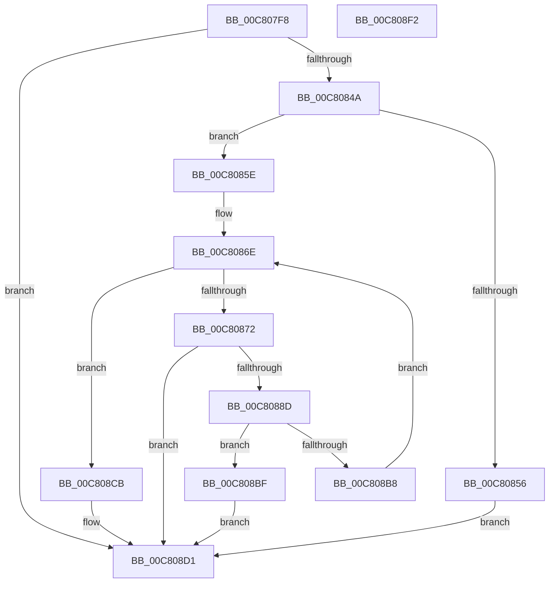

# FopGetTableOffsetAndSize

- RVA: `0x00C807F8`–`0x00C808F3` (길이 `251` bytes)
- VA: `0x0000000140C807F8`
- 실행 섹션: `INIT`
- PDB 이름 있음: `예`; PDB Function 태그: `아니요`
- unwind 정보 RVA: `0x000DA4D4`
- 디코드: `80`개 명령, `251/251` bytes 표시
- 미해석 바이트: `0` (있으면 어셈블리에 `.byte`로 보존)

> 이 문서는 커널 이미지의 기계어와 PDB 기호를 분석해 생성했습니다. 4번과 5번은 함수 원형과 자료형을 바이너리 사용 방식에서 추정한 C 해석이며 원본 소스 복구 결과는 아닙니다.

## 1. Dependencies

- 직접 호출 지점: **2**; 고유 호출 대상: **1**
- 직접 호출자로 확인된 함수: **3**
- RIP 상대 이미지 참조: **0**

### Outgoing calls
- `0x00C8083A` → [FioFwReadBytesAtOffset](../../text/3E/FioFwReadBytesAtOffset_function_003E5948.md) (function, `0x003E5948`)
- `0x00C80881` → [FioFwReadBytesAtOffset](../../text/3E/FioFwReadBytesAtOffset_function_003E5948.md) (function, `0x003E5948`)

### Direct callers
- [FopInitializeFonts](FopInitializeFonts_function_00C808FC.md) at `0x00C809AC`
- [FopValidateFontNameTable](FopValidateFontNameTable_function_00C80F14.md) at `0x00C80F57`
- [BgpRasInitializeRasterizer](BgpRasInitializeRasterizer_function_00C81A2C.md) at `0x00C81A96`
- [BgpRasInitializeRasterizer](BgpRasInitializeRasterizer_function_00C81A2C.md) at `0x00C81AC1`
- [BgpRasInitializeRasterizer](BgpRasInitializeRasterizer_function_00C81A2C.md) at `0x00C81AEC`
- [BgpRasInitializeRasterizer](BgpRasInitializeRasterizer_function_00C81A2C.md) at `0x00C81B17`
- [BgpRasInitializeRasterizer](BgpRasInitializeRasterizer_function_00C81A2C.md) at `0x00C81B79`

### Static image references
- 디코드된 RIP-relative 메모리 참조가 없습니다.

## 2. Other-region calls and transfers

- 다른 실행 섹션으로 향하는 call: **2**
  - `0x00C8083A` → [FioFwReadBytesAtOffset](../../text/3E/FioFwReadBytesAtOffset_function_003E5948.md) (`INIT` → `.text`)
  - `0x00C80881` → [FioFwReadBytesAtOffset](../../text/3E/FioFwReadBytesAtOffset_function_003E5948.md) (`INIT` → `.text`)
- 별도 외부 분기/꼬리 이동을 확인하지 못했습니다.

## 3. Assembly (complete function range)

```asm
00C807F8  48 8B C4                        mov rax, rsp
00C807FB  48 89 58 08                     mov qword ptr [rax + 8], rbx
00C807FF  48 89 70 10                     mov qword ptr [rax + 0x10], rsi
00C80803  48 89 78 18                     mov qword ptr [rax + 0x18], rdi
00C80807  4C 89 60 20                     mov qword ptr [rax + 0x20], r12
00C8080B  55                              push rbp
00C8080C  41 56                           push r14
00C8080E  41 57                           push r15
00C80810  48 8B EC                        mov rbp, rsp
00C80813  48 83 EC 40                     sub rsp, 0x40
00C80817  33 C0                           xor eax, eax
00C80819  4D 8B F1                        mov r14, r9
00C8081C  45 8B E0                        mov r12d, r8d
00C8081F  48 89 45 E0                     mov qword ptr [rbp - 0x20], rax
00C80823  0F 57 C0                        xorps xmm0, xmm0
00C80826  89 45 E8                        mov dword ptr [rbp - 0x18], eax
00C80829  4C 8D 4D E0                     lea r9, [rbp - 0x20]
00C8082D  8B FA                           mov edi, edx
00C8082F  44 8D 40 0C                     lea r8d, [rax + 0xc]
00C80833  4C 8B F9                        mov r15, rcx
00C80836  0F 11 45 F0                     movups xmmword ptr [rbp - 0x10], xmm0
00C8083A  E8 09 51 76 FF                  call 0x1403e5948
00C8083F  44 8B C0                        mov r8d, eax
00C80842  85 C0                           test eax, eax
00C80844  0F 88 87 00 00 00               js 0x140c808d1
00C8084A  8B 45 E0                        mov eax, dword ptr [rbp - 0x20]
00C8084D  0F C8                           bswap eax
00C8084F  3D 00 00 01 00                  cmp eax, 0x10000
00C80854  74 08                           je 0x140c8085e
00C80856  41 B8 BB 00 00 C0               mov r8d, 0xc00000bb
00C8085C  EB 73                           jmp 0x140c808d1
00C8085E  0F B7 45 E4                     movzx eax, word ptr [rbp - 0x1c]
00C80862  33 DB                           xor ebx, ebx
00C80864  66 C1 C8 08                     ror ax, 8
00C80868  83 C7 0C                        add edi, 0xc
00C8086B  0F B7 F0                        movzx esi, ax
00C8086E  3B DE                           cmp ebx, esi
00C80870  73 59                           jae 0x140c808cb
00C80872  4C 8D 4D F0                     lea r9, [rbp - 0x10]
00C80876  41 B8 10 00 00 00               mov r8d, 0x10
00C8087C  8B D7                           mov edx, edi
00C8087E  49 8B CF                        mov rcx, r15
00C80881  E8 C2 50 76 FF                  call 0x1403e5948
00C80886  44 8B C0                        mov r8d, eax
00C80889  85 C0                           test eax, eax
00C8088B  78 44                           js 0x140c808d1
00C8088D  8B 4D F0                        mov ecx, dword ptr [rbp - 0x10]
00C80890  45 33 C0                        xor r8d, r8d
00C80893  8B 55 F8                        mov edx, dword ptr [rbp - 8]
00C80896  44 8B 4D FC                     mov r9d, dword ptr [rbp - 4]
00C8089A  8B 45 F4                        mov eax, dword ptr [rbp - 0xc]
00C8089D  0F C9                           bswap ecx
00C8089F  89 4D F0                        mov dword ptr [rbp - 0x10], ecx
00C808A2  0F CA                           bswap edx
00C808A4  89 55 F8                        mov dword ptr [rbp - 8], edx
00C808A7  41 0F C9                        bswap r9d
00C808AA  44 89 4D FC                     mov dword ptr [rbp - 4], r9d
00C808AE  0F C8                           bswap eax
00C808B0  89 45 F4                        mov dword ptr [rbp - 0xc], eax
00C808B3  41 3B CC                        cmp ecx, r12d
00C808B6  74 07                           je 0x140c808bf
00C808B8  FF C3                           inc ebx
00C808BA  83 C7 10                        add edi, 0x10
00C808BD  EB AF                           jmp 0x140c8086e
00C808BF  48 8B 45 40                     mov rax, qword ptr [rbp + 0x40]
00C808C3  41 89 16                        mov dword ptr [r14], edx
00C808C6  44 89 08                        mov dword ptr [rax], r9d
00C808C9  EB 06                           jmp 0x140c808d1
00C808CB  41 B8 25 02 00 C0               mov r8d, 0xc0000225
00C808D1  48 8B 5C 24 60                  mov rbx, qword ptr [rsp + 0x60]
00C808D6  41 8B C0                        mov eax, r8d
00C808D9  48 8B 74 24 68                  mov rsi, qword ptr [rsp + 0x68]
00C808DE  48 8B 7C 24 70                  mov rdi, qword ptr [rsp + 0x70]
00C808E3  4C 8B 64 24 78                  mov r12, qword ptr [rsp + 0x78]
00C808E8  48 83 C4 40                     add rsp, 0x40
00C808EC  41 5F                           pop r15
00C808EE  41 5E                           pop r14
00C808F0  5D                              pop rbp
00C808F1  C3                              ret
00C808F2  CC                              int3
```

## 4. C-style interpretation (structured pseudocode)

```c
__int64 __fastcall FopGetTableOffsetAndSize(__int64 a1, int a2, int a3, __int64 a4, __int64 a5)
{
    __int64 result;
    __int64 v_rbx;
    __int64 v_rdi;
    __int64 v_rsp;
    unsigned int v_stack_m1C;
    unsigned int v_stack_m20;
    unsigned int v_stack_m24;
    unsigned __int64 v_stack_m28;
    unsigned int v_stack_m30;
    unsigned __int16 v_stack_m34;
    unsigned __int64 v_stack_m38;
    unsigned __int64 v_stack_p10;
    unsigned __int64 v_stack_p18;
    unsigned __int64 v_stack_p20;
    unsigned __int64 v_stack_p8;

    *(unsigned __int64 *)(v_rsp + 8) = v_rbx;
    *(unsigned __int64 *)(v_rsp + 16) = v_rsi;
    *(unsigned __int64 *)(v_rsp + 24) = v_rdi;
    *(unsigned __int64 *)(v_rsp + 32) = v_r12;
    v_rsp = (v_rsp) - (64);
    result = 0;
    v_stack_m38 = 0;
    v_stack_m30 = 0;
    v_stack_m28 = v_xmm0;
    result = FioFwReadBytesAtOffset(a1, a2, result + 12, v_stack_m38);
    if (sign_flag) goto loc_00C808D1;
    if (((unsigned int)((unsigned int)(v_stack_m38))) == 0x10000ULL) goto loc_00C8085E;
    goto loc_00C808D1;
loc_00C8085E:
    v_rbx = 0;
    v_rdi = (unsigned int)(((unsigned int)(a2)) + (12));
loc_00C8086E:
    if (0 >= ((unsigned int)((unsigned __int16)(v_stack_m34)))) goto loc_00C808CB;
    result = FioFwReadBytesAtOffset(a1, (unsigned int)((unsigned int)(v_rdi)), 16, v_stack_m28);
    if (sign_flag) goto loc_00C808D1;
    a3 = 0;
    v_stack_m28 = (unsigned int)((unsigned int)(v_stack_m28));
    v_stack_m20 = (unsigned int)((unsigned int)(v_stack_m20));
    v_stack_m1C = (unsigned int)((unsigned int)(v_stack_m1C));
    v_stack_m24 = (unsigned int)((unsigned int)(v_stack_m24));
    if (((unsigned int)((unsigned int)(v_stack_m28))) == ((unsigned int)((unsigned int)(a3)))) goto loc_00C808BF;
    v_rbx = (unsigned int)((v_rbx) + 1);
    v_rdi = (unsigned int)((v_rdi) + (16));
    goto loc_00C8086E;
loc_00C808BF:
    *(unsigned int *)(a4) = (unsigned int)((unsigned int)(v_stack_m20));
    *(unsigned int *)(a5) = (unsigned int)((unsigned int)(v_stack_m1C));
    goto loc_00C808D1;
loc_00C808CB:
loc_00C808D1:
    v_rsp = (v_rsp) + (64);
    return (unsigned int)((unsigned int)((unsigned int)(0xC0000225ULL)));
}
```

## 5. (Beta) C Style

```c
int64_t FopGetTableOffsetAndSize(int64_t Arg1, int32_t Arg2, int32_t Arg3, void *Arg4, void *Arg5)
{
    uint8_t *arg4 = (uint8_t *)Arg4;
    uint8_t *arg5 = (uint8_t *)Arg5;

    int64_t result;
    int64_t local_rbx;
    int64_t local_rdi;
    int64_t local_rsp;
    uint32_t v_stack_m1C;
    uint32_t v_stack_m20;
    uint32_t v_stack_m24;
    uint64_t v_stack_m28;
    uint32_t v_stack_m30;
    uint16_t v_stack_m34;
    uint64_t v_stack_m38;
    uint64_t v_stack_p10;
    uint64_t v_stack_p18;
    uint64_t v_stack_p20;
    uint64_t v_stack_p8;

    *(uint64_t *)(local_rsp + 0x8) = local_rbx;
    *(uint64_t *)(local_rsp + 0x10) = local_rsi;
    *(uint64_t *)(local_rsp + 0x18) = local_rdi;
    *(uint64_t *)(local_rsp + 0x20) = local_r12;
    local_rsp = (local_rsp) - (64);
    result = 0;
    v_stack_m38 = 0;
    v_stack_m30 = 0;
    v_stack_m28 = v_xmm0;
    result = FioFwReadBytesAtOffset(Arg1, Arg2, result + 12, v_stack_m38);
    if (sign_flag) goto loc_00C808D1;
    if (((uint32_t)((uint32_t)(v_stack_m38))) == 0x10000ULL) goto loc_00C8085E;
    goto loc_00C808D1;
loc_00C8085E:
    local_rbx = 0;
    local_rdi = (uint32_t)(((uint32_t)(Arg2)) + (12));
loc_00C8086E:
    if (0 >= ((uint32_t)((uint16_t)(v_stack_m34)))) goto loc_00C808CB;
    result = FioFwReadBytesAtOffset(Arg1, (uint32_t)((uint32_t)(local_rdi)), 16, v_stack_m28);
    if (sign_flag) goto loc_00C808D1;
    Arg3 = 0;
    v_stack_m28 = (uint32_t)((uint32_t)(v_stack_m28));
    v_stack_m20 = (uint32_t)((uint32_t)(v_stack_m20));
    v_stack_m1C = (uint32_t)((uint32_t)(v_stack_m1C));
    v_stack_m24 = (uint32_t)((uint32_t)(v_stack_m24));
    if (((uint32_t)((uint32_t)(v_stack_m28))) == ((uint32_t)((uint32_t)(Arg3)))) goto loc_00C808BF;
    local_rbx = (uint32_t)((local_rbx) + 1);
    local_rdi = (uint32_t)((local_rdi) + (16));
    goto loc_00C8086E;
loc_00C808BF:
    *(uint32_t *)(arg4) = (uint32_t)((uint32_t)(v_stack_m20));
    *(uint32_t *)(arg5) = (uint32_t)((uint32_t)(v_stack_m1C));
    goto loc_00C808D1;
loc_00C808CB:
loc_00C808D1:
    local_rsp = (local_rsp) + (64);
    return (uint32_t)((uint32_t)((uint32_t)(0xC0000225ULL)));
}
```

### 관측된 메모리 오프셋

구조체 형식이 확인되지 않은 접근은 인자 기준의 오프셋으로만 기록했습니다.

| 기준 인자 | 오프셋 표현 | 폭 (bit) | 접근 |
|---|---:|---:|---|
| `Arg4` | `+ 0x0` | `32` | `W` |
| `Arg5` | `+ 0x0` | `32` | `W` |

## 6. Execution-region graph

[열기: 2D/3D 그래프와 함수 탐색 컨트롤 패널](../../../control-panel.html?section=init&rva=0x00C807F8&view=graph)

- 2D 그래프는 위에서 아래로 흐르고, 3D 그래프는 빈 공간을 드래그해 회전합니다. Shift+드래그는 이동, 휠은 확대·축소, 함수 노드 선택은 대상 보고서 이동입니다.

### Static fallback


