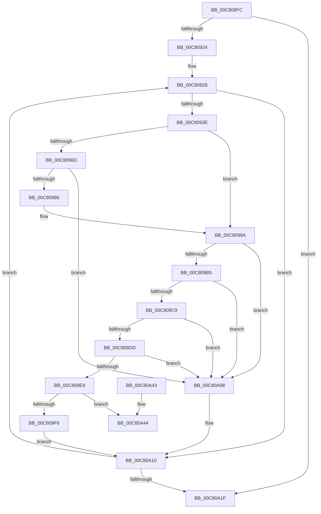

# FopInitializeFonts

- RVA: `0x00C808FC`–`0x00C80A4B` (길이 `335` bytes)
- VA: `0x0000000140C808FC`
- 실행 섹션: `INIT`
- PDB 이름 있음: `예`; PDB Function 태그: `아니요`
- unwind 정보 RVA: `0x000DA4B8`
- 디코드: `97`개 명령, `335/335` bytes 표시
- 미해석 바이트: `0` (있으면 어셈블리에 `.byte`로 보존)

> 이 문서는 커널 이미지의 기계어와 PDB 기호를 분석해 생성했습니다. 4번과 5번은 함수 원형과 자료형을 바이너리 사용 방식에서 추정한 C 해석이며 원본 소스 복구 결과는 아닙니다.

## 1. Dependencies

- 직접 호출 지점: **8**; 고유 호출 대상: **8**
- 직접 호출자로 확인된 함수: **1**
- RIP 상대 이미지 참조: **0**

### Outgoing calls
- `0x00C8092D` → [BgpFwAllocateMemory](../../text/3E/BgpFwAllocateMemory_function_003E4374.md) (function, `0x003E4374`)
- `0x00C80949` → [memset](../../text/6C/memset_function_006C6C40.md) (function, `0x006C6C40`)
- `0x00C80979` → [FioFwReadUlongAtOffset](../../text/6A/FioFwReadUlongAtOffset_function_006A2BB4.md) (function, `0x006A2BB4`)
- `0x00C809AC` → [FopGetTableOffsetAndSize](FopGetTableOffsetAndSize_function_00C807F8.md) (function, `0x00C807F8`)
- `0x00C809C0` → [FopValidateFontNameTable](FopValidateFontNameTable_function_00C80F14.md) (function, `0x00C80F14`)
- `0x00C809D4` → [FopReadMappingTable](FopReadMappingTable_function_00C80BA4.md) (function, `0x00C80BA4`)
- `0x00C809E0` → [BgpRasInitializeRasterizer](BgpRasInitializeRasterizer_function_00C81A2C.md) (function, `0x00C81A2C`)
- `0x00C80A0B` → [FopFreeFontData](../../pagebgfx/BC/FopFreeFontData_function_00BC2800.md) (function, `0x00BC2800`)

### Direct callers
- [BgpFoInitialize](BgpFoInitialize_function_00C806B0.md) at `0x00C807BC`

### Static image references
- 디코드된 RIP-relative 메모리 참조가 없습니다.

## 2. Other-region calls and transfers

- 다른 실행 섹션으로 향하는 call: **4**
  - `0x00C8092D` → [BgpFwAllocateMemory](../../text/3E/BgpFwAllocateMemory_function_003E4374.md) (`INIT` → `.text`)
  - `0x00C80949` → [memset](../../text/6C/memset_function_006C6C40.md) (`INIT` → `.text`)
  - `0x00C80979` → [FioFwReadUlongAtOffset](../../text/6A/FioFwReadUlongAtOffset_function_006A2BB4.md) (`INIT` → `.text`)
  - `0x00C80A0B` → [FopFreeFontData](../../pagebgfx/BC/FopFreeFontData_function_00BC2800.md) (`INIT` → `PAGEBGFX`)
- 별도 외부 분기/꼬리 이동을 확인하지 못했습니다.

## 3. Assembly (complete function range)

```asm
00C808FC  48 89 5C 24 10                  mov qword ptr [rsp + 0x10], rbx
00C80901  48 89 6C 24 18                  mov qword ptr [rsp + 0x18], rbp
00C80906  48 89 74 24 20                  mov qword ptr [rsp + 0x20], rsi
00C8090B  57                              push rdi
00C8090C  41 56                           push r14
00C8090E  41 57                           push r15
00C80910  48 83 EC 30                     sub rsp, 0x30
00C80914  33 F6                           xor esi, esi
00C80916  33 ED                           xor ebp, ebp
00C80918  48 8B F9                        mov rdi, rcx
00C8091B  39 71 18                        cmp dword ptr [rcx + 0x18], esi
00C8091E  0F 86 FB 00 00 00               jbe 0x140c80a1f
00C80924  44 8D 76 0C                     lea r14d, [rsi + 0xc]
00C80928  B9 80 00 00 00                  mov ecx, 0x80
00C8092D  E8 42 3A 76 FF                  call 0x1403e4374
00C80932  48 8B D8                        mov rbx, rax
00C80935  48 85 C0                        test rax, rax
00C80938  0F 84 D2 00 00 00               je 0x140c80a10
00C8093E  33 D2                           xor edx, edx
00C80940  41 B8 80 00 00 00               mov r8d, 0x80
00C80946  48 8B C8                        mov rcx, rax
00C80949  E8 F2 62 A4 FF                  call 0x1406c6c40
00C8094E  48 8D 4B 68                     lea rcx, [rbx + 0x68]
00C80952  48 89 49 08                     mov qword ptr [rcx + 8], rcx
00C80956  48 89 09                        mov qword ptr [rcx], rcx
00C80959  33 C9                           xor ecx, ecx
00C8095B  48 89 7B 10                     mov qword ptr [rbx + 0x10], rdi
00C8095F  89 6B 28                        mov dword ptr [rbx + 0x28], ebp
00C80962  8B 47 20                        mov eax, dword ptr [rdi + 0x20]
00C80965  89 4C 24 50                     mov dword ptr [rsp + 0x50], ecx
00C80969  A8 01                           test al, 1
00C8096B  74 1D                           je 0x140c8098a
00C8096D  48 8B 4F 10                     mov rcx, qword ptr [rdi + 0x10]
00C80971  4C 8D 44 24 50                  lea r8, [rsp + 0x50]
00C80976  41 8B D6                        mov edx, r14d
00C80979  E8 36 22 A2 FF                  call 0x1406a2bb4
00C8097E  85 C0                           test eax, eax
00C80980  0F 88 82 00 00 00               js 0x140c80a08
00C80986  8B 4C 24 50                     mov ecx, dword ptr [rsp + 0x50]
00C8098A  83 64 24 50 00                  and dword ptr [rsp + 0x50], 0
00C8098F  48 8D 44 24 50                  lea rax, [rsp + 0x50]
00C80994  89 4B 2C                        mov dword ptr [rbx + 0x2c], ecx
00C80997  4C 8D 4B 30                     lea r9, [rbx + 0x30]
00C8099B  8B D1                           mov edx, ecx
00C8099D  48 89 44 24 20                  mov qword ptr [rsp + 0x20], rax
00C809A2  48 8B 4F 10                     mov rcx, qword ptr [rdi + 0x10]
00C809A6  41 B8 70 61 6D 63               mov r8d, 0x636d6170
00C809AC  E8 47 FE FF FF                  call 0x140c807f8
00C809B1  85 C0                           test eax, eax
00C809B3  78 53                           js 0x140c80a08
00C809B5  8B 53 2C                        mov edx, dword ptr [rbx + 0x2c]
00C809B8  4C 8D 43 20                     lea r8, [rbx + 0x20]
00C809BC  48 8B 4F 10                     mov rcx, qword ptr [rdi + 0x10]
00C809C0  E8 4F 05 00 00                  call 0x140c80f14
00C809C5  85 C0                           test eax, eax
00C809C7  78 3F                           js 0x140c80a08
00C809C9  8B 53 30                        mov edx, dword ptr [rbx + 0x30]
00C809CC  4C 8D 43 18                     lea r8, [rbx + 0x18]
00C809D0  48 8B 4F 10                     mov rcx, qword ptr [rdi + 0x10]
00C809D4  E8 CB 01 00 00                  call 0x140c80ba4
00C809D9  85 C0                           test eax, eax
00C809DB  78 2B                           js 0x140c80a08
00C809DD  48 8B CB                        mov rcx, rbx
00C809E0  E8 47 10 00 00                  call 0x140c81a2c
00C809E5  85 C0                           test eax, eax
00C809E7  78 1F                           js 0x140c80a08
00C809E9  48 8D 47 28                     lea rax, [rdi + 0x28]
00C809ED  48 8B 48 08                     mov rcx, qword ptr [rax + 8]
00C809F1  48 39 01                        cmp qword ptr [rcx], rax
00C809F4  75 4E                           jne 0x140c80a44
00C809F6  48 89 03                        mov qword ptr [rbx], rax
00C809F9  FF C6                           inc esi
00C809FB  48 89 4B 08                     mov qword ptr [rbx + 8], rcx
00C809FF  48 89 19                        mov qword ptr [rcx], rbx
00C80A02  48 89 58 08                     mov qword ptr [rax + 8], rbx
00C80A06  EB 08                           jmp 0x140c80a10
00C80A08  48 8B CB                        mov rcx, rbx
00C80A0B  E8 F0 1D F4 FF                  call 0x140bc2800
00C80A10  FF C5                           inc ebp
00C80A12  41 83 C6 04                     add r14d, 4
00C80A16  3B 6F 18                        cmp ebp, dword ptr [rdi + 0x18]
00C80A19  0F 82 09 FF FF FF               jb 0x140c80928
00C80A1F  48 8B 5C 24 58                  mov rbx, qword ptr [rsp + 0x58]
00C80A24  F7 DE                           neg esi
00C80A26  48 8B 6C 24 60                  mov rbp, qword ptr [rsp + 0x60]
00C80A2B  48 8B 74 24 68                  mov rsi, qword ptr [rsp + 0x68]
00C80A30  1B C0                           sbb eax, eax
00C80A32  F7 D0                           not eax
00C80A34  25 7B 00 00 C0                  and eax, 0xc000007b
00C80A39  48 83 C4 30                     add rsp, 0x30
00C80A3D  41 5F                           pop r15
00C80A3F  41 5E                           pop r14
00C80A41  5F                              pop rdi
00C80A42  C3                              ret
00C80A43  CC                              int3
00C80A44  B9 03 00 00 00                  mov ecx, 3
00C80A49  CD 29                           int 0x29
```

## 4. C-style interpretation (structured pseudocode)

```c
__int64 __fastcall FopInitializeFonts(__int64 a1, int a2)
{
    __int64 result;
    __int64 v_r14;
    __int64 v_rbp;
    __int64 v_rsi;
    __int64 v_rsp;
    unsigned __int64 v_stack_m28;
    unsigned __int64 v_stack_p10;
    unsigned __int64 v_stack_p18;
    unsigned __int64 v_stack_p20;
    unsigned int v_stack_p8;

    v_stack_p10 = v_rbx;
    v_stack_p18 = v_rbp;
    v_stack_p20 = v_rsi;
    v_rsp = (v_rsp) - (48);
    v_rsi = 0;
    v_rbp = 0;
    if ((*(unsigned int *)(a1 + 24)) <= 0) goto loc_00C80A1F;
loc_00C80928:
    result = BgpFwAllocateMemory(128, a2, a3, a4);
    if (result == 0) goto loc_00C80A10;
    a2 = 0;
    result = memset(result, a2, 128, a4);
    *(unsigned __int64 *)(result + 104 + 8) = result + 104;
    *(unsigned __int64 *)(result + 104) = result + 104;
    a1 = 0;
    *(unsigned __int64 *)(result + 16) = 0;
    *(unsigned int *)(result + 40) = 0;
    v_stack_p8 = 0;
    if ((((unsigned __int8)((unsigned int)(*(unsigned int *)(a1 + 32)))) & (1)) == 0) goto loc_00C8098A;
    result = FioFwReadUlongAtOffset(*(unsigned __int64 *)(a1 + 16), (unsigned int)((unsigned int)(v_rsi + 12)), v_stack_p8, a4);
    if (sign_flag) goto loc_00C80A08;
loc_00C8098A:
    *(unsigned int *)(result + 44) = (unsigned int)((unsigned int)(v_stack_p8));
    v_stack_m28 = v_stack_p8;
    result = FopGetTableOffsetAndSize(*(unsigned __int64 *)(a1 + 16), (unsigned int)((unsigned int)((unsigned int)(v_stack_p8))), (unsigned int)(0x636D6170ULL), result + 48);
    if (sign_flag) goto loc_00C80A08;
    result = FopValidateFontNameTable(*(unsigned __int64 *)(a1 + 16), (unsigned int)(*(unsigned int *)(result + 44)), result + 32, result + 48);
    if (sign_flag) goto loc_00C80A08;
    result = FopReadMappingTable(*(unsigned __int64 *)(a1 + 16), (unsigned int)(*(unsigned int *)(result + 48)), result + 24, result + 48);
    if (sign_flag) goto loc_00C80A08;
    result = BgpRasInitializeRasterizer(result, (unsigned int)(*(unsigned int *)(result + 48)), result + 24, result + 48);
    if (sign_flag) goto loc_00C80A08;
    if ((*(unsigned __int64 *)(*(unsigned __int64 *)(a1 + 40 + 8))) != (a1 + 40)) goto loc_00C80A44;
    *(unsigned __int64 *)(result) = a1 + 40;
    v_rsi = (unsigned int)((v_rsi) + 1);
    *(unsigned __int64 *)(result + 8) = *(unsigned __int64 *)(a1 + 40 + 8);
    *(unsigned __int64 *)(*(unsigned __int64 *)(a1 + 40 + 8)) = result;
    *(unsigned __int64 *)(a1 + 40 + 8) = result;
    goto loc_00C80A10;
loc_00C80A08:
    result = FopFreeFontData(result, (unsigned int)(*(unsigned int *)(result + 48)), result + 24, result + 48);
loc_00C80A10:
    v_rbp = (unsigned int)((v_rbp) + 1);
    v_r14 = (unsigned int)((v_rsi + 12) + (4));
    if (((unsigned int)(v_rbp)) < (*(unsigned int *)(a1 + 24))) goto loc_00C80928;
loc_00C80A1F:
    v_rsi = (unsigned int)(-(v_rsi));
    result = (unsigned int)(~(result));
    result = (unsigned int)((result) & (0xC000007BULL));
    v_rsp = (v_rsp) + (48);
    return result;
loc_00C80A44:
    return result;
}
```

## 5. (Beta) C Style

```c
int64_t FopInitializeFonts(void *Arg1, int32_t Arg2)
{
    uint8_t *arg1 = (uint8_t *)Arg1;

    int64_t result;
    int64_t local_r14;
    int64_t local_rbp;
    int64_t local_rsi;
    int64_t local_rsp;
    uint64_t v_stack_m28;
    uint64_t v_stack_p10;
    uint64_t v_stack_p18;
    uint64_t v_stack_p20;
    uint32_t v_stack_p8;

    v_stack_p10 = local_rbx;
    v_stack_p18 = local_rbp;
    v_stack_p20 = local_rsi;
    local_rsp = (local_rsp) - (48);
    local_rsi = 0;
    local_rbp = 0;
    if ((*(uint32_t *)(arg1 + 0x18)) <= 0) goto loc_00C80A1F;
loc_00C80928:
    result = BgpFwAllocateMemory(128, Arg2, a3, a4);
    if (result == 0) goto loc_00C80A10;
    Arg2 = 0;
    result = memset(result, Arg2, 128, a4);
    *(uint64_t *)(result + 0x68 + 0x8) = result + 104;
    *(uint64_t *)(result + 0x68) = result + 104;
    Arg1 = 0;
    *(uint64_t *)(result + 0x10) = 0;
    *(uint32_t *)(result + 0x28) = 0;
    v_stack_p8 = 0;
    if ((((uint8_t)((uint32_t)(*(uint32_t *)(arg1 + 0x20)))) & (1)) == 0) goto loc_00C8098A;
    result = FioFwReadUlongAtOffset(*(uint64_t *)(arg1 + 0x10), (uint32_t)((uint32_t)(local_rsi + 12)), v_stack_p8, a4);
    if (sign_flag) goto loc_00C80A08;
loc_00C8098A:
    *(uint32_t *)(result + 0x2C) = (uint32_t)((uint32_t)(v_stack_p8));
    v_stack_m28 = v_stack_p8;
    result = FopGetTableOffsetAndSize(*(uint64_t *)(arg1 + 0x10), (uint32_t)((uint32_t)((uint32_t)(v_stack_p8))), (uint32_t)(0x636D6170ULL), result + 48);
    if (sign_flag) goto loc_00C80A08;
    result = FopValidateFontNameTable(*(uint64_t *)(arg1 + 0x10), (uint32_t)(*(uint32_t *)(result + 0x2C)), result + 32, result + 48);
    if (sign_flag) goto loc_00C80A08;
    result = FopReadMappingTable(*(uint64_t *)(arg1 + 0x10), (uint32_t)(*(uint32_t *)(result + 0x30)), result + 24, result + 48);
    if (sign_flag) goto loc_00C80A08;
    result = BgpRasInitializeRasterizer(result, (uint32_t)(*(uint32_t *)(result + 0x30)), result + 24, result + 48);
    if (sign_flag) goto loc_00C80A08;
    if ((*(uint64_t *)(*(uint64_t *)(arg1 + 0x28 + 0x8))) != (Arg1 + 40)) goto loc_00C80A44;
    *(void **)(result) = Arg1 + 40;
    local_rsi = (uint32_t)((local_rsi) + 1);
    *(uint64_t *)(result + 0x8) = *(uint64_t *)(arg1 + 0x28 + 0x8);
    *(uint64_t *)(*(uint64_t *)(arg1 + 0x28 + 0x8)) = result;
    *(uint64_t *)(arg1 + 0x28 + 0x8) = result;
    goto loc_00C80A10;
loc_00C80A08:
    result = FopFreeFontData(result, (uint32_t)(*(uint32_t *)(result + 0x30)), result + 24, result + 48);
loc_00C80A10:
    local_rbp = (uint32_t)((local_rbp) + 1);
    local_r14 = (uint32_t)((local_rsi + 12) + (4));
    if (((uint32_t)(local_rbp)) < (*(uint32_t *)(arg1 + 0x18))) goto loc_00C80928;
loc_00C80A1F:
    local_rsi = (uint32_t)(-(local_rsi));
    result = (uint32_t)(~(result));
    result = (uint32_t)((result) & (0xC000007BULL));
    local_rsp = (local_rsp) + (48);
    return result;
loc_00C80A44:
    return result;
}
```

### 관측된 메모리 오프셋

구조체 형식이 확인되지 않은 접근은 인자 기준의 오프셋으로만 기록했습니다.

| 기준 인자 | 오프셋 표현 | 폭 (bit) | 접근 |
|---|---:|---:|---|
| `Arg1` | `+ 0x8` | `64` | `R` |
| `Arg1` | `+ 0x8` | `64` | `W` |
| `Arg1` | `+ 0x10` | `64` | `R` |
| `Arg1` | `+ 0x18` | `32` | `R` |
| `Arg1` | `+ 0x20` | `32` | `R` |
| `Arg1` | `+ 0x28` | `64` | `R` |

## 6. Execution-region graph

[열기: 2D/3D 그래프와 함수 탐색 컨트롤 패널](../../../control-panel.html?section=init&rva=0x00C808FC&view=graph)

- 2D 그래프는 위에서 아래로 흐르고, 3D 그래프는 빈 공간을 드래그해 회전합니다. Shift+드래그는 이동, 휠은 확대·축소, 함수 노드 선택은 대상 보고서 이동입니다.

### Static fallback


