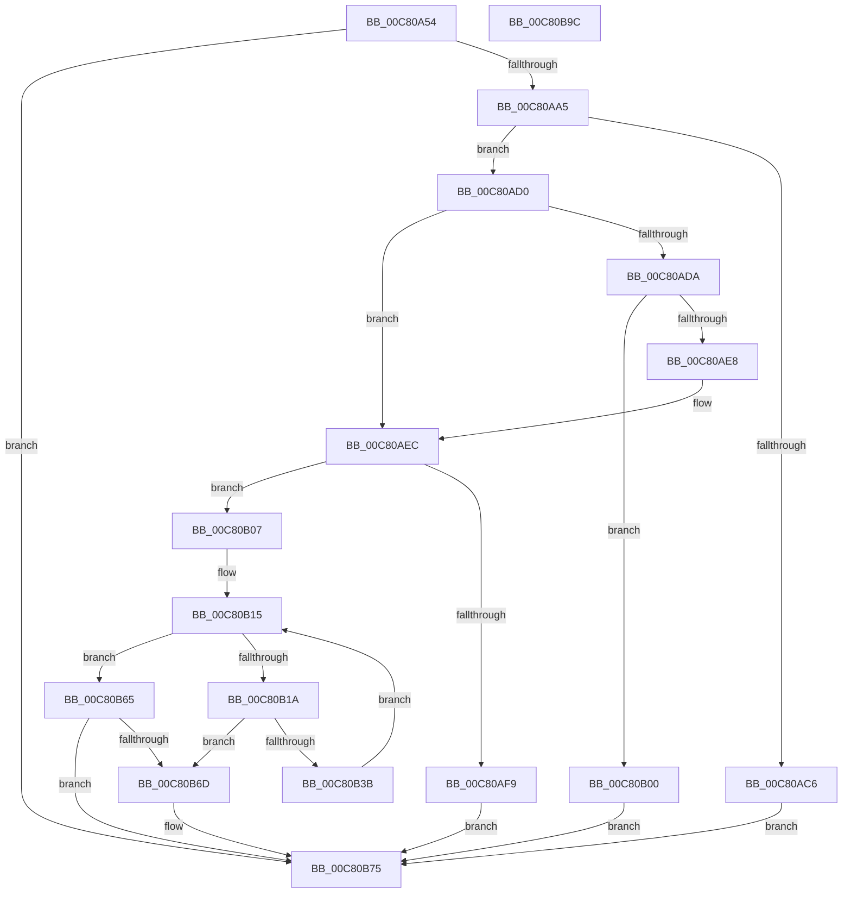

# FopReadCmapTable

- RVA: `0x00C80A54`–`0x00C80B9D` (길이 `329` bytes)
- VA: `0x0000000140C80A54`
- 실행 섹션: `INIT`
- PDB 이름 있음: `예`; PDB Function 태그: `아니요`
- unwind 정보 RVA: `0x000DA494`
- 디코드: `101`개 명령, `329/329` bytes 표시
- 미해석 바이트: `0` (있으면 어셈블리에 `.byte`로 보존)

> 이 문서는 커널 이미지의 기계어와 PDB 기호를 분석해 생성했습니다. 4번과 5번은 함수 원형과 자료형을 바이너리 사용 방식에서 추정한 C 해석이며 원본 소스 복구 결과는 아닙니다.

## 1. Dependencies

- 직접 호출 지점: **5**; 고유 호출 대상: **4**
- 직접 호출자로 확인된 함수: **1**
- RIP 상대 이미지 참조: **1**

### Outgoing calls
- `0x00C80A94` → [FioFwReadBytesAtOffset](../../text/3E/FioFwReadBytesAtOffset_function_003E5948.md) (function, `0x003E5948`)
- `0x00C80AEC` → [BgpFwAllocateMemory](../../text/3E/BgpFwAllocateMemory_function_003E4374.md) (function, `0x003E4374`)
- `0x00C80B30` → [FioFwReadBytesAtOffset](../../text/3E/FioFwReadBytesAtOffset_function_003E5948.md) (function, `0x003E5948`)
- `0x00C80B70` → [BgpFwFreeMemory](../../text/3E/BgpFwFreeMemory_function_003E25E0.md) (function, `0x003E25E0`)
- `0x00C80B7F` → [_security_check_cookie](../../text/6A/_security_check_cookie_function_006AC640.md) (function, `0x006AC640`)

### Direct callers
- [FopReadMappingTable](FopReadMappingTable_function_00C80BA4.md) at `0x00C80BDF`

### Static image references
- `0x00C80A68` → RVA `0x00E0A740` (`.data`; read)

## 2. Other-region calls and transfers

- 다른 실행 섹션으로 향하는 call: **5**
  - `0x00C80A94` → [FioFwReadBytesAtOffset](../../text/3E/FioFwReadBytesAtOffset_function_003E5948.md) (`INIT` → `.text`)
  - `0x00C80AEC` → [BgpFwAllocateMemory](../../text/3E/BgpFwAllocateMemory_function_003E4374.md) (`INIT` → `.text`)
  - `0x00C80B30` → [FioFwReadBytesAtOffset](../../text/3E/FioFwReadBytesAtOffset_function_003E5948.md) (`INIT` → `.text`)
  - `0x00C80B70` → [BgpFwFreeMemory](../../text/3E/BgpFwFreeMemory_function_003E25E0.md) (`INIT` → `.text`)
  - `0x00C80B7F` → [_security_check_cookie](../../text/6A/_security_check_cookie_function_006AC640.md) (`INIT` → `.text`)
- 별도 외부 분기/꼬리 이동을 확인하지 못했습니다.

## 3. Assembly (complete function range)

```asm
00C80A54  48 89 5C 24 20                  mov qword ptr [rsp + 0x20], rbx
00C80A59  55                              push rbp
00C80A5A  56                              push rsi
00C80A5B  57                              push rdi
00C80A5C  41 54                           push r12
00C80A5E  41 55                           push r13
00C80A60  41 56                           push r14
00C80A62  41 57                           push r15
00C80A64  48 83 EC 40                     sub rsp, 0x40
00C80A68  48 8B 05 D1 9C 18 00            mov rax, qword ptr [rip + 0x189cd1]
00C80A6F  48 33 C4                        xor rax, rsp
00C80A72  48 89 44 24 30                  mov qword ptr [rsp + 0x30], rax
00C80A77  33 C0                           xor eax, eax
00C80A79  4C 8D 4C 24 20                  lea r9, [rsp + 0x20]
00C80A7E  4D 8B E0                        mov r12, r8
00C80A81  48 89 44 24 20                  mov qword ptr [rsp + 0x20], rax
00C80A86  44 8B F2                        mov r14d, edx
00C80A89  89 44 24 28                     mov dword ptr [rsp + 0x28], eax
00C80A8D  4C 8B E9                        mov r13, rcx
00C80A90  44 8D 40 04                     lea r8d, [rax + 4]
00C80A94  E8 AF 4E 76 FF                  call 0x1403e5948
00C80A99  33 ED                           xor ebp, ebp
00C80A9B  8B D8                           mov ebx, eax
00C80A9D  85 C0                           test eax, eax
00C80A9F  0F 88 D0 00 00 00               js 0x140c80b75
00C80AA5  0F B7 4C 24 20                  movzx ecx, word ptr [rsp + 0x20]
00C80AAA  0F B7 74 24 22                  movzx esi, word ptr [rsp + 0x22]
00C80AAF  66 C1 C9 08                     ror cx, 8
00C80AB3  66 C1 CE 08                     ror si, 8
00C80AB7  66 89 4C 24 20                  mov word ptr [rsp + 0x20], cx
00C80ABC  66 89 74 24 22                  mov word ptr [rsp + 0x22], si
00C80AC1  66 85 C9                        test cx, cx
00C80AC4  74 0A                           je 0x140c80ad0
00C80AC6  BB 7B 00 00 C0                  mov ebx, 0xc000007b
00C80ACB  E9 A5 00 00 00                  jmp 0x140c80b75
00C80AD0  B9 0C 00 00 00                  mov ecx, 0xc
00C80AD5  66 85 F6                        test si, si
00C80AD8  74 12                           je 0x140c80aec
00C80ADA  0F B7 C6                        movzx eax, si
00C80ADD  8D 04 C5 04 00 00 00            lea eax, [rax*8 + 4]
00C80AE4  3B C1                           cmp eax, ecx
00C80AE6  72 18                           jb 0x140c80b00
00C80AE8  8B C8                           mov ecx, eax
00C80AEA  8B DD                           mov ebx, ebp
00C80AEC  E8 83 38 76 FF                  call 0x1403e4374
00C80AF1  48 8B F8                        mov rdi, rax
00C80AF4  48 85 C0                        test rax, rax
00C80AF7  75 0E                           jne 0x140c80b07
00C80AF9  BB 17 00 00 C0                  mov ebx, 0xc0000017
00C80AFE  EB 75                           jmp 0x140c80b75
00C80B00  BB 95 00 00 C0                  mov ebx, 0xc0000095
00C80B05  EB 6E                           jmp 0x140c80b75
00C80B07  8B 44 24 20                     mov eax, dword ptr [rsp + 0x20]
00C80B0B  41 83 C6 04                     add r14d, 4
00C80B0F  89 07                           mov dword ptr [rdi], eax
00C80B11  44 0F B7 FE                     movzx r15d, si
00C80B15  41 3B EF                        cmp ebp, r15d
00C80B18  73 4B                           jae 0x140c80b65
00C80B1A  8B C5                           mov eax, ebp
00C80B1C  41 B8 08 00 00 00               mov r8d, 8
00C80B22  41 8B D6                        mov edx, r14d
00C80B25  49 8B CD                        mov rcx, r13
00C80B28  48 8D 34 C7                     lea rsi, [rdi + rax*8]
00C80B2C  4C 8D 4E 04                     lea r9, [rsi + 4]
00C80B30  E8 13 4E 76 FF                  call 0x1403e5948
00C80B35  8B D8                           mov ebx, eax
00C80B37  85 C0                           test eax, eax
00C80B39  78 32                           js 0x140c80b6d
00C80B3B  0F B7 46 04                     movzx eax, word ptr [rsi + 4]
00C80B3F  33 DB                           xor ebx, ebx
00C80B41  66 C1 C8 08                     ror ax, 8
00C80B45  FF C5                           inc ebp
00C80B47  66 89 46 04                     mov word ptr [rsi + 4], ax
00C80B4B  0F B7 46 06                     movzx eax, word ptr [rsi + 6]
00C80B4F  66 C1 C8 08                     ror ax, 8
00C80B53  66 89 46 06                     mov word ptr [rsi + 6], ax
00C80B57  41 83 C6 08                     add r14d, 8
00C80B5B  8B 46 08                        mov eax, dword ptr [rsi + 8]
00C80B5E  0F C8                           bswap eax
00C80B60  89 46 08                        mov dword ptr [rsi + 8], eax
00C80B63  EB B0                           jmp 0x140c80b15
00C80B65  49 89 3C 24                     mov qword ptr [r12], rdi
00C80B69  85 DB                           test ebx, ebx
00C80B6B  79 08                           jns 0x140c80b75
00C80B6D  48 8B CF                        mov rcx, rdi
00C80B70  E8 6B 1A 76 FF                  call 0x1403e25e0
00C80B75  8B C3                           mov eax, ebx
00C80B77  48 8B 4C 24 30                  mov rcx, qword ptr [rsp + 0x30]
00C80B7C  48 33 CC                        xor rcx, rsp
00C80B7F  E8 BC BA A2 FF                  call 0x1406ac640
00C80B84  48 8B 9C 24 98 00 00 00         mov rbx, qword ptr [rsp + 0x98]
00C80B8C  48 83 C4 40                     add rsp, 0x40
00C80B90  41 5F                           pop r15
00C80B92  41 5E                           pop r14
00C80B94  41 5D                           pop r13
00C80B96  41 5C                           pop r12
00C80B98  5F                              pop rdi
00C80B99  5E                              pop rsi
00C80B9A  5D                              pop rbp
00C80B9B  C3                              ret
00C80B9C  CC                              int3
```

## 4. C-style interpretation (structured pseudocode)

```c
__int64 __fastcall FopReadCmapTable(__int64 a1, int a2, __int64 a3)
{
    __int64 result;
    __int64 v_r14;
    __int64 v_rbp;
    __int64 v_rbx;
    __int64 v_rsp;
    unsigned __int64 v_stack_m48;
    unsigned int v_stack_m50;
    unsigned __int16 v_stack_m56;
    unsigned __int64 v_stack_m58;
    unsigned __int64 v_stack_p20;

    v_stack_p20 = v_rbx;
    v_rsp = (v_rsp) - (64);
    result = (*(unsigned __int64 *)(v_rip + 1613009)) ^ (v_rsp);
    v_stack_m48 = result;
    result = 0;
    v_stack_m58 = 0;
    v_stack_m50 = 0;
    result = FioFwReadBytesAtOffset(a1, a2, result + 4, v_stack_m58);
    v_rbp = 0;
    if (sign_flag) goto loc_00C80B75;
    v_stack_m58 = (unsigned __int16)(v_stack_m58);
    v_stack_m56 = (unsigned __int16)(v_stack_m56);
    if ((unsigned __int16)(v_stack_m58) == 0) goto loc_00C80AD0;
    goto loc_00C80B75;
loc_00C80AD0:
    if ((unsigned __int16)(v_stack_m56) == 0) goto loc_00C80AEC;
    if (((unsigned int)((unsigned __int16)(v_stack_m56) * 8 + 4)) < 12) goto loc_00C80B00;
loc_00C80AEC:
    result = BgpFwAllocateMemory((unsigned int)((unsigned int)((unsigned __int16)(v_stack_m56) * 8 + 4)), a2, result + 4, v_stack_m58);
    if (result != 0) goto loc_00C80B07;
    goto loc_00C80B75;
loc_00C80B00:
    goto loc_00C80B75;
loc_00C80B07:
    v_r14 = (unsigned int)(((unsigned int)(a2)) + (4));
    *(unsigned int *)(result) = (unsigned int)((unsigned int)(v_stack_m58));
loc_00C80B15:
    if (0 >= ((unsigned int)((unsigned __int16)(v_stack_m56)))) goto loc_00C80B65;
    result = FioFwReadBytesAtOffset(a1, (unsigned int)((unsigned int)(v_r14)), 8, result + 0 * 8 + 4);
    if (sign_flag) goto loc_00C80B6D;
    v_rbx = 0;
    v_rbp = (unsigned int)((v_rbp) + 1);
    *(unsigned __int16 *)(result + 0 * 8 + 4) = (unsigned __int16)(*(unsigned __int16 *)(result + 0 * 8 + 4));
    *(unsigned __int16 *)(result + 0 * 8 + 6) = (unsigned __int16)(*(unsigned __int16 *)(result + 0 * 8 + 6));
    v_r14 = (unsigned int)((v_r14) + (8));
    *(unsigned int *)(result + 0 * 8 + 8) = (unsigned int)((unsigned int)(*(unsigned int *)(result + 0 * 8 + 8)));
    goto loc_00C80B15;
loc_00C80B65:
    *(unsigned __int64 *)(a3) = result;
    result = (unsigned int)(*(unsigned int *)(result + 0 * 8 + 8));
    if (sign_flag) {
        a1 = result;
        result = BgpFwFreeMemory(a1, (unsigned int)((unsigned int)(v_r14)), 8, result + 0 * 8 + 4);
    }
    a1 = (v_stack_m48) ^ (v_rsp);
    result = _security_check_cookie(a1, (unsigned int)((unsigned int)(v_r14)), 8, result + 0 * 8 + 4);
    v_rsp = (v_rsp) + (64);
    return result;
}
```

## 5. (Beta) C Style

```c
int64_t FopReadCmapTable(int64_t Arg1, int32_t Arg2, void *Arg3)
{
    uint8_t *arg3 = (uint8_t *)Arg3;

    int64_t result;
    int64_t local_r14;
    int64_t local_rbp;
    int64_t local_rbx;
    int64_t local_rsp;
    uint64_t v_stack_m48;
    uint32_t v_stack_m50;
    uint16_t v_stack_m56;
    uint64_t v_stack_m58;
    uint64_t v_stack_p20;

    v_stack_p20 = local_rbx;
    local_rsp = (local_rsp) - (64);
    result = (*(uint64_t *)(v_rip + 0x189CD1)) ^ (local_rsp);
    v_stack_m48 = result;
    result = 0;
    v_stack_m58 = 0;
    v_stack_m50 = 0;
    result = FioFwReadBytesAtOffset(Arg1, Arg2, result + 4, v_stack_m58);
    local_rbp = 0;
    if (sign_flag) goto loc_00C80B75;
    v_stack_m58 = (uint16_t)(v_stack_m58);
    v_stack_m56 = (uint16_t)(v_stack_m56);
    if ((uint16_t)(v_stack_m58) == 0) goto loc_00C80AD0;
    goto loc_00C80B75;
loc_00C80AD0:
    if ((uint16_t)(v_stack_m56) == 0) goto loc_00C80AEC;
    if (((uint32_t)((uint16_t)(v_stack_m56) * 8 + 4)) < 12) goto loc_00C80B00;
loc_00C80AEC:
    result = BgpFwAllocateMemory((uint32_t)((uint32_t)((uint16_t)(v_stack_m56) * 8 + 4)), Arg2, result + 4, v_stack_m58);
    if (result != 0) goto loc_00C80B07;
    goto loc_00C80B75;
loc_00C80B00:
    goto loc_00C80B75;
loc_00C80B07:
    local_r14 = (uint32_t)(((uint32_t)(Arg2)) + (4));
    *(uint32_t *)(result) = (uint32_t)((uint32_t)(v_stack_m58));
loc_00C80B15:
    if (0 >= ((uint32_t)((uint16_t)(v_stack_m56)))) goto loc_00C80B65;
    result = FioFwReadBytesAtOffset(Arg1, (uint32_t)((uint32_t)(local_r14)), 8, result + 0 * 8 + 4);
    if (sign_flag) goto loc_00C80B6D;
    local_rbx = 0;
    local_rbp = (uint32_t)((local_rbp) + 1);
    *(uint16_t *)(result + 0x0 * 8 + 0x4) = (uint16_t)(*(uint16_t *)(result + 0x0 * 8 + 0x4));
    *(uint16_t *)(result + 0x0 * 8 + 0x6) = (uint16_t)(*(uint16_t *)(result + 0x0 * 8 + 0x6));
    local_r14 = (uint32_t)((local_r14) + (8));
    *(uint32_t *)(result + 0x0 * 8 + 0x8) = (uint32_t)((uint32_t)(*(uint32_t *)(result + 0x0 * 8 + 0x8)));
    goto loc_00C80B15;
loc_00C80B65:
    *(uint64_t *)(arg3) = result;
    result = (uint32_t)(*(uint32_t *)(result + 0x0 * 8 + 0x8));
    if (sign_flag) {
        Arg1 = result;
        result = BgpFwFreeMemory(Arg1, (uint32_t)((uint32_t)(local_r14)), 8, result + 0 * 8 + 4);
    }
    Arg1 = (v_stack_m48) ^ (local_rsp);
    result = _security_check_cookie(Arg1, (uint32_t)((uint32_t)(local_r14)), 8, result + 0 * 8 + 4);
    local_rsp = (local_rsp) + (64);
    return result;
}
```

### 관측된 메모리 오프셋

구조체 형식이 확인되지 않은 접근은 인자 기준의 오프셋으로만 기록했습니다.

| 기준 인자 | 오프셋 표현 | 폭 (bit) | 접근 |
|---|---:|---:|---|
| `Arg3` | `+ 0x0` | `64` | `W` |

## 6. Execution-region graph

[열기: 2D/3D 그래프와 함수 탐색 컨트롤 패널](../../../control-panel.html?section=init&rva=0x00C80A54&view=graph)

- 2D 그래프는 위에서 아래로 흐르고, 3D 그래프는 빈 공간을 드래그해 회전합니다. Shift+드래그는 이동, 휠은 확대·축소, 함수 노드 선택은 대상 보고서 이동입니다.

### Static fallback


