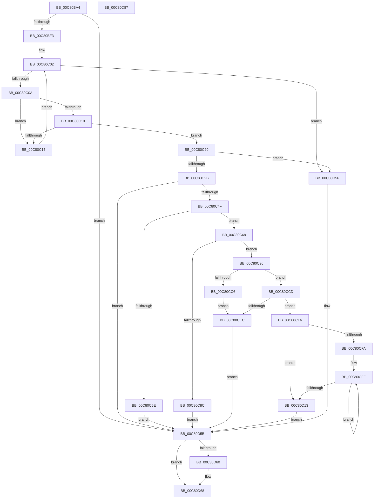

# FopReadMappingTable

- RVA: `0x00C80BA4`–`0x00C80D88` (길이 `484` bytes)
- VA: `0x0000000140C80BA4`
- 실행 섹션: `INIT`
- PDB 이름 있음: `예`; PDB Function 태그: `아니요`
- unwind 정보 RVA: `0x0008C20C`
- 디코드: `143`개 명령, `484/484` bytes 표시
- 미해석 바이트: `0` (있으면 어셈블리에 `.byte`로 보존)

> 이 문서는 커널 이미지의 기계어와 PDB 기호를 분석해 생성했습니다. 4번과 5번은 함수 원형과 자료형을 바이너리 사용 방식에서 추정한 C 해석이며 원본 소스 복구 결과는 아닙니다.

## 1. Dependencies

- 직접 호출 지점: **7**; 고유 호출 대상: **5**
- 직접 호출자로 확인된 함수: **1**
- RIP 상대 이미지 참조: **0**

### Outgoing calls
- `0x00C80BDF` → [FopReadCmapTable](FopReadCmapTable_function_00C80A54.md) (function, `0x00C80A54`)
- `0x00C80C40` → [FioFwReadBytesAtOffset](../../text/3E/FioFwReadBytesAtOffset_function_003E5948.md) (function, `0x003E5948`)
- `0x00C80C7F` → [BgpFwAllocateMemory](../../text/3E/BgpFwAllocateMemory_function_003E4374.md) (function, `0x003E4374`)
- `0x00C80CB9` → [BgpFwAllocateMemory](../../text/3E/BgpFwAllocateMemory_function_003E4374.md) (function, `0x003E4374`)
- `0x00C80CE1` → [FioFwReadBytesAtOffset](../../text/3E/FioFwReadBytesAtOffset_function_003E5948.md) (function, `0x003E5948`)
- `0x00C80CEF` → [FopFreeMappingTable](../../pagebgfx/BC/FopFreeMappingTable_function_00BC28AC.md) (function, `0x00BC28AC`)
- `0x00C80D63` → [BgpFwFreeMemory](../../text/3E/BgpFwFreeMemory_function_003E25E0.md) (function, `0x003E25E0`)

### Direct callers
- [FopInitializeFonts](FopInitializeFonts_function_00C808FC.md) at `0x00C809D4`

### Static image references
- 디코드된 RIP-relative 메모리 참조가 없습니다.

## 2. Other-region calls and transfers

- 다른 실행 섹션으로 향하는 call: **6**
  - `0x00C80C40` → [FioFwReadBytesAtOffset](../../text/3E/FioFwReadBytesAtOffset_function_003E5948.md) (`INIT` → `.text`)
  - `0x00C80C7F` → [BgpFwAllocateMemory](../../text/3E/BgpFwAllocateMemory_function_003E4374.md) (`INIT` → `.text`)
  - `0x00C80CB9` → [BgpFwAllocateMemory](../../text/3E/BgpFwAllocateMemory_function_003E4374.md) (`INIT` → `.text`)
  - `0x00C80CE1` → [FioFwReadBytesAtOffset](../../text/3E/FioFwReadBytesAtOffset_function_003E5948.md) (`INIT` → `.text`)
  - `0x00C80CEF` → [FopFreeMappingTable](../../pagebgfx/BC/FopFreeMappingTable_function_00BC28AC.md) (`INIT` → `PAGEBGFX`)
  - `0x00C80D63` → [BgpFwFreeMemory](../../text/3E/BgpFwFreeMemory_function_003E25E0.md) (`INIT` → `.text`)
- 별도 외부 분기/꼬리 이동을 확인하지 못했습니다.

## 3. Assembly (complete function range)

```asm
00C80BA4  4C 8B DC                        mov r11, rsp
00C80BA7  49 89 5B 08                     mov qword ptr [r11 + 8], rbx
00C80BAB  49 89 6B 10                     mov qword ptr [r11 + 0x10], rbp
00C80BAF  49 89 73 18                     mov qword ptr [r11 + 0x18], rsi
00C80BB3  57                              push rdi
00C80BB4  41 54                           push r12
00C80BB6  41 55                           push r13
00C80BB8  41 56                           push r14
00C80BBA  41 57                           push r15
00C80BBC  48 83 EC 30                     sub rsp, 0x30
00C80BC0  33 C0                           xor eax, eax
00C80BC2  4D 8B E0                        mov r12, r8
00C80BC5  49 21 43 20                     and qword ptr [r11 + 0x20], rax
00C80BC9  4D 8D 43 20                     lea r8, [r11 + 0x20]
00C80BCD  49 89 43 C8                     mov qword ptr [r11 - 0x38], rax
00C80BD1  8B FA                           mov edi, edx
00C80BD3  89 44 24 28                     mov dword ptr [rsp + 0x28], eax
00C80BD7  4C 8B F9                        mov r15, rcx
00C80BDA  66 89 44 24 2C                  mov word ptr [rsp + 0x2c], ax
00C80BDF  E8 70 FE FF FF                  call 0x140c80a54
00C80BE4  4C 8B 74 24 78                  mov r14, qword ptr [rsp + 0x78]
00C80BE9  8B D8                           mov ebx, eax
00C80BEB  85 C0                           test eax, eax
00C80BED  0F 88 68 01 00 00               js 0x140c80d5b
00C80BF3  41 0F B7 56 02                  movzx edx, word ptr [r14 + 2]
00C80BF8  49 8D 46 04                     lea rax, [r14 + 4]
00C80BFC  33 C9                           xor ecx, ecx
00C80BFE  44 8D 41 01                     lea r8d, [rcx + 1]
00C80C02  3B CA                           cmp ecx, edx
00C80C04  0F 83 4C 01 00 00               jae 0x140c80d56
00C80C0A  66 83 38 03                     cmp word ptr [rax], 3
00C80C0E  75 07                           jne 0x140c80c17
00C80C10  66 44 39 40 02                  cmp word ptr [rax + 2], r8w
00C80C15  74 09                           je 0x140c80c20
00C80C17  41 03 C8                        add ecx, r8d
00C80C1A  48 83 C0 08                     add rax, 8
00C80C1E  EB E2                           jmp 0x140c80c02
00C80C20  8B 48 04                        mov ecx, dword ptr [rax + 4]
00C80C23  85 C9                           test ecx, ecx
00C80C25  0F 84 2B 01 00 00               je 0x140c80d56
00C80C2B  44 8D 2C 39                     lea r13d, [rcx + rdi]
00C80C2F  41 B8 0E 00 00 00               mov r8d, 0xe
00C80C35  41 8B D5                        mov edx, r13d
00C80C38  4C 8D 4C 24 20                  lea r9, [rsp + 0x20]
00C80C3D  49 8B CF                        mov rcx, r15
00C80C40  E8 03 4D 76 FF                  call 0x1403e5948
00C80C45  8B D8                           mov ebx, eax
00C80C47  85 C0                           test eax, eax
00C80C49  0F 88 0C 01 00 00               js 0x140c80d5b
00C80C4F  0F B7 44 24 20                  movzx eax, word ptr [rsp + 0x20]
00C80C54  66 C1 C8 08                     ror ax, 8
00C80C58  66 83 F8 04                     cmp ax, 4
00C80C5C  74 0A                           je 0x140c80c68
00C80C5E  BB 7B 00 00 C0                  mov ebx, 0xc000007b
00C80C63  E9 F3 00 00 00                  jmp 0x140c80d5b
00C80C68  0F B7 5C 24 22                  movzx ebx, word ptr [rsp + 0x22]
00C80C6D  B9 38 00 00 00                  mov ecx, 0x38
00C80C72  0F B7 74 24 26                  movzx esi, word ptr [rsp + 0x26]
00C80C77  66 C1 CB 08                     ror bx, 8
00C80C7B  66 C1 CE 08                     ror si, 8
00C80C7F  E8 F0 36 76 FF                  call 0x1403e4374
00C80C84  48 8B F8                        mov rdi, rax
00C80C87  48 85 C0                        test rax, rax
00C80C8A  75 0A                           jne 0x140c80c96
00C80C8C  BB 17 00 00 C0                  mov ebx, 0xc0000017
00C80C91  E9 C5 00 00 00                  jmp 0x140c80d5b
00C80C96  0F 57 C0                        xorps xmm0, xmm0
00C80C99  33 C0                           xor eax, eax
00C80C9B  0F 11 07                        movups xmmword ptr [rdi], xmm0
00C80C9E  0F 11 47 10                     movups xmmword ptr [rdi + 0x10], xmm0
00C80CA2  0F 11 47 20                     movups xmmword ptr [rdi + 0x20], xmm0
00C80CA6  48 89 47 30                     mov qword ptr [rdi + 0x30], rax
00C80CAA  0F B7 C6                        movzx eax, si
00C80CAD  D1 E8                           shr eax, 1
00C80CAF  0F B7 F3                        movzx esi, bx
00C80CB2  83 EE 0E                        sub esi, 0xe
00C80CB5  89 07                           mov dword ptr [rdi], eax
00C80CB7  8B CE                           mov ecx, esi
00C80CB9  E8 B6 36 76 FF                  call 0x1403e4374
00C80CBE  48 8B E8                        mov rbp, rax
00C80CC1  48 85 C0                        test rax, rax
00C80CC4  75 07                           jne 0x140c80ccd
00C80CC6  BB 17 00 00 C0                  mov ebx, 0xc0000017
00C80CCB  EB 1F                           jmp 0x140c80cec
00C80CCD  D1 EE                           shr esi, 1
00C80CCF  41 8D 55 0E                     lea edx, [r13 + 0xe]
00C80CD3  4C 8B CD                        mov r9, rbp
00C80CD6  48 89 6F 08                     mov qword ptr [rdi + 8], rbp
00C80CDA  49 8B CF                        mov rcx, r15
00C80CDD  44 8D 04 36                     lea r8d, [rsi + rsi]
00C80CE1  E8 62 4C 76 FF                  call 0x1403e5948
00C80CE6  8B D8                           mov ebx, eax
00C80CE8  85 C0                           test eax, eax
00C80CEA  79 0A                           jns 0x140c80cf6
00C80CEC  48 8B CF                        mov rcx, rdi
00C80CEF  E8 B8 1B F4 FF                  call 0x140bc28ac
00C80CF4  EB 65                           jmp 0x140c80d5b
00C80CF6  85 F6                           test esi, esi
00C80CF8  74 19                           je 0x140c80d13
00C80CFA  48 8B CD                        mov rcx, rbp
00C80CFD  8B D6                           mov edx, esi
00C80CFF  0F B7 01                        movzx eax, word ptr [rcx]
00C80D02  66 C1 C8 08                     ror ax, 8
00C80D06  66 89 01                        mov word ptr [rcx], ax
00C80D09  48 8D 49 02                     lea rcx, [rcx + 2]
00C80D0D  48 83 EA 01                     sub rdx, 1
00C80D11  75 EC                           jne 0x140c80cff
00C80D13  8B 17                           mov edx, dword ptr [rdi]
00C80D15  03 D2                           add edx, edx
00C80D17  48 89 6F 18                     mov qword ptr [rdi + 0x18], rbp
00C80D1B  8D 4A 02                        lea ecx, [rdx + 2]
00C80D1E  48 03 CD                        add rcx, rbp
00C80D21  48 89 4F 10                     mov qword ptr [rdi + 0x10], rcx
00C80D25  8D 0C 55 02 00 00 00            lea ecx, [rdx*2 + 2]
00C80D2C  48 03 CD                        add rcx, rbp
00C80D2F  48 89 4F 20                     mov qword ptr [rdi + 0x20], rcx
00C80D33  8D 4A 01                        lea ecx, [rdx + 1]
00C80D36  8D 0C 4A                        lea ecx, [rdx + rcx*2]
00C80D39  48 03 CD                        add rcx, rbp
00C80D3C  48 89 4F 28                     mov qword ptr [rdi + 0x28], rcx
00C80D40  8D 0C 95 02 00 00 00            lea ecx, [rdx*4 + 2]
00C80D47  48 03 CD                        add rcx, rbp
00C80D4A  48 89 4F 30                     mov qword ptr [rdi + 0x30], rcx
00C80D4E  33 DB                           xor ebx, ebx
00C80D50  49 89 3C 24                     mov qword ptr [r12], rdi
00C80D54  EB 05                           jmp 0x140c80d5b
00C80D56  BB 25 02 00 C0                  mov ebx, 0xc0000225
00C80D5B  4D 85 F6                        test r14, r14
00C80D5E  74 08                           je 0x140c80d68
00C80D60  49 8B CE                        mov rcx, r14
00C80D63  E8 78 18 76 FF                  call 0x1403e25e0
00C80D68  48 8B 6C 24 68                  mov rbp, qword ptr [rsp + 0x68]
00C80D6D  8B C3                           mov eax, ebx
00C80D6F  48 8B 5C 24 60                  mov rbx, qword ptr [rsp + 0x60]
00C80D74  48 8B 74 24 70                  mov rsi, qword ptr [rsp + 0x70]
00C80D79  48 83 C4 30                     add rsp, 0x30
00C80D7D  41 5F                           pop r15
00C80D7F  41 5E                           pop r14
00C80D81  41 5D                           pop r13
00C80D83  41 5C                           pop r12
00C80D85  5F                              pop rdi
00C80D86  C3                              ret
00C80D87  CC                              int3
```

## 4. C-style interpretation (structured pseudocode)

```c
__int64 __fastcall FopReadMappingTable(__int64 a1, int a2, __int64 a3)
{
    __int64 result;
    __int64 v_rbx;
    __int64 v_rsi;
    __int64 v_rsp;
    unsigned __int16 v_stack_m2C;
    unsigned int v_stack_m30;
    unsigned __int16 v_stack_m32;
    unsigned __int16 v_stack_m36;
    unsigned __int64 v_stack_m38;
    unsigned __int64 v_stack_p10;
    unsigned __int64 v_stack_p18;
    unsigned __int64 v_stack_p20;
    unsigned __int64 v_stack_p8;

    *(unsigned __int64 *)(v_rsp + 8) = v_rbx;
    *(unsigned __int64 *)(v_rsp + 16) = v_rbp;
    *(unsigned __int64 *)(v_rsp + 24) = v_rsi;
    v_rsp = (v_rsp) - (48);
    result = 0;
    *(unsigned __int64 *)(v_rsp - 56) = 0;
    v_stack_m30 = 0;
    v_stack_m2C = 0;
    result = FopReadCmapTable(a1, a2, v_rsp + 32, a4);
    if (sign_flag) goto loc_00C80D5B;
    a1 = 0;
loc_00C80C02:
    if (0 >= ((unsigned int)(*(unsigned __int16 *)(v_stack_p20 + 2)))) goto loc_00C80D56;
    if ((*(unsigned __int16 *)(v_stack_p20 + 4)) != 3) goto loc_00C80C17;
    if ((*(unsigned __int16 *)(v_stack_p20 + 4 + 2)) == ((unsigned __int16)(a1 + 1))) goto loc_00C80C20;
loc_00C80C17:
    a1 = (unsigned int)((a1) + ((unsigned int)(a1 + 1)));
    result = (v_stack_p20 + 4) + (8);
    goto loc_00C80C02;
loc_00C80C20:
    if ((unsigned int)((unsigned int)(*(unsigned int *)(result + 4))) == 0) goto loc_00C80D56;
    result = FioFwReadBytesAtOffset(a1, (unsigned int)((unsigned int)((unsigned int)(*(unsigned int *)(result + 4)) + (unsigned int)(a2) * 1)), 14, v_stack_m38);
    if (sign_flag) goto loc_00C80D5B;
    if (((unsigned __int16)(v_stack_m38)) == 4) goto loc_00C80C68;
    goto loc_00C80D5B;
loc_00C80C68:
    result = BgpFwAllocateMemory(56, (unsigned int)((unsigned int)((unsigned int)(*(unsigned int *)(result + 4)) + (unsigned int)(a2) * 1)), 14, v_stack_m38);
    if (result != 0) goto loc_00C80C96;
    goto loc_00C80D5B;
loc_00C80C96:
    result = 0;
    *(unsigned __int64 *)(result) = v_xmm0;
    *(unsigned __int64 *)(result + 16) = v_xmm0;
    *(unsigned __int64 *)(result + 32) = v_xmm0;
    *(unsigned __int64 *)(result + 48) = 0;
    result = (unsigned int)(((unsigned __int16)(v_stack_m32)) >> (1));
    v_rsi = (unsigned int)(((unsigned __int16)((unsigned int)(0xC0000017ULL))) - (14));
    *(unsigned int *)(result) = (unsigned int)(result);
    result = BgpFwAllocateMemory((unsigned int)((unsigned int)(v_rsi)), (unsigned int)((unsigned int)((unsigned int)(*(unsigned int *)(result + 4)) + (unsigned int)(a2) * 1)), 14, v_stack_m38);
    if (result != 0) goto loc_00C80CCD;
    goto loc_00C80CEC;
loc_00C80CCD:
    v_rsi = (unsigned int)((v_rsi) >> (1));
    *(unsigned __int64 *)(result + 8) = result;
    result = FioFwReadBytesAtOffset(a1, (unsigned int)(*(unsigned int *)(result + 4)) + (unsigned int)(a2) * 1 + 14, v_rsi + v_rsi * 1, result);
    if (!sign_flag) goto loc_00C80CF6;
loc_00C80CEC:
    result = FopFreeMappingTable(result, (unsigned int)(*(unsigned int *)(result + 4)) + (unsigned int)(a2) * 1 + 14, v_rsi + v_rsi * 1, result);
    goto loc_00C80D5B;
loc_00C80CF6:
    if ((unsigned int)(v_rsi) == 0) goto loc_00C80D13;
loc_00C80CFF:
    *(unsigned __int16 *)(result) = (unsigned __int16)(*(unsigned __int16 *)(result));
    a2 = ((unsigned int)((unsigned int)(v_rsi))) - (1);
    if (condition_is_not_equal) goto loc_00C80CFF;
loc_00C80D13:
    a2 = (unsigned int)(((unsigned int)(*(unsigned int *)(result))) + ((unsigned int)((unsigned int)(*(unsigned int *)(result)))));
    *(unsigned __int64 *)(result + 24) = result;
    a1 = (a2 + 2) + (result);
    *(unsigned __int64 *)(result + 16) = a1;
    a1 = (a2 * 2 + 2) + (result);
    *(unsigned __int64 *)(result + 32) = a1;
    a1 = (a2 + a2 + 1 * 2) + (result);
    *(unsigned __int64 *)(result + 40) = a1;
    a1 = (a2 * 4 + 2) + (result);
    *(unsigned __int64 *)(result + 48) = a1;
    v_rbx = 0;
    *(unsigned __int64 *)(a3) = result;
    goto loc_00C80D5B;
loc_00C80D56:
loc_00C80D5B:
    result = *(unsigned __int16 *)(result);
    if (v_stack_p20 != 0) {
        a1 = v_stack_p20;
        result = BgpFwFreeMemory(a1, a2, v_rsi + v_rsi * 1, result);
    }
    v_rsp = (v_rsp) + (48);
    return (unsigned int)((unsigned int)((unsigned int)(0xC0000225ULL)));
}
```

## 5. (Beta) C Style

```c
int64_t FopReadMappingTable(int64_t Arg1, int32_t Arg2, void *Arg3)
{
    uint8_t *arg3 = (uint8_t *)Arg3;

    int64_t result;
    int64_t local_rbx;
    int64_t local_rsi;
    int64_t local_rsp;
    uint16_t v_stack_m2C;
    uint32_t v_stack_m30;
    uint16_t v_stack_m32;
    uint16_t v_stack_m36;
    uint64_t v_stack_m38;
    uint64_t v_stack_p10;
    uint64_t v_stack_p18;
    uint64_t v_stack_p20;
    uint64_t v_stack_p8;

    *(uint64_t *)(local_rsp + 0x8) = local_rbx;
    *(uint64_t *)(local_rsp + 0x10) = local_rbp;
    *(uint64_t *)(local_rsp + 0x18) = local_rsi;
    local_rsp = (local_rsp) - (48);
    result = 0;
    *(uint64_t *)(local_rsp - 0x38) = 0;
    v_stack_m30 = 0;
    v_stack_m2C = 0;
    result = FopReadCmapTable(Arg1, Arg2, local_rsp + 32, a4);
    if (sign_flag) goto loc_00C80D5B;
    Arg1 = 0;
loc_00C80C02:
    if (0 >= ((uint32_t)(*(uint16_t *)(v_stack_p20 + 0x2)))) goto loc_00C80D56;
    if ((*(uint16_t *)(v_stack_p20 + 0x4)) != 3) goto loc_00C80C17;
    if ((*(uint16_t *)(v_stack_p20 + 0x4 + 0x2)) == ((uint16_t)(Arg1 + 1))) goto loc_00C80C20;
loc_00C80C17:
    Arg1 = (uint32_t)((Arg1) + ((uint32_t)(Arg1 + 1)));
    result = (v_stack_p20 + 4) + (8);
    goto loc_00C80C02;
loc_00C80C20:
    if ((uint32_t)((uint32_t)(*(uint32_t *)(result + 0x4))) == 0) goto loc_00C80D56;
    result = FioFwReadBytesAtOffset(Arg1, (uint32_t)((uint32_t)((uint32_t)(*(uint32_t *)(result + 0x4)) + (uint32_t)(Arg2) * 1)), 14, v_stack_m38);
    if (sign_flag) goto loc_00C80D5B;
    if (((uint16_t)(v_stack_m38)) == 4) goto loc_00C80C68;
    goto loc_00C80D5B;
loc_00C80C68:
    result = BgpFwAllocateMemory(56, (uint32_t)((uint32_t)((uint32_t)(*(uint32_t *)(result + 0x4)) + (uint32_t)(Arg2) * 1)), 14, v_stack_m38);
    if (result != 0) goto loc_00C80C96;
    goto loc_00C80D5B;
loc_00C80C96:
    result = 0;
    *(uint64_t *)(result) = v_xmm0;
    *(uint64_t *)(result + 0x10) = v_xmm0;
    *(uint64_t *)(result + 0x20) = v_xmm0;
    *(uint64_t *)(result + 0x30) = 0;
    result = (uint32_t)(((uint16_t)(v_stack_m32)) >> (1));
    local_rsi = (uint32_t)(((uint16_t)((uint32_t)(0xC0000017ULL))) - (14));
    *(uint32_t *)(result) = (uint32_t)(result);
    result = BgpFwAllocateMemory((uint32_t)((uint32_t)(local_rsi)), (uint32_t)((uint32_t)((uint32_t)(*(uint32_t *)(result + 0x4)) + (uint32_t)(Arg2) * 1)), 14, v_stack_m38);
    if (result != 0) goto loc_00C80CCD;
    goto loc_00C80CEC;
loc_00C80CCD:
    local_rsi = (uint32_t)((local_rsi) >> (1));
    *(uint64_t *)(result + 0x8) = result;
    result = FioFwReadBytesAtOffset(Arg1, (uint32_t)(*(uint32_t *)(result + 0x4)) + (uint32_t)(Arg2) * 1 + 14, local_rsi + local_rsi * 1, result);
    if (!sign_flag) goto loc_00C80CF6;
loc_00C80CEC:
    result = FopFreeMappingTable(result, (uint32_t)(*(uint32_t *)(result + 0x4)) + (uint32_t)(Arg2) * 1 + 14, local_rsi + local_rsi * 1, result);
    goto loc_00C80D5B;
loc_00C80CF6:
    if ((uint32_t)(local_rsi) == 0) goto loc_00C80D13;
loc_00C80CFF:
    *(uint16_t *)(result) = (uint16_t)(*(uint16_t *)(result));
    Arg2 = ((uint32_t)((uint32_t)(local_rsi))) - (1);
    if (condition_is_not_equal) goto loc_00C80CFF;
loc_00C80D13:
    Arg2 = (uint32_t)(((uint32_t)(*(uint32_t *)(result))) + ((uint32_t)((uint32_t)(*(uint32_t *)(result)))));
    *(uint64_t *)(result + 0x18) = result;
    Arg1 = (Arg2 + 2) + (result);
    *(uint64_t *)(result + 0x10) = Arg1;
    Arg1 = (Arg2 * 2 + 2) + (result);
    *(uint64_t *)(result + 0x20) = Arg1;
    Arg1 = (Arg2 + Arg2 + 1 * 2) + (result);
    *(uint64_t *)(result + 0x28) = Arg1;
    Arg1 = (Arg2 * 4 + 2) + (result);
    *(uint64_t *)(result + 0x30) = Arg1;
    local_rbx = 0;
    *(uint64_t *)(arg3) = result;
    goto loc_00C80D5B;
loc_00C80D56:
loc_00C80D5B:
    result = *(uint16_t *)(result);
    if (v_stack_p20 != 0) {
        Arg1 = v_stack_p20;
        result = BgpFwFreeMemory(Arg1, Arg2, local_rsi + local_rsi * 1, result);
    }
    local_rsp = (local_rsp) + (48);
    return (uint32_t)((uint32_t)((uint32_t)(0xC0000225ULL)));
}
```

### 관측된 메모리 오프셋

구조체 형식이 확인되지 않은 접근은 인자 기준의 오프셋으로만 기록했습니다.

| 기준 인자 | 오프셋 표현 | 폭 (bit) | 접근 |
|---|---:|---:|---|
| `Arg3` | `+ 0x0` | `64` | `W` |

## 6. Execution-region graph

[열기: 2D/3D 그래프와 함수 탐색 컨트롤 패널](../../../control-panel.html?section=init&rva=0x00C80BA4&view=graph)

- 2D 그래프는 위에서 아래로 흐르고, 3D 그래프는 빈 공간을 드래그해 회전합니다. Shift+드래그는 이동, 휠은 확대·축소, 함수 노드 선택은 대상 보고서 이동입니다.

### Static fallback


