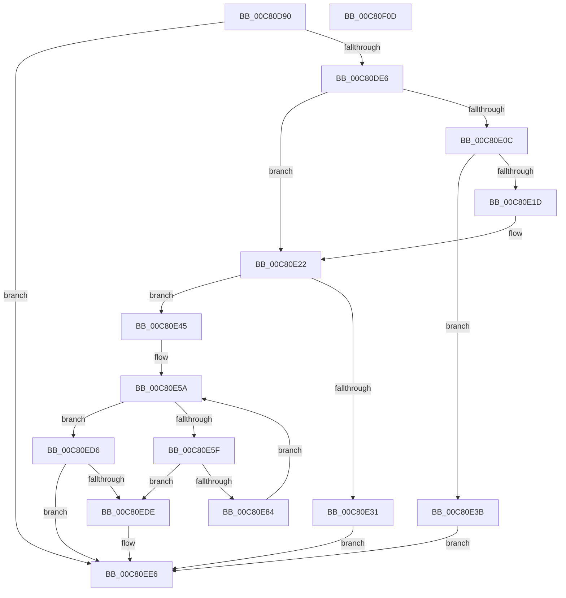

# FopReadNamingTable

- RVA: `0x00C80D90`–`0x00C80F0E` (길이 `382` bytes)
- VA: `0x0000000140C80D90`
- 실행 섹션: `INIT`
- PDB 이름 있음: `예`; PDB Function 태그: `아니요`
- unwind 정보 RVA: `0x000DA470`
- 디코드: `112`개 명령, `382/382` bytes 표시
- 미해석 바이트: `0` (있으면 어셈블리에 `.byte`로 보존)

> 이 문서는 커널 이미지의 기계어와 PDB 기호를 분석해 생성했습니다. 4번과 5번은 함수 원형과 자료형을 바이너리 사용 방식에서 추정한 C 해석이며 원본 소스 복구 결과는 아닙니다.

## 1. Dependencies

- 직접 호출 지점: **5**; 고유 호출 대상: **4**
- 직접 호출자로 확인된 함수: **1**
- RIP 상대 이미지 참조: **1**

### Outgoing calls
- `0x00C80DD4` → [FioFwReadBytesAtOffset](../../text/3E/FioFwReadBytesAtOffset_function_003E5948.md) (function, `0x003E5948`)
- `0x00C80E24` → [BgpFwAllocateMemory](../../text/3E/BgpFwAllocateMemory_function_003E4374.md) (function, `0x003E4374`)
- `0x00C80E79` → [FioFwReadBytesAtOffset](../../text/3E/FioFwReadBytesAtOffset_function_003E5948.md) (function, `0x003E5948`)
- `0x00C80EE1` → [BgpFwFreeMemory](../../text/3E/BgpFwFreeMemory_function_003E25E0.md) (function, `0x003E25E0`)
- `0x00C80EF0` → [_security_check_cookie](../../text/6A/_security_check_cookie_function_006AC640.md) (function, `0x006AC640`)

### Direct callers
- [FopValidateFontNameTable](FopValidateFontNameTable_function_00C80F14.md) at `0x00C80F79`

### Static image references
- `0x00C80DA4` → RVA `0x00E0A740` (`.data`; read)

## 2. Other-region calls and transfers

- 다른 실행 섹션으로 향하는 call: **5**
  - `0x00C80DD4` → [FioFwReadBytesAtOffset](../../text/3E/FioFwReadBytesAtOffset_function_003E5948.md) (`INIT` → `.text`)
  - `0x00C80E24` → [BgpFwAllocateMemory](../../text/3E/BgpFwAllocateMemory_function_003E4374.md) (`INIT` → `.text`)
  - `0x00C80E79` → [FioFwReadBytesAtOffset](../../text/3E/FioFwReadBytesAtOffset_function_003E5948.md) (`INIT` → `.text`)
  - `0x00C80EE1` → [BgpFwFreeMemory](../../text/3E/BgpFwFreeMemory_function_003E25E0.md) (`INIT` → `.text`)
  - `0x00C80EF0` → [_security_check_cookie](../../text/6A/_security_check_cookie_function_006AC640.md) (`INIT` → `.text`)
- 별도 외부 분기/꼬리 이동을 확인하지 못했습니다.

## 3. Assembly (complete function range)

```asm
00C80D90  48 89 5C 24 20                  mov qword ptr [rsp + 0x20], rbx
00C80D95  55                              push rbp
00C80D96  56                              push rsi
00C80D97  57                              push rdi
00C80D98  41 54                           push r12
00C80D9A  41 55                           push r13
00C80D9C  41 56                           push r14
00C80D9E  41 57                           push r15
00C80DA0  48 83 EC 40                     sub rsp, 0x40
00C80DA4  48 8B 05 95 99 18 00            mov rax, qword ptr [rip + 0x189995]
00C80DAB  48 33 C4                        xor rax, rsp
00C80DAE  48 89 44 24 38                  mov qword ptr [rsp + 0x38], rax
00C80DB3  33 C0                           xor eax, eax
00C80DB5  4C 8D 4C 24 20                  lea r9, [rsp + 0x20]
00C80DBA  4D 8B E8                        mov r13, r8
00C80DBD  66 89 44 24 30                  mov word ptr [rsp + 0x30], ax
00C80DC2  0F 57 C0                        xorps xmm0, xmm0
00C80DC5  44 8B F2                        mov r14d, edx
00C80DC8  4C 8B E1                        mov r12, rcx
00C80DCB  44 8D 40 06                     lea r8d, [rax + 6]
00C80DCF  0F 11 44 24 20                  movups xmmword ptr [rsp + 0x20], xmm0
00C80DD4  E8 6F 4B 76 FF                  call 0x1403e5948
00C80DD9  45 33 FF                        xor r15d, r15d
00C80DDC  8B D8                           mov ebx, eax
00C80DDE  85 C0                           test eax, eax
00C80DE0  0F 88 00 01 00 00               js 0x140c80ee6
00C80DE6  0F B7 74 24 22                  movzx esi, word ptr [rsp + 0x22]
00C80DEB  41 8D 57 12                     lea edx, [r15 + 0x12]
00C80DEF  0F B7 6C 24 24                  movzx ebp, word ptr [rsp + 0x24]
00C80DF4  66 C1 4C 24 20 08               ror word ptr [rsp + 0x20], 8
00C80DFA  66 C1 CE 08                     ror si, 8
00C80DFE  66 C1 CD 08                     ror bp, 8
00C80E02  66 89 74 24 22                  mov word ptr [rsp + 0x22], si
00C80E07  66 85 F6                        test si, si
00C80E0A  74 16                           je 0x140c80e22
00C80E0C  0F B7 C6                        movzx eax, si
00C80E0F  8D 0C 40                        lea ecx, [rax + rax*2]
00C80E12  8D 0C 8D 12 00 00 00            lea ecx, [rcx*4 + 0x12]
00C80E19  3B CA                           cmp ecx, edx
00C80E1B  72 1E                           jb 0x140c80e3b
00C80E1D  8B D1                           mov edx, ecx
00C80E1F  41 8B DF                        mov ebx, r15d
00C80E22  8B CA                           mov ecx, edx
00C80E24  E8 4B 35 76 FF                  call 0x1403e4374
00C80E29  48 8B F8                        mov rdi, rax
00C80E2C  48 85 C0                        test rax, rax
00C80E2F  75 14                           jne 0x140c80e45
00C80E31  BB 17 00 00 C0                  mov ebx, 0xc0000017
00C80E36  E9 AB 00 00 00                  jmp 0x140c80ee6
00C80E3B  BB 95 00 00 C0                  mov ebx, 0xc0000095
00C80E40  E9 A1 00 00 00                  jmp 0x140c80ee6
00C80E45  8B 44 24 20                     mov eax, dword ptr [rsp + 0x20]
00C80E49  41 83 C6 06                     add r14d, 6
00C80E4D  89 07                           mov dword ptr [rdi], eax
00C80E4F  66 89 6F 04                     mov word ptr [rdi + 4], bp
00C80E53  41 8B EF                        mov ebp, r15d
00C80E56  44 0F B7 FE                     movzx r15d, si
00C80E5A  41 3B EF                        cmp ebp, r15d
00C80E5D  73 77                           jae 0x140c80ed6
00C80E5F  8B C5                           mov eax, ebp
00C80E61  41 B8 0C 00 00 00               mov r8d, 0xc
00C80E67  41 8B D6                        mov edx, r14d
00C80E6A  48 8D 0C 40                     lea rcx, [rax + rax*2]
00C80E6E  48 8D 34 8F                     lea rsi, [rdi + rcx*4]
00C80E72  49 8B CC                        mov rcx, r12
00C80E75  4C 8D 4E 06                     lea r9, [rsi + 6]
00C80E79  E8 CA 4A 76 FF                  call 0x1403e5948
00C80E7E  8B D8                           mov ebx, eax
00C80E80  85 C0                           test eax, eax
00C80E82  78 5A                           js 0x140c80ede
00C80E84  0F B7 46 06                     movzx eax, word ptr [rsi + 6]
00C80E88  33 DB                           xor ebx, ebx
00C80E8A  66 C1 C8 08                     ror ax, 8
00C80E8E  FF C5                           inc ebp
00C80E90  66 89 46 06                     mov word ptr [rsi + 6], ax
00C80E94  0F B7 46 08                     movzx eax, word ptr [rsi + 8]
00C80E98  66 C1 C8 08                     ror ax, 8
00C80E9C  66 89 46 08                     mov word ptr [rsi + 8], ax
00C80EA0  0F B7 46 0A                     movzx eax, word ptr [rsi + 0xa]
00C80EA4  66 C1 C8 08                     ror ax, 8
00C80EA8  66 89 46 0A                     mov word ptr [rsi + 0xa], ax
00C80EAC  0F B7 46 0C                     movzx eax, word ptr [rsi + 0xc]
00C80EB0  66 C1 C8 08                     ror ax, 8
00C80EB4  66 89 46 0C                     mov word ptr [rsi + 0xc], ax
00C80EB8  0F B7 46 0E                     movzx eax, word ptr [rsi + 0xe]
00C80EBC  66 C1 C8 08                     ror ax, 8
00C80EC0  66 89 46 0E                     mov word ptr [rsi + 0xe], ax
00C80EC4  0F B7 46 10                     movzx eax, word ptr [rsi + 0x10]
00C80EC8  66 C1 C8 08                     ror ax, 8
00C80ECC  66 89 46 10                     mov word ptr [rsi + 0x10], ax
00C80ED0  41 83 C6 0C                     add r14d, 0xc
00C80ED4  EB 84                           jmp 0x140c80e5a
00C80ED6  49 89 7D 00                     mov qword ptr [r13], rdi
00C80EDA  85 DB                           test ebx, ebx
00C80EDC  79 08                           jns 0x140c80ee6
00C80EDE  48 8B CF                        mov rcx, rdi
00C80EE1  E8 FA 16 76 FF                  call 0x1403e25e0
00C80EE6  8B C3                           mov eax, ebx
00C80EE8  48 8B 4C 24 38                  mov rcx, qword ptr [rsp + 0x38]
00C80EED  48 33 CC                        xor rcx, rsp
00C80EF0  E8 4B B7 A2 FF                  call 0x1406ac640
00C80EF5  48 8B 9C 24 98 00 00 00         mov rbx, qword ptr [rsp + 0x98]
00C80EFD  48 83 C4 40                     add rsp, 0x40
00C80F01  41 5F                           pop r15
00C80F03  41 5E                           pop r14
00C80F05  41 5D                           pop r13
00C80F07  41 5C                           pop r12
00C80F09  5F                              pop rdi
00C80F0A  5E                              pop rsi
00C80F0B  5D                              pop rbp
00C80F0C  C3                              ret
00C80F0D  CC                              int3
```

## 4. C-style interpretation (structured pseudocode)

```c
__int64 __fastcall FopReadNamingTable(__int64 a1, int a2, __int64 a3)
{
    __int64 result;
    __int64 v_r14;
    __int64 v_r15;
    __int64 v_rbp;
    __int64 v_rbx;
    __int64 v_rsp;
    unsigned __int64 v_stack_m40;
    unsigned __int16 v_stack_m48;
    unsigned __int16 v_stack_m54;
    unsigned __int16 v_stack_m56;
    unsigned __int64 v_stack_m58;
    unsigned __int64 v_stack_p20;

    v_stack_p20 = v_rbx;
    v_rsp = (v_rsp) - (64);
    result = (*(unsigned __int64 *)(v_rip + 1612181)) ^ (v_rsp);
    v_stack_m40 = result;
    result = 0;
    v_stack_m48 = 0;
    v_stack_m58 = v_xmm0;
    result = FioFwReadBytesAtOffset(a1, a2, result + 6, v_stack_m58);
    v_r15 = 0;
    if (sign_flag) goto loc_00C80EE6;
    v_stack_m56 = (unsigned __int16)(v_stack_m56);
    if ((unsigned __int16)(v_stack_m56) == 0) goto loc_00C80E22;
    if (((unsigned int)((unsigned __int16)(v_stack_m56) + (unsigned __int16)(v_stack_m56) * 2 * 4 + 18)) < ((unsigned int)(v_r15 + 18))) goto loc_00C80E3B;
loc_00C80E22:
    result = BgpFwAllocateMemory((unsigned int)((unsigned int)((unsigned int)((unsigned int)((unsigned __int16)(v_stack_m56) + (unsigned __int16)(v_stack_m56) * 2 * 4 + 18)))), (unsigned int)((unsigned int)((unsigned __int16)(v_stack_m56) + (unsigned __int16)(v_stack_m56) * 2 * 4 + 18)), result + 6, v_stack_m58);
    if (result != 0) goto loc_00C80E45;
    goto loc_00C80EE6;
loc_00C80E3B:
    goto loc_00C80EE6;
loc_00C80E45:
    v_r14 = (unsigned int)(((unsigned int)(a2)) + (6));
    *(unsigned int *)(result) = (unsigned int)((unsigned int)(v_stack_m58));
    *(unsigned __int16 *)(result + 4) = (unsigned __int16)(v_stack_m54);
loc_00C80E5A:
    if (0 >= ((unsigned int)((unsigned __int16)(v_stack_m56)))) goto loc_00C80ED6;
    result = FioFwReadBytesAtOffset(a1, (unsigned int)((unsigned int)(v_r14)), 12, result + 0 + 0 * 2 * 4 + 6);
    if (sign_flag) goto loc_00C80EDE;
    v_rbx = 0;
    v_rbp = (unsigned int)((0) + 1);
    *(unsigned __int16 *)(result + 0 + 0 * 2 * 4 + 6) = (unsigned __int16)(*(unsigned __int16 *)(result + 0 + 0 * 2 * 4 + 6));
    *(unsigned __int16 *)(result + 0 + 0 * 2 * 4 + 8) = (unsigned __int16)(*(unsigned __int16 *)(result + 0 + 0 * 2 * 4 + 8));
    *(unsigned __int16 *)(result + 0 + 0 * 2 * 4 + 10) = (unsigned __int16)(*(unsigned __int16 *)(result + 0 + 0 * 2 * 4 + 10));
    *(unsigned __int16 *)(result + 0 + 0 * 2 * 4 + 12) = (unsigned __int16)(*(unsigned __int16 *)(result + 0 + 0 * 2 * 4 + 12));
    *(unsigned __int16 *)(result + 0 + 0 * 2 * 4 + 14) = (unsigned __int16)(*(unsigned __int16 *)(result + 0 + 0 * 2 * 4 + 14));
    *(unsigned __int16 *)(result + 0 + 0 * 2 * 4 + 16) = (unsigned __int16)(*(unsigned __int16 *)(result + 0 + 0 * 2 * 4 + 16));
    v_r14 = (unsigned int)((v_r14) + (12));
    goto loc_00C80E5A;
loc_00C80ED6:
    *(unsigned __int64 *)(a3) = result;
    result = *(unsigned __int16 *)(result + 0 + 0 * 2 * 4 + 16);
    if (sign_flag) {
        a1 = result;
        result = BgpFwFreeMemory(a1, (unsigned int)((unsigned int)(v_r14)), 12, result + 0 + 0 * 2 * 4 + 6);
    }
    a1 = (v_stack_m40) ^ (v_rsp);
    result = _security_check_cookie(a1, (unsigned int)((unsigned int)(v_r14)), 12, result + 0 + 0 * 2 * 4 + 6);
    v_rsp = (v_rsp) + (64);
    return result;
}
```

## 5. (Beta) C Style

```c
int64_t FopReadNamingTable(int64_t Arg1, int32_t Arg2, void *Arg3)
{
    uint8_t *arg3 = (uint8_t *)Arg3;

    int64_t result;
    int64_t local_r14;
    int64_t local_r15;
    int64_t local_rbp;
    int64_t local_rbx;
    int64_t local_rsp;
    uint64_t v_stack_m40;
    uint16_t v_stack_m48;
    uint16_t v_stack_m54;
    uint16_t v_stack_m56;
    uint64_t v_stack_m58;
    uint64_t v_stack_p20;

    v_stack_p20 = local_rbx;
    local_rsp = (local_rsp) - (64);
    result = (*(uint64_t *)(v_rip + 0x189995)) ^ (local_rsp);
    v_stack_m40 = result;
    result = 0;
    v_stack_m48 = 0;
    v_stack_m58 = v_xmm0;
    result = FioFwReadBytesAtOffset(Arg1, Arg2, result + 6, v_stack_m58);
    local_r15 = 0;
    if (sign_flag) goto loc_00C80EE6;
    v_stack_m56 = (uint16_t)(v_stack_m56);
    if ((uint16_t)(v_stack_m56) == 0) goto loc_00C80E22;
    if (((uint32_t)((uint16_t)(v_stack_m56) + (uint16_t)(v_stack_m56) * 2 * 4 + 18)) < ((uint32_t)(local_r15 + 18))) goto loc_00C80E3B;
loc_00C80E22:
    result = BgpFwAllocateMemory((uint32_t)((uint32_t)((uint32_t)((uint32_t)((uint16_t)(v_stack_m56) + (uint16_t)(v_stack_m56) * 2 * 4 + 18)))), (uint32_t)((uint32_t)((uint16_t)(v_stack_m56) + (uint16_t)(v_stack_m56) * 2 * 4 + 18)), result + 6, v_stack_m58);
    if (result != 0) goto loc_00C80E45;
    goto loc_00C80EE6;
loc_00C80E3B:
    goto loc_00C80EE6;
loc_00C80E45:
    local_r14 = (uint32_t)(((uint32_t)(Arg2)) + (6));
    *(uint32_t *)(result) = (uint32_t)((uint32_t)(v_stack_m58));
    *(uint16_t *)(result + 0x4) = (uint16_t)(v_stack_m54);
loc_00C80E5A:
    if (0 >= ((uint32_t)((uint16_t)(v_stack_m56)))) goto loc_00C80ED6;
    result = FioFwReadBytesAtOffset(Arg1, (uint32_t)((uint32_t)(local_r14)), 12, result + 0 + 0 * 2 * 4 + 6);
    if (sign_flag) goto loc_00C80EDE;
    local_rbx = 0;
    local_rbp = (uint32_t)((0) + 1);
    *(uint16_t *)(result + 0x0 + 0x0 * 2 * 4 + 0x6) = (uint16_t)(*(uint16_t *)(result + 0x0 + 0x0 * 2 * 4 + 0x6));
    *(uint16_t *)(result + 0x0 + 0x0 * 2 * 4 + 0x8) = (uint16_t)(*(uint16_t *)(result + 0x0 + 0x0 * 2 * 4 + 0x8));
    *(uint16_t *)(result + 0x0 + 0x0 * 2 * 4 + 0xA) = (uint16_t)(*(uint16_t *)(result + 0x0 + 0x0 * 2 * 4 + 0xA));
    *(uint16_t *)(result + 0x0 + 0x0 * 2 * 4 + 0xC) = (uint16_t)(*(uint16_t *)(result + 0x0 + 0x0 * 2 * 4 + 0xC));
    *(uint16_t *)(result + 0x0 + 0x0 * 2 * 4 + 0xE) = (uint16_t)(*(uint16_t *)(result + 0x0 + 0x0 * 2 * 4 + 0xE));
    *(uint16_t *)(result + 0x0 + 0x0 * 2 * 4 + 0x10) = (uint16_t)(*(uint16_t *)(result + 0x0 + 0x0 * 2 * 4 + 0x10));
    local_r14 = (uint32_t)((local_r14) + (12));
    goto loc_00C80E5A;
loc_00C80ED6:
    *(uint64_t *)(arg3) = result;
    result = *(uint16_t *)(result + 0x0 + 0x0 * 2 * 4 + 0x10);
    if (sign_flag) {
        Arg1 = result;
        result = BgpFwFreeMemory(Arg1, (uint32_t)((uint32_t)(local_r14)), 12, result + 0 + 0 * 2 * 4 + 6);
    }
    Arg1 = (v_stack_m40) ^ (local_rsp);
    result = _security_check_cookie(Arg1, (uint32_t)((uint32_t)(local_r14)), 12, result + 0 + 0 * 2 * 4 + 6);
    local_rsp = (local_rsp) + (64);
    return result;
}
```

### 관측된 메모리 오프셋

구조체 형식이 확인되지 않은 접근은 인자 기준의 오프셋으로만 기록했습니다.

| 기준 인자 | 오프셋 표현 | 폭 (bit) | 접근 |
|---|---:|---:|---|
| `Arg3` | `+ 0x0` | `64` | `W` |

## 6. Execution-region graph

[열기: 2D/3D 그래프와 함수 탐색 컨트롤 패널](../../../control-panel.html?section=init&rva=0x00C80D90&view=graph)

- 2D 그래프는 위에서 아래로 흐르고, 3D 그래프는 빈 공간을 드래그해 회전합니다. Shift+드래그는 이동, 휠은 확대·축소, 함수 노드 선택은 대상 보고서 이동입니다.

### Static fallback


