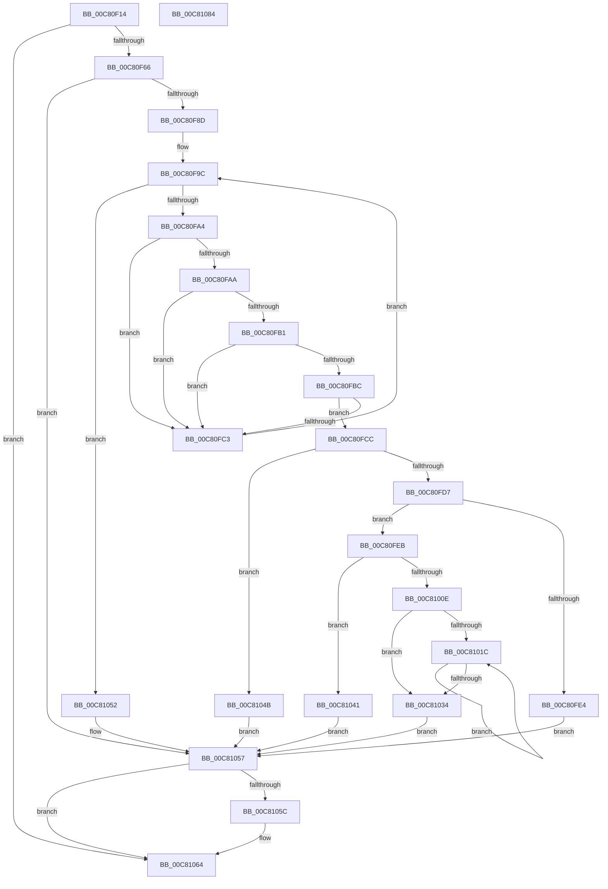

# FopValidateFontNameTable

- RVA: `0x00C80F14`–`0x00C81085` (길이 `369` bytes)
- VA: `0x0000000140C80F14`
- 실행 섹션: `INIT`
- PDB 이름 있음: `예`; PDB Function 태그: `아니요`
- unwind 정보 RVA: `0x000AC264`
- 디코드: `111`개 명령, `369/369` bytes 표시
- 미해석 바이트: `0` (있으면 어셈블리에 `.byte`로 보존)

> 이 문서는 커널 이미지의 기계어와 PDB 기호를 분석해 생성했습니다. 4번과 5번은 함수 원형과 자료형을 바이너리 사용 방식에서 추정한 C 해석이며 원본 소스 복구 결과는 아닙니다.

## 1. Dependencies

- 직접 호출 지점: **6**; 고유 호출 대상: **5**
- 직접 호출자로 확인된 함수: **1**
- RIP 상대 이미지 참조: **0**

### Outgoing calls
- `0x00C80F57` → [FopGetTableOffsetAndSize](FopGetTableOffsetAndSize_function_00C807F8.md) (function, `0x00C807F8`)
- `0x00C80F79` → [FopReadNamingTable](FopReadNamingTable_function_00C80D90.md) (function, `0x00C80D90`)
- `0x00C80FD7` → [BgpFwAllocateMemory](../../text/3E/BgpFwAllocateMemory_function_003E4374.md) (function, `0x003E4374`)
- `0x00C81003` → [FioFwReadBytesAtOffset](../../text/3E/FioFwReadBytesAtOffset_function_003E5948.md) (function, `0x003E5948`)
- `0x00C81044` → [BgpFwFreeMemory](../../text/3E/BgpFwFreeMemory_function_003E25E0.md) (function, `0x003E25E0`)
- `0x00C8105F` → [BgpFwFreeMemory](../../text/3E/BgpFwFreeMemory_function_003E25E0.md) (function, `0x003E25E0`)

### Direct callers
- [FopInitializeFonts](FopInitializeFonts_function_00C808FC.md) at `0x00C809C0`

### Static image references
- 디코드된 RIP-relative 메모리 참조가 없습니다.

## 2. Other-region calls and transfers

- 다른 실행 섹션으로 향하는 call: **4**
  - `0x00C80FD7` → [BgpFwAllocateMemory](../../text/3E/BgpFwAllocateMemory_function_003E4374.md) (`INIT` → `.text`)
  - `0x00C81003` → [FioFwReadBytesAtOffset](../../text/3E/FioFwReadBytesAtOffset_function_003E5948.md) (`INIT` → `.text`)
  - `0x00C81044` → [BgpFwFreeMemory](../../text/3E/BgpFwFreeMemory_function_003E25E0.md) (`INIT` → `.text`)
  - `0x00C8105F` → [BgpFwFreeMemory](../../text/3E/BgpFwFreeMemory_function_003E25E0.md) (`INIT` → `.text`)
- 별도 외부 분기/꼬리 이동을 확인하지 못했습니다.

## 3. Assembly (complete function range)

```asm
00C80F14  4C 8B DC                        mov r11, rsp
00C80F17  49 89 5B 08                     mov qword ptr [r11 + 8], rbx
00C80F1B  49 89 6B 10                     mov qword ptr [r11 + 0x10], rbp
00C80F1F  49 89 73 18                     mov qword ptr [r11 + 0x18], rsi
00C80F23  57                              push rdi
00C80F24  41 54                           push r12
00C80F26  41 55                           push r13
00C80F28  41 56                           push r14
00C80F2A  41 57                           push r15
00C80F2C  48 83 EC 40                     sub rsp, 0x40
00C80F30  45 33 ED                        xor r13d, r13d
00C80F33  49 8D 43 C8                     lea rax, [r11 - 0x38]
00C80F37  4D 8B E0                        mov r12, r8
00C80F3A  45 89 6B 20                     mov dword ptr [r11 + 0x20], r13d
00C80F3E  41 B8 65 6D 61 6E               mov r8d, 0x6e616d65
00C80F44  4D 89 6B D0                     mov qword ptr [r11 - 0x30], r13
00C80F48  4D 8D 4B 20                     lea r9, [r11 + 0x20]
00C80F4C  45 89 6B C8                     mov dword ptr [r11 - 0x38], r13d
00C80F50  49 89 43 B8                     mov qword ptr [r11 - 0x48], rax
00C80F54  4C 8B F1                        mov r14, rcx
00C80F57  E8 9C F8 FF FF                  call 0x140c807f8
00C80F5C  8B F8                           mov edi, eax
00C80F5E  85 C0                           test eax, eax
00C80F60  0F 88 FE 00 00 00               js 0x140c81064
00C80F66  44 8B BC 24 88 00 00 00         mov r15d, dword ptr [rsp + 0x88]
00C80F6E  4C 8D 44 24 38                  lea r8, [rsp + 0x38]
00C80F73  41 8B D7                        mov edx, r15d
00C80F76  49 8B CE                        mov rcx, r14
00C80F79  E8 12 FE FF FF                  call 0x140c80d90
00C80F7E  48 8B 6C 24 38                  mov rbp, qword ptr [rsp + 0x38]
00C80F83  8B F8                           mov edi, eax
00C80F85  85 C0                           test eax, eax
00C80F87  0F 88 CA 00 00 00               js 0x140c81057
00C80F8D  0F B7 4D 02                     movzx ecx, word ptr [rbp + 2]
00C80F91  48 8D 5D 06                     lea rbx, [rbp + 6]
00C80F95  41 8B C5                        mov eax, r13d
00C80F98  45 8D 45 01                     lea r8d, [r13 + 1]
00C80F9C  3B C1                           cmp eax, ecx
00C80F9E  0F 83 AE 00 00 00               jae 0x140c81052
00C80FA4  66 83 3B 03                     cmp word ptr [rbx], 3
00C80FA8  75 19                           jne 0x140c80fc3
00C80FAA  66 44 39 43 02                  cmp word ptr [rbx + 2], r8w
00C80FAF  75 12                           jne 0x140c80fc3
00C80FB1  BA 09 04 00 00                  mov edx, 0x409
00C80FB6  66 39 53 04                     cmp word ptr [rbx + 4], dx
00C80FBA  75 07                           jne 0x140c80fc3
00C80FBC  66 44 39 43 06                  cmp word ptr [rbx + 6], r8w
00C80FC1  74 09                           je 0x140c80fcc
00C80FC3  41 03 C0                        add eax, r8d
00C80FC6  48 83 C3 0C                     add rbx, 0xc
00C80FCA  EB D0                           jmp 0x140c80f9c
00C80FCC  0F B7 43 08                     movzx eax, word ptr [rbx + 8]
00C80FD0  8D 48 02                        lea ecx, [rax + 2]
00C80FD3  3B C8                           cmp ecx, eax
00C80FD5  72 74                           jb 0x140c8104b
00C80FD7  E8 98 33 76 FF                  call 0x1403e4374
00C80FDC  48 8B F0                        mov rsi, rax
00C80FDF  48 85 C0                        test rax, rax
00C80FE2  75 07                           jne 0x140c80feb
00C80FE4  BF 17 00 00 C0                  mov edi, 0xc0000017
00C80FE9  EB 6C                           jmp 0x140c81057
00C80FEB  0F B7 45 04                     movzx eax, word ptr [rbp + 4]
00C80FEF  4C 8B CE                        mov r9, rsi
00C80FF2  0F B7 53 0A                     movzx edx, word ptr [rbx + 0xa]
00C80FF6  41 03 C7                        add eax, r15d
00C80FF9  44 0F B7 43 08                  movzx r8d, word ptr [rbx + 8]
00C80FFE  03 D0                           add edx, eax
00C81000  49 8B CE                        mov rcx, r14
00C81003  E8 40 49 76 FF                  call 0x1403e5948
00C81008  8B F8                           mov edi, eax
00C8100A  85 C0                           test eax, eax
00C8100C  78 33                           js 0x140c81041
00C8100E  66 D1 6B 08                     shr word ptr [rbx + 8], 1
00C81012  41 8B D5                        mov edx, r13d
00C81015  66 44 3B 6B 08                  cmp r13w, word ptr [rbx + 8]
00C8101A  73 18                           jae 0x140c81034
00C8101C  8B CA                           mov ecx, edx
00C8101E  FF C2                           inc edx
00C81020  0F B7 04 4E                     movzx eax, word ptr [rsi + rcx*2]
00C81024  66 C1 C8 08                     ror ax, 8
00C81028  66 89 04 4E                     mov word ptr [rsi + rcx*2], ax
00C8102C  0F B7 43 08                     movzx eax, word ptr [rbx + 8]
00C81030  3B D0                           cmp edx, eax
00C81032  72 E8                           jb 0x140c8101c
00C81034  8B C2                           mov eax, edx
00C81036  66 44 89 2C 46                  mov word ptr [rsi + rax*2], r13w
00C8103B  49 89 34 24                     mov qword ptr [r12], rsi
00C8103F  EB 16                           jmp 0x140c81057
00C81041  48 8B CE                        mov rcx, rsi
00C81044  E8 97 15 76 FF                  call 0x1403e25e0
00C81049  EB 0C                           jmp 0x140c81057
00C8104B  BF 95 00 00 C0                  mov edi, 0xc0000095
00C81050  EB 05                           jmp 0x140c81057
00C81052  BF 7B 00 00 C0                  mov edi, 0xc000007b
00C81057  48 85 ED                        test rbp, rbp
00C8105A  74 08                           je 0x140c81064
00C8105C  48 8B CD                        mov rcx, rbp
00C8105F  E8 7C 15 76 FF                  call 0x1403e25e0
00C81064  4C 8D 5C 24 40                  lea r11, [rsp + 0x40]
00C81069  8B C7                           mov eax, edi
00C8106B  49 8B 5B 30                     mov rbx, qword ptr [r11 + 0x30]
00C8106F  49 8B 6B 38                     mov rbp, qword ptr [r11 + 0x38]
00C81073  49 8B 73 40                     mov rsi, qword ptr [r11 + 0x40]
00C81077  49 8B E3                        mov rsp, r11
00C8107A  41 5F                           pop r15
00C8107C  41 5E                           pop r14
00C8107E  41 5D                           pop r13
00C81080  41 5C                           pop r12
00C81082  5F                              pop rdi
00C81083  C3                              ret
00C81084  CC                              int3
```

## 4. C-style interpretation (structured pseudocode)

```c
__int64 __fastcall FopValidateFontNameTable(__int64 a1, __int64 a2, __int64 a3)
{
    __int64 result;
    __int64 v_r13;
    __int64 v_rbx;
    __int64 v_rsp;
    unsigned __int64 v_stack_m28;
    unsigned __int64 v_stack_m30;
    unsigned int v_stack_p20;

    *(unsigned __int64 *)(v_rsp + 8) = v_rbx;
    *(unsigned __int64 *)(v_rsp + 16) = v_rbp;
    *(unsigned __int64 *)(v_rsp + 24) = v_rsi;
    v_rsp = (v_rsp) - (64);
    v_r13 = 0;
    *(unsigned int *)(v_rsp + 32) = 0;
    *(unsigned __int64 *)(v_rsp - 48) = 0;
    *(unsigned int *)(v_rsp - 56) = 0;
    *(unsigned __int64 *)(v_rsp - 72) = v_rsp - 56;
    result = FopGetTableOffsetAndSize(a1, a2, (unsigned int)(0x6E616D65ULL), v_rsp + 32);
    if (sign_flag) goto loc_00C81064;
    result = FopReadNamingTable(a1, (unsigned int)((unsigned int)((unsigned int)(v_stack_p20))), v_stack_m30, v_rsp + 32);
    if (sign_flag) goto loc_00C81057;
loc_00C80F9C:
    if (0 >= ((unsigned int)(*(unsigned __int16 *)(v_stack_m30 + 2)))) goto loc_00C81052;
    if ((*(unsigned __int16 *)(v_stack_m30 + 6)) != 3) goto loc_00C80FC3;
    if ((*(unsigned __int16 *)(v_stack_m30 + 6 + 2)) != ((unsigned __int16)(v_r13 + 1))) goto loc_00C80FC3;
    if ((*(unsigned __int16 *)(v_stack_m30 + 6 + 4)) != ((unsigned __int16)((unsigned int)(0x409ULL)))) goto loc_00C80FC3;
    if ((*(unsigned __int16 *)(v_stack_m30 + 6 + 6)) == ((unsigned __int16)(v_r13 + 1))) goto loc_00C80FCC;
loc_00C80FC3:
    result = (unsigned int)((0) + ((unsigned int)(v_r13 + 1)));
    v_rbx = (v_stack_m30 + 6) + (12);
    goto loc_00C80F9C;
loc_00C80FCC:
    if (((unsigned int)(*(unsigned __int16 *)(v_rbx + 8) + 2)) < ((unsigned int)(*(unsigned __int16 *)(v_rbx + 8)))) goto loc_00C8104B;
    result = BgpFwAllocateMemory(*(unsigned __int16 *)(v_rbx + 8) + 2, (unsigned int)(0x409ULL), v_r13 + 1, v_rsp + 32);
    if (result != 0) goto loc_00C80FEB;
    goto loc_00C81057;
loc_00C80FEB:
    result = (unsigned int)((*(unsigned __int16 *)(v_stack_m30 + 4)) + ((unsigned int)((unsigned int)(v_stack_p20))));
    a2 = (unsigned int)((*(unsigned __int16 *)(v_rbx + 10)) + ((unsigned int)(result)));
    result = FioFwReadBytesAtOffset(a1, a2, *(unsigned __int16 *)(v_rbx + 8), result);
    if (sign_flag) goto loc_00C81041;
    if (0 >= (*(unsigned __int16 *)(v_rbx + 8))) goto loc_00C81034;
loc_00C8101C:
    a2 = (unsigned int)((0) + 1);
    *(unsigned __int16 *)(result + 0 * 2) = (unsigned __int16)(*(unsigned __int16 *)(result + 0 * 2));
    if (((unsigned int)(a2)) < ((unsigned int)(*(unsigned __int16 *)(v_rbx + 8)))) goto loc_00C8101C;
loc_00C81034:
    *(unsigned __int16 *)(result + (unsigned int)((unsigned int)(a2)) * 2) = 0;
    *(unsigned __int64 *)(a3) = result;
    goto loc_00C81057;
loc_00C81041:
    result = BgpFwFreeMemory(result, a2, *(unsigned __int16 *)(v_rbx + 8), result);
    goto loc_00C81057;
loc_00C8104B:
    goto loc_00C81057;
loc_00C81052:
loc_00C81057:
    if (v_stack_m30 != 0) {
        a1 = v_stack_m30;
        result = BgpFwFreeMemory(a1, a2, *(unsigned __int16 *)(v_rbx + 8), result);
    }
    return (unsigned int)((unsigned int)((unsigned int)(0xC000007BULL)));
}
```

## 5. (Beta) C Style

```c
int64_t FopValidateFontNameTable(int64_t Arg1, int64_t Arg2, void *Arg3)
{
    uint8_t *arg3 = (uint8_t *)Arg3;

    int64_t result;
    int64_t local_r13;
    int64_t local_rbx;
    int64_t local_rsp;
    uint64_t v_stack_m28;
    uint64_t v_stack_m30;
    uint32_t v_stack_p20;

    *(uint64_t *)(local_rsp + 0x8) = local_rbx;
    *(uint64_t *)(local_rsp + 0x10) = local_rbp;
    *(uint64_t *)(local_rsp + 0x18) = local_rsi;
    local_rsp = (local_rsp) - (64);
    local_r13 = 0;
    *(uint32_t *)(local_rsp + 0x20) = 0;
    *(uint64_t *)(local_rsp - 0x30) = 0;
    *(uint32_t *)(local_rsp - 0x38) = 0;
    *(uint64_t *)(local_rsp - 0x48) = local_rsp - 56;
    result = FopGetTableOffsetAndSize(Arg1, Arg2, (uint32_t)(0x6E616D65ULL), local_rsp + 32);
    if (sign_flag) goto loc_00C81064;
    result = FopReadNamingTable(Arg1, (uint32_t)((uint32_t)((uint32_t)(v_stack_p20))), v_stack_m30, local_rsp + 32);
    if (sign_flag) goto loc_00C81057;
loc_00C80F9C:
    if (0 >= ((uint32_t)(*(uint16_t *)(v_stack_m30 + 0x2)))) goto loc_00C81052;
    if ((*(uint16_t *)(v_stack_m30 + 0x6)) != 3) goto loc_00C80FC3;
    if ((*(uint16_t *)(v_stack_m30 + 0x6 + 0x2)) != ((uint16_t)(local_r13 + 1))) goto loc_00C80FC3;
    if ((*(uint16_t *)(v_stack_m30 + 0x6 + 0x4)) != ((uint16_t)((uint32_t)(0x409ULL)))) goto loc_00C80FC3;
    if ((*(uint16_t *)(v_stack_m30 + 0x6 + 0x6)) == ((uint16_t)(local_r13 + 1))) goto loc_00C80FCC;
loc_00C80FC3:
    result = (uint32_t)((0) + ((uint32_t)(local_r13 + 1)));
    local_rbx = (v_stack_m30 + 6) + (12);
    goto loc_00C80F9C;
loc_00C80FCC:
    if (((uint32_t)(*(uint16_t *)(local_rbx + 0x8) + 2)) < ((uint32_t)(*(uint16_t *)(local_rbx + 0x8)))) goto loc_00C8104B;
    result = BgpFwAllocateMemory(*(uint16_t *)(local_rbx + 0x8) + 2, (uint32_t)(0x409ULL), local_r13 + 1, local_rsp + 32);
    if (result != 0) goto loc_00C80FEB;
    goto loc_00C81057;
loc_00C80FEB:
    result = (uint32_t)((*(uint16_t *)(v_stack_m30 + 0x4)) + ((uint32_t)((uint32_t)(v_stack_p20))));
    Arg2 = (uint32_t)((*(uint16_t *)(local_rbx + 0xA)) + ((uint32_t)(result)));
    result = FioFwReadBytesAtOffset(Arg1, Arg2, *(uint16_t *)(local_rbx + 0x8), result);
    if (sign_flag) goto loc_00C81041;
    if (0 >= (*(uint16_t *)(local_rbx + 0x8))) goto loc_00C81034;
loc_00C8101C:
    Arg2 = (uint32_t)((0) + 1);
    *(uint16_t *)(result + 0x0 * 2) = (uint16_t)(*(uint16_t *)(result + 0x0 * 2));
    if (((uint32_t)(Arg2)) < ((uint32_t)(*(uint16_t *)(local_rbx + 0x8)))) goto loc_00C8101C;
loc_00C81034:
    *(uint16_t *)(result + (uint32_t)((uint32_t)(Arg2)) * 2) = 0;
    *(uint64_t *)(arg3) = result;
    goto loc_00C81057;
loc_00C81041:
    result = BgpFwFreeMemory(result, Arg2, *(uint16_t *)(local_rbx + 0x8), result);
    goto loc_00C81057;
loc_00C8104B:
    goto loc_00C81057;
loc_00C81052:
loc_00C81057:
    if (v_stack_m30 != 0) {
        Arg1 = v_stack_m30;
        result = BgpFwFreeMemory(Arg1, Arg2, *(uint16_t *)(local_rbx + 0x8), result);
    }
    return (uint32_t)((uint32_t)((uint32_t)(0xC000007BULL)));
}
```

### 관측된 메모리 오프셋

구조체 형식이 확인되지 않은 접근은 인자 기준의 오프셋으로만 기록했습니다.

| 기준 인자 | 오프셋 표현 | 폭 (bit) | 접근 |
|---|---:|---:|---|
| `Arg3` | `+ 0x0` | `64` | `W` |

## 6. Execution-region graph

[열기: 2D/3D 그래프와 함수 탐색 컨트롤 패널](../../../control-panel.html?section=init&rva=0x00C80F14&view=graph)

- 2D 그래프는 위에서 아래로 흐르고, 3D 그래프는 빈 공간을 드래그해 회전합니다. Shift+드래그는 이동, 휠은 확대·축소, 함수 노드 선택은 대상 보고서 이동입니다.

### Static fallback


