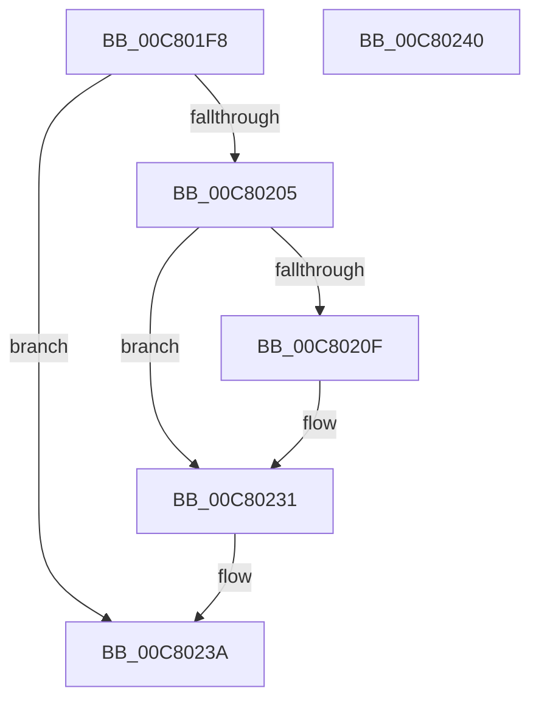

# KiVerifyXcpt7$fin$2

- RVA: `0x00C801F8`–`0x00C80241` (길이 `73` bytes)
- VA: `0x0000000140C801F8`
- 실행 섹션: `INIT`
- PDB 이름 있음: `예`; PDB Function 태그: `예`
- unwind 정보 RVA: `0x000BF6EC`
- 디코드: `25`개 명령, `73/73` bytes 표시
- 미해석 바이트: `0` (있으면 어셈블리에 `.byte`로 보존)

> 이 문서는 커널 이미지의 기계어와 PDB 기호를 분석해 생성했습니다. 4번과 5번은 함수 원형과 자료형을 바이너리 사용 방식에서 추정한 C 해석이며 원본 소스 복구 결과는 아닙니다.

## 1. Dependencies

- 직접 호출 지점: **2**; 고유 호출 대상: **2**
- 직접 호출자로 확인된 함수: **0**
- RIP 상대 이미지 참조: **1**

### Outgoing calls
- `0x00C8021B` → [KiVerifyXcptFilter](../C3/KiVerifyXcptFilter_function_00C3ADD0.md) (function, `0x00C3ADD0`)
- `0x00C8022B` → [local_unwind](../../text/4F/local_unwind_function_004FFB40.md) (function, `0x004FFB40`)

### Direct callers
- 이 함수 시작 RVA로 연결되는 직접 call은 확인되지 않았습니다. 간접 호출은 완전히 역산할 수 없습니다.

### Static image references
- `0x00C80220` → RVA `0x00C3AD01` (`INIT`; read)

## 2. Other-region calls and transfers

- 다른 실행 섹션으로 향하는 call: **1**
  - `0x00C8022B` → [local_unwind](../../text/4F/local_unwind_function_004FFB40.md) (`INIT` → `.text`)
- 별도 외부 분기/꼬리 이동을 확인하지 못했습니다.

## 3. Assembly (complete function range)

```asm
00C801F8  40 55                           push rbp
00C801FA  48 83 EC 20                     sub rsp, 0x20
00C801FE  48 8B EA                        mov rbp, rdx
00C80201  84 C9                           test cl, cl
00C80203  74 35                           je 0x140c8023a
00C80205  48 8B 55 40                     mov rdx, qword ptr [rbp + 0x40]
00C80209  83 7A 0C 20                     cmp dword ptr [rdx + 0xc], 0x20
00C8020D  75 22                           jne 0x140c80231
00C8020F  8B 42 0C                        mov eax, dword ptr [rdx + 0xc]
00C80212  83 C0 08                        add eax, 8
00C80215  89 42 0C                        mov dword ptr [rdx + 0xc], eax
00C80218  48 8B CA                        mov rcx, rdx
00C8021B  E8 B0 AB FB FF                  call 0x140c3add0
00C80220  48 8D 15 DA AA FB FF            lea rdx, [rip - 0x45526]
00C80227  48 8B 4D 20                     mov rcx, qword ptr [rbp + 0x20]
00C8022B  E8 10 F9 87 FF                  call 0x1404ffb40
00C80230  90                              nop
00C80231  48 8B 02                        mov rax, qword ptr [rdx]
00C80234  8B 08                           mov ecx, dword ptr [rax]
00C80236  FF C1                           inc ecx
00C80238  89 08                           mov dword ptr [rax], ecx
00C8023A  48 83 C4 20                     add rsp, 0x20
00C8023E  5D                              pop rbp
00C8023F  C3                              ret
00C80240  CC                              int3
```

## 4. C-style interpretation (structured pseudocode)

```c
__int64 __fastcall KiVerifyXcpt7_fin_2(unsigned __int8 a1, __int64 a2)
{
    __int64 result;
    __int64 v_rsp;

    v_rsp = (v_rsp) - (32);
    if (a1 == 0) goto loc_00C8023A;
    if ((*(unsigned int *)(*(unsigned __int64 *)(a2 + 64) + 12)) == 32) {
        result = *(unsigned int *)(*(unsigned __int64 *)(a2 + 64) + 12);
        result = (unsigned int)((result) + (8));
        *(unsigned int *)(*(unsigned __int64 *)(a2 + 64) + 12) = (unsigned int)(result);
        a1 = *(unsigned __int64 *)(a2 + 64);
        result = KiVerifyXcptFilter(a1, *(unsigned __int64 *)(a2 + 64), a3, a4);
        a2 = v_rip - 283942;
        a1 = *(unsigned __int64 *)(a2 + 32);
        result = local_unwind(a1, a2, a3, a4);
    }
    a1 = (unsigned int)(((unsigned int)(*(unsigned int *)(*(unsigned __int64 *)(a2)))) + 1);
    *(unsigned int *)(*(unsigned __int64 *)(a2)) = a1;
loc_00C8023A:
    v_rsp = (v_rsp) + (32);
    return *(unsigned __int64 *)(a2);
}
```

## 5. (Beta) C Style

```c
int64_t KiVerifyXcpt7_fin_2(uint8_t Arg1, void *Arg2)
{
    uint8_t *arg2 = (uint8_t *)Arg2;

    int64_t result;
    int64_t local_rsp;

    local_rsp = (local_rsp) - (32);
    if (Arg1 == 0) goto loc_00C8023A;
    if ((*(uint32_t *)(*(uint64_t *)(arg2 + 0x40) + 0xC)) == 32) {
        result = *(uint32_t *)(*(uint64_t *)(arg2 + 0x40) + 0xC);
        result = (uint32_t)((result) + (8));
        *(uint32_t *)(*(uint64_t *)(arg2 + 0x40) + 0xC) = (uint32_t)(result);
        Arg1 = *(uint64_t *)(arg2 + 0x40);
        result = KiVerifyXcptFilter(Arg1, *(uint64_t *)(arg2 + 0x40), a3, a4);
        Arg2 = v_rip - 283942;
        Arg1 = *(uint64_t *)(arg2 + 0x20);
        result = local_unwind(Arg1, Arg2, a3, a4);
    }
    Arg1 = (uint32_t)(((uint32_t)(*(uint32_t *)(*(uint64_t *)(arg2)))) + 1);
    *(uint32_t *)(*(uint64_t *)(arg2)) = Arg1;
loc_00C8023A:
    local_rsp = (local_rsp) + (32);
    return *(uint64_t *)(arg2);
}
```

### 관측된 메모리 오프셋

구조체 형식이 확인되지 않은 접근은 인자 기준의 오프셋으로만 기록했습니다.

| 기준 인자 | 오프셋 표현 | 폭 (bit) | 접근 |
|---|---:|---:|---|
| `Arg2` | `+ 0x20` | `64` | `R` |
| `Arg2` | `+ 0x40` | `64` | `R` |

## 6. Execution-region graph

[열기: 2D/3D 그래프와 함수 탐색 컨트롤 패널](../../../control-panel.html?section=init&rva=0x00C801F8&view=graph)

- 2D 그래프는 위에서 아래로 흐르고, 3D 그래프는 빈 공간을 드래그해 회전합니다. Shift+드래그는 이동, 휠은 확대·축소, 함수 노드 선택은 대상 보고서 이동입니다.

### Static fallback


