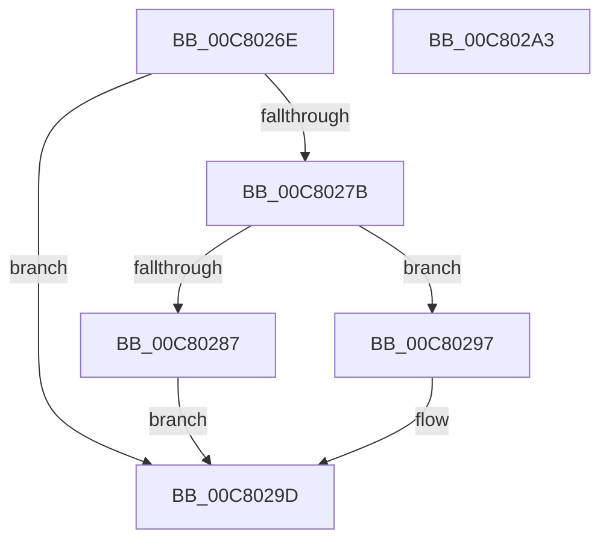

# KiVerifyXcpt8$fin$0

- RVA: `0x00C8026E`–`0x00C802A4` (길이 `54` bytes)
- VA: `0x0000000140C8026E`
- 실행 섹션: `INIT`
- PDB 이름 있음: `예`; PDB Function 태그: `예`
- unwind 정보 RVA: `0x000BF6EC`
- 디코드: `22`개 명령, `54/54` bytes 표시
- 미해석 바이트: `0` (있으면 어셈블리에 `.byte`로 보존)

> 이 문서는 커널 이미지의 기계어와 PDB 기호를 분석해 생성했습니다. 4번과 5번은 함수 원형과 자료형을 바이너리 사용 방식에서 추정한 C 해석이며 원본 소스 복구 결과는 아닙니다.

## 1. Dependencies

- 직접 호출 지점: **0**; 고유 호출 대상: **0**
- 직접 호출자로 확인된 함수: **0**
- RIP 상대 이미지 참조: **0**

### Outgoing calls
- 직접 디코드된 call 명령이 없습니다.

### Direct callers
- 이 함수 시작 RVA로 연결되는 직접 call은 확인되지 않았습니다. 간접 호출은 완전히 역산할 수 없습니다.

### Static image references
- 디코드된 RIP-relative 메모리 참조가 없습니다.

## 2. Other-region calls and transfers

- 다른 실행 섹션으로 향하는 call: **0**
- 별도 외부 분기/꼬리 이동을 확인하지 못했습니다.

## 3. Assembly (complete function range)

```asm
00C8026E  40 55                           push rbp
00C80270  48 83 EC 20                     sub rsp, 0x20
00C80274  48 8B EA                        mov rbp, rdx
00C80277  84 C9                           test cl, cl
00C80279  74 22                           je 0x140c8029d
00C8027B  48 8B 55 40                     mov rdx, qword ptr [rbp + 0x40]
00C8027F  8B 42 0C                        mov eax, dword ptr [rdx + 0xc]
00C80282  83 F8 09                        cmp eax, 9
00C80285  75 10                           jne 0x140c80297
00C80287  03 C0                           add eax, eax
00C80289  89 42 0C                        mov dword ptr [rdx + 0xc], eax
00C8028C  48 8B 02                        mov rax, qword ptr [rdx]
00C8028F  8B 08                           mov ecx, dword ptr [rax]
00C80291  FF C1                           inc ecx
00C80293  89 08                           mov dword ptr [rax], ecx
00C80295  EB 06                           jmp 0x140c8029d
00C80297  83 C0 0A                        add eax, 0xa
00C8029A  89 42 0C                        mov dword ptr [rdx + 0xc], eax
00C8029D  48 83 C4 20                     add rsp, 0x20
00C802A1  5D                              pop rbp
00C802A2  C3                              ret
00C802A3  CC                              int3
```

## 4. C-style interpretation (structured pseudocode)

```c
__int64 __fastcall KiVerifyXcpt8_fin_0(unsigned __int8 a1, __int64 a2)
{
    __int64 result;
    __int64 v_rsp;

    v_rsp = (v_rsp) - (32);
    if (a1 == 0) goto loc_00C8029D;
    if (((unsigned int)((unsigned int)(*(unsigned int *)(*(unsigned __int64 *)(a2 + 64) + 12)))) != 9) goto loc_00C80297;
    result = (unsigned int)(((unsigned int)(*(unsigned int *)(*(unsigned __int64 *)(a2 + 64) + 12))) + ((unsigned int)((unsigned int)(*(unsigned int *)(*(unsigned __int64 *)(a2 + 64) + 12)))));
    *(unsigned int *)(*(unsigned __int64 *)(a2 + 64) + 12) = (unsigned int)(result);
    a1 = (unsigned int)(((unsigned int)(*(unsigned int *)(*(unsigned __int64 *)(*(unsigned __int64 *)(a2 + 64))))) + 1);
    *(unsigned int *)(*(unsigned __int64 *)(*(unsigned __int64 *)(a2 + 64))) = a1;
    goto loc_00C8029D;
loc_00C80297:
    result = (unsigned int)((*(unsigned __int64 *)(*(unsigned __int64 *)(a2 + 64))) + (10));
    *(unsigned int *)(*(unsigned __int64 *)(a2 + 64) + 12) = (unsigned int)(result);
loc_00C8029D:
    v_rsp = (v_rsp) + (32);
    return result;
}
```

## 5. (Beta) C Style

```c
int64_t KiVerifyXcpt8_fin_0(uint8_t Arg1, void *Arg2)
{
    uint8_t *arg2 = (uint8_t *)Arg2;

    int64_t result;
    int64_t local_rsp;

    local_rsp = (local_rsp) - (32);
    if (Arg1 == 0) goto loc_00C8029D;
    if (((uint32_t)((uint32_t)(*(uint32_t *)(*(uint64_t *)(arg2 + 0x40) + 0xC)))) != 9) goto loc_00C80297;
    result = (uint32_t)(((uint32_t)(*(uint32_t *)(*(uint64_t *)(arg2 + 0x40) + 0xC))) + ((uint32_t)((uint32_t)(*(uint32_t *)(*(uint64_t *)(arg2 + 0x40) + 0xC)))));
    *(uint32_t *)(*(uint64_t *)(arg2 + 0x40) + 0xC) = (uint32_t)(result);
    Arg1 = (uint32_t)(((uint32_t)(*(uint32_t *)(*(uint64_t *)(*(uint64_t *)(arg2 + 0x40))))) + 1);
    *(uint32_t *)(*(uint64_t *)(*(uint64_t *)(arg2 + 0x40))) = Arg1;
    goto loc_00C8029D;
loc_00C80297:
    result = (uint32_t)((*(uint64_t *)(*(uint64_t *)(arg2 + 0x40))) + (10));
    *(uint32_t *)(*(uint64_t *)(arg2 + 0x40) + 0xC) = (uint32_t)(result);
loc_00C8029D:
    local_rsp = (local_rsp) + (32);
    return result;
}
```

### 관측된 메모리 오프셋

구조체 형식이 확인되지 않은 접근은 인자 기준의 오프셋으로만 기록했습니다.

| 기준 인자 | 오프셋 표현 | 폭 (bit) | 접근 |
|---|---:|---:|---|
| `Arg2` | `+ 0x40` | `64` | `R` |

## 6. Execution-region graph

[열기: 2D/3D 그래프와 함수 탐색 컨트롤 패널](../../../control-panel.html?section=init&rva=0x00C8026E&view=graph)

- 2D 그래프는 위에서 아래로 흐르고, 3D 그래프는 빈 공간을 드래그해 회전합니다. Shift+드래그는 이동, 휠은 확대·축소, 함수 노드 선택은 대상 보고서 이동입니다.

### Static fallback


