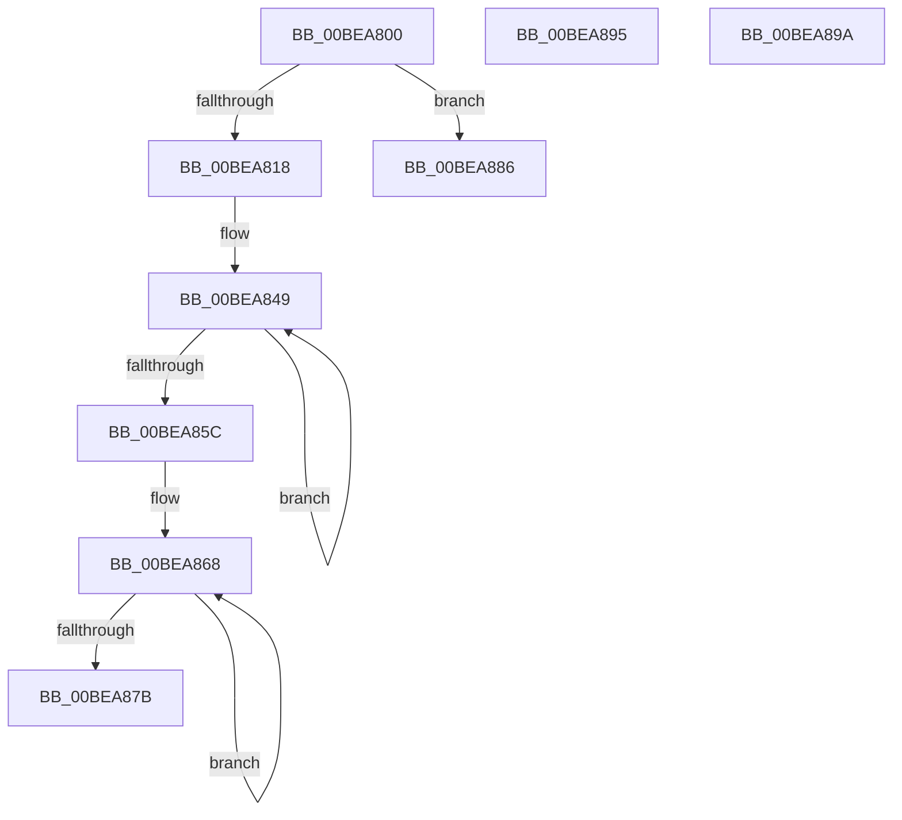

# FsRtlUninitializeSmallMcb

- RVA: `0x00BEA800`–`0x00BEA89E` (길이 `158` bytes)
- VA: `0x0000000140BEA800`
- 실행 섹션: `INITKDBG`
- PDB 이름 있음: `예`; PDB Function 태그: `아니요`
- unwind 정보 RVA: `0x000C2F2C`
- 디코드: `42`개 명령, `158/158` bytes 표시
- 미해석 바이트: `0` (있으면 어셈블리에 `.byte`로 보존)

> 이 문서는 커널 이미지의 기계어와 PDB 기호를 분석해 생성했습니다. 4번과 5번은 함수 원형과 자료형을 바이너리 사용 방식에서 추정한 C 해석이며 원본 소스 복구 결과는 아닙니다.

## 1. Dependencies

- 직접 호출 지점: **1**; 고유 호출 대상: **1**
- 직접 호출자로 확인된 함수: **0**
- RIP 상대 이미지 참조: **2**

### Outgoing calls
- `0x00BEA804` → [FsRtlMdlReadCompleteDevEx](../BD/FsRtlMdlReadCompleteDevEx_function_00BD1010.md) (function, `0x00BD1010`)

### Direct callers
- 이 함수 시작 RVA로 연결되는 직접 call은 확인되지 않았습니다. 간접 호출은 완전히 역산할 수 없습니다.

### Static image references
- `0x00BEA842` → RVA `0x00BEA800` (`FsRtlUninitializeSmallMcb`; read)
- `0x00BEA861` → RVA `0x00BEA886` (`INITKDBG`; read)

## 2. Other-region calls and transfers

- 다른 실행 섹션으로 향하는 call: **0**
- 별도 외부 분기/꼬리 이동을 확인하지 못했습니다.

## 3. Assembly (complete function range)

```asm
00BEA800  48 83 EC 48                     sub rsp, 0x48
00BEA804  E8 07 68 FE FF                  call 0x140bd1010
00BEA809  48 8D 88 20 08 00 00            lea rcx, [rax + 0x820]
00BEA810  48 8B 11                        mov rdx, qword ptr [rcx]
00BEA813  48 0B D2                        or rdx, rdx
00BEA816  75 6E                           jne 0x140bea886
00BEA818  48 83 C4 40                     add rsp, 0x40
00BEA81C  53                              push rbx
00BEA81D  48 8B D0                        mov rdx, rax
00BEA820  48 8B 88 E8 07 00 00            mov rcx, qword ptr [rax + 0x7e8]
00BEA827  4C 8B 80 08 01 00 00            mov r8, qword ptr [rax + 0x108]
00BEA82E  44 8B 90 04 08 00 00            mov r10d, dword ptr [rax + 0x804]
00BEA835  48 8B 98 F0 07 00 00            mov rbx, qword ptr [rax + 0x7f0]
00BEA83C  4C 8B C9                        mov r9, rcx
00BEA83F  4C 33 CC                        xor r9, rsp
00BEA842  4C 8D 1D B7 FF FF FF            lea r11, [rip - 0x49]
00BEA849  4C 33 0A                        xor r9, qword ptr [rdx]
00BEA84C  4C 89 0A                        mov qword ptr [rdx], r9
00BEA84F  49 C1 C9 03                     ror r9, 3
00BEA853  48 83 C2 08                     add rdx, 8
00BEA857  49 3B D3                        cmp rdx, r11
00BEA85A  72 ED                           jb 0x140bea849
00BEA85C  4E 8D 5C 10 F9                  lea r11, [rax + r10 - 7]
00BEA861  48 8D 15 1E 00 00 00            lea rdx, [rip + 0x1e]
00BEA868  4C 33 0A                        xor r9, qword ptr [rdx]
00BEA86B  4C 89 0A                        mov qword ptr [rdx], r9
00BEA86E  49 C1 C9 05                     ror r9, 5
00BEA872  48 83 C2 08                     add rdx, 8
00BEA876  49 3B D3                        cmp rdx, r11
00BEA879  72 ED                           jb 0x140bea868
00BEA87B  48 8B D3                        mov rdx, rbx
00BEA87E  5B                              pop rbx
00BEA87F  48 83 C4 08                     add rsp, 8
00BEA883  41 FF E0                        jmp r8
00BEA886  48 83 C4 48                     add rsp, 0x48
00BEA88A  33 D2                           xor edx, edx
00BEA88C  48 8B 80 80 02 00 00            mov rax, qword ptr [rax + 0x280]
00BEA893  FF E0                           jmp rax
00BEA895  48 83 C4 48                     add rsp, 0x48
00BEA899  C3                              ret
00BEA89A  0F 0D 09                        prefetchw byte ptr [rcx]
00BEA89D  C3                              ret
```

## 4. C-style interpretation (structured pseudocode)

```c
__int64 __fastcall FsRtlUninitializeSmallMcb(void)
{
    __int64 result;
    __int64 v_rsp;

    v_rsp = (v_rsp) - (72);
    result = FsRtlMdlReadCompleteDevEx(a1, a2, a3, a4);
    a2 = (*(unsigned __int64 *)(result + 2080)) | (*(unsigned __int64 *)(result + 2080));
    if (condition_is_not_equal) goto loc_00BEA886;
    v_rsp = (v_rsp) + (64);
    a4 = (*(unsigned __int64 *)(result + 2024)) ^ (v_rsp);
loc_00BEA849:
    a4 = (a4) ^ (*(unsigned __int64 *)(result));
    *(unsigned __int64 *)(result) = a4;
    a2 = (result) + (8);
    if (a2 < (v_rip - 73)) goto loc_00BEA849;
loc_00BEA868:
    a4 = (a4) ^ (*(unsigned __int64 *)(v_rip + 30));
    *(unsigned __int64 *)(v_rip + 30) = a4;
    a2 = (v_rip + 30) + (8);
    if (a2 < (result + (unsigned int)(*(unsigned int *)(result + 2052)) * 1 - 7)) goto loc_00BEA868;
    v_rsp = (v_rsp) + (8);
loc_00BEA886:
    v_rsp = (v_rsp) + (72);
    a2 = 0;
}
```

## 5. (Beta) C Style

```c
void FsRtlUninitializeSmallMcb(void)
{
    int64_t result;
    int64_t local_rsp;

    local_rsp = (local_rsp) - (72);
    result = FsRtlMdlReadCompleteDevEx(a1, a2, a3, a4);
    a2 = (*(uint64_t *)(result + 0x820)) | (*(uint64_t *)(result + 0x820));
    if (condition_is_not_equal) goto loc_00BEA886;
    local_rsp = (local_rsp) + (64);
    a4 = (*(uint64_t *)(result + 0x7E8)) ^ (local_rsp);
loc_00BEA849:
    a4 = (a4) ^ (*(uint64_t *)(result));
    *(uint64_t *)(result) = a4;
    a2 = (result) + (8);
    if (a2 < (v_rip - 73)) goto loc_00BEA849;
loc_00BEA868:
    a4 = (a4) ^ (*(uint64_t *)(v_rip + 0x1E));
    *(uint64_t *)(v_rip + 0x1E) = a4;
    a2 = (v_rip + 30) + (8);
    if (a2 < (result + (uint32_t)(*(uint32_t *)(result + 0x804)) * 1 - 7)) goto loc_00BEA868;
    local_rsp = (local_rsp) + (8);
loc_00BEA886:
    local_rsp = (local_rsp) + (72);
    a2 = 0;
}
```

## 6. Execution-region graph

[열기: 2D/3D 그래프와 함수 탐색 컨트롤 패널](../../../control-panel.html?section=initkdbg&rva=0x00BEA800&view=graph)

- 2D 그래프는 위에서 아래로 흐르고, 3D 그래프는 빈 공간을 드래그해 회전합니다. Shift+드래그는 이동, 휠은 확대·축소, 함수 노드 선택은 대상 보고서 이동입니다.

### Static fallback


