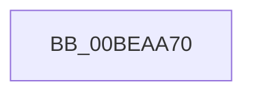

# KeGuardCheckICall

- RVA: `0x00BEAA70`–`0x00BEAA75` (길이 `5` bytes)
- VA: `0x0000000140BEAA70`
- 실행 섹션: `INITKDBG`
- PDB 이름 있음: `예`; PDB Function 태그: `아니요`
- unwind 정보 RVA: `0x000C2F6C`
- 디코드: `1`개 명령, `5/5` bytes 표시
- 미해석 바이트: `0` (있으면 어셈블리에 `.byte`로 보존)

> 이 문서는 커널 이미지의 기계어와 PDB 기호를 분석해 생성했습니다. 4번과 5번은 함수 원형과 자료형을 바이너리 사용 방식에서 추정한 C 해석이며 원본 소스 복구 결과는 아닙니다.

## 1. Dependencies

- 직접 호출 지점: **0**; 고유 호출 대상: **0**
- 직접 호출자로 확인된 함수: **6**
- RIP 상대 이미지 참조: **0**

### Outgoing calls
- 직접 디코드된 call 명령이 없습니다.

### Direct callers
- [KiSwInterruptDispatch](../../text/50/KiSwInterruptDispatch_function_0050A5C0.md) at `0x0050BD46`
- [sub_0050C0E0](../../text/50/Unknown_function_0050C0E0.md) at `0x0051AB9C`
- [FsRtlMdlReadCompleteDevEx](../BD/FsRtlMdlReadCompleteDevEx_function_00BD1010.md) at `0x00BE3773`
- [sub_00BE8680](Unknown_function_00BE8680.md) at `0x00BE8811`
- [sub_00BE8680](Unknown_function_00BE8680.md) at `0x00BE895F`
- [sub_00BE8680](Unknown_function_00BE8680.md) at `0x00BE8B21`
- [sub_00BE8680](Unknown_function_00BE8680.md) at `0x00BE8C84`
- [sub_00BE8DF0](Unknown_function_00BE8DF0.md) at `0x00BE9DAE`
- [sub_00BF16D0](../../init/BF/Unknown_function_00BF16D0.md) at `0x00C18C53`

### Static image references
- 디코드된 RIP-relative 메모리 참조가 없습니다.

## 2. Other-region calls and transfers

- 다른 실행 섹션으로 향하는 call: **0**
- call이 아닌 외부 분기/꼬리 이동: **1**
  - `0x00BEAA70` → [guard_check_icall](../../text/6B/guard_check_icall_function_006BAA80.md) (`tail-transfer`)

## 3. Assembly (complete function range)

```asm
00BEAA70  E9 0B 00 AD FF                  jmp 0x1406baa80
```

## 4. C-style interpretation (structured pseudocode)

```c
void __fastcall KeGuardCheckICall(void)
{
}
```

## 5. (Beta) C Style

```c
void KeGuardCheckICall(void)
{
}
```

## 6. Execution-region graph

[열기: 2D/3D 그래프와 함수 탐색 컨트롤 패널](../../../control-panel.html?section=initkdbg&rva=0x00BEAA70&view=graph)

- 2D 그래프는 위에서 아래로 흐르고, 3D 그래프는 빈 공간을 드래그해 회전합니다. Shift+드래그는 이동, 휠은 확대·축소, 함수 노드 선택은 대상 보고서 이동입니다.

### Static fallback


