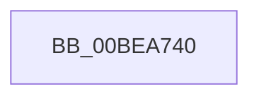

# KiAccessPage

- RVA: `0x00BEA740`–`0x00BEA75F` (길이 `31` bytes)
- VA: `0x0000000140BEA740`
- 실행 섹션: `INITKDBG`
- PDB 이름 있음: `예`; PDB Function 태그: `아니요`
- unwind 정보 RVA: `0x000C2F14`
- 디코드: `11`개 명령, `31/31` bytes 표시
- 미해석 바이트: `0` (있으면 어셈블리에 `.byte`로 보존)

> 이 문서는 커널 이미지의 기계어와 PDB 기호를 분석해 생성했습니다. 4번과 5번은 함수 원형과 자료형을 바이너리 사용 방식에서 추정한 C 해석이며 원본 소스 복구 결과는 아닙니다.

## 1. Dependencies

- 직접 호출 지점: **1**; 고유 호출 대상: **1**
- 직접 호출자로 확인된 함수: **1**
- RIP 상대 이미지 참조: **0**

### Outgoing calls
- `0x00BEA747` → `indirect target` (indirect, 간접 대상)

### Direct callers
- [sub_00BE8680](Unknown_function_00BE8680.md) at `0x00BE881F`
- [sub_00BE8680](Unknown_function_00BE8680.md) at `0x00BE896F`
- [sub_00BE8680](Unknown_function_00BE8680.md) at `0x00BE8B2F`
- [sub_00BE8680](Unknown_function_00BE8680.md) at `0x00BE8C92`

### Static image references
- 디코드된 RIP-relative 메모리 참조가 없습니다.

## 2. Other-region calls and transfers

- 다른 실행 섹션으로 향하는 call: **0**
- 별도 외부 분기/꼬리 이동을 확인하지 못했습니다.

## 3. Assembly (complete function range)

```asm
00BEA740  48 83 EC 28                     sub rsp, 0x28
00BEA744  48 8B C2                        mov rax, rdx
00BEA747  FF D1                           call rcx
00BEA749  49 83 C9 FF                     or r9, 0xffffffffffffffff
00BEA74D  48 92                           xchg rdx, rax
00BEA74F  98                              cwde
00BEA750  48 3B C2                        cmp rax, rdx
00BEA753  49 8B C1                        mov rax, r9
00BEA756  49 0F 44 C0                     cmove rax, r8
00BEA75A  48 83 C4 28                     add rsp, 0x28
00BEA75E  C3                              ret
```

## 4. C-style interpretation (structured pseudocode)

```c
__int64 __fastcall KiAccessPage(__int64 a1, __int64 a2, __int64 a3, __int64 a4)
{
    __int64 result;
    __int64 v_rsp;

    v_rsp = (v_rsp) - (40);
    result = kernel_indirect_call(a1, a2, a3, a4);
    a4 = (a4) | (-1);
    if (result == a2) { a4 = a3; }
    v_rsp = (v_rsp) + (40);
    return a4;
}
```

## 5. (Beta) C Style

```c
int64_t KiAccessPage(int64_t Arg1, int64_t Arg2, int64_t Arg3, int64_t Arg4)
{
    int64_t result;
    int64_t local_rsp;

    local_rsp = (local_rsp) - (40);
    result = kernel_indirect_call(Arg1, Arg2, Arg3, Arg4);
    Arg4 = (Arg4) | (-1);
    if (result == Arg2) { Arg4 = Arg3; }
    local_rsp = (local_rsp) + (40);
    return Arg4;
}
```

## 6. Execution-region graph

[열기: 2D/3D 그래프와 함수 탐색 컨트롤 패널](../../../control-panel.html?section=initkdbg&rva=0x00BEA740&view=graph)

- 2D 그래프는 위에서 아래로 흐르고, 3D 그래프는 빈 공간을 드래그해 회전합니다. Shift+드래그는 이동, 휠은 확대·축소, 함수 노드 선택은 대상 보고서 이동입니다.

### Static fallback


