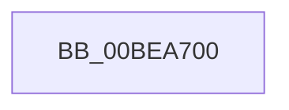

# KiErrata704Present

- RVA: `0x00BEA700`–`0x00BEA72B` (길이 `43` bytes)
- VA: `0x0000000140BEA700`
- 실행 섹션: `INITKDBG`
- PDB 이름 있음: `예`; PDB Function 태그: `아니요`
- unwind 정보 RVA: `0x000C2F10`
- 디코드: `17`개 명령, `43/43` bytes 표시
- 미해석 바이트: `0` (있으면 어셈블리에 `.byte`로 보존)

> 이 문서는 커널 이미지의 기계어와 PDB 기호를 분석해 생성했습니다. 4번과 5번은 함수 원형과 자료형을 바이너리 사용 방식에서 추정한 C 해석이며 원본 소스 복구 결과는 아닙니다.

## 1. Dependencies

- 직접 호출 지점: **0**; 고유 호출 대상: **0**
- 직접 호출자로 확인된 함수: **2**
- RIP 상대 이미지 참조: **0**

### Outgoing calls
- 직접 디코드된 call 명령이 없습니다.

### Direct callers
- [sub_0050C0E0](../../text/50/Unknown_function_0050C0E0.md) at `0x005176D2`
- [FsRtlMdlReadCompleteDevEx](../BD/FsRtlMdlReadCompleteDevEx_function_00BD1010.md) at `0x00BDD8C2`

### Static image references
- 디코드된 RIP-relative 메모리 참조가 없습니다.

## 2. Other-region calls and transfers

- 다른 실행 섹션으로 향하는 call: **0**
- 별도 외부 분기/꼬리 이동을 확인하지 못했습니다.

## 3. Assembly (complete function range)

```asm
00BEA700  B9 84 00 00 C0                  mov ecx, 0xc0000084
00BEA705  0F 32                           rdmsr
00BEA707  52                              push rdx
00BEA708  50                              push rax
00BEA709  25 FF FE FF FF                  and eax, 0xfffffeff
00BEA70E  0F 30                           wrmsr
00BEA710  9C                              pushfq
00BEA711  81 0C 24 00 01 00 00            or dword ptr [rsp], 0x100
00BEA718  9D                              popfq
00BEA719  0F 05                           syscall
00BEA71B  4C 8B D1                        mov r10, rcx
00BEA71E  B9 84 00 00 C0                  mov ecx, 0xc0000084
00BEA723  58                              pop rax
00BEA724  5A                              pop rdx
00BEA725  0F 30                           wrmsr
00BEA727  49 8B C2                        mov rax, r10
00BEA72A  C3                              ret
```

## 4. C-style interpretation (structured pseudocode)

```c
__int64 __fastcall KiErrata704Present(__int64 a1, __int64 a2)
{
    __int64 result;
    unsigned int v_stack_m18;

    result = (unsigned int)((result) & (0xFFFFFEFFULL));
    return (unsigned int)(0xC0000084ULL);
}
```

## 5. (Beta) C Style

```c
int64_t KiErrata704Present(int64_t Arg1, int64_t Arg2)
{
    int64_t result;
    uint32_t v_stack_m18;

    result = (uint32_t)((result) & (0xFFFFFEFFULL));
    return (uint32_t)(0xC0000084ULL);
}
```

## 6. Execution-region graph

[열기: 2D/3D 그래프와 함수 탐색 컨트롤 패널](../../../control-panel.html?section=initkdbg&rva=0x00BEA700&view=graph)

- 2D 그래프는 위에서 아래로 흐르고, 3D 그래프는 빈 공간을 드래그해 회전합니다. Shift+드래그는 이동, 휠은 확대·축소, 함수 노드 선택은 대상 보고서 이동입니다.

### Static fallback


