# KiMceDispatch

- RVA: `0x00BE37B0`–`0x00BE39FD` (길이 `589` bytes)
- VA: `0x0000000140BE37B0`
- 실행 섹션: `INITKDBG`
- PDB 이름 있음: `예`; PDB Function 태그: `아니요`
- unwind 정보 RVA: `0x000C2B4C`
- 디코드: `141`개 명령, `589/589` bytes 표시
- 미해석 바이트: `0` (있으면 어셈블리에 `.byte`로 보존)

> 이 문서는 커널 이미지의 기계어와 PDB 기호를 분석해 생성했습니다. 4번과 5번은 함수 원형과 자료형을 바이너리 사용 방식에서 추정한 C 해석이며 원본 소스 복구 결과는 아닙니다.

## 1. Dependencies

- 직접 호출 지점: **0**; 고유 호출 대상: **0**
- 직접 호출자로 확인된 함수: **1**
- RIP 상대 이미지 참조: **0**

### Outgoing calls
- 직접 디코드된 call 명령이 없습니다.

### Direct callers
- [KiMceLinkage](KiMceLinkage_function_00BEA9D0.md) at `0x00BEAA10`

### Static image references
- 디코드된 RIP-relative 메모리 참조가 없습니다.

## 2. Other-region calls and transfers

- 다른 실행 섹션으로 향하는 call: **0**
- 별도 외부 분기/꼬리 이동을 확인하지 못했습니다.

## 3. Assembly (complete function range)

```asm
00BE37B0  48 89 5C 24 08                  mov qword ptr [rsp + 8], rbx
00BE37B5  48 89 74 24 10                  mov qword ptr [rsp + 0x10], rsi
00BE37BA  48 89 7C 24 20                  mov qword ptr [rsp + 0x20], rdi
00BE37BF  41 54                           push r12
00BE37C1  41 55                           push r13
00BE37C3  41 56                           push r14
00BE37C5  41 57                           push r15
00BE37C7  65 48 8B 04 25 18 00 00 00      mov rax, qword ptr gs:[0x18]
00BE37D0  48 8B F9                        mov rdi, rcx
00BE37D3  4C 8B 40 38                     mov r8, qword ptr [rax + 0x38]
00BE37D7  65 48 8B 04 25 18 00 00 00      mov rax, qword ptr gs:[0x18]
00BE37E0  65 8B 0C 25 A4 01 00 00         mov ecx, dword ptr gs:[0x1a4]
00BE37E8  F3 41 0F 7E 40 48               movq xmm0, qword ptr [r8 + 0x48]
00BE37EE  4C 8B 70 08                     mov r14, qword ptr [rax + 8]
00BE37F2  49 8B 40 40                     mov rax, qword ptr [r8 + 0x40]
00BE37F6  66 89 44 24 38                  mov word ptr [rsp + 0x38], ax
00BE37FB  48 C1 E8 30                     shr rax, 0x30
00BE37FF  66 89 44 24 3A                  mov word ptr [rsp + 0x3a], ax
00BE3804  66 0F 7E 44 24 3C               movd dword ptr [rsp + 0x3c], xmm0
00BE380A  4C 8B 44 24 38                  mov r8, qword ptr [rsp + 0x38]
00BE380F  8B C2                           mov eax, edx
00BE3811  48 83 C0 20                     add rax, 0x20
00BE3815  48 03 C0                        add rax, rax
00BE3818  4D 8B 88 00 14 00 00            mov r9, qword ptr [r8 + 0x1400]
00BE381F  4D 8B 90 08 14 00 00            mov r10, qword ptr [r8 + 0x1408]
00BE3826  41 0F 10 04 C0                  movups xmm0, xmmword ptr [r8 + rax*8]
00BE382B  66 48 0F 7E C0                  movq rax, xmm0
00BE3830  66 0F 73 D8 08                  psrldq xmm0, 8
00BE3835  66 89 44 24 38                  mov word ptr [rsp + 0x38], ax
00BE383A  48 C1 E8 30                     shr rax, 0x30
00BE383E  66 89 44 24 3A                  mov word ptr [rsp + 0x3a], ax
00BE3843  66 0F 7E 44 24 3C               movd dword ptr [rsp + 0x3c], xmm0
00BE3849  F0 41 83 88 30 14 00 00 01      lock or dword ptr [r8 + 0x1430], 1
00BE3852  41 3B 88 34 14 00 00            cmp ecx, dword ptr [r8 + 0x1434]
00BE3859  74 14                           je 0x140be386f
00BE385B  EB 02                           jmp 0x140be385f
00BE385D  F3 90                           pause
00BE385F  41 8B 80 30 14 00 00            mov eax, dword ptr [r8 + 0x1430]
00BE3866  A8 02                           test al, 2
00BE3868  75 F3                           jne 0x140be385d
00BE386A  F0 83 0C 24 00                  lock or dword ptr [rsp], 0
00BE386F  4D 8D A1 B9 08 00 00            lea r12, [r9 + 0x8b9]
00BE3876  BA 00 10 00 00                  mov edx, 0x1000
00BE387B  41 3B 88 34 14 00 00            cmp ecx, dword ptr [r8 + 0x1434]
00BE3882  0F 85 06 01 00 00               jne 0x140be398e
00BE3888  41 F7 81 DC 09 00 00 00 00 02 00  test dword ptr [r9 + 0x9dc], 0x20000
00BE3893  75 35                           jne 0x140be38ca
00BE3895  49 8B 81 B8 04 00 00            mov rax, qword ptr [r9 + 0x4b8]
00BE389C  48 B9 E8 B4 C8 91 58 3F A0 A3   movabs rcx, 0xa3a03f5891c8b4e8
00BE38A6  48 89 08                        mov qword ptr [rax], rcx
00BE38A9  49 8B 81 C0 04 00 00            mov rax, qword ptr [r9 + 0x4c0]
00BE38B0  48 83 20 00                     and qword ptr [rax], 0
00BE38B4  49 8B 81 C8 04 00 00            mov rax, qword ptr [r9 + 0x4c8]
00BE38BB  48 83 20 00                     and qword ptr [rax], 0
00BE38BF  49 8B 81 D0 04 00 00            mov rax, qword ptr [r9 + 0x4d0]
00BE38C6  48 83 20 00                     and qword ptr [rax], 0
00BE38CA  41 BB 01 00 00 00               mov r11d, 1
00BE38D0  49 83 C6 24                     add r14, 0x24
00BE38D4  49 8B 1E                        mov rbx, qword ptr [r14]
00BE38D7  48 85 DB                        test rbx, rbx
00BE38DA  74 4C                           je 0x140be3928
00BE38DC  45 8A B9 9B 08 00 00            mov r15b, byte ptr [r9 + 0x89b]
00BE38E3  B9 D0 01 00 00                  mov ecx, 0x1d0
00BE38E8  45 8B A9 D4 08 00 00            mov r13d, dword ptr [r9 + 0x8d4]
00BE38EF  41 F6 C7 08                     test r15b, 8
00BE38F3  48 8B 77 18                     mov rsi, qword ptr [rdi + 0x18]
00BE38F7  41 8B C5                        mov eax, r13d
00BE38FA  0F 45 C1                        cmovne eax, ecx
00BE38FD  48 3B F3                        cmp rsi, rbx
00BE3900  77 0B                           ja 0x140be390d
00BE3902  48 8B CB                        mov rcx, rbx
00BE3905  48 2B C8                        sub rcx, rax
00BE3908  48 3B F1                        cmp rsi, rcx
00BE390B  77 28                           ja 0x140be3935
00BE390D  41 F6 C7 08                     test r15b, 8
00BE3911  74 15                           je 0x140be3928
00BE3913  48 8B 5B 08                     mov rbx, qword ptr [rbx + 8]
00BE3917  48 3B F3                        cmp rsi, rbx
00BE391A  77 0C                           ja 0x140be3928
00BE391C  41 8D 4D E0                     lea ecx, [r13 - 0x20]
00BE3920  48 2B D9                        sub rbx, rcx
00BE3923  48 3B F3                        cmp rsi, rbx
00BE3926  77 0D                           ja 0x140be3935
00BE3928  41 FF C3                        inc r11d
00BE392B  49 83 C6 08                     add r14, 8
00BE392F  41 83 FB 08                     cmp r11d, 8
00BE3933  72 9F                           jb 0x140be38d4
00BE3935  41 83 FB 08                     cmp r11d, 8
00BE3939  75 22                           jne 0x140be395d
00BE393B  48 8B 07                        mov rax, qword ptr [rdi]
00BE393E  49 2B C2                        sub rax, r10
00BE3941  48 3B C2                        cmp rax, rdx
00BE3944  73 17                           jae 0x140be395d
00BE3946  48 8B 47 18                     mov rax, qword ptr [rdi + 0x18]
00BE394A  48 8B 08                        mov rcx, qword ptr [rax]
00BE394D  49 3B CC                        cmp rcx, r12
00BE3950  75 0B                           jne 0x140be395d
00BE3952  48 83 C0 08                     add rax, 8
00BE3956  48 89 0F                        mov qword ptr [rdi], rcx
00BE3959  48 89 47 18                     mov qword ptr [rdi + 0x18], rax
00BE395D  48 B8 C3 C3 C3 C3 C3 C3 C3 C3   movabs rax, 0xc3c3c3c3c3c3c3c3
00BE3967  B9 04 00 00 00                  mov ecx, 4
00BE396C  49 89 81 BE 08 00 00            mov qword ptr [r9 + 0x8be], rax
00BE3973  49 8D 81 C6 08 00 00            lea rax, [r9 + 0x8c6]
00BE397A  C6 00 C3                        mov byte ptr [rax], 0xc3
00BE397D  48 FF C0                        inc rax
00BE3980  83 C1 FF                        add ecx, -1
00BE3983  75 F5                           jne 0x140be397a
00BE3985  F0 41 83 A0 30 14 00 00 FD      lock and dword ptr [r8 + 0x1430], 0xfffffffd
00BE398E  41 8B 80 30 14 00 00            mov eax, dword ptr [r8 + 0x1430]
00BE3995  A8 04                           test al, 4
00BE3997  75 38                           jne 0x140be39d1
00BE3999  49 8D 88 00 04 00 00            lea rcx, [r8 + 0x400]
00BE39A0  41 BB 00 02 00 00               mov r11d, 0x200
00BE39A6  48 8B 01                        mov rax, qword ptr [rcx]
00BE39A9  83 C2 F8                        add edx, -8
00BE39AC  49 89 02                        mov qword ptr [r10], rax
00BE39AF  48 83 C1 08                     add rcx, 8
00BE39B3  49 83 C2 08                     add r10, 8
00BE39B7  49 83 EB 01                     sub r11, 1
00BE39BB  75 E9                           jne 0x140be39a6
00BE39BD  85 D2                           test edx, edx
00BE39BF  74 10                           je 0x140be39d1
00BE39C1  8A 01                           mov al, byte ptr [rcx]
00BE39C3  48 FF C1                        inc rcx
00BE39C6  41 88 02                        mov byte ptr [r10], al
00BE39C9  49 FF C2                        inc r10
00BE39CC  83 C2 FF                        add edx, -1
00BE39CF  75 F0                           jne 0x140be39c1
00BE39D1  48 8B 5C 24 28                  mov rbx, qword ptr [rsp + 0x28]
00BE39D6  49 8D 81 9A 08 00 00            lea rax, [r9 + 0x89a]
00BE39DD  48 8B 74 24 30                  mov rsi, qword ptr [rsp + 0x30]
00BE39E2  48 8B 7C 24 40                  mov rdi, qword ptr [rsp + 0x40]
00BE39E7  49 89 80 10 14 00 00            mov qword ptr [r8 + 0x1410], rax
00BE39EE  48 8B 44 24 38                  mov rax, qword ptr [rsp + 0x38]
00BE39F3  41 5F                           pop r15
00BE39F5  41 5E                           pop r14
00BE39F7  41 5D                           pop r13
00BE39F9  41 5C                           pop r12
00BE39FB  C3                              ret
00BE39FC  CC                              int3
```

## 4. C-style interpretation (structured pseudocode)

```c
__int64 __fastcall KiMceDispatch(__int64 a1, int a2)
{
    __int64 result;
    __int64 v_r10;
    __int64 v_r11;
    __int64 v_r14;
    __int64 v_rbx;
    unsigned int v_stack_m20;
    unsigned __int64 v_stack_p10;
    unsigned __int16 v_stack_p18;
    unsigned __int16 v_stack_p1A;
    unsigned int v_stack_p1C;
    unsigned __int64 v_stack_p20;
    unsigned __int64 v_stack_p8;

    v_stack_p8 = v_rbx;
    v_stack_p10 = v_rsi;
    v_stack_p20 = v_rdi;
    v_stack_p18 = (unsigned __int16)(*(unsigned __int64 *)(*(unsigned __int64 *)(*(unsigned __int64 *)(gs_base + (0 + 24)) + 56) + 64));
    result = (*(unsigned __int64 *)(*(unsigned __int64 *)(*(unsigned __int64 *)(gs_base + (0 + 24)) + 56) + 64)) >> (48);
    v_stack_p1A = (unsigned __int16)(result);
    v_stack_p1C = v_xmm0;
    result = ((unsigned int)(a2)) + (32);
    result = (result) + (result);
    v_stack_p18 = (unsigned __int16)(result);
    result = (result) >> (48);
    v_stack_p1A = (unsigned __int16)(result);
    v_stack_p1C = v_xmm0;
    if (((unsigned int)((unsigned int)(*(unsigned int *)(gs_base + (0 + 420))))) == (*(unsigned int *)(v_stack_p18 + 5172))) goto loc_00BE386F;
    goto loc_00BE385F;
loc_00BE385D:
loc_00BE385F:
    if ((((unsigned __int8)((unsigned int)(*(unsigned int *)(v_stack_p18 + 5168)))) & (2)) != 0) goto loc_00BE385D;
loc_00BE386F:
    if (((unsigned int)((unsigned int)(*(unsigned int *)(gs_base + (0 + 420))))) != (*(unsigned int *)(v_stack_p18 + 5172))) goto loc_00BE398E;
    result = (unsigned int)(*(unsigned int *)(v_stack_p18 + 5168));
    if (((*(unsigned int *)(*(unsigned __int64 *)(v_stack_p18 + 5120) + 2524)) & (0x20000ULL)) == 0) {
        result = *(unsigned __int64 *)(*(unsigned __int64 *)(v_stack_p18 + 5120) + 1208);
        *(unsigned __int64 *)(result) = (unsigned int)(*(unsigned int *)(gs_base + (0 + 420)));
        result = *(unsigned __int64 *)(*(unsigned __int64 *)(v_stack_p18 + 5120) + 1216);
        result = *(unsigned __int64 *)(*(unsigned __int64 *)(v_stack_p18 + 5120) + 1224);
        result = *(unsigned __int64 *)(*(unsigned __int64 *)(v_stack_p18 + 5120) + 1232);
    }
    v_r14 = (*(unsigned __int64 *)(*(unsigned __int64 *)(gs_base + (0 + 24)) + 8)) + (36);
loc_00BE38D4:
    if (*(unsigned __int64 *)(v_r14) == 0) goto loc_00BE3928;
    result = (unsigned int)((unsigned int)((unsigned int)(*(unsigned int *)(*(unsigned __int64 *)(v_stack_p18 + 5120) + 2260))));
    if ((((unsigned __int8)(*(unsigned __int8 *)(*(unsigned __int64 *)(v_stack_p18 + 5120) + 2203))) & (8)) != 0) { result = 464; }
    if ((*(unsigned __int64 *)(a1 + 24)) > (*(unsigned __int64 *)(v_r14))) goto loc_00BE390D;
    a1 = (*(unsigned __int64 *)(v_r14)) - (result);
    if ((*(unsigned __int64 *)(a1 + 24)) > a1) goto loc_00BE3935;
loc_00BE390D:
    if ((((unsigned __int8)(*(unsigned __int8 *)(*(unsigned __int64 *)(v_stack_p18 + 5120) + 2203))) & (8)) == 0) goto loc_00BE3928;
    if ((*(unsigned __int64 *)(a1 + 24)) > (*(unsigned __int64 *)(*(unsigned __int64 *)(v_r14) + 8))) goto loc_00BE3928;
    v_rbx = (*(unsigned __int64 *)(*(unsigned __int64 *)(v_r14) + 8)) - ((unsigned int)(*(unsigned int *)(*(unsigned __int64 *)(v_stack_p18 + 5120) + 2260)) - 32);
    if ((*(unsigned __int64 *)(a1 + 24)) > v_rbx) goto loc_00BE3935;
loc_00BE3928:
    v_r11 = (unsigned int)((1) + 1);
    v_r14 = (v_r14) + (8);
    if (((unsigned int)(v_r11)) < 8) goto loc_00BE38D4;
loc_00BE3935:
    if (((unsigned int)(v_r11)) != 8) goto loc_00BE395D;
    result = (*(unsigned __int64 *)(a1)) - (*(unsigned __int64 *)(v_stack_p18 + 5128));
    if (result >= ((unsigned int)(0x1000ULL))) goto loc_00BE395D;
    result = *(unsigned __int64 *)(a1 + 24);
    if ((*(unsigned __int64 *)(*(unsigned __int64 *)(a1 + 24))) == (*(unsigned __int64 *)(v_stack_p18 + 5120) + 2233)) {
        result = (*(unsigned __int64 *)(a1 + 24)) + (8);
        *(unsigned __int64 *)(a1) = *(unsigned __int64 *)(*(unsigned __int64 *)(a1 + 24));
        *(unsigned __int64 *)(a1 + 24) = result;
    }
    *(unsigned __int64 *)(*(unsigned __int64 *)(v_stack_p18 + 5120) + 2238) = result;
loc_00BE397A:
    *(unsigned __int8 *)(*(unsigned __int64 *)(v_stack_p18 + 5120) + 2246) = 195;
    result = (*(unsigned __int64 *)(v_stack_p18 + 5120) + 2246) + 1;
    a1 = (unsigned int)((4) + (-1));
    if (condition_is_not_equal) goto loc_00BE397A;
loc_00BE398E:
    if ((((unsigned __int8)((unsigned int)(*(unsigned int *)(v_stack_p18 + 5168)))) & (4)) != 0) goto loc_00BE39D1;
loc_00BE39A6:
    a2 = (unsigned int)(((unsigned int)(0x1000ULL)) + (-8));
    *(unsigned __int64 *)(*(unsigned __int64 *)(v_stack_p18 + 5128)) = *(unsigned __int64 *)(v_stack_p18 + 1024);
    a1 = (v_stack_p18 + 1024) + (8);
    v_r10 = (*(unsigned __int64 *)(v_stack_p18 + 5128)) + (8);
    v_r11 = (512) - (1);
    if (condition_is_not_equal) goto loc_00BE39A6;
    if (a2 == 0) goto loc_00BE39D1;
loc_00BE39C1:
    a1 = (a1) + 1;
    *(unsigned __int8 *)(v_r10) = (unsigned __int8)(*(unsigned __int8 *)(a1));
    v_r10 = (v_r10) + 1;
    a2 = (unsigned int)((a2) + (-1));
    if (condition_is_not_equal) goto loc_00BE39C1;
loc_00BE39D1:
    *(unsigned __int64 *)(v_stack_p18 + 5136) = *(unsigned __int64 *)(v_stack_p18 + 5120) + 2202;
    return v_stack_p18;
}
```

## 5. (Beta) C Style

```c
int64_t KiMceDispatch(void *Arg1, int32_t Arg2)
{
    uint8_t *arg1 = (uint8_t *)Arg1;

    int64_t result;
    int64_t local_r10;
    int64_t local_r11;
    int64_t local_r14;
    int64_t local_rbx;
    uint32_t v_stack_m20;
    uint64_t v_stack_p10;
    uint16_t v_stack_p18;
    uint16_t v_stack_p1A;
    uint32_t v_stack_p1C;
    uint64_t v_stack_p20;
    uint64_t v_stack_p8;

    v_stack_p8 = local_rbx;
    v_stack_p10 = local_rsi;
    v_stack_p20 = local_rdi;
    v_stack_p18 = (uint16_t)(*(uint64_t *)(*(uint64_t *)(*(uint64_t *)(gs_base + (0 + 0x18)) + 0x38) + 0x40));
    result = (*(uint64_t *)(*(uint64_t *)(*(uint64_t *)(gs_base + (0 + 0x18)) + 0x38) + 0x40)) >> (48);
    v_stack_p1A = (uint16_t)(result);
    v_stack_p1C = v_xmm0;
    result = ((uint32_t)(Arg2)) + (32);
    result = (result) + (result);
    v_stack_p18 = (uint16_t)(result);
    result = (result) >> (48);
    v_stack_p1A = (uint16_t)(result);
    v_stack_p1C = v_xmm0;
    if (((uint32_t)((uint32_t)(*(uint32_t *)(gs_base + (0 + 0x1A4))))) == (*(uint32_t *)(v_stack_p18 + 0x1434))) goto loc_00BE386F;
    goto loc_00BE385F;
loc_00BE385D:
loc_00BE385F:
    if ((((uint8_t)((uint32_t)(*(uint32_t *)(v_stack_p18 + 0x1430)))) & (2)) != 0) goto loc_00BE385D;
loc_00BE386F:
    if (((uint32_t)((uint32_t)(*(uint32_t *)(gs_base + (0 + 0x1A4))))) != (*(uint32_t *)(v_stack_p18 + 0x1434))) goto loc_00BE398E;
    result = (uint32_t)(*(uint32_t *)(v_stack_p18 + 0x1430));
    if (((*(uint32_t *)(*(uint64_t *)(v_stack_p18 + 0x1400) + 0x9DC)) & (0x20000ULL)) == 0) {
        result = *(uint64_t *)(*(uint64_t *)(v_stack_p18 + 0x1400) + 0x4B8);
        *(uint64_t *)(result) = (uint32_t)(*(uint32_t *)(gs_base + (0 + 0x1A4)));
        result = *(uint64_t *)(*(uint64_t *)(v_stack_p18 + 0x1400) + 0x4C0);
        result = *(uint64_t *)(*(uint64_t *)(v_stack_p18 + 0x1400) + 0x4C8);
        result = *(uint64_t *)(*(uint64_t *)(v_stack_p18 + 0x1400) + 0x4D0);
    }
    local_r14 = (*(uint64_t *)(*(uint64_t *)(gs_base + (0 + 0x18)) + 0x8)) + (36);
loc_00BE38D4:
    if (*(uint64_t *)(local_r14) == 0) goto loc_00BE3928;
    result = (uint32_t)((uint32_t)((uint32_t)(*(uint32_t *)(*(uint64_t *)(v_stack_p18 + 0x1400) + 0x8D4))));
    if ((((uint8_t)(*(uint8_t *)(*(uint64_t *)(v_stack_p18 + 0x1400) + 0x89B))) & (8)) != 0) { result = 464; }
    if ((*(uint64_t *)(arg1 + 0x18)) > (*(uint64_t *)(local_r14))) goto loc_00BE390D;
    Arg1 = (*(uint64_t *)(local_r14)) - (result);
    if ((*(uint64_t *)(arg1 + 0x18)) > Arg1) goto loc_00BE3935;
loc_00BE390D:
    if ((((uint8_t)(*(uint8_t *)(*(uint64_t *)(v_stack_p18 + 0x1400) + 0x89B))) & (8)) == 0) goto loc_00BE3928;
    if ((*(uint64_t *)(arg1 + 0x18)) > (*(uint64_t *)(*(uint64_t *)(local_r14) + 0x8))) goto loc_00BE3928;
    local_rbx = (*(uint64_t *)(*(uint64_t *)(local_r14) + 0x8)) - ((uint32_t)(*(uint32_t *)(*(uint64_t *)(v_stack_p18 + 0x1400) + 0x8D4)) - 32);
    if ((*(uint64_t *)(arg1 + 0x18)) > local_rbx) goto loc_00BE3935;
loc_00BE3928:
    local_r11 = (uint32_t)((1) + 1);
    local_r14 = (local_r14) + (8);
    if (((uint32_t)(local_r11)) < 8) goto loc_00BE38D4;
loc_00BE3935:
    if (((uint32_t)(local_r11)) != 8) goto loc_00BE395D;
    result = (*(uint64_t *)(arg1)) - (*(uint64_t *)(v_stack_p18 + 0x1408));
    if (result >= ((uint32_t)(0x1000ULL))) goto loc_00BE395D;
    result = *(uint64_t *)(arg1 + 0x18);
    if ((*(uint64_t *)(*(uint64_t *)(arg1 + 0x18))) == (*(uint64_t *)(v_stack_p18 + 0x1400) + 2233)) {
        result = (*(uint64_t *)(arg1 + 0x18)) + (8);
        *(uint64_t *)(arg1) = *(uint64_t *)(*(uint64_t *)(arg1 + 0x18));
        *(uint64_t *)(arg1 + 0x18) = result;
    }
    *(uint64_t *)(*(uint64_t *)(v_stack_p18 + 0x1400) + 0x8BE) = result;
loc_00BE397A:
    *(uint8_t *)(*(uint64_t *)(v_stack_p18 + 0x1400) + 0x8C6) = 195;
    result = (*(uint64_t *)(v_stack_p18 + 0x1400) + 2246) + 1;
    Arg1 = (uint32_t)((4) + (-1));
    if (condition_is_not_equal) goto loc_00BE397A;
loc_00BE398E:
    if ((((uint8_t)((uint32_t)(*(uint32_t *)(v_stack_p18 + 0x1430)))) & (4)) != 0) goto loc_00BE39D1;
loc_00BE39A6:
    Arg2 = (uint32_t)(((uint32_t)(0x1000ULL)) + (-8));
    *(uint64_t *)(*(uint64_t *)(v_stack_p18 + 0x1408)) = *(uint64_t *)(v_stack_p18 + 0x400);
    Arg1 = (v_stack_p18 + 1024) + (8);
    local_r10 = (*(uint64_t *)(v_stack_p18 + 0x1408)) + (8);
    local_r11 = (512) - (1);
    if (condition_is_not_equal) goto loc_00BE39A6;
    if (Arg2 == 0) goto loc_00BE39D1;
loc_00BE39C1:
    Arg1 = (Arg1) + 1;
    *(uint8_t *)(local_r10) = (uint8_t)(*(uint8_t *)(arg1));
    local_r10 = (local_r10) + 1;
    Arg2 = (uint32_t)((Arg2) + (-1));
    if (condition_is_not_equal) goto loc_00BE39C1;
loc_00BE39D1:
    *(uint64_t *)(v_stack_p18 + 0x1410) = *(uint64_t *)(v_stack_p18 + 0x1400) + 2202;
    return v_stack_p18;
}
```

### 관측된 메모리 오프셋

구조체 형식이 확인되지 않은 접근은 인자 기준의 오프셋으로만 기록했습니다.

| 기준 인자 | 오프셋 표현 | 폭 (bit) | 접근 |
|---|---:|---:|---|
| `Arg1` | `+ 0x0` | `64` | `R` |
| `Arg1` | `+ 0x0` | `64` | `W` |
| `Arg1` | `+ 0x18` | `64` | `R` |
| `Arg1` | `+ 0x18` | `64` | `W` |

## 6. Execution-region graph

[열기: 2D/3D 그래프와 함수 탐색 컨트롤 패널](../../../control-panel.html?section=initkdbg&rva=0x00BE37B0&view=graph)

- 2D 그래프는 위에서 아래로 흐르고, 3D 그래프는 빈 공간을 드래그해 회전합니다. Shift+드래그는 이동, 휠은 확대·축소, 함수 노드 선택은 대상 보고서 이동입니다.

### Static fallback

```mermaid
flowchart TD
  bb_00BE37B0[BB_00BE37B0]
  bb_00BE385B[BB_00BE385B]
  bb_00BE385D[BB_00BE385D]
  bb_00BE385F[BB_00BE385F]
  bb_00BE386A[BB_00BE386A]
  bb_00BE386F[BB_00BE386F]
  bb_00BE3888[BB_00BE3888]
  bb_00BE3895[BB_00BE3895]
  bb_00BE38CA[BB_00BE38CA]
  bb_00BE38D4[BB_00BE38D4]
  bb_00BE38DC[BB_00BE38DC]
  bb_00BE3902[BB_00BE3902]
  bb_00BE390D[BB_00BE390D]
  bb_00BE3913[BB_00BE3913]
  bb_00BE391C[BB_00BE391C]
  bb_00BE3928[BB_00BE3928]
  bb_00BE3935[BB_00BE3935]
  bb_00BE393B[BB_00BE393B]
  bb_00BE3946[BB_00BE3946]
  bb_00BE3952[BB_00BE3952]
  bb_00BE395D[BB_00BE395D]
  bb_00BE397A[BB_00BE397A]
  bb_00BE3985[BB_00BE3985]
  bb_00BE398E[BB_00BE398E]
  bb_00BE3999[BB_00BE3999]
  bb_00BE39A6[BB_00BE39A6]
  bb_00BE39BD[BB_00BE39BD]
  bb_00BE39C1[BB_00BE39C1]
  bb_00BE39D1[BB_00BE39D1]
  bb_00BE39FC[BB_00BE39FC]
  bb_00BE37B0 -->|branch| bb_00BE386F
  bb_00BE37B0 -->|fallthrough| bb_00BE385B
  bb_00BE385B -->|branch| bb_00BE385F
  bb_00BE385D -->|flow| bb_00BE385F
  bb_00BE385F -->|branch| bb_00BE385D
  bb_00BE385F -->|fallthrough| bb_00BE386A
  bb_00BE386A -->|flow| bb_00BE386F
  bb_00BE386F -->|branch| bb_00BE398E
  bb_00BE386F -->|fallthrough| bb_00BE3888
  bb_00BE3888 -->|branch| bb_00BE38CA
  bb_00BE3888 -->|fallthrough| bb_00BE3895
  bb_00BE3895 -->|flow| bb_00BE38CA
  bb_00BE38CA -->|flow| bb_00BE38D4
  bb_00BE38D4 -->|branch| bb_00BE3928
  bb_00BE38D4 -->|fallthrough| bb_00BE38DC
  bb_00BE38DC -->|branch| bb_00BE390D
  bb_00BE38DC -->|fallthrough| bb_00BE3902
  bb_00BE3902 -->|branch| bb_00BE3935
  bb_00BE3902 -->|fallthrough| bb_00BE390D
  bb_00BE390D -->|branch| bb_00BE3928
  bb_00BE390D -->|fallthrough| bb_00BE3913
  bb_00BE3913 -->|branch| bb_00BE3928
  bb_00BE3913 -->|fallthrough| bb_00BE391C
  bb_00BE391C -->|branch| bb_00BE3935
  bb_00BE391C -->|fallthrough| bb_00BE3928
  bb_00BE3928 -->|branch| bb_00BE38D4
  bb_00BE3928 -->|fallthrough| bb_00BE3935
  bb_00BE3935 -->|branch| bb_00BE395D
  bb_00BE3935 -->|fallthrough| bb_00BE393B
  bb_00BE393B -->|branch| bb_00BE395D
  bb_00BE393B -->|fallthrough| bb_00BE3946
  bb_00BE3946 -->|branch| bb_00BE395D
  bb_00BE3946 -->|fallthrough| bb_00BE3952
  bb_00BE3952 -->|flow| bb_00BE395D
  bb_00BE395D -->|flow| bb_00BE397A
  bb_00BE397A -->|branch| bb_00BE397A
  bb_00BE397A -->|fallthrough| bb_00BE3985
  bb_00BE3985 -->|flow| bb_00BE398E
  bb_00BE398E -->|branch| bb_00BE39D1
  bb_00BE398E -->|fallthrough| bb_00BE3999
  bb_00BE3999 -->|flow| bb_00BE39A6
  bb_00BE39A6 -->|branch| bb_00BE39A6
  bb_00BE39A6 -->|fallthrough| bb_00BE39BD
  bb_00BE39BD -->|branch| bb_00BE39D1
  bb_00BE39BD -->|fallthrough| bb_00BE39C1
  bb_00BE39C1 -->|branch| bb_00BE39C1
  bb_00BE39C1 -->|fallthrough| bb_00BE39D1
```


